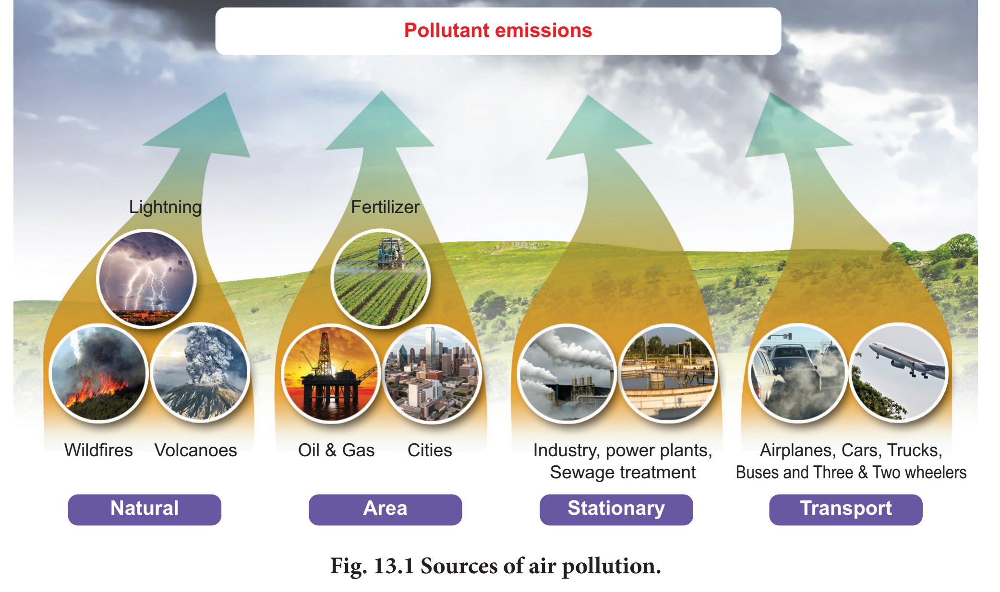
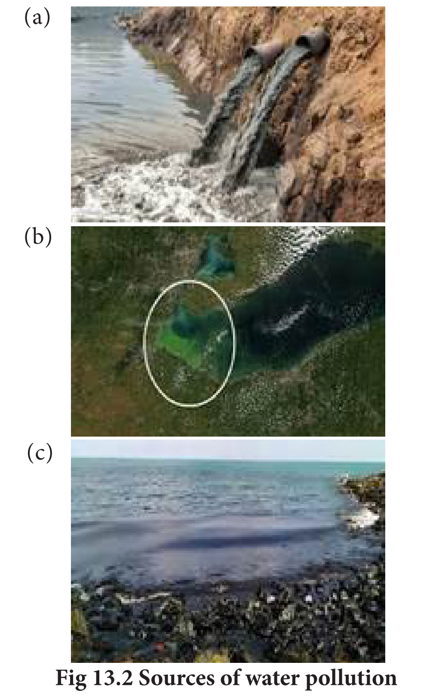
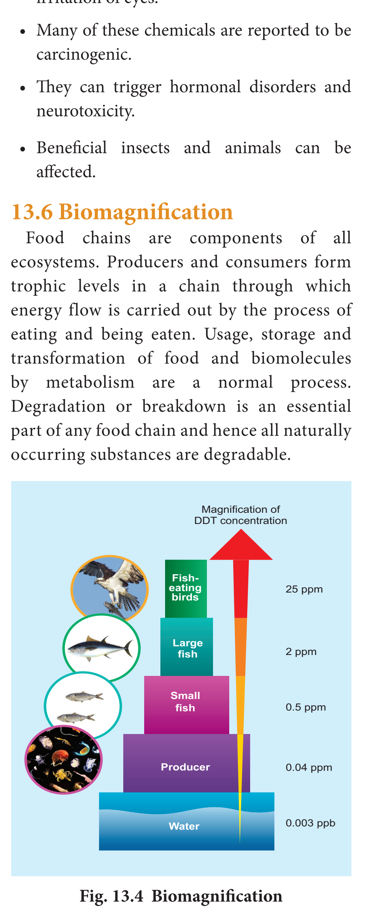
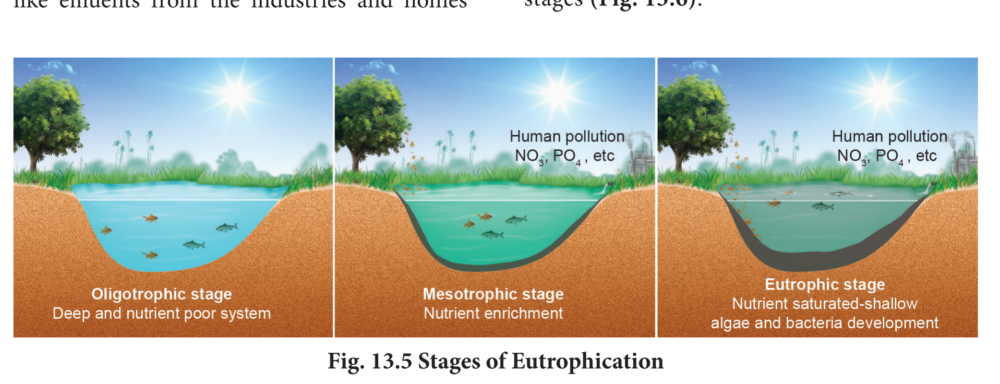
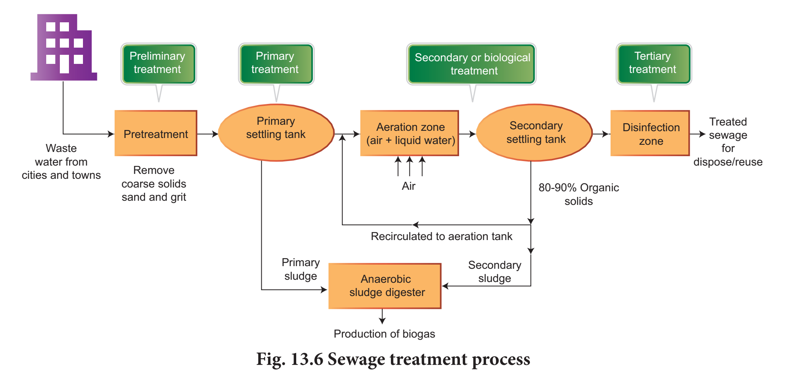
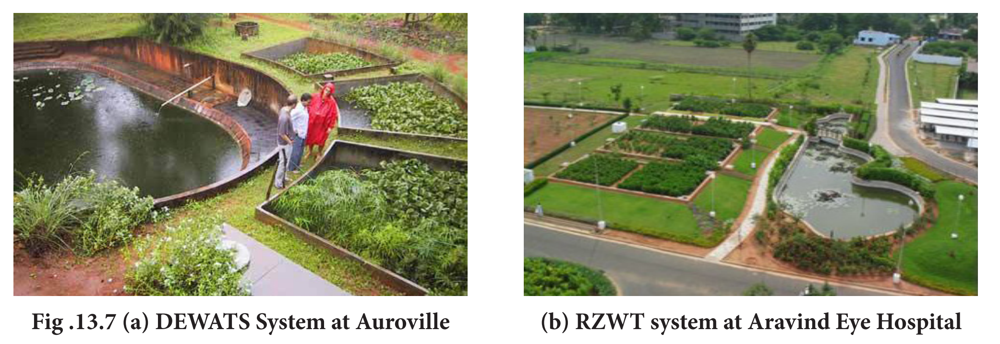
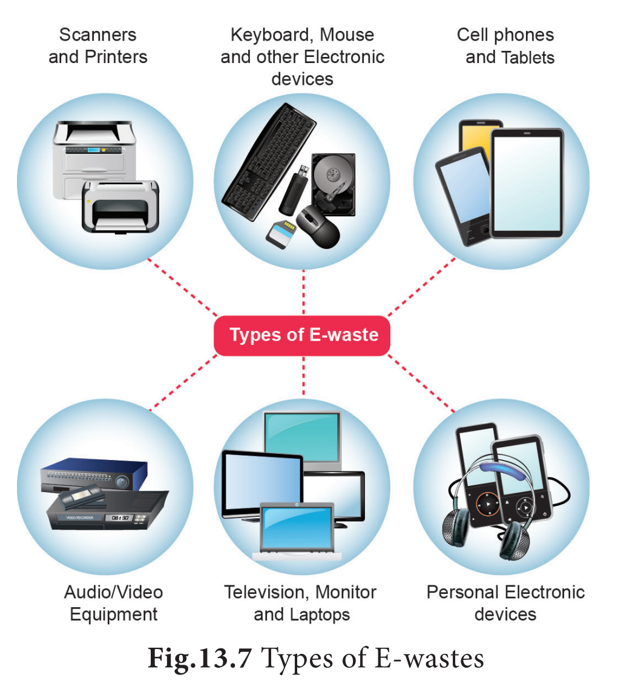

# Chapter 13: Environmental Issues

> Source: 2024 English-medium textbook, PDF pages 227–249.

## Chapter Outline
- 13.1 Pollution
- 13.2 Air Pollution
- 13.3 Water Pollution
- 13.4 Noise Pollution
- 13.5 Agrochemicals
- 13.6 Biomagnification
- 13.7 Eutrophication
- 13.8 Organic Farming and its Implementation
- 13.9 Solid Waste Management
- 13.10 Ecosan Toilets

## Learning Objectives
- Understands the classification of pollutants and their effects.
- Learns about various types of pollutions.
- Gains knowledge about the effects of air pollution.
- Realises the importance of water and its pollution aspects.
- Learns about the noise pollution and its effects.
- Grasps the consequences of agricultural chemicals.
- Explores biomagnification and eutrophication.
- Understands the solid waste and eco-friendly toilets.

al
> *"Environment is my prime teacher"* — Masanabu Fukuoka

A clean environment is very necessary
to live a peaceful and healthy life. But
our environment is getting dirty day by day
because of our negligence. Earth is currently
facing a lot of environmental concerns like air
pollution, water pollution, and noise pollution,
global warming, acid rain, biomagnification,
eutrophication, deforestation, waste disposal,
ozone layer depletion and climate change.
Over the last few decades, the exploitation of
our planet and degradation of our environment
have gone up at an alarming rate. As our
actions have not been in favour of protecting
this planet, we have seen natural disasters
striking us more often in the form of flash
floods, tsunami and cyclones.
“Every individual should be environmentally
aware, regardless of whether they work with
environmental issues or not.”
## 13.1 Pollution

Pollution is any undesirable change in the
physical, chemical and biological characteristics
of the environment due to natural causes and
human activities. The agents which cause
pollution are called pollutants. Pollution is

classified according to the types of environment
that is affected. They are mainly air, water and
soil pollution.
### 13.1.1 Classification of Pollutants

In terms of eco-system, pollutants can
be classified into two basic groups – Non-
degradable and degradable. Based on the time
taken to breakdown into their ingredients,
degradable pollutants are classified as rapidly
degradable (non-persistent) and slowly
degradable (persistent).
a) Rapidly degradable or non-persistent
pollutants: These can be broken down by
natural processes. Domestic sewage and
vegetable waste are examples of such pollutants.
b) Slowly degradable or persistent
pollutants: These are pollutants that remain
in the environment for many years in an
unchanged condition and take decades or
longer to degrade, as in the case of DDT.
c) Non-degradable pollutants: These
cannot be degraded by natural processes.
Once they are released into the environment,
they are difficult to be eliminated and

continue to accumulate (biomagnification).
Toxic elements like lead, mercury, cadmium,
chromium and nickel are such common
pollutants.
## 13.2 Air Pollution

Earth is surrounded by a gaseous envelope
which is called atmosphere. The gaseous
blanket of the atmosphere acts as a thermal
insulator and regulates the temperature of
the earth by selectively absorbing The UV
rays of solar radiation. The adverse effects
of pollution include depletion of Ozone
by Chlorofluorocarbons or CFCs, used as
refrigerants and global warming by elevated
CO (industries, deforestation, and partial
2
combustion)
.
The alterations or changes in the composition
of the earth’s atmosphere by natural or human
activities (anthropogenic factors) are referred as
Air Pollution. Pollutants include the abundant
presence of solid, liquid or gaseous substances
produced by human or natural activity. The
nature and concentration of a pollutant
determines the severity of detrimental effects

on organisms and human health. Along with
atmospheric factors (humidity, precipitation,
wind, air currents, altitude) prevailing at a place
and time, its effects can be far reaching and
catastrophic.
Air pollutants can be
• discharge of dusts or particulate matter
(PM : 2.5 µm)
• discharge of gases (SO NO CO, CO )
2, 2, 2
Carbon monoxide (CO) is produced mainly
due to incomplete combustion of fossil fuels.
Automobiles are major causes of CO pollution
in large cities and towns Automobile exhausts,
fumes from factories, emission from power
plants, forest fires and burning of fire-wood
contribute to CO pollution.
With rapid urbanization, major amount of
carbon dioxide and sulphur dioxide (SO ) is
2
released in the atmosphere. From automobiles,
aeroplanes, power plants and other human
activities that involving the burning of fossil
fuels (coal, oil etc.,) CO is the main pollutant
2
that is leading to global warming.
Nitrogen oxides are also major air
pollutants. Fossil fuel combustion and
automobiles exhausts are the source of
nitrogen oxides. Sulphur dioxide and nitrogen
oxides are the major causes of acid rain.
Particulate matters are tiny particles of
solid matter suspended in a gas or liquid.
Combustion of fossil fuels, fly ash produced
in thermal power plants, forest fires, asbestos
mining units, cement factories are the main
sources of particulate matter pollution.
### 13.2.1 Sources

The main sources of air pollution (Fig 13.1) are:
• Transport sources – cars, buses, airplanes,
trucks, trains
• Stationary sources – power plants,
incinerators, oil refineries, industrial
facilities, and factories

• Area sources – agricultural - wood /
stubble burning, fireplaces
• Natural sources – wind-blown dust,
wildfires, volcanoes.
### 13.2.2 Effects of Air Pollution

• Affects all organisms as they depend on the
atmosphere for respiration.
• Causes irritation in the throat, nose, lungs
and eyes. It causes breathing problems and
aggravates existing health conditions such
as emphysema and asthma.
• Contaminated air reduces the body’s
defense mechanism and decreases the
body’s capacity to fight other infections
in the respiratory system.
• Frequent exposure to polluted air increases
the risk of cardiovascular diseases.
Breathing air that is filled with fine
particulate matter can induce hardening of
the arteries, triggering cardiac arrhythmia
or even a heart attack.
• People who exercise outdoors can
sometimes be susceptible to adverse effects
of air pollution because it involves deeper
and faster breathing. Hence it is advisable to
walk or jog in the mornings in places with
ample tree cover.
• Gas leaks can be lethal or affect the quality
of air in the affected area.
• CO in the atmosphere interferes with O
2
transport since haemoglobin has greater
affinity for carbon monoxide. At low
concentration it causes headache and
blurred vision. In higher concentration, it
can lead to coma and death.
Sameer, an App provides
hourly updates on the
National Air Quality Index
(AQI) published by CPCB.

### 13.2.3 Other notable effects of Air Pollution

Smog is a type of air pollution caused by tiny
particles in the air. The word comes from a
mixture of the words smoke and fog .
Today, smog generally refers to photochemical
smog, which is created when sunlight reacts
with nitrogen oxides and volatile organic
compounds found in fossil fuel emissions
from automobiles, factories, and power plants.
These reactions create ground-level ozone and
particulate matter, reducing visibility. Smog can
make breathing more difficult, especially for
people with asthma.
Smog also affects plants and animals. It
damages crops as well as causes health problems
in pets, farm animals and human beings. Smog
has also been known to cause corrosive damage
to buildings and vehicles.
Peroxyacetyl nitrate (PAN) is a secondary
pollutant present in photochemical smog. It
is thermally unstable and decomposes into
peroxyethanol radicals and nitrogen dioxide
gas causing eye irritation.
Global warming: Increase in the
concentrations of greenhouse gases such as
CO , methane, nitrous oxide, CFCs, and ozone
2
causes greenhouse effect, warming of the earth,
resulting in sea level rise, submerging of islands
and sea shores of various parts of the world.
Ozone depletion: Thinning of the
stratospheric ozone layer is known as ozone
depletion. Such depletion causes the ‘ozone hole’,
resulting in poor screening of the harmful UV
rays and increase in incidences of skin cancer.
Some of the common agents that deplete ozone
are CFCs.
Acid rain: Acid rain is a form of precipitation
that contains acidic components, such as
sulphuric acid or nitric acid. It damages trees,
crops and harms marine animals (coral reefs)
and induces corrosion.

### 13.2.4 Control of Air Pollution

Certain measures help to remove pollutants,
reduce their presence or prevent their entry into
the atmosphere.
• Trees are the best remedy for urban
particulate and gaseous pollution
• Forests act as carbon sinks and lungs of
the planet
• Catalytic converters in vehicles help to
reduce polluting gases drastically
• Diesel exhaust filters in automobiles cuts
particulates
• Electrostatic precipitators reduce release
of industrial pollutants.
• Cost effective air pollution treatment
systems like indoor plants and high
performance biofilters can improve
indoor air quality.
The Taj Mahal, a UNESCO world
heritage site, is facing deterioration and
damage by industrial gases due to several
industrial units around Agra. The white
marble has decolorized to yellow.
### 13.2.5 Legal Protection

• The Air (Prevention and Control of
Pollution) Act was enacted in 1981 and
amended in 1987 for the prevention,
control and abatement of Air pollution in
India.
• Traffic Emissions Standards: The
Government has decided to enforce Bharat
Stage VI norms from 2020.
• The Green Bench and the National Green
Tribunal (NGT) give judicial safeguard to
environmental protection.
Steps taken by the Central and the State
governments in India:
• Road traffic rationing, encourage public
transport, carpooling

• Increase green cover alongside roads
(planting avenue trees)
• Promoting Swachh Bharat Abhiyan
• Enactment and Enforcement of stricter
environmental laws
• Maintenance of air standards by proper
enforcement and monitoring
Average human
consumption of Oxygen
per day = 550 L
Cost of 2.75 L Oxygen
cylinder = ₹ 6500
Cost of 550 L of oxygen from tree
= ₹ 13,00,000
-----------------------------------------
Oxygen production by one healthy
tree per year =1,00,375 L
Cost of 2.75 L oxygen cylinder
= ₹ 6500
Cost of 1,00,375 L of oxygen from one
tree /year = ₹ 23,72,50,000
• Reducing carbon emissions
• Encourage use of renewable energy
• Limiting the sale of firecrackers and
developing eco-friendly crackers
• Make Environmental Impact Assessment
mandatory
Air Quality Index (AQI) is a number used
by government agencies to communicate to the
public how polluted the air is at a given time.
Air Quality Index
AQI Air Pollution Level Colour
0-50 Good
51-100 Moderate
101-150 Unhealthy for Sensitive Groups
151-200 Unhealthy
201-300 Very Unhealthy
301+ Hazardous

## 13.3 Water Pollution

### 13.3.1 Quality of Water

Water is essential for life and for the health of
the environment. As a valuable natural resource,
it comprises marine, estuarine, freshwater
(river and lakes) and groundwater environments
that stretch across coastal and inland areas.
Water has two dimensions that are closely linked:
quantity and quality. Water quality is commonly
defined by its physical, chemical, biological and
aesthetic (appearance and smell) characteristics.
A healthy environment is one in which the water
quality supports a rich and varied community of
organisms and protects public health.

### 13.3.2 Water Pollution

Water pollution occurs when there is a
change in the chemical, physical or biological
quality of water that has harmful effect(s) on
living organisms that consume it or live in it.
Water pollution adversely affects water
bodies due to the large amounts of natural
or man-made materials let into it. When it
becomes unfit for its intended use, water is
considered polluted.
### 13.3.3 Sources of Water Pollution

Even though water bodies or sources can be
polluted by natural causes, water pollution is
usually caused by human activities. There are
three main types of sources: point sources,
non-point sources, leaks and spills.
Point sources: Discharge of pollutants at
specific locations through pipelines or sewers
into the water body. Factory effluents, sewage,
underground mines, oil wells, oil tankers
and agriculture are common point sources
(Fig. 13.2 a).
Non-point sources: Sources that cannot be
traced to a single site of discharge like acid
rain, dumping of the plastics in water bodies,
agriculture chemical run off are common
examples (Fig. 13.2 b).

Leaks and Spills: This occurs mostly due to
ship collision, off shore oil rigs, oil leakages
and discharges into sea (Fig. 13.2 c).
Sources of water pollution can also be classified
in three ways. They are municipal wastes,
industrial wastes, and agricultural wastes.
Sources of water pollution
Municipal Industrial Agricultural
wastes wastes wastes
1. Municipal waste water is from homes and
commercial establishments.
2. Industrial discharge (effluents) may
contain varieties of compounds such
as heavy metals (cadmium, chromium,
lead), and organic / inorganic chemicals

containing waste water, sometimes in toxic
concentrations. These discharges can affect
temperatures of the water bodies as well as
dissolved oxygen level.
3. Agricultural wastes include fertiliser and
pesticide runoff from agricultural fields,
food processing waste, tree and saw dust
from logging operations and bacteria from
sewage or livestock operations.
Water pollutants reach water bodies like
rivers, streams and the marine system by
precipitation, run-off and the groundwater by
seepage or percolation.

### 13.3.4 Effect of Water pollution on Ecosystems

Ecosystems
1. Destruction of ecosystems: Ecosystems,
especially aquatic systems, can be severely
affected or destroyed by water pollution.
Water pollutants affect existing niches and
habitats and the survival of organisms. Soil
fertility is affected and the system becomes
uninhabitable.
2. Disruption of food-chains: Water
pollution disrupts the natural food chains
as well as food webs. Pollutants such as
lead and cadmium are taken up by primary
consumers where they can be lethal or
get stored. Later, when these animals are
consumed by secondary consumers, the
food chain can get disrupted at any trophic
level or result in enhanced concentration
of these pollutants (biomagnification). Hot
water from industries when released into
the water bodies affects aquatic density and
diversity.
### 13.3.5 Effect of Water pollution on Organisms

1. Water pollution can be lethal to aquatic
organisms and others that depend on these
water bodies.
Accidental oil spills from tanker ships can cause
substantial environmental damage. Oil spreads
on the water surface, prevents the entry of light
and oxygen into the water. This increases BOD
and COD, resulting in mass death of organisms

and degradation of water quality. It also clogs
fish gills and the feathers of aquatic birds.
On January 28, 2017, two cargo ships
collided off the Ennore coast in Chennai
causing oil to spill into the sea. Due to wave
action and the southern current, the spill
spread over to 34 km down south affecting
the coast. Beach sand also got spoiled by
the oil sludge. It took more than a thousand
volunteers to clean the oil sludge.
2. Humans and other organisms can get
affected by diseases such as hepatitis and
typhoid by consuming contaminated
water and food. Excess of fluoride in
drinking water causes fluorosis. In many
poor nations, outbreak of water borne
diseases and epidemics are a result of
contaminated water and poor or absence
of water treatment processes.
3. Water pollution can cause eutrophication
due to nutrient enrichment. This causes
algal blooms which affect the quality
of water bodies (Fig. 13.3). Red tides, if
occur, can be lethal to aquatic organisms.
Fig. 13.3 Algal bloom
### 13.3.6 Control Measures

1. Right to clean water is a fundamental
right under the Indian Constitution
(Article 21).
2. Water (Prevention and Control of
Pollution) Act, 1974, sections 17 to 40

prohibit the pollution of a stream or well
by disposal of polluting matter.
3. The Central/State Pollution Control
Boards have the power to advise the
central/state government on various
matters concerned with the prevention
and control of pollution of water.
4. The Ministry of Environment, Forest and
Climate Change (MoEFCC) is the nodal
agency of the Central Government for
the planning, promotion, co-ordination
and for overseeing the implementation
of India’s environmental and forestry
policies and programmes.
5. National river conservation plan (NRCP)
was enacted in 1995 to improve the water
quality of the rivers, which are the major
fresh water resources in our country. This
important assignment taken up under the
NRCP includes,
To capture the raw sewage flowing into the
river through open drains and divert them
for treatment.
Setting up sewage treatment plants for
treating the diverted sewage.
Construction of low cost sanitation toilets
to prevent open defecation on river banks.
Prevention
• Regulate or control of pollutant(s)
discharge at the point of generation.
• Wastewater can be pretreated by scientific
methods before discharge to municipal
treatment sources.
• Setting up of Sewage Treatment Plants
(STP) and Effluent Treatment Plants (ETP).
• Regulate or restrict the use of synthetic
fertilisers and pesticides.
• Public awareness and peoples’ involvement
is essential.

Assessment by CPCB
The number of polluted stretches in
India’s rivers has increased to 351 from
302 (in 2006), and the number of critically
polluted stretches – where water quality
indicators are the poorest – has gone
up to 45 from 35 (Source: The Hindu,
17 September, 2018).
Case study
Namami Gange (National Mission
for Clean Ganga) Programme is an
Integrated Conservation Mission approved
as the ‘Flagship Programme’ of the Union
Government in June 2014 with a budget
outlay of 20,000 crores to accomplish the
twin objectives of effective abatement of
pollution, conservation and rejuvenation of
River Ganga.

## 13.4 Noise Pollution

Sound that is unwanted and undesirable
or can disrupts one’s quality of life is called
as Noise. When there is lot of ‘noise’ in
the environment, it is termed as Noise
Pollution. The intensity of noise is meaured
in decibels (dB).
### 13.4.1 Sources of Noise Pollution

Vehicle engines, air horns, audio video
systems, trains, low flying aircrafts, factory
machines, sirens, motors, drillers and
crushers, compressor machines, crackers,
explosives, modern supersonic transports are
the common sources of noise pollution.
The threshold of pain is about 120 db.
World Health Organization has proposed that
noise must be recognized as a major threat to
human well-being. This is applicable for all
living organisms.

### 13.4.2 Effect of Noise Pollution

• According to the USEPA (United States
Environmental Protection Agency) there
are direct links between noise and health.
Heart disease, high blood pressure, stress
related illness, sleep disruption, hearing
loss (deafness), and productivity loss are
the problems related to noise pollution.
• Increased stress and tension, nervousness,
irritability, anxiety, depression and panic
attacks.
• Peptic ulcer, severe head ache,
memory loss.
• Marine animals are affected by noise
pollution from offshore activities and port
activities.
• Fire crackers frighten animals. Birds are
often affected by increased air traffic.

### 13.4.3 Control

• Planting trees in and around noise sources
is an effective solution for noise pollution
as plants are known to absorb noise and
bring down sound levels.
• Regular servicing and tuning of
automobile engines can effectively reduce
noise pollution by vehicles and machinery.
• Workers should be provided with ear plugs
and earmuffs at work sites that generate
high noise levels.
• Lubrication of machinery and regular
servicing minimizes noise levels.
• Regulations should be imposed to restrict
the usage of loudspeakers in crowded
areas and public places.
### 13.4.4 Legal Protection

Article 48-A and Article 51-A of the
Constitution of India, Noise Pollution
(Regulation and Control) Rules 2000, and
Tamil Nadu State Environment Policy
2017 are some of the legal relief from noise
pollution.

According to Noise Pollution (Regulation
and Control) Rules, 2000, the permissible
limit of noise in areas categorized as
commercial is 65 decibels (dB) during day
and 55 dB during night.
## 13.5 Agrochemicals

Chemicals which are used in agriculture for
growth of plants and pest control are called
agrochemicals or agrichemicals.
Overuse of agrochemicals have been observed
to generate residues that cause nutrient
imbalance, and
• May kill beneficial bacteria and soil
organisms.
• Can cause eutrophication in water bodies.
• Affect aquatic animals and their productivity.
• Pesticide containing water, even in trace
quantities is unfit for human consumption.
• Particles (aerosols) and residues of these
chemicals cause air pollution.
1. Mosquito Repellents
D EET (n-n-diethylnetatoluamide)
and allethrin used in mosquito coils
may cause itching, burning, tingling
sensation or numbness.
2. Colony collapse syndrome in Honey
bees due to pesticides/herbicides can
lead to destruction of hives and lower
agricultural productivity. !!Remember
bees are Nature’s best pollinators!!

• Inhalation of contaminated air can cause
respiratory problems.
• Consumption can lead to poisoning, side
effects and after effects.
• Chemicals can cause skin rashes and
irritation of eyes.
• Many of these chemicals are reported to be
carcinogenic.
• They can trigger hormonal disorders and
neurotoxicity.
• Beneficial insects and animals can be
affected.
## 13.6 Biomagnification

Food chains are components of all
ecosystems. Producers and consumers form
trophic levels in a chain through which
energy flow is carried out by the process of
eating and being eaten. Usage, storage and
transformation of food and biomolecules
by metabolism are a normal process.
Degradation or breakdown is an essential
part of any food chain and hence all naturally
occurring substances are degradable.

Biomagnification of DDT
When non-degradable substances enter the food
chain, they do not get metabolized or broken
down or expelled and instead get transferred up
the tropic levels of the food chain. During this
process, they show an increase in concentration
which is referred to as biomagnification. This
results in increased toxicity and may even be
lethal. This phenomenon is well established for
mercury and DDT. Figure 13.4 schematically
shows biomagnification of DDT in an aquatic
food chain where the concentration of DDT is
enhanced at successive trophic levels.

## 13.7 Eutrophication

When run-off from land
containing nutrients reaches
water bodies like lakes, it
results in dense growth of
plant life. This phenomenon
is called Eutrophication. Natural aging of
lakes also leads to nutrient enrichment of its
water. In a lake, the water is cold and clear
(oligotrophic stage), supporting little life. With
time, streams draining into the lake introduce
nutrients such as nitrates and phosphates, which
encourage the growth of aquatic organisms.
Aquatic plants and animal life grow rapidly, and
organic remains begin to be deposited on the
lake bottom (mesotrophic stage) (Fig. 13.5).
Pollutants from anthropogenic activities
like effluents from the industries and homes

can radically accelerate the aging process.
This phenomenon is known as Cultural or
Accelerated Eutrophication.
Nutrients stimulate the growth of algae, water
hyacinth and can cause clogging of canals, rivers
and lakes as well as, displacing native plants. It
causes unsightly foam and unpleasant odours,
and deprives the water of dissolved oxygen.
### 13.7.1 Integrated Wastewater Management

Wastewater Treatment
Wastewater or sewage originates from
domestic waste waters, industrial wastes and
animal wastes. Realizing the importance
of clean potable water, the Government
passed the Water (Prevention and Control
of Pollution) Act in 1974, which made it
mandatory to treat wastewater in treatment
plants. The main objective of a wastewater
treatment process is to reduce organic and
inorganic components in wastewater to a level
that it no longer supports microbial growth
and to eliminate other potentially toxic
materials. Microorganisms mainly bacteria
and some protozoa play an essential part in
the treatment of sewage to make it harmless.
Sewage contains pathogenic bacteria. These
bacteria must be destroyed in order to prevent
the spread of diseases. Sewage treatment is
usually performed in the following three
stages (Fig. 13.6).
of Eutrophication

till the BOD is reduced. The greater the BOD of
the waste water more is its polluting potential.
Once the BOD of sewage water is reduced
significantly, the effluent is then passed into
a settling tank where the bacterial “flocs” are
allowed to sediment. This sediment is called
activated sludge. A small part of activated
sludge is pumped back into the aeration tank
to serve as the inoculum. The remaining major
part of the sludge is pumped into large tanks
called anaerobic sludge digesters. Here, the
bacteria which grow anaerobically, digest the
bacteria and the fungi in the sludge. During this
digestion, bacteria produce a mixture of gases
such as methane, hydrogen sulphide and CO .
2
These gases form biogas and can be used as a
source of energy.
Tertiary treatment
Tertiary treatment is the final process
that improves the quality of the waste water
before it is reused, recycled or released into
natural water bodies. This treatment removes
the remaining inorganic compounds and
substances, such as nitrogen and phosphorus.
UV is an ideal disinfectant for wastewater since
it does not alter the water quality – except for
inactivating microorganisms. UV is a chemical-
free process that can completely replace
the existing chlorination system and also

inactivates chlorine-resistant microorganisms
like Cryptosporidium and Giardia.
Case Study: Auroville, located in South India
near Puducherry has been experimenting
with natural wastewater recycling systems
(Decentralized Waste Water Treatment System
(DEWATS)) (Fig.13.7a). Such treatment
plants have now also been implemented in
Aravind Eye Hospital, Puducherry (Root
Zone Wastewater Treatment (RZWT))
(Fig.13.7 b) and the Chennai Mathematical
Institute, Siruseri IT Park, Chennai.

## 13.8 Organic Farming and Its Implementation

It is a method of farming system which
primarily aims at cultivating the land and raising
crops in such a way, so as to keep the soil alive
and in good health by use of organic wastes
(crop, animal and farm wastes, aquatic wastes)
and other biological materials along with
beneficial microbes (biofertilizers) to release
nutrients to crops for increased sustainable
production in an eco-friendly pollution free
environment.

## 13.9 Solid Waste Management

Every day, tonnes of solid wastes are disposed
off at landfill sites. This waste comes from
homes, offices, industries and various other
agricultural related activities. These landfill
sites produce foul smell if waste is not stored
and treated properly. When hazardous
wastes like pesticides, batteries containing
lead, cadmium, mercury or zinc, cleaning

(b) RZWT system at Aravind Eye Hospital
G. Nammalvar was a supporter and expert
of organic farming. He was an agricultural
scientist, environmental activist celebrated for
his work on spreading Ecological farming &
Organic farming. He was against the use of
chemical fertilisers and pesticides. He trained
hundreds of farmers in natural farming.
Nammalvar was the author of several Tamil and
English books on natural farming, pesticides
& fertilisers and was featured in magazines &
television programs. He founded the Nammalvar
Ecological Foundation for Farm Research and
Global Food Security Trust or simply Vaanagam
at Karur, Tamilnadu. He developed social forest
at Ammankurai and the Kolunji Ecological Farm
in Pudukottai. He and his friends made a 10-
acre barren land into fertile cultivable land in the
dry Pudukottai district. He planted 52 varieties
of trees in the same waste land extending in 20
acres. His organization ‘Kudumbam’ preserves
and regenerates hundreds of native flora and
fauna, in order to ensure a sustainable livelihood.
solvents, radioactive materials, e-waste
and plastics are mixed up with paper and
other scraps and burnt, they produce gases
such as dioxins. These gases are toxic and
carcinogenic. These pollute the surrounding

Table 13.1 Major sources of solid waste
Waste category
Food wastes, plastics, paper
Residential
ashes, tires, batteries, old m
Industrial Packaging wastes, ashes, ch
Thin and thick plastics, foo
Commercial
cardboard materials
Institutional Wood, paper, metals, cardb
Construction
Steel materials, concrete, wo
and Demolition
Agriculture Agricultural wastes, spoiled
Syringes, bandages, used gl
Biomedical
plastics, food wastes, sanita
Electronic items like used TV
E-Waste
mother boards, CDs, cassette
Dr. Sultan Ahmed Ismail is an Indian soil
biologist and ecologist from Tamil Nadu.
His work has centered on techniques
for recycling biodegradable waste into
fertiliser using varieties of earthworms,
and on soil bioremediation.
Dr. Ismail received a D.Sc. in Zoology
from the University of Madras for his
research on the role of earthworms in
soil ecology and waste management.
He works on vermicomposting as a
sustainable ecological practice. He has
been instrumental in introducing as well
as spreading awareness on environmental
issues, solid waste management,
vermicomposting, organic farming,
vermitech and waste management to
several educational institutions, industries
and organic farmers in India and abroad.
Source
r, glass, leather, cardboard, metals, yard wastes,
mattresses
hemicals, cans, plastics, metal parts
od wastes, metals, paper, glass, wood,
board materials, electronics
ood, plastics, rubber, copper wires, dirt and glass
d food, pesticide containers
loves, catheter, urine bags, drugs, paper,
ary napkins and diapers, chemicals
Vs, transistors, tape recorders, computer cabinets,
es, mouse, wires, cords, switches., chargers
air, ground water and can seriously affect
the health of humans, wildlife and our
environment (Table 13.1).
Solid Waste management includes the
activities and actions required to manage waste
from its inception to its final disposal. This
includes the collection, transport, treatment and
disposal of waste, together with monitoring and
regulation of the waste management process. It
is all about how solid waste can be changed and
used as a valuable resource.
Case Study: The Corporation of Chennai
looks after clearance and management of solid
waste in Chennai. Every day around 5400
Metric Tonnes (MT) of garbage is collected
from the city. Door to door collection of
garbage is done in most zones apart from
sweeping, collecting, and storing the waste
in the specified bins. At present garbage
generated in Chennai is dumped at two sites.
Proposals are there for remediation of the
existing landfill or scientific closure and to
have integrated waste processing facilities
with waste to energy plants as one of the
components at the existing Kodungaiyur and
Perungudi sites.

### 13.9.1 Waste management practices

a) Source segregation
b) Composting
1. Aerobic 2. Anaerobic
c) Vermicomposting
d) Biogas generation
e) Incineration
### 13.9.2 Radioactive waste

Radioactive wastes are generated during
various operations of the nuclear power plant.
Radioactive waste can be in gas, liquid or solid
form, and its level of radioactivity can vary. The
waste can remain radioactive for a few hours or
several months or even hundreds of thousands
of years. Depending on the level and nature of
radioactivity, radioactive wastes can be classified
as exempt waste, Low and Intermediate level
waste and High Level Waste.
Radioactive waste management
Radioactive waste management involves
the treatment, storage, and disposal of liquid,
airborne, and solid effluents from the nuclear
industry.
The Three Mile Island
(Pennsylvania, United
States), Chernobyl
(Pripyat, Ukraine) and
Fukushima Daiichi
(Ōkuma, Japan) are nuclear disasters
the world has seen in the recent period.
Methods of disposal of radioactive
wastes are
1. Limit generation - Limiting the generation
of waste is the first and most important
consideration in managing radioactive wastes.
2. Dilute and disperse - For wastes having
low radioactivity, dilution and dispersion
are adopted.
3. Delay and decay - Delay and decay is
frequently an important strategy because

much of the radioactivity in nuclear reactors
and accelerators is very short lived.
4. Concentrate and confine process -
Concentrating and containing is the
objective of treatment activities for longer-
lived radioactivity. The waste is contained
in corrosion resistant containers and
transported to disposal sites. Leaching of
heavy metals and radionuclides from these
sites is a problem of growing concern.
Control and Management
Three ways are employed to manage nuclear
wastes
• Spent Fuel Pools - The spent fuel discharged
from the reactors is temporarily stored in
the reactor pool. The Spent fuel rods are
used in stored cooling ponds. They protect
the surroundings from radiation and absorb
the heat generated during radioactive decay.
• Vitrification method – This prevents
reaction or degradation of nuclear waste for
extended periods of time and encased in dry
cement caskets.
• Geological Repositories - A deep geological
repository is a nuclear waste repository
excavated deep within a stable geologic
environment. It is suited to provide a high
level of long-term isolation and containment
without future maintenance. In India at
Tarapur and Kalpakkam, a wet storage
facility of Spent Fuel is the main mode of
storage.
### 13.9.3 Medical waste

Any kind of waste that contains infectious
material generated by hospitals, laboratories,
medical research centers, Pharmaceutical
companies and Veterinary clinics are called
medical wastes.
Medical wastes contain body fluids like blood,
urine, body parts and other contaminants,
culture dishes, glasswares, bandages, gloves,
discarded needles, scalpels, swabs and tissues.

Management: The safe and sustainable
management of biomedical waste is the social
and legal responsibilities of people working in
healthcare centers.
Waste disposal: Involved by incineration,
chemical disinfection, autoclaving, encapsulation,
microwave irradiation are methods of waste
disposals. Final disposal includes landfill and
burying as per norms inside premises.

### 13.9.4 E-Waste

Electronic waste or e-waste describes
discarded electrical electronic devices as well
as any refuse created by discarded electronic
devices and components and substances
involved in their manufacture or use. Their
disposal is a growing problem because electronic
equipment frequently contains hazardous
substances. In a personal computer, for example,
there may be lead (Pb) in the cathode ray tube
(CRT) and soldering compound, mercury
(Hg) in switches and housing, and cobalt (Co)
in steel components, among other equally
toxic substances. E-wastes are basically PCB
(Polychlorinated biphenyl) based, which are
non-degradable (Fig.13.7).

Used electronics which are destined for
reuse, resale, salvage, recycling, or disposal

are also considered e-waste. Unauthorised
processing of e-waste in developing countries
can lead to adverse human health effects and
environmental pollution.
Recycling and disposal of e-waste may
involve significant risk to the health of workers
and communities in developed countries
and great care must be taken to avoid unsafe
exposure in recycling operations and leaking
of materials such as heavy metals from landfills
and incinerator ashes.

### 13.9.5 Plastic Waste – Solutions and Remedies

Remedies
Plastics are low molecular weight organic
polymers that are non-degradable in the natural
environment. They are used in several items,
including cars, bulletproof vests, toys, hospital
equipment, carry bags and food containers.
Packaging materials used in supermarkets, retail
outlets, manufacturing industries, households,
hotels, hospitals, restaurants and transport
companies are major contributors to plastic
waste generation. Plastic waste constitutes a
major part of municipal solid waste.
• Remedies: ‘4R’- Refuse, Reduce, Reuse
and Recycle mantra is the best available
remedy for plastic waste pollution.
• Tamil Nadu State government successfully
implemented the ban on single use
plastics from 1st January 2019.
## 13.10 Ecosan Toilets

About 150 liters of wastewater at an average
is generated by an Indian individual daily, and
a large amount of it is generated from toilets.
Ecological sanitation (EcoSan) is a sustainable
system for handling human excreta by using
dry composting toilets. EcoSan toilets not
only reduce wastewater generation but also
generate the natural fertilizer from recycled
human excreta, which forms an excellent
substitute for chemical fertilizers. This
method is based on the principle of recovery

and recycling of nutrients from excreta to
create a valuable supply for agriculture.
‘EcoSan’ toilets are being used in several parts
of India and Sri Lanka.
## Summary
Degrading natural environments, depleting
natural resources, pollution, vulnerability to
large scale environmental changes and hazards
are the core Environmental issues of today.
Air pollution by fossil fuel burning and other
anthropological activities like industrialization
is reaching alarming levels and affecting human
health and testing the survival of sensitive species.
Domestic and industrial sewage, and
agricultural run-off are the most common reasons
for pollution of water bodies, resulting in reduced
dissolved oxygen and increased Biochemical
Oxygen demand of water bodies. Eutrophication
and algal blooms are regular occurrences today.
Industrial wastewaters are often rich in toxic
chemicals, heavy metals and organic compounds
which harm living organisms and may even
result in death of aquatic life.
Noise pollution is a threat to human and
other animals. It can affect health and disturb
peaceful habitats. Agrochemicals and its usages
cause many ill effects in human beings, other
organisms and soil. Agrochemicals can also
cause biomagnification. The solution is to revert
to non-chemical farming (use of biofertilisers,
biopesticides, protect pollinators) practices.
Generation of municipal wastes and their safe
disposal are major issues faced by communities
today. Solid wastes create environmental
problems and must be disposed-off in safe ways.
Disposal of solid wastes, radioactive wastes and
e-wastes requires further efforts and research.
Solid wastes like plastic can be combated by
practicing the 4R - refuse, reduce, reuse and
recycle. Ecosan toilets are some of the universally
accepted eco-friendly practices.

## Evaluation
1. Right to Clean Water is a
fundamental right, under
the Indian Constitution
a) Article 12
b) Article 21
c) Article 31
d) Article 41
2. The ‘thickness’ of Stratospheric Ozone layer
is measured in/on:
a) Sieverts units b) Dobson units
c) Melson units d)Beaufort Scale
3. As per 2017 statistics, the highest per capita
emitter of Carbon dioxide in the world is
a) USA b) China
c) Qatar d) Saudi Arabia
4. The use of microorganism metabolism to
remove pollutants such as oil spills in the
water bodies is known as
a) Biomagnification b) Bioremediation
c) Biomethanation d) Bioreduction
5. Which among the following always
decreases in a Food chain across tropic
levels?
a) Number b)Accumulated chemicals
c) Energy d) Force
6. In the E-waste generated by the Mobile
Phones, which among the following metal
is most abundant?
a) Copper b) Silver
c) Palladium d) Gold
7. ___________ is/are an ideal disinfectant
for waste water.
a) U-V Rays b) Chlorination
c) Boiling d) Ozonisation

8. SMOG is derived from :
a) Smoke b) Fog
c) Both A and B d) Only A
9. Excess of fluoride in drinking water
causes:
a) Lung disease b) Intestinal infection
c) Fluorosis d) None of the above
10. Expand (i) CFC (ii) AQI (iii) PAN
11. What is SMOG and how it is harmful for us?
12. List all the wastes that you generate, at home,
school or during your trips to other places.
Could you very easily reduce the generation
of these wastes? Which would be difficult or
rather impossible to reduce?
13. Write notes on the following:
a. Eutrophication
b. Algal Bloom

14. What effect can fertilizer runoff have on an
aquatic ecosystem?
15. How can we control air pollution?
16. Discuss the role of an individual to reduce
environmental pollution.
17. How does recycling help reduce pollution?
18. Discuss briefly the following :
a. Catalytic converter
b. Ecosan toilets
19. What are some solutions to toxic dumping
in our oceans?
20. Define BOD.
21. What is referred to as biomagnification?
22. What are the effects of noise pollution?

Glossary
Glossary
Abiogenesis –  The emergence
of life forms from non-living
chemical systems. In contrast
with  spontaneous generation,
abiogenesis is not a process
that biologists think continues in a particular
environment, such as a planet or moon, once a
living system has emerged.
Acidogenesis – Conversion of simple organic
materials into acetate, H 2 and CO 2 by acidogenic
bacteria.
Algal bloom – Presence of large amounts of
nutrients in waste water causing excessive growth
of planktonic algae.
Allergy - A hypersensitivity reaction that can
involve various deleterious effects.
Anthropogenic causes– Problems created
by human
Anthropology – The study of differences and
similarities, both biological and cultural, in human
populations. Anthropology is concerned with typical
biological and cultural characteristics of human
populations in all periods and in all parts of the
world.
Antisense DNA– It is the non coding strand
complementary to the coding strand in double
stranded DNA. The antisense strand serves as a
template for mRNA synthesis.
Apoptosis– Is a form of programmed cell death
that occurs in multicellular organisms.
Attenuated – Reduced in virulence.
Autoradiography – It is the use of X-ray or
photographic film to detect radioactive materials.
Bacteriophages– Viruses which infect bacterial
cells.
Biogeography - The scientific study of the
geographic distribution of organisms.
Canopy – The canopy is the above ground
portion of a plant community or crop, formed
by the collection of individual plant crowns.
Carcinogens– Substances causing cancer.
Cardiac arrhythmia– Any variation from the
normal rhythm in the heartbeat.
Carrier – An individual heterozygous for a
recessive gene that is not expressed.
Catastrophic– Something or substance that
involves or causes a sudden terrible disaster.
Chemical Oxygen Demand - A measure of the
oxygen required to oxidize soluble and particulate
organic matter in water.
Cirrhosis - Scarring of the liver that impairs its
functioning.
Co-dominance – In a heterozygote, the dominant
and recessive allele is capable of phenotypic
expression.
Coacervates – Are the microscopic spontaneously
formed spherical aggregates of lipid molecules
that are held together by electrostatic forces and
that may have been precursor of cells.  They are
the  cluster of molecular aggregates in colloidal
form which are bounded by a membrane
and  grows  by absorbing molecules from the
environment. Oparin believed that life developed
from coacervates.
Cytolysis - Destruction of cells.
Cursorial – A cursorial organism is one
that is adapted specifically to run. Cursorial
organisms are typically adapted to long-
distance running at high speeds, rather than
animals with high acceleration over short
distances; thus, a cheetah is considered
cursorial, while a leopard is not.
Denaturing – Denaturing means separation or
splitting of the double helix into single stands
by breaking hydrogen bonds between the two
strands.
Dendritic cells - Professional antigen presenting
cells that have long membrane processes.
Diapedesis - The movement of blood cells
(leucocytes) out of the circulatory system and
towards the site of tissue damage or infection
accompanying inflammation.
Dinosaurs - a term coined by Sir Richard Owen
for giant extinct reptiles. Group of animals that

Glossary
have bird-like and lizard-like facial appearance
(Mesozoic).
Distribution – The occurrence of different
organisms in a given area and the way they are
distributed in their space, specific time and
utilization of their resources.
DO – Dissolved Oxygen is the amount of
gaseous oxygen (O2) dissolved in the water.
Ecotourism - Travel undertaken to witness sites
or regions of unique natural ecological quality
the provision of services to facilitate such travel.
El Nino– Unusual warming of surface waters in
the eastern tropical Pacific Ocean.
Emphysema– A serious medical condition that
occurs when the lungs become larger and do not
work properly, causing difficulty in breathing.
Endemism-The phenomenon in which the
organisms are exclusively restricted to a given
area.
Endometriosis – An abnormal condition in
which endometrial tissue that normally lines
the uterus grows outside .
Eohippus – Ancestor of modern horse.
Euchromatin – Euchromatin is a tightly packed
form of chromatin that is enriched in genes, and
is often under active transcription.
Eutrophication - Excessive richness of nutrients
in a lake or other water bodies frequently due to
run of fertilizers from the land causing dense
growth of plant life.
Fibroids – Fibroids are abnormal growths
formed on the outside, inside or in the walls of
the uterus.
Foetus – Developmental stage extending
from the ninth week of development
to birth.
Fossorial – Fossorial (from Latin fossor,
meaning "digger") is an animal adapted
to digging which lives primarily, but not
solely, underground. Some examples are
badgers, naked mole-rats, clams, and mole
salamanders.
Galaxy – A specific arrangement of stars.
Gene bank-A facility established for the ex-situ
Conservation of individuals, seeds, tissues or
reproductive cells .
Gene pool – The total gene content of a whole
species.
Genetic drift – An alteration in the gene
frequency.
Geology – The study of origin and structure of
Earth.
Glaciers– A large mass of ice that moves slowly.
Haemophilia – A medical condition in which
the ability of the blood to clot is severely
reduced, causing the patient to bleed severely
from even a slight injury.
Haemozoin - Toxic malarial pigment that
causes malaria fever.
Hallucination - The sensation of seeing, hearing
or sensing something that does not exist.
Heterochromatin – Heterochromatin is a tightly
packed form of DNA or condensed DNA.
Homeostasis– It is the state of steady internal
conditions maintained by living things.
Immune reaction – The production of
antibodies in response to antigens.
Interferon - An antiviral protein produced
from virally infected fibroblasts and leucocytes
induces antiviral state in uninfected cells.
Intersex – An individual showing a combination
of male and female characters.
Intra-Uterine Insemination (IUI) -Processed
sperm sample is infused into the uterus, by
passing the vagina.
Intracytoplasmic sperm injection (ICSI)-
injection of a sperm directly into the ovum.
Intra uterine transfer (IUT)- Transfer of
embryo with more than 8 celled blastomeres
into the uterus.
In vitro fertilization (IVF)- F ertilization
outside the body in the laboratory.
In vivo fertilization -Fusion of gametes within
the female.

Glossary
Inflammation - e.g., Vaginitis- inflammation
in the vagina, urethritis- inflammation in the
urethra,endocervicitis- inflammation inside
the cervix, epididymitis - inflammation in the
epididymis, prostatitis - inflammation in the
prostate gland.
Keystone species- A species whose loss from
an ecosystem would cause a greater than
average change in other species population or
ecosystem process.
Locus – The particular point on the chromosome
at which the gene for a given trait occurs.
Macrophage - A large, leucocyte derived from a
monocyte that functions in phagocytosis.
Malt - Mucosal Associated Lymphoid Tissue
collective terms for secondary lymphoid organs
located along various mucous membrane
surfaces including Peyer’s patches, tonsils,
appendix.
Mast cell - A bone marrow derived cell.
Menarche – Starting of the first menstrual
period.
Merozoite - A trophozoite of Plasmodium
found in RBC or liver cells.
Methanogenesis – Conversion of acetate, H 2
and CO2 into methane by methane producing
bacteria .
Molecular biology – The branch of biology
which attempts to interpret biological events
in terms of the physico chemical properties of
molecules in a cell.
Molecular Pharming – Production of active
pharmaceutical substances in genetically
moldified organisms.
Mould – An impression of a complete organism
or a part of it in the rock that surrounds it.
Multiple Sclerosis– It is a demyelinating disease
in which the insulating covers of nerve cells in
the brain and spinal cord are damaged.
Mutation – Sudden and inheritable changes.
Narcotic - A powerful drug that produces,
relaxed, dreamy state, derived from Opium
plant.
Nascent RNA – Nascent RNA is an immediately
formed RNA. In this RNA no post transcriptional
modification had occured.
NBOD – Nitrogenous BOD.
Nk cells - Natural Killer cells that kill infected
and tumor cells.
Nondisjunction – Nondisjunction is the
failure of homologous chromosomes or sister
chromatids to separate properly during cell
division.
NPK fertilizers– Fertilizers with Nitrogen (N),
Phosphorus (P) and Potassium (K).
Nucleosome – A morphologically repeating
unit of DNA containing 190 base pairs of DNA
folded together with eight histone molecules.
Null cell - A small population of peripheral
blood lymphocytes that lack the membrane
markers characteristic of B and T cells. Natural
killer cells are included in this group.
Ontogeny – Life history of an individual.
Oocyte – The encysted zygote of Plasmodium
Operon – A cluster of genes whose expression
is controlled by a single operator.
Panspermia – Units of life in the forms of
spores.
Permafrost – Any ground that remains
completely frozen (32°F (0°C) or colder) for
at least two years straight. These permanently
frozen grounds are most common in regions
with high mountains and in Earth’s higher
latitudes near the North and South Poles.
Phenotypic plasticity - The ability of
one genotype to produce more than
one  phenotype  when exposed to different
environments.
Phylogeny – Record of ancestral history.
Planetesimals - Planetesimals are the
fundamental building blocks of the planets as
well as the ancestors of asteroids and comets.
Polypeptide chain– It consists of smaller
subunits or amino acids that are linked together.
They are the building blocks of proteins.
Postpartum – Period of life following childbirth.

Glossary
Precursor– A substance from which another is
formed, especially by metabolic reaction.
Primer – A short oligonucleotide that hybridizes
the template strand and gives a 3’ – OH end for the
initiation of nucleic acid synthesis.
Probe – The probe is a single stranded DNA
molecule that is ‘complementary’ to the gene of
interest in a sample under study.
Pseudopodia – Blunt temporary protoplasmic
projections found in Amoeba or in some amoeba-
like cells.
Psychoactive drug - A chemical substance that
acts on brain and affects the mind and behaviour
of user.
Puberty – Period of reproductive maturity.
Pyrolysis– Decomposition brought about by high
temperatures.
Recombinant– A cell or organism whose genetic
complement results from recombination.
Redia – Larva in the life cycle of most trematodes.
Rheoreceptors – They are receptors in fish
and some amphibians that respond to water
currents.
Saltation – Single step large mutation.
Satellite DNA – Short highly repeated
eukaryotic DNA sequences, usually clustered in
heterochromatin and generally not transcribed.
Saltatorial – Saltatorial is an animal adapted to
leaping. They have large, muscular hindlimbs and
sometimes, reduced forelimbs. A few example
for jumpers in the animal kingdom include fleas,
froghoppers, grasshoppers, and frogs.
Schizogony - The process of multiple fission, in
which one organism divides to produce many
daughter cells.
Schizont – The trophozoite of Plasmodium grows
in size to form the schizont.
Selection – Choosing the better adapted alleles
from the mixed population.
Sewage - Domestic waste water containing various
solid and liquid waste materials including human
excreta.
Single cell protein (SCP) – A protein derived from
a culture of single celled organisms used especially
as a food supplement.
SOD– Sediment Oxygen Demand is the rate at
which dissolved oxygen is removed from the water
column during the decomposition of organic
matter in streambed or lakebed sediments.
Solubilisation – Dissolving the feed stock in water
to make a slurry for anaerobic digestion.
Speciation – Formation of new species from the
pre-existing ones.
Structural gene – A gene coding for the structure
of a protein.
Taq DNA polymerase– A thermostable DNA
polymerase obtained from thermophilic bacterium
Thermus aqu aticus. It helps in the synthesis of
DNA.
Transgene– The target gene responsible for the
development of transgenic organism.
Trophozoite stage – In Plasmodium life cycle,
cryptomerozoites in the RBC become round and it
modifies into a young trophozoite.
Umbilical cord – Structure bearing arteries and
veins connecting the placenta and the foetus.
Variations – Dissimilarity between the members
of the same species.
Vitrification– Transformation of a substance into
a glass.
Volatility– A liquid or substance is one that will
quickly change into a gas.
Withdrawal symptoms - The reactions
experienced by an addict after he/she stops using
drugs.
Woolly mammoth – A hairy relative of modern
elephant that lived in cold climates.
Zoogeography – Study of details with the
geographical distribution of animals.
Zygote intra fallopian transfer-(ZIFT)
Transfer of zygote or embryo with 8 or
less than 8 celled blastomeres into the
fallopian tube.

References
Reference
- Ahluwalia KB., (1895), Genetics, wiley eastern
Ltd.,
- Ananthanaryan, R and JayaramPaniker, C.K.
(2009). Text book of Microbiology, University
Press (India) Pvt. Ltd. 8th Edition.
- Barucha, E. (2004). Textbook for Environmental
Studies, New Delhi: University Grants
Commission.
- Benjamin, E., Coico, R and Sunshine, G. (2000).
Immunology.A short course.Fourth Edition.
Wiley-Liss, Wiley and Sons, Inc., Publication.
- Bose, A.K. (1999). Legal Control of Water
Pollution in India. Indian Institute of
Management, Kolkata.
- Brooker/Widmaier, 2014, Evolution, Second
Edition, Prime books publishers, USA.
- Chaudhary Sushil, 2000, Pioneer Refresher
Course in Biology, Dhanpat Rai & Co, Delhi.
- Clary DP ., (2010), Molecular biology, Ap cell
press.
- Climate change and global warming. (2015).
ENVIS centre for Himalayan Ecology,
Uttarakhand.
- Dabady, K & Tulk, P . (2015). Agrochemicals
and their Impact on Human Health, McGill
University, Canada.
- Daniel L. Hartl., (2011), Essential Genetics. A
genomics perspective fifth edition, Jones and
Bartlett Publishers.
- Dhami P .S and Mahindru R.C 1698, A text book
of Biology, Pradeep publications, Jalandhar.
- Doan, T., Melvold, R., Viselli, S. and
Waltenbaugh, C. (2008). Lippincott’s Illustrated
Reviews: Immunology. Published by Wolters
Kluwer (India) Pvt. Ltd., New Delhi.
- Dodson O. Dodson, 1661, Evolution process
and product, Dodson University, Australia.
- Dubey. R.C and Maheswari., D.K (2010),
A text book of Microbiology, Revised edition,
S. Chand & Company Ltd.,
- Edward J. Kormondy Concepts of Ecology –
Fourth edition Publised by Ashoke K. Ghosh,
PHI Learning (P) Ltd.,
- Ekambaranatha Ayyar and Anantha Krishnan,
(1987), Manual of Zoology, Vol II Chordata,
5th Edition S.Viswanathan Publishers and
Printers Pvt. Ltd.,
- Farrugia. A and R. Blundell (2007). In vitro
Fertilisation and Other Artificial Reproductive
Technology Methods-Review Paper.
International Journal of Molecular Medicine
and Advance Sciences 3 (1): 16-23, 2007.
- Fukuoka, M. (2009). The One-Straw Revolution:
An Introduction to Natural Farming, New Y ork
Review of Books, New Y ork.
- Futuyma Douglas J 2008, Evolution, Second
Edition, Prime books publishers, USA.
- Gangane. S.D(2012), Human genetics,
4th edition Elsevier publications India Ltd.,
- Gaya Pandey, 2010, Bio-cultural Evolution,
Concept publishing company Pvt, New Delhi.
- Getchell, Pippin and Varnes, Perspectives on
Health, New edition, Mcdougal Littell.
- Goldsby, R.A., Kindt, T.J., Osborne, B.A.
and Kuby, J. (2003). Immunology.Fifth
Edition.W .H.Freeman and Company.
New Y ork.
- Goodwin TM, Montoro MN, Muderspach
L, Paulson R, Roy R.(2010). Management
of Common Problems in Obstetrics
and Gynecology, 5th Edition, Dec 2010,
Wiley-Blackwell. ISBN: 978-1-444-39034-6.
- Gopalakrishnan T.S ,Dr. Itta Sambaswaiah
1684, Dr Kamalakara Rao A.P (Three Author
book) Principles of organic evolution, 7th
Edition Himalaya Publishing House, Chennai.
- Guyton. AC. and I.E. Hall. (2000).
Endocrinology and Reproduction. In Schmitt,
W ., R. Gruliow and A Norwitz. (Eds.). Text
book of Medical Physiology. W .B. Saunders
Company. pp: 916-941.
- Hall J. E. , 202, 13th Edition. In Guyton
and Hall Textbook of Medical Physiology;
Reed Elsevier India Pvt. Ltd.,
- Helen Kreuzer and Adrianne Massey
(2005) Biology and Biotechnology-Science,
Applications and Issues, ASM Press, American
Society for Microbiology., Washington DC.

References
- Herren, Ray V (2005), Introduction to
Biotechnology: An Agricultural Revolution,
Thomson-Delmar Learning Inc., NY .
- Ichhpujani R.L and Rajesh Bhatia (1994),
Microbiology for Nurses, First edition, Jaypee
brothers Medical Publishers (P) Ltd.,
- Jones M, Fosbery M, Gregory J and Taylor D.,
(2014), Bridge international. AS and A
level biology course book, Fourth edition,
Cambridge University Press.
- Jordan E.L and Verma P .S.,(2010), Invertebrate
Zoology, 14th Edition, S. Chand & Company Ltd.,
- Joseph, B. (2009). Environmental Studies, McGraw
Hill Education (India) Pvt. Ltd., New Delhi.
- Kardong Kenneth V 2005, Biological Evolution,
Washington State University, USA.
- Klug W .S and Cummings M.R., Concept of
Genetics, Seventh Edition. Chapter 5.
- Kotpal R.L., (2016), Modern Text Book Of
Zoology- Invertebrates, 11th Edition, Rastogi
Publications.
- Kotpal R.L., (2012), Modern Text Book Of
Zoology- Vertebrates(Diversity - II), 3rd
Edition, Rastogi Publications.
- Leonard B. Radinsky, 2000, Evolution of
Vertebrates Second Edition, John Wiley and
Sons, New Y ork.
- MacKenzie, S.H. (1996). The Ecosystem, Island
Press, CA (USA).
- Marieb E. N. and Hoehn K, 2011, 8th
Edition. In. Anatomy and Physiology;
Pearson Education Inc.,
- Mudaliar A.L and Krishna Menon M.K,
202, 12th Edition. In. Clinical Obstetrics;
Universities Press (India) Pvt. Ltd.,
- Muthayya NM, 2010, 4th Edition. In. Human
Physiology; Jaypee Brothers Medical Publishers
(P) Ltd.,
- National Population Education project,
Adolescence Education in Schools, NCERT,
New Delhi.
- R. C. Dubey (2003) A Textbook of
Biotechnology, S. Chand and Company LTD.,
New Delhi.
- Randhawa SS (2006), a text book of genetics,
3rd edition, pee vee publications Ltd.,
- Ridley Mark, 2004, Evolution, Third edition
Blackwell publishing, Malden, USA.
- Roitt(2001). Immunology. Harcourt Publishers
limited. Sixth edition.
- S.N.Chary Ecology – Environmental Studies,
First Edition 2008, Published by Rajiv Beri for
Macmillan India Ltd.,
- Sekar, P . & Mathivanan, J. (2008). Environmental
Education, Neminatha Pathippagam, Polur.
- Sharma P .D. Ecology and Environment
12th edition – 12th Revised edition, Rastogi
publication.
- Silverthorn, D.U(2016). Human Physiology.
An integrated approach. Pearson Education
Limited. Seventh Edition.
- Stiling, P . (2012). Ecology: Global Insights &
Investigations, McGraw-Hill Companies Inc.,
New Y ork.
- Tamarin RH (2007), Principles of genetics, 7th
edition, tata Mcgraw hill publication Ltd.,
- Tamil Nadu State Environment Policy – 2017,
Department of Environment, Government of
Tamil Nadu, Chennai - 600 015.
- Tortora.J and Funk.R., (2008), Microbiology an
Introduction, 9th edition, Pearson Education
in South Asia.
- U. Satyanarayana Biotechnology, Books and
Allied (P) Ltd., Kolkata.
- Ugene P .Odum, Gray W . Barrett Fundamental
of Ecology – Fifth edition, 2005. Cengage
Learning India (p) Ltd.,
- VamanRao C. (2017). Immunology.Narosa
Publishing House Pvt. Ltd., Third Edition.
- Verma P .S., Agarwal V .K. Environmental
Biology – S.Chand & Company Ltd.,
- Verma PS and Agarwal VK., (2008), Genetics,
Ninth Revised multicolor edition, S.Chand
& Company Ltd.,
- William J. Thieman and Michael A Palladino
(2004), Introduction to Biotechnology,
Pearson Education Inc., and Dorling Kingsley
Publishing Inc., New Delhi, India.
