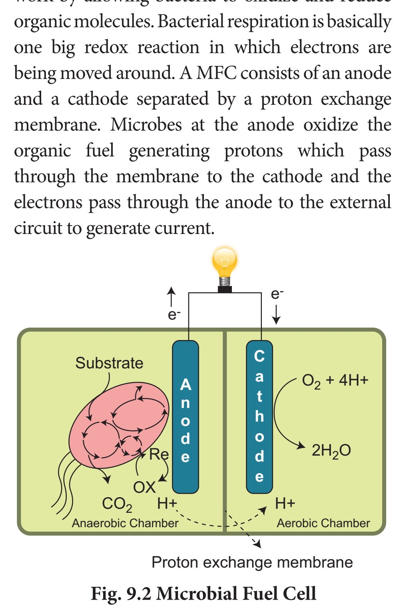
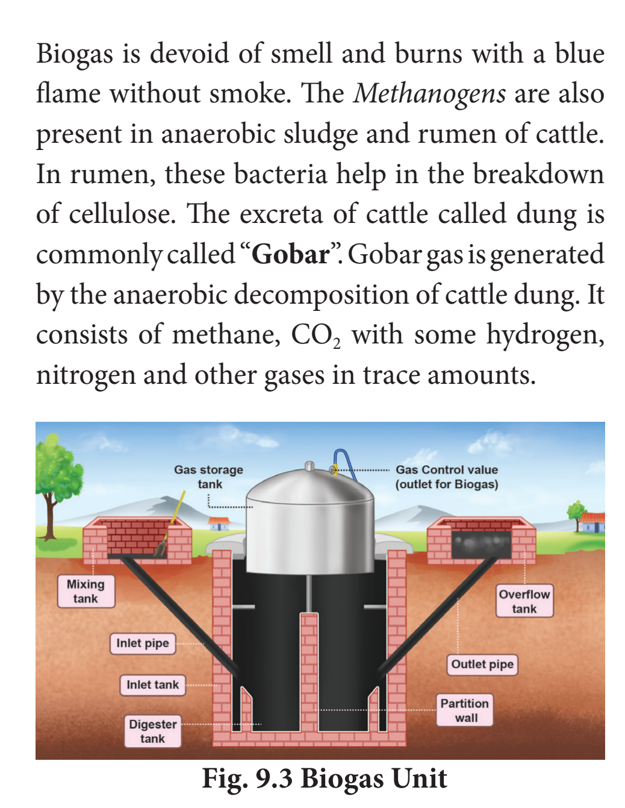
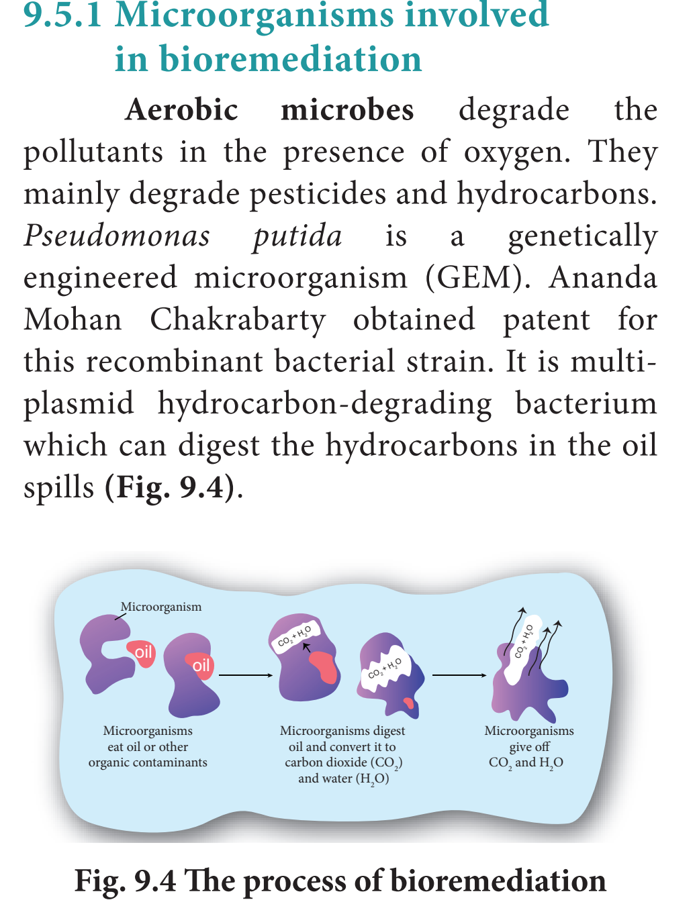
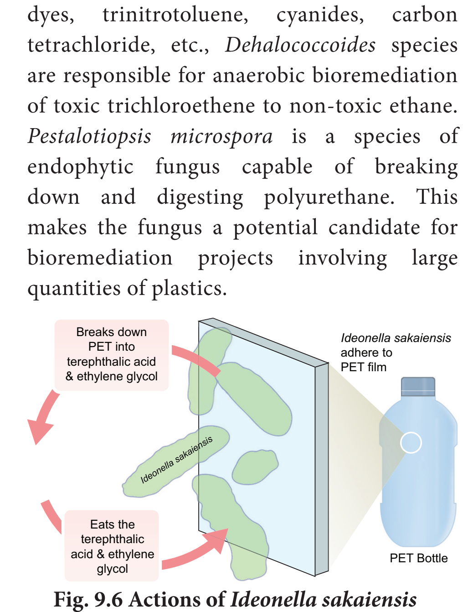
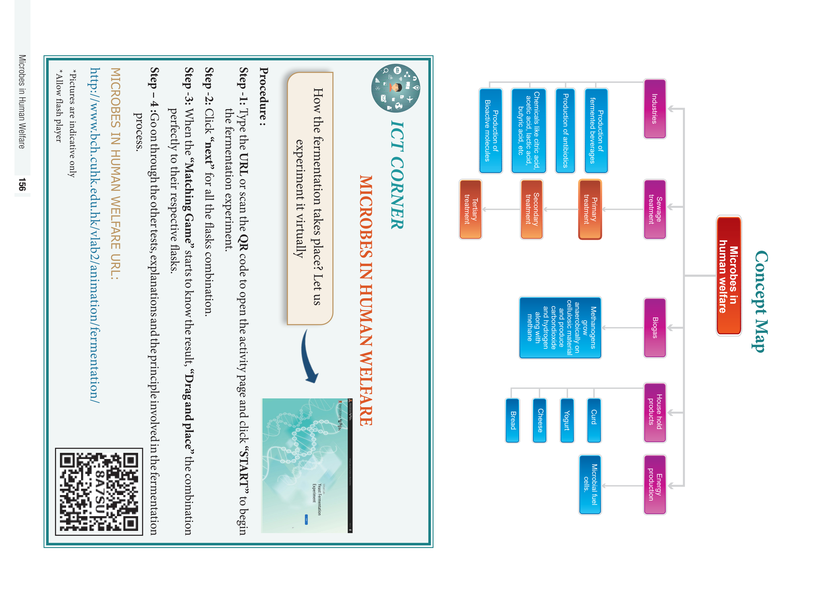

# Chapter 9: Microbes in Human Welfare

> Source: 2024 English-medium textbook, PDF pages 156–164.

## Chapter Outline

9.1 Microbes in household products
9.2 Microbes in industrial products
9.3 Microbes in sewage treatment and energy generation
9.4 Microbes in the production of biogas
9.5 Bioremediation

## Learning Objectives

➢ Understands the role of microbes in household and industrial products.
➢ Appreciates the role of microbes in sewage treatment and energy generation.
➢ Evaluates the importance of microbes in biogas production.
➢ Understands the role of microbes in bioremediation.

Microbes are a diverse group of organisms that include bacteria, fungi, viruses, viroids, prions and microscopic animals like protozoans. They are ubiquitous in presence and are found in almost all habitats on the earth. They are present in soil, water, air, inside bodies of animals and plants, even in thermal vents, geysers, deep inside soil, under snow shields and also in highly acidic and alkaline environments.

Microbes are generally regarded as organisms that cause diseases in humans, animals and plants. However, several microbes are useful to man in diverse ways. In this chapter we will discuss the beneficial roles of microbes in human welfare.

## 9.1 Microbes in household products

Microbes such as Lactobacillus and others commonly called Lactic Acid Bacteria (LAB) grow in milk and convert it into curd. During this process, the LAB produces acids that coagulate and partially digest the milk proteins. A small amount of curd added to fresh milk as inoculum or starter contains millions of LAB, which at suitable temperatures multiply and convert milk into curd. It also improves the nutritional quality of milk by increasing vitamin B12. In our stomach, LAB plays very beneficial role in checking disease causing microbes.

The dough, which is used for making foods such as dosa and idli is fermented by bacteria. The puffed-up appearance of dough is due to the production of CO2 gas. Similarly dough used for making bread is fermented using baker’s yeast (Saccharomyces cerevisiae). A number of traditional drinks and foods are also made by fermentation by microbes. ‘Toddy’ a traditional drink of some parts of South India is made by fermenting sap from palms. Microbes are also used to ferment fish, soybean and bamboo-shoots to make foods.

Different varieties of cheese are known by their characteristic texture, flavour and taste, the specificity coming from the microbes used. For example, the large holes in ‘Swiss cheese’ are due to production of a large amount of CO2 by a bacterium named Propionibacterium sharmanii. The ‘Roquefort cheese’ is ripened by growing a specific fungi on them, which gives them a particular flavour.

## 9.2 Microbes in industrial products

Microbes are used in industry to synthesize a number of products valuable to human beings. Beverages and antibiotics are some examples. Production on an industrial scale requires growing microbes in very large vessels called fermentors.

### 9.2.1 Antibiotic production

Antibiotics are chemical substances, which are produced by some microbes and can kill or retard the growth of other (disease-causing) microbes. You are familiar with the commonly used antibiotic Penicillin. Alexander Fleming while working on Staphylococci bacteria, once observed a mould growing in one of his unwashed culture plates around which Staphylococci could not grow. He found that it was due to a chemical produced by the mould and he named it Penicillin after the mould Penicillium notatum. However, its full potential as an effective antibiotic was established much later by Ernest Chain and Howard Florey. This antibiotic was extensively used to treat American soldiers wounded in World War II. Fleming, Chain and Florey were awarded the Nobel Prize in 1945, for this discovery.

After Penicillin, other antibiotics were also purified from other microbes. Can you name some other antibiotics and find out their sources? Antibiotics have greatly improved our capacity to treat deadly diseases such as plague, whooping cough (kali khansi), diphtheria (gal ghotu) and leprosy (kusht rog), which used to kill millions all over the globe. Today, we cannot imagine a world without antibiotics.

### 9.2.2 Fermented beverages

Microbes especially yeast is being used from time immemorial for the production of beverages like wine, beer, whisky, brandy and rum. Wine is among the oldest alcoholic beverages known and is produced by fermentation of fruit juice by yeast. Zymology is an applied science which deals with the biochemical process of fermentation and its practical uses.

Saccharomyces cerevisiae commonly called brewer’s yeast is used for fermenting malted cereals and fruit juices to produce various alcoholic beverages. Wine and beer are produced without distillation, whereas whisky, brandy and rum are obtained by fermentation and distillation.

The Pasteur effect is the inhibiting effect of oxygen on the fermentation process. Oenology is the science and study of wine and wine making. Wine is made from the fermentation of grape juice. Grape juice is fermented by various strains of Saccharomyces cerevisiae into alcohol. Grape wine is of two types, red wine and white wine. For red wine, black grapes are used including skins and sometimes the stems also are used. In contrast white wine is produced only from the juice of either white or red grapes without their skin and stems.

Beer is produced from germinated barley malt grain by Saccharomyces carlsbergensis or Saccharomyces cerevisiae. Rum is made from fermented sugarcane or molasses or directly from sugarcane juice by Saccharomyces cerevisiae. Whisky is a type of distilled alcoholic beverage made from fermented grain mash by Saccharomyces cerevisiae.

$$C_6H_{12}O_6 \xrightarrow{\text{Yeast / Fermentation}} 2C_2H_5OH + 2CO_2\uparrow$$

World biofuel day is observed every year on 10th August to create awareness about the importance of renewable bio-fuels as an alternative to conventional non-renewable fossil fuels. This day also highlights the various efforts taken by the Government in the biofuel sector.

### 9.2.3 Chemicals, enzymes and other bioactive molecules

Microbes are not only used for commercial and industrial production of alcohol, but also used for production of chemicals like organic acids and enzymes. Examples of organic acid producers are Aspergillus niger for citric acid, Acetobacter aceti for acetic acid, Rhizopus oryzae for fumaric acid, Clostridium butyricum for butyric acid and Lactobacillus for lactic acid.

Yeast (Saccharomyces cerevisiae) and bacteria are used for commercial production of enzymes. Lipases are used in detergent formulations and are used for removing oily stains from the laundry. Bottled juices are clarified by the use of pectinase, protease and cellulase. Rennet can also be used to separate milk into solid curds for cheese making.

Streptokinase produced by the bacterium Streptococcus and genetically engineered Streptococci are used as “clot buster” for removing clots from the blood vessels of patients who have undergone myocardial infarction.

Cyclosporin A, an immunosuppressant used in organ transplantation is produced from the fungus Trichoderma polysporum. It is also used for its anti-inflammatory, anti-fungal and anti-parasitic properties. Statins produced by the yeast Monascus purpureus have been used to lower blood cholesterol levels. It acts by competitively inhibiting the enzyme responsible for the synthesis of cholesterol. Recombinant human insulin has been produced predominantly using E. coli and Saccharomyces cerevisiae for therapeutic use in human.

Biodiesel is a fuel made from vegetable oils, fats or greases. Biodiesel fuel can be used in diesel engines without altering the engine. Pure biodiesel is non-toxic, biodegradable and produces lower level of air pollutants than petroleum-based diesel fuel. The Government of India approved the National Policy on Biofuels in December 2009 and identified Jatropha curcas as the most suitable oilseed for biodiesel production. Pongamia species is also a suitable choice for production of biodiesel.

## 9.3 Microbes in sewage treatment and energy generation

Sewage is the waste generated every day in cities and towns containing human excreta. It contains large amounts of organic matter and microbes, which are pathogenic to humans and are bio-degradable pollutants. Domestic waste consists of approximately 99 percent water, suspended solids and other soluble organic and inorganic substances. Sewage should not be discharged directly into natural water bodies like rivers and streams. Before disposal, sewage should be treated in sewage treatment plants to make it less polluting.

Microbes (mass of bacteria floc) are allowed to grow in aerated water (secondary treatment). They consume major part of organic matter in the effluent and reduce the BOD in the waste water (The details on waste water treatment are discussed in chapter 13).

### 9.3.1 Microbial Fuel Cell (MFC)

A Microbial Fuel Cell is a bio-electrochemical system that drives an electric current by using bacteria and mimicking bacterial interaction found in nature (Fig. 9.2). Microbial Fuel Cells work by allowing bacteria to oxidize and reduce organic molecules. Bacterial respiration is basically one big redox reaction in which electrons are being moved around. A MFC consists of an anode and a cathode separated by a proton exchange membrane. Microbes at the anode oxidize the organic fuel generating protons which pass through the membrane to the cathode and the electrons pass through the anode to the external circuit to generate current.

## 9.4 Microbes in the production of biogas

Biogas is a mixture of different gases produced by the breakdown of organic matter in the absence of oxygen. Biogas can be produced from raw materials such as agricultural wastes, manure, municipal wastes, plant material, sewage, food waste, etc. Biogas is produced under anaerobic condition, when the organic materials are converted through microbiological reactions into gas and organic fertilizer. Biogas primarily consists of methane (63 percent), along with CO2 and hydrogen. Methane producing bacteria are called methanogens and one such common bacterium is Methanobacterium.

Biogas is devoid of smell and burns with a blue flame without smoke. The Methanogens are also present in anaerobic sludge and rumen of cattle. In rumen, these bacteria help in the breakdown of cellulose. The excreta of cattle called dung is commonly called “Gobar”. Gobar gas is generated by the anaerobic decomposition of cattle dung. It consists of methane, CO2 with some hydrogen, nitrogen and other gases in trace amounts.

In a biogas plant, anaerobic digestion is carried out in an air tight cylindrical tank known as digester (Fig. 9.3). It is made up of concrete bricks and cement or steel. Bio-wastes are collected and slurry of dung is fed into this digester. It has a side opening into which organic materials for digestion are incorporated for microbial activity. Anaerobic digestion is accomplished in three stages: solubilisation, acidogenesis and methanogenisis. The outlet is connected to a pipe to supply biogas. The slurry is drained through another outlet and is used as fertilizer. Biogas is used for cooking and lighting. The technology of biogas production was developed in India mainly due to the efforts of Indian Agricultural Research Institute (IARI) and Khadi and Village Industries Commission (KVIC).

## 9.5 Bioremediation

The use of naturally occurring or genetically engineered microorganisms to reduce or degrade pollutants is called bioremediation. Bioremediation is less expensive and more sustainable than other remediations available. It is grouped into in situ bioremediation (treatment of contaminated soil or water in the site) and ex situ bioremediation (treatment of contaminated soil or water that is removed from the site and treated).

### 9.5.1 Microorganisms involved in bioremediation

Aerobic microbes degrade the pollutants in the presence of oxygen. They mainly degrade pesticides and hydrocarbons. Pseudomonas putida is a genetically engineered microorganism (GEM). Ananda Mohan Chakrabarty obtained patent for this recombinant bacterial strain. It is multi-plasmid hydrocarbon-degrading bacterium which can digest the hydrocarbons in the oil spills (Fig. 9.4).

Nitrosomonas europaea is also capable of degrading benzene and a variety of halogenated organic compounds including trichloroethylene and vinyl chloride.

Ideonella sakaiensis is currently tried for recycling of PET plastics (Fig. 9.5). These bacteria use PETase and MHETase enzymes to breakdown PET plastic into terephthalic acid and ethylene glycol.

Anaerobic microbes degrade the pollutants in the absence of oxygen.
• Dechloromonas aromatica has the ability to degrade benzene anaerobically and to oxidize toluene and xylene.
• Phanerochaete chrysosporium an anaerobic fungus exhibits strong potential for bioremediation of pesticides, polycyclic aromatic hydrocarbons, dyes, trinitrotoluene, cyanides, carbon tetrachloride, etc.
• Dehalococcoides species are responsible for anaerobic bioremediation of toxic trichloroethene to non-toxic ethane.
• Pestalotiopsis microspora is a species of endophytic fungus capable of breaking down and digesting polyurethane. This makes the fungus a potential candidate for bioremediation projects involving large quantities of plastics.

## Summary

All microbes are not pathogenic, many of them are beneficial to human beings. We use microbes and their derived products almost every day. Lactic acid bacteria convert milk into curd. Saccharomyces cerevisiae (yeast) is used in bread making. Idly and dosa are made from dough fermented by microbes. Bacteria and fungi are used in cheese making. Industrial products like lactic acid, acetic acid and alcohol are produced by microbes. Antibiotics are produced from useful microbes to kill the disease causing harmful microbes. For more than a hundred years, microbes are being used to treat sewage by the process of activated sludge formation. Bio-gas produced by microbes is used as a source of energy in rural areas. In bio-remediation naturally occurring or genetically engineered microorganisms are used to reduce or degrade pollutants.

## Evaluation

1. Which of the following microorganism is used for production of citric acid in industries?
a) Lactobacillus bulgaris
b) Penicillium citrinum
c) Aspergillus niger
d) Rhizopus nigricans

2. Which of the following pair is correctly matched for the product produced by them?
a) Acetobacter aceti - Antibiotics
b) Methanobacterium - Lactic acid
c) Penicilium notatum - Acetic acid
d) Saccharomyces cerevisiae - Ethanol

3. The most common substrate used in distilleries for the production of ethanol is_________
a) Soyameal
b) Groundgram
c) Molasses
d) Corn meal

4. Cyclosporin – A is an immunosuppressive drug produced from _______
a) Aspergillus niger
b) Manascus purpureus
c) Penicillium notatum
d) Trichoderma polysporum

5. CO2 is not released during
a) Alcoholic fermentation
b) Lactate fermentation
c) Aerobic respiration in animals
d) Aerobic respiration in plants

6. The purpose of biological treatment of waste water is to _______
a) Reduce BOD
b) Increase BOD
c) Reduce sedimentation
d) Increase sedimentation

7. The gases produced in anaerobic sludge digesters are
a) Methane, oxygen and hydrogen sulphide.
b) Hydrogen sulphide, methane and sulphur dioxide.
c) Hydrogen sulphide, nitrogen and methane.
d) Methane, hydrogen sulphide and CO2.

8. How is milk converted into curd? Explain the process of curd formation.
9. Give any two bioactive molecules produced by microbes and state their uses.
10. Define the following terms:
a) Antibiotics
b) Zymology
c) Superbug
11. Write short notes on the following:
a) Brewer's yeast
b) Ideonella sakaiensis
c) Microbial Fuel Cell
12. List the advantages of biogas plants in rural areas.
13. When does antibiotic resistance develop?
14. What is referred to as industrial alcohol? Briefly describe its preparation.
15. What is bioremediation?

## Concept Map

## ICT CORNER

MICROBES IN HUMAN WELFARE
How the fermentation takes place? Let us experiment it virtually
URL: http://www.bch.cuhk.edu.hk/vlab2/animation/fermentation/

Procedure:
Step - 1: Type the URL or scan the QR code to open the activity page and click “START” to begin the fermentation experiment.
Step - 2: Click “next” for all the flasks combination.
Step - 3: When the “Matching Game” starts to know the result, “Drag and place” the combination perfectly to their respective flasks.
Step – 4: Go on through the other tests, explanations and the principle involved in the fermentation process.
