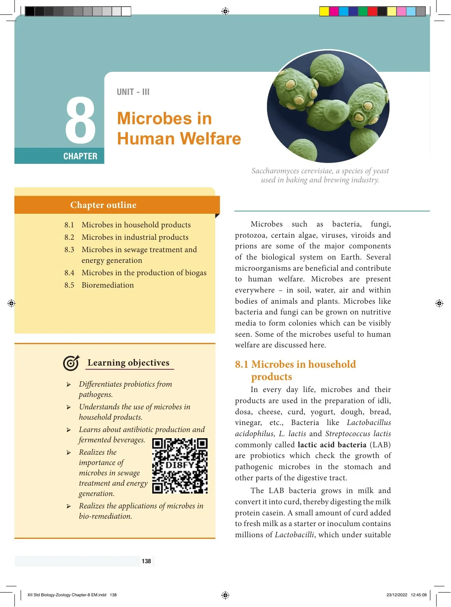
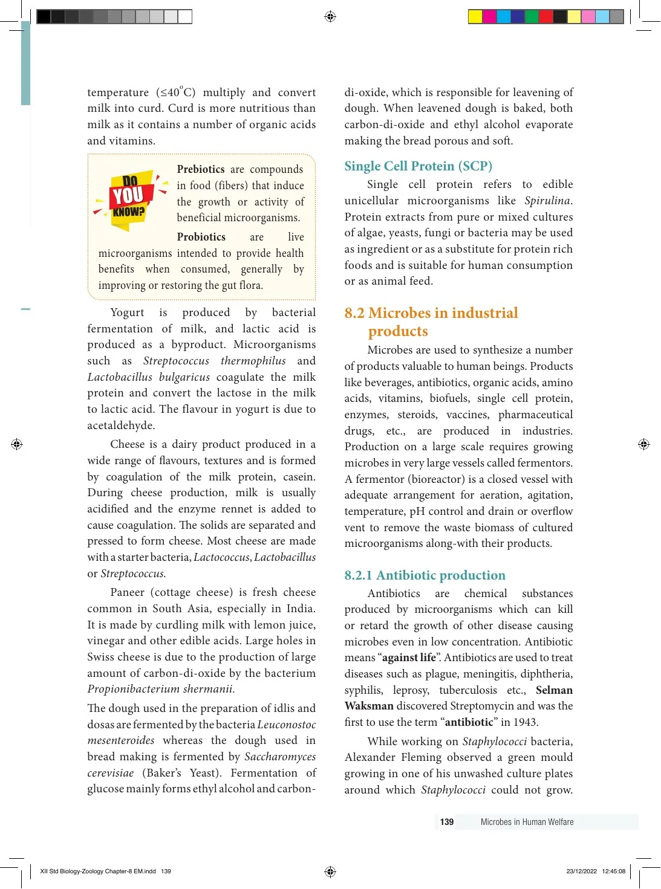
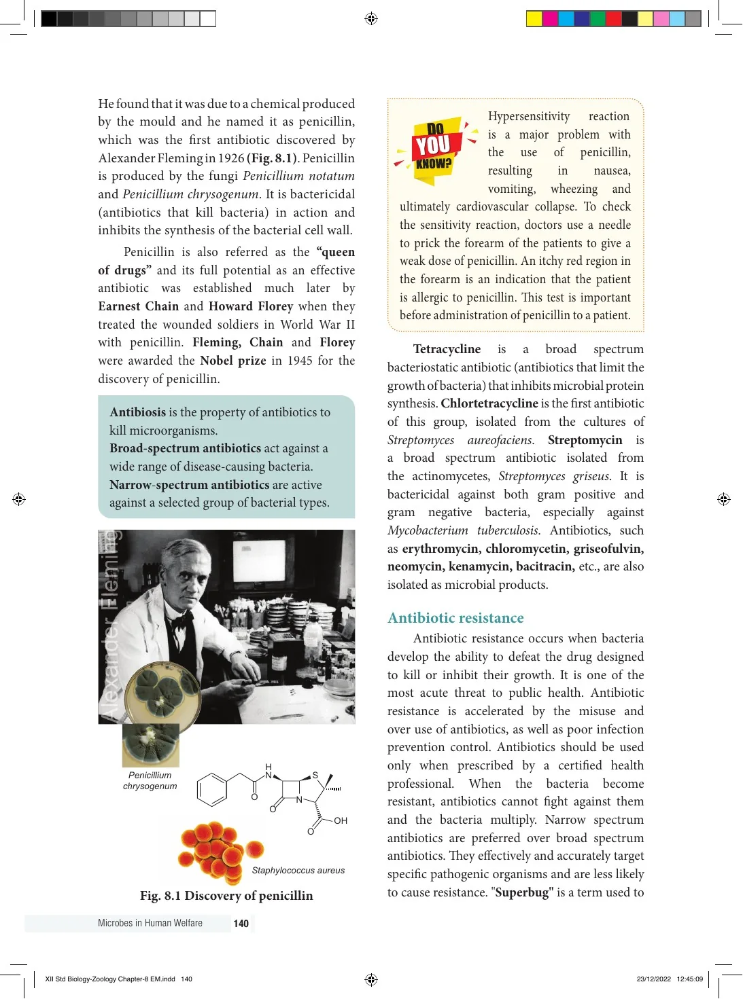
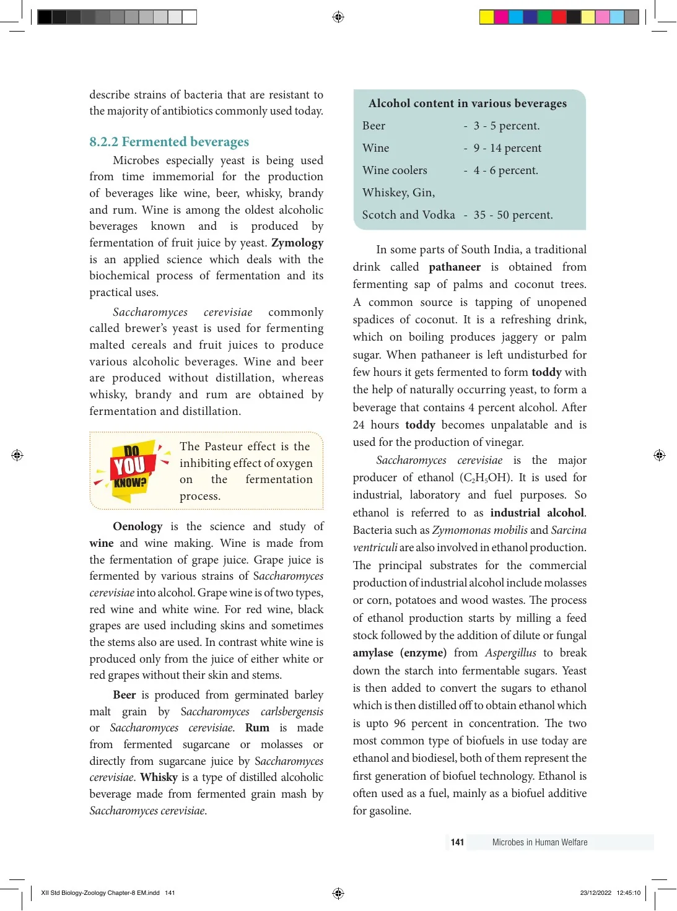
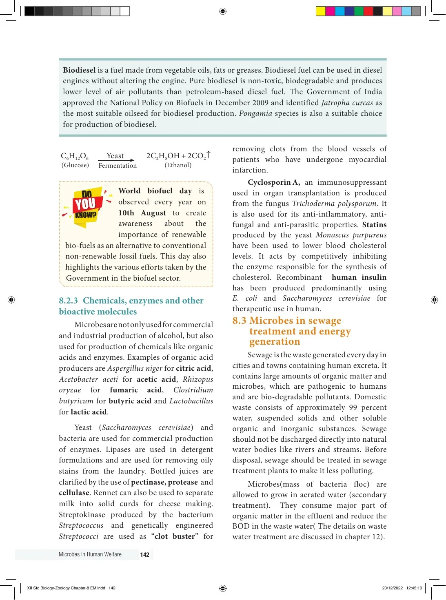
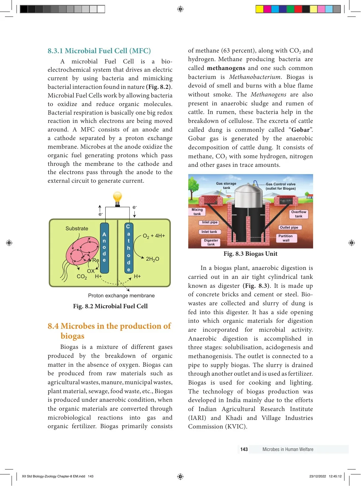
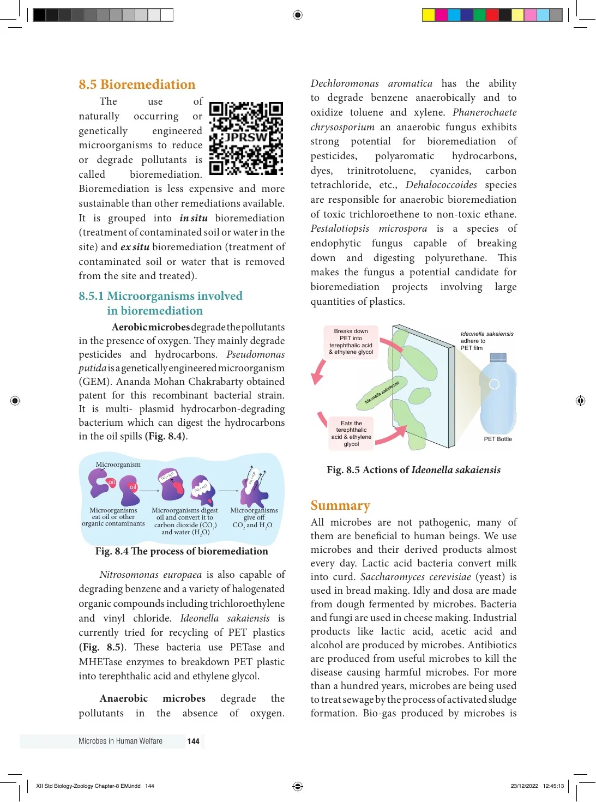
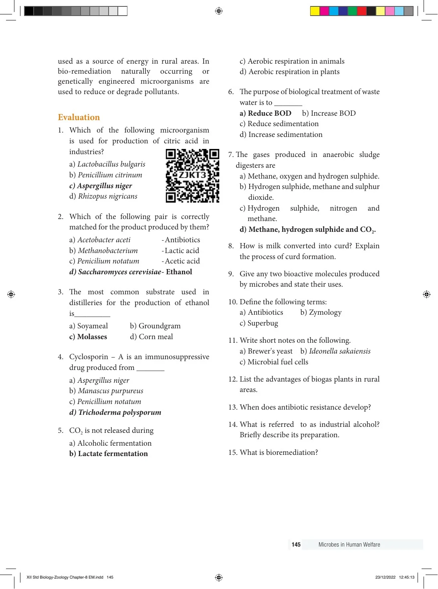
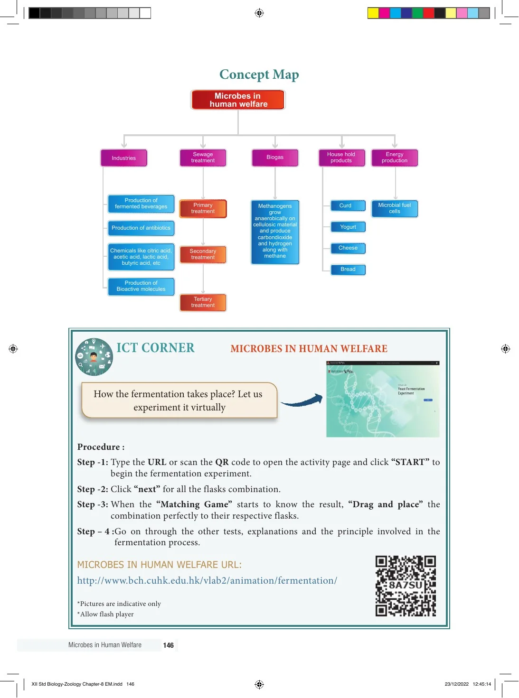

# Original textbook pages: Microbes in Human Welfare

These images preserve the supplied page layout, diagrams, labels, tables, activities and exercises.

## PDF page 146 · textbook page 138

## PDF page 147 · textbook page 139

## PDF page 148 · textbook page 140

## PDF page 149 · textbook page 141

## PDF page 150 · textbook page 142

## PDF page 151 · textbook page 143

## PDF page 152 · textbook page 144

## PDF page 153 · textbook page 145

## PDF page 154 · textbook page 146

