# Original textbook pages: Principles of Inheritance and Variation

These images preserve the supplied page layout, diagrams, labels, tables, activities and exercises.

## PDF page 53 · textbook page 45

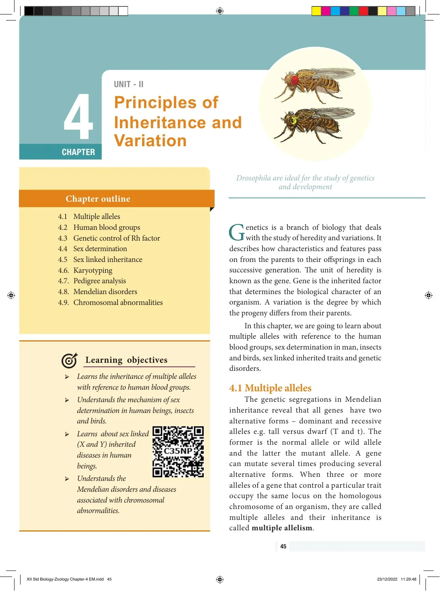

## PDF page 54 · textbook page 46

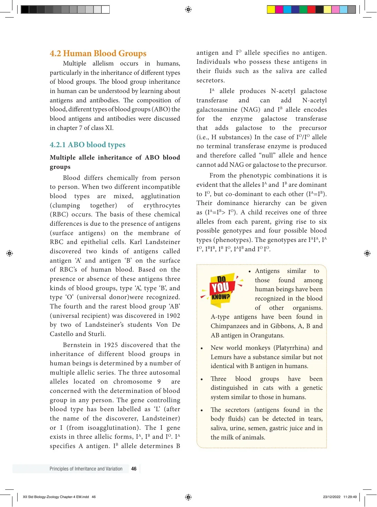

## PDF page 55 · textbook page 47

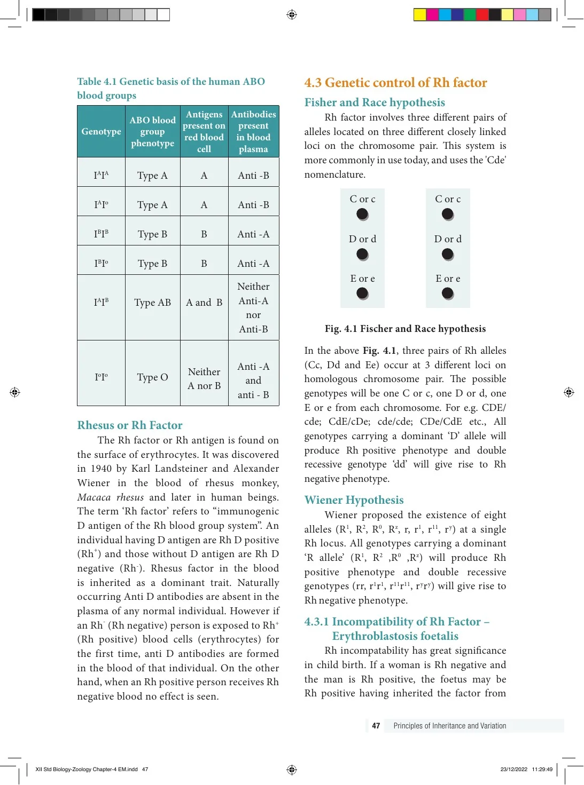

## PDF page 56 · textbook page 48

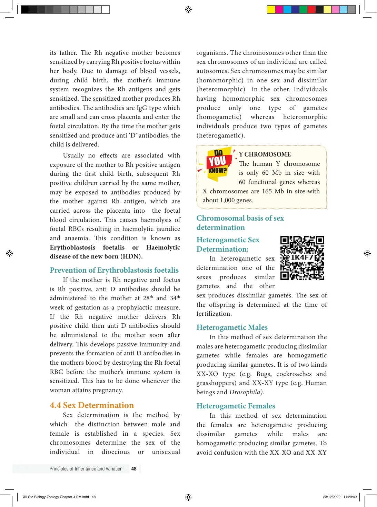

## PDF page 57 · textbook page 49

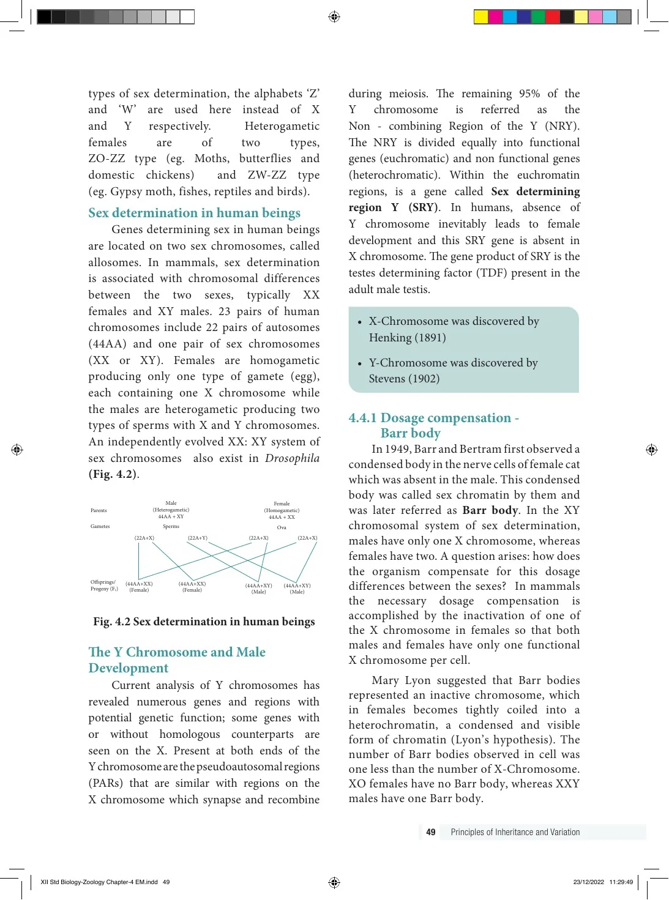

## PDF page 58 · textbook page 50

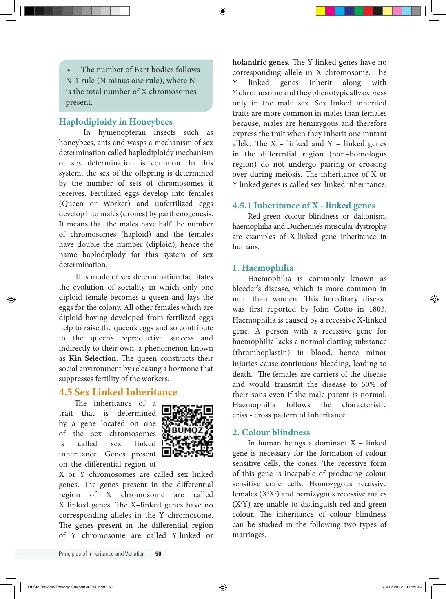

## PDF page 59 · textbook page 51

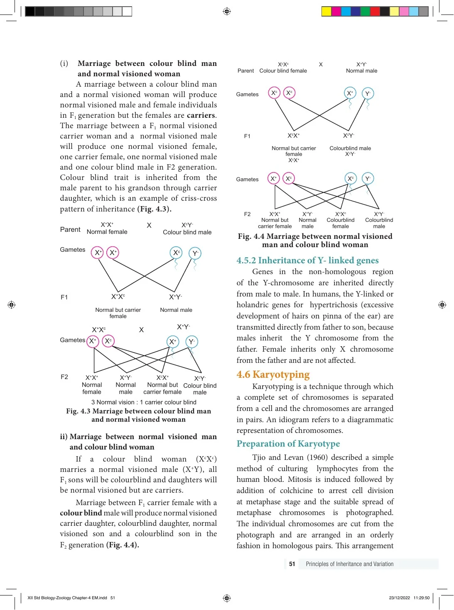

## PDF page 60 · textbook page 52

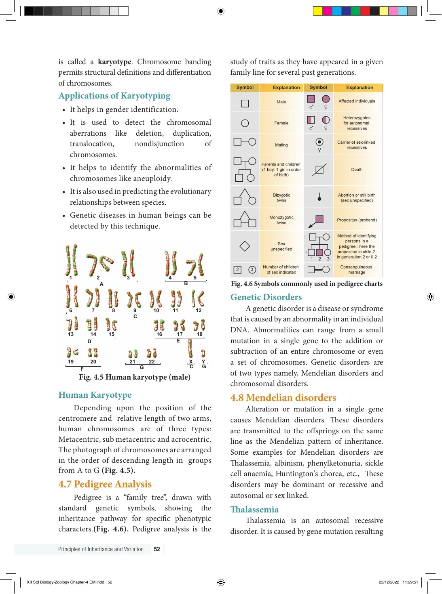

## PDF page 61 · textbook page 53

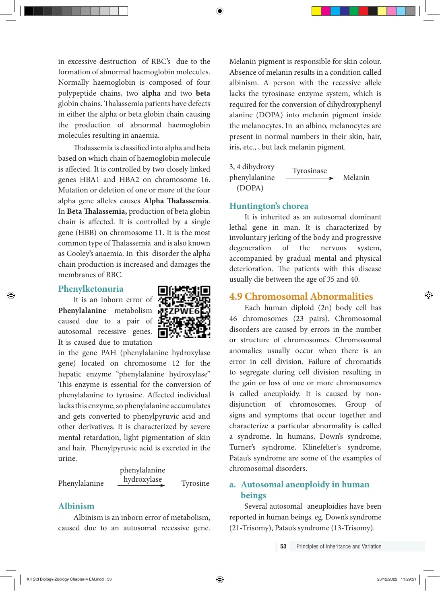

## PDF page 62 · textbook page 54

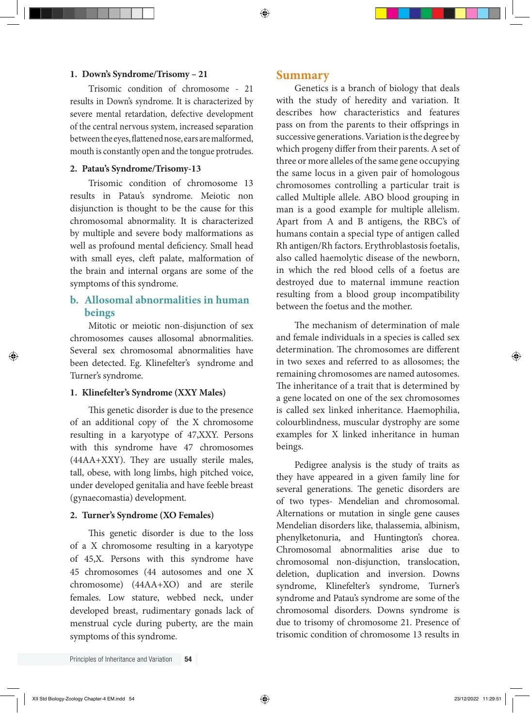

## PDF page 63 · textbook page 55

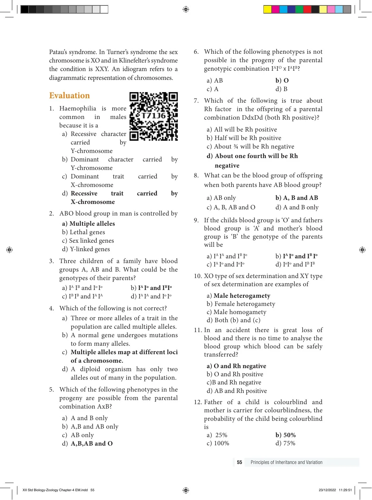

## PDF page 64 · textbook page 56

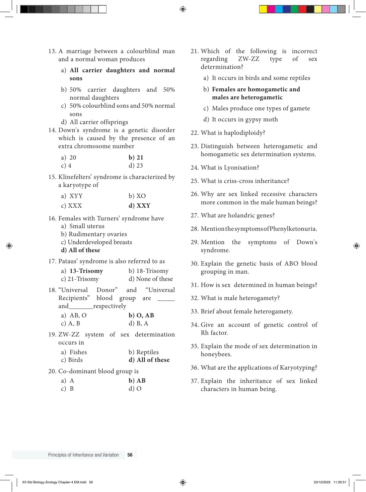

## PDF page 65 · textbook page 57

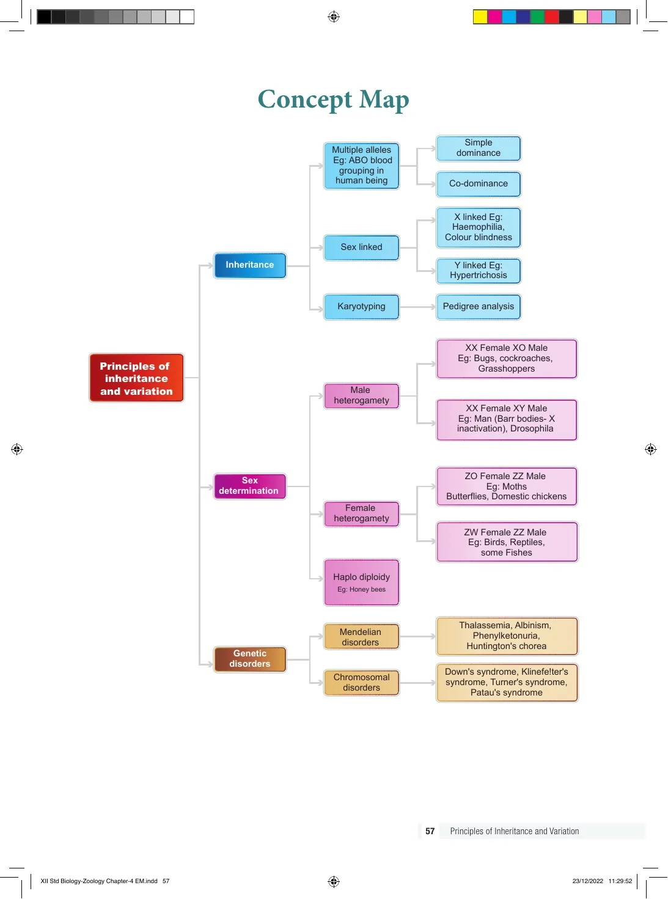
