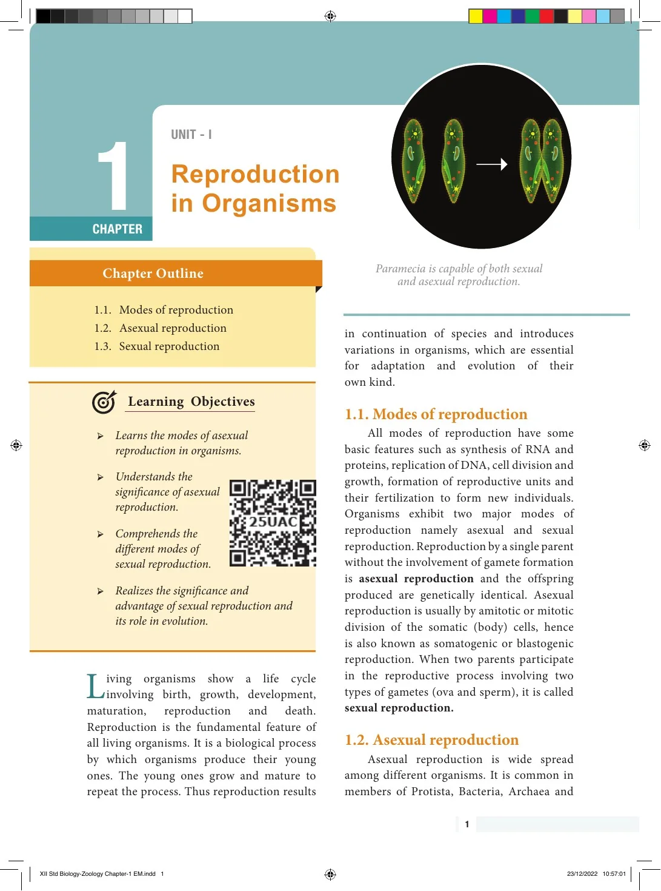
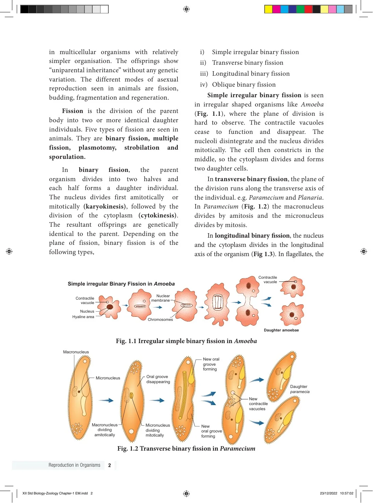
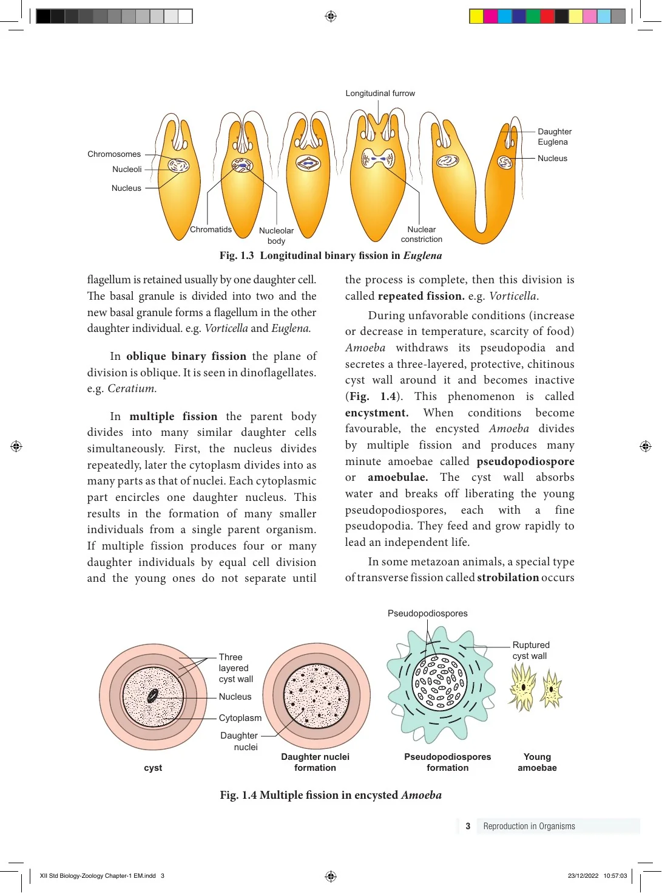
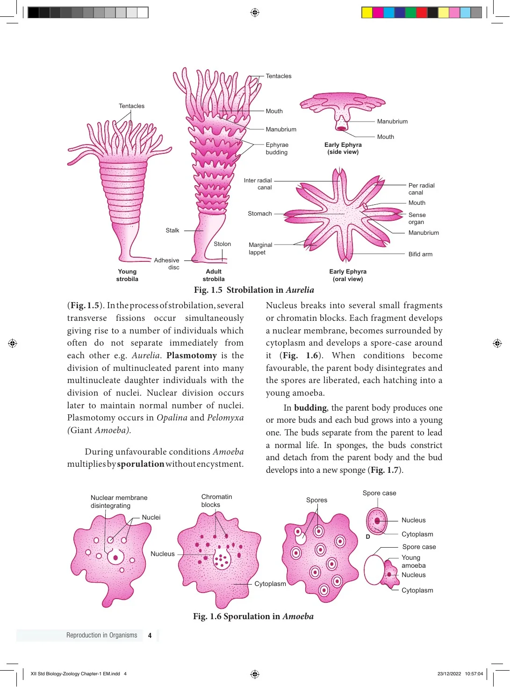
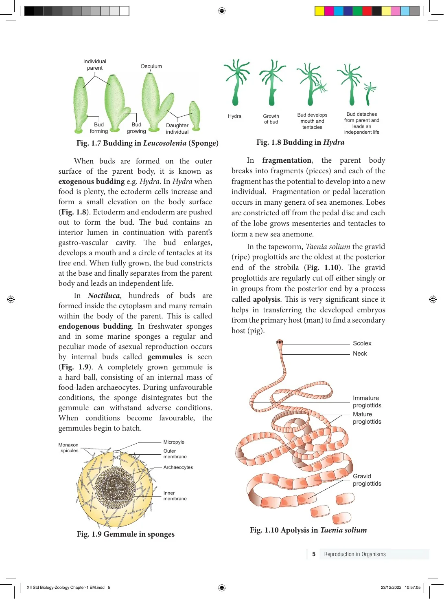
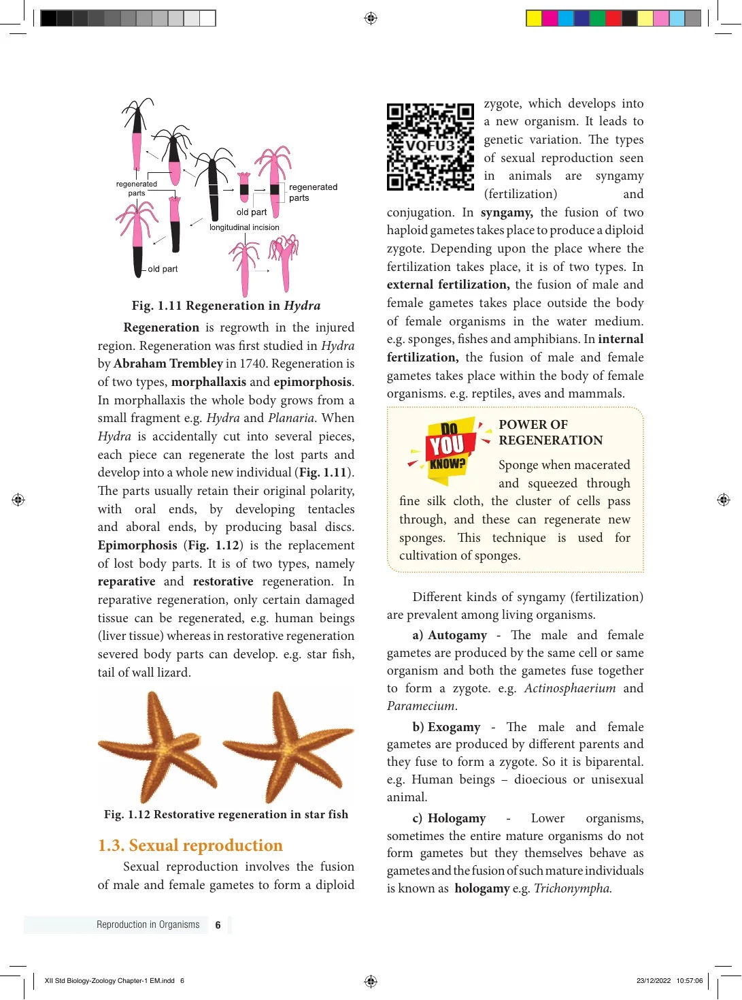
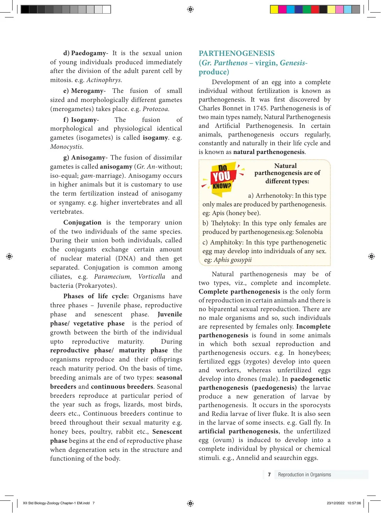
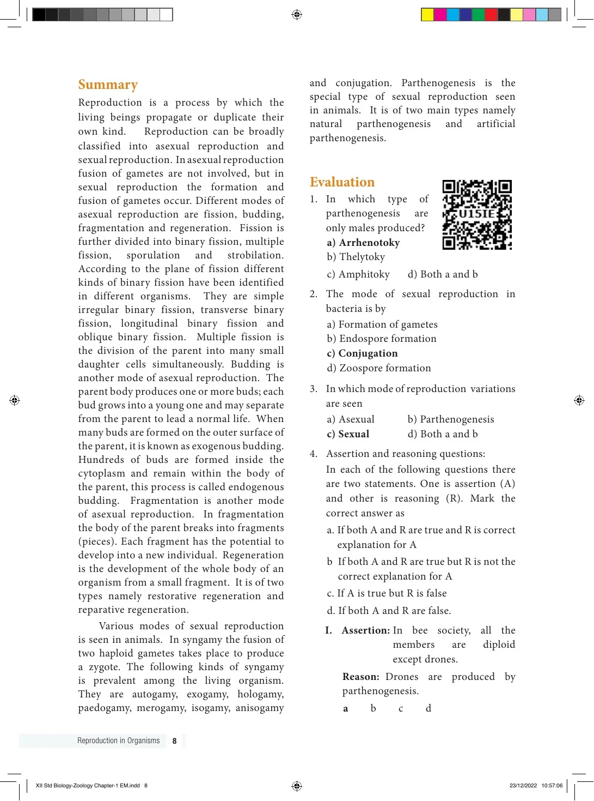
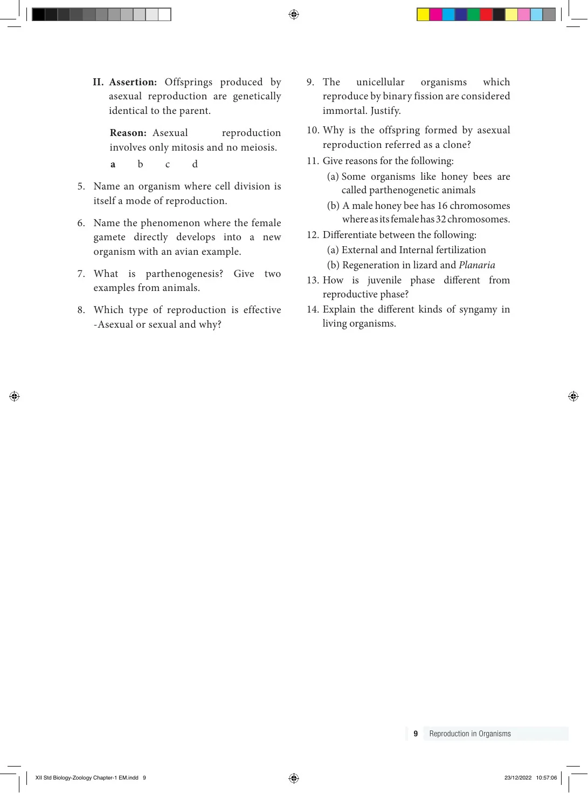
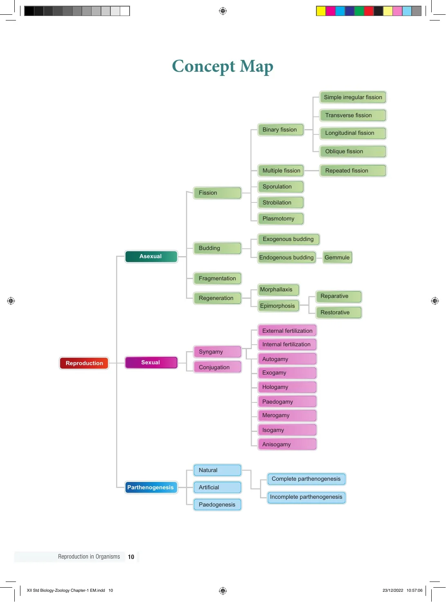

# Original textbook pages: Reproduction in Organisms

These images preserve the supplied page layout, diagrams, labels, tables, activities and exercises.

## PDF page 9 · textbook page 1

## PDF page 10 · textbook page 2

## PDF page 11 · textbook page 3

## PDF page 12 · textbook page 4

## PDF page 13 · textbook page 5

## PDF page 14 · textbook page 6

## PDF page 15 · textbook page 7

## PDF page 16 · textbook page 8

## PDF page 17 · textbook page 9

## PDF page 18 · textbook page 10

