# Original textbook pages: Reproductive Health

These images preserve the supplied page layout, diagrams, labels, tables, activities and exercises.

## PDF page 40 · textbook page 32

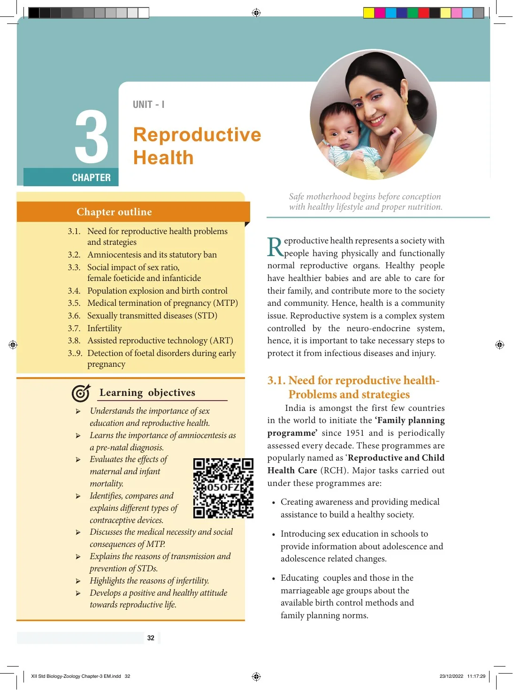

## PDF page 41 · textbook page 33

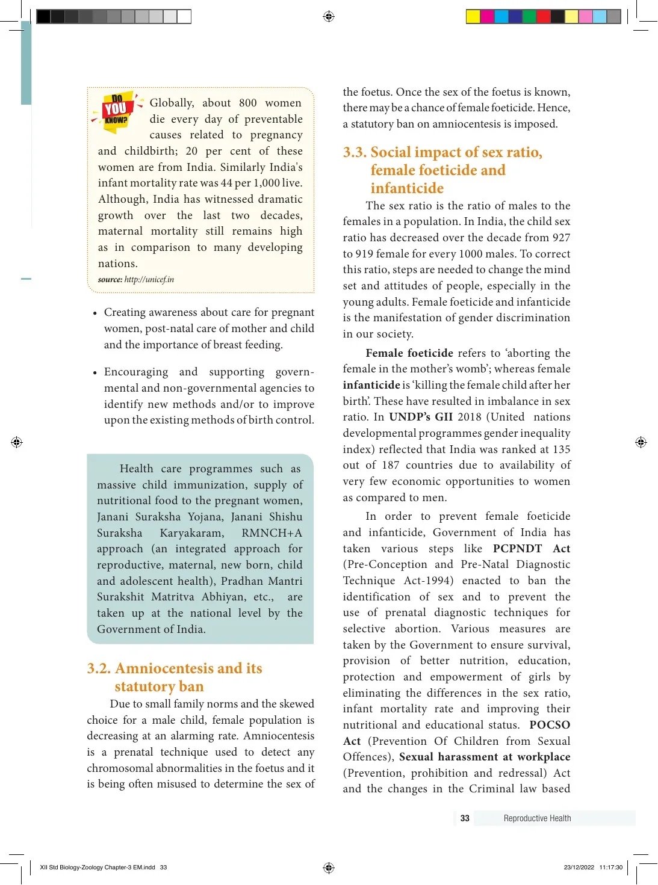

## PDF page 42 · textbook page 34

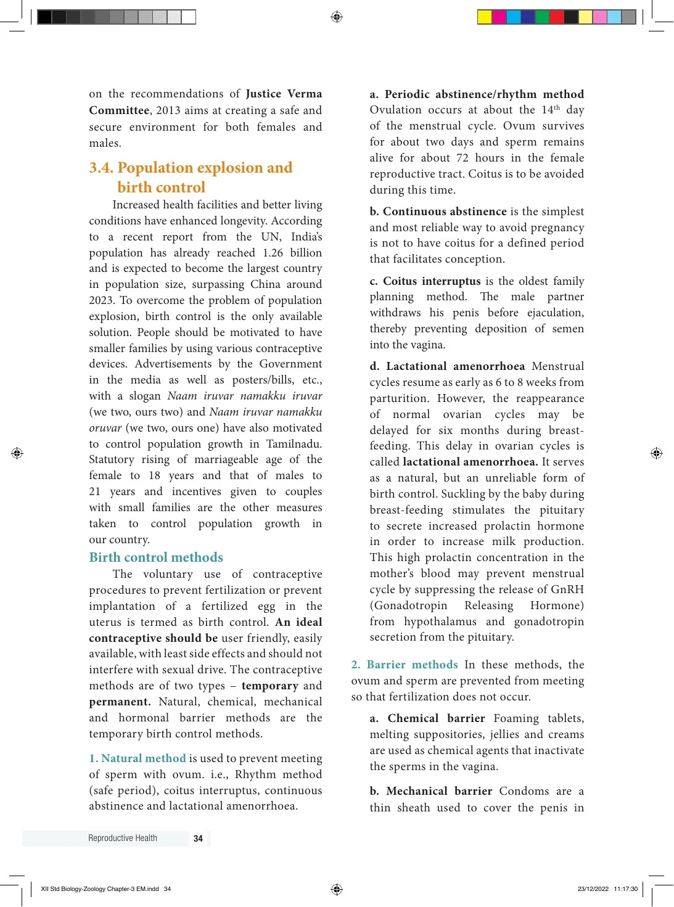

## PDF page 43 · textbook page 35

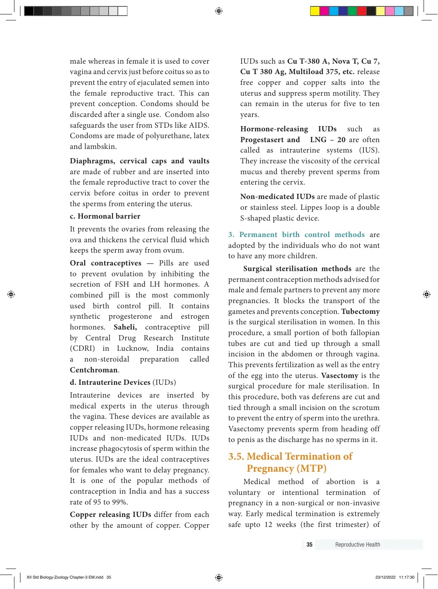

## PDF page 44 · textbook page 36

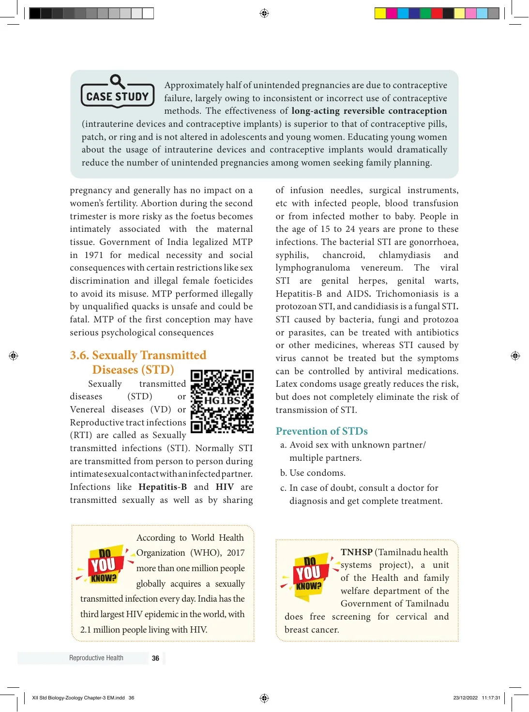

## PDF page 45 · textbook page 37

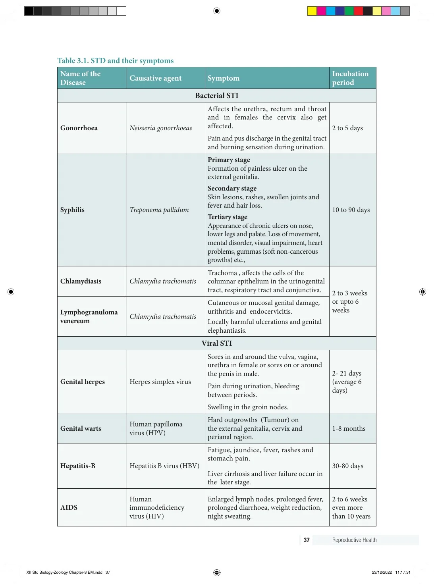

## PDF page 46 · textbook page 38

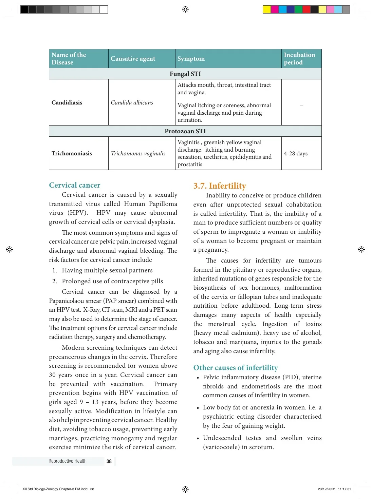

## PDF page 47 · textbook page 39

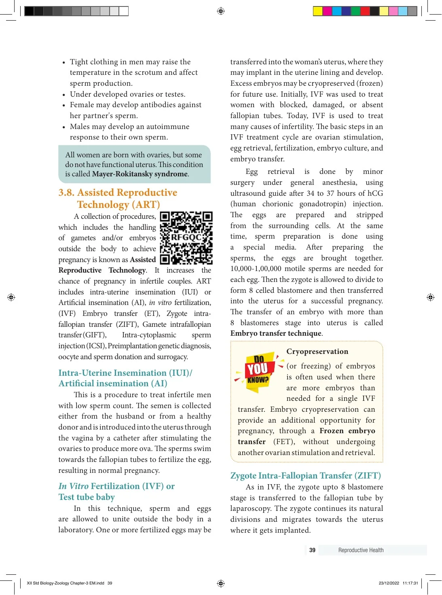

## PDF page 48 · textbook page 40

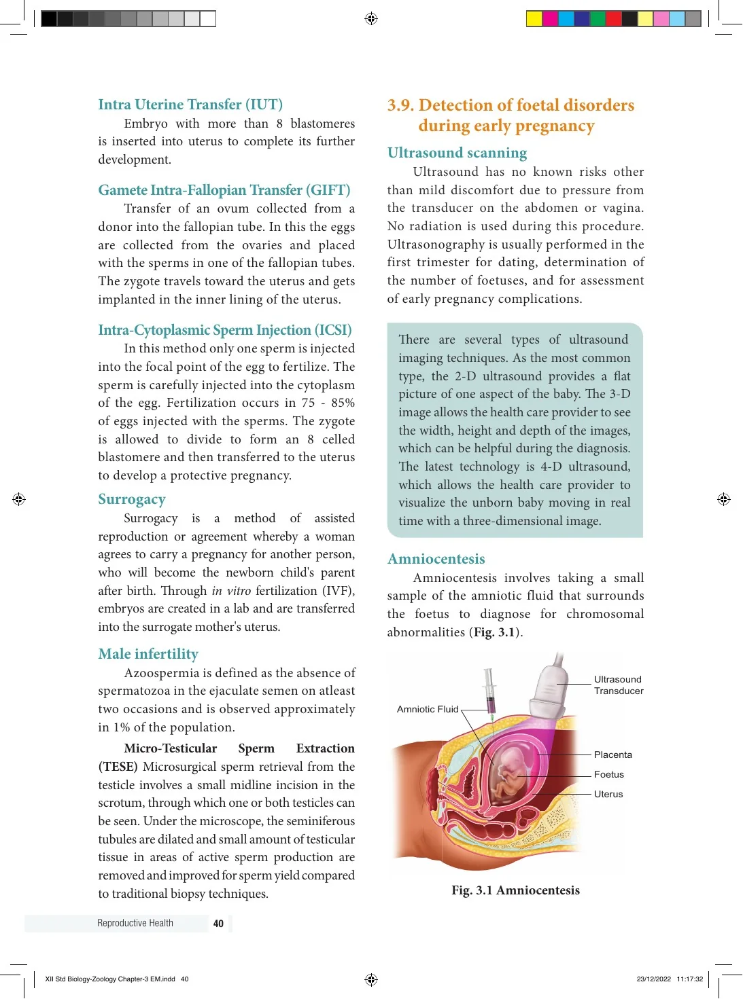

## PDF page 49 · textbook page 41

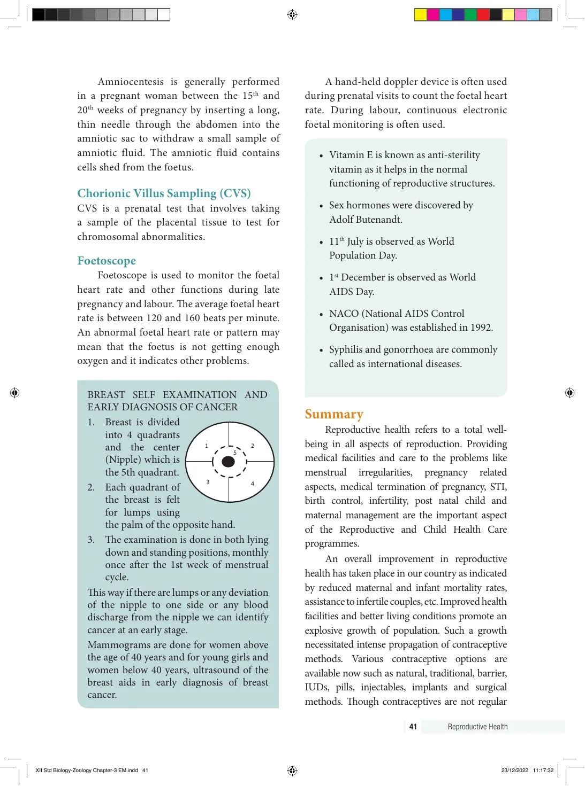

## PDF page 50 · textbook page 42

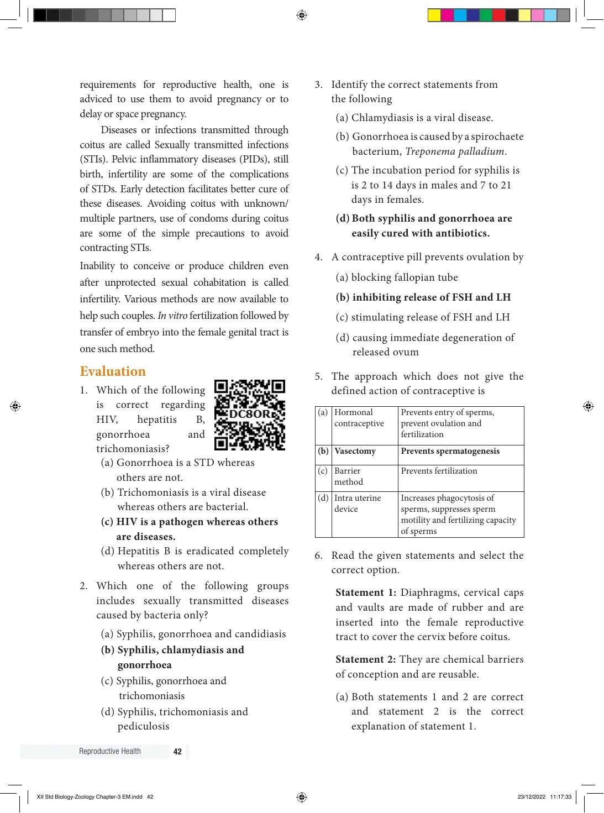

## PDF page 51 · textbook page 43

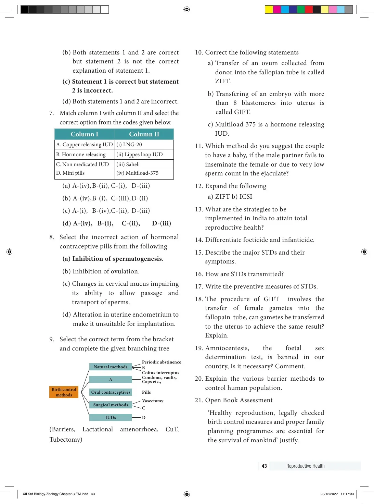

## PDF page 52 · textbook page 44

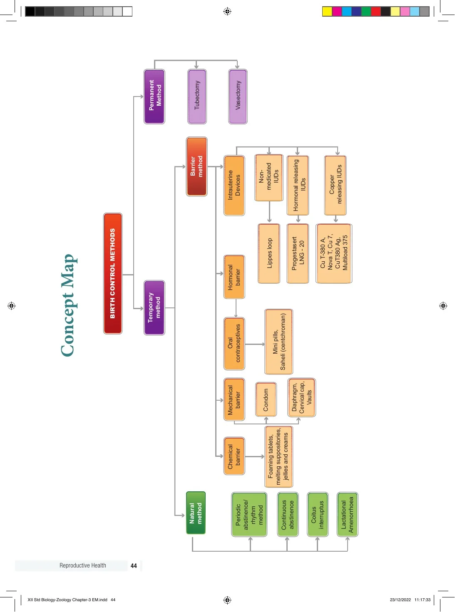
