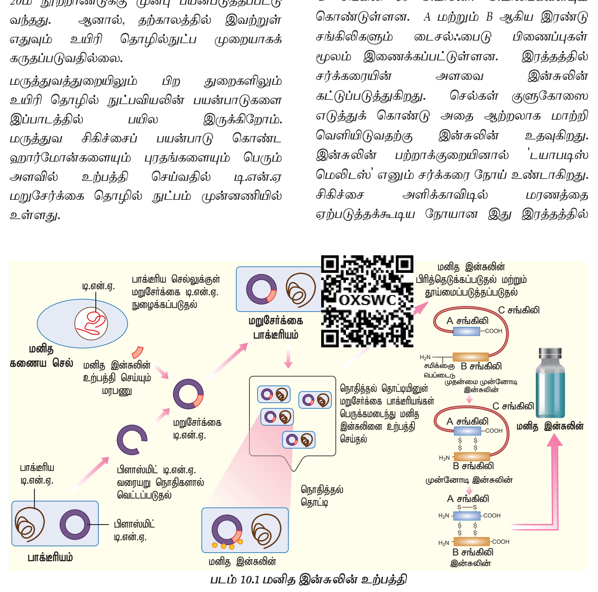
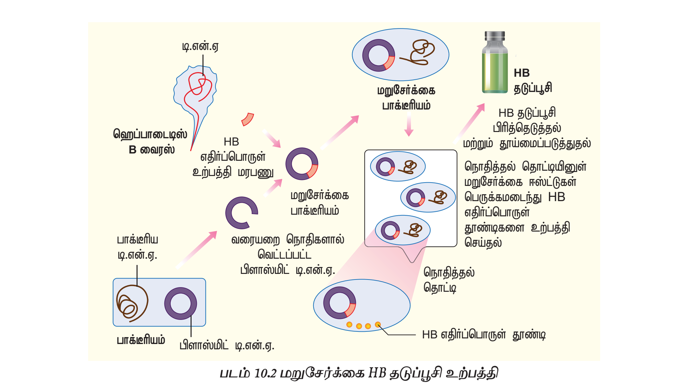
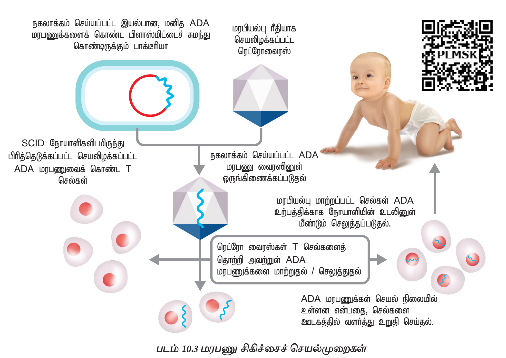
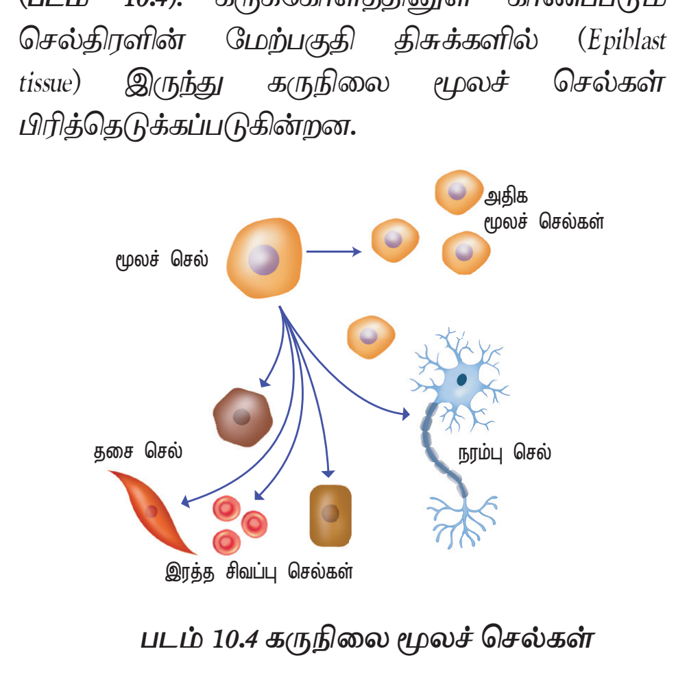
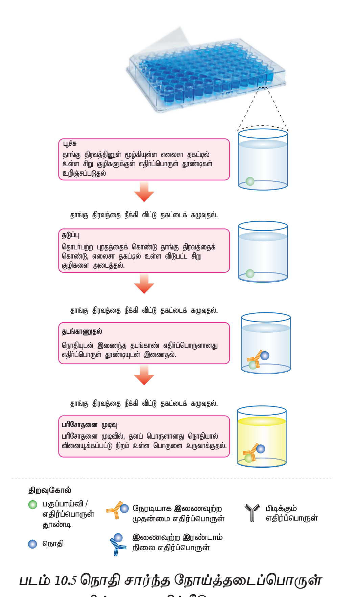
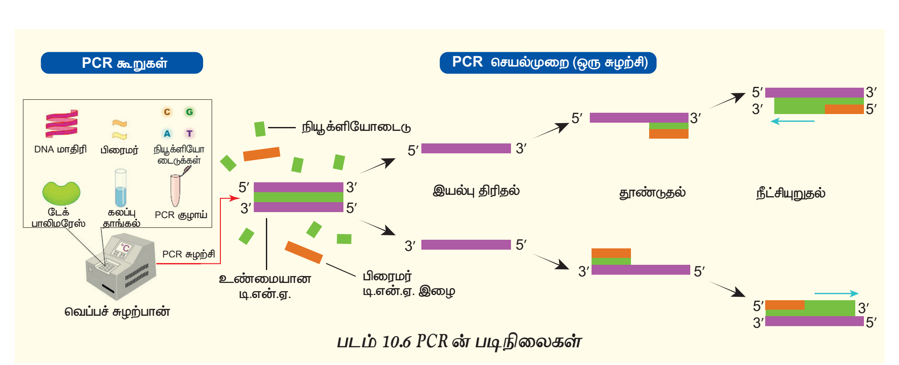
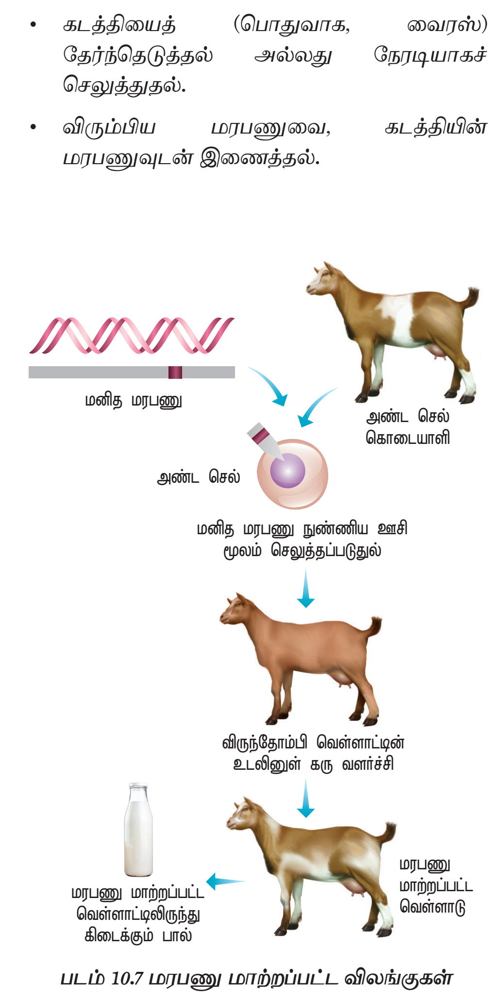
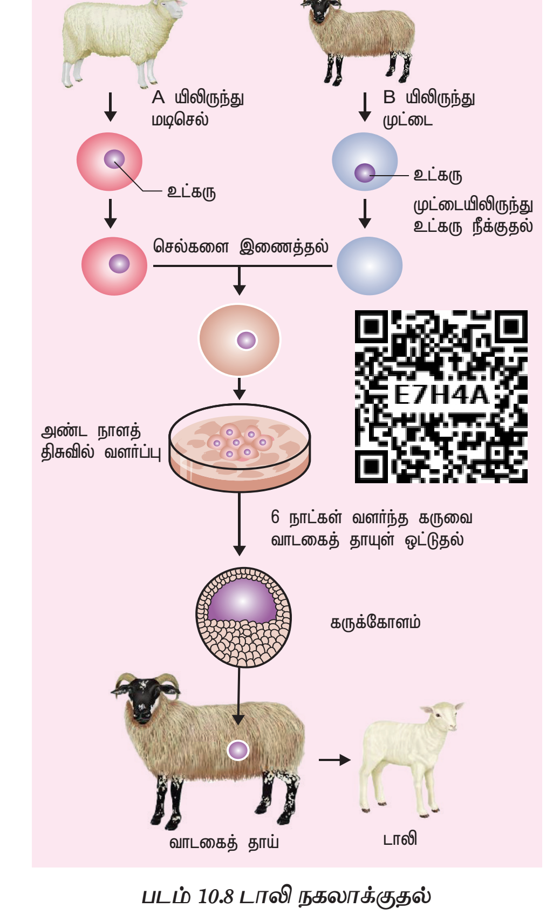

# பாடம் 10: உயிரி தொழில் நுட்பவியலின் பயன்பாடுகள்

> மூலம்: தமிழ் வழிப் பாடநூல், PDF பக்கங்கள் 196–218.

> குறிப்பு: கீழுள்ள தேடக்கூடிய உரை துல்லியமான படங்கள், அட்டவணைகள் மற்றும் அமைப்பிற்கு அசல் பக்கங்களைப் பார்க்கவும்.

பாடம்

அலகு - IV

உயிரி தொொழில்
நுட்பவியலின்
பயன்பபாடுகள்
நமது உலகம் உயிரியலால்
கட்டமைக்கப்பட்டுள்ளது.

## பாட உள்ளடக்கம்

10.1

 மருத்துவத்தில் உயிரி தொொழில்
நுட்பவியலின் பயன்பபாடுகள்

## 10.2  மரபணு சிகிச்சை

## 10.3  மூலச் செல் சிகிச்சை

## 10.4  மூலக்கூறு அளவில் நோய் கண்டறிதல்

## 10.5  மரபணு மாற்றப்பட்ட விலங்குகள்

## 10.6  உயிரிய விளை பொொருட்கள் மற்றும்

அவற்றின் பயன்கள்

## 10.7  விலங்கு நகலாக்கம்

## 10.8 அறம் சார்ந்த பிரச்சனைகள்

## 10.9  உயிரி தொொழில்நுட்பவியலின்

நெறிமுறைகள்

## 10.10  மரபியல்பு மாற்றப்பட்ட உயிரிகளால்

நேரிடக் கூடிய ஆபத்துகள்

## 10.11 உயிரிய பாதுகாப்பு வழிமுறைகள்

அவற்றின் பயன்பபாடுகளைக் கற்றுக்
கொொள்ளுதல்.
- உயிரி தொொழில் நுட்பவியலோடு
தொொடர்புடைய அறம் சார்ந்த பிரச்சினைகள்
பற்றிய விழிப்புணர்வவை ஏற்படுத்துதல்.
- உயிரிய பாதுகாப்பு வழிமுறைகள்
மற்றும் உயிரி தொொழில்நுட்ப
நெறிமுறைகள் ஆகியவற்றின்
தேவையைத் தெளிவாக உணர்தல்.

இ

ப்பாடப் பகுதியைக் கற்கத் தொொடங்கும் முன்
டி.என்.ஏவின் அமைப்பு, புரத உற்பத்தி மற்றும்

மரபுப்பொறியியல்

ஆகியவற்றைப்

பற்றி

மீள்

பார்வவை செய்தல் உதவிகரமானதாக அமையும்.
டி.என்.ஏ மற்றும் இயற்ககையாக நடைபெறும் புரத
உற்பத்தியை மனித விருப்பப்படி, மாற்றியமைத்து
மருத்துவ முக்கியத்துவம் வாய்ந்த புரதங்கள்

## கற்றலின் நோக்கங்கள் :

- மருத்துவத்துறையில் rDNA
தொொழில்நுட்பத்தின் பயன்பபாடுகளைப்
புரிந்து கொொள்ளுதல்.
- மூலக்கூறு அளவில்
நோய் கண்டறியும்
முறைகளில் கண்டறிய
உதவும் கருவிகளின்
பங்கினைப் பகுத்தாய்தல்.
- விலங்குகளின் நகலாக்கம் மற்றும்

மற்றும் இதர பயன்பபாட்டிற்ககான புரதங்களை
உருவாக்கும் செயல்முறைகள் ‘மரபுப் பொொறியியல்’
எனப்படும்.

ஒரு உயிரியிலிருந்து மரபணுவைப்

பிரித்ததெடுத்து அதே சிற்றினத்தையோ அல்லது
வேறு சிற்றினத்தையோ சார்ந்த உயிரியின் டி.என்.
ஏவுடன் மாற்றிப் பொொருத்தப்படுகிறது. இவ்வாறு
உருவாக்கப்படும் டி.என்.ஏவானது மறுசேர்க்கை
டி.என்.ஏ (rDNA) என்றும் இச்சசெயல்முறைக்கு
டி.என்.ஏ
என்றும்

மறுசேர்க்கை
பெயர்.

தொொழில்நுட்பம்

இவையனைத்தும்

உயிரி

தொொழில்நுட்பவியல் என்னும் பெரும் பிரிவின்
அங்கங்களாகும்.

நல்ல

பொொருட்களையும்

சேவையையும்
காரணிகளைக்

அளிப்பதற்ககாக
கொொண்டு

## 10.1  மருத்துவத்தில் உயிரி தொொழில்

நுட்பவியலின் பயன்பபாடுகள்
(Applications in medicine)

உயிரியல்

செயல்படுத்தப்படும்

அறிவியல் மற்றும் பொொறியியல் கோட்பபாடுகளே
உயிரிய தொொழில்நுட்பம் என வரையறுக்கலாம்.

### 10.1.1 மறுசேர்க்கை மனித இன்சுலின்

(Recombinant Human Insulin)

பல்வவேறு பொொருட்களின் உற்பத்தி க்காகவும்
சேவைக்காகவும்

உயிரிகளின்

பண்புகளை

கணையத்திலுள்ள

பயன்படுத்திக் கொொள்ளும் பலவகையான தொொழில்

திட்டுகளில் காணப்படும் β

நுட்பங்களை பரந்த அளவில் உள்ளடக்கிய சொொல்

மனித

உயிரி தொொழில்நுட்பவியல் ஆகும்.
பாரம்பரிய

செயல்பபாடுகளான

சங்கிலிகளாக

உயிரி தொொழில்நுட்பவியல் என்னும் வார்த்தை
20ம் நூற்றாண்டுக்கு முன்பு பயன்படுத்தப்பட்டு
எதுவும்

உயிரி

தற்ககாலத்தில்

பிற

மருத்துவ

பயில

சிகிச்சைப்

‘B’

சங்கிலி

துறைகளிலும்

கொொண்ட

ஹார்மோன்களையும்

புரதங்களையும்

பெரும்

அளவில்

செய்வதில்

டி.என்.ஏ

அமினோ

அமிலங்களையும்

A மற்றும் B ஆகிய இரண்டு
டைசல்ஃபைடு

பிணைப்புகள்

மூலம் இணைக்கப்பட்டுள்ளன.

இரத்தத்தில்

சர்க்கரையின்

இன்சுலின்

அளவை

கட்டுப்படுத்துகிறது.

செல்கள் குளுகோஸை

எடுத்துக் கொொண்டு அதை ஆற்றலாக மாற்றி

இருக்கிறோம்.

பயன்பபாடு

உற்பத்தி

சங்கிலி 21 அமினோ அமிலங்களையும்

சங்கிலிகளும்

உயிரி தொொழில் நுட்பவியலின் பயன்பபாடுகளை
இப்பாடத்தில்

அமைக்கப்பட்டுள்ளன.

கொொண்டுள்ளன.

இவற்றுள்

கருதப்படுவதில்லை.
மருத்துவத்துறையிலும்

இது

‘A’

முறையாகக்

தொொழில்நுட்ப

உற்பத்தியாகிறது.

மற்றும் ‘B’ என்னும் இரண்டு பாலிபெப்டடைடு

அல்லது ஒயின் தயாரித்தல் போன்றவற்றிற்கு

ஆனால்,

இன்சுலின்

செல்களிலிருந்து

51 அமினோ அமிலங்களால் ஆனது. இவை ‘A’

இட்லி,

தோசை, பால்பொருட்கள், ரொொட்டித்துண்டங்கள்

வந்தது.

லாங்கர்ஹஹான்

வெளியிடுவதற்கு
இன்சுலின்

இன்சுலின்

உதவுகிறது.

பற்றாக்குறையினால்

‘டயாபடிஸ்

மெலிடஸ்’ எனும் சர்க்கரை நோய் உண்டடாகிறது.

மறுசேர்க்கை தொொழில் நுட்பம் முன்னணியில்

சிகிச்சை

உள்ளது.

ஏற்படுத்தக்கூடிய நோயான இது இரத்தத்தில்

®.â¡.ã.

அளிக்காவிடில்

ñQî Þ¡²L¡
HKˆªî´‚èŠð´î™ ñŸÁ‹
ÉŒ¬ñŠð´ˆîŠð´î™

𣂯Kò ªê™½‚°œ
ñÁ«ê˜‚¬è ®.â¡.ã.
¸¬ö‚èŠð´î™

ñQî
è¬íò ªê™ ñQî Þ¡²L¡

COOH

H 2N

சm ைஞ B ச
kl
ெப ைட 
mத ைம m ேனா 
ªï£Fˆî™ ªî£†®JÂœ
இ cl

àŸðˆF ªêŒ»‹
ñóðµ
ñÁ«ê˜‚¬è
®.â¡.ã.

ñÁ«ê˜‚¬è 𣂯Kòƒèœ
ªð¼‚èñ¬ì‰¶ ñQî
Þ¡²L¬ù àŸðˆF
ªêŒî™

A ச
kl

m

ªï£Fˆî™
ªî£†®

C ச
kl

COOH

S
S
H 2N

H÷£vI† ®.â¡.ã.
õ¬óòÁ ªï£Fè÷£™
ªõ†ìŠð´î™

ñQî Þ¡²L¡

S
S

B ச
kl

ேனா  இ

cl

A ச
kl
S

S

S
S

S
S

H 2N

H÷£vI†
®.â¡.ã.

𣂯Kò‹

C ச
kl

A ச
kl

ñÁ«ê˜‚¬è
𣂯Kò‹

𣂯Kò
®.â¡.ã.

மரணத்தை

H 2N

COOH

உயிரி தொொழில் நுட்பவியலின் பயன்பபாடுகள்

குளுக்கோஸின் அளவு அதிகரித்தல் மற்றும்
சிக்கலான

அறிகுறிகளையும்

காணப்படுகிறது.

கொொண்டு

தொொடர்ச்சியான இன்சுலின்

சார்பு சிகிச்சை மூலம் இப்பற்றாக்குறை நோயைச்
சரி செய்யலாம்.
முற்ககாலத்தில், பன்றிகள் மற்றும் பசுக்களின்
கணையங்களிலிருந்து

பிரித்ததெடுக்கப்பட்டு

தூயமைப்படுத்தப்பட்ட இன்சுலினை சர்க்கரை
நோயாளிக்குச் செலுத்தி சிகிச்சையளிக்கப்பட்டது.
விலங்கு

இன்சுலினுக்கும்

மனித

இன்சுலினுக்கும் அமைப்பில் சிறிய அளவில்
வேறுபாடுகள் உள்ளதால், சில நோயாளிகளில்
இது ஒவ்வாமையை ஏற்படுத்தியது. 1970களின்
பிற்பகுதியில் டி.என்.ஏ மறுசேர்க்கைத் தொொழில்
நுட்பத்தைப் பயன்படுத்தி இன்சுலின் உற்பத்தி
செய்யப்பட்டது. இத்தொழில் நுட்பத்தில், மனித
இன்சுலினுக்கான
பிளாஸ்மிட்டில்

மரபணு,

எ.கோலையின்

நுழைக்கப்படுகிறது.

ஒரு

தலைமை வரிசையை (leader sequence) முன்புறம்
கொொண்டு அதைத் தொொடர்ந்த ‘A’ மற்றும் ‘B’
துண்டங்கள் (சங்கிலிகள்) மற்றும் அவற்றை
இணைக்கும் ‘C’ என்னும் மூன்றறாவது சங்கிலி
ஆகியவற்றால் ஆன முன்னோடி பாலிபெப்டடைடு
சங்கிலியாக முதனமை-முன்னோடி இன்சுலின்
(Pre-Pro

Insulin)

பெயர்ப்புக்குப்பின்
சங்கிலியும்

உருவாகிறது.
தலைமை

வெட்டப்பட்டு

மொொழி

வரிசையும்

‘C’

நீக்கபடுவதால்,

‘A’

மற்றும் ‘B’ சங்கிலிகள் மட்டும் எஞ்சுகின்றன
(படம் 10.1).
1921ல்
பெஸ்ட்
மற்றும்
பேன்டிங்
என்பவர்கள்,
நாயின்
கணையத்திட்டுகளிலிருந்து
பிரித்து
எடுக்கப்பட்ட
இன்சுலின்
ஹார்மோனின்,
சர்க்கரை நோய் குணப்படுத்தும் திறனை
விளக்கிக் காட்டினார்கள்.
டி.என்.ஏ மறுசேர்க்கைத் தொொழில் நுட்பத்தால்
உருவாக்கப்பட்டு
முதல்

மனிதனுள்

மருந்துப்பொருள்

செலுத்தப்பட்ட

இன்சுலின்

ஆகும்.

1982ல் சர்க்கரை நோயைக் குணப்படுத்துவதற்ககாக
இந்த

இன்சுலினைப்

அனுமதியளிக்கப்பட்டது.

பயன்படுத்த

1986ல் ‘ஹியுமுலின்’

(Humulin) என்னும் வணிகப் பெயரோடு, சந்ததையில்
மனித இன்சுலின் விற்பனை செய்யப்பட்டது.
உயிரி தொொழில் நுட்பவியலின் பயன்பபாடுகள்

### 10.1.2 மனித ஆல்ஃபா லேக்டடால்புமின்

(Human α lactalbumin )
ஆல்ஃபா
லேக்டடால்புமின்
என்பது
123 அமினோ அமிலங்களையும் 4 டைசல்ஃபைடு
இணைப்புகளையும் 14178 டால்டன் மூலக்கூறு
எடையையும் கொொண்ட ஒரு புரதம் ஆகும்.
மனித
தாய்ப்பாலிலுள்ள
புரதங்களுள்
25% புரதம் ஆல்ஃபா லேக்டடால்புமின் ஆகும். இது
பால் சுரப்பிகளால் உற்பத்தி செய்யப்படுகிறது.
லேக்டடால்புமின் கால்சியம் மற்றும் துத்தநாக
அயனிகளுடன் இணைந்து பாக்டீரியங்களைக்
கொொல்லும்
பண்பபையும்
கட்டி-எதிர்ப்புச்
செயல்பபாடுகளையும் கொொண்டுள்ளது.
மறுசேர்க்கை செய்யப்பட்ட மனித ஆல்ஃபா
லேக்டடால்புமின்
மரபணுவைக்
கொொண்டு
பசுவின் மரபியல்பபை மாற்றி அதன் விளைவாக
பசும்பபாலின் உணவு மதிப்பை அதிகரிக்கச்
செய்ய முயற்சிக்கப்பட்டது. உடற்சசெல் உட்கரு
மாற்றிப் பொொருத்துதல் மூலம் நலமான, மரபியல்பு
மாற்றப்பட்ட
பசுக்கள்
உருவாக்கப்பட்டன.
அப்பசுவின் பாலில், ஒரு லிட்டருக்கு 1.55 கிராம்
மறுசேர்க்கை ஆல்ஃபா லேக்டடால்புமின் உற்பத்தி
சாத்தியமானது.
இதே போன்று மரபியல்பு
மாற்றப்பட்ட வெள்ளாடுகள் உருவாக்கப்பட்டு,
அவற்றின் பாலைப் பரிசோதித்ததில், அதில்
ஒரு மில்லி லிட்டருக்கு 0.1 முதல் 0.9 மில்லி
கிராம் மனித ஆல்ஃபா லேக்டடால்புமின் இருப்பது
கண்டறியப்பட்டது.
உடற்சசெல்
உட்கரு
மாற்றிப்
பொொருத்துதல் எனும் தொொழில் நுட்பத்தில்,
ஒரு
உடற்சசெல்லையும்
ஒரு
அண்ட
செல்லையும் கொொண்டு ஒரு உயிருள்ள கரு
உருவாக்கப்படுகிறது.
விலங்கு நகலாக்கம்
எனும் பாடப்பகுதியில் இத்தொழில்நுட்பம்
குறித்து விரிவாக விவரிக்கப்பட்டுள்ளது
1997ல்
முதன்
முதலில்
‘ரோஸி’
எனும்
மரபியல்பு மாற்றப்பட்ட பசு
உருவாக்கப்பட்டது. இப்பசுவின்
பால்,
மனித
லேக்டடால்புமின்
கொொண்ட
புரதச் செறிவு மிக்க பாலாகக் காணப்பட்டது.
சாதாரண பசுவின் பாலை விட, புரதம் செறிந்த
(2.4கிராம்/லிட்டர்) இப்பசும்பபாலானது பச்சிளம்
குழந்ததைகளுக்கு ஏற்ற உணவூட்டம் மிக்க ஒரு
சரிவிகித உணவாகும்.

### 10.1.3 இன்டர்ஃபெரான்கள்

பாலூட்டிகளின் செல்கள் வைரஸ்களால்
பாதிக்கப்படும்
போது,
அச்சசெல்களால்
உற்பத்தி
செய்யப்படும்
சிற்றினக்குறிப்பிடு
தனமையுடைய, புரதத்தாலான, வைரஸ் எதிர்ப்புப்
பொொருட்களே ‘இன்டர்ஃபெரான்கள்’ ஆகும். 1957ல்
அலிக் ஐசக்ஸ் (Alick Isaacs) மற்றும் ஜீன் லின்ட்மமேன்
(Jean
Lindemann)
என்பவர்களால்
இண்டர்ஃபெரான்கள்
முதன்
முதலில்
கண்டுபிடிக்கப்பட்டன.
அவற்றின் அமைப்பின்
அடிப்படையில் இன்டர்ஃபெரான்கள் ⍺, β மற்றும்
Ƴ என வகைப்படுத்தப்பட்டுள்ளன.
இவை,
செல்லில் உள்ள டி.என்.ஏ வைத் தூண்டி, வைரஸ்
எதிர்ப்பு நொொதிகளைச் சுரக்கச் செய்து அதன் மூலம்
வைரஸ்களின் பெருக்கத்தை் தடுத்து செல்களைப்
பாதுகாக்கின்றன.
காரணி VIIIஐப் போன்றறே
இன்டர்ஃபெரான்களை
இரத்தத்திலிருந்து
பிரித்ததெடுக்கலாம். ஆனால், இதற்கு மிக அதிக
அளவில் இரத்தம் தேவைப்படுவதால் இது
நடைமுறைச் சாத்தியம் இல்லை. இச்சிக்கலைக்
கடப்பதற்கு,
இன்டர்ஃபெரான்களை
rDNA
தொொழில்
நுட்பம்
மூலம்
உருவாக்குவது
உகந்ததாகும். மறுசேர்க்கை இண்டர்ஃபெரான்கள்
(recombinant interferons) உற்பத்திக்கு ‘எ.கோலை’
யை விட ‘சாக்கரோமைசெஸ் செரிவிசியே’
என்னும் ஈஸ்ட் பொொருத்தமானதாகும். ஏனெனில்,
புரதங்களைச் சர்க்கரையேற்றம் (Glycosylation)
அடைய வைக்கத் தேவையான இயங்குதளம்
‘எ.கோலை’யில் இல்லை. புற்றுநோய், எய்ட்ஸ்,
தண்டுவட மரப்பு நோய் (multiple sclerosis). கல்லீரல்
அழற்சி (hepatitis-c), அக்கிப்புடை (herpes zoster)
போன்ற பல்வவேறு நோய்களுக்கான சிகிச்சையில்
இன்டர்ஃபெரான்கள் பெரிதும் பயன்படுகின்றன.
இவ்விதம், பல சிகிச்சைப் பயன்பபாடுகளை இவை
கொொண்டிருந்ததாலும்
அவற்றின்
அதீதமான
உற்பத்திச்
செலவு
காரணமாக,
சாதாரண
மனிதனுக்கு
இன்னும்
எட்டாக்கனியாகவே
இன்டர்ஃபெரான்கள் விளங்குகின்றன.

### 10.1.4 மறுசேர்க்கைத் தடுப்பூசிகள்/

தடுப்பு மருந்துகள் (Recombinant vaccines)
புதிய
தலைமுறைத்
தடுப்பூசிகளை
உருவாக்க டி.என்.ஏ மறுசேர்க்கைத் தொொழில்
நுட்பம் பயன்படுகிறது. இம்முறையின் மூலம்,
பாரம்பரியத் தடுப்பூசி உற்பத்தி முறைகளிலிருந்த
வரம்புகளைக் கடக்க இயலும்.

வழக்கமான
நடைமுறைகளில்
உற்பத்தி
செய்யப்படும் தடுப்பூசிகளுடன் ஒப்பிடும்போது,
மறுசேர்க்கைத் தடுப்பூசிகள் சீரான தரத்துடன்
குறைவான பக்க விளைவுகளைக் கொொண்டுள்ளன.
மறுசேர்க்கைத்
தடுப்பூசிகளின்
பல்வவேறு
வகைகளாவன:
i) துணை அலகு தடுப்பூசிகள்
ii)  வலு
குறைக்கப்பட்ட
மறுசேர்க்கைத்
தடுப்பூசிகள்
iii) டி.என்.ஏ தடுப்பூசிகள்

துணை அலகு தடுப்பூசிகள் (Subunit vaccines)
நோயுண்டடாக்கும் உயிரியை, முழு உயிரியாகப்
பயன்படுத்தாமல், அவ்வுயிரியின் பகுதிகளை
மட்டும்
பயன்படுத்தித்
தயாரிக்கப்படும்
தடுப்பூசிகளுக்கு ‘துணை அலகு தடுப்பூசிகள்’
என்று பெயர்.
புதிய வகை துணை அலகு
தடுப்பூசிகள் தயாரிக்க டி.என்.ஏ மறுசேர்க்கைத்
தொொழில் நுட்பம் ஏற்றதாகும்.
இம்முறையில்,
நோயுண்டடாக்கும்
உயிரியிலுள்ள
புரதங்கள்,
பெப்டடைடுகள் மற்றும் அவற்றின் டி.என்.ஏக்கள்
ஆகிய
கூறுகள்
பயன்படுத்தப்படுகின்றன.
தயாரிப்பில் தூயமை, நிலைப்புத்தனமை மற்றும்
பாதுகாப்பான பயன்பபாடு ஆகியவை இவ்வகைத்
தடுப்பூசிகளின் நனமைகளாகும்.
மரபுப்பொறியியல்
என்னும்
அறிவியற்புலத்தைப் பயன்படுததி 'மூலக்கூறு
மருந்ததாக்கம்' என்னும் முறை மூலம் வாய்வழி
தடுப்பு மருந்துகள் தயாரிக்கப்படுகின்றன.
தேர்ந்ததெடுக்கப்பட்ட
மரபணுக்கள்
தாவரங்களுக்குள் புகுத்தப்பட்டு மரபியல்பு
மாற்றப்படுவதால், அம்மரபணுக்களுக்குரிய
புரதம் உற்பத்தியாகிறது.
உண்ணத்தகுந்த
தடுப்பு
மருந்துகள்
கோழைப்படலத்தை
இலக்காகக் கொொண்டவை. இவை, உடல் பகுதி
மற்றும் கோழைப்படலம் சார்ந்த தடைகாப்பு
வினைகளைத் தூண்டுகின்றன. தற்பொழுது,
மனித
மற்றும்
விலங்கு
நோய்களான,
மணல்வவாரி, காலரா, கால் மற்றும் வாய் நோய்
மற்றும் கல்லீரல் அழற்சி போன்றவற்றிற்ககான
உண்ணத்தகுந்த
தடுப்பு
மருந்துகள்
விலங்குகளில் சோதிக்கப்பட்டு , வளர்ச்சி கட்ட
நிலையிலுள்ளது.

வலு குறைக்கப்பட்ட மறுசேர்க்கைத் தடுப்பூசிகள்
(Attenuated recombinant vaccines)
மரபியல்பு
மாற்றப்பட்ட
நோயுண்டடாக்கி
உயிரிகளில் (பாக்டீரியா அல்லது வைரஸ்)

உயிரி தொொழில் நுட்பவியலின் பயன்பபாடுகள்

®.â¡.ã
HB

î´ŠÌC

ñÁ«ê˜‚¬è
𣂯Kò‹
ªýŠð£¬ì®v
B ¬õóv

HB î´ŠÌC
HKˆªî´ˆî™
ñŸÁ‹ ÉŒ¬ñŠð´ˆ¶î™

HB

âF˜Šªð£¼œ
àŸðˆF ñóðµ

ªï£Fˆî™ ªî£†®JÂœ
ñÁ«ê˜‚¬è ßv†´èœ
ªð¼‚èñ¬ì‰¶ HB
âF˜Šªð£¼œ
ɇ®è¬÷ àŸðˆF
ªêŒî™

ñÁ«ê˜‚¬è
𣂯Kò‹
𣂯Kò
®.â¡.ã.

𣂯Kò‹

அவற்றின் நோயுண்டடாக்கும் தனமை நீக்கப்பட்டு
தடுப்பூசிகளாகப்
பயன்படுத்தப்படுகின்றன.
பாக்டீரியா
அல்லது
வைரஸ்களை
மரபுப்
பொொறியியல்
மாற்றம்
மூலம்
உயிருள்ள
தடுப்பூசிகளாகப் (live vaccines) பயன்படுத்தலாம்.
இத்தகைய தடுப்பூசிகள் ‘வலு குறைக்கப்பட்ட
மறுசேர்க்கைத் தடுப்பூசிகள்’ எனப்படும்.

டி.என்.ஏ தடுப்பூசிகள் (DNA vaccines)
டி.என்.ஏ
தடுப்பூசிகளை
மரபியல்
நோய்த்தடுப்பு முறையாகப் பயன்படுத்தும் ஒரு
புதிய அணுகுமுறை 1990ல் நடைமுறைக்கு
வந்தது. டி.என்.ஏ மூலக்கூறுகள் மூலம் உடலில்
தடைகாப்பு
வினைகள்
தூண்டப்படுகின்றன.
‘எதிர்பப்பபொருள்
தூண்டி
புரதத்திற்கு’
(antigenic protein) குறியீடு செய்யும் ஒரு மரபணுவை
டி.என்.ஏ
தடுப்பூசி
கொொண்டுள்ளது.
இந்த
மரபணுவை
பிளாஸ்மிட்டுக்குள்
செலுத்தி, பின்னர் ஒரு இலக்கு விலங்கின்
உடல்
செல்களுக்குள்
ஒன்றிணையச்
செய்யப்படுகிறது. உள்ளே சென்ற அந்த டி.என்.ஏ,
எதிர்பப்பபொருள்
தூண்டி
மூலக்கூறுகளை
உருவாக்க
செல்களுக்கு
உத்தரவிடுகிறது.
அவ்விதம்
உருவாக்கப்பட்ட
மூலக்கூறுகள்
செல்களுக்கு
வெளியே
காணப்படுகின்றன.
செல்களால் உருவாக்கப்பட்டு, சுதந்திரமான
மிதந்து
கொொண்டிருக்கும்
இம்மூலக்கூறைக்
காணும் நமது தடைகாப்பு, தனது வலுவான
எதிர்ப்பை,
எதிர்பப்பபொருள்
உருவாக்கத்தின்
மூலம் தெரிவிக்கிறது. டி.என்.ஏ தடுப்பூசியால்
உயிரி தொொழில் நுட்பவியலின் பயன்பபாடுகள்

நோயை
உருவாக்க
இயலாது.
ஏனெனில்,
இது நோயுண்டடாக்கும் மரபணுவின் ஒரு பகுதி
நகல்களையே கொொண்டுள்ளது. வடிவமைக்கவும்
மலிவாக உற்பத்தி செய்வதற்கும் டி.என்.ஏ
தடுப்பூசிகள் எளிதானவை.
1997ல் முதன் முதலில் உருவாக்கப்பட்ட
செயற்ககைத் தடுப்பூசி, ெஹப்படைடிஸ் B (HbsAg)
நோய்க்கு எதிரான மறுசேர்க்கைத் தடுப்பூசி
ஆகும்.

இது,

ரிகாம்பிவேக்ஸ்

(Recombivax)

மற்றும் என்ஜஜெரிக்ஸ் B (Engerix B) என்னும்
வணிகப்

பெயர்களில்

விற்பனையாகிறது.

அமெரிக்கா, ஃப்ரரான்ஸ் மற்றும் பெல்ஜியம்
நாடுகளுக்கு அடுத்தபடியாக, ெஹப்படைடிஸ்
B

தடுப்பூசியைச்

சொொந்தமாகத்

தயாரித்த

நான்ககாவது நாடு இந்தியா ஆகும்.
இவ்வாறு புதிய தொொழில் நுட்ப முறைகளின்
மூலம்
உருவாக்கப்படும்
தடுப்பூசிகள்
உறுதியான பல நனமைகளைக் கொொண்டுள்ளன.
அவையாவன: இலக்கு புரத உற்பத்தி, நீண்டு
நிலைக்கும் நோய்த்தடைகாப்பு மற்றும் குறிப்பிட்ட
நோயுண்டடாக்கிகளுக்கு

எதிரான

தடைகாப்பு

வினைகளை குறைந்த நச்சு விளைவுகளுடன்
விரைவாகத் தூண்டுதல் ஆகியன.
மறுசேர்க்கை ஹெப்பட்டைிஸ் B தடுப்பூசி
ஒரு துணை அலகு தடுப்பூசியாகும். இது ஒரு
பாக்டீரியாவிலிருந்து

பெறப்பட்ட

பிளாஸ்மிட்

டி.என்.ஏவில்

ஹெப்படைடிஸ்

எதிர்பொருள்

தூண்டியை

செய்யும்

மரபணுவை

B

வைரஸ்

(HbsAg)

உற்பத்தி

இணைப்பதின்

மூலம்

தயாரிக்கப்படுகிறது. இந்த மறுசேர்க்கை டி.என்.ஏ.
சாக்கரோமைசெஸ் செரிவிசியே எனும் ஈஸ்ட்டில்
நகலாக்கம் செய்யப்படுகிறது. (படம் 10.2).

## 10.2 மரபணு சிகிச்சை (Gene therapy)

பிறக்கும்போதே
ஒரு
மனிதன்
மரபிய
நோயோடு பிறப்பானேயாகில், அதைச் சரி செய்ய
ஏதேனும் சிகிச்சைகள் உளதோ? அவ்வாறாகின்,
‘மரபணு சிகிச்சை’ எனும் செயல்முறையின்
மூலம் அது சாத்தியம் ஆகும். ஒன்றோ அதற்கு
மேற்பட்டோ திடீர் மாற்றமடைந்த அல்லீல்களைக்
கொொண்ட ஒருவருடைய செல்களுககுள் இயல்பபான
மரபணுவை செலுத்தி அவற்றைச் சரி செய்யலாம்.
இவ்வாறு உட்சசெலுத்தப் பெற்ற மரபணு செயல்பட்டு,
உருவாக்கும் செயல்நிலை விளைபொொருட்களினால்
இயல்பபான புறத்தோற்றம் உருவாகிறது. இயல்பபான
அல்லீலை செல்களுக்குள் செலுத்தும் பணியானது
ஒரு கடத்தி மூலம் செயல்படுத்தப்படுகிறது.
ஒரு மரபணுத்திடீர் மாற்றத்தால் உருவாகும்
நோய்களான,‘நீர்மத்திசுஅழற்சி’(Cysticfibrosis)மற்றும்
‘இரத்த
உறையாமை’
(Haemophilia)
போன்ற
நோய்களைக் குணப்படுத்தும் முயற்சியே மரபணு
சிகிச்சையின்முக்கியநோக்கமாகும். பெரும்பபாலான
மரபியல் நோய்களுக்கு இன்றுவரை சரியான
சிகிச்சை முறை இல்லையாதலால், மரபணு சிகிச்சை
ஒன்றறே
பலருக்கும்
நம்பிக்கையளிப்பதாகும்.
மரபணு சிகிச்சையில் பயன்படுத்தப்படும் இருவித
உத்திகளாவன: ‘மரபணு பெருக்குதல் சிகிச்சை’ (Gene
augumentation therapy) மற்றும் ‘மரபணுத்தடை சிகிச்சை’
(Gene
inhibition
therapy)
ஆகியன.
இழந்த

மரபுப்பொருளை ஈடு செய்ய மரபணுத் தொொகுதியில்
டி.என்.ஏவை நுழைத்துச் சரி செய்யும் முறைக்கு
மரபணு பெருக்குதல் சிகிச்சை என்று பெயர்.
உணர்தடை மரபணுக்களை (anti-sense genes)
நுழைத்து ஓங்கு மரபணுவின் வெளிப்பாட்டைத்
தடை செய்யும் சிகிச்சைக்கு மரபணுத் தடை
சிகிச்சை என்று பெயர்.
மரபணு சிகிச்சையை வெற்றிகரமாகச் செய்ய
உடற்சசெல் மரபணு சிகிச்சை மற்றும் இனச்சசெல்
மரபணு சிகிச்சை (Somatic cell and germline gene therapy)
எனும் இரு வழிமுறைகள் உள்ளன. முழுமையான
செயல்பபாட்டுடனும் வெளிப்படுத்து திறனுடனும்
உள்ள மரபணுக்களை உடற்சசெல்லுக்குள் செலுத்தி
மரபியல் நோயை நிரந்தரமாகச் சரி செய்யும்
முறை ‘உடற்சசெல் மரபணு சிகிச்சை’ எனப்படும்.
இதே போன்று, அடுத்தடுத்த தலைமுறைகளுக்கு
செல்லும் வகையில் இனச் செல்களுக்குள் டி.என்.ஏ
வைச் செலுத்திச் சரி செய்ததால் அதற்கு ‘இனச்சசெல்
மரபணு சிகிச்சை’ என்று பெயர். குறிப்பிட்ட
மரபணுைவத் தனித்துப் பிரித்ததெடுத்து அதன்
நகல்களை உருவாக்கி பின்பு அவற்றை இலக்கு
செல்களுக்குள் செலுத்தி விரும்பிய (சரியான)
புரதத்தை உற்பத்தி செய்தலே மரபணு சிகிச்சை
ஆகும் (படம் 10.3). இவ்விதம் செலுத்தப்படும்
மரபணுவை, பெறுபவரின் உடலுக்குள் அது சரியான
விதத்தில் செயல்பட்டு வெளிப்பாட்டை அளிக்கிறதா
என்பதையும் இந்த மரபணுவில் உருவாக்கப்படும்
புதிய
வகைப்
புரதங்களோடு
அந்நபரின்
நோய்த்தடைகாப்பு மண்டலம் எதிர்வினை ஏதும்
புரியவில்லை என்பதையும் மற்றும் நோயாளிக்குத்
தீங்கு ஏதும் ஏற்படவில்லை என்பதையும் மரபணு
சிகிச்சையாளர்கள் உறுதிப்படுத்திக் கொொள்ளுதல்
மிக முக்கியமானதாகும்.

அட்டவணை 10.1 உடற்சசெல் மரபணு சிகிச்சைக்கும் இனச்சசெல் மரபணு
சிகிச்சைக்கும் இடையேயான வேறுபாடுகள்
உடற்சசெல் மரபணு சிகிச்சை

இனச்சசெல் மரபணு சிகிச்சை

சிகிச்சையளிக்கும் மரபணுக்கள் (therapeutic genes)
உடற்சசெல்களுக்குள் மாற்றப்படுகின்றன

சிகிச்சையளிக்கும்
மரபணுக்கள்
இனச்சசெல்களுக்குள் மாற்றப்படுகின்றன.

எலும்பு மஜ்ஜை செல்கள், இரத்த செல்கள், தோல்
செல்கள் போன்ற செல்களுக்குள் மரபணுக்கள்
செலுத்தப்படுகிறது.

அண்டசெல்கள் மற்றும் விந்து செல்களுக்குள்
மரபணுக்கள் செலுத்தப்படுகின்றன.

பிந்ததைய
தலைமுறைக்கு
கடத்தப்படுவதில்லை.

பிந்ததைய
தலைமுறைக்கு
கடத்தப்படுகின்றன.

பண்புகள்

பண்புகள்

உயிரி தொொழில் நுட்பவியலின் பயன்பபாடுகள்

ïèô£‚è‹ ªêŒòŠð†ì Þò™ð£ù, ñQî ADA
ñóðµ‚è¬÷‚ ªè£‡ì H÷£vI†¬ì„ ²ñ‰¶
ªè£‡®¼‚°‹ 𣂯Kò£

SCID «ï£ò£OèOìI¼‰¶
HKˆªî´‚èŠð†ì ªêòLö‚èŠð†ì
ADA ñóðµ¬õ‚ ªè£‡ì T
ªê™èœ

ñóHò™¹ gFò£è
ªêòLö‚èŠð†ì
ªó†«ó£¬õóv

ïèô£‚è‹ ªêŒòŠð†ì ADA
ñóðµ ¬õóRÂœ
弃A¬í‚èŠð´î™
ñóHò™¹ ñ£ŸøŠð†ì ªê™èœ ADA
àŸðˆF‚è£è «ï£ò£OJ¡ àìLÂœ
e‡´‹ ªê½ˆîŠð´î™.

அடினோசின் டி அமினேஸ் (ADA) குறைபாடு கொொண்ட நான்கு வயது பெண் குழந்ததைக்கு
ஃப்ரரெஞ்ச் ஆன்டர்சன் என்பவரால், 1990ல் முதன் முதலில் மரபணு சிகிச்சை மருத்துவம் அளிக்கப்பட்டது.
ADA குறைபாடு அல்லது SCID (தீவிர ஒருங்கிணைந்த நோய்த்தடைகாப்பு குறைபாடு) என்பது ஒரு
உடற்குரோமோசோமின் ஒடுங்கு ஜீன் வளர்சிதை மாற்றக்குறைபாடுஆகும். ADA நொொதி உருவாக்கத்துக்குத்
தேவையான மரபணுவின் செயலிழப்பு அல்லது நீக்கம் காரணமாக இக்குறைபாடு உண்டடாகிறது.
இந்நோயாளிகளின் உடலிலுள்ள ‘T’ செல்களின் செயலிழப்பால், உள் நுழையும் நோயூக்கிகளுக்கு எதிரான
நோய்த்தடைகாப்பு பதில் வினைகளை அவற்றால் வெளிப்படுத்த முடிவதில்லை. இந்நிலையில், பாதிக்கப்பட்ட
நோயாளிகளுக்கு, செயல்புரியும் நிலையிலுள்ள அடினோசின் டி அமினேஸ் அளிக்கப்பட்டு, அதன் மூலம்
நச்சுத்தனமையுள்ள உயிரியல் பொொருட்களை அழிப்பதே SCID நோய்க்கான சரியான சிகிச்சை முறையாகும்.
சில குழந்ததைகளில், ADA குறைபாட்டை, எலும்பு மஜ்ஜை மாற்று சிகிச்சை மூலம் குணப்படுத்தலாம்.
இதில், குறைபாடுடைய நோய்த்தடை செல்களை கொொடையாளியிடமிருந்து பெறப்பட்ட நலமான
நோய்த்தடை செல்களைக்கொண்டு பதிலீடு செய்யப்படுகிறது. சில நோயாளிகளில், நொொதி பதிலீட்டு
சிகிச்சை முறையாக, செயல்நிலை ADA நோயாளியின் உடலில் செலுத்தப்படுகிறது.
மரபணு
சிகிச்சையின்போது,
நோயாளியின்
இரத்தத்திலிருந்து
லிம்போசைட்டுகள்
பிரித்ததெடுக்கப்பட்டு, ஒரு ஊட்ட வளர்ப்புஊடகத்தில் வளர்க்கப்படுகிறது. ADA நொொதி உற்பத்திக்குக்
குறியீடு செய்யும் நலமான, செயல்நிலை மனித மரபணுவான ADA cDNAவை ரெட்ரோவைரஸ்
கடத்தியின் உதவியுடன் லிம்போசைட்டுகளுக்குள் செலுத்தப்படுகிறது. இவ்வாறு மரபுப்பொறியியல்
செய்யப்பட்ட லிம்போசைட்டுகள் மீண்டும் நோயாளியின் உடலினுள் செலுத்தப்படுகிறது. இவை,
சில காலமே உயிர்வவாழ்வதால் குறிப்பிட்ட கால இடைவெளியில், மரபுப் பொொறியியல் செய்யப்பட்ட
லிம்போசைட்டுகளை மீண்டும் மீண்டும் செலுத்திக் கொொள்ள வேண்டும். எலும்பு மஜ்ஜையிலிருந்து
எடுக்கப்பட்ட ADA மரபணுக்களை ஆரம்பகட்ட கருநிலை செல்களுக்குள் செலுத்துவதன் மூலம்
இந்நோயை நிரந்தரமாகக் குணப்படுத்த இயலும்.

உயிரி தொொழில் நுட்பவியலின் பயன்பபாடுகள்

## 10.3  மூலச் செல்கள் சிகிச்சை

(Stem Cell Therapy)

பெரும்பபாலான பல செல் உயிரிகளில்
காணப்படும் வேறுபாடு அடையாத செல்கள்
‘மூலச் செல்கள்/குருத்தணுக்கள்/ஆதார செல்கள்/
தண்டு செல்கள்’ ஆகும். இவை பல மறைமுகப்
பிரிவுகளுக்கு உட்பட்டாலும் தங்களது வேறுபாடு
அடையாத் தனமையைத் தொொடர்ந்து பராமரித்து
வருகின்றன.
சேதமுற்ற மற்றும் நோயுற்ற உறுப்புகளை
மீண்டும் உருவாக்கி எதிர்ககால மருத்துவத்துறையில்
புரட்சி படைக்கத் தேவையான திறனுடன் மூலச்
செல் ஆராய்ச்சிகள் விளங்குகின்றன. தங்களைத்
தாங்களே புதுப்பித்துக்கொள்ளும் இயல்புடைய
மூலச் செல்கள் ‘செல் திறனை’ (Cellular Potency)
வெளிப்படுத்துகின்றன. மூன்று வகை வளர்ச்சி
அடுக்குகளான புற அடுக்கு, அக அடுக்கு மற்றும்
நடு அடுக்கு ஆகிய அடுக்குகளிலிருந்து உருவாகும்
அனைத்து வகை செல்களாகவும் மாறும் திறன்
படைத்தவை மூலச் செல்கள் ஆகும்.
பாலூட்டிகளில், இரு முக்கிய மூலச் செல்
வகைகள் காணப்படுகின்றன. அவை’கருநிலை
மூலச் செல்கள்’ (Embryonic stem cells) மற்றும் ‘முதிர்
மூலச் செல்கள் (Adult stem cells).’ கருநிலைத் மூலச்
செல்கள் ‘பகுதித்திறன்’ (Pluripotent) (புற அடுக்கு,
நடு அடுக்கு மற்றும் அக அடுக்கு என்னும்
மூன்று அடிப்படை வளர்ச்சி அடுக்குகளையும்
உருவாக்கும் திறன்) மற்றும் பல்திறன் (Multipotent)
(பலவகையான செல்களாக மாற்றமுறும் திறன்)
(படம் 10.4). கருக்கோளத்தினுள் காணப்படும்
செல்திரளின் மேற்பகுதி திசுக்களில் (Epiblast
tissue) இருந்து கருநிலை மூலச் செல்கள்
பிரித்ததெடுக்கப்படுகின்றன.
ÜFè

கருநிலை மூலச் செல்கள் தூண்டப்படும்
போது, 200க்கும் மேற்பட்ட முதிர்ந்த உடலின் செல்
வகைகளாக மாற்றமடையக்கூடும். கருநிலை
மூலச் செல்கள் அழிவற்றவை. அதாவது, கிருமி
நீக்கம் செய்யப்பட்ட ஊடகத்தில் அவை நன்கு
வளர்ந்து தங்களது வேறுபடா நிலையைத்
தொொடர்ந்து பராமரிக்கவும் செய்கின்றன.
குழந்ததைகள்
மற்றும்
முதிர்ந்த
மனிதர்களின் பல்வவேறு திசுக்களில் முதிர்
மூலச் செல்கள் காணப்படுகின்றன. முதிர் மூலச்
செல் அல்லது உடல் மூலச் செல் பிரிதலடைந்து
தன்னைப்போன்றறே மற்றொரு செல்லை உருவாக்க
இயலும். பெரும்பபாலான முதிர் மூலச் செல்கள்
பல்திறன் (Multipotient)
கொொண்டவை. இவை,
உடலின் சேதமுற்ற பாகங்களைச் சரி செய்யும்
அமைப்பாகவும் முதிர் உயிரி திசுக்களைப்
புதுப்பிக்கும் அமைப்பாகவும் திகழ்கின்றன. முதிர்
மூலச் செல்களின் அதிகப்படியான உற்பத்திக்கு
மூலாதாரமாக சிவப்பு மஜ்ஜை விளங்குகிறது.

முழுமைத்திறன்
(Totipotency)
எனப்படுவது, ஒற்றைச் செல், பிரிதலடைந்து
ஒரு உயிரியின் அனைத்து வகையான
வேறுபாடடைந்த செல்களையும் உருவாக்கும்
திறனாகும்.
பகுதித்திறன் (Pluripotency) எனப்படுவது,
மூலச் செல்லானது புற அடுக்கு, அக அடுக்கு
நடு அடுக்கு என்னும் மூவகை அடுக்குகளில்
ஏதேனும் ஒரு செல் அடுக்காக மாறும்
திறனாகும்
பல்திறன்
(Multipotency)
எனப்படுவது,
தொொடர்புடைய, பலவகை செல்வகைகளாக
மாற்றமுறும் மூலச் செல்களின் திறனாகும்.
எடுத்துக்காட்டாக, இரத்தத்மூலச் செல்கள்,
லிம்ஃபோசைட்டுகள், மோனோசைட்டுகள்,
நியூட்ரோஃபில்கள்
மற்றும்
இன்னபிற
செல்களாக வேறுபாடடைதல்.
குறுதிறன் (Oligopotency) எனப்படுவது,
மூலச் செல்கள், சில வகை செல்களாக மட்டும்
வேறுபாடையும் திறனாகும். எடுத்துக்காட்டாக
லிம்ஃபாய்டு அல்லது மயலாய்டு மூலச்
செல்கள் B மற்றும்T செல்களாக மட்டும்
வேறுபாடடைதல்,
ஆனால்
RBC
யாக
வேறுபாடடைவதில்லை.
ஒற்றைத்திறன் (Unipotency) எனப்படும்
திறனில்
மூலச்
செல்கள்
ஒரேயொொரு
செல்வகையாக மட்டும் வேறுபாடடையும்.

உயிரி தொொழில் நுட்பவியலின் பயன்பபாடுகள்

மனித மூலச் செல்களின் மிக முக்கியமான
திறன் வாய்ந்த பயன்பபாடு என்னவெனில்,
செல்
அடிப்படையிலான
சிகிச்சைகளுக்குப்
(Cell based therapies) பயன்படும் செல்களையும்
திசுக்களையும் உற்பத்தி செய்தல் ஆகும். மனித
மூலச் செல்கள் புதிய மருந்துகளைச் சோதனை
செய்து பார்க்க உதவுகின்றன.

மூலச் செல் வங்கிகள் ( Stem cell Banks)
எதிர்ககால சிகிச்சைத் தேவைகளுக்காக மூலச்
செல்களைப் பிரித்ததெடுத்தல், பதப்படுத்துதல்
மற்றும் சேமித்து வைத்தல் ஆகிய பணிகளை
உள்ளடக்கியதே மூலச் செல் வங்கியியல் (Stem Cell
Banking) எனப்படும். பனிக்குட திரவத்திலிருந்து
பெறப்படும் மூலச் செல்களை எதிர்ககாலப்
யன்பபாட்டிற்ககாகச் சேமித்து வைக்கும் வசதி
கொொண்ட இடத்திற்கு பனிக்குட திரவ செல்
வங்கி (Amniotic Cell Bank) என்று பெயர். ஒரு
நபரிடமிருந்து பெறப்படும் மூலச் செல்களைச்
சேகரித்து குறிப்பிட்ட அந்நபரின் எதிர்ககாலப்
பயன்பபாட்டிற்ககாக அவற்றைத் மூலச் செல்
வங்கிக்குரிய கட்டணத்தைச் செலுத்தி சேமித்து
வைக்கப்படுகிறது. குழந்ததை பிறக்கும்போது அதன்
தொொப்புள் கொொடியிலிருந்து மூலச் செல்களைப்
பிரித்ததெடுத்து அவற்றைச் சேமிக்கும் முறைக்கு
தொொப்புள்கொடி இரத்த வங்கியியல் (Cord Blood
Banking) என்று பெயர். தொொப்புள் கொொடி மற்றும்
அதன் இரத்தம் ஆகியவை தண்டு செல்களுக்கான
சிறந்த மூலங்கள் ஆகும். அதே சமயம், தாய் சேய்
இணைப்புத்திசு, பனிக்குட உறை மற்றும் பனிக்குட
திரவம் ஆகியவையும் மிகுந்த அளவில் தரமான
மூலச் செல்களைக் கொொண்டுள்ளன.

## 10.4  மூலக்கூறு அளவில் நோய்

கண்டறிதல் (Molecular Diagnostics)

தொொற்று
நோய்களாக
இருந்ததாலும்,
பரம்பரையாக வரும் மரபியல் நோய்களாக
இருந்ததாலும் முன்கூட்டியே கண்டறிதல் சரியான
சிகிச்சைக்கு
முக்கியமானதாகும்.
பாரம்பரிய
கண்டறியும் நடைமுறைகளான, நுண்ணோக்கி
வழி ஆய்வு, சீரம் பகுப்பாய்வு சிறுநீர் பகுப்பாய்வு
போன்ற
ஆய்வுகளின்
மூலம்
நோய்களைத்
தொொடக்க நிலையிலேயே கண்டறிய இயலாது. இந்த
ஆய்வகத் தொொழில்நுட்பங்கள் மறைமுகமானவை
மற்றும் இலக்கு தனமை (குறிப்பிடும் தனமை)
அற்றவை. எனவே, நோய்களைக் கண்டறிய இலக்கு
உயிரி தொொழில் நுட்பவியலின் பயன்பபாடுகள்

தனமையுடைய, துல்லியமான, எளிய கண்டறிதல்
தொொழில் நுட்பங்களை நாடி அறிவியலாளர்கள்
தொொடர் ஆய்வுகளைச் செய்து வருகிறார்கள்.
டி.என்ஏ
மறுசேர்ககைத்
தொொழில்
நுட்பம்,
பாலிமரேஸ் சங்கிலி வினைகள் (Polymerase Chain
Reactions PCR), நொொதி சார்ந்த நோய்த்தடைப்பொருள்
உறிஞ்சுகை மதிப்பீடு (Enzyme Linked Immuno Sorbent Assay)
போன்ற நம்பகத் தனமை உள்ள தொொழில் நுட்பங்கள்
நோய்களைத் தொொடக்க நிலையிலேயே கண்டறிய
உதவுகின்றன. நோயாளியின் உடலில் அறிகுறிகள்
தோன்றும்போதுதான்
அவனது
உடலுக்குள்
வைரஸ்,
பாக்டீரியா
போன்ற
நோயூக்கிகள்
இருப்பதை அறிய முடிகிறது. ஆனால், அறிகுறிகள்
தோன்றுவதற்குள்
அவை
நோயாளியின்
உடலில் பல்கிப்பபெருகி அதிக எண்ணிக்கையுடன்
(அடர்வுடன்) காணப்படுகின்றன. இருப்பினும்,
பாக்டீரியா, வைரஸ் போன்றவை மிகக்குறைந்த
எண்ணிக்கையில்
இருக்கும்போதே,
நோயின்
அறிகுறிகளை
வெளிப்படுத்துவதற்கு
முன்பபே
அவற்றின் நியூக்ளிக் அமில பெருக்க வினையின்
மூலம் அந்நோய்க்கிருமிகள் இருப்பதைக் கண்டறிய
இயலும்.

எலைசா (ELISA - Enzyme linked Immunosorbent Assay)
சீரம்
அல்லது
சிறுநீர்
மாதிரியின்
குறிப்பிட்ட வகை எதிர்பப்பபொருள் அல்லது
எதிர்பப்பபொருள் தூண்டிகள் உள்ளதா என்பதைக்
கண்டறிய எவா எங்வவால் (Eva Engvall) மற்றும்
பீட்டர் பெர்ல்மமான் (1971) (Peter Perlmann)
ஆகியோர்களால் கண்டுபிடிக்கப்பட்ட உயிர்வவேதி
செய்முறையே எலைசா ஆகும். ஒரு நபர்
HIV தொொற்று கொொண்டவரா (Positive) இல்லையா
(Negative) என்பதைக் கண்டறிய உதவும் மிக
முக்கியமான கருவியாக எலைசா சோதனை
விளங்குகிறது. ஒரு நபரின் உடலில் உள்ள சீரத்தில்
எதிர்பப்பபொருள்
அளவைத்
தீர்மமானிக்கவும்
(நோயூக்கியான HIV தொொற்று கொொண்ட நபரின்
உடலில்
உற்பத்தியாகும்.
எதிர்பப்பபொருளின்
அளவு) குறிப்பிட்ட எதிர்பப்பபொருள் தூண்டிகள்,
மனித கோரியானிக் கொொனடோட்ரோபின் போன்ற
ஹார்மோன்கள் ஆகியவற்றைக் கண்டறியவும்
எலைசா ஒரு சோதனைக் கருவியாக உள்ளது.
ஆன்டிஜெனைக்
கொொண்டுள்ளது
எனச்
சந்ததேகிக்கப்படும்
மாதிரியில்,
ஆன்டிஜென்
இருப்பின் எலைசா தகட்டின் மேற்பரப்பில் அது
நகர இயலாமல் செய்யப்படுகிறது (படம் 10.5).

Ì„²
° FóõˆFÂœ Í›A»œ÷ â¬ôê£ î膮™
àœ÷ CÁ °NèÀ‚°œ âF˜Šªð£¼œ ɇ®èœ
àP…êŠð´î™

° Fóõˆ¬î c‚A M†´ îè†¬ì‚ è¿¾î™.
î´Š¹
ªî£ì˜ðŸø ¹óîˆ¬î‚ ªè£‡´ ° Fóõˆ¬î‚
ªè£‡´, â¬ôê£ î膮™ àœ÷ M´ð†ì CÁ
°Nè¬÷ ܬìˆî™.

° Fóõˆ¬î c‚A M†´ îè†¬ì‚ è¿¾î™.

இந்த
நகர்ச்சியற்ற
எதிர்பப்பபொருள்
தூண்டியுடன் அதற்ககே உரிய எதிர்பப்பபொருள்
சேர்க்கப்பட்டு வினைபுரியச் செய்யப்படுகிறது.
இவ்வாறு
சேர்க்கப்படும்
எதிர்பப்பபொருள்
பெராக்ஸிடேஸ் போன்ற உகந்த நொொதியுடன்
பிணைக்கப்பட்டுள்ளது.
வினைபுரியாத
எதிர்பப்பபொருள்கள் கழுவி, நீக்கப்பட்டு நொொதியின்
தளப்பொருள்
(ஹைட்ரஜன்
பெராக்ஸ்சசைடு)
4 குளோரோ நாப்ததால் என்னும் வேதிப்பொருளுடன்
சேர்க்கப்படுகிறது. நொொதியின் செயல்பபாட்டால்,
நிறமுள்ள
விளைபொொருள்
உருவாவது
எதிர்பப்பபொருள் தூண்டி இருப்பதைக் குறிக்கும்.
உருவாகும் நிறத்தின் செறிவும் எதிர்பப்பபொருள்
தூண்டியின் எண்ணிக்கையும் நேர்விகிதத்தில்
உள்ளன.
எலைசா
என்பது
நேனோகிராம்
அளவிலுள்ள எதிர்பப்பபொருள் தூண்டிகளைக்கூட
கண்டறிய உதவும் அதி உணர்திறன் கொொண்ட
முறையாகும்.

நான்கு வகையான எலைசா சோதனைகள்
உள்ளன. அவை, நேரடி எலைசா (Direct Elisa)
மறைமுக எலைசா (Indirect Elisa) இடையடுக்கு
(Sandwich Elisa) எலைசா மற்றும் போட்டியிடும்
எலைசா ( Competitive Elisa) ஆகியன. கதிர்வீச்சு
ஐசோடோப்புகளோ,
கதிர்வீச்சு
அளவிடும்
கருவிகளோ தேவைப்படாத ஒரு முறையாக
எலைசா இருப்பது அதன் தனிச்சிறப்பு ஆகும்.

பாலிமரேஸ் சங்கிலி வினை
(PCR Polymerase Chain Reaction)
நமக்கு விருப்பமான டி.என்.ஏ துண்டுகளை
எண்ணற்ற ஒத்த நகல்களாக (இலட்சக்கணக்கில்)
அதிக அளவில் பெருக்கம் செய்யப் பயன்படும்
ஒரு உடல் வெளி ( in vitro) ஆய்வகத் தொொழில்
நுட்பமாக
பாலிமரேஸ்
சங்கிலி
வினை
செயல்படுகிறது. 1983-ல் கேரி முல்லிஸ் (1993-ல்
நோபல் பரிசு பெற்றவர்) என்பவரால் இத்தொழில்
நுட்பம் உருவாக்கப்பட்டது.
இயல்பு திரிபு (denaturation) இயல்பு மீள்வு
(renaturation), அல்லது ‘முதனமை இணைப்பு
இழை பதப்படுத்தல்’ (Primer annealing) மற்றும்
அதன் ‘உற்பத்தி’ (synthesis) அல்லது ‘நீட்சி’
(Primer extension) ஆகிய மூன்று நிலைகள்
பாலிமரேஸ் சங்கிலி வினையில் நடைபெறுகின்றன
(படம் 10.6). அதிக வெப்பநிலையைப் பயன்படுத்தி,
நமக்குத்
தேவைப்படும்
இரட்டைச்
சுருள்
டி.என்.ஏவின்
இயல்பபைத்திரித்து
இரண்டு
தனித்தனியான இழைகளாகப் பிரிக்கப்படுகிறது.
இதற்கு இயல்பு திரிபு என்று பெயர். ஒவ்வொரு
இழையும் ஒரு முதனமை இணைப்பு இழையுடன்
கலப்பு செய்யப்படுகிறது (renaturation or primer
annealing). இந்த முதனமை இணைப்பு அச்சு
வார்ப்பு இழையைக் கொொண்டு Taq டி.என்.ஏ
பாலிமரேஸைப் பயன்படுத்தி புதிய டி.என்.ஏ
உருவாக்கப்படுகிறது (தெர்மஸ் அக்குவாட்டிகஸ்
பாக்டீரியாவிலிருந்து பிரித்ததெடுக்கப்படுகிறது).
இயல்பு திரிபு நிகழ்ச்சியில், வேதிவினைக்
கலவையானது 95°c வெப்பநிலையில் சிறிது
நேரம்
வெப்பப்படுத்தப்படுகிறது.
இதனால்
இலக்கு டி.என்.ஏ தனது இயல்பு திரிந்து தனித்த
இழைகளாகப்பிரிகிறது.
இவ்விழைகள்
புதிய
டி.என்.ஏக்களை உருவாக்கும் அச்சு வார்ப்பு
டி.என்.ஏக்களாகச் செயல்படுகின்றன. கலவையை
விரைந்து குளிர்விப்பதன் மூலம் இரு முதனமை
இணைப்பு இழைகளும், இலக்கு டி.என்.ஏவின்
தனி இழைகளின் பக்கவாட்டில் இணைந்து

உயிரி தொொழில் நுட்பவியலின் பயன்பபாடுகள்

PCR ெசய mைற (ஒr cழ c)

PCR k
க

5’

ny ேயாைட
DNA மாtr

pைரம 

ny ேயா
ைட க‚

ேட
பாlமேர 

கல p
தா க 

PCR kழா 

3’

PCR cழ c

ெவ பŠ cழ பா†

இய p trத 

3’
5’

உைமயான
ƒ.எ†.ஏ.

pைரம 
ƒ.எ†.ஏ. இைழ

tத 

PCR முறைப்படி RNA மூலக்கூறுகளையும்
பெருக்கமடையச் செய்ய இயலும். இந்நிகழ்ச்சி
பின்னோக்கிய படியெடுத்தல் PCR (RT – PCR : Reverse
transcription PCR) என அழைக்கப்படும். இச்சசெயல்
முறையில்,
ரிவர்ஸ்
டிரான்ஸ்கிரிப்டடேஸ்
எனும் நொொதியைப் பயன்படுத்தி ஆர்.என்.ஏ
மூலக்கூறுகள் (mRNA) நிரப்பு டி.என்.ஏ க்களாக
(Complementary DNA) மாற்றப்படுகின்றன. இவ்வாறு
உருவான cDNA வானது PCR க்கு வார்ப்புரு
டி.என்.ஏவாகப் பணிபுரிகிறது.

மருத்துவக் கண்டறிதலில் PCR
(PCR in clinical diagnosis)
மரபியக் குறைபாடுகள், வைரஸ் நோய்கள்,
பாக்டீரிய நோய்கள் போன்றவற்றைக் கண்டறிய
PCR ன் இலக்குத் தனமை மற்றும் உணர்திறன்
மிகவும்
பயன்படுகிறது.
குறிப்பிட்ட
வகை
உயிரி தொொழில் நுட்பவியலின் பயன்பபாடுகள்

கொொள்கின்றன. முதனமை இணைப்பு இழையின்
நீட்சி அல்லது உருவாக்கத்தின்போது கலவையின்
வெப்பநிலை 75°c க்கு உயர்த்தப்பட்டு போதுமான
கால
அளவிற்கு
நிலை
நிறுத்தப்படுகிறது.
இதனால் Taq டி.என்.ஏ பாலிமரேஸ், தனித்த அச்சு
வார்ப்பு டி.என்.ஏ விலிருந்து நகலெடுக்கப்பட்டு
முதனமை இணைப்பு இழை நீட்சியடையச்
செய்யப்படுகிறது. இந்த அடைகாப்புக் காலத்தின்
இறுதியில் இரு அச்சு வார்ப்பு இழைகளும்
பகுதியளவு இரட்டைச் சுருள் இழைகளாக
மாற்றப்படும். இவ்வாறு உருவாகும் இரட்டைச்
சுருள்களிலுள்ள ஒவ்வொரு புது இழையும் கீழ்
நோக்கிய வேறுபட்ட தொொலைவுகளில் நீண்டு
காணப்படும். இந்த நிகழ்வுகள் திரும்பத்திரும்ப
நடைபெறுவதன் மூலம் விரும்பிய டி.என்.ஏவின்
பல நகல்கள் உற்பத்தி செய்யப்படுகின்றன.
இதற்கு
டி.என்.ஏ
பெருக்கமடைதல்
(DNA amplification) என்று பெயர்.

5’
3’

3’

5’
5’
3’

3’

5’
5’
3’

3’
5’

நோயூக்கியை அடையாளங்ககாண்பதன் மூலம்
சரியான சிகிச்சை அளிக்க இயலும். வழக்கமான
நடைமுறையில்
நோயூக்கியாகக்
கருதப்படும்
நுண்ணுயிர்களை வளர்ப்பு ஊடகத்தில் வளர்த்து,
வளர்சிதை மாற்ற சோதனைகளையும் மற்றும்
இதர
சோதனைகளையும்
செய்து
பார்த்து
அடையாளங்ககாணப்படுகின்றன.
தொொற்று
நோய்களை கண்டறிய PCR அடிப்படையிலான
ஆய்வு எளிதானதாகும். ஒரு ஆய்வக மாதிரியில்,
ஒரு நோயூக்கி காணப்பட்டால் நிச்சயமாக அதன்
டி.என்.ஏவும் காணப்படும். PCR முறை மூலம்
அவற்றின் தனித்துவமான டி.என்.ஏ வரிசைகள்
கண்டறியப்படுகின்றன. எடுத்துக்காட்டாக, இரத்தம்,
மலம், தண்டுவட திரவம், சளி போன்ற மருத்துவ
மாதிரிகளில் PCR முறைப்படி மூலம் பரிசோதிப்பதன்
மூலம் நோய் வகைகளைக் கண்டறியலாம்.
கோரியான்
நீட்சிகளின்
மாதிரிகளைப்
பயன்படுத்தியோஅல்லதுபனிக்குடதிரவசெல்களை
ஆய்வதன் மூலமோ குழந்ததை பிறப்பதற்கு முன்பபே
அக்குழந்ததைக்கு மரபியல் நோய்கள் உள்ளனவா
என்பதைக் கண்டறியலாம். கதிர் அரிவாள்
இரத்த சோகை (Sickle cell anaemia), தலாசீமியா
(β-Thalassemia) மற்றும் ஃபினைல்கீட்டோனூரியா
போன்ற
நோய்களையும்
PCR
முறையில்
கண்டறிந்து விடலாம். PCR மூலம் கண்டறியப்படும்
cDNA வானது ரெட்ரோ வைரஸ் தொொற்றுகளைக்
கண்டறியவும் கண்ககாணிக்கவும் உதவும் ஒரு மதிப்பு
மிகுந்த கருவியாகும் எ.கா. கொொரோனா வைரஸ்
(SARS - CoV-2).
PCR
முறை
மூலம்,
பாப்பிலோமா
வைரஸால்
தோற்றுவிக்கப்படும்
கருப்பை
வாய்ப்புற்று நோய் போன்ற வைரஸ்களால்
தூண்டப்படும் புற்று நோய்களைக் கண்டறிய
இயலும். முதனமை இழைகளையும் (Primers)

டி.என்.ஏ துலக்கி (Probes)யையும் பயன்படுத்தி
பால்
குரோமோசோம்களைக்
கண்டறிந்து,
மனிதக்கரு,
கால்நடைகளின்
கரு
மற்றும்
உடல் வெளிக்கருக்களின் பால் தனமையை
(ஆண்/பெண்) PCR முறையில் கண்டறியலாம்.
கருவுற்ற முட்டைகளில் (கருக்கள்) ஏதேனும் பால்
சார்ந்த குறைபாடுகள் உள்ளனவா என்பதையும்
கண்டறியலாம்.

PCR ன் பயன்பபாடுகள் (Applications of PCR):
இரு வேறு உயிரிகளின் மரபணுத் தொொகுதியில்
காணப்படும் வேறுபாடுகளை PCR மூலம் ஆய்வு
செய்யலாம். பரிணாமத்தில், குறிப்பாக, மரபுவழி
இனவரலாறுகளை (Phylogenetics) ஆய்வு செய்ய
PCR மிக முக்கியமானதாகும். இதில், முடி,
பதப்படுத்தப்பட்ட திசுக்கள், எலும்புகள் அல்லது
ஏதேனும் படிவமாக்கப்பட்ட பொொருள்கள் போன்ற
மூலங்களிலிருந்து கிடைக்கப்பபெறும் நுண்ணிய
அளவு டி.என்.ஏக்களைக் கூட, அளவில் பெருக்கி
ஆய்வுகள் மேற்கொள்ள இயலும்.
தடயவியல்
மருத்துவத்திலும்
PCR
தொொழில்நுட்பத்தைப்
பயன்படுத்தலாம்.
இரத்தக்கறை, உரோமம், விந்து திரவம் போன்ற
தடயங்களிலிருந்து கிடைக்கப்பபெறும் ஒரேயொொரு
டி.என்.ஏ மூலக்கூறைக்கூட PCR தொொழில்நுட்பம்
மூலம் பெருக்கி ஆய்வு செய்ய முடியும். இவ்வாறு
பெருக்கப்பட்ட
டி.என்.ஏவைப்
பயன்படுத்தி
டி.என்.ஏ ரேகை அச்சிடப்பட்டு (DNA fingerprinting)
குற்றவாளிகளை அடையாளம் காண உதவும்
ஒரு
கருவியாக,
தடயவியல்
அறிவியலில்
பயன்படுத்தலாம்.
மரபணு
சிகிச்சையில்,
குறிப்பிட்ட டி.என்.ஏ துண்டங்களை உற்பத்தி
செய்து பெருக்குவதற்கும் PCR பயன்படுகிறது.

மரபியல்
மாற்றங்களை
விரும்பிய
வண்ணம்
தோற்றுவிக்கலாம்.
இதற்கு
மரபணு மாற்றம் (Transgenesis) என்று பெயர்
இவ்விதம்
உள்
நுழைக்கப்படும்
அந்நிய
DNA வானது ‘மாற்று மரபணு’ (Transgene) எனவும்,
இதனால் தோற்றுவிக்கப்படும் விலங்குகளை
‘மரபுப்பொறியியல் மூலம் மாற்றப்பட்ட’ (Genetically
engineered) அல்லது ‘மரபியல்பு மாற்றப்பட்ட
உயிரிகள்’ (Genetically modified organisms) என்று
அழைக்கலாம்.
மரபணு மாற்ற உயிரிகளை உருவாக்கும்
பல்வவேறு படிநிலைகளாவன,
- 

விரும்பிய மரபணுவை அடையாளங்கண்டு
அதைத் தனித்துப் பிரித்ததெடுத்தல்.

- 

கடத்தியைத்
(பொொதுவாக,
தேர்ந்ததெடுத்தல்
அல்லது
செலுத்துதல்.

வைரஸ்)
நேரடியாகச்

- 

விரும்பிய
மரபணுவை,
மரபணுவுடன் இணைத்தல்.

கடத்தியின்

ñQî ñóðµ

Ü‡ì ªê™
ªè£¬ìò£O

Ü‡ì ªê™
ñQî ñóðµ ¸‡Eò áC
Íô‹ ªê½ˆîŠð´¶™

## 10.5  மரபணு மாற்றப்பட்ட

விலங்குகள் (Transgenic Animals)
கால் நடைகள் மற்றும் வீட்டு விலங்குகளின்
மரபியல்
பண்புகளை
மேம்படுத்துவதற்கு
தொொடக்க காலங்களில், தேர்ந்ததெடுக்கப்பட்ட கலப்பு
முறைகள் நடைமுறையில் இருந்தன. ஆனால்
நவீன உயிரி தொொழில்நுட்ப முன்னேற்றத்திற்குப்
பிறகு,
விரும்பிய
வகை
விலங்குகளைத்
தோற்றுவிக்க, மரபு ரீதியிலான மாற்றங்களைக்
கையாள,
மனிதர்களால்
முடிகிறது.
உயிரிகளின் மரபணுத் தொொகுதிக்குள் புதிய,
(அந்நிய/புறந்தோன்றிய)
மிகைப்படியான
டி.என்.
ஏக்களை
நுழைத்து
நிலையான

உயிரி தொொழில் நுட்பவியலின் பயன்பபாடுகள்

- 

இவ்விதம் மாற்றமுற்ற கடத்தியை, செல்கள்,
திசுக்கள், கரு அல்லது முதிர்ந்த உயிரியினுள்
செலுத்துதல்.

- 

மரபணு மாற்ற திசு அல்லது விலங்குகளில்
அந்நிய ஜீனின் ஒருங்கிணைப்பு மற்றும்
வெளிப்பாடு பற்றிய செயல் விளக்கம்.

சுண்டடெலி, எலி, முயல், பன்றி,பசு, வெள்ளாடு,
செம்மறியாடு மற்றும் மீன் ஆகியவற்றில் மரபணு
மாற்ற வகைகள் தோற்றுவிக்கப்பட்டுள்ளன
(படம் 10.7).

மரபணு
மாற்றுதலின்
(Uses of Trangenesis)

பயன்பபாடுகள்

-  உயர்வகை
உயிரிகளில்
மரபணு
வெளிப்பாட்டையும்
வளர்ச்சி
செயல்முறைகளையும் அறிந்து கொொள்ள
உதவும் சக்தி வாய்ந்த கருவியாக மரபணு
மாற்றம் உள்ளது.
-  மரபணு மாற்றம் விலங்குகளின் மரபுப்
பண்புகளை
மேம்படுத்த
உதவுகிறது.
மனித நோய்களைப் புரிந்து கொொள்ளவும்
அவற்றிற்குரிய
புதிய
சிகிச்சை
முறைகளைப்பற்றி
ஆய்வு
செய்யவும்
உதவும் நல்ல மாதிரிகளாக மரபணு மாற்ற
விலங்குகள் விளங்குகின்றன. புற்றுநோய்,
அல்சசைமர், நீர்மத்திசு அழற்சி (Cystic fibrosis),
ரூமடாய்டு ஆர்தரடீஸ் (rheumatoid arthritis)
மற்றும் கதிர் அரிவாள் இரத்த சோகை
(Sickle
cell
anaemia)
போன்ற
மனித
நோய்களுக்கான
மனித
மரபணு
மாற்ற
மாதிரிகளும்
(Transgenic models) உருவாக்கப்பட்டுள்ளன.
-  மரபணு மாற்ற விலங்குகளைக் கொொண்டு
உற்பத்தி
செய்யப்படும்
புரதங்கள்
மருத்துவத்துறையிலும் மருந்து உற்பத்தித்
துறையிலும் முக்கியமான பயன்பபாடுகளைக்
கொொண்டுள்ளன.
-  தடுப்பூசிகளின்
பாதுகாப்புத்தனமையைச்
சோதிப்பதற்கு மரபணு மாற்ற சுண்டடெலிகள்
பயன்படுத்தப்படுகின்றன.
-  நச்சுத்தனமையுடைய
பொொருட்களைச்
செலுத்தி
மரபணு
மாற்றமில்லாத
(non-transgenic)
விலங்குகளைப்
பரிசோதித்தபோது,
அவை
அந்தப்
பொொருட்களுக்கான
உணர்
திறன்
கொொண்டிருந்ததை விட, மரபணு மாற்றம்
உயிரி தொொழில் நுட்பவியலின் பயன்பபாடுகள்

பெற்ற விலங்குகள் அப்பொருள்களுக்குரிய
மரபணுவை பெற்றிருந்ததால், உணர்திறன்
மிகுதியாகக்
கொொண்டிருந்ததையும்,
நச்சுப்பொருள்களால் அவைகளில் ஏற்படும்
விளைவுகள் பற்றியும் அறியப்பட்டது.
-  பாலின்
அளவையும்
தரத்தையும்
மேம்படுத்துவதற்கும், மாமிசம், முட்டைகள்
மற்றும் கம்பளி (உரோமம்) உற்பத்திக்கும்,
மருந்து
எதிர்ப்புத்தனமையைப்
பரிசோதிப்பதற்கும் மரபியல்பு மாற்றுதல்
முக்கியப் பங்ககாற்றுகிறது.

## 10.6  உயிரிய விளைபொொருட்கள்

மற்றும் அவற்றின் பயன்கள்
(Biological products and their uses)
உயிரிகளிடமிருந்து பெறப்பட்டு நோய்கள்
வருமுன் தடுக்கவும், நோய்களுக்கு சிகிச்சை
அளிக்கவும் பயன்படும் பொொருட்கள் “உயிரிய
விளைபொொருட்கள்”
எனப்படும்.
எதிர்
நச்சுகள் (Antitoxins), பாக்டீரிய மற்றும் வைரஸ்
தடுப்பூசிகள் (Bacterial and Viral Vaccines), இரத்த
விளைப்பொருட்கள் (Blood products) மற்றும்
ஹார்மோன்
வடிசாறு
(Hormone
extracts)
போன்றன சில உயிரிய விளை பொொருட்கள்
ஆகும். இத்தகு பொொருட்கள் நுண்ணுயிரிகள்,
தாவரசெல்கள்
அல்லது
விலங்குசெல்கள்
போன்ற உயிரிகளைக் கொொண்டு உயிரியதொொழில்
நுட்ப முறையில் உற்பத்தி செய்யப்படுகின்றது.
இவற்றை பண்பபாக்கம் செய்வது சிறுமூலக்கூறு
மருந்துகளின் பண்பபாக்கத்தை விட கடினமாகும்.
இத்தகைய
உயிரிய
விளைபொொருட்களை
மரபணு
மறுசேர்க்கை
தொொழில்நுட்பத்தின்
மூலம், தேவையான போது உற்பத்தி செய்து
கொொள்ள முடியும். சிகிச்சை புரதங்கள் (Therapeutic
proteins), ஒற்றைப் படியாக்க எதிர்பப்பபொருட்கள்
(Monoclonal antibodies) மற்றும் தடுப்பூசிகள்
(Vaccines) போன்ற பல உயிரிய விளை பொொருட்கள்
பயன்பபாட்டிற்ககான ஒப்புதலைப் பெற்றுள்ளன.
புரதங்கள் நலப்பாதுகாப்பு மற்றும் மருந்ததாக்கத்
தொொழிற்சலைகளில் உயிரிய தொொழில்நுட்பவியல்
புரட்சியை ஏற்படுத்தியுள்ளது. வணிக முறையில்
உற்பத்தி
செய்யப்படும்
ஹார்மோன்களும்,
எதிர்பப்பபொருட்களும்
மருத்துவத்
தொொழிற்சசாலைக்கு
முதனமையானவை
ஆகும்.
மறுசேர்க்கை
ஹார்மோன்களான
இன்சுலின், மனித வளர்ச்சி ஹார்மோன்கள்,
மறுசேர்க்கை தடுப்பூசிகள் மற்றும் மனித

ஆல்ஃபா லேக்டடால்புமின் போன்ற மறுசேர்க்கைப்
புரதங்கள் தற்போது கிடைக்கின்றன.
விரும்பத்தகுந்த புரதங்களை உற்பத்தி
செய்யும் உயிரிய வினைகலன்களாக (Bioreactors)
விலங்குகள் பயன்படுகின்றன. நோயுண்டடாக்கும்
எதிர்பப்பபொருள்
தூண்டிகளுக்கு
(Antigens)
எதிராகச்
செயல்படும்
பொொருட்களே
எதிர்பப்பபொருட்கள்
(Antibodies)
எனப்படும்.
இவற்றை
உற்பத்தி
செய்யும்
உயிரிய
வினைகலன்களாக
மரபணு
மாற்றப்பட்ட
விலங்குகள் பயன்படுத்தப்படுகின்றன. புற்றுநோய்
சிகிச்சை, இதயநோய் சிகிச்சை மற்றும் உறுப்பு
மாற்று நிராகரிப்பு போன்றவற்றில் பயன்படும்
ஒற்றை படியாக்க எதிர்பொருட்கள் (Monoclonal
antibodies) போன்றன உயிரி தொொழில்நுட்ப
முறையில் உற்பத்தி செய்யப்படுகின்றன. இயற்ககை
புரத ஒட்டுப்பசைகள் (Natural protein adhesives)
என்பன நச்சற்ற, உயிரி சிதைவுக்கு உள்ளாகும்,
அரிதாக நோய்த்தடையை முடுக்கிவிடும் தனமை
கொொண்டனவாகும். எனவே தசை நாண்கள்
(Tendons) மற்றும் திசுக்களை இணைக்கவும்,
பற்குழியை நிரப்பவும், உடைந்த எலும்புகளை
சீராக்கவும் பயன்படுகின்றன.

மற்றும் முடிவாக, ஒரு உயிரியை உருவாக்கும்
ஒரு செல்லின் திறனாகும்.

A JL¼‰¶
ñ®ªê™

B JL¼‰¶
º†¬ì
à†è¼

à†è¼
ªê™è¬÷ Þ¬íˆî™

º†¬ìJL¼‰¶
à†è¼ c‚°î™

܇ì ï£÷ˆ
F²M™ õ÷˜Š¹
6 ï£†èœ õ÷˜‰î 輬õ
õ£ì¬èˆ œ 冴î™

輂«è£÷‹

## 10.7 விலங்கு நகலாக்கம் (Animal cloning)

விலங்கு
நகலாக்கம்
என்பது
ஒரு
உயிரியிலிருந்து மரபொொத்த பல உயிரிகளை
இயற்ககை முறை அல்லது செயற்ககை முறையில்
உருவாக்குவது
ஆகும்.
இயற்ககையில்
பல
உயிரினங்கள் நகலாக்கம் எனும் பாலிலி
இனப்பபெருக்க முறையை மேற்கொகின்றன.
உயிரிய தொொழில் நுட்பவியலில் நகலாக்கம்
என்பது உயிரியை உருவாக்குவது அல்லது
செல்களின் நகல்களை உருவாக்குவது அல்லது
டி.என்.ஏ
துண்டங்களை
உருவாக்குவது
(மூலக்கூறு
நகலாக்கம்)
ஆகியவற்றைக்
குறிப்பதாகும்.
ஐயன் வில்மட் (Ian Wilmat) மற்றும்
கேம்ப்பபெல் (Campbell) ஆகியோர் 1997 ல் முதன்
முதலில் டாலி (Dolly) எனும் முதல் பாலூட்டியை
(செம்மறி
ஆடு)
நகலாக்கம்
செய்தனர்.
முழுமைத்திறன் நிகழ்வவாய்வு மற்றும் உட்கரு
மாற்று தொொழில் நுட்பத்தின் மூலம் மரபணு
மாற்றப்பட்ட டாலி எனும் நகல் செம்மறி ஆடு
உருவாக்கப்பட்டது. முழுமைத்திறன் என்பது
பல்வவேறு செல்களை, திசுக்களை, உறுப்புகளை

கொொடையாளி செம்மறி ஆட்டின் (ewe) பால்மடி
செல்கள் (உடல் செல்கள்) தனிமைப் படுத்தப்பட்டு
5 நாட்களுக்கு உணவூட்டமின்றி வைக்கப்பட்டது.
மடி செல்கள் இயல்பபான வளர்ச்சி அடையாமல்
உறக்க நிலையை அடைந்து முழுமைத்திறனைப்
பெறுகின்றது. வேறொொரு செம்மறி ஆட்டின்
அண்டசெல் (முட்டை) பிரித்ததெடுக்கப்பட்டு உட்கரு
வெளியேற்றப்படுகின்றது. பின்னர் உறக்க நிலை
மடிசெல் மற்றும் உட்கரு நீக்கிய அண்ட செல்
இரண்டும் ஒன்றிணைக்கப்பட்டது. மடிசெல்லின்
வெளியுறை சிதைக்கப்பட்டு உட்கருவைச் சுற்றி
அண்ட செல் சூழும்படி செய்யப்பட்டது. இவ்வாறு
ஒன்றிணைந்த செல் பிரிதொொரு செம்மறி ஆட்டின்
கருப்பையில் பதிவேற்றப்பட்டது. (வாடகைத்தாய்)
ஐந்து மாதங்களுக்குப்பின் “டாலி” பிறந்தது.
ஒரு
முதிர்ந்த
விலங்கின்
மாறுபாடடைந்த

ì£L

உயிரி தொொழில் நுட்பவியலின் பயன்பபாடுகள்

உடல்
செல்லிலிருந்து
கருவுறுதல்
நிகழ்வு
இன்றி, நகலாக்க முறையில் முதன்முதலாக
உருவாக்கப்பட்ட விலங்கு டாலி ஆகும் (படம் 10.8).

விலங்கு நகலாக்கத்தின் நனமைகளும்
தீமைகளும்
நனமைகள்
-  மருத்துவப் பரிசோதனைகள் மற்றும் மருத்துவ
ஆராய்ச்சிகளுக்கு
நனமை
பயக்கின்றது.
மருத்துவத் துறையில் புரதங்கள் மற்றும்
மருந்துகள் உற்பத்திக்கு உதவுகின்றது.
-  மூலச் செல் ஆராய்ச்சிக்கு (Stem cell research)
வழிகோலுகிறது.
-  விலங்கு நகலாக்கத்தின் மூலம் அழியும் நிலை
இனங்களை (Endangered species) பாதுகாக்க
முடியும்.

தீமைகள்
-  விலங்கு மற்றும் மனித செய்ல முனைவோர்
நகலாக்கம் என்பது உயிரிய பல்வகைமைக்கான
சவாலானது எனக் கருதுகின்றனர். இச்சசெயல்,
பரிணாமத்தை மாற்றி இனத்தொகை மற்றும்
சூழ்நிலை
மண்டலத்தில்
தாக்கத்தை
உண்டடாக்கும் என்று கருதுகின்றனர்.
-  நகலாக்க செயல்முறை கடினமானது மற்றும்
விலையுயர்ந்தது.
-  இச் செயலால் விலங்குகள் பாதிப்படையும்.
-  வாடகைத்தாய் உயிரிகள், எதிர்மறையாகி
கேடுகளுக்கு
ஆட்படுவதுடன்
நகலாக்க
விலங்குகள் நோய் பாதிப்புக்கு உட்பட்டு
உயர்இறப்பு வீதம் ஏற்படுகின்றது.
-  நகலாக்க
விலங்குகளின்
இறைச்சியை
உண்பதால் உடல் நலனில் சமரசம் செய்ய
வேண்டியுள்ளது.
-  இயல்பபான
விலங்குகளைவிட
நகலாக்க
விலங்குகள் விரைவாக மூப்படைவதுடன்,
பெற்றோர்
உயிரியைவிட
குறைந்த
நலமுடையனவாக
உள்ளன.
(இந்தப்
பிரச்சனை ‘டாலி’ யிலும் காணப்பட்டது)
-  நகலாக்க
விலங்குகளில்
கோளாறுகள் தோன்றுகின்றன.

மரபுக்

-  90% மேற்பட்ட நகலாக்க விலங்குகள் சந்ததியை
உருவாக்க இயலாத மலட்டுயிரிகளாகின்றன.
உயிரி தொொழில் நுட்பவியலின் பயன்பபாடுகள்

ஐயன் வில்மட் மற்றும்
கேம்ப்பபெல் முதிர்ந்த செம்மறி
ஆட்டின் 227 மடிசெல்களை
227 உட்கரு நீக்கிய அண்ட
செல்களுடன் ஒன்றிணைத்தனர். 6 நாட்கள்
கருவளர்ச்சிக்குப்பின் 29 வளர்கருக்களை
வாடகைத்தாய்
கருப்பையில்
பதித்தனர்.
அவற்றில் ஒன்று மட்டுமே ‘டாலி’ யாக
உற்பத்தியானது.
‘மரபணு வெளியேற்றம்’ (knock out) என்பது ஒரு
உயிரியிலுள்ள குரோமோசோம்களில் ஒன்று
அல்லது அதற்கு மேற்பட்ட மரபணுக்களை
மரபுப்பொறியியல்
வாயிலாக
செயல்பட
இயலாமல் செய்வதாகும்.

## 10.8  அறம் சார்ந்த பிரச்சனைகள்

(Ethical issues)

மலிவான மருந்துகள், தரம் மிகுந்த பழங்கள்
மற்றும் காய்கறிகள், நோயெதிர்ப்பு திறன் கொொண்ட
பயிர்கள், நோய்களை குணமாக்கும் உள்ளூர்
முறை மற்றும் அதிக எண்ணிக்கையிலான
முரண்கள் ஆகியவற்றை இச்சமூகத்திற்கு உயிரிய
தொொழில்நுட்பம் கொொடையாக தந்திருக்கிறது.
இதற்ககான முக்கிய காரணம் நவீன
உயிரிய தொொழில்நுட்பத்தின் பெரும்பகுதி மரபணு
கையாளுதலுடன்
தொொடர்புடையதே
ஆகும்.
இத்தகைய மரபணு மாற்றம் இனம் புரியாத
விளைவுகளை ஏற்படுத்துமோ என மக்கள்
அச்சப்படுகின்றனர்.
டி.என்.ஏ
மறுசேர்க்கை
தொொழில்நுட்பத்தால்
உருவாக்கப்படும்
தனித்தனமை கொொண்ட நுண்ணுயிரிகள், வைரஸ்
போன்றனவற்றை கவனக்குறைவாகவோ அல்லது
வேண்டுமென்றோ
போர்
போன்றவற்றில்
பயன்படுத்திட நேர்ந்ததால் தொொற்று நோய்கள்
அல்லது சூழியல் பேரழிவை ஏற்படுத்தும் எனும் பீதி
மக்களிடையே நிலவுகின்றது. எப்படியிருப்பினும்
இம்முறையில் இடர்கள் குறைவு, பயன்கள் அதிகம்.

## 10.9  உயிரிய தொொழில்நுட்பவியலின்

நெறிமுறைகள்
(Regulations in Biotechnology)
மரபியல்பு
மாற்றப்பட்ட
உயிரிகளின்
(GMOs)
உற்பத்தி
மற்றும்
உயிரிய
தொொழில்நுட்பப்
பொொருட்களின்
உற்பத்தி,
விற்பனை மற்றும் பயன்கள் ஆகியவை சில

நெறிமுறைகளுக்குட்பட்டதாகும்.
மரபியல்பு
மாற்றப்பட்ட உயிரிகளின் உற்பத்திப் பொொருட்களை
கவனமாக
ஆய்வுக்கு
உட்படுத்தப்பட்டு
ஆவணப்படுத்துவது
அவசியம்.
மரபியல்பு
மாற்றப்பட்ட உயிரிகளை அடையாளப்படுத்தி,
பயன்பபாட்டு வழிமுறைகளுக்கு ஏற்ப பயன்படுத்த
வேண்டும். இத்தகு நெறிமுறைகள் மக்கள்
உயிரினங்கள் மற்றும் சுற்றுச்சூழலை பாதுகாக்க
உருவாக்கப்பட்டதாகும்.
இந்திய
உயிரிய
தொொழில்நுட்ப நெறிப்படுத்து ஆணையம் (BRAI)
(Bio technology Regulatory Authority of India), மரபியல்பு
மாற்றப்பட்ட உயிரிகளை உள்ளடக்கிய உயிரிய
தொொழில்நுட்பவியல் வழி (GMOs) உற்பத்திப்
பொொருட்கள்
பயன்பபாட்டை
நெறிப்படுத்த
உருவாக்கப்பட்ட அமைப்பாகும். இந்திய வனங்கள்,
சூழ்நிலை மாற்றம் சுற்றுச்சூழல் அமைச்சகத்தின்
ஆளுகையில் உள்ள மரபுப்பொறியியல் ஒப்புதல்
குழுமம் (Genetic Engineering Approval Committee –
GEAC), நம் நாட்டில் மரபுப்பொறியியல் உற்பத்திப்
பொொருட்களுக்கு ஒப்புதல் அளிக்கும் அமைப்பு
ஆகும். மசோதா ஏற்பளிக்கப்பட்டால், உயிரிய
தொொழில் நுட்பவியல் நெறிப்படுத்து ஆணையத்தின்
துணைப்பிரிவான சுற்றுச்சூழல் மதிப்பீட்டுக் குழு
(Environmental Appraisal Panel) பொொறுப்பேற்கும்.
மேலும், அமைச்சகங்களுக்கு
இடையிலான
BRAI செயல்பபாடுகளை மேற்பபார்வவை செய்யும்
அமைப்பை
உருவாக்கிட
இம்மசோதா
முன்மொழிகின்றது.
உயிரிய
தொொழில்நுட்ப
உற்பத்தி பொொருட்கள் மற்றும் உயிரிகளை
சமுதாயத்துக்குள்
நுழைத்தல்,
அவற்றின்
பயன்பபாட்டின் பின்னூட்டம் அளிப்பது ஆகியன
தேசிய உயிரி தொொழில்நுட்ப ஆலோசனைக் குழுமப்
பங்குதாரரின்
பணிகளாகும்.
சட்டப்படியான
தன்னாட்சி நிறுவனமான நெறிப்படுத்து அமைப்பு
உயிரிய தொொழில்நுட்ப உற்பத்திப் பொொருட்கள்
மற்றும் உயிரிகளைப்பற்றி ஆராய்ச்சி, இறக்குமதி,
போக்குவரத்து மற்றும் உற்பத்தி ஆகியனவற்றை
நெறிப்படுத்துகின்றது. மாநில உயிரிய தொொழில்
நுட்ப ஒருங்கிணைப்புக் குழுமம் (State Biotechnology
Co ordination Committees – SBCC) மற்றும் மாவட்ட
அளவிலான குழுமங்கள் (District level Committee)
ஆகியன GEAC க்கு உதவி புரிவனவாகும். நிறுவன
உயிரிய பாதுகாப்புக் குழுமம் (The Institutional Biosafety
Committees – IBSC) உள்ளூரில் வழிமுறைகளை
நடைமுறைப்படுத்தும் அமைப்பு ஆகும். மரபணு
மாற்றப்பட்ட பொொருட்களை வர்த்தக ரீதியாக,
பெருமளவில் பயன்படுத்த அனுமதி அளிப்பது,

விருப்பத்திற்ககேற்ப மரபுப்பொருள் மாற்றியமைப்பு
மீளாய்வுக்குழு (Review Committee on Genetic
manipulation (RCGM) வின் பணியாகும். IBSC மற்றும்
RCGM ஆகியவை மிக முக்கிய அமைப்புகளாகும்.
இவற்றை கண்ககாணிப்பது மரபுப்பொருள் ஒப்புதல்
குழுவின் (GEAC) பொொறுப்பாகும்.
சட்டப்படியான அமைப்புகள்
1. மறுசேர்க்கை DNA
ஆலோசனைக் குழுமம்
(RDAC) 2.

நிறுவன உயிரிய பாதுகாப்புக்
குழுமம் (IBSC)

3.

விருப்பத்திற்ககேற்ப
மரபுப்பொருள்
மாற்றியமைப்பு மீளாய்வுக்
குழு (RCGM)

4.

மரபுப்பொறியியல் ஒப்புதல்
குழுமம் (GEAC)

5.

மாநில உயிரிதொொழில்
நுட்பவியல் ஒருங்கிணைப்பு
குழுமம் (SBCC)

6.

ஒப்புதல்

கண்ககாணிப்பு

மாவட்ட அளவிலான குழுமம்
(DLC)

உயிரிப்பொருள் கொொள்ளை (Biopiracy)
என்பது ‘பன்னாட்டு நிறுவனங்கள் மற்றும் பிற
அமைப்புகள், நாடு அல்லது மக்களின் உரிய
அங்கீகாரமின்றி, இழப்பீடு ஏதும் வழங்ககாமல்
உயிர் வளங்களை பயன்படுத்துவதாகும்’ என
வரையறுக்கப்பட்டுள்ளது.
உயிரியல்
மற்றும்
மருத்துவத்துறை
மேம்பபாட்டால்
தோன்றும்
அறம்சசார்
பிரச்சனைகளைப் பற்றி படிப்பது உயிர்
அறவியல்
(Bioethics)
எனப்படும்.
இது
மருத்துவ கொொள்ககை மற்றும் நடைமுறையை
தொொடர்புபடுத்தும் தார்மீக பகுப்பாய்வு ஆகும்.
உயிரிய தொொழில் நுட்பவியல் துறையானது
அதன் பொொருந்துத்தனமை மற்றும் பயன்தரு
தனமை அடிப்படையில் தனித்தனியே பல்வவேறு
சட்டதிட்டங்களால்
நிர்வகிக்கப்படுகின்றது.
1990 ல் உயிரிய தொொழில்நுட்பவியல் துறையால்
(DBT)
வெளியிடப்பட்ட
மறுசேர்க்கை
டி.என்.ஏ பாதுகாப்பு வழிகாட்டி முறைகள்
மரபுப்பொறியியலால்
மாற்றப்படும்

ஆலோசனை

உயிரி தொொழில் நுட்பவியலின் பயன்பபாடுகள்

உயிரிகள்
தொொடர்பபான
ஆராய்ச்சிகளை
உள்ளடக்கியதாகும். இந்த வழிகாட்டி முறைகள்,
1994ல் மேலும் திருத்தி அமைக்கப்பட்டது.
இந்திய
மருத்துவ
ஆராய்ச்சிப்பேரவை,
இந்திய
வேளாண்
ஆராய்ச்சிப்பேரவை,
அறிவியல் மற்றும் தொொழிலக ஆராய்ச்சிப்
பேரவை ஆகியவற்றின் பிரதிநிதிகளை உயிரிய
தொொழில் நுட்பவியல் துறையின் கீழ் இயங்கும்
விருப்பத்திற்ககேற்ப மரபுப்பொருள் மாற்றியமைப்பு
மீளாய்வுக் குழு (RCGM) அங்கத்தினர்களாகக்
கொொண்டுள்ளது. டி. என்.ஏ. மறுசேர்க்கைத்
தொொழில்நுட்பத்தைப் பயன்படுத்தி பெருமளவு
மருந்து உற்பத்தி செய்யும் தொொழிலகங்களுக்கு
உரிமம் பெறுவது தொொழிற்சசாலை (வளர்ச்சி
மற்றும் நெறிப்படுத்துதல்) விதி1951ன் படி
கட்டாயமாக்கப்பட்டுள்ளது.
உலக
வர்த்தக
அமைப்பின்
(WTO)
ஒப்பந்தப்படி
அறிவுசார்
சொொத்துரிமை
வர்த்தகத்தின் கையொொப்பதாரர் எனும் முறையில்
இந்தியா, காப்புரிமை விதி 1999 உட்பட பல்வவேறு
அறிவுசார் சொொத்துகளின் மீதான சட்ட விதிகளில்
திருத்தங்களைச் செய்துள்ளது.

## 10.10  மரபியல்பு மாற்றப்பட்ட

உயிரிகளால் நேரிடக்கூடிய
ஆபத்துகள் (Possible threats of
Genetically modified organisms)

மரபியல்பு
மாற்றப்பட்ட
உயிரிகள்
(GMO) எனப்படும் மரபுப்பொறியியல் வழி
மாற்றப்பட்ட உயிரிகள் (GEO), வளர்ந்த மற்றும்
வளரும் நாடுகளில் வேளாணமை, வனத்துறை,
நீர்வவாழ் உயிரி வளர்ப்பு, உயிரியல் தீர்வு மற்றும்
சுற்றுச்சூழல்
மேலாணமை
ஆகியவற்றில்
பங்ககாற்ற
உருவாக்கப்பட்டனவாகும்.
இருந்தபோதிலும்
வேண்டுமென்றோ
அல்லது
கவனக்குறைவாகவோ
மரபியல்பு
மாற்றப்பட்ட
உயிரிகளை
சுற்றுச்சூழலில்
விடுவிக்கப்படும்போது சில சமயங்களில் எதிர்
சூழலியல் விளைவுகளை உண்டடாக்குகின்றன.
மரபியல்பு மாற்றப்பட்ட உயிரிகளால் ஏற்பட
வாய்ப்புள்ள இடர்பபாடுகள்:
-  புதிய அல்லது கொொடிய தீங்குயிரிகள் மற்றும்
நோயூக்கிகளை உருவாக்குவது. மரபணு
மாற்றப்பட்ட
உயிரிகளைக்
கொொண்டு

அட்டவணை 10.2 மரபியல்பு மாற்றப்பட்ட உயிரிகளால் ஏற்படும் இடர்பபாடுகள்

சுற்றுச்சூழல்

நலம்

வேளாணமை

தீங்குயிர்கக்ககொல்லி GMO-ல்
உள்ள நச்சுப்பொருட்கள்
இலக்கில்லா உயிரிகள்
மற்றும் சூழ்நிலை மண்டலம்
ஆகியவற்றில் எதிர்மறை
விளைவுகளை
ஏற்படுத்துகின்றன.

மரபியல்பு மாற்றப்பட்ட
மரபணுக்களால் உருவாக்கப்படும்
புரதங்கள் மனிதன் அல்லது பிற
விலங்குகளில்
ஒவ்வாமையைவிளைவிக்கின்றது.
தற்ககாலத்தில் மரபியல்பு மாற்றிய
உணவுப் பொொருட்கள் மீது எவ்விதக்
குறியீடுகளும் செய்யப்படுவதில்லை.

தீங்குயிர் நச்சுப்
பொொருட்களுடன் மரபியல்பு
மாற்றப்பட்ட உயிரிகள்
இணைந்து தீங்குயிர்கக்ககொல்லி
இனத்தொகையில் நச்சு எதிர்
பரிணாமத்தை
ஏற்படுத்துகின்றது

சிற்றினங்களுக்கிடையிலான
மகரந்தச் சேர்க்கை “தாவரக்
கொொல்லி எதிர்ப்பு”
மரபணுக்களை பரப்பி
“சூப்பர் வீட்” எனும்
“மீக்களை” தாவரங்களை
உருவாக்குகின்றன.

மரபணு மாற்றத்தின்போது
குறியீட்டாளராகப் பயன்படுத்தப்படும்
நோய் எதிர்பொருள் தடை
ஏற்படுத்தும் மரபணுக்கள் , நோய்
உண்டடாக்கும் பாக்டீரியங்களை பரப்ப
வாய்ப்புள்ளது.

மரபியல்பு மாற்றப்பட்ட
விதைகள் மீது பெரிய
உயிர்தொழில் நுட்ப
நிறுவனங்கள் சட்டப்படியான
தனியுரிமை (காப்புரிமை)
தன்னகத்தே கொொண்டுள்ளன.

மரபு மாற்றப்பட்ட மரபணுக்கள் திடீர்
மாற்றமடைந்து எதிர்பபாராத
இடர்பபாடுகளை ஏற்படுத்தலாம்.

தீங்குயிர்கக்ககொல்லி எதிர்ப்பு
மற்றும் களைக்கொல்லி
எதிர்ப்பு என இரு
வடிவங்களில், மரபணு
மாற்றப்பட்ட உயிரிகள்,
வேளாணமையில்
இடையூறுகளை ஏற்படுத்தும்.

தீங்குயிரிகள், களைகள்
மற்றும் போட்டித்
தாவரங்களை அழிப்பதால்
உயிரிய பல்வகைத்
தனமையில் எதிர்மறைத்
தாக்கம் ஏற்படுகின்றது.
உயிரி தொொழில் நுட்பவியலின் பயன்பபாடுகள்

இனக்கலப்பு செய்வதன் மூலம் வாழ்ந்து
வரும்
தீங்குயிரிகளின்
விளைவுகளை
மேலும் மோசமடையச் செய்தல்
-  இலக்கில்
இல்லாச்
சிற்றினங்களான
மண்ணில்
வாழும்
உயிரிகள்,
தீங்கு
செய்யத் தாவரங்கள், பறவைகள் மற்றம் பிற
விலங்குகளுக்கு ஊறு விளைவித்தல்
-  விவசாய / வேளாண் சூழ்நிலை மண்டலம்
உட்பட்ட உயிரிய சமுதாயத்திற்கு இடையூறு
செய்தல்.
-  சிற்றின பல்வகைத் தனமை அல்லது
சிற்றினங்களுக்குள்ளான
மரபியல்
பல்வகைமை ஆகியவற்றில் சரி செய்யப்பட
இயலாத இழப்பு அல்லது மாற்றங்களை
ஏற்படுத்துதல்.
-  மனித நலனுக்கு எதிரான இடர்பபாடுகளை
ஏற்படுத்துதல்
மரபியல்பு
மாற்றப்பட்ட
உயிரிகளை
சுற்றுச்சூழலில் விடுவித்தால் காலம் தாழ்ந்தும்
தாக்கத்தை
ஏற்படுத்தலாம்.
ஏனெனில்,
அவ்வுயிரிகள் பெருகி, ஊடுருவி, பரவி, சில
நேரங்களில் பிற உயிரிகளின் டி.என்.ஏ வில்
நுழைந்து மாற்றங்களை ஏற்படுத்திட நீண்ட
காலம் தேவைப்படும். மரபியல்பு மாற்றப்பட்ட
உயிரிகள்
தற்போது
வாழும்
உயிரிகளில்
மாற்றங்களை உருவாக்கி அதன் மூலம் புதிய
சிற்றினங்களை
உருவாக்கி
சுற்றுச்சூழலை
பாதிக்கச் செய்ய இயலும். இத்தகு காரணங்களால்
நெறிப்படுத்தும்
ஆணையத்தினர்
மரபியல்பு
மாற்றப்பட்ட
உயிரிகளை
சுற்றுச்சூழலில்
களப்பரிசோதனைக்கு அனுமதி அளிப்பதில்
மிகவும் கவனமாக உள்ளனர்.

10.11.  உயிரிய பாதுகாப்பு
வழிமுறைகள்
(Biosafety guidelines)
மரபியல்பு மாற்றப்பட்ட உயிரிகள் (GMOs)
வளர்ச்சி பற்றி கருத்துகள் புவியளவில் வளர்ந்து
வருவதால் உலக சுகாதார நிறுவனம் (WHO)
1991ஆம் ஆண்டு உயிரிய பாதுகாப்புக்காக
முறை சாரா பணிக் குழுக்களை உருவாக்கியது.
இக்குழு சுற்றுச்சூழலில் உயிரிகளை விடுவிக்க
“தன்னார்வக் குறியீடு” ஒன்றறை தயாரித்துள்ளது.
“மரபுப்பொறியியல் மற்றும் உயிரிய தொொழில்
நுட்பவியல் பன்னாட்டு மையம்” (ICGEB) உயிரிய

பாதுகாப்பு தொொடர்பபாக எழும் பிரச்சனைகளுக்குத்
தீர்வு மற்றும் சுற்றுச்சூழல அடிப்படையில்
உயிரிய தொொழில்நுட்பவியல் தொொடர் பயன்பபாடு
ஆகியனவற்றில் முக்கியப் பங்ககாற்றுகின்றது.
மனித
சுகாதாரம்
சுற்றுச்சூழல்
மற்றும்
வேளாணமை
ஆகியனவற்றில்
மரபியல்பு
மாற்றப்பட்ட உயிரிகளுக்கான அனுமதியால்
தோன்றும்
இடர்பபாடுகள்
பற்றி
ICGEB
வலைதளத்தில் அறியலாம். கேடு விளைவிக்கும்
நுண்ணுயிரிகள் மற்றும் மரபுப் பொொறியியலால்
உருவாக்கப்பட்ட உயிரினங்கள் ஆகியனவற்றை
உற்பத்தி செய்தல், பயன்படுத்துதல், இறக்குமதி
செய்தல்,
ஏற்றுமதி
செய்தல்,
சேமித்தல்
போன்றவற்றை கட்டுபடுத்துவதற்ககாக, 1986ன்
சுற்றுச்சூழல்
பாதுகாப்பு
சட்டம்
தனக்கு
வழங்கியுள்ள
அதிகாரத்தை
பயன்படுத்தி
இந்தியாவில் உயிரிய தொொழில் நுட்பத் துறை
(DBT) “rDNA பாதுகாப்பு வழிமுறை”களை
உருவாக்கியுள்ளது. மேற்கூறிய வழிமுறைகளை
நடைமுறைப்படுத்துவது மற்றும் கண்ககாணிப்பது
“உயிரியப் பாதுகாப்பு நிறுவனக் குழுக்கள்
(IBSC’s), “விருப்பத்திற்ககேற்ப மரபுப்பொருளை
கையாளும் மீளாய்வுக் குழுக்கள்” (RCGM)
மற்றும் சுற்றுச்சூழல் மற்றும் வனத்துறை
அமைச்சகத்தின் மரபுப் பொொறியியல் ஒப்புதல்
குழு (GEAC) ஆகியனவற்றின் பணிகளாகும்.

அறிவுசார் சொொத்துரிமை மற்றும்
பாதுகாப்பு (Intellectual Property Rights and
Intellectual Property Protection)
இயல்பொருட்களான வீட்டுத் தளவாடங்கள்,
நிலம் போன்ற சொொத்துகளைப் பாதுகாக்க
நாட்டில்
பல
சட்டங்கள்
நடைமுறையில்
உள்ளன. இவை வெளியில் புலப்படக் கூடியன.
ஆனால், மாற்றம் செய்யப்பட்ட நுண்ணுயிரிகள்,
தாவரங்கள், விலங்குகள் மற்றும் வணிகப்
பொொருட்களை உற்பத்தி செய்யும் தொொழில்
நுட்பங்கள் போன்றன முழுமையாக அறிவு
சார்ந்தனவாகும்.
இத்தகு
பொொருட்களை
உருவாக்கியவர்
அல்லது
கண்டறிந்தவர்
அப்பொருளுக்கு முழு உரிமையுடைவராவார்.
இத்தகு
அறிவுசார்
சொொத்துகளுக்கும்
நாட்டில் சட்டம் உருவாக்கப்பட்டு பாதுகாப்பு
அளிக்கப்படுகிறது. ஏனெனில், இவை வெளியில்
புலப்படாத சொொத்துக்கள். மேலும் இத்தகு அறிவை
பிறருக்கு வெளிப்படுத்துவது புதிய கண்டுபிடிப்பு
மற்றும் புதுமையாக்கலுக்கும் வழி செய்கின்றது.

உயிரி தொொழில் நுட்பவியலின் பயன்பபாடுகள்

இதற்ககான
பின்னூட்டமே
சட்ட
உரிமை
அல்லது காப்புரிமை எனும் பயன்பட்டிற்ககான
தற்ககாலிக தனியுரிமை ஆகும். சட்டங்கள் தேசிய
அளவிலும் பன்னாட்டு அளவிலும் அவ்வப்போது
உருவாக்கப்படுகின்றன. உருவாக்கப்படும் புதிய
பயிர் வகைகளும் அறிவுசார் சொொத்துரிமை
ஆகும்.
இது தாவர சாகுபடியாளர்களின்
உரிமைகள் (plant breeders rights – PBR’s) மூலமாக
பாதுகாக்கப்படுகின்றது.
கிராம
சமூகம்
மற்றும் விவசாயிகளின் மரபியல் பல்வகைமை
கொொண்ட
சிற்றினப்
பயன்பபாடு,
மரபியல்
அறிவு மற்றும் பரிமாற்றம் படைப்பு, பாதுகாப்பு
ஆகியனவற்றை PBR அங்கீகரிக்கின்றது. தாவர
சாகுபடியாளர் இதுவரை இல்லாத புதிய தாவர
வகையை

உற்பத்தி

அளிக்கப்படுவதே

செய்ய

அரசாங்கத்தால்

“அறிவுசார்

சொொத்துரிமை”

(IPR) மற்றும் “பாதுகாப்பு” (IPP) ஆகும்.
காப்புரிமை, பதிப்புரிமை, வணிகக் குறியீடு
போன்ற

பல்வவேறு

வழிகளில்

அறிவுசார்

விளைபொொருட்களை உருவாக்குதல் போன்றன
உயிரிய

செய்ய, விற்பனை செய்ய மற்றும் பயன்படுத்த
அரசால் ஒரு குறிப்பிட்ட காலம் (இயல்பபாக 20
ஆண்டுகள்) வரை முழு உரிமையை ஆவணமாக
வழங்குவதே காப்புரிமை (Patent) என்ததாகும்.
இந்த

கண்டுபிடிப்பாளரின்

உற்பத்திப்

பொொருட்கள்

மற்றும்

செயல்முறைகள் ஆகியவை கண்டுபிடிப்புகளுள்
அடங்கும். உயிருள்ள கூறுகளான நுண்ணுயிரிகள்
விலங்குகள், தாவரங்கள், செல்வகைகள், செல்
நுண்ணுறுப்புகள், பிளாஸ்மிடுகள், மரபணுக்கள்
மற்றும்

உயிரினத்

தொொகுப்பில்

உருவாகும்

இயற்ககை உற்பத்திப் பொொருட்களான முதனிலை
மற்றும் இரண்டடாம் நிலை வளர்சிதை மாற்ற
உற்பத்திப் பொொருட்களான ஆல்கஹால் மற்றும்
எதிர்பொருட்கள் ஆகியன உற்பத்தி பொொருட்களில்
அடங்கும்.

உழைப்பு,

நேரம்,

நோக்கமாகும்.
காப்புரிமை

பெறத்

தேவையான

அடிப்படைத்

தகுதிகள்
கண்டுபிடிப்பு

புதுமையானதாகவும்

பயனுள்ளதாகவும் இருத்தல் வேண்டும்.
உற்பத்திப்

பொொருட்கள்

கண்டுபிடிப்பாகவும்

புதிய

மீண்டும்

தயாரிக்கத்

தகுந்ததாகவும் இருத்தல் வேண்டும்.
- 

காப்புரிமை விண்ணப்பத்தில் கண்டுபிடிப்பு
பற்றிய

முழு

விளக்கமும்

இருத்தல்

வேண்டும்.
1980ல் முதன் முதலில்
காப்புரிமை பெற்ற உயிரினம்
மரபுப் பொொறியியல் மாற்றம்
செய்யப்பட்ட பாக்டீரியாவான
சூடோமோனாஸ் புடிடா (Pseudomonas putida).
1971 ஆம் ஆண்டு பேராசிரியர் ஆனந்த
மோகன் சக்கரவர்த்தி என்பவரால் இது
உருவாக்கப்பட்டது.
அறிவுசார்

சொொத்துரிமை

வணிகம்

(TRIPs)

தொொடர்பபான கட்டண நிர்ணயம் மற்றும் வர்த்தக

தாமஸ் ஆல்வவா எடிசன் மட்டுமே உலகில்
1000க்கும் மேற்பட்ட காப்புரிமையை தன்
கணக்கில் கொொண்ட அறிவியலாளர் ஆவார்.
பிரித்ததெடுத்தல், சுத்திகரித்தல், வளர்த்தல்,
புதிய, எளிய, செலவு மலிவான உயிரிய மாற்ற
செயல்கள்

கடின

வருவாய் கிடைக்க வழி செய்வதே காப்புரிமையின்

எண்ணற்ற உயிரிய பொொருட்களின் உற்பத்தியை

நுட்பவியல்

கண்டுபிடித்தலை

கருத்துகள், முதலீடு ஆகியனவற்றிற்ககேற்ப சீரான

வாய்ந்த

உயிரிய தொொழில்

மற்றும்

ஆவணம்

பாதுகாக்கும் உரிமை மற்றும் சலுகையாகும்.

- 

எனும் அறிவியல் ஆகும்.

சட்டப்படியான

கண்டுபிடித்தவர்

காப்புரிமை (Patents):

உள்ளடக்கியது, உயிரிய தொொழில் நுட்பவியல்

பல்வவேறு

ஒருவர் கண்டுபிடித்த ஒரு பொொருளை உற்பத்தி

- 

முக்கியத்துவம்

நுட்பவியலின்

செயல்கள் ஆகும்.

சொொத்துகளின் உரிமை பாதுகாக்கப்படுகின்றது.

பொொருளாதார

தொொழில்

மற்றும்

உயிரிய

உயிரி தொொழில் நுட்பவியலின் பயன்பபாடுகள்

தொொழில்நுட்ப

பொொது ஒப்பந்தம் (GATT):
உலக

வர்த்தகப்

பங்கீடு

தொொடர்பபான

சர்ச்சைகளுக்குத் தீர்வு காண 1948 ஆம் ஆண்டு
வளர்ந்த

நாடுகளால்

வடிவமைக்கப்பட்டது

தான் GATT ஒப்பந்தமாகும். இந்த ஒப்பந்தத்தின்
நனமைகள்

வளர்ந்த

நாடுகளால்

மட்டுமே

அனுபவிக்கப்பட்டன.
பாராளுமன்றம்

1988-ல்

“அமெரிக்க

அனைத்து வணிகம் மற்றும்

செய்து

வெளியிட்டவை

படைப்புகளைப்

போன்ற

பதிப்புரிமை

பாதுகாக்கிறது.

போட்டித் தனமை சட்டம்” (Ominibus trade and

உயிரிய

competitiveness

சட்டத்தை

டி. என்.ஏ. வரிசைத் தரவுகள் அல்லது வேறு

இயற்றி, வர்த்தகம் தொொடர்பபான சட்ட திட்டங்களை

பதிப்பு வடிவங்கள், ஒளி நுண் வரை படங்கள்

விசாரிக்கும் அதிகாரத்தை அமெரிக்க ஐக்கிய

போன்றன பதிப்புரிமையில் அடங்கும்.

நாடுகளுக்கு வழங்கியது.

வணிகக் குறியீடு (Trade mark):

act

(OTCA))

எனும்

புவியியல்
சார்ந்த
(Geographical indication -GI)
புவியியல்

சார்ந்த

குறியீடு

தொொழில்

வெளிவந்த

வணிகக்

குறியீடு

நிறுவனத்தின்

குறியீடு

என்பது

ஒரு

அல்லது

நுட்பவியல்

துறையில்

என்பது

ஒரு

தனியொொரு

பொொருளை

நடவடிக்கைளைக்

கண்டறியப்

உற்பத்திப் பொொருள் தோன்றிய உற்பத்தியான

பயன்படும் சொொற்கள் அல்லது குறியீடு ஆகும்.

குறிப்பிட்ட

நிலப்பரப்பை

பொொதுமக்களுக்கு

சிறப்பியல்பு

அல்லது

சார்நந்ததோ,

பண்பபைப்

அதன்

பொொருத்து

உணமையான

பொொருளையும் பிறரால் உருவாக்கப்படும் போலிப்

வழங்கப்படும் ஒரு பெயர் அல்லது குறியீடு

பொொருளையும்

ஆகும்.

வழிவகை செய்கின்றது.

இக்குறியீடு

குறிப்பாக

வேளாண்

வணிகப்

பிரித்தறிய

வணிக்குறியீடு

பரந்த எல்லையில்லா

உற்பத்திப் பொொருட்கள், உணவுப் பொொருட்கள்,

பயன்பபாடுகளைக்

கைவினைப்

தொொழிலக

தொொழில்நுட்பவியல் உலகளவில் அரசு மற்றும்

உற்பத்திப் பொொருட்களுக்கு வழங்கப்படுவதாகும்.

பெரிய வணிக நிறுவனங்களை ஈர்க்கும் சுயசார்புத்

2004–

துறையாகும்.

பொொருட்கள்

2005ஆம்

முதன்முதலில்

மற்றும்

ஆண்டு

புவியியல்

இந்தியாவில்

சார்ந்த

குறியீடு

கொொண்டதால்

உயிரிய

மரபியல் நோய்கள் மற்றும் பிற

நோய்களை தீர்க்கவல்ல சஞ்சீவியாக இத்துறை

பெற்ற பொொருள் டார்ஜீலிங் தேயிலை ஆகும்.

கருதப்படுகின்றது.

காஞ்சிப்பட்டு, கோவை மாவரைக்கும் இயந்திரம்,

உற்பத்திப் பொொருட்களின் தேவை உலகளவில்

தஞ்சசை வண்ண ஓவியங்கள், மதுரை மல்லிகை,

உயர்ந்து வருகின்றது.

இந்த அறிவியல் பிரிவு

மற்றும் நாகர்கோவில் கோவில் ஆபரணங்கள்

நலம்,

சுற்றுச்சூழல்

ஆகியன தமிழகத்தில் புவியியல் சார்ந்த குறியீடு

தொொழிலகங்கள் தொொடர்பபான பிரச்சனைகளுக்கு

பெற்ற சில பொொருட்கள் ஆகும்.

எதிர்ககாலத்தில் சிறந்த தீர்வளிக்கும் துறையாகும்.

பதிப்புரிமை (Copyright)

பாடச்சுருக்கம்

ஒரு

நூலாசிரியர்

படைப்புகளுக்கான

வெளியிட்ட
படைப்புரிமையை

பாதுகாத்தல் IPRsன் கீழ் வருகிறது. பதிப்புரிமை
நூலாசிரியரின்

கருத்து

வழங்கப்படும்

வெளிப்பாட்டிற்கு

பாதுகாப்பு

ஆகும்.

எடுத்துக்காட்டாக, நூலாசிரியர், பதிப்பாசிரியர்
(பதிப்பாளர்)

நூல்

வெளியீட்டாளர்

அல்லது

பதிப்பாசிரியர்/நூல்

வெளியீட்டாளர்

ஆகிய

இருவருக்கும்
நூலின்

வழங்கப்படும்

கருத்துகள்

உரிமையாகும்.

நகலாக்கம்

அல்லது

மறுபதிப்பு செய்ய பதிப்புரிமையாளரிடம் எழுத்து
பூர்வமான அனுமதி பெறுதல் வேண்டும்.

ஒரு

பொொருள் எவ்வாறு உருவாக்கப்பட்டது என்பதை
பாதுகாப்பது

காப்புரிமை

ரகசியங்கள் ஆகியனவாகும்.

மற்றும்

வணிக

ஆனால், அச்சில்

வெளிவந்தவை, ஒளிப்பதிவு மற்றும் ஒலிப்பதிவு

வேளாணமை,

உயிரிய

தொொழில்

நுட்பவியல்

மற்றும்

என்பது

உயிரினக்

கட்டமைப்பு,

உயிரினங்கள்

உயிரிவிளை

பொொருட்கள்

ஆகியனவற்றில்

தொொழில்நுட்பங்களைப் பயன்படுத்தி குறிப்பிட்ட
பயன்பபாட்டிற்ககான விளைபொொருட்கள் அல்லது
செயல்களில்
ஆகும்.

மாற்றங்களை

உருவாக்குவது

உறங்ககேரிய வேளாண் பொொறியாளர்

கார்ல் எரிகி 1919 ஆம் ஆண்டு உயிரி தொொழில்
நுட்பவியல் என்ற சொொல்லை உருவாக்கினார்.
உயிரிதொொழில்

நுட்பவியல்

மரபுப்பொறியியல்

மற்றும் வேதிப் பொொறியியல் எனும் இரு பெரும்
தொொழில் நுட்பவியலை உள்ளடக்கியதாகும்.
உயிரிய

தொொழில்நுட்பவியல்,

(மருத்துவம்),

வேளாணமை,

உடல்நலம்

தொொழில்துறை

மற்றும் சுற்றுச்சூழல ஆகிய நான்கு பெரும்

உயிரிதொொழில் நுட்பவியல்

உயிரி தொொழில் நுட்பவியலின் பயன்பபாடுகள்

துறைகளில்

பயன்படுகின்றது.

தொொழில்

நுட்பவியலின்

மருத்துவத்

துறையில்

உயிரி

தொொழில்நுட்பங்கள்

பல்வவேறு

நோய்களை

கண்டறிதல், வருமுன் காத்தல் மற்றம் சிகிச்சை
அளித்தலில் பயன்படுகின்றது.

மறுசேர்க்கை

ஹார்மோன்கள்

மறுசேர்க்கை

மற்றும்

இன்டர்ஃபெரான்கள்

நோய்களுக்கு

சிகிச்சையளிக்கப்
மறுசேர்க்கை
நோய்கள்

பயன்படுகின்றது.
தடுப்பூசிகள்

வருமுன்

வருகின்றது.

பல்வவேறு

தடைசெய்ய

பயன்பட்டு

மறுசேர்க்கை

துணையலகு

தடுப்பூசிகள்

மறுசேர்க்கை

தடுப்பூசிகள்,

வலுவிழக்கப்பட்ட

வகை

மறுசேர்க்கை

தடுப்பூசிகள்

மரபணு

மறுசேர்க்கை

மற்றும்

தடுப்பூசிகள் என மூன்று வகைப்படும்.

மரபுக்

குறைபாடுகளை

சிகிச்சை

எனும்

செயல்முறை மூலம் சரிசெய்யலாம்.

மரபணு

மரபணு

சிகிச்சை உடல்சசெல்வகை மரபணு சிகிச்சை
மற்றும் கருச்சசெல் வகை மரபணு சிகிச்சை
என இருவகைப்படும்.

உயிரி
தொொழில்நுட்பவியல்
பயன்களின்
மேம்பபாடு, எதிர்விளைவுகள், அறநெறிமுறை
பிரச்சனைகள்
மற்றும்
அக்கறைகளுடன்
பெரும்பபாலும் தொொடர்புடையது. உயிரிதொொழில்
நுட்பவியல் செயல்பபாடுகள் மற்றும் உற்பத்திப்
பொொருட்களைக் கண்ககாணிக்க சட்டப்படியான
அமைப்புகள் உருவாக்கப்பட்டுள்ளன.
மரபணு மாற்றப்பட்ட உயிரினங்கள் வளர்ந்த
மற்றும் வளரும் நாடுகளின் நிலைத்த வேளாண்
துறை தொொடர் முன்னேற்றம், வனத்துறை, நீர் உயிரி
வளர்ப்பு, உயிரிய தீர்வு மற்றும் சுற்றுச்சூழல்
மேலாணமை ஆகிய துறைகளில் நேர்மறைப்
பங்ககாற்றுகின்றது.
மறுசேர்க்கை டி.என்.ஏ
கையாளுதலுக்காக பல்வவேறு நாடுகளால் உயிரிய
பாதுகாப்பு வழிமுறைகள் உருவாக்கப்பட்டுள்ளன.

## மதிப்பீடு

1.

மரபணு சிகிச்சை மூலம்

பலசெல் உயிரிகளில்

நிவர்த்தி

காணப்படும் மாறுபாடு அடையாத செல்கள்

அ) எய்ட்ஸ்

மூலச் செல்கள் மற்றும் முதிர்ந்த மூலச் செல்கள்

ஆ) புற்றுநோய்

பழுதுபட்ட டி.என்.ஏ

இ) நீர்மத் திசு அழற்சி

அல்லது நோயுற்ற உறுப்புகளை மீளுருவாக்கம்

ஈ) SCID

செல்ல மூலச் செல்கள் பயன்படுகின்றன. DNA
மறுசேர்க்கை

தொொழில்நுட்பம்,

பாலிமரேஸ்

சங்கிலி வினை மற்றும் எலீசா போன்ற தொொழில்
நுட்பங்கள்
கண்டறிய

நோய்களை
உதவும்

2.

தொொழில்

(மரபணு

மாற்றம்)

அ) ஜீன் மாற்றியமைப்பு நகலாக்கம்
ஆ) இனச்சசெல்கள் உதவியின்றி நகலாக்கம்

நுட்பங்களாகும்.

இ) உடல் செல்கள் திசு வளர்ப்பு நகலாக்கம்

டிரான்ஸ்ஜஜெனிசிஸ்

என்பது அயல் டி.என்.ஏ வை விலங்கு மரபணு
தொொகுப்பில் செலுத்தி நிலையான, மரபு வழி
கடத்தக்கூடிய,

பண்புகளை

உருவாக்கி,

தக்க

வைத்தல் நிகழ்வவாகும்.
உயிரிய

விளைபொொருட்கள்

உயிரிகளிலிருந்து

பெறப்பட்டு

என்பது
நோய்களை

வருமுன் காப்பதற்கும், சிகிச்சைக்கும் பயன்படும்
பொொருட்களாகும்.
நகலாக்கம் என்பது மரபொொத்த உயிரிகளை
இயற்ககை

அல்லது

செயற்ககை

உருவாக்குவது ஆகும்.

உயிரி தொொழில் நுட்பவியலின் பயன்பபாடுகள்

டாலி எனும் செம்மறி ஆடு உருவாக்கப்பட்ட
தொொழில் நுட்பம்

ஆரம்பநிலையில்

நம்பகமான

செய்யப்பட்ட

நோய்

மூலச் செல்கள் எனப்படும். மூலச் செல்கள், கரு
என இருவகைப்படும்.

முதன் முதலில் மருத்துவ

முறையில்

ஈ) உட்கரு மாற்றியமைப்பு நகலாக்கம்
3.

அடினோசின் டிஅமினேஸ் குறைபாடு எனும்
மரபியல் கோளாறுக்கான நிரந்தரத் தீர்வு
அ) நொொதி இடமாற்ற சிகிச்சை
ஆ)  ADA cDNA கொொண்ட மரபுப் பொொறியியல்
மாற்றிய

லிம்போசைட்களை

கால

இடைவெளியில் உட்சசெலுத்துதல்
இ)  அடினோசின் டி அமினேஸ் தூண்டிகளை
அளித்தல்
ஈ)  ஆரம்ப கால கரு வளர்ச்சியின் போதே
ADA உற்பத்தி செய்யும் எலும்பு மஜ்ஜை
செல்களை கருவினுள் நுழைத்தல்.

4.

இன்சுலின் இரு சங்கிலிகளிலும் எத்தனை
அமினோ அமிலங்கள் அமைந்துள்ளன.
அ)  A சங்கிலியில் 12 மற்றும் B சங்கிலியில் 13
அமினோ அமிலங்கள்
ஆ)  A சங்கிலியில் 21 மற்றும் B சங்கிலியில் 30
அமினோ அமிலங்கள்
இ)  A சங்கிலியில் 20மற்றும் B சங்கிலியில் 30
அமினோ அமிலங்கள்
ஈ)  A சங்கிலியில் 12 மற்றும் B சங்கிலியில்
20அமினோ அமிலங்கள்

5.

பாலிமரேஸ் சங்கிலி வினை வெப்பநிலை
மாறுபாட்டால் 3 தனித்தனி நிலைகளில்
தொொடர்கின்றது. அதன் வரிசை
அ)  இயல்பு திரிபு, இணைப்பு
இழைபதப்படுத்துதல், உற்பத்தி
ஆ) உற்பத்தி, இணைப்பு, இயல்புதிரிபு
இ) இணைப்பு, உற்பத்தி, இயல்புதிரிபு
ஈ) செயலிழப்பு, இயல்புதிரிபு இணைப்பு

6.

கீழ்வருவனவற்றுள் எது PCR ல் பயன்படும்
டி.என்.ஏ பாலிமரேஸ் பயன்பபாடு பற்றிய
உணமையான கூற்றாகும்.
அ)  உள்நுழைத்த டி.என்.ஏ வை பெற்றுக்
கொொள்ளும்
செல்லில்
ஒட்டுவதற்கு
உதவுகின்றது.
ஆ)  இது தேர்வு செய்யும் குறியாளராகச்
செயல்படுகின்றது.
இ)  இது வைரஸில் இருந்து பிரிக்கப்படுகின்றது.
ஈ)  உயர் வெப்பநிலையிலும் செயல்படுகின்றது.

7.

எலைசா
முதனமையாக
பயன்படுகின்றது.

இதற்குப்

அ) திடீர் மாற்றங்களைக் கண்டறிய
ஆ) நோய்க்கிருமிகளைக் கண்டறிய
இ)  விரும்பத்தக்க
பண்புகளைடைய
விலங்குகளைத் தேர்வு செய்ய
ஈ)  விரும்பத்தக்க
பண்புகளையுடைய
தாவரங்களைத் தேர்வு செய்ய
8.

மரபணுவை
மாற்றப்பட்ட
இதனைக் கொொண்டுள்ளது

விலங்குகள்

அ) சில செல்களில் அயல் டி.என்.ஏ
ஆ) அனைத்து செல்களிலும் அயல் டி.என்.ஏ
இ) சில செல்களில் அயல் ஆர்.என்.ஏ
ஈ) அனைத்து செல்களிலும் அயல் ஆர்.என்.ஏ
9.

தடுப்பூசியில்
முழுநோயூக்கி
உயிரிக்கு
மாற்றாக நோயூக்கி உயிரியின் பகுதிகள்
பயன்படுத்தப்படுவது
இவ்வாறு
அழைக்கப்படும்.

அ) துணையலகு மறுசேர்க்கை தடுப்பூசிகள்
ஆ)  வலுகுறைக்கப்பட்ட மறுசேர்க்கை
தடுப்பூசிகள்
இ) டி.என்.ஏ தடுப்பூசிகள்
ஈ) வழக்கமான தடுப்பூசிகள்
10. GEAC என்பது
அ) ஜீனோம் பொொறியியல் செயல் குழுமம்
ஆ) நில சுற்றுச்சூழல் செயல் குழுமம்
இ) மரபுப் பொொறியியல் ஒப்புதல் குழுமம்
ஈ)  மரபிய மற்றும் சுற்றுச்சூழல் ஒப்புதல்
குழுமம்
11. PCRன் ஒவ்வொரு சுற்றிலும் எத்தனை
முன்னோடிகள் தேவைப்படுகின்றன? PCRல்
மற்றும் டி.என்.ஏ பாலிமரேஸ் பங்கு யாது?
PCR சுற்றில் பயன்படுத்தப்படும் டி.என்.ஏ
பாலிமரேஸ் எந்த உயிரின மூலத்திலிருந்து
பெறப்படுகின்றது?
12. பாலிமரேஸ் சங்கிலி வினையைப் பயன்படுத்தி
விரும்பிய மாதிரியில் எவ்வாறு மரபணு
பெருக்கம் செய்யப்படுகின்றது?
13. மரபுப் பொொறியியல் மூலம் உருவாக்கப்பட்ட
இன்சுலின் என்பது யாது?
14. ரோஸி எவ்வாறு இயல்பபான பசுவினின்று
வேறுபடுகின்றது என்பதை விளக்குக.
15. rDNA தொொழில்நுட்ப வருகைக்கு முன்
இன்சுலின் எவ்வாறு பெறப்பட்டது? எத்தகைய
பிரச்சனைகள் எதிர்கொள்ளப்பட்டன?
16. எலைசா தொொழில் நுட்பம் எதிர்பொருள் தூண்டி
– எதிர்பப்பபொருள் வினை அடிப்படையிலானது.
இதே தொொழில நுட்பத்தைக் கொொண்டு மரபுக்
குறைபாடான ஃபினைல்கீட்டோனூரியாவை
மூலக்கூறு நோய்க் கண்டறிதலால் செய்ய
இயலுமா?
17. ஒரு உயிரியில் மரபணு சிகிச்சை முறை
மூலம் இயல்பபான மரபணுக்களை வழங்கி
மரபியல்
குறைபாடுகளைச்
சரிசெய்ய
விழைகின்றனர்.
இதனால் உயிரியின்
செயல்பபாடுகள் மீளப் பெறப்படுகின்றன.
இதற்கு மாற்றாக மரபணுவின் உற்பத்திப்
பொொருளான நொொதி மாற்று சிகிச்சை முறை
மூலமும் உயிரியின் செயல்பபாடுகள் மீளப்
பெறப்படுகின்றன. மேற்குறிப்பிட்ட இரண்டு
முறைகளில் சிறந்தது எது எனக் கருதுகின்றீர்.
தங்கள் கருத்துகளுக்கான காரணங்களைக்
குறிப்பிடவும்.

உயிரி தொொழில் நுட்பவியலின் பயன்பபாடுகள்

18. மரபணு மாற்றப்பட்ட விலங்குகள் என்பன
யாவை? எடுத்துக்காட்டுகள் தருக.
19. ஒருவர் பாதுகாப்பற்ற உடலுறவின் காரணமாக
தனக்கு HIV தொொற்று ஏற்பட்டிருக்குமோ
என்று எண்ணி இரத்தப் பரிசோதனைக்குச்
செல்கின்றறார். எலைசா பரிசோதனை உதவி
புரியுமா? ஆம் எனில் எப்படி? இல்லை எனில்
ஏன்?
20. ADA குறைபாடு எவ்வாறு சரிசெய்யலாம்
என்பதை விளக்கவும்.
21. டி.என்.ஏ தடுப்பூசிகள் என்பன யாவை?
22. உடல்சசெல் மரபணு சிகிச்சை, மற்றும்
இனச்சசெல் மரபணு சிகிச்சை வேறுபடுத்துக.
23. மூலச் செல்கள் என்பன யாவை? மருத்துவத்
துறையில் அதன் பங்ககை விளக்குக.
24. மரபுவழி நோயுடன் பிறந்த ஒருவருக்கு
சிகிச்சையளிக்கும் மரபணு சிகிச்சை உயிரி
தொொழில்நுட்பவியலின்
ஒரு
பயன்பபாடே
ஆகும்.

ஆ)  முதல் மருத்துவ மரபணு சிகிச்சை
மேற்கொள்ளப்பட்ட மரபு வழி நோய் எது?
இ)  மரபு வழி நோய் சிகிச்சைக்கான மரபணு
சிகிச்சையின் படிநிலைகள் யாவை?
25. பாலிமரேஸ் சங்கிலி வினை, தொொற்றுநோயை
ஆரம்பகாலத்தில் கண்டறியப் பயன்படும்
ஒரு சிறந்த கருவியாகும் எனும் கருத்தை
விரிவாக்கம் செய்க.
26. மறுசேர்க்கை தடுப்பூசிகள் என்பன யாவை?
வகைகளை விளக்குக.
27. நகலாக்க செம்மறி ஆடு – டாலி ஒரு மிகப்
பெரிய அறிவியல் திருப்பு முனை என்பதை
விளக்குக.
28. நகலாக்கத்தில்
குறிப்பிடுக.

சாதக,

பாதகங்களை

29. மறுசேர்க்கை இன்சுலின் எவ்வாறு உற்பத்தி
செய்யப்படுகின்றது என்பதை விளக்குக.
30. மரபியல்பு மாற்றப்பட்ட உயிரினங்களால்
நேரிடக்கூடிய ஆபத்துகள் யாவை?

அ)  மரபணு சிகிச்சை என்பதன் பொொருள்
யாது?

இணையச் செயல்பபாடு

உயிரி தொொழில் நுட்பவியலின் பயன்பபாடுகள்

PCR Amplification நெறிமுறைகளைளைப் பற்றி அறிதல்

படிநிலைகள்
படி 1 :  கீழ்க்காணும் உரலி/விரைவுக்குறியீட்டைப் பயன்படுத்திஎன்னும் இணையப் பக்கத்திற்குச்
செல்லவும்.
படி 2 :  “Sample Prep”இல் தரப்பட்டுள்ள வழிமுறைகளைப் பின்பற்றி செயல்பபாட்டினை தொொடர்க.
படி 3 :  “PCR Amplification” என்பதை சொொடுக்கி , திரையில் வெளிப்படும் நெறிமுறைகளை பின்பற்றி
அதன் பின் திரையின் வலது புறம்ககாணும் படிநிலைகளை படித்து தொொடர்க.
படி 4 :  செயல்பபாட்டினை தொொடர்ந்து செய்து “PCR Purification, Sequencing Prep, DNA Sequencing, Sequencing
Analysis”ஆகிய பிற செயல்முறைகளை அறிக.
உயிரி தொொழில் நுட்பவியலின் பயன்பபாடுகள்

உரலி: http://media.hhmi.org/biointeractive/vlabs/bacterial_id/index.html?_
ga=2.12841655.1253796128.1545143882-264360672.1545143882

*படங்கள் அடையாளத்திற்கு மட்டுமே .
*தேவையெனில் Adobe Flash யை அனுமதிக்க.

உயிரி தொொழில் நுட்பவியலின் பயன்பபாடுகள்
