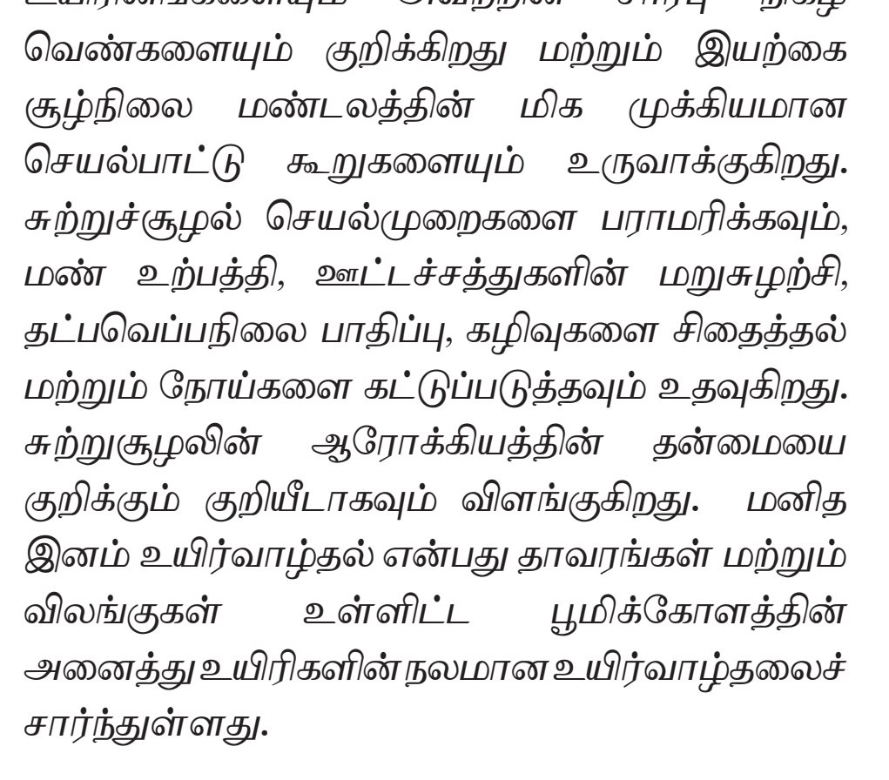
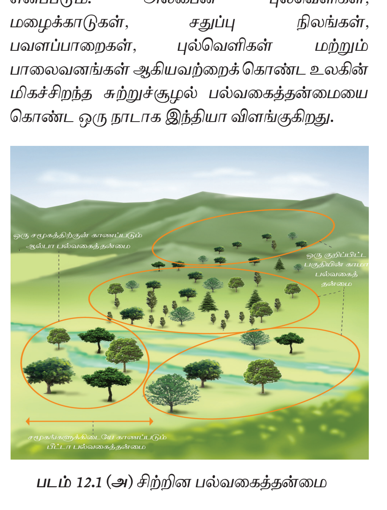
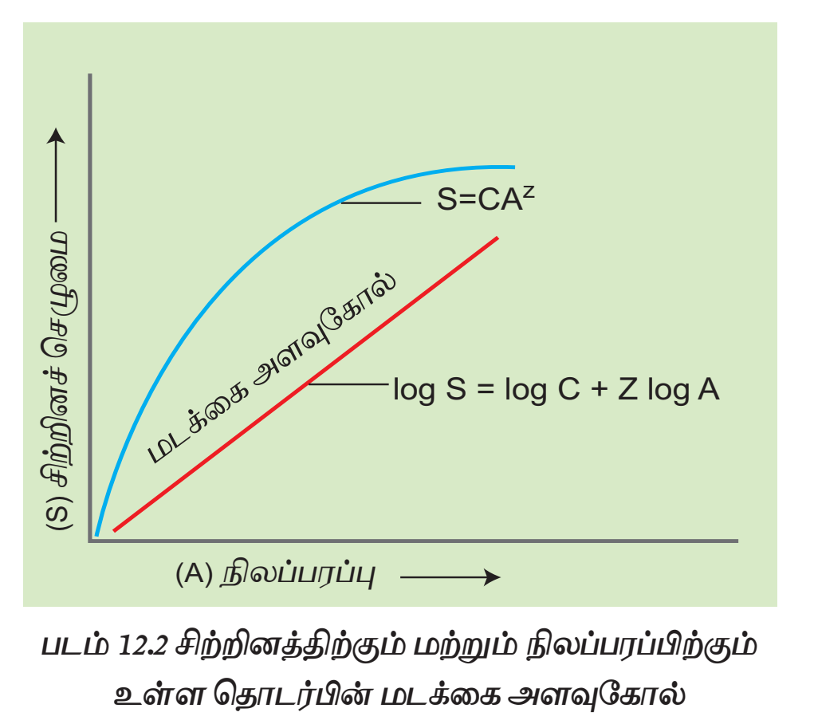
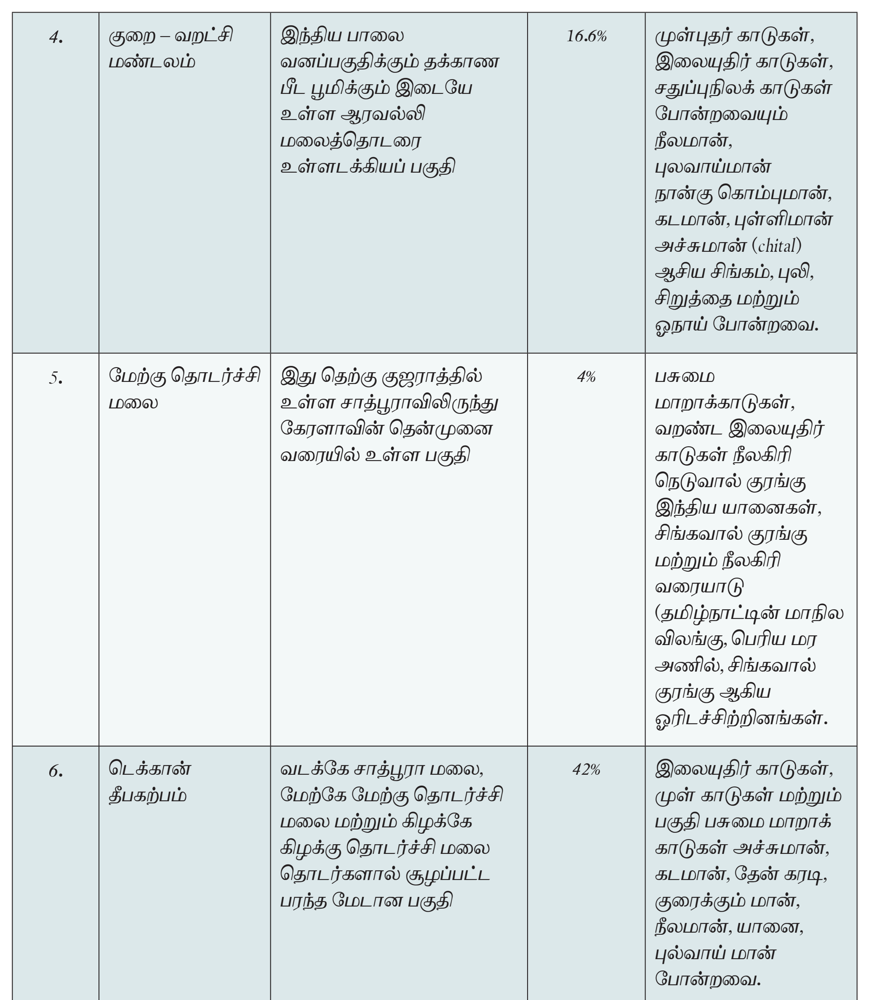
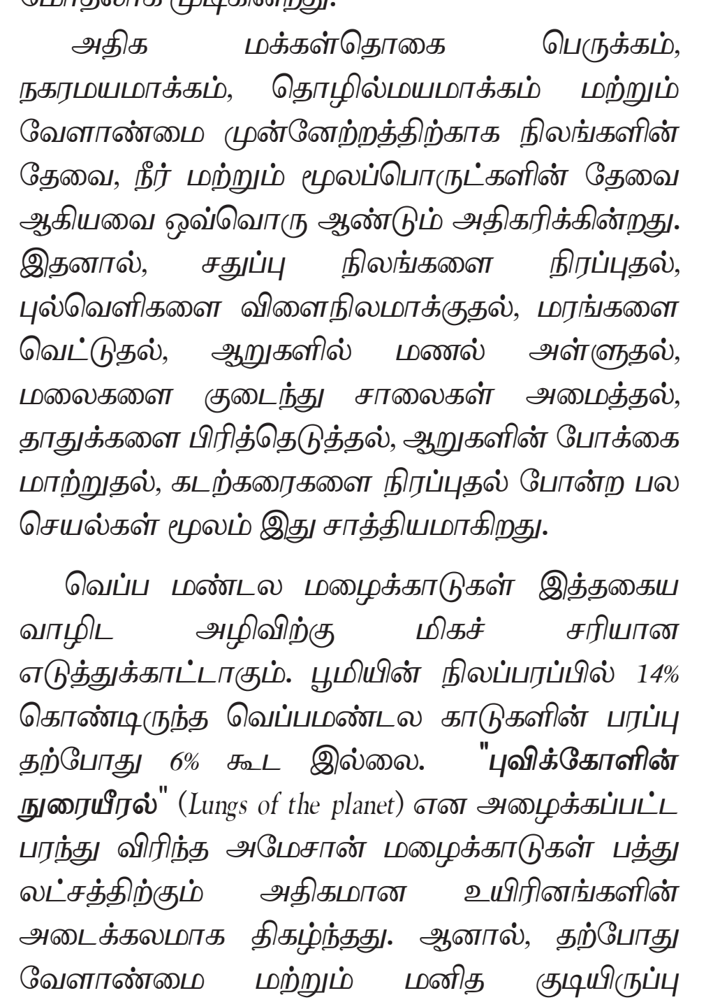
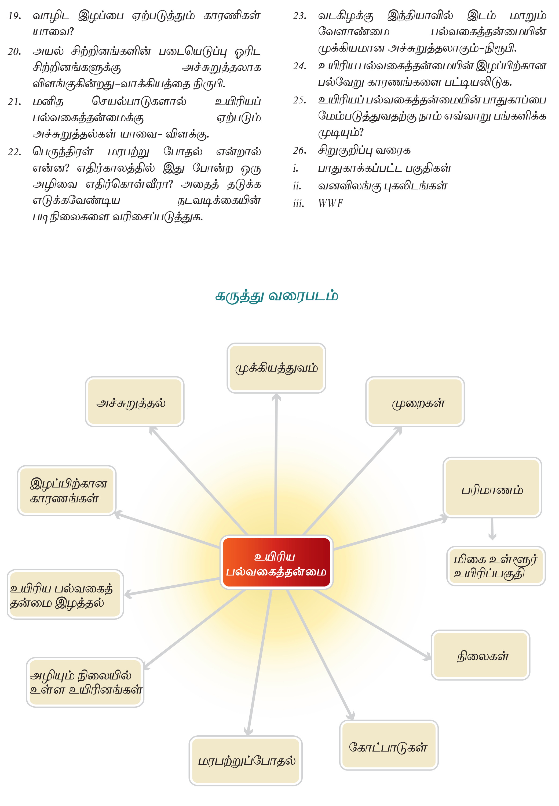

# பாடம் 12: உயிரிய பல்வகைத்தன்மை மற்றும் அதன் பாதுகாப்பு

> மூலம்: தமிழ் வழிப் பாடநூல், PDF பக்கங்கள் 245–272.

> குறிப்பு: கீழுள்ள தேடக்கூடிய உரை துல்லியமான படங்கள், அட்டவணைகள் மற்றும் அமைப்பிற்கு அசல் பக்கங்களைப் பார்க்கவும்.

பாடம்

அலகு - V

உயிரிய
பல்வகைத்தனமை
மற்றும் அதன் பாதுகாப்பு

## பாட உள்ளடக்கம்

12.1
உயிரிய பல்வகைத்தனமை

- 12.2  உலக மற்றும் இந்திய அளவில்

உயிரிய பல்வகைத்தனமையின்
முக்கியத்துவம்

- 12.3  இந்தியாவின் உயிர்ப்புவி

மண்டலங்கள்

- 12.4  உயிரியப் பல்வகைத்தனமைக்கு

ஏற்பட்டுள்ள அச்சுறுத்தல்கள்

- 12.5  உயிரிய பல்வகைத்தனமை

இழப்பிற்ககான காரணங்கள்

- 12.6  சர்வதேச இயற்ககை பாதுகாப்பு

கூட்டமைப்பு - (IUCN)

- 12.7  உயிரியப் பல்வகைத் தனமையின்

பாதுகாப்பு உக்திகள்

- 12.8  சிதைந்த வாழிடங்களின் மீள்

உருவாக்கம்

- 12.9  உயிரிய பல்வகைத்தனமை சட்டம்

– (BDA)

## கற்றலின் நோக்கங்கள் :

-  உயிரினப்
பல்வகைத்தனமையின்
கோட்பபாடு, அடுக்கு மற்றும் பாங்கு
ஆகியவற்றை பற்றிய அறிவைப் பெறுதல்.
-  இந்திய
பல்வகைத்தனமையின்
பரிமாணத்தை உணர்ந்து பாராட்டல்.
-  இந்தியாவின்
உயிரியப்

புவி
மண்டலங்கள்
மற்றும்
வளங்கள்
ஆகியவற்றை புரிந்து கொொள்ளுதல்.

நீலகிரி வரையாடு அழியும் நிலையில் உள்ள
விலங்ககாகும். அத்து மீறி நுழைந்து திருடுவதாலும்
மற்றும் அதிகமாக வேட்டையாடப்படுவதாலும்
அழியும் நிலையில் உள்ள விலங்கு என்று சிவப்பு
பட்டியலில் IUCN வெளியிட்டுள்ளது.

-  உயிரிய
பல்வகைத்தனமைக்கான
அச்சுறுத்தல்களை ஆழ்ந்து நோக்கல்.
-  உயிரினங்கள் மரபற்றுப்போவதற்ககான
காரணங்கள்
மற்றும்
விளைவுகளை புரிந்து
கொொள்ளுதல்.
-  அழிந்து
வரும்
வ ா ழி ட ங் ்க ளை யு ம் ,
சு ற் று ச் சூ ழலை யு ம்
மீட்பதற்ககான விழிப்புணர்வவை ஏற்படுத்தல்.
-  உயிரிய பல்வகைமை சட்டம் மற்றும்
அதன் விதிமுறைளை பற்றி அறிதல்.

இ

ப்புவிக் கோளத்தை நம்மோடு பகிர்ந்து
வாழும்

பல்வவேறு

வகையான

உயிரினங்களான,

தாவரங்கள்,

விலங்குகள்

மற்றும்

நுண்ணுயிரிகள்

வாழ்வதற்ககேற்ற

அழகான

இடமாக

மாற்றுகின்றன. மலை உச்சி முதல் ஆழ்கடல்
வரையிலும்,

பாலைவனங்கள்

முதல்

அடர்த்தியான காடுகள் வரையிலும் ஏறத்தாழ
உலகின் எல்லா இடங்களிலும் உயிரினங்கள்
வாழ்கின்றன. அவை தங்களது பழக்கம், நடத்தை,
வடிவம், அளவு மற்றும் நிறத்தால் ஒன்றுடன்
ஒன்று

வேறுபடுகின்றன.

இவ்வுலகத்தை

உயிரினங்களில்

உயிரிய பல்வகைத்தனமை மற்றும் அதன் பாதுகாப்பு

காணப்படும் குறிப்பிடத்தக்க பன்முகத் தனமை,
நம் பூமிகோளின் பிரிக்க முடியாத முக்கிய
அங்கமாகும். இருப்பினும் தொொடர்ந்து அதிகரித்து
வரும் மானுட மக்கள் தொொகை பெருக்கம்
உயிரியப் பல்வகைத்தனமைக்கு கடுமையான
அச்சுறுத்தலாக விளங்குகிறது.
உயிரியப்
பல்வகைத்தனமையின்
கோட்பபாடுகள்,
அடுக்குகள், பரிமாணம் மற்றும் பாங்கு, உயிரியப்
பல்வகைத்தனமையின் முக்கியத்துவம், இந்திய
உயிரிய புவியமைப்பு மண்டலங்கள், உயிரியப்
பல்வகைத்தனமைக்கு
ஏற்பட்டுள்ள
அச்சுறுத்தல்கள், உயிரியப் பல்வகைத்தனமையின்
அழிவிற்ககான காரணங்கள், மரபற்றுப்போதல்
மற்றும்
உயிரிய
பல்வகைத்தனமையின்
பாதுகாப்பு ஆகியவை பற்றி இப்பாடத்தில்
விளக்கப்படுகிறது.

## 12.1 உயிரிய பல்வகைத்தனமை

1992ல் ஐ.நா.வில் நடந்த புவி உச்சி மாநாட்டில்
நிலம், கடல், பிற நீர் சூழ்நிலை மண்டலங்கள்
மற்றும் தாங்கள் பங்கு கொொள்கின்ற சூழலியல்
கூட்டுத்தொகுதி
உள்ளிட்ட
அனைத்து
ஆதாரங்களிலிருந்தும்
வருகின்ற
உயிரினங்களிடையே காணப்படும் வேறுபாடுகளே
உயிரியப்
பல்வகைத்தனமை
என
வரையறுக்கப்பட்டது.
இதில்
சிற்றினங்களுக்குள்ளேயான
வேறுபாடுகள்,
சிற்றினங்களுக்கு இடையேயான வேறுபாடுகள்
மற்றும் சூழ்நிலை மண்டலங்களுக்கிடையே
உள்ள வேறுபாடுகள் அடங்கியுள்ளது. இது ஒரு
சூழலியல் மண்டலத்தில் உள்ள பல்வவேறு
உயிரினங்களையும் அவற்றின் சார்பு நிகழ்
வெண்களையும் குறிக்கிறது மற்றும் இயற்ககை
சூழ்நிலை மண்டலத்தின் மிக முக்கியமான
செயல்பபாட்டு கூறுகளையும் உருவாக்குகிறது.
சுற்றுச்சூழல் செயல்முறைகளை பராமரிக்கவும்,
மண் உற்பத்தி, ஊட்டச்சத்துகளின் மறுசுழற்சி,
தட்பவெப்பநிலை பாதிப்பு, கழிவுகளை சிதைத்தல்
மற்றும் நோய்களை கட்டுப்படுத்தவும் உதவுகிறது.
சுற்றுசூழலின் ஆரோக்கியத்தின் தனமையை
குறிக்கும் குறியீடாகவும் விளங்குகிறது. மனித
இனம் உயிர்வவாழ்தல் என்பது தாவரங்கள் மற்றும்
விலங்குகள்
உள்ளிட்ட
பூமிக்கோளத்தின்
அனைத்து உயிரிகளின் நலமான உயிர்வவாழ்தலைச்
சார்ந்துள்ளது.
உயிரிய பல்வகைத்தனமை மற்றும் அதன் பாதுகாப்பு

### 12.1.1 உயிரிய பல்வகைத்தனமையின்

கோட்பபாடு
உயிரிய பல்வகைத்தனமை என்ற சொொல்லை
வால்டர்
ரோசன்
என்பவர்
1986ல்
அறிமுகப்படுத்தினார்.
பலதரப்பட்ட
உயிரினங்களின்
தொொகுப்பே
உயிரிய
பல்வகைத்தனமை ஆகும். ஒவ்வொரு உயிரினமும்
குறிப்பிட்ட சூழ்நிலையில் வாழும் வகையில்
தம்மை தகவமைத்துள்ளன. தட்பவெப்ப நிலையில்
ஏற்படும் மாற்றங்கள் நம் கோளில் உள்ள உயிரிய
பல்வகைத்தனமையின் பரவல் மற்றும் பாங்கு
ஆகியவற்றின் மூலம் பிரதிபலிக்கப்படுகின்றன.
வெப்ப மண்டலப் பகுதியிலிருந்து துருவங்களை
நோக்கிச் செல்லச் செல்ல ஒரு அலகு பரப்பிலுள்ள
சிற்றினங்களின் எண்ணிக்கை குறைகிறது. வடக்கு
கனடா, அலாஸ்ககா, வடக்கு ஐரோப்பா மற்றும்
ரஷ்யயா போன்ற நாடுகளில் உள்ள பனிச்சமவெளி
(Tundra) மற்றும் பசுமைமாறா ஊசியிலை காடுகளில்
(Taiga) 12 சிற்றினங்களுக்கும் குறைவான மரங்களே
உள்ளன. அமெரிக்காவின் மிதவெப்பகாடுகளில்
20-35 சிற்றினங்களைச் சேர்ந்த மரங்களும் சிறிய
நிலப்பரப்பை
உடைய
பனாமாவின்
வெப்ப
மண்டலக்
காடுகளில்
110க்கு
மேற்பட்ட
சிற்றினங்களைச் சேர்ந்த மரங்கள் உள்ளன.

### 12.1.2 உயிரிய பல்வகைத்தனமையின்

அடுக்குகள்
இனக்கூட்டம்
(Population)
முதல்
உயிர்தத்ததொகை (Biome) வரையிலான அனைத்து
அடுக்குகளில் உள்ள உயரிய அமைப்புகளின்
வேறுபாட்டை
விளக்குவதற்ககாக,
உயிரிய
பல்வகைத்தனமை என்ற சொொல்லை எட்வர்ட்
வில்சன் என்பவர் பிரபலப்படுத்தினார் (படம் 12.1).
உயிரியப்
பல்வகைமைத்தனமையில்
மூன்று
அடுக்குகள் உள்ளன. அவை
- 
- 
- 

மரபியல் பல்வகைத்தனமை
சிற்றின பல்வகைத்தனமை
சமூக/சூழ்நிலை மண்டல பல்வகைத்தனமை

வேறுபட்ட
சிற்றினங்களுக்கிடையே
மரபியலமைப்பு ரீதியான வேறுபாடு (எண்ணிக்கை
மற்றும்
மரபணுக்களின்
வகைகள்),
ஒரு
சிற்றினத்துக்குள்ளே
காணப்படும்
மரபியல்
அமைப்பில்
உள்ள
வேறுபாடுகள்,
ஒரே
சிற்றினத்தின்
வெவ்வேறு
இனக்கூட்டத்துக்கிடையிலான
மரபியல்
வேறுபாடுகள் ஆகியவற்றைக் குறிப்பது மரபியல்

பல்வகைத்தனமை
எனப்படும்.
பல்வவேறு
மூலக்கூறு தொொழில்நுட்பங்களை பயன்படுத்தி
மரபணு பல்வகைத்தனமை அளவிடப்படுகிறது.
இந்தியாவில் 50,000த்திற்கும் அதிகமான நெல்
மரபணு வகைகளும் 1,000க்கும் மேற்பட்ட மா
மரபணு வகைகளும் காணப்படுகின்றன.
ஒரு
சிற்றினத்தின்
மரபணு
வேறுபாடுகள்,
பல்வகைத்தனமையின்
அளவு
மற்றும்
வாழிடங்களை பொொறுத்து அதிகரிக்கிறது. இதன்
விளைவாக புதிய இனங்கள், ரகங்கள் மற்றும்
துணைச் சிற்றினங்கள் உருவாகின்றன. இமய
மலையின்
பல்வவேறு
பகுதிகளில்
வளரும்
ராவோல்ஃபியா வோமிட்டேரியா என்னும்
மூலிகைத் தாவரத்திலுள்ள ரிசர்பபைன் என்னும்
செயல்திறனுள்ள உட்பொருளின் அடர்த்தியிலும்
ஆற்றலிலும் மரபியல் பல்வகைத்தனமையின்
காரணமாக வேறுபாடுகள் காணப்படுகின்றன.
மரபியல்
பல்வகைத்தனமை,
மாறி
வரும்
சுற்றுச்சூழல் நிலைமைகளுக்கு ஏற்ப உயிரிகள்
தங்கள் தகவமைப்பை மேம்படுத்தி கொொள்ள
உதவுகிறது.
ñóHò ð™õ¬èˆî¡¬ñ

ஒரு வாழிடத்தில் உள்ள சிற்றின வகைகளின்
எண்ணிக்கை மற்றும் அவற்றின் செழுமை
ஆகியவை சிற்றின பல்வகைத்தனமை எனப்படும்.
ஒரு அலகு பரப்பளவில் ஒரு குறிப்பிட்ட நேரத்தில்
காணப்படும்
சிற்றினங்களின்
எண்ணிக்கை
சிற்றினச்சசெழுமை
எனப்படும்.
கிழக்குத்
தொொடர்ச்சி மலைகளை விட மேற்கு தொொடர்ச்சி
மலைப்பகுதியில் இருவாழ்வி சிற்றினங்களின்
எண்ணிக்கை அதிகம்.
ஒரு பகுதியில் ஒரு
சிற்றினத்தின் எண்ணிக்கை அதிகமாக இருந்ததால்
அங்ககே அச்சிற்றினத்தின் செழுமையும் அதிகமாக
இருக்கும் (படம் 12.1அ).
சிற்றின மண்டல பல்வகைத்தனமை மூன்று
பிரிவுகளாவன
i. ஆல்பபா பல்வகைத்தனமை
ii. பீட்டா பல்வகைத்தனமை மற்றும்
iii. காமா பல்வகைத்தனமை ஆகும்
ஆல்பபா பல்வகைத்தனமை
ஒரு குறிப்பிட்ட பகுதி, சமுதாயம் அல்லது
சூழ்நிலை மண்டலத்தில் வாழும் வகைபாட்டுத்
தொொகுதிகளின் (பெரும்பபாலும் சிற்றினங்களின்)
எண்ணிக்கையை வைத்து அளவிடப்படுகிறது.
பீட்டா பல்வகைத்தனமை

Þùˆªî£¬èJ™ àœ÷ ñóHòŠð™õ¬èˆî¡¬ñ
CŸPù ð™õ¬èˆî¡¬ñ

இது அருகருகே உள்ள இரண்டு சூழ்நிலை
மண்டலங்களுக்கிடையேயான
சிற்றின
பல்வகைத்தனமையாகும்.
இது அச்சூழ்நிலை
மண்டலங்களிலுள்ள
தனித்தனமை
வாய்ந்த
சிற்றினங்களின்
எண்ணிக்கையை
ஒப்பீடு
செய்வதன் மூலம் பெறப்படுகிறது.
காமா பல்வகைத்தனமை

èìŸè¬ó ªê‹ñó Å›ñ‡ìôˆF¡
CŸPùŠ ð™õ¬èˆî¡¬ñ
ÅNì ð™õ¬èˆî¡¬ñ

இது மொொத்த நிலப்பரப்பு அல்லது புவியில் உள்ள
அனைத்து
வாழிடங்களுக்கிடையேயான
வேறுபாடுகளை குறிக்கிறது
சூழ்நிலை மண்டல பல்வகைத்தனமை:

இது உயிர்கக்கோளத்தில் உள்ள பல்வவேறுவகையான
வாழிடங்கள், உயிரிய சமுதாயங்கள் மற்றும்
உயிர்கோளத்தின் சுற்றுச்சூழல் செயல்முறைகளில்
உள்ள வேறுபாடுகளைக் குறிக்கும். உணவூட்ட
சுழற்சி, உணவு வலை, ஆற்றல் ஓட்டம் மற்றும் பல
உயிரியல் உள்வினைகள் போன்ற சூழ்நிலைக்
கூறுகள்,
ஊட்டமட்டங்கள்
(trophic
levels)
மற்றும்
சுற்றுச்சூழல்
செயல்முறைகளின்
பல்வகைத்தனமையால்
சூழ்நிலை
மண்டல

உயிரிய பல்வகைத்தனமை மற்றும் அதன் பாதுகாப்பு

அளவில்
காணப்படும்
பல்வகைத்தனமை
சூழ்நிலை
மண்டலம்
பல்வகைத்தனமை
எனப்படும்.
அல்பபைன்
புல்வவெளிகள்,
மழைக்காடுகள்,
சதுப்பு
நிலங்கள்,
பவளப்பாறைகள்,
புல்வவெளிகள்
மற்றும்
பாலைவனங்கள் ஆகியவற்றைக் கொொண்ட உலகின்
மிகச்சிறந்த சுற்றுச்சூழல் பல்வகைத்தனமையை
கொொண்ட ஒரு நாடாக இந்தியா விளங்குகிறது.

### 12.1.3 உயிரிய பல்வகைத்தனமையின்

பரிமாணம்
ஒரு குறிப்பிட்ட பகுதியில் வரையறுக்கப்பட்ட
நேரத்தில்
காணப்படும்
உயிரினங்களின்
எண்ணிக்கையை
கொொண்டு
உயிரிய
பல்வகைத்தனமையை அளவிடலாம். பூமியில்,
காணப்படும்
பல்வவேறு
சிற்றினங்களின்
தற்போதைய மதிப்பீடு சுமார் 8-9 மில்லியன்
ஆகும். இருப்பினும் நம் இயற்ககை செல்வத்தின்
சரியான பரிமாணம், நமக்குத் துல்லியமாக,
தெரியாது. இதுவே “வகைபாட்டியலின் இடையூறு”
எனப்படும்.
இது
வரை
ஏறத்தாழ
1.5 மில்லியன் நுண்ணுயிரிகள், விலங்குகள்
மற்றும்
தாவர
சிற்றினங்கள்
விவரிக்கப்பட்டுள்ளன.
ஒவ்வொரு ஆண்டும்
ஏறத்தாழ 10-15 ஆயிரம் புதிய இனங்கள்
இனங்ககாணப்பட்டு
உலகளாவிய
அளவில்
வெளியிடப்படுகின்றன.
அவற்றில்
75%
முதுகுநாணற்ற
உயிரிகளாகும்.
இன்னும்
கண்டறிப்படாத
இனங்களின்
எண்ணிக்கை
சந்ததேகத்திற்கு இடமின்றி மிகவும் அதிகமாகவே
உள்ளது.
உயிரிய பல்வகைத்தனமை மற்றும் அதன் பாதுகாப்பு

தனித்தனமை வாய்ந்த உயிரிய புவியமைப்பு
கொொண்ட இருப்பிடங்கள், பரந்த மாறுபாடுடைய
காலநிலை கூறுகள், எண்ணிலடங்ககா சுற்றுசூழல்
பல்வகைத்தனமை
மற்றும்
புவியியல்
பல்வகைத்தனமை ஆகியவற்றைப் பெற்றிருப்பதன்
காரணமாக இந்தியா பல்வகைத்தனமையில்
செழிப்பு மிக்க நாடாக விளங்குகின்றது. உலக
உயிரிய
புவியமைப்பு
வகைபாட்டின்
படி
பொொலியார்டிக் மற்றும் இந்தோ-மலேயன் ஆகிய
இரண்டு முக்கிய ஆட்சியெல்லைப் (realms)
பகுதிகள்
மற்றும்
வெப்ப
மண்டல
சதுப்புநிலக்காடுகள், வெப்ப மண்டல வறண்ட
இலையுதிர்
காடுகள்
மற்றும்
வெப்பப்
பாலைவனங்கள் / அரைப் பாலைவனம் என
மூன்று உயிரினத் தொொகையின் பிரநிதியாகவும்
இந்தியா உள்ளது. உலகின் மொொத்த நிலப்பரப்பில்
2.4% மட்டுமே கொொண்ட இந்தியாவில் உலகின் 8%
க்கும் மேலாக விலங்கின சிற்றினங்கள் உள்ளன.
இவ்விழுக்காட்டில் உலகம் அறிந்த 92,000
சிற்றினங்கள் அடங்கும்.
நிலப்பரப்பின்
அடிப்படையில்
இந்தியா
உலகின் ஏழாவது பெரிய நாடாகும். இந்தியாவில்
பல்வவேறு வகையான சூழ்நிலை மண்டலங்கள்,
மலைகள்,
பள்ளத்தாக்குகள்,
பீடபூமிகள்,
கடற்கரைகள், சதுப்புநிலங்கள், கழிமுகங்கள்,
பனிப்பாறைகள்,
புல்வவெளிகள்
மற்றும்
ஆற்றுப்படுகைகள்
போன்ற
பல்வவேறுபட்ட
வாழிடங்களில் வாழும் உயிர்த் தொொகைகளையும்
சுற்றுச்சூழல்
மண்டலங்களையும்
இந்தியா
கொொண்டுள்ளது.
பலதரப்பட்ட பருவநிலை,
மழைப்பொழிவு, வெப்பநிலை, ஆறுகளின் ஓட்டம்
மற்றும் மண் ஆகியவற்றில் இதன் தாக்கம்
பிரதிபலிக்கிறது.

உயிரிய
மிகைப்
பல்வகைத்தனமை கொொண்ட உலக நாடுகளில்
இந்தியாவும்
ஒன்றறாகும்.
மேலும்
தனித்தனமைமிக்க
வாழிடங்கள்
மற்றும்
உயிரினங்களைக் கொொண்ட பத்து உயிர் புவி
மண்டலங்கள் இந்தியாவில் உள்ளன.
"உலகின்
தற்போதைய
உயிரியப்
பல்வகைத்தனமை மிக வேகமாக அழிந்து
வருகிறது. இது இதற்கு முன்னால் பூமியின்
வரலாற்றில் நடந்த ஐந்து அல்லது ஆறு
பேரழிவுவோடு
ஒப்பிடத்தக்க
வகையில்
அமைந்துள்ளது".
 

-உலக வனவிலங்கு நிதியம்

### 12.1.4 உயிரிய பல்வகைத்தனமையின்

பரவல்
தாவர மற்றும் விலங்கினங்களின் பரவல்
உலகம் முழுவதும் சீராக இருப்பது இல்லை.
உயிரினங்களின் வளர்ச்சி மற்றும் உகந்த அளவு
வளர்சிதை மாற்றத்திற்ககாக வெவ்வேறு சூழல்
அமைப்பு
கூறுகள்
உயிரினங்களுக்குத்
தேவைப்படுகின்றன.
வெவ்வேறு
வகை
உயிரினங்கள் தங்களுக்கு ஏற்புடைய இடங்களில்
(வாழிடங்கள்) அதிக எண்ணிக்கையில் வளர்ந்து
பெருக்கமடைகின்றன.
வாழிடங்களின்
தனமைகளை நிலங்களின் பரப்பு மற்றும் கடல்
மட்டத்திலிருந்து அவற்றின் உயரம் ஆகியவை
தீர்மமானிக்கின்றன.

தன்
நிலப்பரப்பில்
பெரும்
பகுதியை
வெப்பமண்டலத்தில்
கொொண்ட
இந்தியாவில்
ஏறத்தாழ 1200க்கும் அதிகமான பறவை இனங்கள்
உள்ளன.
ஆகவே பரப்பு பரவல் சிற்றின
பல்வகைத்தனமையை அதிகரிக்கிறது என்பது
தெளிவாகிறது.
உயரமான மலைப்பகுதிகளில் மேலே செல்ல,
செல்ல வெப்பநிலை குறைவின் காரணமாக
உயிரினங்களின் பல்வகைத்தனமை குறைகின்றது.
(சராசரியாக கடல் மட்டத்திற்கு மேல் ஒவ்வொரு
கி. மீ க்கும் 6.5oC வீதம் வெப்பம் குறைகின்றது).

பரப்பு மற்றும் உயரம் சார்ந்த சரிவு வாட்டம்
வெப்பநிலை,
மழைப்பொழிவு,
நிலநடுக்கோட்டிலிருந்து தூரம் (பரப்பு சரிவு
வாட்டம்) கடல் மட்டத்திலிருந்து அதன் உயரம்
(உயரடுக்கு
சரிவு
வாட்டம்)
ஆகியவை
பல்வகைத்தனமை
பரவலின்
பாங்கினை
நிர்ணயிக்கும் சில காரணிகளாகும்.
உயிரிய
பல்வகைத்தனமையில் மிக முக்கியமானது பரவல்
பரப்பு சார்ந்த பல்வகைத்தனமையாகும். அதாவது,
துருவங்களில்
இருந்து
பூமத்திய
ரேகை
(நிலநடுக்கோடு)
வரை
பல்வகைத்தனமை
அதிகரிக்கின்றது.
துருவப்
பகுதியிலிருந்து
மிதவெப்ப மண்டலத்தை நோக்கி நகரும் பொொழுது
பல்வகைத்தனமை அதிகரித்து வெப்பமண்டல
பகுதிகளில் உச்சத்தை அடைகின்றது. ஆகவே
துருவ மற்றும் மித வெப்ப மண்டலங்களை விட
வெப்ப மண்டலப் பகுதிகளில் குறிப்பாக 23.5oN
மற்றும்
23.5oS
ஆகிய
அட்சகோடுகளுக்கு
இடையிலான (கடக ரேகை மற்றும் மகர ரேகை –
Tropic of cancer and Tropic of capricon) பகுதிகள்
பல்வகைத்தனமையின் புகலிடமாகத் திகழ்கின்றன.
மிதவெப்ப மண்டலங்களில் குளிர் காலங்களில்
கடுமையான காலநிலையும் அதே நேரத்தில்
துருவப்பகுதியில்
ஆண்டில்
பெரும்பபாலான
மாதங்களில் மிகக் கடுமையான காலநிலையும்
நிலவுகின்றது.
நிலநடுக்கோட்டுக்கு (0o) அருகில் உள்ள
கொொலம்பியாவில் ஏறத்தாழ 1400 பறவை இனங்கள்
உள்ளன. அதே வேளையில் 41oN ல் உள்ள
நியூயார்க்
பகுதியில்

இனங்களும்,
o
கிரீன்லலாந்தில் 71 N ல் 56 இனங்களும் உள்ளன.

MSL.171.91m

சராசரி கடல் மட்டம் (Mean Sea level-MSL)
என்பது பூமியின் ஒன்று அல்லது அதற்கு
மேற்பட்ட பெருங்கடல்களின் மேற்பரப்பின்
சராசரி நிலையாகும். இதிலிருந்து உயரமான,
பகுதிகளின் உயரத்தைக் கணக்கிடலாம்.
நாம் இரயிலில் பயணம் செய்யும் பொொழுது,
ரயில்
நிலையங்களின்
மஞ்சள்
நிற
பெயர்ப்பலகையில் பெரிய கருப்பு நிறத்தில்
ஊரின்
பெயர்
எழுதப்பட்டிருப்பதை
பார்க்கலாம். அதை MSL உடன் ஒப்பிடுகையில்
எவ்வளவு உயரத்தில் அந்த ஊர் அமைந்து
உள்ளது என்பதும் குறிப்பிடப்பட்டிருக்கும்.
உதாரணமாக ஈரோடு சந்திப்பு சராசரி கடல்
மட்டத்திற்கு மேலே 171.91 மீட்டர் உயரத்தில்
அமைந்துள்ளது.
வெப்பமண்டல
பகுதிகளில்
உயிரிய
பல்வகைத்தனமையின்
செழுமைக்கான
காரணங்கள்
-  நிலநடுக்கோட்டின் இருபுறங்களிலும் உள்ள
கடகரேகைக்கும் மகரரேகைக்கும் இடைப்பட்ட
பகுதிகளில் உயிரினங்கள் வாழ இணக்கமான
வாழிடங்கள் உள்ளன.

உயிரிய பல்வகைத்தனமை மற்றும் அதன் பாதுகாப்பு

சிற்றினங்களுக்கும் நில பரப்புக்குமான தொொடர்பு
ஜெர்மனியை சேர்ந்த இயற்ககையியலாளர்
மற்றும் புவியியல் ஆர்வலருமான அலெக்சசாண்டர்
வோன் ஹம்போல்ட் (Alexander von Humboldt)
என்பவர்
தென்
அமெரிக்காவில்
உள்ள
காட்டுப்பகுதிகளை கண்டறிந்து ஆய்வு செய்ததார்.
ஆய்வில், ஒரு குறிப்பிட்ட அளவு வரை, ஒரு சூழல்
மண்டலத்துக்குள் உள்ள செழுமை நிலபரப்பிற்கு
ஏற்ப அதிகரித்தைக் கண்டறிந்ததார். பல்வவேறு
வகையான உயிரினங்களின் (பூக்கும் தாவரங்கள்,
பறவைகள், வௌவால்கள், நன்னீர் மீன்கள்)
சிற்றினச்சசெழுமைக்கும் பரப்புக்கும் இடையே
உள்ள தொொடர்பபை ஆராய்ந்ததார். இதன் முடிவாக,
செவ்வக
வடிவிலான
இருபுறஅதிவளைவு
கிடைத்தது.
மடக்கை
அளவுகோலின்படி,
(logarithmic
scale)
சிற்றின
செழுமைக்கும்
பரப்பளவுக்குமான உறவு ஒரு நேர்கக்கோட்டில்
அமைகிறது. அதனை கீழ்க்கண்ட சமன்பபாட்டின்
மூலம் விளக்கலாம்.
logS = log C+ Z log A
S = சிற்றினச் செழுமை
A= நிலப்பரப்பு
Z=  கோட்டின் சாய்வுநிலை (தொொடர்பு போக்கு
கெழு எண்)
C = Y-இடை குறுக்கீடு
உயிரிய பல்வகைத்தனமை மற்றும் அதன் பாதுகாப்பு

S=CAz
(S) c  ன  ெச ைம

-  வெப்ப மண்டலங்களில் உள்ள சூழ்நிலைக்
கூறுகள் சிற்றினமாக்கலுக்கு மட்டுமல்லாமல்
உயிரினங்களின்
பலவகை
மற்றும்
எண்ணிக்கையை அதிகரிக்கவும் ஏதுவாக
உள்ளன.
-  25oC முதல் 35oC வரை வெப்பநிலை நிலவுகிறது
இந்த
வெப்ப
நிலை,
உயிரினங்களின்
பெரும்பபாலான வளர்ச்சிதை மாற்றங்கள்
எளிதாகவும்
மற்றும்
அதிதிறனுடனும்
செயல்பட உதவுகின்றது.
-  பெரும்பபாலும், ஆண்டுக்கு 200 மி.மீக்கும்
அதிகமாக மழை பெய்கிறது.
-  காலநிலை, பருவங்கள், வெப்பநிலை, ஈரப்பதம்,
ஒளிக்காலம்
ஆகியவை
ஏறக்குறைய
நிலையாக
இருப்பதால்
உயிரினங்களில்
வேற்றுமைத்
தனமையையும்
எண்ணிக்கையையும் உயர்த்த உதவுகின்றன.
-  ஊட்டச்சத்து
மற்றும்
அதிக
வளங்கள்
கிடைக்கின்றன.

மட

க

ை

v

ள

அ

ா 

ேக

log S = log C + Z log A

வகைப்பாட்டியல்
குழு
அல்லது
மண்டலங்களுக்கு
அப்பாற்பட்டு
தொொடர்பு
போக்குக் கெழு எண் Z, பொொதுவாக 0.1 - 0.2
வரையிலான
மதிப்பை
கொொண்டிருக்கும்.
இருப்பினும், கண்டங்கள் போன்ற மிகப்பபெரிய
பரப்புகளில் சிற்றினங்களுக்கும் – பரப்புக்குமான
தொொடர்பு போக்கு கோடு குத்துச் சாய்வவாக
காணப்படுகிறது
(Z-மதிப்பு
0.6
1.2)
எடுத்துக்காட்டாக, பல்வவேறு கண்டங்களில் உள்ள
வெப்ப மண்டல காடுகளின் பழம் உண்ணும்
பறவைகள் மற்றும் பாலூட்டிகளின் குத்து சாய்வுக்
கோட்டின் Z-மதிப்பு 1.15 ஆகும் (படம் 12.2).

## 12.2  உலக மற்றும் இந்திய அளவில்

உயிரிய பல்வகைத்தனமையின்
முக்கியத்துவம்

உயிரிய பல்வகைத்தனமை என்பது இந்த
பூமியில் வாழும் பலவகையான உயிரினங்களை
குறிக்கிறது.
அதாவது
நுண்ணுயிரிகளை
உள்ளடக்கிய தாவர மற்றும் விலங்குகளின்
பல்வவேறு சிற்றினங்களின் எண்ணிக்கையை
குறிக்கிறது. மழைக்காடுகள், பவளப்பாறைகள்,
புல்வவெளிகள்,
பாலைவனங்கள்,
பனிச்சமவெளிகள் மற்றும் துருவ பகுகளின்
பனிப்பாறைகள்
போன்ற
பல்வவேறு
சூழ்நிலைகளைக்
கொொண்ட
வெவ்வேறு
சூழ்நிலை மண்டலங்களில் இவ்வுயிரினங்கள்
வாழ்கின்றன.
ஒரு சூழ்நிலை மண்டலத்தில் ஏற்படும்
சிற்றினங்களின் இழப்பால் ஏற்படும் விளைவை
புரிந்துகொொள்ள சூழியல் வல்லுநர் பால் எர்லிச்
“ரிவட் பாப்பர் கருதுகோளை” (Rivet Popper
Hypothesis) வெளியிட்டார்.

ஒரு
சூழ்நிலை
மண்டலத்தில்
உள்ள
ஒவ்வொரு சிற்றினத்தையும் ஒரு வானூர்தியின்
(Aeroplane) உடலில் உள்ள திருகு ஆணியுடன்
ஒப்பிட்டார். வானூர்தியின் (சூழ்நிலை மண்டலம்)
எல்லா பாகங்களும் ஆயிரக்கணக்கான திருகு
ஆணிகளால்
(சிற்றினங்கள்)
இணைக்கப்பட்டுள்ளது. இவ்வூர்தியில் பயணம்
செய்யும் ஒவ்வொரு பயணியும், அதிலுள்ள
திருகாணிகளை கழற்றி அவரவர் வீட்டிற்கு
எடுத்துச் சென்றறால் (சிற்றினத்தின் இழப்பு)
தொொடக்கத்தில் இச்சசெயல் ஊர்தியின் பறக்கும்
செயலுக்கு பாதிப்பை ஏற்படுத்தாமலிருக்கலாம்.
ஆனால், காலப்போக்கில் ஊர்தி மென்மமேலும்
திருகாணிகளை இழக்கும் போது, வலுவிழந்து
ஆபத்தான நிலைக்கு தள்ளப்படும். மேலும் இதில்
எந்தத் திருகாணி கழற்றப்படுகிறது என்பதும்
முக்கியமாகிறது.
ஊர்தியின்
இறக்கைளை
இணைக்கும்
முக்கிய
திருகாணி
(மூலச் சிற்றினத்தின் இழப்பு) நீக்கப்படும்போது,
அது சந்ததேகத்திற்கு இடமின்றி வானூர்தியின்
பறக்கும் செயலுக்கு அச்சுறுத்தலாக அமைகிறது.
ஆகவே
சூழ்நிலை
மண்டலத்தில்
உள்ள
ஒவ்வொரு சிற்றினத்தின் பங்கும், அச்சூழ்நிலை
மண்டலத்தின்
ஒருமித்த
இணைந்த
செயல்பபாட்டுக்கு
அவசியம்
என்பதை
உணர்கிறோம்.
நம் கோளத்தின் நல்வவாழ்விற்கும் உயிரிகள்
நிலைத்திருப்பதற்கும்
உயிரியப்
பல்வகைத்
தனமை
அவசியமானதாகும்.
உயிரிய
பல்வகைத்தனமையின்
முக்கியத்துவத்தை
கீழ்க்கண்ட நிலைகளில் அளவீடு செய்யலாம்.
i)  சூழ்நிலை மண்டல சேவைகள், ii) உயிரிய
வளங்கள்
மற்றும்
iii)
உயிரிய
பல்வகைத்தனமையின் சமூகப்பயன்கள்
உலகளாவிய
அளவில்
சூழ்நிலை
மண்டலத்தின் அமைப்பு மற்றும் செயல்பபாடுகள்
உயிரியப் பல்வகைத்தனமை மற்றும் அதன்
செழுமையையே
சார்ந்துள்ளது.
உயிரிய
பல்வகைத்தனமையின் முக்கிய செயல்பபாடுகளின்
பண்புக்கூறுகளாவன.
-  ஊட்டச்சத்து சுழற்சி அல்லது உயிரியபுவிவேதிய(N2, C, H2O, P, S) சுழற்சிகள்
தொொடர்ந்து நடைபெறுதல்.
-  மண்
நுண்ணுயிரிகள்
வெவ்வேறு
ஊட்டநிலை உறுப்பினர்களோடு இணைந்து

மண் உருவாக்கம், சீரமைப்பு அல்லது மண்
வள பராமரிப்பு ஆகியவை நடைபெறுதல்.
-  சூழ்நிலை மண்டலத்தின் உற்பத்தி திறன்
அதிகரிப்பு மற்றும் உணவு வளங்களை
வழங்குதல்
-  நீர் பிடிப்பு பகுதிகளாக, வடிகட்டிகளாக,
நீரோட்ட நெறிபடுத்திகளாக மற்றும் நீர்
சுத்திகரிப்பாளர்களாக
செயல்படுதல்
(வனப்பகுதிகள் மற்றும் தாவர செறிவு)
-  தட்பவெப்பநிலையின்,
நிலைத்தனமை
(மழைப்பொழிவு,
வெப்பநிலை
நெறிப்படுத்துதல்,
CO2
உறிஞ்சப்படுதல்
ஆகியவற்றிற்கு
காடுகள்
அவசியம்.
ஏனெனில் காடுகள் அங்குள்ள, தாவரங்களின்
வகைகளையும்
அடர்த்தியையும்
ஒழுங்குபடுத்துகிறது.)
-  காட்டு வளங்களின் மேலாணமை மற்றும்
நிலையான தொொடர் வளர்ச்சி
-  உயிரியல் கூறுகளிடையே
பராமரித்தல்

-  மாசுபடுத்திகளை நீக்குதல் – மனிதர்கள்
உற்பத்தி செய்கின்ற குப்பைகள், கழிவுநீர்,
சாக்கடை மற்றும் வேளாண் கழிவுகள்
ஆகியவற்றை சிதைப்பதில் நுண்ணுயிரிகள்
மிகப் பெரிய பங்ககாற்றுகின்றன.
-  சுற்றுச்சூழல்
நிலைப்புத்
தனமை

உயிரினங்களின் பல்வகைத்தனமை மற்றும்
செழுமை ஆகியவை சுற்றுசூழல் நிலைப்புத்
தனமைக்கும்
சிற்றினங்களின்
தொொடர்
வாழ்விற்கும்
பெரும்பங்ககாற்றுகின்றன.
உணவு வளங்கள், மரபியல் வளங்கள்,
மருந்து வளங்கள் மற்றும் எதிர்ககால உயிரிய
வளங்கள்
போன்றவற்றிற்ககான
சேமிப்பு
இடமாக
உயிரிய
பல்வகைத்தனமை
மண்டலங்கள் உள்ளன.
-  தனித்துவமான அழகு உணர்வு மற்றும்
சுற்றுசூழல்
சார்ந்த
சிறப்பு
சுற்றுலா
தலங்களைத் தருகிறது.
வனவளங்கள்
மற்றும் வன உயிரினங்களுடன் சூழலியல்
சுற்றுலாவிற்ககென வணிக முக்கியத்துவமும்
உண்டு.
-  சூழ்நிலை மண்டலத்தின் ஆரோக்கியத்தினை
சுட்டிக்காட்டுகிறது, ஓரிடச்சார்பு உயிரிகள்
(endemism)
செழுமையின்
சிறப்பு
சுட்டிக்காட்டியாகும்.

சமநிலையை

உயிரிய பல்வகைத்தனமை மற்றும் அதன் பாதுகாப்பு

## 12.3  இந்தியாவின் உயிர்ப்புவி மண்டலங்கள்

தட்பவெப்பம் தாவரங்கள், விலங்கினங்கள் மற்றும் மண் வகை ஆகியவற்றின் அடிப்படையில் அமைந்த
சர்வதேச உயிர்குழும வகைபாட்டின் படி இந்தியாவை பத்து வெவ்வேறு உயிர்ப்புவி மண்டலங்களாகப்
பிரிக்கலாம் (படம் 12.3 மற்றும் அட்டவணை 12.1).

அட்டவணை 12.1 இந்தியாவின் உயிர்ப்புவி மண்டலங்கள்
வ.
எண்

உயிர்ப்புவி
மண்டலங்கள்

1.

இமய மலைக்கு
அப்பாலுள்ள
மண்டலம் (Trans
Himalayas)

லடாக்கின் மலைப்பகுதிகள்
(J &K), சிக்கிம் வடபகுதி
மற்றும் ஹிமாச்சல
பிரதேசத்தின் லஹலா
மற்றும் ஸ்பிதி ஆகியவற்றை
உள்ளடக்கியது.

5.6%

ஆல்பபைன், புல்வவெளி
தாவரங்கள்
உலகிலேயே மிக
அதிக அளவிலான
காட்டு செம்மறி
ஆடுகள் மற்றும்
வெள்ளாடுகள் (மிகத்
தரமான கம்பளிக்கு
பெயர் பெற்றது) சிரு
(Chiru – திபெத்திய
மானினம்) கருப்பு
பாறை கொொக்கு
போன்றவை.

2.

இமயமலை
(Himalayas)

வடமேற்கு முதல் வட
கிழக்கு இந்தியா வரை
நீண்டு காணப்படும் முழு
நிள மலைத் தொொடர்

6.4%

ஆல்பபைன் காடுகள்,
ஆர்க்கிட்டுகள்
பசுமை மாறா புதர்
செடிகள் காட்டு
செம்மறி ஆடுகள்,
மலை வெள்ளாடுகள்,
மூஞ்சுறு,
பனிசிறுத்தை, பாண்டடா
போன்றவை.

3.

இந்திய
பாலைவனம்
(Indian desert)

குஜராத்தின் உப்புப்
பாலைவனத்தையும் (கட்ச்)
மற்றும் இராஜஸ்ததானின்
மணல் பாலைவனத்தையும்
(தார்) உள்ளடக்கிய
ஆரவல்லி மலைத்
தொொடரின் மேற்கில் உள்ள
மிகவும் வறண்ட பகுதி.

6.6%

முட்ககாடுகள்,
இலையுதிர்க்
காடுகள், காட்டுக்
கழுதை (உள்ளூர்
இனம்) இந்திய
பஸ்டடார்டு, ஒட்டகம்,
குள்ளநரிகள்,
பாம்புகள்
போன்றவை.

உயிரியப் பகுதிகள்

உயிரிய பல்வகைத்தனமை மற்றும் அதன் பாதுகாப்பு

பரப்பளவு
சதவீதம்

உயிரினங்கள்

4.

குறை – வறட்சி
மண்டலம்

இந்திய பாலை
வனப்பகுதிக்கும் தக்காண
பீட பூமிக்கும் இடையே
உள்ள ஆரவல்லி
மலைத்தொடரை
உள்ளடக்கியப் பகுதி

16.6%

முள்புதர் காடுகள்,
இலையுதிர் காடுகள்,
சதுப்புநிலக் காடுகள்
போன்றவையும்
நீலமான்,
புலவாய்மமான்
நான்கு கொொம்புமான்,
கடமான், புள்ளிமான்
அச்சுமான் (chital)
ஆசிய சிங்கம், புலி,
சிறுத்தை மற்றும்
ஓநாய் போன்றவை.

5.

மேற்கு தொொடர்ச்சி
மலை

இது தெற்கு குஜராத்தில்
உள்ள சாத்பூராவிலிருந்து
கேரளாவின் தென்முனை
வரையில் உள்ள பகுதி

4%

பசுமை
மாறாக்காடுகள்,
வறண்ட இலையுதிர்
காடுகள் நீலகிரி
நெடுவால் குரங்கு
இந்திய யானைகள்,
சிங்கவால் குரங்கு
மற்றும் நீலகிரி
வரையாடு
(தமிழ்நநாட்டின் மாநில
விலங்கு, பெரிய மர
அணில், சிங்கவால்
குரங்கு ஆகிய
ஓரிடச்சிற்றினங்கள்.

6.

டெக்கான்
தீபகற்பம்

வடக்கே சாத்பூரா மலை,
மேற்ககே மேற்கு தொொடர்ச்சி
மலை மற்றும் கிழக்கே
கிழக்கு தொொடர்ச்சி மலை
தொொடர்களால் சூழப்பட்ட
பரந்த மேடான பகுதி

42%

இலையுதிர் காடுகள்,
முள் காடுகள் மற்றும்
பகுதி பசுமை மாறாக்
காடுகள் அச்சுமான்,
கடமான், தேன் கரடி,
குரைக்கும் மான்,
நீலமான், யானை,
புல்வவாய் மான்
போன்றவை.

7.

கங்ககை சமவெளி

இந்திய நாட்டின் மிக
வளமான பகுதிகளில்
ஒன்றறான இது கிழக்கு
இராஜஸ்ததானில் தொொடங்கி
உத்திரபிரதேசம் பிஹார்
மற்றும் மேற்கு வங்ககாளம்
வரை நீண்ட பகுதி

10.8%

சதுப்பு நில காடுகள்,
வறண்ட இலையுதிர்
காடுகள், காண்டடா
மிருகம், யானை புலி
எருமை, முதலை,
சதுப்புநில மான்கள்
வராக மான்
போன்றவை.

உயிரிய பல்வகைத்தனமை மற்றும் அதன் பாதுகாப்பு

8.

வடகிழக்கு
இந்தியா

- 

வட கிழக்கு இந்தியச்
சமவெளிகள் மற்றும்
இமயமலை சாராத
பகுதிகள்

- 

இப்பகுதி இந்தியா
– இந்தோமலேயா
மற்றும் இந்தோ –
சீனா ஆகிய உயிர்
புவி மண்டலங்களின்
நிலைதிரிபு மண்டலம்.

- 

இப்பகுதி தீபகற்ப
இந்தியாவும்,
இமயலையும் சந்திக்கும்
இடம்.

5.2%

பெரும்பபாலான
இந்திய தாவர மற்றும்
விலங்கினங்களுக்கு
‘உயிர் புவியமைப்பு
வாயில்' மற்றும் மிகை
உயிரியப் பல்வகைத்
தனமை கொொண்ட
பகுதி.
பகுதி இலையுதிரா
காடுகள், மழைக்
காடுகள், சதுப்பு நிலக்
காடுகள் மற்றும்
புல்வவெளிகள், இந்திய
காண்டடாமிருகம்,
சிறுத்தை,
தங்கநிறமந்தி
போன்றவை. .

9.

கடற்கரையோர
மண்டலம்

குஜராத்திலிருந்து
சுந்தரவனக் காடுகள்
வரையிலுள்ள
மணல் கடற்கரைகள்,
பவளப்பாறைகள்,
மண்திட்டுகள், சதுப்பு
நிலங்கள் ஆகியவற்றை
உள்ளடக்கிய பகுதி.

2.5%

சதுப்புநில
தாவரங்கள்,
கடற்பஞ்சுகள்,
பவளப்பாறைகள்,
நண்டுகள்,
கடல் ஆமைகள்,
சூரைமீன்கள்,
அலங்ககார மீன்கள்
போன்றவை.

10.

அந்தமான்
மற்றும்
நிக்கோபர்
தீவுகள்

வங்ககாள விரிகுடாவில்
உள்ள அந்தமான் மற்றும்
நிக்கோபர் தீவுகளை
உள்ளடக்கிய பகுதி

0.3%

பசுமை மாறாக்
காடுகள், பலதரப்பட்ட
பவளங்கள்,
நார்கண்டம்
இருவாயன்கள்,
இராட்சத கொொள்ளை
நண்டுகள், கடல்
ஆமைகள், காட்டுப்
பன்றிகள், நீர் உடும்பு
தெற்கு அந்தமான்
கட்டுவிரியன்
பாம்புகள்
போன்றவை.

உயிரிய பல்வகைத்தனமை மற்றும் அதன் பாதுகாப்பு

Þñòñ¬ô‚° ܊𣽜÷ ñ‡ìô‹
Þñòñ¬ô
Þ‰Fò ð£¬ôõù‹
°¬ø- õø†C ñ‡ìô‹
«ñŸ° ªî£ì˜„C ñ¬ô
ªì‚裡 bðèŸð‹
胬è êñªõO

## 12.4  உயிரியப் பல்வகைத்தனமைக்கு

ஏற்பட்டுள்ள அச்சுறுத்தல்கள்
உயிரிய மிகைப் பல்வகைத்தனமை உடைய
மண்டலங்கள்

என்று

அறிவிக்கப்பட்ட

நாடுகளில் இந்தியாவும் ஒன்றறாக இருப்பினும்,
அதன்

உயிரியப்

வகையான

பல்வகைத்தனமை

அச்சுறுத்தல்களை

பல்வவேறு

எதிர்கொள்ள

வேண்டியுள்ளது.
இயற்ககையால் ஏற்படும் அச்சுறுத்தல்களைத்
தவிர, நேரடியாகவும், மறைமுகமாகவும் வாழிடம்

மற்றும் உயிரியப் பல்வகைத்தனமை ஆகியவற்றின்
இழப்பிற்கு இன்றறைய மனிதனின் செயல்பபாடுகள்
முக்கிய

காரணங்களாகும்.

செயல்பபாடுகளால் நிலப்பரப்பு துண்டடாடப்படுதல்
மற்றும் அழிக்கப்படுதல், பிரித்ததெடுத்தல் (சுரங்கம்,
மீன்பிடித்தல், தேங்கிடங்கள், அறுவடை) மற்றும்
வளர்ச்சி

(குடியிருப்புகள்,

மற்றும்

தொொடர்புடைய

தொொழிற்சசாலைகள்
உட்கட்டமைப்புகளை

உருவாக்குதல்) ஆகியவை வாழிட இழப்பு மற்றும்
துண்டடாடப்படுதலுக்குக் காரணமாகின்றன. இதன்
விளைவாக,

வேளாணமை

தனிமைப்படுத்தப்பட்ட

பகுதிகள்,

உயிரிய பல்வகைத்தனமை மற்றும் அதன் பாதுகாப்பு

சிறிய மற்றும் ஆங்ககாங்ககே உருவான உயிரின
கூட்டங்கள் ஆகியவை உருவாக வழி ஏற்படுகிறது.
அவ்வாறு உருவான சிறுகூட்டம் அழியும் நிலை
இனங்களாக மாறுகின்றன.
சிறப்பு வகையான உணவு பழக்கம், சிறப்பு
வகை வாழிடத் தேவை, பெரிய உடல், சிறிய
இனக்கூட்டம்,

குறைவான

புவியியல்

பரவல்

மற்றும் பொொருளாதார அல்லது வணிக உயர்மதிப்பு
ஆகியவை

உயிரியப்

பல்வகைத்தனமைக்கான

வேறு சில அச்சுறுத்தல்கள் ஆகும்.
பாலூட்டிகளை

விட

பெரிய

சிறிய

பாலூட்டிகள்

அவற்றின் உடலமைப்பிற்கு ஏற்ப, உணவு தேவை,
பாதுகாப்பு,

இனப்பபெருக்க

இணை

ஆகிய

வாழ்வியல் தேவைக்காக அதிக நிலப்பரப்புடைய
காடுகளை

நம்பியுள்ளன.

ஒரு

சிங்கத்தின்

தனிப்பட்ட வாழிட பரப்பின் தேவை 100 சதுர.கி.மீ
ஆகும். ஊன் உண்ணிகள், பழந்தின்னிகள் போன்ற
பாலூட்டிகள்

சிறப்பு

வகையான

உணவுத்

தேவையைக் கொொண்டவையாகும். மேலும் இவை
பொொதுவான உணவை ஏற்றுக் கொொள்ளும் தாவர
மற்றும்

அனைத்துண்ணிகளை

அளவிலான

நிலபரப்பை

பயன்படுத்துவது

விட

பெரிய

இரைதேடலுக்குப்

அவசியமாகும்.

சிறிய

கொொறித்துண்ணிகள் தவிர மீதமுள்ள பாலூட்டிகள்
குறைந்த இனப்பபெருக்க திறன் கொொண்டவை.
தென்கிழக்கு
ஆசிய
பகுதியான குவாமி (Gaum)
யின்
பழந்திண்ணி
வௌ ௌ வ ா ல் ்களை
எ டு த் து க் ்ககா ட் ்டடாக க்
கொொண்டு
ஒரு
மண்டலத்தில்
உள்ள
அனைத்து உயிர்க்கூறுகளையும் சார்புத்
தனமையையும் அறியலாம். இப்பழந்திண்ணி
வௌவால்கள்
இங்குள்ள
மக்களின்
ருசியான உணவு என்பதால் அவற்றின்
இனக்கூட்டம் வேகமாகக் குறைந்து வருவது
வியப்புக்குரியதல்ல.
ஆனால், மகரந்த
சேர்க்கையாளர்களாக
அடையாளம்
காணப்பட்டுள்ள
இவ்வௌவால்களின்
எண்ணிக்கை் குறைவினால், உள்ளூர் பழ
உற்பத்தி வெகுவாக குறைந்திருப்பது தான்
வியப்பாகும். எனவே இத்தகைய சூழலை
தவிர்க்க வேண்டுமெனில், பல்வகைத்தனமை
பெருந்ததேவையாய் இருக்கிறது.
உயிரிய பல்வகைத்தனமை மற்றும் அதன் பாதுகாப்பு

## 12.5  உயிரிய பல்வகைத்தனமை

இழப்பிற்ககான காரணங்கள்
உயிரியப் பல்வகைத்தனமை குறைவதற்ககான
முக்கிய காரணங்கள் பின்வருமாறு
-  வாழிட இழப்பு, காடுகள் துண்டடாடப்படுதல்
மற்றும் அழித்தல் (ஏறத்தாழ 73% அனைத்து
சிற்றினங்களையும் பாதிக்கிறது)
-  சுற்றுச்சூழல்
மாசுறுதல்
மற்றும்
மாசுபடுத்திகள்
(புகைபனி,
தீங்குயிர்கக்ககொல்லிகள், களைக்கொல்லிகள்,
எண்ணணெய் கசிவுகள், பசுமை இல்ல வாயுக்கள்)
- தட்பவெப்பநிலை மாற்றம்
-  வெளிநாட்டு
சிற்றினங்களை
அறிமுகப்படுத்துதல்
-  வளங்கள்
அதிகமாக
சுரண்டப்படுதல்
(ஆக்கிரமிப்பு, மரங்களை வரையறையின்றி
வெட்டுதல், மிகை மீன்பிடிப்பு, வேட்டையாடல்,
சுரங்கங்கள்)
-  தீவிர
வேளாணமை,
நீருயிரி
வளர்ப்பு
நடைமுறைகள்
-  உள்ளூர் இனங்களுடன் வெளிஇனங்களை
இணைத்து கலப்பினம் உருவாக்குவதால்
உள்ளூர் இனங்கள் அழிதல்
-  இயற்ககை
பேரழிவுகள்
(ஆழிப்பேரலை,
காட்டுத்தீ, நிலநடுக்கம், எரிமலை)
-  தொொழில்
மயமாக்கம்,
நகரமயமாக்கம்,
உட்கட்டமைப்பு வளர்ச்சி, சாலை மற்றும்
கப்பல் போக்குவரத்து பணிகள், தகவல்
தொொடர்பு
கோபுரங்கள்,
அணைகட்டுதல்,
கட்டுப்பாடற்ற சுற்றுலா, ஒற்றை பயிர் சாகுபடி
ஆகியவை
பொொதுவான
குறிப்பிடத்தக்க
அச்சுறுத்தல்களாகும்.
- இணை மரபற்றுப்போதல்
வாழிட இழப்பு
மனித சமுதாயத்தின் வளர்ச்சி தவிர்க்க
முடியாத ஒன்று.
குடியிருப்புகள், விவசாயம்,
சுரங்கம் அமைத்தல், தொொழிற்சசாலைகள் மற்றும்
நெடுஞ்சசாலைகள்
அமைத்தல்
போன்ற
காரணங்களுக்காக
உயிரினங்களின்
இயற்ககையான வாழிடங்கள் அழிக்கப்படுகின்றன.
இதன் விளைவாக, உயிரினங்கள் சுற்றுசூழலில்
ஏற்படும்
மாற்றங்களுக்கேற்ப
தங்களை
தகவமைத்துக்
கொொள்ள
அல்லது
வேறு
இடங்களுக்கு நகர கட்டாயப்படுத்தப்படுகின்றன.
இல்லையெனில்
அவ்வுயிரினங்கள்
கொொன்றுண்ணிகள், பட்டினி, நோய் ஆகியவற்றுக்கு

பலியாகி இறுதியில் இறக்கின்றன அல்லது மனித
- விலங்கு (மனிதன் விலங்குகளுக்கிடையே)
மோதலாக முடிகின்றது.
அதிக
மக்கள்தொகை
பெருக்கம்,
நகரமயமாக்கம், தொொழில்மயமாக்கம் மற்றும்
வேளாணமை முன்னேற்றத்திற்ககாக நிலங்களின்
தேவை, நீர் மற்றும் மூலப்பொருட்களின் தேவை
ஆகியவை ஒவ்வொரு ஆண்டும் அதிகரிக்கின்றது.
இதனால்,
சதுப்பு
நிலங்களை
நிரப்புதல்,
புல்வவெளிகளை விளைநிலமாக்குதல், மரங்களை
வெட்டுதல், ஆறுகளில் மணல் அள்ளுதல்,
மலைகளை குடைந்து சாலைகள் அமைத்தல்,
தாதுக்களை பிரித்ததெடுத்தல், ஆறுகளின் போக்கை
மாற்றுதல், கடற்கரைகளை நிரப்புதல் போன்ற பல
செயல்கள் மூலம் இது சாத்தியமாகிறது.
வெப்ப மண்டல மழைக்காடுகள் இத்தகைய
வாழிட
அழிவிற்கு
மிகச்
சரியான
எடுத்துக்காட்டாகும். பூமியின் நிலப்பரப்பில் 14%
கொொண்டிருந்த வெப்பமண்டல காடுகளின் பரப்பு
தற்போது 6% கூட இல்லை.
“புவிக்கோளின்
நுரையீரல்” (Lungs of the planet) என அழைக்கப்பட்ட
பரந்து விரிந்த அமேசான் மழைக்காடுகள் பத்து
லட்சத்திற்கும்
அதிகமான
உயிரினங்களின்
அடைக்கலமாக திகழ்ந்தது. ஆனால், தற்போது
வேளாணமை
மற்றும்
மனித
குடியிருப்பு
களுக்காக பல பகுதிகள் அழிக்கப்பட்டுள்ளன.
நியூசிலாந்தின் 90% சதுப்பு நிலங்கள் அழிக்கப்பட்டு,
சோயா பீன்ஸ் பயிரிடுவதற்கும் இறைச்சி தரும்
கால்நடைகளுக்கு புல் வளர்ப்பிடமாகவும் தற்போது
மாற்றியமைக்கப்பட்டுள்ளன.
தமிழ்நநாட்டில்
கொொடைக்கானல் மற்றும் நீலகிரி மலைகள் மனித
ஆக்கிரமிப்புகளால் வேகமாக அழிக்கப்பட்டு
வருகின்றன. உயிரினங்களின் வாழிட அழிப்பின்
விளைவாக
தாவரங்கள்,
நுண்ணுயிர்கள்
ஆகியவை
அழிக்கப்பட்டுள்ளன
மற்றும்
விலங்குகள் தம்முடைய வாழிடங்களை விட்டு
வெளியேற வேண்டிய நிலை ஏற்படுகிறது.
வாழிடங்கள் துண்டடாடப்படுதல்
உயிரினங்கள்
வாழும்
ஒரு
பெரிய
தொொடர்ச்சியான நிலப்பரப்பு இரண்டு அல்லது
அதற்கு மேற்பட்ட சிறு பகுதிகளாகப் பிரித்தல்
“வாழிடம் துண்டடாடப்படுதல்” எனப்படும். காட்டு
நிலங்களை விளை நிலங்களாக மாற்றுதல்,
பழத்தோட்டங்கள், மலைத்தோட்டங்கள், நகர்ப்புற
குடியிருப்புகள் அமைத்தல், தொொழிற்பபேட்டைகள்,
விளைபொொருட்களை
எடுத்து
செல்ல

வழித்தடங்கள் அமைத்தல் ஆகிய நிகழ்வுகளால்
வாழிடங்கள் துண்டடாடப்படுகின்றன.
இதன்
விளைவாக சிற்றினங்களுக்கு இடையே உள்ள
சில சிக்கலான தொொடர்புகள் (உணவு சங்கிலி,
உணவு வலை) அழிக்கப்படுதல், அழிக்கப்பட்ட
பகுதியில் உள்ள உயிரினங்கள் அழிதல், இந்த
வாழிடங்களில்
மட்டும்
வாழக்கூடிய
உயிரினங்கள் அழிதல் மற்றும் தூண்டடாடப்பட்ட
வாழிடத்தில் உள்ள பல்வகைத்தனமை குறைதல்
ஆகியவை ஏற்படுகின்றன. அதிக நிலப்பரப்பை
தேவையாகக் கொொண்ட பாலூட்டிகள் மற்றும்
பறவை
போன்ற
விலங்குகள்
கடுமையாக
பாதிக்கப்படுகின்றன.
யானை வழித்தடங்கள்
மற்றும் வலசைபோகும் பாதைகள் ஆகியவை
எளிதில் பாதிக்கப்படுகின்றன. சிட்டுக் குருவிகள்
போன்ற நன்கு அறியப்பட்ட பறவைகள் மற்றும்
விலங்குகள் எண்ணிக்கையில் குறைய இதுவும்
ஒரு காரணமாகும்.
சிட்டுக் குருவிகளை தேடுவோம்
வரையறையற்ற
நகரமயமாதலின்
காரணமாகச்
சிட்டுக்குருவிகள்
இனம்
அழிவை நோக்கி செல்கின்றது. இக்குருவிகள்
தங்களின் இயற்ககை வாழிடங்களை மட்டும்
தொொலைக்கவில்லை, தன் தேவைக்காகவும்
வாழ்க்கை்காகவும் சார்ந்திருக்க வேண்டிய
மனிதனோடான உறவையும் இழக்கின்றன.
உறையிடப்பட்ட
உணவுகள்,
வேளாணமைக்கான
பூச்சிக்கொல்லிகள்
மாறும் வாழ்க்கை முறைகள் மற்றும் தீப்பபெட்டி
போன்ற
அடுக்குமாடி
குடியிருப்புகள்
ஆகியவற்றால் பறவைகளுக்குத் தேவையான
உணவு
மற்றும்
பாதுகாப்பான
இடம்
ஆகியவற்றில் பற்றாக்குறை ஏற்படுகிறது. சுவர்
மற்றும் சன்னல் இடுக்குகளில் கூட்டினை
அமைக்கும் புறாக்கள் போல இல்லாமல்
சிட்டுக்குருவிகளுக்கு தங்கள் கூட்டினை கட்ட
பொொந்துகள் தேவைப்படுகின்றன.
நவீன
கட்டுமானங்களில்
பொொந்துகளுக்கான
வாய்ப்புகள்
இல்லாதிருப்பதால்
சிட்டுக்
குருவிகள்
கூட்டிற்ககான
இடமின்றி
தவிக்கின்றன.
மிகை பயன்பபாடு
உணவு மற்றும் பாதுகாப்பான தங்குமிடம்
போன்ற அடிப்படைத் தேவைகளுக்கு நாம்
இயற்ககை
வளங்களையே
சார்ந்துள்ளோம்.

உயிரிய பல்வகைத்தனமை மற்றும் அதன் பாதுகாப்பு

இருப்பினும்,
தேவை
பேராசையாகும்போது
இயற்ககை
வளங்கள்
அளவுக்கு
அதிகமாக
பயன்படுத்தப்படுகிறது.
இதனால் அத்தகைய
சிற்றினங்களின் இனத் தொொகை அளவு குறைந்து
எளிதில் மரபற்றுப்போகும் வாய்ப்புக்குள்ளாகிறது.
டோடோ, பயணிகள் புறா, ஸ்டடெல்லரின் கடல்பசு
ஆகியவை கடந்த 200-300 ஆண்டுகளின் மனிதனின்
அதீத பயன்பபாட்டால் மரபற்றுப்போன இனங்களில்
சிலவாகும். மக்கள் தொொகையின் அழுத்தத்தால்
அதிகமான மீன்கள் பிடிக்கப்பட்டதால் உலக
அளவில் கடல் மீன்களின் வளம் (உயிர்தத்ததொகை)
குறைந்து வருகிறது.
அயல்நநாட்டு இனங்களின் உள்ளேற்றம்
அந்நிய இனங்கள் (வெளியூர்/வெளிநாடு)
பெரும்பபாலும்
தற்சசெயலாகவோ
அல்லது
வேண்டுமென்றறே
வர்த்தக
நோக்கங்களுக்காகவோ, உயிரி வழிகட்டுபாட்டு
முகவர்களாகவோ அல்லது பிற பயன்களுக்காக
அறிமுகப்படுத்திப்படுகின்றன.
அவை
பெரும்பபாலும்
ஆக்கிரமிப்புத்
தனமையுடன்
இருப்பதால்
அவை
உள்ளூர்
இனங்களை
வெளியேற்றி
விடுவதால்
உயிரினங்களின்
அழிவிற்கு இரண்டடாவது முக்கிய காரணியாக
அந்நிய இனங்கள் கருதப்படுகிறது.
அயல்
இனங்கள்
நீர்
மற்றும்
தரை
சூழ்நிலை
மண்டலங்களுக்கு
தீங்கு
விளைவிப்பதாக
நிரூபிக்கப்பட்டுள்ளன.
1952 இல் தென்னாப்பிரிக்காவின் கிழக்கு
கடற்கரையிலிருந்து கொொண்டு வரப்பட்ட அதிக
உற்பத்தித்திறனுடைய
திலேப்பியா
(ஜிலேபி
கெண்டடை – ஒரியோகுரோமிஸ் மொொசாம்பிகஸ்)
கேரளாவின்
உள்ளூர்
நீர்நிலைகளை
ஆக்கிரமித்ததின்
விளைவாக
உள்ளூர்
இனங்களான பன்டியஸ் டூபியஸ் (Puntius dubius)
மற்றும் லேபியோ கோண்டியஸ் (Labeo kontius)
போன்ற மீன்கள், அப்பகுதியில் விரைவில் அழியும்
நிலையில் உள்ளன. நம் ஆறுகளில் மீன் வளர்ப்பு
நோக்கத்திற்ககாக, ஆப்பிரிக்க பூனை மீன் கிளாரியஸ்
கேரிபின்னஸ் (Clarias gariepinus), உள்ளூர் பூனை
மீன்களுக்கு பெரும் அச்சுறுத்தலாக உள்ளது.
நைல்பபெர்ச் (Nile perch) என்ற கொொன்றுண்ணி
மீனை தெற்கு ஆப்பிரிக்காவில் விக்டோரியா ஏரியில்
அறிமுகப்படுத்தியதன் விளைவாக சுற்றுசூழல்
தனித்துவம் வாய்ந்த இயற்ககையான 200க்கும்
மேற்பட்ட சிச்லிட் மீன் இனம் அழிந்துவிட்டது.
உயிரிய பல்வகைத்தனமை மற்றும் அதன் பாதுகாப்பு

உலகளாவிய தட்பவெப்பநிலை மாற்றம்
தட்பவெப்பநிலை மாற்றத்திற்ககான முக்கிய
காரணியான
தொொழில்மயமாக்கம்
உயிரியப்
பல்வகைத்தனமைக்கு மிகுந்த அச்சுறுத்தலாக
விளங்குகிறது. புதைப்படிவ எரிப்பொருட்கள் தான்
இன்றறைய
தொொழிற்சசாலைகளை
இயக்கும்
ஆற்றலாகும். இதன் விளைவாக பசுமை இல்ல
வாயுக்களில் ஒன்றறான கார்பன்-டை-ஆக்சசைடு
அதிகரித்து
தட்பவெப்பநிலை
மாற்றத்திற்கு
வழிவகுகின்றது.
காடுகள் பெரிய அளவில்
அழிக்கப்படுவதால்
தொொழிற்சசாலைகள்
வெளியிடும்
CO2
முழுமையாக
உறிஞ்சப்படுவதில்லை
எனவே
கார்பன்
டைஆக்ஸஸைடின்
அடர்த்தி
காற்றில்
அதிகரிக்கின்றது. தட்பவெப்பநிலை மாற்றத்தின்
காரணமாக நிலம் மற்றும் கடலின் வெப்ப நிலை
உயர்ந்து
மழைப்பொழிவின்
முறைகளை
மாற்றுகின்றன.
இதனால் பனிப்பாறைகள்
உருகுதல்,
வெள்ளப்பபெருக்கு
வானிலை
நிலவரத்தை கணிக்க இயலாமை, மிக அதிக
வெப்பம் மற்றும் குடல் நோய்கள் பரவுதல்,
விலங்குகளின் இடப்பபெயர்வு மற்றும் வனங்களில்
மரங்கள் இழப்பு ஆகியவை ஏற்படுகின்றன. எனவே
காலநிலை மாற்றம் தற்போதைய உயிரியப்
பல்வகைத்தனமைக்கு ஒரு உடனடி ஆபத்தாகக்
கருதப்படுகிறது.
ñQî ªêò™ð£´è÷£™
õ£»‚èœ ñŸÁ‹
裟Á ªîOŠð£¡
ªõOŠð£´

ñQî˜èœ
Å›G¬ô ñ‡ìô
«ê¬õèœ
nல

பய பா 
மா ற 

è£ôG¬ô
èƒèœ

è£ôG¬ô

è£ôG¬ô
心°ð£´

è£ôG¬ô
èƒèœ

àJKòŠ
ð™õ¬èˆ
ñ
Å›G¬ô ñ‡ìô
ªêò™èœ

àJKùƒèOù£™ ªõOŠð´‹
ð²¬ñ Þ™ô õ£»‚èœ
ñŸÁ‹ 裟Á ªîOŠð£¡
ªõOŠð£´

இடம் மாறும் வேளாணமை (உடைத்து எரித்தல்
வேளாணமை)
இயற்ககையான மரங்களை கொொண்ட வனங்களை
எரித்து சுத்தம் செய்து 2-3 பருவத்திற்கு பயிர்
சாகுபடி செய்தபின் மண் வளம் குறைந்து இனி

பயிர் உற்பத்தியில் அதிக லாபம் ஈட்ட முடியாத
நிலை வந்தவுடன் அந்த நிலங்களை கைவிட்டு
விட்டு வேறு பகுதிகளுக்கு இடம்பபெயர்ந்து அங்கு
ஒரு புதிய இடத்தை தேர்வு செய்து மீண்டும் பயிர்
உற்பத்திக்கு மரங்களை வெட்டி எரித்து நிலத்தை
தயார் படுத்துவர். இதுவே இடம் மாறும்
வேளாணமை எனப்படும். இம்முறை, வடகிழக்கு
இந்தியப் பகுதியில் நடைமுறையில் உள்ளது.
இவ்வாறு பெரிய வனப்பரப்பு எரிக்கப்படுவதால்
வனத்தின் பரப்பளவு குறைந்து மாசு ஏற்படுவதுடன்
வெளியேற்றப்படும்
கார்பன்
டைஆக்ஸஸைடு
அளவும் அதிகரித்தது. வாழிட அழிப்பு மற்றும்
தட்பவெப்பநிலை
மாற்றம்
ஆகியவற்றுக்கு
வழிவகுகின்றது.
இது விலங்கினங்கள் மீது
தாக்கத்தை ஏற்படுத்தும்.
இணை-மரபற்றுப் போதல்
இணை மரபற்றுபோதல் என்பது ஒரு இனம்
மரபற்று போவதனால் அதைச் சார்ந்த மற்றொரு
இனமும் மரபற்றுப் போதலாகும். எடுத்துகாட்டாக
ஆர்க்கிட்
தேனீக்கள்
மற்றும்
வனத்தில்
காணப்படும் மரங்கள் (அயல் மகரந்த சேர்க்கை).
ஒரு இனத்தின் அழிவு தானாகவே இன்னொரு
இனத்தின் அழிவை தூண்டுகிறது. மற்றொரு
உதாரணம் மொொரிஷியஸ் தீவில் அழிந்து போன
டோடோ பறவை மற்றும் கல்வவாரியா மரத்திற்கு
உள்ள தொொடர்பு. கல்வவாரியா மரம் தன் வாழ்க்கை
சுழற்சியை நிறைவு செய்ய டோடோ பறவையை
சார்ந்துள்ளது. கல்வவாரியா மரத்தின் விதைகள்
மிக கடுமையான கொொம்பு போன்ற நீட்சிகளுடைய
உள் விதையுறையைக் கொொண்டது. இதை டோடோ
பறவை உண்டு. அரைவைப்பையில் உள்ள பெரிய
கற்கள் மற்றும் குடல்சசாறுகளின் செயல்பபாடுகளால்
திறம்பட செரித்து விதைகளின் முளைக்கும்
திறனை எளிதாக்குகின்றது.
இந்த டோடோ
பறவையின் அழிவு கல்வவாரியா மரத்திற்கு உடனடி
ஆபத்தாக அமைந்தது.
இதனால் கல்வவாரியா
மரமும் மரபற்று போனது.
தீவிர வேளாணமை
சில
சமயங்களில்
சதுப்புநிலங்கள்,
புல்வவெளிகள் மற்றும் வனங்கள் ஆகியவற்றின்
அழிவில், வேளாணமை பரவுகிறது.
தீவிர
வேளாணமை ஒரு சில அதிக விளைச்சல்
தரும்
பயிர்
இனங்களைச்
சார்ந்துள்ளது.
இதன் விளைவாக மரபிய பல்வகைத்தனமை
குறைகின்றது.
மேலும் இப்பயிர்கள், பூச்சிகள்
மற்றும் நோயூக்கிகளின் திடீர் தாக்குதலுக்கு

ஆளாகும். ஆபத்தும் உள்ளது. தமிழ்நநாட்டில்,
கலப்பின
நெல்வகைகளை
அதிகமாக
பயன்படுத்துவதால் பாரம்பரிய நெல் வகைகள்
குறைந்து தற்போது ஒரு சில இனங்கள் மட்டுமே
உள்ளன.

### 12.5.1 உயிரிய பல்வகைத்தனமையின் இழப்பு

உலகில் உயிர்கள் தோன்றியது முதல்
இயற்ககையாகவே உயிரினங்கள் உருவாவதும்
மறைவதும் (மரபற்றுபோவதும்) தொொடர்ந்து நடந்து
வருகின்றன. இருப்பினும், தற்போது மிக வேகமாக
மரபற்றுப்போகின்றன. இது பூமியின் சுற்றுசூழலின்
நிலைப்புத்தனமையும்
மற்றும்
பல்வகைத்
தனமையின் பரவலையும் சீர்குலைக்கின்றது.
மனித
செயல்பபாடுகளே
பெருமளவிலான
பல்வகைத்தனமையின்
அழிவிற்கு
முக்கிய
காரணமாகும். இயற்ககை வளங்களான நிலம், நீர்
மற்றும் உயிரினங்கள் போன்றவை கட்டுப்பாடின்றி
மிக அதிகமாக மனிதர்களால் சுரண்டப்படுகின்றன.
உயிரிய
பல்வகைத்தனமை
மாநாட்டின்
கருத்துபடி, மனித செயல்பபாடுகள், நேரடியாகவும்
மறைமுகமாகவும் உயிரிய பல்வகைத்தனமையின்
மீது
அழிவைத்
தரும்
தாக்கத்தை
ஏற்படுத்துகின்றன.
உள்ளூர்
நிலங்களின்
பயன்பபாட்டை
மாற்றுதல்,
உயிரினங்களை
அறிமுகப்படுத்துதல் அல்லது நீக்குதல், அறுவடை
செய்தல், மாசடைதல் மற்றும் காலநிலை மாற்றம்
போன்ற மனிதனின் நேரடி செயல்பபாடுகள்
உயிரினப்
பல்வகைத்தனமையின்
மீது
அழுத்தத்தைக் கொொடுத்து இழப்பைத் தருகின்றன.
மக்கள் தொொகை பெருக்கம், பொொருளாதாரம்,
தொொழில்நுட்பங்கள், கலாச்சாரம் மற்றும் சமய
காரணிகள் ஆகிய மறைமுக செயல்பபாடுகளும்
இழப்பிற்கு பெரும்பங்ககாற்றுகின்றன.
புதிய உயிரினங்கள் கண்டுபிடிக்கப்பட்டாலும்
சிற்றினமாக்கல் வழியாக புதிய சிற்றினங்களை
உயிரிய

பல்வகைத்தனமையில்

நம்பிக்கை குறைவாகவே உள்ளது.

பருவமழை

பொொய்த்தல், புவிவெப்பமடைதல், ஒசோன் சிதைவு,
மலைப்

பிரதேசங்களில்

ஏற்படும்

நிலச்சரிவு

மற்றும் மாசுபாடு போன்ற மனிதனின் மறைமுக
செயல்பபாடுகள் உயிரிய பல்வகைத்தனமையை
அழிக்ககூடியனவாகும்.

இயற்ககை

மற்றும்

இயற்ககை வளங்களின் பாதுகாப்பிற்ககான சர்வதேச
ஒன்றியம் (International Union for Conservation of
Nature: IUCN) வெளியிட்டுள்ள சிவப்பு பட்டியல்

சேர்ப்பதற்கு

உயிரிய பல்வகைத்தனமை மற்றும் அதன் பாதுகாப்பு

(2004), 500 ஆண்டுகளில் 784 இனங்கள் மரபற்றுப்
போனதை ஆவணப் படுத்தியுள்ளது.
உயிரினங்களின்
இயற்ககையான
மரபற்றுப்போதலின் வீதத்தை விட தற்போதைய
விகிதம் 100 முதல் 1000 மடங்கு அதிகமாக இருக்கும்
என்று
மதிப்பிடப்பட்டுள்ளது.
இந்த
வீதம் எதிர்ககாலத்தில் மேலும் அதிகரிக்கும் என
எதிர்பபார்க்கப்படுகிறது. தாவரம் மற்றும் மனித
வாழ்க்கையில்
பல்வகைத்தனமை
நிறைய
தாக்கங்களை ஏற்படுத்துகின்றது. உணவுவலையின்
மீது பல்வகைத்தனமையின் பல்வவேறு எதிர்மறை
விளைவுகளை
ஏற்படுத்தியுள்ளது.
ஒரு
சிற்றினத்தின் இழப்பு கூட முழு உணவு சங்கிலியை
மிக மோசமாக தாக்கும், அதன் விளைவாக
உயிரின பல்வகைத்தனமையின் ஒட்டுமொொத்த
குறைப்பிற்கு காரணமாகின்றன. பல்வகைத்தனமை
அழிவால் சூழ்நிலை மண்டலத்தின் சேவைகள்
குறைந்து உணவு பற்றாக்குறை ஏற்படும் அபாயமும்
உள்ளது.

### 12.5.2 அபாயநிலை மிகை உள்ளூர்

உயிரினப் பகுதி (Hot spots)

அசாதாரணமான மற்றும் துரிதமான வாழிட
மாறுபாட்டு இழப்புகளைச் சந்திக்கும் உள்ளூர்
சிற்றினங்களை (ஓரிடத்தனமை (Endemism) ஒரு குறிப்பிட்ட பகுதியில் மட்டுமே மிக அதிக
அளவில் காணப்படும் தனித்தனமை வாய்ந்த
உயிரினங்களைக் குறிப்பது) அதிகமாகக் கொொண்ட
நிலப்பரப்பு அபாயநிலை மிகை உள்ளூர் உயிரினப்
பகுதி (Hotspot) எனப்படும். நார்மன் மையர்ஸ் (Norman
Myers) என்பவர் அபாயநிலை மிகை உள்ளூர்
உயிரினப் பகுதி தனித்தனமையுடைய உள்ளூர்
உயிரினங்களின் பல்வகைத்தனமையை அதிகமாகக்
கொொண்ட, அதே நேரத்தில் மனித செயல்பபாடுகளால்
குறிப்பிடத்தக்க
அளவிற்கு
பாதிக்கப்பட்டு
மாற்றியமைக்கப்பட்ட பகுதி என்று வரையறுத்தார்.
அபாயநிலை மிகை உள்ளூர் உயிரினப் பகுதி
என்பது குறைந்தது 1500 வாஸ்குலார் கற்றைக்
கொொண்ட தாவர இனங்களில் (உலக அளவில் இது
0.5%) - 70% க்கும் அதிகமான மூல தாவர
இனங்களை இழந்த பகுதியாகும். உலகில்
36 உயிரியப் பல்வகைத்தனமை அபாயநிலை மிகை
உள்ளூர் உயிரினப் பகுதிக்கான இடங்கள்
அடையாளம் காணப்பட்டுள்ளன. அதில் நான்கு
இந்தியாவில் உள்ளது (சுற்றுசூழல் தகவல்
மையம், ENVIS).
உயிரிய பல்வகைத்தனமை மற்றும் அதன் பாதுகாப்பு

அவையாவன
அ.  இமயமலை (முழு
தொொடர் மண்டலம்).

இந்திய

இமயமலைத்

ஆ. மேற்கு தொொடர்ச்சி மலைகள்.
இ.  இந்தோ-பர்மமா, அசாம் மற்றும் அந்தமான்
தொொகுதி
தீவுகள்
(மற்றும்
மியான்மர்,
தாய்லலாந்து,
வியட்நநாம்,
லாவோஸ்,
கம்போடியா மற்றும் தெற்கு சீனா) தவிர்த்து
முழு வடகிழக்கு மண்டல இந்தியாவை
உள்ளடக்கியது.
ஈ.  சுந்ததாலேன்ட் (சுந்ததாலேன்ட்-குமரிக்கண்டம்):
நிக்கோபார்
தீவுகளை
உள்ளடக்கியது
(இந்தோனேசியா,
மலேசியா,
சிங்கப்பூர்,
புரூனே,
பிலிப்பைன்ஸ்
ஆகியவையும்
அடங்கும்).

### 12.5.3 அழியும் நிலை இனங்கள்

(Endangered species)

இவை, மரபற்றுப்போக அதிக வாய்ப்புகள்
உள்ளது
என
வகைப்படுத்தப்பட்டுள்ள
சிற்றினங்கள் ஆகும். சர்வதேச இயற்ககைப்
பாதுகாப்பு கூட்டமைவின் சிவப்புப் பட்டியலில்
வரிசைப்படுத்தப்பட்டுள்ள படி தீவிரமாக அழியும்
(Critically
endangered)
நிலையிலுள்ள
உயிரினங்களுக்கு அடுத்த படியாக அழியும்
நிலையிலுள்ள வன (Endangered) விலங்குகளுக்கு
இரண்டடாம்
நிலை
அதிகபட்ச
பாதுகாப்பு
தரப்பட்டுள்ளது.
மேலும் ஒரு இனம் மரபற்றுபோகிறது.

ஜார்ஜ் என்ற மர நத்தை (Achatinella apexfulva)
ஜனவரி 1, 2019 அன்று தனது 14 வது வயதில்
இறந்தது. அந்த நத்தை தான் அந்த இனத்தின்
கடைசி நத்தையாகும். இது ஹவாய் வாழ்
மெல்லுடலிகள்
இழப்பிற்ககான
அடையாளமாகும்.
1998 ஆம் ஆண்டில் 1102 விலங்கினங்களும்
மற்றும் 1197 தாவர இனங்களும் IUCN சிவப்பு

பட்டியலில் இடம் பெற்றுள்ளன. 2012 ஆம்
ஆண்டில் வெளியான IUCN சிவப்பு பட்டியலில்
3079 விலங்கினங்களும் மற்றும் 2655 தாவர
இனங்களும் உலகமெங்கும் அழிந்து வரும்
இனங்கள் (EN) என பட்டியலிடப்பட்டுள்ளது.

### 12.5.4 மரபற்றுப்போதல் (Extinction)

காலத்தில் பேரழிவு ஏற்பட்டு ஆழமற்ற கடல்நீரில்
வாழ்ந்த 90% முதுகுநாணற்ற உயிரினங்கள்
மரபற்றுப் போயின
(iii)  மானுடசெயல்பபாடுகளால்
போதல்
வேட்டையாடுதல், வாழிடச் சீரழிவு, மிகை

உலகின் எந்தப் பகுதியிலும், ஒரு இனத்தின்

பயன்பபாடு, நகரமயமாக்கல் மற்றும் தொொழில்

ஒரு உறுப்பினர் கூட உயிருடன் இல்லை என்ற

மயமாக்கல்

போன்ற

நிலையை அடைந்த இனம் மரபற்றுப் போனதாகக்

இவ்வகை

அழிவினைத்

கருதப்படுகிறது.

மொொரிஷியஸ்

தீவுகளில்

பிடிபட்ட

ஒரு

நிலையில்

இனத்தின்
அல்லது

உயிரிகள்

பிற

மரபற்றுப்

மனித

ரஷ்யயாவில்

வாழ்ந்த

மனித

நடவடிக்கைள்
தூண்டுகின்றன.

வாழ்ந்த

டோடோ,

ஸ்டடெர்லரின்

கடல்பசு

உயிருடன்

ஆகியவை இதற்கு சிறந்த எடுத்துக்காட்டுகளாகும்.

இருந்ததால் அந்த இனம் வனத்தில் அழிந்து விட்டது

வாழிட இழப்பு காரணமாக பல இருவாழ்விகள்

எனக்

அழிவின் விளிம்பில் உள்ளதாக அறியப்படுகிறது.

கட்டுப்பாட்டுச்

சூழலில்

கருதப்படும்.

இவ்வினம்

இவ்விரு

உலகளவில்

கருதப்படும்.

மட்டுமே

நிலையிலுமே,

மரபற்றுப்போனதாகக்

ஒரு இனம் சொொந்த வாழிடத்தில்

இல்லாமல் மற்றொரு இடத்தில் அடைக்கலம்
பெற்று உயிருடன் இருக்குமானால் அது உள்ளூர்
மரபற்றுப்போனதாகக் கருதப்படும்.

பல்வகைத்தனமையின்
முக்கிய

காரணம்

இழப்பிற்கு

உயிரினங்கள்

மிக

மரபற்று

போவதாகும்.

இதனால்

உயிரினங்களின்

மரபுப்பொருளில்

உள்ள

தனித்துவமிக்க

செய்திகளும் (DNA) அதன் சிறு வாழிடங்களும்

கடந்த 450 மில்லியன் ஆண்டுகளில் பூமியில்
ஐந்து பேரழிவுகள் நிகழ்ந்து அதன் விளைவாக
உலகில்
ஏறத்தாழ
50%
தாவர
மற்றும்
விலங்கினங்கள் அழிந்துள்ளன.

நிரத்தரமாக இழக்கப்படுகின்றன.

உயிரினங்களின் அழிவிற்கு மிக கடுமையான
சுற்றுசூழல் மாற்றங்கள் மற்றும் இனத்தொகை
பண்புகளும் காரணமாகும்.

இயற்ககை வளங்களை பாதுகாத்தல் மற்றும்
இயற்ககை வளங்களை தொொடர்ந்து பயன்படுத்துதல்
ஆகியவற்றை முன்னிறுத்தி செயல்பட்டு வரும்
நிறுவனமே,
சர்வதேச இயற்ககை பாதுகாப்பு
கூட்டமைப்பு ஆகும். இது 1948 ஆம் ஆண்டு
சுவிட்சர்லலாந்தில் உள்ள கிளாண்ட் VDயில்
(Gland VD) நிறுவப்பட்டது.
தகவல் சேகரிப்பு
மற்றும் பகுப்பாய்வு ஆராய்ச்சிகள், களத்திட்டங்கள்
மற்றும் பாதுகாப்பு தொொடர்பபான கல்வி, நிலையான
வளர்ச்சி மற்றும் உயிரின பல்வகைத்தனமை
ஆகியவற்றில்
தன்னை
ஈடுபடுத்திக்
கொொண்டுள்ளது. இயற்ககை பாதுகாப்பு, இயற்ககை
வளங்களின்
சமமான
பயன்பபாடு
மற்றும்
சுற்றுச்சூழலின்
நிலைப்புத்தனமை
ஆகியவற்றிற்ககாக
உலகெங்கும்
உள்ள
சேவை
நிறுவனங்களை
ஒருங்கிணைத்து
ஊக்கப்படுத்துவதே IUCN நிறுவனத்தின் இலக்கு
ஆகும். அரசு மற்றும் தொொழிற்சசாலைகளுடன்
தங்களை இணைத்துக் கொொண்டு அவற்றிற்கு
தகவல்கள்
மற்றும்
ஆலோசனைகளை
வழங்குவதன் மூலம் அவற்றைத் தூண்டுகிறது.
அழியும் ஆபத்தில் உள்ள உயிரினங்களின்

மரபற்றுபோதல் மூன்று வகைப்படும்
(i)

இயற்ககை வழி மரபற்றுபோதல்
சுற்றுச்சூழல் மற்றும் பரிணாமத்தில் ஏற்பட்ட

மாற்றங்கள், கொொன்றுண்ணிகள் மற்றும் நோய்கள்
போன்ற

காரணங்களால்

தற்போதுள்ள

ஒரு

சிற்றினம் மேம்பட்ட தகவமைப்புகளைக் கொொண்ட
மற்றொரு சிற்றினத்தால் மாற்றம் செய்யப்படுதல்
இயற்ககை வழி மரபற்றுப்போதல் எனப்படும். இது
மந்தமாக நடைபெறும் செயலாகும். அகக்கலப்பின்
வீரியக் குறைவு (குறைவான தகவமைப்பு மற்றும்
மாறுபாடு) காரணமாக சிறு

இனக்கூட்டங்கள்

பெரிய

விட

இனக்

கூட்டங்களை

விரைவில்

மரபற்றுப் போகின்றன.
(ii) பெருந்திரள் மரபற்றுப்போதல்
சுற்றுச்சூழல்
பேரழிவுகளால்
பூமி
சில
பெருந்திரள் அழிவுகளை சந்தித்துள்ளது. 225
மில்லியன் ஆண்டுகளுக்கு முன் பெர்மியன்

## 12.6  சர்வதேச இயற்ககை பாதுகாப்பு

கூட்டமைப்பு (IUCN)

உயிரிய பல்வகைத்தனமை மற்றும் அதன் பாதுகாப்பு

தகவல்களைச் சேகரித்து, தொொகுத்து, சிவப்பு
பட்டியலாக
இந்நிறுவனம்
வெளியிடுகிறது
மற்றும் உலகளாவிய அளவில் அதன் பாதுகாப்பு
குறித்தும் தெரிவிக்கின்றது. பல்வகைத்தனமை
மற்றும் இயற்ககை பாதுகாப்பிற்ககாக உள்ள பல
சர்வதேச உடன்படிக்கைளை செயல்படுத்துவதில்
முக்கிய பங்ககாற்றுகிறது.
சிவப்பு தகவல் புத்தகம் (அ) செந்தரவுப் புத்தகம்
செந்தரவுப் புத்தகம் (அ) சிவப்பு தகவல் புத்தகம்
அல்லது சிவப்பு பட்டியல் என்பது அழிவின்
விளிம்பில் உள்ள உயிரினங்களின் விவரங்கள்
அடங்கிய பட்டியல் ஆகும். இயற்ககை மற்றும்
இயற்ககை வளங்களின் பாதுகாப்பிற்ககான சர்வதேச
கூட்டமைப்பு, உலக பாதுகாப்பு கூட்டமைப்பு (World
Conservation Union -WCU) (மோர்கஸ் சுவிட்சர்லலாந்து)
என பெயர் மாற்றப்பட்டு செந்தரவுப் புத்தகத்தை
பராமரிக்கிறது. சிவப்பு பட்டியல் என்ற கருத்து
1963 ஆம் ஆண்டு உருவானது. சிவப்பு பட்டியல்
தயாரிப்பதன் நோக்கங்கள் பின்வருமாறு
-  உயிரின
பல்வகைத்தனமைக்கு
அச்சுறுத்தல்களின்
அளவுகள்
விழிப்புணர்வவை ஏற்படுத்துதல்.
-  மரபற்றுப்போகும்
உயிரினங்களை
ஆவணபடுத்துதல்.

நிலையில்
அடையாளம்

எதிரான
பற்றிய
உள்ள
கண்டு

-  குறைந்து வரும் உயிரின பல்வகைத்தனமைக்கு
உலகளாவிய குறியீட்டடெண்னனை வழங்குதல்.
-  பாதுகாப்பு தேவைப்படும் உயிரினங்களின்
பட்டியலை முன்னுரிமை அடிப்படையில்
தயார்
செய்தல்
மற்றும்
பாதுகாப்பு
செயல்பபாடுகளில் உதவுதல்.
-  பல்வகைத்தனமை பாதுகாப்பு தொொடர்புடைய
பல்வவேறு சர்வதேச உடன்படிக்கைள் பற்றிய
தகவல்களை அளித்தல்.
சிவப்பு பட்டியலில் உள்ள சிற்றினங்கள் எட்டு
வகையாக வகைப்படுத்தப்பட்டுள்ளன.
i.

மரபற்றுப்போனவை

ii. வனத்தில் மரபற்று போனவை
iii. மிகவும் ஆபத்தான நிலையில் உள்ளவை
iv. அழியும் நிலையில் உள்ளவை
v.

எளிதில் பாதிக்கப்படக்கூடியவை

vii. முழுமையான தகவல் இல்லாதவை
viii. மதிப்பீடு செய்யப்படாதவை

ஸ்டடாக்ஹோம் பிரகடனம்
1972ன் படி இன்றறைய மற்றும்
எதிர்ககால
சந்ததியினரின்
நனமைக்காக
இயற்ககை
வளங்களான காற்று, நீர், நிலம்,
தாவரங்கள் மற்றும் விலங்குகள்
ஆகியவற்றை
கவனத்துடன்
திட்டமிட்டு
மேலாணமை செய்து இயற்ககை சூழ்நிலை
மண்டலங்களைப் பாதுகாக்க வேண்டும். உயிரின
பல்வகைத்தனமையின் பெரிய அளவிலான இழப்பு
மற்றும்
உலகளவிய
தாக்கம்
ஆகியவை
பாதுகாப்பின் அவசியத்தை உணர்த்துகிறது.
உயிரின பல்வகைத்தனமையின் பாதுகாப்பு
என்பது
உயிரின
பல்வகைத்தனமையை
பேணிக்காத்தல் மற்றும் அறிவியல் ரீதியான
மேலாணமை ஆகியவற்றை உள்ளடக்கியதாகும்.
இதனால் இவைகளை சரியான அளவில்
பராமரிப்பதன் மூலம் வளங்களை தற்போதைய
மற்றும்
எதிர்ககால
தலைமுறைகள்
தொொடர்ச்சியான
நனமைகளைப்
பெறலாம்.
மரபற்று
போவதிலிருந்து
சிற்றினங்கள்
அவற்றின் வாழிடம் மற்றும் அவற்றின் சூழ்நிலை
மண்டலம்
ஆகியவற்றை
சீரழிவிலிருந்து
காப்பதே இதன் முக்கிய நோக்கமாகும்.
உயிரிய
பல்வகைத்
தனமை
பாதுகாப்பின்
பொொதுவான உத்திகள்:
 அபாயத்திலுள்ள அனைத்து சிற்றினங்களையும்
அடையாளம் கண்டு பாதுகாத்தல்.
 பொொருளதார
முக்கியத்துவம்
வாய்ந்த,
உயிரிகளையும் அவற்றோடு தொொடர்புடைய
வன விலங்குகளையும் அடையாளம் கண்டு
அவற்றை
பாதுகாக்கப்பட்ட
பகுதியில்
பாதுகாத்தல்.
 உணவு, இனப்பபெருக்கம், பேணி வளர்த்தல்,
ஓய்விடம் ஆகியவற்றுக்கான வாழ்விடங்களில்
மிக ஆபத்தான நிலையில் இருப்பவைகளை
அடையாளம் கண்டு பாதுகாத்தல்
 நிலம், நீர் மற்றும் காற்று முதலியவற்றை
முன்னுரிமை அடிப்படையில் பாதுகாத்தல்.
 வன உயிரினங்களின் பாதுகாப்புச்
அமல்படுத்தப்படுத்துதல்.

vi. குறைந்த ஆபத்துடையவை

உயிரிய பல்வகைத்தனமை மற்றும் அதன் பாதுகாப்பு

## 12.7  உயிரிய பல்வகைத்தனமையின்

பாதுகாப்பு உத்திகள்

சட்டம்

பாதுகாப்பு உத்திகளில் இரண்டு முக்கிய
அம்சங்கள் உள்ளன. (அட்டவணை 12.4 )அவை

i. சூழல்உள் பாதுகாப்பு (In-situ conservation)
ii. சூழல்வவெளி பாதுகாப்பு (Ex-situ conservation)

பாதுகாக்கப்பட்ட பகுதிகள்
இத்தகைய
உயிரிய
புவியமைப்புப்
மண்டலங்களை இயற்ககை மற்றும் கலாச்சார
வளங்களுடன்
உயிரியப்
பல்வகைத்தனமை
பாதுகாக்கப்பட்டு, சட்டபூர்வமான முறையில்
பராமரிக்கப்பட்டு நிர்வகிக்கப்படுகிறது. தேசியப்
பூங்ககாக்கள், வன உயிரி புகலிடங்கள், சமூக
காப்பிடங்கள் மற்றும் உயிர்கக்கோள காப்பிடங்கள்
ஆகியவை
பாதுகாக்கப்பட்ட
பகுதிகளில்
அடங்கும். உலகளவில் 37,000 பாதுகாக்கப்பட்ட
பகுதிகளை உலக பாதுகாப்பு கண்ககாணிப்பு
மையம் அங்கீகரித்துள்ளது. இந்தியாவில் 16,2,099
ச.கி.மீ பரப்பளவில் 771 பாதுகாக்கப்பட்ட பகுதிகள்
அமைந்துள்ளன. இதில் தேசிய பூங்ககாக்கள் (104),
வனவிலங்கு புகலிடங்கள் (544), உயிர்கக்கோள
காப்பிடங்கள் (18), மற்றும் பல புனித தோப்புகள்
ஆகியவை
அடங்கி
உள்ளன.
தேசிய பூங்ககாக்கள் (National Park)
விலங்கு,

புவி

அமைப்பியல் (அல்லது) விலங்கின கூட்டமைப்பு

பூங்ககாக்கள்

மாநில

அரசால்

Act - WPA) 1972, பகுதி IVல் குறிப்பிட்டுள்ள
நிபந்தனைகளின் படி மாநிலத்தின் முதனமை வன
உயிரி பாதுகாவலர் அனுமதித்த நபர்களை தவிர
மற்ற

மனித

செயல்பபாடுகளுக்கு

தேசிய

பூங்ககாக்களில் அனுமதில்லை (அட்டவணை 12.2.).
இந்தியாவில் 40,501 ச.கி.மீ பரப்பில் 104 தேசிய
பூங்ககாக்கள் அமைந்துள்ளன.
இது நாட்டின்
நிலப்பரப்பில் 1.23% ஆகும். (தேசிய வனவிலங்கு
தரவுத்தளம், ஆகஸ்ட் 2018) தேசியப் பூங்ககா என்பது
உயிரியப்
பல்வகைத்தனமை
மற்றும்
வனவிலங்குகளில் நல்வவாழ்விற்ககாக மட்டுமே
புலித்திட்டம்
நம் தேசிய விலங்ககான புலியை பாதுகாக்கும்
பொொருட்டு 1973ல் இந்திய அரசு புலித்திட்டத்தை
தொொடங்கியது.

புலிகாப்பகங்களுடன்
தொொடங்கப்பட்ட இத்திட்டம், தற்போது 50
புலிகாப்பகங்களை
உள்ளடக்கியுள்ளது.
புலிகள் காப்பிடங்கள் என மத்திய அரசின்
சுற்றுச்சூழல்
மற்றும்
வனத்துறை
அமைச்சகத்தின் நிதியுதவியுடன் நடந்துவரும்
இத்திட்டத்தைச் செயல்படுத்தும் மாநிலங்களின்
புலித்திட்ட செயல்பபாடுகளுக்கு உதவி செய்து
வருகிறது. 1973 ஆம் ஆண்டு உத்தரகாண்ட்
மாநிலத்தில் உள்ள ஜிம் கார்பபெட் தேசிய
பூங்ககாவில் புலிகள் திட்டம் தொொடங்கப்பட்டது.
இந்த திட்டம் இனப்பபெருக்கத் திறனுடைய
வங்கப்புலிகள்
இயற்ககை
வாழிடங்களில்
வாழ்வதையும் அவற்றை அழிவில் இருந்து
பாதுகாப்பதையும்
மற்றும்
உயிரியல்
முக்கியத்துவம் வாய்ந்த பாதுகாப்புப் பகுதிகளை
இயற்ககை பாரம்பரியமாக பேணுவதையும்
உறுதி செய்கிறது.
தேசிய புலிகள் காப்பக ஆணையம் (NTCA)
என்பது வனவிலங்கு பாதுகாப்பு சட்டம் 1972ன்
கீழ்
உருவாக்கப்பட்ட
சட்டபூர்வமான
அமைப்பாகும். உலகின் மொொத்த புலி இனத்தின்
எண்ணிக்கையில் பாதியளவு இந்தியாவில்
காணப்படுகிறது.
தேசிய புலிகள் காப்பக
ஆணையம், ஜனவரி 20, 2015 அன்று வெளியிட்ட
அறிக்கையில்
தற்போதைய
புலிகளின்
எண்ணிக்கை 2,212 என குறிப்பிட்டுள்ளது.

தேசிய

வாய்ந்த

வனவிலங்கு பாதுகாப்பு சட்டம் (Wildlife Protection

மிக அதிக அளவு உயிரினச் செழுமையை
கொொண்ட பகுதிகளுக்கு அதிகபட்ச பாதுகாப்பு
அளிக்கப்படுகிறது. அனைத்து உயிரினப் பன்மய
புவிகோளத்தில்
2%
க்கும்
குறைவான
நிலப்பரப்பினை
கொொண்டிருப்பினும்
மிக
அதிக
எண்ணிக்கையில்
சிற்றினங்களை
கொொண்டுள்ளது. அபாயநிலை மிகை உள்ளூர்
உயிரினப்பகுதியை
பாதுகாப்பதன்
மூலம்
தற்போது வாழும் உயிரினங்களைத் தக்க வைத்து
கொொள்ளலாம்.

தாவர,

என்று

முக்கியத்துவம்

அறிவிக்கப்பட்ட இயற்ககை வாழிடப் பகுதியாகும்.

உயிரினங்களின்
மரபியல்
வளத்தை
இயற்ககையான
அல்லது
மனிதனால்
உருவாக்கப்பட்ட சூழ்நிலை மண்டலங்களில்
வைத்துப் பாதுகாத்தல் சூழல்உள் பாதுகாத்தல்
ஆகும். இது ஒரு சூழ்நிலை மண்டலத்தில் உள்ள
அனைத்து நிலை உயிரினத் தொொகுப்புகளையும்
ஒட்டுமொொத்தமாக பாதுகாப்பதன் மூலம் அங்கு
அழியும்
ஆபத்திலுள்ள
விலங்குகளையும்
பாதுகாத்தல் ஆகும்.

சுற்றுசூழல்,

பகுதிகள்

உருவாக்குவதற்ககென

### 12.7.1 சூழல்உள் பாதுகாப்பு

(இயற்ககையான வாழிடத்தில்
பாதுகாத்தல் : In– situ conservation)

இது

போன்றவற்றிற்ககான

உயிரிய பல்வகைத்தனமை மற்றும் அதன் பாதுகாப்பு

அட்டவணை 12.2 தமிழ்நநாட்டிலுள்ள தேசிய பூங்ககாக்கள்
வரிசை

தமிழ்நநாட்டில் உள்ள தேசிய பூங்ககாக்கள்

தோற்றுவிக்கப்பட்ட ஆண்டு

மாவட்டம்

கிண்டி தேசிய உயிரியல் பூங்ககா

1977

சென்னை

மன்னார் வளைகுடா கடல்சசார் உயிரியல்
பூங்ககா

1986

ராமநாதபுரம் மற்றும்
தூத்துக்குடி

இந்திரா காந்தி தேசிய உயிரியல் பூங்ககா
(ஆனைமலை)

1976

கோயம்புத்தூர்

முதுமலை தேசிய உயிரியல் பூங்ககா

1940

நீலகிரி

முக்குர்த்தி தேசிய உயிரியல் பூங்ககா

2001

நீலகிரி

ஒதுக்கப்பட்ட பகுதியாகும். இங்கு வளர்ச்சி, காடு
வளர்ப்பு, வேட்டையாடல், மேய்ச்சல் மற்றும்
வேளாணமை, அத்துமீறி நுழைந்து திருடுதல்
போன்ற
நடவடிக்கைள்
எதுவும்
அமைதிக்கப்படுவதில்லை.
தேசிய அழகினைப் பறைசாற்றும் இயற்ககை
எழில் நிறைந்த இப்பபெரிய பகுதி அறிவியல் கல்வி
மற்றும் பொொழுது போக்கு ஆகியவற்றிற்குப்
பயன்படுகிறது.
இவற்றின்
வளங்களை
வணிகரீதியாக பயன்படுத்த இயலாது. அசாமில்
உள்ள காசிரங்ககா தேசிய பூங்ககா, ஒற்றை கொொம்பு
காண்டடாமிருகத்திற்கு
என
பாதுகாக்கப்பட்ட
பகுதியாகும்.
வனவிலங்கு புகலிடங்கள் (Wild Life Sanctuaries - WLS)
ஏதேனும் காப்புக் காடுகள் அல்லது ஆட்சி
எல்லைக்குட்பட்ட நீர்நிலைகள் தவிர பிற பகுதிகள்
எதுவும் சூழ்நிலை, விலங்குகள், தாவரங்கள்.
புவியமைப்புகள், இயற்ககை மற்றும் விலங்கியல்
முக்கியத்துவம் பெற்றிருந்ததால் அப்பகுதிகளை
மாநில
அரசு
வனவிலங்கு
புகலிடமாக
அறிவிக்கலாம். அழியும் நிலையில் உள்ள
வனவிலங்குகளின்
பாதுகாப்பு
இதன்
நோக்கமாகும். சில வரையறுக்கப்பட்ட மனித
நடவடிக்கைள்,
புகலிடப்
பகுதிக்குள்
அனுமதிக்கப்படுகின்றன. (விவரம்: பகுதி 6
வனவிலங்கு
பாதுகாப்புச்சட்டம்
1972).

வனவிலங்குகள்
பாதிக்கப்படாத
வகையில்
சுற்றுச்சூழல் சுற்றுலா அனுமதிக்கப்படுகிறது.
தற்போது இந்தியாவில் உள்ள 544 புகலிடங்கள்
சுமார் 1,18,918 ச.கி.மீ அளவிற்கு பரந்துள்ளன. இது
நாட்டின் மொொத்த நிலப்பரப்பில் சுமார் 3.62% ஆகும்.
(தேசிய
வனவிலங்கு
தரவுத்தளம்
2017)
காட்டுவிலங்குகளும்
தாவரங்களும்
வேட்டையாடப்படவும்
திருடப்படவும்
இன்றி
அடைக்கலம் பெறும் நிலப்பகுதியே வனவிலங்குப்
புகலிடம் எனப்படும். வன உற்பத்தி பொொருட்கள்
சேகரிப்பு,
நெறிமுறைகளுக்குட்பட்டு
மரம்
வெட்டுதல், தனியார் நிலவுடமை போன்ற பிற
செயல்பபாடுகளுக்கு
அனுமதிக்கப்படுகின்றன.
கேரளாவில் உள்ள பெரியார் வனவிலங்கு
புகலிடம் ஆசிய யானை மற்றும் இந்திய புலிகளுக்கு
புகழ்பபெற்றதாகும் (அட்டவணை 12.3).
உயிர்கோள காப்பிடங்கள் (Biosphere Reserves)
நிலச்சூழ்நிலை மண்டலம், கடற்கரை / கடல்
சூழ்நிலை மண்டலம் மற்றும் இவை கலந்து
காணப்படும் சூழ்நிலை மண்டலங்களில் பரந்து
விரிந்து காணப்படும் இயற்ககை மற்றும் கலாச்சார
நிலத்தோற்றத்தின் மாதிரிப் பகுதியே உயிர்கக்கோள
காப்பிடங்கள் என யுனெஸ்கோ சர்வதேச அளவில்
நிர்ணயம் செய்துள்ளது. உயிரிய பல்வகைமை
பாதுகாப்பு, பொொருளாதார மற்றும் சமூக வளர்ச்சி
மற்றும் கலாச்சாரம் மதிப்புகளோடு இணைந்த

அட்டவணை 12.3 தமிழ்நநாட்டிலுள்ள வனவிலங்கு புகலிடங்கள்
வரிசை
எண்

தமிழ்நநாட்டில் உள்ள முக்கிய புகலிடங்கள்

தோற்றுவிக்கப்பட்ட
ஆண்டு

மாவட்டம்

வேடந்ததாங்கல் ஏரி பறவைகள் புகலிடம்

1936

காஞ்சிபுரம்

முதுமலை வனவிலங்கு புகலிடம்

1942

நீலகிரி

கோடியக்கரை வனவிலங்கு புகலிடம்

1967

நாகப்பட்டினம்

இந்திராகாந்தி வனவிலங்கு புகலிடம் (ஆனை மலை)

1976

கோயம்புத்தூர்

முண்டந்துறை வனவிலங்கு புகலிடம்

1988

திருநெல்வவேலி

உயிரிய பல்வகைத்தனமை மற்றும் அதன் பாதுகாப்பு

பராமரிப்பு
ஆகிய
பணிகளை
உயிர்கோள
காப்பிடங்கள்
செய்கின்றன.
உயிர்கோள
காப்பிடங்கள் என்பது மக்கள் மற்றும் இயற்ககை
இருவருக்கும் அமைக்கப்பட்ட ஒரு சிறப்பான
சூழலாகும். இங்கு ஒருவருக்கொருவர் தங்களின்
தேவைகளுக்கு மதிப்பளித்து உடன் இணைந்து
வாழ்வது மனிதர்களும் இயற்ககை சூழலும்
இணைந்து
வாழ்வதற்ககான
சிறந்த
எடுத்துக்காட்டாகும்.
உயிர்கோள
காப்பிடங்கள்
திட்டத்தை
யூனெஸ்கோவின்
மனிதன்
மற்றும்
உயிர்கோளத்திட்டம் (Man and Biosphere Reserve;
MAB) வழிநடத்துகிறது.
மனிதன் மற்றும்
உயிர்கோள
திட்டத்தின்
அணுகுமுறையை
ஆதரித்து இந்திய அரசு 1986ல் கையொொப்பமிட்டு
செயல்படுத்தியது.
நாட்டில் 18 உயிர்கோள
காப்பிடங்கள் உள்ளன.
அகத்தியர் மலை
(கர்நநாடகா-தமிழ்நநாடு-கேரளா),
நீலகிரி
(தமிழ்நநாடு-கேரளா) மற்றும் மன்னார் வளைகுடா
(தமிழ்நநாடு) ஆகிய உயிர்கோள காப்பிடங்கள்
தமிழ்நநாட்டில் உள்ளன.

### 12.7.2 சூழல்வவெளி பாதுகாப்பு

(Ex-situ conservation)

சூழல்வவெளி
பாதுகாப்பு
என்பது
தேர்ந்ததெடுக்கப்பட்ட
அரிய
தாவரங்கள்
/
விலங்குகளை
அவற்றின்
இயற்ககை
வாழிடங்களுக்கு வெளியே பாதுகாத்தல் ஆகும்.
இது வெளிப்புற சேகரிப்பு மற்றும் மரபணுவங்கி
ஆகியவற்றை உள்ளடக்கியது ஆகும்.

அறிஞர் அண்ணா விலங்கியல் பூங்ககா, வண்டலூர்
அறிஞர் அண்ணா விலங்கியல் பூங்ககா,
சென்னையில்
உள்ள
வண்டலூரில்
பாதுகாக்கப்பட்ட வனப்பகுதியில் சுமார் 602
ஹெக்டடேர் பரப்பளவில் பரந்து காணப்படுகிறது.
இது பரப்பளவு அடிப்படையில் தென்கிழக்கு
ஆசியாவின்
மிகப்பபெரிய
விலங்கியல்
பூங்ககாக்களில் ஒன்றறாகும்.
இந்த பூங்ககா
பாலூட்டிகள், பறவைகள் மற்றும் ஊர்வன
போன்ற 180 சிற்றினங்களை உள்ளடக்கிய 2500
வன
உயிரினங்களை
கொொண்டுள்ளது.
இராஜகம்பீரமான வங்ககாள புலி, சிங்கவால்
குரங்கு, நீலகிரி நெடுவால் குரங்கு, சாம்பல் ஓநாய்
போன்ற
அழியும்
நிலையில்
உள்ள
விலங்குகளுக்கான
சிறைபட்ட
நிலை

முதலை பண்ணை அறக்கட்டளை
சென்னை முதலை பண்ணை அறக்கட்டளை
மற்றும் ஹெர்ப்பபெட்டலாஜி மையம் (ஊர்வன
இனங்களை பற்றிய அறிவியல் பிரிவு) என்பது
புகழ்பபெற்ற ரோமூலஸ் விட்டேக்கர் மற்றும்
அவருடன் ஒத்த மனநிலைக் கொொண்டவர்களின்
மூளையிருந்து உதித்த குழந்ததையாகும். 1976ம்
ஆண்டு இதற்ககான வேலை தொொடங்கப்பட்டது.
இந்தியாவில்
குறைந்து
வரும்
முதலை
இனத்தின் எண்ணிக்கையை உயர்த்துவதே
இதன் இலக்காகும்.
கல்வி, அறிவியல்
ஆராய்ச்சி
மற்றும்
சிறைப்பட்ட
நிலை
இனப்பபெருக்கத்தின் மூலம் தவளை மற்றும்
ஊர்வன இனத்தை பாதுகாத்தல் மற்றும் அதன்
வாழிடங்களை பராமரித்தல் ஆகிய பணிகளை
இந்த அறக்கட்டளை மேற்கொள்கிறது. மேலும்
முதலை
வங்கியானது
முதல்நிலை
பாதுகாப்பிலும் இயற்ககை நிலப்பரப்புகளை
பேணுவதிலும்
உலகத்தில்
முதலிடத்தில்
உள்ளது.
தற்போது
முதலை
வங்கி
சென்னைக்கருகில் ஊர்வனவற்றிற்ககான பெரிய
பண்ணை
ஒன்றறை
அமைத்து
இந்திய
துணைக்கண்டம் முதல் நிக்கோபார் தீவுகள்
வரை பல்வவேறு களசெயல் திட்டங்களை
செயல்படுத்தி வருகிறது. முதலை வங்கிக்கு
ஆண்டுதோறும்
0.5
மில்லியன்
பார்வவையாளர்கள்
வருவதால்
கிழக்கு
கடற்கரை சாலையின் மிகவும் பிரபலமான
சுற்றுலாத்தலமாக இது திகழ்கிறது.

இனப்பபெருக்க முறை மையமாகவும் சூழல்வவெளி
பாதுகாப்பு மையமாகவும் கடந்த 34 ஆண்டுகளாக
வெற்றிகரமாகச் செயல்பட்டுவருகிறது.
இந்த விலங்கியல் பூங்ககாவில், பட்டாம்பூச்சி
பூங்ககா, குழந்ததைகள் பூங்ககா, பறவைப் பண்ணை
வழியாக நடைபயண முறை, சிங்கம் மற்றும்
மான்களை காண வாகன வனப்பயணம், வன
அருங்ககாட்சியகம், வன தகவல் மையம் போன்ற பல
மனம் கவரும் அம்சங்கள் உள்ளன. ஆண்டிற்கு
சுமார் 21 லட்சம் பார்வவையாளர்கள் வந்து
செல்கின்றனர். ‘’ Zoo e-eye” என்ற பெயரில் விலங்கு
மேலாணமை மற்றும் பார்வவையாளர் பாதுகாப்பு
நலன் கருதி 24 மணி நேரமும் கண்ககாணிப்பு
கோமராக்களை
நிறுவி பூங்ககாவின் பாதுகாப்பு
பலப்படுத்தப்பட்டுள்ளது.
பார்வவையாளர்கள்

உயிரிய பல்வகைத்தனமை மற்றும் அதன் பாதுகாப்பு

பயன்பபெறும் வகையில் 24X7 விலங்கினங்களின்
நேரடி அசைவுகளை பார்வவையிடும் முறையை
உலகில்
முதல்
முறையாகக்
அறிமுகப்படுத்தப்பட்டுள்ளது.
வண்டலூர்
விலங்கியல் பூங்ககா என்ற பெயரில் ஒரு கைபேசி
செயலி
மூலம்
அனுமதிசீட்டு
முன்பதிவு,
விலங்குகளை வழிதொொடர்தல், விலங்கின தகவல்
வாக்கியங்கள் மற்றும் கேட்போலி போன்ற பல
சேவைகள் அளிப்பட்டு வருகிறது.
மின்னணு
முன்பதிவு சேவையும் உள்ளது.

நடத்துவதில் தன்னை ஈடுபடுத்தி கொொண்டுள்ளது.
இதன் முக்கிய நிகழ்வவான “விலங்கியல் பூங்ககா
தூதுவர்” என்ற நிகழ்ச்சி பள்ளி குழந்ததைகளுக்காக
நடத்தப்பட்டு வருகிறது.
2018 ஆம் ஆண்டில்
400க்கு அதிகமான பள்ளி குழந்ததைகளுக்கு
பயிற்சியளிக்கப்பட்டு
“விலங்கியல்
பூங்ககா
தூதுவர்” என பட்டம் சூட்டப்பட்டுள்ளது. மேலும்
மீட்பு மையம் ஒன்றறை நிறுவி காட்டு விலங்குகளை
ஆபத்தில் இருந்து மீட்டு மன அழுத்தத்திலிருந்து
அவை வெளிவர உதவிசெய்யப்படுகின்றது.

விலங்கியல் பூங்ககா, கல்வி மற்றும் பாதுகாப்பு
சம்பந்தமான
விரிவாக்க
நிகழ்ச்சிகளை

தகவல்:
இயக்குநர்,
அறிஞர்
அண்ணா
விலங்கியல் பூங்ககா, வண்டலூர், சென்னை.

வெளிப்புற சேகரிப்பு (Off site-collection)
தாவரவியல் பூங்ககா, விலங்கியல் பூங்ககா,
வனவிலங்கு சுற்றுலா பூங்ககா, ஆர்போரிட்டா
(மரங்கள் மற்றும் புதர்களை கொொண்ட காடுகள்)
ஆகியவற்றில்
வன
உயிரினங்கள்
மற்றும்
வளர்க்கப்படும் உயிரினங்களைச்
சேகரித்தல்
வெளிப்புற சேகரிப்பு எனப்படும். உயிரினங்கள்
சிறைப்பட்ட நிலையில் இனப்பபெருக்கம் செய்யும்
வகையில் நன்கு பராமரிக்கப்படுகின்றன. இதன்
விளைவாக, வனங்களில் மரபற்றுப்போன பல
விலங்குகள் கூட விலங்கியல் பூங்ககாக்களில்
தொொடர்ந்து பராமரிக்கப்படுகின்றன. சிறைப்பட்ட
நிலையில்
இனப்பபெருக்கம்
அதிகரிப்பதால்
விலங்குகளின் எண்ணிக்கை அதிகரிக்கின்றன.
இதனால்
தேர்ந்ததெடுக்கப்பட்ட
விலங்குகள்
காடுகளில்
விடப்படுகின்றன.
இம்முறையில்
இந்திய முதலை மற்றும் கங்ககை டால்பின் ஆகிய
இனங்கள் அழிவில் இருந்து காப்பாற்றப்பட்டன.

மரபணு வங்கிகள் (Gene banks)
மரபணுவங்கிகள்
என்பது
மரபணு
பொொருட்களை
பாதுகாக்கும்
ஒரு
உயிர்
களஞ்சியமாகும்.
வணிக
ரீதியாக
முக்கியத்துவம் வாய்ந்த பல்வவேறு ரகமான
தாவரங்களின் விதைகளை விதைவங்கிகளில்
நீண்ட காலங்களுக்கு சேமிக்கலாம், அழியும்
நிலையில்
உள்ள
இனங்களின்
இனச்
செல்களை வளமாகவும் மற்றும் வீரியமாகவும்
உறைநிலை
பாதுகாப்புமுறைகள்
மூலமாக
நீண்ட
நாட்களுக்கு
பாதுகாக்கலாம்.
இருப்பினும் அனைத்து உயிரியல் வளங்கள்
மற்றும்
அனைத்து
சூழ்நிலையை
மண்டலங்களையும் காப்பாற்ற பொொருளாதார
ரீதியாக இயலாது. அழிவில் இருந்த காப்பாற்ற
வேண்டிய
சிற்றினங்களின்
எண்ணிக்கை
பாதுகாப்பு முயற்சிகளை விட அதிகமாகவே
உள்ளது.

அட்டவணை 12.4 சூழ் உள்பபாதுகாப்பிற்கும் சூழ் வெளிபாதுகாப்பிற்கும் இடையே உள்ள வேறுபாடுகள்
சூழல்உள் பாதுகாப்பு

சூழல்வவெளி பாதுகாப்பு

தாவர
அல்லது
விலங்கினங்களை
அவற்றுக்குரிய அழியும் நிலையிலுள்ள விலங்கு அல்லது
தளங்களிலேயே பாதுகாக்கப்படுதல் அல்லது தாவர தாவர இனங்களை தனிப்பட்ட இடங்களில்
விலங்கின மரபணு வளங்களை இயற்ககை சூழலில் வைத்து சிறப்பாக பாதுகாக்கும் ஒரு பாதுகாப்பு
பாதுகாத்தல்
முறையாகும்.
அழியும் நிலையில் உள்ள தாவர அல்லது விலங்கினங்களை இனத் தொொகையை மீட்டடெடுக்க உதவுதல்
அவற்றின்
இயற்ககை
வாழிடங்களில்
பாதுகாத்தல் அல்லது இயற்ககையான வாழிடங்களைப்
இம்முறையில் இயற்ககை வாழிடங்களையே மீட்பது அல்லது நெருக்கமாக ஒத்திருக்கும் அமைப்புகளைக்
கொொன்றுண்ணி
விலங்குகளிடமிருந்து
சிற்றினங்களை கொொண்டு
மரபற்றுப்
போவதிலிருந்து
பாதுகாத்தல் ஆகியவை அடங்கும்
பாதுகாத்தல்.
தேசிய பூங்ககாக்கள், உயிர்கோள காப்பிடங்கள் வனவிலங்கு விலங்கியல்
பூங்ககாக்கள்,
தாவரவியல்
புகலிடங்கள் ஆகியவை சூழல் உள்ள பாதுகாப்பு தோட்டங்கள் ஆகியவை பொொதுவான சூழல்
யுக்திகளாகும்.
வெளி பாதுகாப்புக்கான திட்டங்களாகும்.
உயிரிய பல்வகைத்தனமை மற்றும் அதன் பாதுகாப்பு

புனித தோப்புகள் (Sacred groves)
புனித
தோப்புகள்
அல்லது
புனித
மரங்கள் ஒரு குறிப்பிட்ட கலாச்சாரத்தின் மத
ரீதியான சிறப்பு முக்கியத்துவம் வாய்ந்தவை.
உலகெங்கிலும்
உள்ள
பல்வவேறு
கலாச்சாரங்களுக்கு புனித தோப்புகள் தனிச்
சிறப்பு வாய்ந்தவை. தமிழ்நநாட்டிலுள்ள அழகர்
மலை,
மேகாலயாவிலுள்ள
காசி
மற்றும்
ஜான்டியா
மலைகள்,
ராஜஸ்ததானிலுள்ள
ஆரவல்லி மலைகள் ஆகியவை புனித தோப்பிற்கு
எடுத்துக்காட்டுகள் ஆகும்.

### 12.7.3 வனவிலங்கு நிதியம் (WWF)

‘இயற்ககைக்கான, உலக வனவிலங்கு நிதியம்’
(World Wild Fund, WWF) என்பது 1961 ல் நிறுவப்பட்ட
ஒரு
சர்வதேச
அரசு
சாரா
தொொண்டு
இந்திய விலங்கியல் கணக்ககெடுப்பு
(Zoological Survey of India)
இந்தியாவின் விலங்கியல் கணக்ககெடுப்பு
என்பது 1916 ஆம் ஆண்டு ஏற்படுத்தப்பட்டது.
இது

விலங்கினங்களின்

கணக்ககெடுப்பு,

புதிய

விலங்கினங்களை

கண்டுபிடித்தல்,

ஆராய்ச்சிகள் நம் நாட்டின் பல்வகைமையின்
பல்வவேறு அம்சங்களில் தொொடர்புடைய அறிவை
மேம்படுத்த வழிவகுகின்றது.
இதன் நோக்கங்கள்
-  பல
மாநிலங்களிலுள்ள
உள்ள
உயிரினங்களின்
பல்வகைத்தனமை,
சூழ்நிலை
மண்டலங்கள்
மற்றும்
இந்தியாவின் பாதுகாக்கப்பட்ட பகுதிகள்
ஆகியவற்றைக்
கண்டுபிடித்தல்,
இருப்புநிலை கணக்ககெடுத்தல் மற்றும்
அவற்றைப் பட்டியலிடுதல்.
-  அழியும் நிலையிலுள்ள
மற்றும் ஓரிட
இனங்கள் நிலைமையை அவ்வப்போது
களஆய்வு செய்தல்
-  இந்திய விலங்குகளின் செந்தரவுப் புத்தகம்,
இந்திய விலங்குகள் பற்றிய விவரங்களை
தயாரித்தல்.
-  தேர்ந்ததெடுக்கப்பட்டட
சிற்றினங்களைக்
கொொண்டு
உயிரியல்
ஆய்வுகளை
மேற்கொள்ளப்படுதல்.
-  தேசிய விலங்கு சேகரிப்புகளை பராமரித்து
மேம்பபாடு செய்தல்.

அறக்கட்டளையாகும்.
இதன் தலைமையிடம்
சுவிட்சர்லலாந்து நாட்டிலுள்ள கிளாண்ட், வாட்
பகுதியில் அமைந்துள்து. வனங்களின் பாதுகாப்பு
மற்றும்
மனிதனின்
சுற்றுசூழல்
மீதான
மனிதனின் தாக்கங்களை குறைப்பது ஆகியவை
இதன் முக்கிய குறிக்கோளாகும். முன்னதாக,
உலக
வனவிலங்கு
நிதியம்
என
பெயரிடப்பட்டிருந்தது. 1998ல் இருந்து இரண்டு
ஆண்டுகளுக்கு ஒருமுறை இது உயிர்கக்கோளம்
பற்றி அறிக்கை வெளியிடுகிறது.
இயற்ககையைப் பாதுகாத்தல், பூமியிலுள்ள
உயிரிகளின் பல்வகைத்தனமைக்கு எதிரான
அச்சுறுத்தல்களை
குறைத்தல்,
சூழ்நிலை
முக்கியத்துவம்
வாய்ந்த
மண்டலங்களைப்
பாதுகாத்தல், சிற்றினங்களையும் அவற்றின்
வாழிடங்களையும் மீட்டடெடுத்துப் பாதுகாத்தல்
மற்றும் தான் சார்ந்துள்ள இயற்ககை வளங்களை
பாதுகாப்பதற்ககாக உள்ளூர் சமூகத்தின் திறனை
மேம்படுத்தப்படுத்துதல்.
தனிமனிதர்கள்,
சமூகம், அரசு மற்றும் வணிகம் ஆகியவற்றின்
முடிவுகளில்
பிரதிபலிக்கும்
இயற்ககை
மதிப்பீடுகள்
ஆகியவை உலக வனவிலங்கு
நிதியத்தின் நோக்கங்கள் ஆகும்.

### 12.7.4 அழியும் நிலை சிற்றினங்கள்–

சர்வதேச
வர்த்தக
மாநாட்டு
உடன்படிக்கை (CITES)

வாஷிங்டன் மாநாடு என்று அறியப்படும் இது
அழியும்
நிலை
சிற்றினங்களில்
சர்வதேச
வர்த்தகத்தின்
(CITES)
மாநாட்டு
உடன்படிக்கையாகும். இது அழியும் நிலையில்
உள்ள வனவிலங்குகள் மற்றும் தாவரங்களை
பாதுகாக்கும் ஒரு பன்முகத்தனமை கொொண்ட
ஒப்பந்தமாகும்.
1963 ஆம் ஆண்டு IUCN
உறுப்பினர்களின் கூட்டத்தில் இத்தீர்மமானம்
வரைவு செய்யப்பட்டு 1973 ஆம் ஆண்டு
கையெழுத்து இடப்பட்டு ஜீலை 1975 இல்
நடைமுறைக்கு வந்தது.
சர்வதேச அளவில் நடைபெறும் வன விலங்கு
மற்றும் தாவர இனங்களின் வர்த்தகம், காடுகளில்
வாழும் உயிரினங்களுக்கு எந்த விதத்திலும்
அச்சுறுத்தலாக இருக்கக்கூடாது என்பதே இதன்
முக்கிய நோக்கமாகும். இதன் மூலம் 3,50,000க்கும்
மேற்பட்ட விலங்குகள் மற்றும் தாவரங்களுக்கான
பல்வவேறு
நிலைகளின்
பாதுகாப்பை
உறுதிப்படுத்துகிறது.

உயிரிய பல்வகைத்தனமை மற்றும் அதன் பாதுகாப்பு

உயிரியப் பல்வகைத்தனமைக்கான
உடன்படிக்கை (Convention on Biological
Diversity CBD)
ஐக்கிய

நாடுகளில்

பல்வகைத்தனமைக்கான

நன்னீர், வன உயிரிகள், உணவு மற்றும்
காலநிலை ஆகியன “இருந்ததால் நல்லது”
உயிரியப்

உடன்படிக்கையில்

இந்தியா உள்ளிட்ட 172 நாடுகள் டிசம்பர் 29,
1993ல்

கையெழுத்திட்டன.

இந்த

எனப்படுபவை

அல்ல.

அவற்றைப்

பெற்றிருப்பது

அவசியம்

எனப்படுபவை

யாகும்.

இவை அனைத்தும் மனித குலம்

உயிர்

பிழைத்திருப்பதற்கு

யாதவை

நாம்

இன்றியமை

ஒன்றிணைந்ததால்

நம்

உடன்படிக்கையின் படி, உயிரிய வளங்களை

கோளத்திலுள்ள அனைத்து உயிர்களையும்

பாதுகாப்பதற்கும், பயன்படுத்துவதற்கும் ஒரு

காப்பாற்ற முடியும் – நம்மையும் சேர்த்து.

சர்வதேச

திட்டத்தை

முன்னனெடுக்கும்

முயற்சியாகும். இந்த வரலாற்று சிறப்புமிக்க
உடன்படிக்கையில்
மீதான

மரபியல்

உரிமை

இறையாணமை
“மரபுவழி

அந்தந்த

நாட்டின்

என

அங்கீகரித்து

வளங்களுக்குப்

பொொருத்தமான

அணுகுமுறைகளுக்கு
மேலும்

வளங்களின்

இந்த

பயன்படுத்துவதின்

மரபு

வழிவகுக்கிறது.
சார்

வளங்களை

மூலம்

கிடைக்கும்

பயன்களை நியாயமான பங்கிடுதல் குறித்தும்
இது கணக்கில் கொொள்கிறது.

## 12.8  சிதைந்த வாழிடங்களின்

மீள்உருவாக்கம்
சுற்றுச்சூழல்
வளர்ச்சியின்
வழியாக
-உயிரியப்பல்வகைத்தனமை பாதுகாப்பு குறித்த
ஓர் இந்திய தனிநபர் ஆய்வு.
இந்தியாவில் உள்ள வனவியல் ஆராய்ச்சிக்
கல்வி மற்றும் விரிவாக்க திட்டம் (FREEP) (உலக
வங்கியின் முயற்சி) மூலம் ‘சூழல் மேம்பபாடு’
எனும் செயல்திட்டம் செயல்படுத்தப்படுகின்றன.
இதன்படி
உயிரியப்
பல்வகைத்தனமை
பாதுகாப்பில்
உள்ளூர்
மூலப்பொருட்களும்
பட்டியலில்
இணைக்கப்பட்டன.
இச்சசெயல்திட்டத்தின்
படி,
பாதுகாக்கப்பட்ட
இயற்ககை வாழிடங்களை(வனங்களை) சார்ந்து
இருப்பவர்களுக்கு மாற்று வளங்கள் மற்றும்
வருமானத்திற்ககான
ஆதாரங்கள்
ஆகியவை
உருவாக்கப்படுகின்றன.
தமிழ்நநாட்டில் களக்காடு முண்டந்துறை
புலிகள் காப்பகத்தில் (KMTR – Kalkad Mundathurai
Tiger Reserve) மாதிரி சுற்றுச்சூழல் மேம்பபாட்டு
திட்டத்தை FREEP மேற்கொள்கிறது. இந்த
காப்பகத்தில்
தனித்துவமான
மற்றும்
உயிரிய பல்வகைத்தனமை மற்றும் அதன் பாதுகாப்பு

பல்வகைப்பட்ட
தாவர
இனங்களான
முள்ககாடுகள் மற்றும் உலர்ததேக்கு முதல் வெப்ப
மண்டல பசுமைமாறா காடுகளும் பல்வவேறு
வகையான பறவைகள் புலி, சிறுத்தை மற்றும்
யானை
உள்ளிட்ட
பல
பாலூட்டிகளும்
வாழ்கின்றன. தமிழகத்தின் கடைசி புலிகள்
புகலிடமான களக்காடு முண்டந்துறை புலிகள்
காப்பகம் இந்திய அரசால் உருவாக்கப்பட்ட
புலித்திட்டத்தின் கீழ்வரும் 50 இடங்களில்
ஒன்றறாகும்.
புலிகளின்
வாழிடத்தை
மேம்படுத்துவதற்ககாக சர்வதேச உதவியையும்
இக்காப்பகம் பெற்று வருகிறது.
நூறுக்கு மேற்பட்ட கிராமங்கள் தற்போது
இந்த திட்டத்தில் பங்ககேற்று வருகின்றன.
தனிவிவசாயிகள்
மற்றும்
சமூகங்கள்
ஒருங்கினைத்தும் விறகுக்கான மரங்கள் மற்றும்
கால்நடை தீவனங்கள் ஆகியவற்றைப் பயிரிட்டு
வருகின்றனர்.
சில
கிராமங்களில்
வீட்டு
எரிபொொருள்
தேவைக்கு
சாண-எரிவாயு
கலன்கள் நிறுவப்பட்டுள்ளது. அழுத்தம் சார்
சமைப்பான்கள் மற்றும் திறன்மிகு விறகு
அடுப்புகள்
ஆகியவற்றை
(புகையில்லா
சூளைகள்)
பயன்படுத்தி
எரிபொொருளை
சேமிக்கின்றனர்.
பால்பண்ணை,
கோழி
வளர்ப்பு, தையல், தென்னை ஓலை பின்னுதல்

மற்றும் தேநீர் விடுதிகள், உலர் பொொருள்
அங்ககாடிகள் போன்ற பல்வவேறு மாற்று வருவாய்
வாய்ப்புகளுக்கு
கடன்உதவிகள்
வழங்கப்படுகின்றன. களக்காடு முண்டந்துறை
புலிகள் காப்பகத்தின் “சுற்றுசூழல்-மேம்பபாட்டு”
திட்டத்தை உள்ளூர் மக்களின் பங்களிப்பு மூலம்
பல்வகைத்தனமையை
பாதுகாக்கலாம்
என்பதற்ககான முன் மாதிரியாக விரைவில்
பார்க்கப்படும்.

## 12.9  உயிரிய பல்வகைத்தனமை

சட்டம்- (Biodiversity Act: BDA)
பல்வகைத்தனமையை
பாதுகாக்கவும்,
இயற்ககை வளங்களின் நிலையான பயன்பபாட்டை
ஊக்குவிப்பதற்குமான
ஐக்கியநாடுகளின்
முயற்சியே
உயிரிய
பல்வகைத்தனமை
உடன்படிக்கையாகும்.
1992 ஆம் ஆண்டு
பிரேசிலில் நடந்த “புவி உச்சி மாநாட்டில்”
இவ்வுடன்படிக்கை இயற்றப்பட்டது. இதனை
ஆதரித்து
இந்தியாவும்
கையொொப்பமிட்டது.
இதன் அடிப்படையில் 2002 ஆம் ஆண்டு
பாராளுமன்றத்தில் உயிரிய பல்வகைத்தனமை
சட்டம்
நிறைவேற்றப்பட்டது.
இதன்படி
இந்தியாவில் உள்ள உயிரியப் பல்வகைத்தனமை
பாதுகாப்பு மற்றும் பரம்பரையாக உள்ள
உயிரியல் வளங்கள் மற்றும் அனுபவங்களில்
இருந்து கிடைக்கும் நனமைகளை சமஅளவில்
பகிர்ந்து கொொள்வதற்ககான வழிமுறைகளை
வழங்குகிறது. இந்தியா உறுப்பு நாடாக உள்ள
உயிரியப்
பல்வகைத்தனமை
பாதுகாப்பு
மாநாட்டின் முடிவுகளை நிறைவேற்றுவதற்ககாக
இச்சட்டம் இயற்றப்பட்டது.
2003 ஆம் ஆண்டில் இந்தியாவின் உயிரியப்
பல்வகைத்தனமை
சட்டத்தை
(2002)
நடைமுறைப்படுத்துவதற்ககாக மத்திய அரசால்
2003 ஆண்டு தேசிய உயிரியப் பல்வகைத்தனமை
ஆணையம்
(National
Biodiversity
Authority)
அமைக்கப்பட்டது. இவ்வாணையம் பாதுகாப்பில்
ஏற்படும் பிரச்சினைகள், உயிரிய வளங்களின்
நிலையான பயன்பபாடு மற்றும் உயிரியல்
வளங்களால்
கிடைக்கும்
பயன்களை
நியாயமாகவும்
சமஅளவிலும்
பகிர்ந்து
கொொள்ளுதல் ஆகியவற்றில் இந்திய அரசுக்கு
உதவி செய்து நெறிப்படுத்தி ஆலோசனைகளை
வழங்கும்
சட்டபூர்வமான
அமைப்பாகும்.
சென்னையை தலைமையகமாகக் கொொண்டு
இவ்வாணையம் செயல்படுகிறது.

பாடச்சுருக்கம்

உயிரியப் பல்வகைத்தனமை என்பது பூமியில்
உள்ள அனைத்து உயிரினங்களின் மரபியல்,
சிற்றினம் மற்றும் சுற்றுச்சூழல் மண்டலங்களின்
வேறுபாடுகளை உள்ளடக்கியது.
இன்றறைய
பல்வகைத்தனமை இயற்ககை செயல்முறைகளால்
வடிவமைக்கப்பட்ட பல பில்லியன் ஆண்டு கால
பரிணாம
வளர்ச்சி,
மற்றும்
மனிதனின்
முயற்சிகளுக்கு கிடைத்த பலன் ஆகும். இன்றறைய
தேதி வரை புவியில் 2 மில்லியன் சிற்றினங்கள்
அடையாளம் காணப்பட்டுள்ளன.
கடந்த சில நூறு ஆண்டுகளில் உயிரிய
பல்வகைத்தனமை
பெரிய
சவால்களை
எதிர்கொண்டுள்ளது.
மக்கள்
தொொகை
வளர்ச்சியின் காரணமாக வளங்கள் அதிகமாக
நுகரப்படுவதால் உயிரியல் வளங்களுக்கான
தேவை வளர்ந்து கொொண்டடே இருக்கிறது.
இத்தகைய
வரைமுறையற்ற
சுரண்டலின்
விளைவாக பல்வவேறு மட்டங்களிலும் உயிரின
இழப்பு ஏற்படுகிறது. உயிரினங்கள் மனிதர்கள்
குறுக்கிடுவதற்கு முன்பு நடந்த இயற்ககை இழப்பு
விகிதத்தை விட 100 மடங்கு அதிக வேகத்தில்
இழப்பு
ஏற்பட்டு
வருவதாகத்
தற்போது
மதிப்பிடப்பட்டுள்ளது. பல இனங்கள் அழிந்து
புதிய இனங்கள் தோன்றினாலும் தற்போதைய
கணக்குபடி இந்த தொொடர் இழப்பு நீடித்தால்
இரண்டு நூற்றாண்டுக்குள் நாம் அனைத்து
இயற்ககை வளங்களையும் இழக்க வாய்ப்பு
உள்ளது.
உயிரிய பல்வகைத்தனமை மற்றும் அதன்
பாதுகாப்பு என்பது அனைத்து நாடுகளும்
கருத்தில் கொொள்ள வேண்டிய முக்கியமான
பிரச்சனையாகும். இந்த சிக்கலை கண்டறிந்ததால்
அறிவியலாளர்கள்
மற்றும்
கொொள்ககை
வகுப்பாளர்கள் ஆகியோர் ஒருங்கிணைந்து
பல்வகைத்தனமையை
ஆவணப்படுத்துதல்,
பாதுகாத்தல்
மற்றும்
நிலைபடுத்துதல்
ஆகியவற்றிக்கான வழிமுறைகளை உருவாக்கி
வருகின்றனர்.
இன்றறைய பல்வகைத்தனமையின் ஆபத்தான
நிலையை
இளைய
தலைமுறையினர்
உணரச் செய்வது அவசியமாகும். மேலும்
அவற்றைப்
பாதுகாக்கவும்,
நன்னிலையில்
வைத்திருக்கவும், இளையோர் தன்னார்வலர்
களாக
மாற
வேண்டும்.
இதன்மூலம்
எதிர்ககாலத்தலைமுறையினரும்
இயற்ககையின்
பயன்களைத் துய்க்க முடியும்.

உயிரிய பல்வகைத்தனமை மற்றும் அதன் பாதுகாப்பு

## மதிப்பீடு

1.  பின்வரும்
மண்டலங்களில்
அதிகபட்ச
பல்வகைத் தனமை கொொண்ட பகுதி எது?
அ) குளிர் பாலைவனம்
ஆ) வெப்ப மண்டலகாடுகள்
இ) மிதவெப்ப மழைக்காடுகள்
ஈ) சதுப்பு நிலங்கள்

2.  இயற்ககையான வாழிடங்களினுள் உயிரிய
பல்வகைத்தனமை பாதுகாப்பு என்பது
அ) சூழல்உள் பாதுகாப்பு
ஆ) சூழல்வவெளி பாதுகாப்பு
இ) உடலுள் பாதுகாப்பு
ஈ) உடல்வவெளி பாதுகாப்பு

3.  பின்வருவனவற்றில்
எது
சூழல்உள் பாதுகாப்பு வகையை சார்ந்தது
அல்ல
அ) புகலிடங்கள்
ஆ) தேசிய பூங்ககாக்கள்
இ) விலங்கியல் பூங்ககாக்கள்
ஈ) உயிர்கோள காப்பிடம்

4.  பின்வருவனற்றில் இந்தியாவில் எது மிகை
உள்ளூர் உயிரினப்பகுதி எது?
அ) மேற்கு தொொடர்ச்சி மலை
ஆ) இந்திய-கங்ககை சமவெளி
இ) கிழக்கு இமயமலை தொொடர்
ஈ) அ மற்றும் இ

5.  உயிரினங்களின்
சிவப்பு
வெளியிட்டுள்ள நிறுவனம்
அ) WWF
ஆ)IUCN
இ) ZSI
ஈ) UNEP

பட்டியலை

6.  உயிரியப்
பல்வகைத்தனமை
என்ற
வார்த்தையை அறிமுகப்படுத்தியவர் யார்?
அ) எட்வவேர்டு வில்சன் ஆ) வால்டர் ரோசன்
இ) நார்மன் மியர்ஸ் ஈ) ஆலிஸ் நார்மன்

7.  பின்வரும் பகுதிகளில் எது பூமிக்கோளின்
நுரையீரல் என அறியப்படுகிறது.

8.  வாழிட சீரழிவினால் மிக கடுமையான
பாதிப்புகளுக்கு உள்ளாகி அழியும் நிலையில்
உள்ள விலங்கினம் எது?
அ) பாலூட்டிகள்
இ) இருவாழ்விகள்

ஆ) பறவைகள்
ஈ) முட்தோலிகள்

9.  கூற்று –  வெப்ப மண்டலப் பகுதிகளில் நிலவும்
சுற்றுசூழல் தனமைகள் உயிரினங்
களின்
சிற்றினமாக்கல்
மற்றும்
பல்வகைத்தனமைக்குச்
சாதமாக
உள்ளன.
காரணம் -  பருவகாலம்,
தட்பவெப்பநிலை,
ஈரப்பதம், ஒளிக்காலம் ஏறக்குறைய
நிலையாகவும்
உகந்ததாகவும்
உள்ளது.
அ)  காரணம் மற்றும் கூற்று இரண்டும் சரி,
காரணம் கூற்றை சரியாக விளக்குகிறது.
ஆ)  காரணம் மற்றும் கூற்று சரி, காரணம்
கூற்றை சரியாக விளக்கவில்லை
இ)  கூற்று சரி, காரணம் தவறு.
ஈ)  கூற்று மற்றும் காரணம் இரண்டும் தவறு.

10.  கீழ்க்கண்டவற்றை வரையறு.
அ) ஓரிடத் தனமை (endemism)
ஆ) சிற்றினச் செழுமை (Species richness)

11.  இந்தியாவில் உள்ள மிகை உள்ளூர் உயிரினப்
பகுதிகள் எத்தனை? அவற்றைப் பெயரிடு.

12.  உயிரிய
பல்வகைத்தனமையின்
நிலைகள் யாவை?

13.

மூன்று

 ராவோல்ஃபியா வாமிடோரியா எனும்
மருத்துவ தாவரத்தில் உள்ள செயல்படு
வேதிப்பொருளின் பெயர் என்ன? இது எந்த
வகை பல்வகைத்தனமையை சார்ந்துள்ளது?

14.  “அமேசான்
காடுகள்
பூமிக்கோளின்
நுரையீரலாக
கருதப்படுகிறது”-இந்த
சொொற்றொடரை- நியாயப்படுத்து.

15.  செந்தரவுப்
புத்தகம்
என்றறால்
என்ன?
அதனுடைய நோக்கத்தைக் குறிப்பிடவும்.

16.  சூழல்
உள்பபாதுகாப்பு
மற்றும்
சூழல்
வெளிபாதுகாப்பு இரண்டடையும் ஒப்பிட்டு
வேறுபடுத்துக.
நிலை

சிற்றினங்கள்

என்றறால்

17.  அழியும்
என்ன?

அ) இலையுதிர் காடுகள்
ஆ) வடகிழக்கு இந்தியாவின் மழைக்காடுகள்
இ) ஊசியிலைக் காடுகள்
ஈ) அமேசான் காடுகள்
உயிரிய பல்வகைத்தனமை மற்றும் அதன் பாதுகாப்பு

18.  நம் வெப்ப மண்டலங்களிலிருந்து துருவங்கள்
நோக்கி
நகரும்
பொொழுது
உயிரிய
பல்வகைத்தனமையின் பரவல் குறைகிறது
ஏன்?

19.  வாழிட இழப்பை ஏற்படுத்தும் காரணிகள்
யாவை?

20.  அயல் சிற்றினங்களின் படையெடுப்பு ஓரிட
சிற்றினங்களுக்கு
அச்சுறுத்தலாக
விளங்குகின்றது-வாக்கியத்தை நிருபி.

21.  மனித
செயல்பபாடுகளால்
உயிரியப்
பல்வகைத்தனமைக்கு
ஏற்படும்
அச்சுறுத்தல்கள் யாவை- விளக்கு.

22.  பெருந்திரள் மரபற்று போதல் என்றறால்
என்ன? எதிர்ககாலத்தில் இது போன்ற ஒரு
அழிவை எதிர்கொள்வீரா? அதைத் தடுக்க
எடுக்கவேண்டிய
நடவடிக்கையின்
படிநிலைகளை வரிசைப்படுத்துக.

23.  வடகிழக்கு இந்தியாவில் இடம் மாறும்
வேளாணமை
பல்வகைத்தனமையின்
முக்கியமான அச்சுறுத்தலாகும்-நிரூபி.

24.  உயிரிய பல்வகைத்தனமையின் இழப்பிற்ககான
பல்வவேறு காரணங்களை பட்டியலிடுக.

25.  உயிரியப் பல்வகைத்தனமையின் பாதுகாப்பை
மேம்படுத்துவதற்கு நாம் எவ்வாறு பங்களிக்க
முடியும்?

26.

சிறுகுறிப்பு வரைக

i.

பாதுகாக்கப்பட்ட பகுதிகள்

ii.

வனவிலங்கு புகலிடங்கள்

iii.

WWF

## கருத்து வரைபடம்

### இணையச் செயல்பபாடு
உயிர்களின் பன்முகத்தனமை மற்றும் பாதுகாத்தல்
சிற்றினத்தின்
பெயர்மற்றும்
அச்சிற்றினத்தின்
அழிவு
நிலையைஅறிவோமா?

படிநிலைகள்
படி 1 :  கீழ்க்காணும் உரலி/விரைவுக்குறியீட்டைப் பயன்படுத்தி இச்சசெயல்பட்டிற்ககான இணையப்
பக்கத்திற்குச் செல்க.
படி 2 :  தரப்பட்டுள்ள படங்களின் கீழ்ப்புறம் அப்படத்திலுள்ள சிற்றினத்தின் பெயர்
குறிப்பிடப்பட்டிருக்கும். பெயரின் அருகிலுள்ள புள்ளியை சொொடுக்கி அச்சிற்றினத்தின்
அழிவு நிலையை அறிக.
படி 3 :  அச்சிற்றினத்தினைப் பற்றிய விளக்கக் காணொொலியை காணசெயல்பபாட்டுச் சாளரத்தின்
இடது மேற்புறமுள்ள “<” ஐ சொொடுக்குக. மீண்டும் முகப்புப் பக்கத்திற்கு திரும்ப “x” ஐ
சொொடுக்குக.
படி 4 :  செயல்பபாட்டுச் சாளரத்தின் வலதுபுறமுள்ள ˄மற்றும்˅ பயன்படுத்திஅடுத்தடுத்த படங்களை
பற்றி அறிக.
உயிர்களின் பன்முகத்தனமை மற்றும் பாதுகாத்தல்
உரலி: http://www.species-in-pieces.com/

*படங்கள் அடையாளத்திற்கு மட்டுமே .
தேவையெனில் Adobe Flash யை அனுமதிக்க.

உயிரிய பல்வகைத்தனமை மற்றும் அதன் பாதுகாப்பு
