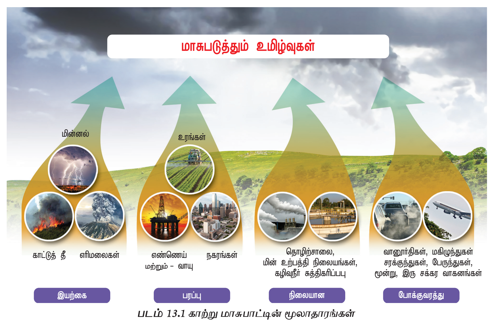
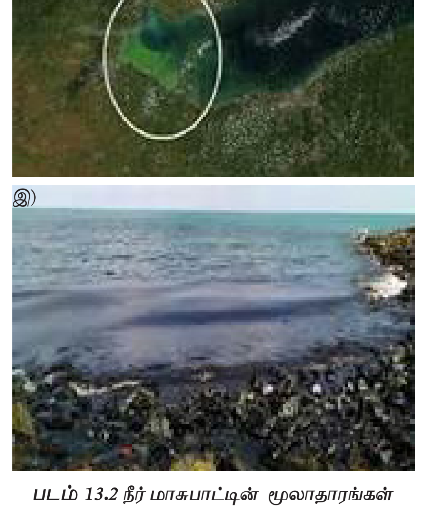
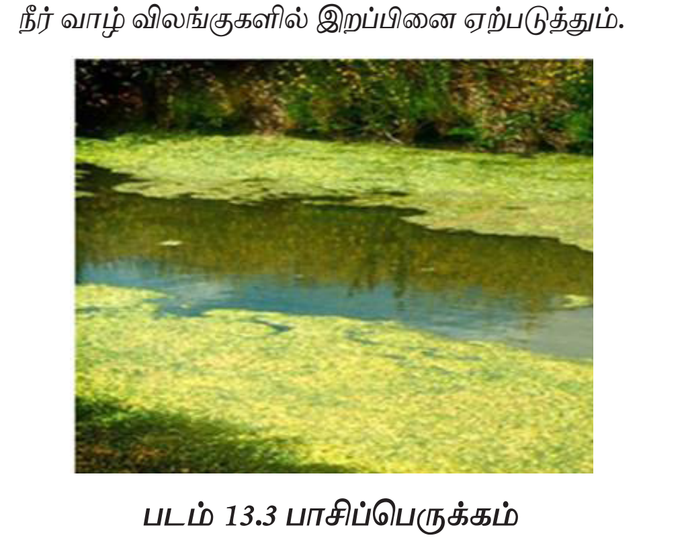
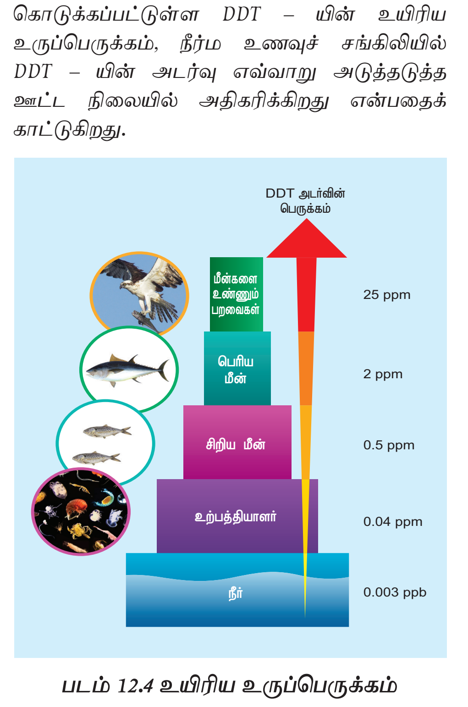
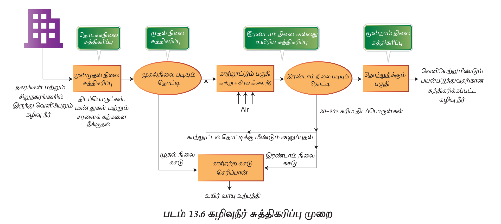
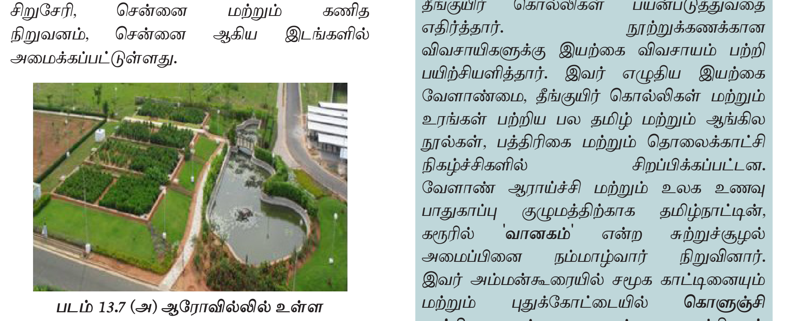

# பாடம் 13: சுற்றுச்சூழல் இடர்பாடுகள்

> மூலம்: தமிழ் வழிப் பாடநூல், PDF பக்கங்கள் 273–300.

> குறிப்பு: கீழுள்ள தேடக்கூடிய உரை துல்லியமான படங்கள், அட்டவணைகள் மற்றும் அமைப்பிற்கு அசல் பக்கங்களைப் பார்க்கவும்.

அலகு - V

சுற்றுச்சூழல்
இடர்பபாடுகள்

பாடம்

## பாட உள்ளடக்கம்

## 13.1 மாசுபாடு

## 13.2 காற்று மாசுபாடு

## 13.3 நீர் மாசுபாடு

## 13.4 ஒலி மாசுபாடு

## 13.5 வேளாண் வேதிப்பொருட்கள்

## 13.6 உயிரிய உருப்பபெருக்கம்

## 13.7 மிகை உணவூட்டம்

## 13.8 இயற்ககை வேளாணமை மற்றும்

அதனை நடைமுறைபடுத்துதல்

## 13.9 திடக்கழிவு மேலாணமை

## 13.10 சூழல் சுகாதாரக் கழிவறைகள்

கற்றலின் நோக்கங்கள்
- நம்முடைய சுற்றுச்சூழல் மற்றும் அதனுடைய
முக்கியத்துவம் பற்றிய அறிவை பெறுதல்.
- காலநிலை மற்றும் சூழ்நிலை
மண்டலத்தின் மீது மனிதனின்
செயல்பபாடுகளால் ஏற்படும்
விளைவுகள் மற்றும் பின்
விளைவுகளை அறிந்து
கொொள்ளல்.
- மாசுபாடுகளை மட்டுப்படுத்த,
சூழியலுக்கு உகந்த செயல்பபாடுகளை அறிந்து
கொொள்ளல்.
- சுற்றுச்சூழல் சிக்கல்களுக்கான தீர்வுகளை
தெளிவாகப் புரிந்து கொொள்ளுதல்.
- சுற்றுச்சூழல் பாதுகாப்பில் மக்களுடைய பங்களிப்பின்
அவசியத்தை உணர்தல்.
- தூயமையான சுற்றுச்சூழலின் முக்கியத்துவத்தைப்
புரிந்து கொொள்ளல்.

சுற்றுச்சூழலே என்னுடைய
முதனமையான ஆசிரியர்.
- மசனபுஃபுகுயோகா

அ

மைதியான மற்றும் ஆரோக்கியமான
வாழ்க்கை வாழ்வதற்கு தூயமையான
சுற்றுச்சூழல்
மிகவும்
அவசியமானதாகும்.
ஆனால் நம்முடைய அலட்சியத்தால் சுற்றுச்சூழல்
நாளுக்கு நாள் மாசடைகின்றது. நம்முடைய புவி
காற்று மாசுபாடு, நீர் மாசுபாடு, ஒலி மாசுபாடு, புவி
வெப்பமாதல், அமில மழை, உயிரிய உருப்பபெருக்கம்,
மிகை
உணவூட்டம்,
காடுகளை
அழித்தல்,
கழிவுகள் வெளியேற்றம், ஓசோன் படலச் சிதைவு,
காலநிலை மாற்றம் போன்ற பல்வவேறு சுற்றுச்சூழல்
சிக்கல்களை தற்சமயம் எதிர்கொள்கிறது. கடந்த
சில பத்தாண்டுகளுக்கும் மேலாக நம்முடைய
புவியின் மிகை பயன்பபாடு மற்றும் நம்முடைய
சுற்றுச்சூழலின் சிதைவு ஆகியவை அபாய
அளவின் உச்சத்தை தொொட்டுள்ளது. நம்முடைய
செயல்கள்
இந்த
கோளை
பாதுகாப்பதற்கு
ஆதரவாக இல்லாததால், திடீர் வெள்ளப் பெருக்கு,
ஆழிப்பேரலை மற்றும் புயல்கள் போன்ற இயற்ககை
பேரழிவுகளை அடிக்கடி சந்திக்க நேரிடுகிறது.
சுற்றுச்சூழல் சிக்கல்களை சார்ந்திருப்பவர்
அல்லது
சாராதார்
என்ற
பாகுபாடின்றி,
ஒவ்வொரு தனி நபரும் சுற்றுச்சூழல் குறித்த
விழிப்புணர்வுடன் இருத்தல் வேண்டும்.

## 13.1 மாசுபாடு (Pollution)

மாசுபாடு என்பது இயற்ககை காரணங்கள்
மற்றும் மனித செயல்பபாடுகளால் சுற்றுச்சூழலின்

சுற்றுச்சூழல் இடர்பபாடுகள்

இயற்பிய, வேதிய மற்றும் உயிரிய பண்புகளில்
ஏற்படும்
விரும்பத்தகாத
மாற்றமாகும்.
மாசுபாட்டினை
ஏற்படுத்தும்
காரணிகள்
மாசுபடுத்திகள் எனப்படுகின்றன. பாதிக்கப்படும்
சுற்றுச்சூழல் வகையின் அடிப்படையில் மாசுபாடு
வகைப்படுத்தப்படுகிறது. அவை காற்று, நீர் மற்றும்
மண் மாசுபாடு ஆகும்.

### 13.1.1 மாசுபடுத்திகளின் வகைபாடு

சுற்றுச்சூழல்
மண்டலத்தில்,
சிதைவடையாதவை மற்றும் சிதையக்கூடியவை
என
இரண்டு
அடிப்படை
குழுக்களாக
மாசுபடுத்திகள் வகைப்படுத்தப்பட்டுள்ளன.
சிதையக்கூடிய
மாசுபடுத்திகள்,
அவற்றினுடைய
உட்கூறுகளாக
சிதைய
எடுத்துக்கொள்ளும்
கால
அளவின்
அடிப்படையில் விரைவாக சிதையக்கூடியவை
(நிலையற்றவை)
மற்றும்
மெதுவாக
சிதையக்கூடியவை (நிலைத்திருப்பவை) என
வகைப்படுத்தப்பட்டுள்ளது.
அ)  விரைவாக சிதையக்கூடிய அல்லது நிலையற்ற
மாசுபடுத்திகள்
இவற்றை இயற்ககையான செயல்முறைகள்
மூலம் சிதைக்க முடியும். வீட்டுக்கழிவு நீர் மற்றும்
காய்கறி கழிவுகள் போன்றவை, இவ்வகையான
மாசுபடுத்திகளுக்கு எடுத்துக்காட்டுகளாகும்.

ஆ)  மெதுவாக
சிதையக்கூடிய
தொொடர்ந்திருக்கும் மாசுபடுத்திகள்

அல்லது

இவை பல ஆண்டுகளுக்கு எவ்வித மாற்றமும்
அடையாமல்
சுற்றுச்சூழலில்
அப்படியே
இருக்கும் மாசுபடுத்திகளாகும். DDT யைப் போல
இவை சிதைவடைய பல பத்தாண்டுகள் அல்லது
அதற்கு அதிகமான கால அளவினை எடுத்துக்
கொொள்கின்றன.
இ) சிதைவடையா மாசுபடுத்திகள்
இவற்றினை
இயற்ககையான
செயல்
முறைகளினால்
சிதைக்க இயலாது. இவை
ஒருமுறை
சுற்றுச்சூழலில்
விடுவிக்கப்பட்டு
விட்டால் வெளியேற்றுவது கடினமாகும் மற்றும்
இவை
தொொடர்ந்து
அதிகரிக்கும்
(உயிரிய
உருப்பபெருக்கம் (Bio magnification) தனமையுடையவை.
காரீயம், பாதரசம், காட்மியம், குரோமியம் மற்றும்
நிக்கல் போன்ற நச்சுப் பொொருட்கள் இவ்வகையைச்
சேர்ந்த மாசுபடுத்திகளாகும்.

## 13.2 காற்று மாசுபாடு (Air Pollution)

புவியைச்
சுற்றியுள்ள
காற்று அடுக்கு
வளிமண்டலம்
எனப்படுகிறது.
புவியினைச்
சுற்றியுள்ள
இக்காற்றுப்
போர்வவையானது
வெப்ப காப்புப் பொொருளாக செயல்படுகிறது
மற்றும் புறஊதா கதிர்களை தேர்ந்ததெடுத்து

ñ£²ð´ˆ¶‹ àI›¾èœ

I¡ù™

裆´ˆ b

àóƒèœ

âKñ¬ôèœ

ÞòŸ¬è

⇪íŒ

ம

& õ£»

ðóŠ¹

ïèóƒèœ

ªî£NŸê£¬ô,
I¡ àŸðˆF G¬ôòƒèœ,
èN¾c˜ ²ˆFèKŠð¹
G¬ôò£ù

õ£Û˜Fèœ, ñA¿‰¶èœ
êó‚°‰¶èœ, «ð¼‰¶èœ,

சுற்றுச்சூழல் இடர்பபாடுகள்

உறிஞ்சுவதன் மூலம் புவியின் வெப்பத்தை
நெறிபடுத்துகிறது. குளிரூட்டியாக பயன்படும்
குளோரோபுளூரோகார்பன்கள் (CFCs) மூலம்
ஏற்படும் ஓசோன் படலச் சிதைவு மற்றும்
அதிகப்படியான கார்பன் டை ஆக்சசைடினால்
(தொொழிற்சசாலைகள், காடுகள் அழிக்கப்படுதல்
மற்றும் பகுதி எரிப்பால்) ஏற்படும் உலகம்
வெப்பமாதல் ஆகியவை இவ்வகை மாசுபாட்டின்
மோசமான விளைவுகளாகும்.
இயற்ககையான
அல்லது
மனித
நடவடிக்கைளினால் (மனித ஆக்க காரணிகள்)
புவியின் வளிமண்டலக் கூறுகளில் ஏற்படும்
மாற்றம் காற்று மாசுபாடு எனப்படும். மனிதன்
அல்லது இயற்ககை செயல்பபாடுகளின் மூலம்
உற்பத்தி செய்யப்படும் திட, திரவ அல்லது வாயு
பொொருட்களின் மிகை இருப்பை உள்ளடக்கியதே
மாசுபடுத்திகள்
ஆகும்.
மாசுபடுத்திகளின்
தனமை மற்றும் செறிவே உயிரினங்கள் மற்றும்
மனிதநலன் மீது மாசுபடுத்திகள் ஏற்படுத்தும்
விளைவுகளின்
தீவிரத்தை
தீர்மமானிக்கிறது.
ஈரப்பதம், மழைப்பொழிவு, காற்று, காற்றோட்டம்,
உயரம் போன்ற வளிமண்டல காரணிகளுடன்
ஒரு குறிப்பிட்ட இடத்தில், குறிப்பிட்ட காலத்தில்
நிகழும் இதன் விளைவுகள் மிகப்பரவலான
மற்றும் பேரழிவினை ஏற்படுத்தக் கூடியதாக
அமையும்.
காற்று மாசுபடுத்திகள் என்பவை,
y

வெளியேற்றப்பட்ட தூசிகள் அல்லது துகள்

வளிமண்டலத்தில்
வெளியிடப்படுகின்றன.
வாகனங்கள், வானூர்திகள், மின் உற்பத்தி
நிலையங்கள் மற்றும் புதைபடிவ எரிபொொருட்களை
(நிலக்கரி, எண்ணணெய், மற்றும் பிற) எரிக்கும் மனித
செயல்பபாடுகள் போன்றவற்றால் வெளியேறும்
CO2, உலகம் வெப்பமாதலுக்கு காரணமான
முக்கிய மாசுபடுத்தியாகும்.
நைட்ரஜன் ஆக்சசைடுகளும் முக்கிய காற்று
மாசுபடுத்திகளாகச் செயல்படுகின்றன. புதைபடிவ
எரிபொொருள் எரிதல் மற்றும் வாகன புகை
வெளியேற்றம் ஆகியவை நைட்ரஜன் ஆக்சசைடு
வெளியேறுவதற்ககான மூலாதாரங்களாகும். சல்பர்
டை ஆக்சசைடு மற்றும் நைட்ரஜன் ஆக்சசைடுகள்
ஆகியவை அமில மழைக்கு முக்கிய காரணமாகும்.
துகள் பொொருட்கள் என்பது வாயு அல்லது
திரவத்தில் பொொதிந்துள்ள சிறிய அளவிலான திட
பொொருட்கள் ஆகும். புதைபடிவ எரிபொொருட்கள்
எரிக்கப்படுதல், அனல் மின் நிலையங்களில்
உற்பத்தி செய்யப்படும் சாம்பல், காட்டுத் தீ,
கல்நநார் (asbestos), சுரங்க அலகுகள், சிமெண்ட்
தொொழிற்சசாலைகள் போன்றவை துகள் பொொருள்
மாசுபாட்டின் முக்கிய மூலாதாரங்கள் ஆகும்.

### 13.2.1 மூலாதாரங்கள்

காற்று
மாசுபாட்டின்
மூலாதாரங்களாவன (படம்: 13.1):
y

போக்குவரத்து மூலாதாரங்கள் மகிழுந்துகள்,
பேருந்துகள், வானூர்திகள், சரக்குந்துகள்
மற்றும் தொொடர்வண்டிகள் ஆகியவை.

y

நிலையான
மூலாதாரங்கள்
நிலையங்கள், எரியூட்டிகள்,
சுத்திகரிப்பு
ஆலைகள்
தொொழிற்சசாலைகள் ஆகியவை.

y

பரப்பு
மூலாதாரங்கள்

விவசாய
மூலாதாரங்கள் – மரக்கட்டை / அறுவடை
செய்த தாள்களை எரித்தல்.

y

இயற்ககை
மூலாதாரங்கள்

காற்றில்
வரும் தூசிகள், காட்டுத்தீ, எரிமலைகள்
(படம் 13.1).

பொொருட்கள் (PM : 2.5 µm)
y

வாயுக்கள் வெளியேற்றப்படுதல் (SO2, NO2,

CO, CO2)

புதைபடிவ எரிபொொருட்கள் முழுமையாக
எரிக்கப்படாததன்
காரணமாக
கார்பன்
மோனாக்சசைடு (CO) உற்பத்தியாகிறது. பெரு
நகரங்கள்
மற்றும்
நகரங்களில்
கார்பன்
மோனாக்சசைடு
மாசுபாட்டிற்ககான
முக்கிய
காரணம் வாகனங்களே ஆகும். வாகனப் புகை,
வெளியேற்றம், தொொழிற்சசாலைகளிலிருந்து வரும்
புகை, மின் உற்பத்தி நிலையங்களிலிருந்து வரும்
உமிழ்வுகள், காட்டுத் தீ மற்றும் விறகுகளை
எரித்தல் போன்றவையும் இம் மாசுபாட்டில்
பங்குகொொள்கின்றன.
தீவிர நகரமயமாதலின் விளைவாக அதிக
அளவிலான கார்பன் டை ஆக்சசைடு (CO2) மற்றும்
சல்பர் டை ஆக்சசைடு (SO2) ஆகிய வாயுக்கள்

மின்
எண்ணணெய்
மற்றும்

### 13.2.2 காற்று மாசுபாட்டினால் ஏற்படும்

விளைவுகள்
y

சுவாசத்திற்ககாக
வளிமண்டலத்தை
சார்ந்திருக்கும் அனைத்து உயிரிகளையும்
பாதிக்கின்றன.

முக்கிய

சுற்றுச்சூழல் இடர்பபாடுகள்

y

y

தொொண்டடை, மூக்கு, நுரையீரல் மற்றும்
கண்களில் எரிச்சலை ஏற்படுத்துகின்றன.
சுவாச கோளாறுகளையும் ஏற்படுத்துகிறது.
மேலும், ஏற்கனவே உள்ள எம்பபைசீமா
மற்றும் ஆஸ்துமா போன்ற நோய்களை
அதிகப்படுத்துகிறது.
மாசடைந்த காற்றானது உடலின் எதிர்ப்பு
சக்தியினைக்
குறைக்கிறது.
மேலும்,
சுவாசப்பாதை தொொற்றுகளுக்கு எதிராக
போராடும் உடல் திறனையும் குறைக்கின்றது.

y

மாசடைந்த காற்றினை அடிக்கடி சுவாசிக்கும்
பொொழுது இதய நோய்களுக்கான ஆபத்து
அதிகரிக்கின்றது. சிறிய துகள் பொொருட்கள்
நிறைந்த காற்றினை சுவாசிப்பதால் தமனிகள்
தடிமனாதல், கார்டியாக் அரித்மியா (இதய
இலயமினமை)
அல்லது
மாரடைப்பு
ஆகியவற்றைத் தூண்டுகிறது.

y

புறவெளியில்
உடற்பயிற்சியினை
மேற்கொள்ளும் மக்கள் சில நேரங்களில்
காற்று
மாசுபாட்டின்
மோசமான
விளைவுகளால்
பாதிக்கப்படுகின்றனர்.
ஏனெனில் இவர்கள் காற்றினை ஆழ்ந்தும்,
வேகமாகவும் சுவாசிக்கின்றனர். எனவே,
காலை நேரங்களில் போதுமான மரங்கள்
நிறைந்த பகுதிகளில் நடக்க அல்லது ஓட
அறிவுறுத்தப்படுகிறார்கள்.

y

y

வாயுக்கசிவானது, பாதிக்கப்பட்ட பகுதிகளில்
இறப்பினை ஏற்படுத்தும் அல்லது காற்றின்
தரத்தினை பாதிக்கும்.
வளிமண்டலத்தில் உள்ள CO ஆக்சிஜன்
கடத்தப்படுதலில்
குறுக்கிடுகின்றது.
ஏனெனில்,
ஹீமோகுளோபின்,
கார்பன்
மோனாக்சசைடுடன்
அதிக
ஈர்ப்பினை
கொொண்டுள்ளது. குறைந்த செறிவில் இது
தலைவலி மற்றும் மங்கலான பார்வவையை
ஏற்படுத்துகிறது.
அதிக
செறிவில்
உணர்விழந்த நிலை (Coma) மற்றும் இறப்பு
ஏற்படலாம்.
மத்திய மாசுக்கட்டுப்பாட்டு
வாரியத்தின்
வெளியீடு
ஆகிய சமீர் (SAMEER) எனும்
செயலி தேசிய அளவில்
ஒவ்வொரு மணிக்கும் காற்றின் பண்புக்
குறியீட்டை வெளியிடுகிறது .

சுற்றுச்சூழல் இடர்பபாடுகள்

### 13.2.3 காற்று மாசுபாட்டின்

குறிப்பிடத்தக்க பிற விளைவுகள்
பனிப்புகை (Smog) என்பது காற்றில்
காணப்படும் சிறிய துகள்களினால் ஏற்படும்
ஒரு வகையான காற்று மாசுபாடு ஆகும்.
இச்சொல்லானது புகை மற்றும் மூடுபனி என்ற
இரு சொொற்களின் கலவையாகும்.
இன்று பனிப்புகை என்பது பொொதுவாக
ஒளிவேதிமாசு மூட்டத்தைக் குறிக்கிறது. இது
வாகனங்கள்,
தொொழிற்சசாலைகள்
மற்றும்
மின்நிலையங்கள் பயன்படுத்தும் புதைபடிவ
எரிபொொருள்கள் உமிழும் எளிதில் ஆவியாகும்
கரிமச்
சேர்மங்கள்
மற்றும்
நைட்ரஜன்
ஆக்ஸஸைடுகள் ஆகியவை சூரிய ஒளியுடன்
வினை புரிவதால் உருவாகிறது. இவ்வினைகள்,
தரை மட்ட ஓசோன் மற்றும் சிறிய துகள்களை
உருவாக்குகின்றன. இவை காற்றின் ஊடே பார்வவை
திறனைக்
குறைக்கிறது.
பனிப்புகையானது
ஆஸ்துமா நோயுடைய மக்களின் சுவாசத்தை
கடினமாக்குகிறது.
மேலும், பனிப்புகையானது தாவரங்கள்
மற்றும் விலங்குகளையும் பாதிக்கிறது. இது
பயிர்களை பாதிப்பதோடு செல்லப் பிராணிகள்,
பண்ணை விலங்குகள் மற்றும் மனிதர்களுக்கு
உடல் நலக் கோளாறுகளையும் ஏற்படுத்துகிறது.
மேலும், கட்டடங்கள் மற்றும் வாகனங்களை
அரித்து (அரித்து கரைக்கும்) சேதத்தினை
ஏற்படுத்துகிறது.
பெராக்சி அசிட்டைல் நைட்ரரேட் (PAN) என்பது
ஒளிவேதி
மாசுகூட்டத்தில்
காணப்படும்
இரண்டடாம் நிலை மாசுபடுத்தியாகும். இது
வெப்பத்தினால்
எளிதில்
சிதைந்து
கண்
எரிச்சலைத்
தரும்
பெராக்சி
எத்தனால்
அடைப்படைக் கூறுகள் மற்றும் நைட்ரஜன்
டைஆக்சசைடு வாயுக்களை வெளியிடுகிறது.
உலக வெப்பமயமாதல்: கார்பன் டைஆக்சசைடு,
மீத்தேன், நைட்ரஸ் ஆக்சசைடு, CFCs மற்றும்
ஓசோன் போன்ற பசுமை இல்ல வாயுக்களின்
அடர்வு அதிகரிப்பால் பசுமை இல்ல விளைவு,
புவி வெப்பமடைதல் ஆகியவை ஏற்படுகிறது.
இதன் விளைவாக கடல் மட்டம் உயர்ந்து, தீவுகள்
மற்றும் உலகின் பல்வவேறு பகுதிகளில் உள்ள
கடற்கரைகள் நீரில் மூழ்கும் நிலை ஏற்படுகிறது.
ஓசோன் படலச் சிதைவு: ஸ்ட்ரரேட்டோஸ்பியரில்
உள்ள ஓசோன் அடுக்கு மெலிந்து போதலே
ஓசோன் படலச் சிதைவு எனப்படும். இவ்வாறான

சிதைவு
ஓசோன்
படத்தில்
துளையினை
ஏற்படுத்துகிறது. இதன் விளைவால், தீங்கு தரும்
புற ஊதாக் கதிர்கள் தடுக்கப்படுவது குறைவதால்
அதிகப்படியான
தோல்
புற்றுநோய்கள்
ஏற்படுகின்றன.
குளோரோஃஃபுளூரோ
கார்பன்கள் போன்றவை ஓசோன் படல சிதைவை
ஏற்படுத்தும் சில முக்கிய காரணிகளாகும்.
அமில மழை :அமில மழை என்பது கந்தக
அமிலம்
அல்லது
நைட்ரிக்
அமிலம்
போன்ற அமிலப் பொொருட்களைக் கொொண்ட
மழைப்பொழிவு ஆகும். இது மரங்கள் மற்றும்
பயிர்களை
சேதப்படுத்துவதுடன்
கடல்
வாழ்
விலங்குகளையும் (பவளப் பாறைகள்)
பாதிக்கின்றது
ேமலும்,
அரிமானத்தையும்
தூண்டுகிறது.

### 13.2.4 காற்று மாசுபாட்டினை

கட்டுப்படுத்துதல்
சில
நடவடிக்கைள்,
மாசுபடுத்திகளை
நீக்கவும், அவற்றின் இருப்பைக் குறைக்கவும்
அல்லது
வளிமண்டலத்திற்குள்
அவை
நுழைவதை தடுக்கவும் உதவுகின்றன.
y

நகரங்களில் உருவாகும் துகள்கள் மற்றும்
காற்று மாசுபாட்டிற்ககான சிறந்த தீர்வு
மரங்களாகும்.

y

காடுகள் கரிமப்பொருட்களை சேகரிக்கும்
இடமாகவும்
மற்றும்
புவிக்கோளின்
நுரையீரலாகவும் செயல்புரிகின்றன.

y

வாகனங்களின்
மாசுபடுத்தும்
உதவுகின்றன.

y

வாகனங்களின்
டீசல்
வெளியேற்று
வடிகட்டிகள், துகள்களைத் தடுக்கின்றன.

வினைவேகமாற்றிகள்
வாயுக்களை
குறைக்க

y

நிலை
மின்
வீழ்படிவாக்கிகள்,
தொொழிற்சசாலைகளிலிருந்து மாசுபடுத்திகள்
வெளியேறுவதை குறைக்கின்றன.

y

உள்வீட்டுத் தாவரங்கள் மற்றும் திறன்
மிகுந்த உயிரிய வடிகட்டிகள் போன்ற
மலிவான காற்று மாசுபாடு சுத்திகரிப்பு
அமைப்புகள் மூலம் வீட்டிற்குள் காற்றின்
தரத்தை மேம்படுத்த முடியும்.

யுனெஸ்கோவின் பாரம்பரிய சின்னமாக
அறிவிக்கப்பட்ட
தாஜ்மஹால்
சிதைதல்,
சேதமுறுதல்
போன்ற
மோசமான
விளைவினை சந்தித்துக் கொொண்டிருக்கிறது.
ஆக்ரராவை
சுற்றியுள்ள
பல்வவேறு
தொொழிற்சசாலைகளிலிருந்து
வெளியேறும்
வாயுக்களே
இதற்கு
காரணங்களாகும்.
இங்குள்ள வெள்ளை பளிங்கு கற்கள், மஞ்சள்
நிறத்திற்கு மாறிவிட்டன.

### 13.2.5 சட்டப்பாதுகாப்பு

y

காற்று சட்டம் (மாசுபாட்டினை தடுத்தல்
மற்றும் கட்டுப்படுத்துதல்) இந்தியாவில்
காற்று
மாசுபாட்டினை
தடுக்க,
கட்டுப்படுத்த மற்றும் குறைக்க 1981 ஆம்
ஆண்டு இயற்றப்பட்டு, 1987 ஆம் ஆண்டு
திருத்தியமைக்கப்பட்டது.

y

போக்குவரத்து உமிழ்வின் தரம்: 2020ஆம்
ஆண்டிலிருந்து பாரத் நிலை VI (BS VI - Bharat
Stage VI) விதிமுறைகளை செயல்படுத்த அரசு
முடிவு செய்துள்ளது.

y

பசுமை அமர்வு மற்றும்
தீர்ப்பாயம்
ஆகியவை
பாதுகாப்பிற்கு நீதிமன்ற
அளிக்கின்றன.

இந்தியாவில் நடுவணரசு மற்றும் மாநில அரசால்
எடுக்கப்பட்டுள்ள நடவடிக்கைள்.
y சாலை
போக்குவரத்தை
சீர்படுத்துதல்,
பொொது போக்குவரத்தினை ஊக்குவித்தல்,
மகிழுந்தில்
குழுக்களாக
பயணிக்கச்
செய்தல்.
y

சாலையின்
ஓரங்களில்
நிழல்தரும்
மரங்களை நடுதல் மூலம் பசுமைச் சூழலை
அதிகரித்தல்.

y

தூயமை இந்தியா (ஸ்வச் பாரத் அபியான்)
திட்டத்தை ஊக்குவித்தல்.

y

சுற்றுச்சூழல்
தொொடர்பபான
சட்டங்களை
கடுமையாக்கி செயல்படுத்துதல்.

y

முறையாக
நடைமுறைப்படுத்தி
மற்றும்
கண்ககாணித்து
காற்றின்
தரத்தைப்
பராமரித்தல்.

y

கார்பன் உமிழ்வுகளைக் குறைத்தல்.

y

புதுப்பிக்கத்தக்க
ஊக்குவித்தல்.

y

பட்டாசுகள்
விற்பனையை
வரை
முறைப்படுத்துதல் மற்றும் சுற்றுச்சூழலுக்கு
உகந்த பட்டாசுகளைத் தயாரித்தல்.

ஆற்றல்

தேசிய பசுமை
சுற்றுச்சூழல்
பாதுகாப்பினை

பயன்பபாட்டை

சுற்றுச்சூழல் இடர்பபாடுகள்

y

சுற்றுச்சூழல்
தாக்க
கட்டாயமாக்குதல்.

மதிப்பீட்டினை

ஒரு
நாளைக்கு
மனிதன்
எடுத்துக்கொள்ளும் ஆக்சிஜனின்
சராசரி அளவு = 550 லி
275 லி ஆக்சிஜன் உருளையின்
விலை = `6500
மரங்கள் வெளியிடும் 550 லி
ஆக்சிஜன் விலை = `13,00,000.

ஒரு ஆரோக்கியமான மரம் ஓராண்டில் உற்பத்தி
செய்யும் ஆக்சிஜனின் அளவு = 1,00,375 லி
275 லி ஆக்சிஜன் உருளையின் விலை = `6500
ஓராண்டில் ஒரு மரம் உற்பத்தி செய்யும் 1,00,375 லி
ஆக்சிஜனின் விலை = `23,72,50,00

காற்று தரக் குறியீட்டு எண் (AQI)
கா.த.கு
எண்:

காற்று மாசுபாட்டின்
அளவு

0 - 50

சிறந்தது

51 - 100

மிதமானது

101 - 150

நிறம்

பாதிக்கப்படக்கூடிய
நிலையில்
உள்ளவர்களுக்கு
ஆரோக்கியமற்றது.

151 - 200

ஆரோக்கியமற்றது

201 - 300

மிகவும்
ஆரோக்கியமற்றது

301 +

கேடு தரக்கூடியது

குறிப்பிட்ட கால அளவில் காற்று எவ்வாறு
மாசடைகிறது என்பது பற்றி பொொதுமக்களுக்கு
தெரியப்படுத்த அரசு முகமைகள் பயன்படுத்தும்
எண்ணே, காற்று தரக் குறியீட்டு எண் (Air Quality
Index) எனப்படும்.

## 13.3 நீர் மாசுபாடு (Water Pollution)

### 13.3.1 நீரின் தரம்

வாழ்க்கை்கும்,
சுற்றுச்சூழலின்
ஆரோக்கியத்திற்கும் நீர் அவசியமானதாகும்.
மதிப்புமிக்க இயற்ககை வளமான நீர், கடல்
நீர், கழிமுக நீர், நன்னீர் (ஆறுகள் மற்றும்
ஏரிகள்) மற்றும் நிலத்தடி நீர் ஆகியவற்றை
சுற்றுச்சூழல் இடர்பபாடுகள்

உள்ளடக்கியுள்ளது. இது கடற்கரை மற்றும்
உள்நநாட்டுப் பகுதிகள் முழுவதும் பரவியுள்ளது.
அளவு மற்றும் தரம் என்ற ஒன்றுக்கொன்று
நெருக்கமாக இணைந்த இரு பரிமாணங்களைக்
நீர் கொொண்டுள்ளது. நீரின் தரம் பொொதுவாக
அதனுடைய
இயற்பிய,
வேதிய,
உயிரிய
மற்றும் அழகியல் (தோற்றம் மற்றும் வாசனை)
பண்புகளால்
வரையறுக்கப்படுகிறது.
உயிரினங்களின் வளம் மற்றும் பல்வவேறு
உயிரிய சமூகங்களுக்கு ஆதரவாகவும் மற்றும்
பொொது நலத்தினைப் பாதுகாப்பதாகவும் நீரின்
தரம் இருப்பின் அதுவே ஆரோக்கியமான
சுற்றுச்சூழல் ஆகும்.

### 13.3.2 நீர் மாசுபாடு

நீரின் வேதிய, இயற்பிய மற்றும் உயிரிய
தனமையில் ஏற்படும் மாற்றங்கள் அந்நீரில்
வாழும் மற்றும் அந்நீரைப் பயன்படுத்தும்
உயிரினங்களுக்கு தீமையை விளைவித்தல் நீர்
மாசுபாடு எனப்படும்.
இயற்ககையான
அல்லது
மனிதனால்
உருவாக்கப்பட்ட பொொருட்கள் அதிக அளவில்
நீரினுள்
கொொட்டப்படுவதால்
ஏற்படும்
நீர்
மாசுபாடு,
நீர்
நிலைகளில்
மோசமான
விளைவுகளை ஏற்படுத்துகிறது. பயன்படுத்தும்
தனமையை
இழந்த
நீர்,
மாசடைந்ததாகக்
கருதப்படுகிறது.

### 13.3.3 நீர் மாசுபாட்டின் மூலாதாரங்கள்

நீர் நிலைகள் அல்லது நீர் ஆதாரங்கள்
இயற்ககை காரணங்களால் மாசடைந்ததாலும் மனித
செயல்பபாடுகளாலேயே நீர் மாசு அதிகமாக
ஏற்படுத்தப்படுகிறது.
நீர்
மாசுபாட்டிற்ககான
மூலாதாரங்கள் மூன்று வகையானவை. அவை,
மைய மூலாதாரங்கள், மையமற்ற மூலாதாரங்கள்,
கசிவுகள் மற்றும் சிந்துதல்.
மைய
மூலாதாரங்கள்
(Point
sources):
நீர்நிலைகளில்
குறிப்பிட்ட
இடத்தில்
குழாய்கள் அல்லது கழிவுநீர்க் குழாய்கள்
மூலம்
மாசுபடுத்திகளை
வெளியிடுதல்
மைய மூலாதாரம் ஆகும். தொொழிற்சசாலை
நீர்மக்கழிவுகள், சாக்கடை நீர், நிலத்தடிச்
சுரங்கம், எண்ணணெய்க்கிணறுகள், எண்ணணெய்க்
கப்பல்கள் மற்றும் வேளாணமை போன்றவை
பொொதுவான
மைய
மூலாதாரங்களாகும்
(படம் 13.2 அ).

மையமற்ற மூலாதாரங்கள் (Non - Point sources):
ஒரு
இடத்தில்
வெளியேற்றப்படும்
மாசின்
மூலாதாரங்கள் கண்டறிய இயலாது. அமில மழை,
நீர்நிலைகளில் கொொட்டப்படும் நெகிழிப்பொருட்கள்,
வழிந்தோடி வரும் வேளாணமை வேதிப்பொருட்கள்
போன்றவை பொொதுவான எடுத்துக்காட்டுகளாகும்
(படம் 13.2 ஆ).
கசிவுகள் மற்றும் சிந்துதல் (Leaks and Spills) : கப்பல்
விபத்து, கடற்கரைப் பகுதிகளில் எண்ணணெய்க்
கிணறுகளைத்
தோண்டுதல்,
எண்ணணெய்க்
கசிவுகள்
மற்றும்
கடலினுள்
எண்ணணெய்
வெளியேற்றப்படுதல்
ஆகியவற்றால்
இது
நடைபெறுகிறது. (படம் 13.2 இ).

அ)

ஆ)

நீர் மாசுபாட்டின் மூலாதாரங்கள் மேலும்
மூன்று வழிகளில் வகைப்படுத்தப்படுகிறது. அவை
நகராட்சிக் கழிவுகள், தொொழிற்சசாலைக் கழிவுகள்
மற்றும் வேளாணமைக் கழிவுகள் ஆகும்.
நீர் மாசுபாட்டின் மூலாதாரங்கள்
இ)
நகராட்சிக்
கழிவுகள்

தொொழிற்சசாலைக்
கழிவுகள்

வேளாணமைக்
கழிவுகள்

1.

வீடுகள் மற்றும் வணிக நிறுவனங்களிலிருந்து
வெளியேற்றப்படுவது நகராட்சி கழிவு நீர்
ஆகும்.

2.

நஞ்சசாகக் கூடிய அடர்த்தியில் காட்மியம்,
குரோமியம்,
காரீயம்
போன்ற
கன
உலோகங்கள்
மற்றும்
கனிம,
கரிமப்
பொொருட்களை
உள்ளடக்கிய
கழிவுநீர்,
ஆகியவை தொொழிற்சசாலைக் கழிவுகள் ஆகும்.
இவை நீர்நிலைகளின் வெப்பநிலையையும்,
நீரில் கரைந்துள்ள ஆக்சிஜன் அளவையும்
பாதிக்கின்றன.

3.

வேளாணமை
செய்யப்பட்டுள்ள
நிலங்களிலிருந்து வழிந்தோடும் உரங்கள்
மற்றும் தீங்குயிர்கொல்லிகள் கலந்த நீர்
உணவு
பதப்படுத்துதலினால்
ஏற்படும்
கழிவுகள், தச்சு செயல்பபாடுகளிலிருந்து வரும்
மரம் மற்றும் மரத்தூள் மற்றும் கழிவு நீர்
அல்லது கால்நடை செயல்பபாடுகளிலிருந்து
வரும்
பாக்டீரியாக்கள்
போன்றவை
வேளாணமைக் கழிவுகளில் அடங்கும்.

நீர் மாசுபடுத்திகள், மழை நீருடன் வழிந்தோடி
ஆறுகள், ஓடைகள் மூலம் கடலினையும் மற்றும்
கசிவு அல்லது ஊடுருவல் மூலம் நிலத்தடி
நீரினையும் அடைகின்றன.

### 13.3.4 நீர் மாசுபாட்டினால் சூழ்நிலை

மண்டலத்தில் ஏற்படும் விளைவுகள்
1.

சூழ்நிலை மண்டலங்கள் அழிதல்: நீர்
மாசுபாட்டினால்
சூழ்நிலை மண்டலம்
குறிப்பாக
நீர்ச்
சூழ்நிலை
மண்டலம்
கடுமையாக
பாதிக்கப்படுகிறது
அல்லது
அழிக்கப்படுகிறது.
நீர்
மாசுபடுத்திகள்

சுற்றுச்சூழல் இடர்பபாடுகள்

உயிரினங்களின் சிறுவாழிடம், வாழிடம்
மற்றும்
அவை
உயிர்
வாழ்தலையும்
பாதிக்கின்றன.
மண்ணின்
வளம்
பாதிக்கப்படுகிறது மற்றும் வாழத் தகுதியற்ற
நிலையினை
சூழ்நிலை
மண்டலம்
அடைகின்றது.
2. உணவுச் சங்கிலிகளில் ஏற்படும் இடையூறுகள்:
நீர் மாசுபாடு, இயற்ககையான உணவுச்
சங்கிலிகளிலும்,
உணவு
வலைகளிலும்
இடையூறுகளை ஏற்படுத்துகின்றது. காரீயம்
மற்றும் காட்மியம் போன்ற மாசுபடுத்திகளை
முதல்நிலை
நுகர்வோர்கள்
எடுத்துக்
கொொள்வது இறப்பினை ஏற்படுத்தும் அல்லது
சேமிக்கப்படும். பின்னர், இவ்விலங்குகளை
இரண்டடாம்
நிலை
நுகர்வோர்கள்
எடுத்துக்கொள்ளும் பொொழுது எந்த ஊட்ட
நிலையிலும் உணவுச் சங்கிலியில் இடையூறு
ஏற்படவும் அல்லது மாசுபடுத்திகளின் அடர்வு
அதிகரிக்கவும்
வாய்ப்புள்ளது
(உயிரிய
உருப்பபெருக்கம்). தொொழிற்சசாலைகளிலிருந்து
வெளியேறும் கொொதி நீர் நீர்நிலைகளில்
விடப்படுவதால்
நீர்வவாழ்
விலங்குகளின்
அடர்வு
மற்றும்
பல்லுயிர்த்தனமை
பாதிக்கப்படுகின்றது.

### 13.3.5 நீர் மாசுபாட்டினால்

உயிரினங்களில் ஏற்படும் விளைவுகள்
1.
நீர்
மாசுபாடு,
அந்நீரில்
வாழும்
விலங்குகளையும் நீர் நிலைகளைச் சார்ந்திருக்கும்
பிற உயிரிகளையும் கொொல்லக் கூடியதாகும்.
விபத்திற்குள்ளான
எண்ணணெய்க்
கப்பல்களிலிருந்து வெளியேறும் எண்ணணெய்க்
கசிவு சுற்றுச்சூழலை கணிசமாக பாதிக்கின்றது.
நீரின் மேற்பரப்பில் பரவும் எண்ணணெயினால்
ஒளி மற்றும் ஆக்சிஜன் நீரினுள் செல்வது
தடுக்கப்படுகிறது. இது உயிரிய ஆக்சிஜன்
தேவை (BOD) மற்றும் வேதிய ஆக்சிஜன்
தேவை (COD) ஆகியவற்றை அதிகரிக்கின்றது.
இதனால் உயிரினங்கள் கூட்டமாக அழிவதோடு,
நீரின் தரமும் சீரழிக்கப்படுகிறது. மேலும்
இது மீன்களின் செவுள்களை அடைத்துக்
கொொள்வதுடன்
நீர்வவாழ்
பறவைகளின்
இறக்கைளிலும் தடையினை (இடையூறை)
ஏற்படுத்துகின்றன.
சுற்றுச்சூழல் இடர்பபாடுகள்

ஜனவரி 28, 2017 – ல் சென்னை
எண்ணூர் துறைமுகத்தில் இரண்டு சரக்கு
கப்பல்கள் மோதியதால், கடலில் எண்ணணெய்
சிந்தியது. அலையியக்கம் மற்றும் தென்திசை
நீரோட்டத்தினால் தென் திசையை நோக்கி
ஏறத்தாழ 34 கி.மீ தூரத்திற்கு எண்ணணெய் பரவி
கடற்கரையில்
பாதிப்பினை
ஏற்படுத்தியது.
கடற்கரை மணலும் எண்ணணெய்க் கசடுகளால்
பாதிப்பிற்குள்ளானது.
இந்த
எண்ணணெய்க்
கசடுகளை சுத்தம் செய்ய ஆயிரத்திற்கும்
மேற்பட்ட தன்னார்வலர்கள் தேவைப்பட்டனர்.
2. கெட்டுப்போன நீர் மற்றும் உணவினை
எடுத்துக் கொொள்வதால் மனிதர்கள் மற்றும் பிற
உயிரினங்கள் கல்லீரல் அழற்சி மற்றும் டைஃபாய்டு
போன்ற
நோய்களால்
பாதிக்கப்படுகின்றனர்.
குடிநீரில் காணப்படும் அதிகப்படியான புளூரைடு,
புளூரோசிஸ் என்ற நோயினை ஏற்படுத்துகிறது.
பல ஏழை நாடுகளில் கெட்டுப்போன நீர் மற்றும்
குறைவாக
சுத்திகரிக்கப்பட்ட
நீர்
அல்லது
சுத்திகரிக்கப்படாத நீரினைப் பயன்படுத்துவதால்
நீர் வழி பரவும் நேய்கள் மற்றும் தொொற்றுநோய்கள்
அதிகமாகின்றன.
3. நீர் மாசுபாட்டினால் விளையும் ஊட்டச்
செறிவு, மிகை உணவூட்டத்திற்குக் (Eutrophication)
காரணமாகிறது. இதனால் ஏற்படும் பாசிப்பபெருக்கம்
நீர்
நிலைகளின்
தரத்தினைப்
பாதிக்கிறது
(படம் 13.3). .சிவப்பு அலைகள் காணப்படுமேயானால்
நீர் வாழ் விலங்குகளில் இறப்பினை ஏற்படுத்தும்.

### 13.3.6 கட்டுப்படுத்தும் நடவடிக்கைள்

1. தூயமையான நீருக்கான உரிமை இந்திய
அரசியலமைப்பின்
கீழுள்ள
அடிப்படை
உரிமையாகும் (பிரிவு 21).

2. நீர் (மாசுபாட்டினைத் தடுத்தல் மற்றும்
கட்டுப்படுத்துதல்) சட்டம், 1974, பிரிவுகள் 17 முதல்
40, மாசுபடுத்திகளை ஓடை அல்லது கிணறுகளில்
விடுவித்து மாசுபடுத்துவதைத் தடை செய்கிறது .
3. நீர் மாசுபாட்டினைத் தடுத்தல் மற்றும்
கட்டுப்படுத்துதல்
சம்பந்தப்பட்ட
பல்வவேறு
நடவடிக்கைள் தொொடர்பபாக நடுவண் / மாநில
அரசிற்கு அறிவுரை கூற நடுவண் / மாநில மாசு
கட்டுப்பாட்டு வாரியத்திற்கு அதிகாரம் உள்ளது.
4. சுற்றுச்சூழல், காடுகள் மற்றும் காலநிலை
மாற்ற அமைச்சகம் (MoEFCC) என்பது நடுவண்
அரசின் கிளை அமைப்பாகும். இது திட்டமிடல்,
முன்னேற்றம், ஒருங்கிணைப்பு மற்றும் இந்திய
சுற்றுச்சூழல் மற்றும் வனவியல் கொொள்ககைகள்
மற்றும்
திட்டங்கள்
செயல்படுத்துவதை
மேற்பபார்வவையிடல்
உள்ளிட்ட
பணிகளை
மேற்கொள்கிறது.
5. தேசிய நதிநீர் பாதுகாப்புத் திட்டம் (NRCP)
என்ற அமைப்பு நாட்டின் பெரும் வளம் என
கருதப்படும் நன்னீர் வளங்களைப் பாதுகாக்க
மற்றும் மேம்படுத்த 1995-ஆம் ஆண்டு செயலாக்கம்
பெற்றது.
இத்திட்டத்தில், கீழ்க்கண்ட முக்கிய
செயல்திட்டங்கள் உள்ளடங்கியுள்ளன.
- 

சாக்கடைக் கழிவுகள் ஆற்று நீரில் நேரடியாக
கலக்காமல் அதனை மடைமாற்றி சுத்திகரிப்பது.

- மடைமாற்றப்பட்ட
கழிவுநீரை
சுத்தம்
செய்வதற்ககாக
கழிவு
நீர்
சுத்திகரிப்பு
நிலையங்களை அமைப்பது.
- மக்களுக்கு குறைந்த செலவில் கழிவறைகளை
கட்டிக்
கொொடுத்து
திறந்த
வெளியில்
(ஆற்றங்கரையோரங்களில்) மலம் கழிப்பதை
தவிர்ப்பது.

நீர் மாசுபாட்டினை தடுத்தல்
y

மாசுபடுத்திகளை அவை உற்பத்தியாகும்
இடத்திலேயே முறைப்படுத்துதல் அல்லது
தடுத்தல்.

y

நகராட்சி கழிவு நீர் வெளியேற்றப்படுவதற்கு
முன்னர்
அறிவியல்
முறைப்படி
சுத்திகரிக்கப்பட வேண்டும்.

y

கழிவுநீர் சுத்திகரிப்பு ஆலைகள் (STP) மற்றும்
தொொழிற்சசாலை நீர்மக் கழிவு சுத்திகரிப்பு
ஆலைகளை நிறுவ வேண்டும்.

y

செயற்ககை உரங்கள் மற்றும் தீங்குயிர்க்
கொொல்லிகளின்
பயன்பபாட்டினை
முறைப்படுத்த
அல்லது
கட்டுப்படுத்த
வேண்டும்.

y

பொொதுமக்களின்
விழிப்புணர்வு
ஈடுபாடு அவசியமானதாகும்.

CPCB மூலம் மதிப்பிடுதல்
இந்தியாவில் மாசடைந்த ஆறுகளின்
எண்ணிக்கை 302 (2006 ல்) லிருந்து 351 ஆக
உயர்ந்திருக்கிறது. நீரின் தரங்ககாட்டிகள் மிகக்
குறைவாகக் காணப்படும் அதிக மாசடைந்த
இடங்கள் 35 லிருந்து 45 ஆக உயர்ந்துள்ளது.
(ஆதாரம்: தி இந்து, 17, செப்டம்பர் 2018)

திட்ட ஆய்வு
நமமி
கங்ககா
திட்டம்
(கங்ககையை
தூயமைபடுத்துவதற்ககான தேசிய குறிக்கோள்)
என்பது
அரசின்
‘மீச்சிறப்பு
திட்டத்தால்’
அங்கீகரிக்கப்பட்ட ஒருங்கிணைந்த பாதுகாப்பு
திட்டமாகும். இத்திட்டம் ஜுன் 2014 –ல் 20,000 கோடி
ரூபாய் மதிப்பீட்டில் கங்ககை நதியின் மாசுபாட்டினை
தீவிரமாக குறைக்கவும், பாதுகாக்கவும் மற்றும்
புத்துயிரூட்டும் நோக்கங்களை நிறைவேற்றவும்
தொொடங்கப்பட்டதாகும்.

## 13.4 ஒலி மாசுபாடு (Noise Pollution)

தேவையற்ற மற்றும் விரும்பத்தகாத அல்லது
ஒன்றின் வாழ்க்கைத் தரத்தை பாதிக்கும் ஒலி,
இரைச்சல் எனப்படும். சுற்றுச்சூழலில் அதிக
இரைச்சல் இருக்குமேயானால் அது ‘ஒலி
மாசுபாடு’ எனப்படும். ஒலியின் செறிவு டெசிபல்
(dB) எனும் அலகு கொொண்டு அளக்கப்படுகிறது.

### 13.4.1 ஒலி மாசுபாட்டின் மூலாதாரங்கள்

வாகன
எஞ்சின்கள்,
காற்று
ஒலிப்பான்கள், ஒலி – ஒளி அமைப்புகள்,
தொொடர் வண்டிகள், தாழ பறக்கும் வானூர்திகள்,
தொொழிற்சசாலை
இயந்திரங்கள்,
அபாயச்
சங்குகள், விசைப்பொறிகள், துளைப்பான்கள்,
நொொறுக்கிகள்,
அழுத்த
இயந்திரங்கள்,
பட்டாசுகள், வெடிபொொருட்கள், நவீன அதிவேகப்
போக்குவரத்து போன்றவை ஒலி மாசுபாட்டின்
மூலாதாரங்கள் ஆகும்.
ஒலி மாசுபாட்டின் தொொடக்க நிலை அளவு
120 டெசிபல் ஆகும். இரைச்சலானது மனித
நல்வவாழ்விற்கு
அச்சுறுத்தலை
ஏற்படுத்தும்
முக்கிய காரணி என உலக சுகாதார நிறுவனம்
கூறியுள்ளது. இது அனைத்து உயிரினங்களுக்கும்
பொொருந்தும்.

### 13.4.2 ஒலி மாசுபாட்டின் விளைவுகள்

- அமெரிக்காவின் சுற்றுச்சூழல் பாதுகாப்பு அமைப்பின் (USEPA-United States Environmental Protection Agency) படி, இரைச்சலும், உடல்நலமும் ஒன்றுக்கொன்று நேரடி தொடர்புடையதாகும். இதய நோய், உயர் இரத்த அழுத்தம், மன அழுத்தம் (stress) தொடர்பான நோய்கள், தூக்க இடையூறுகள், காது கேளாமை மற்றும் ஆக்கத்திறன் குறைதல் போன்றவை ஒலி மாசுபாடு தொடர்பான பிரச்சினைகள் ஆகும்.
- மன அழுத்தம், பதற்றம் அதிகரிப்பு, நரம்பு தளர்ச்சி, எரிச்சல், கவலை, மனச்சோர்வு மற்றும் பெரும் அச்சம் ஆகியவை ஏற்படுதல்.
- வயிற்றுப் புண், தீவிர தலைவலி, நினைவாற்றல் குறைதல் ஆகியவை.
- கடற்கரை மற்றும் துறைமுக செயல்பாடுகளினால் ஏற்படும் ஒலி மாசுபாடு கடல் வாழ் விலங்குகளைப் பாதிக்கின்றது.
- பட்டாசுகள் விலங்குகளை மிரளச் செய்கின்றன. அதிகப்படியான வானூர்திகளால் பறவைகள் அடிக்கடி பாதிப்பிற்குள்ளாகின்றன.

### 13.4.3 கட்டுப்பாடு

- இரைச்சல் அதிகமாக உள்ள இடத்திலும் மற்றும் அதனைச் சுற்றிலும் மரங்களை நடுதல் நல்ல தீர்வாகும். ஏனெனில், தாவரங்கள் ஒலியினை உறிஞ்சி, ஒலியின் அளவைக் குறைக்கின்றன.
- வாகனங்களின் எஞ்சின்களை தொடர் பராமரிப்பு மற்றும் சீராக்கம் செய்வதன் மூலம் அவற்றால் ஏற்படும் இரைச்சல் மாசுபாட்டினை குறைக்கலாம்.
- அதிக ஒலி உற்பத்தியாகும் இடத்தில் பணியாற்றும் பணியாளர்களுக்கு காது செருகிகள் (ear plugs) மற்றும் காது அடைப்பான்களை (ear muffs) வழங்க வேண்டும்.
- இயந்திரங்களுக்கு உயவிடல் மற்றும் வழக்கமான பராமரிப்பு, செய்வதால் ஒலி அளவு குறைக்கப்படுகிறது.
- மக்கள் நிறைந்த இடங்கள் மற்றும் பொது இடங்களில் ஒலிபெருக்கிகள் பயன்படுத்துவதற்கான விதிமுறைகளை உறுதியாக நடைமுறைபடுத்த வேண்டும்.

### 13.4.4 சட்டப் பாதுகாப்பு

இந்திய அரசியலமைப்பின் பிரிவு – 48 A மற்றும் 51 – A, ஒலி மாசுபாடு (நெறிப்படுத்துதல் மற்றும் கட்டுப்பாடு) விதிகள் 2000, மற்றும் தமிழ்நாடு மாநில சுற்றுச்சூழல் கொள்கை 2017 போன்றவை, ஒலி மாசுபாட்டிலிருந்து விடுபடுவதற்கான சட்டங்களில் சிலவாகும்.

ஒலி மாசுபாடு (நெறிப்படுத்துதல் மற்றும் கட்டுப்பாடு) விதிகள், 2000 – த்தின் படி அனுமதிக்கப்பட்ட ஒலி அளவு பகல் நேரங்களில் 65 டெசிபல் (dB) எனவும், இரவு நேரங்களில் 55 டெசிபல் எனவும் வரையறுக்கப்பட்டுள்ளது.

## 13.5 வேளாண் வேதிப்பொருட்கள் (Agrochemicals)

தாவரங்கள் வளர்வதற்கும் மற்றும் தீங்குயிரிகளை கட்டுப்படுத்துவதற்கும் வேளாண் தொழிலில் பயன்படுத்தப்படும் வேதிப்பொருட்கள் வேளாண் வேதிப்பொருட்கள் எனப்படும்.

வேளாண் வேதிப்பொருட்களை அதிகமாகப் பயன்படுத்துவதால் உருவாகும் எச்சங்களினால் ஊட்டச்சத்து சமநிலை பாதிக்கின்றது. மேலும்,
- நன்மையளிக்கும் பாக்டீரியாக்கள் மற்றும் மண் வாழ் உயிரினங்களை அவை கொல்லக்கூடும்.
- நீர் நிலைகளில் மிகை உணவூட்டத்தை ஏற்படுத்தும்.
- நீர் வாழ் விலங்குகளையும் அவற்றின் உற்பத்தித் திறனையும் பாதிக்கின்றது.
- மிகக் குறைந்த அளவு தீங்குயிர் கொல்லிகளைக் கொண்டிருந்தாலும், அந்த நீர் மனித பயன்பாட்டிற்கு தகுதியற்றதாகும்.
- இவ்வேதிப்பொருட்களின் துகள்கள் (தூசிப்படலம்) மற்றும் எச்சங்கள் காற்று மாசுபாட்டினை ஏற்படுத்தும்.
- மாசடைந்த காற்றினை உள்ளிழுப்பது சுவாசக் கோளாறுகளை ஏற்படுத்தும்.
- இதனை உட்கொள்ளுதல் நச்சாகும். மேலும், பல பக்க விளைவுகளையும் மற்றும் பின் விளைவுகளையும் ஏற்படுத்தும்.
- வேதிப்பொருட்களால், தோலில் அரிப்பும் மற்றும் கண்களில் எரிச்சலும் ஏற்படும்.
- இவற்றில் பல வேதிப்பொருட்கள் புற்று நோயினை ஏற்படுத்தக் கூடியவையாகும்.
- இவை ஹார்மோன் கோளாறுகளையும் மற்றும் நரம்பு நச்சுத்தன்மையினையும் தூண்டும்.
- நன்மை செய்யும் பூச்சிகள் மற்றும் விலங்குகள் பாதிக்கப்படும்.

#### 1. கொசு விரட்டிகள் (Mosquito Repellents)
DEET (n–n–டைஎதில்மெட்டாடொலுவமைடு) மற்றும் அல்லத்ரின் போன்றவை கொசுவிரட்டிச் சுருள்களில் பயன்படுத்தப்பட்டுள்ளது. இது அரிப்பு, எரிச்சல், சிலிர்ப்பு உணர்வு அல்லது மரத்துப்போகும் உணர்வினை ஏற்படுத்தும்.

#### 2. கூட்டச் சிதைவு நோய் (Colony collapse syndrome)
தீங்குயிர் கொல்லிகள் / தாவரக்கொல்லிகள் தேன் கூட்டினை அழிக்கின்றன மற்றும் வேளாண் உற்பத்தியைக் குறைக்கிறது. இதன் காரணமாக தேனீக்களில் கூட்டச் சிதைவு நோய் ஏற்படுகிறது. !! நினைவில் கொள்: தேனீக்கள் இயற்கையின் சிறந்த மகரந்தபரப்பிகள் ஆகும்.!!

## 13.6 உயிரிய உருப்பெருக்கம் (Biomagnification)

உணவுச் சங்கிலிகள், அனைத்து சூழ்நிலை மண்டலத்தின் கூறுகளாகும். உற்பத்தியாளர்கள் மற்றும் நுகர்வோர்கள் தொடர்ச்சங்கிலி போன்று ஊட்ட நிலைகளை உருவாக்குகின்றன. இதன் மூலம் உண்ணுதல் மற்றும் உண்ணப்படுதல் ஆகிய செயல்பாடுகளால் ஆற்றல் ஓட்டம் ஏற்படுகிறது. பயன்பாடு, சேமிப்பு, உணவு மாற்றம் மற்றும் வளர்சிதை மாற்றத்தால் ஏற்படும் உயிர் மூலக்கூறுகள் ஆகியவை இயல்பான செயல்களாகும். அழிக்கப்படுதல் அல்லது சிதைக்கப்படுதல் என்பது உணவுச் சங்கிலியின் முக்கிய பகுதியாகும். எனவே, இயற்கையில் காணப்படும் அனைத்துப் பொருட்களும் சிதையக்கூடியவையாகும்.

### DDT யின் உயிரிய உருப்பெருக்கம்
சிதைவடையாப் பொருட்கள் உணவுச் சங்கிலியினுள் நுழையும் பொழுது, அவை வளர்சிதைமாற்றமடைவதில்லை அல்லது சிதைக்கப்படுவதில்லை அல்லது வெளியேற்றப்படுவதுமில்லை. அதற்கு பதிலாக உணவுச் சங்கிலியின் அடுத்தடுத்த ஊட்ட நிலைகளுக்கு இடம் மாற்றப்படுகின்றன. இச்செயல்களின் போது அவற்றின் அடர்வு அதிகரிக்கின்றது. இது உயிரிய உருப்பெருக்கம் எனப்படுகிறது. இதன் விளைவாக நச்சுத்தன்மை அதிகரிக்கும் அல்லது இறப்பு கூட ஏற்படலாம். பாதரசம் மற்றும் DDT ஆகியவற்றில் இது உறுதி செய்யப்பட்டுள்ளது. படம் 13.4ல் கொடுக்கப்பட்டுள்ள DDT – யின் உயிரிய உருப்பெருக்கம், நீர்ம உணவுச் சங்கிலியில் DDT – யின் அடர்வு எவ்வாறு அடுத்தடுத்த ஊட்ட நிலையில் அதிகரிக்கிறது என்பதைக் காட்டுகிறது.

## 13.7 மிகை உணவூட்டம் (Eutrophication)

ஊ ட் ்ட ச் ்ச த் து க் ்கள ை
கொொண்ட
நீர்,
நி ல ப் ்ப கு தி யி லி ரு ந் து
வழிந்தோடி ஏரி போன்ற நீர்
நிலைகளை
சென்றடையும்
பொொழுது,
அடர்ந்த
தாவர
வளர்ச்சியினை
உண்டடாக்குகிறது. இந்நிகழ்வு மிகை உணவூட்டம்
எனப்படுகிறது. ஏரிகளின் வயது அதிகரிக்கும்
போது, நீரின் ஊட்டச்சத்து செறிவு அதிகரிக்கிறது.
ஏரியில் உள்ள குளிர்ச்சியான மற்றும் தெளிவான
நீர் (குறை உணவூட்ட நிலை - Oligotrophic stage)
குறைந்த
உயிரிகளையே
கொொண்டிருக்கும்.
ஏரியினுள் செல்லும் நீர், நைட்ரரேட்டுகள் மற்றும்
பாஸ்பபேட்டுகள் போன்ற ஊட்டச்சத்துக்களை
கொொண்டிருப்பதால் நீர்வவாழ் உயிரினங்களின்
வளர்ச்சியை ஊக்கப்படுத்துகிறது. நீர் வாழ்
தாவரங்கள் மற்றும் விலங்குகள் வேகமாக
வளர்கின்றன மற்றும் மீதம் உள்ள கரிமப்
பொொருட்கள்
ஏரியின்
அடிப்பகுதியில்
சேமிக்கப்படுகிறது
(இடைஉணவூட்டநிலைMesotrophic stage) (படம் 13.5).
தொொழிற்சசாலை மற்றும் வீடுகளிலிருந்து
வெளியேறும் நீர்மக்கழிவுகள் போன்ற மனித
செயல்பபாடுகளினால்
உருவாக்கப்படும்
மாசுபடுத்திகள்
முதிர்வடைதலை
துரிதப்படுத்துகின்றன.
இந்நிகழ்வு
பெருக்க
அல்லது துரித மிகை உணவூட்டம் எனப்படுகிறது.
பாசிகள்
மற்றும்
ஆகாயத்
தாமரை
போன்றவற்றின் வளர்ச்சியை ஊட்டச்சத்துக்கள்
தூண்டுகின்றன.
இதனால்
கால்வவாய்கள்,
ஆறுகள் மற்றும் ஏரிகளில் அடைப்புகளை
ஏற்படுத்துவதுடன் உள்ளூர் தாவரங்களையும்
பதிலீடு செய்கிறது.
இது பார்க்க விரும்பபாத
சுற்றுச்சூழல் இடர்பபாடுகள்

நுரை மற்றும் விரும்பத்தகாத துர்நநாற்றம்
போன்றவற்றை ஏற்படுத்துகிறது. மேலும், இது
நீரில் கரைந்துள்ள ஆக்சிஜனை குறைக்கிறது .

### 13.7.1 ஒருங்கிணைந்த கழிவுநீர்

மேலாணமை
கழிவுநீர் சுத்திகரிப்பு

கழிவு நீர் அல்லது சாக்கடை நீரானது
வீட்டுக்கழிவு நீர், தொொழிற்சசாலை கழிவுகள்
மற்றும் விலங்கு கழிவுகளால் உண்டடாகின்றது.
தூய குடிநீரின் முக்கியத்துவத்தினை உணர்ந்த
அரசு, 1974 –ஆம் ஆண்டு நீர் (மாசுபாட்டினை
தடுத்தல் மற்றும் கட்டுப்படுத்துதல்) சட்டத்தை
இயற்றியுள்ளது. இதனால், கழிவுநீர் சுத்திகரிப்பு
கட்டாயமாக்கப்பட்டுள்ளது. நுண்ணுயிரிகளின்
வளர்ச்சியை ஊக்கப்படுத்தாத அளவுக்கு கழிவு
நீரிலுள்ள கரிம மற்றும் கனிம பொொருட்களின்
அளவைக் குறைப்பதும் பிற நச்சுப்பொருட்களை
கழிவுநீரிலிருந்து வெளியேற்றுவதும் கழிவுநீர்
சுத்திகரிப்பின்
முக்கிய
நோக்கமாகும்.
நுண்ணுயிரிகள்,
குறிப்பாக
பாக்டீரியா
மற்றும் சில புரோட்டோசோவாக்கள் கழிவு
நீரை தீங்கற்றவையாக மாற்றுவதில் முக்கிய
பங்ககாற்றுகின்றன.
கழிவு நீரில் நோயூக்கி
பாக்டீரியாக்கள் உள்ளன. நோய் பரவுதலை தடுக்க
இந்த பாக்டீரியாக்களை அழிக்க வேண்டும்.
கீழ்க்காணும் மூன்று நிலைகளில் கழிவுநீர்
சுத்திகரிப்பு மேற்கொள்ளப்படுகிறது (படம் 13.6).
முதல் நிலை சுத்திகரிப்பு
வடிகட்டுதல் மற்றும் படியவைத்தல் மூலம்
கழிவு நீரிலிருந்து திட, கரிம துகள்கள் மற்றும்
கனிம பொொருட்களை பிரித்ததெடுப்பது முதல்
நிலை சுத்திகரிப்பில் அடங்கும்.
மிதக்கும்
குப்பைகள்
தொொடர்
வடிகட்டல்
முறையில்
பிரித்ததெடுக்கப்படுகின்றன.
மண்
மற்றும்

சிறுகற்கள்
படியவைத்தல்
முறை
மூலம்
நீக்கப்படுகிறது.
கீழே படிந்துள்ள அனைத்து
திடப்பொருட்களும்
முதல்
நிலை
கசடை
உருவாக்குகிறது. மேலே தேங்கியிருப்பது கலங்கல்
நீராகும். முதல் நிலை கழிவு நீர் தொொட்டியிலிருந்து
கலங்கல்
நீரானது
இரண்டடாம்
நிலை
சுத்திகரிப்பிற்கு எடுத்துக் கொொள்ளப்படுகிறது.
இரண்டடாம் நிலை சுத்திகரிப்பு (அ) உயிரிய
சுத்திகரிப்பு
முதல் நிலையில் உருவான கலங்கல் நீர்
பெரிய
காற்றோட்டமுள்ள
தொொட்டிகளுள்
செலுத்தப்படுகிறது. அங்கு அவை இயந்திரங்களின்
உதவியுடன் தொொடர்ச்சியாக கலக்கப்படுவதால்
காற்று உட்சசெலுத்தப்படுகிறது. இதனால் காற்று
சுவாச நுண்ணுயிரிகள் தீவிரமாக வளர்ந்து
திரளாக
(Floc)
உருவாகின்றன.
(இத்திரள்
பாக்டீரியாத்தொகுப்பும் பூஞ்சசை இழைகளும்
இணைந்து வலைப்பின்னல் போன்ற அமைப்பாகக்
காணப்படும்) இந்த நுண்ணுயிரிகள், வளர்ச்சியின்
போது கழிவு நீரில் உள்ள பெரும்பங்கு கரிம
பொொருட்களை உட்கொண்டு அழிக்கின்றன. இது
பெருமளவில் உயிரிய ஆக்சிஜன் தேவையை (BOD)
குறைக்கின்றது. (BOD- உயிர் வேதிய ஆக்சிஜன்
தேவை (அ) உயிரிய ஆக்சிஜன் தேவை) ஒரு லிட்டர்
நீரிலுள்ள அனைத்து கரிம பொொருட்களையும்
ஆக்சிஜனேற்றம் செய்வதற்கு பாக்டீரியாவால்
பயன்படுத்தப்படும் ஆக்சிஜன் அளவே, “உயிரிய
ஆக்சிஜன் தேவை” எனப்படும். உயிரிய ஆக்சிஜன்
தேவை குறையும் வரை கழிவு நீர் சுத்திகரிப்பு
நடைபெறுகிறது. கழிவு நீரில் உயிரிய ஆக்சிஜன்
தேவை அதிகரிக்க அதிகரிக்க, கழிவு நீரின்
மாசுபடுத்தும் தனமையும் அதிகரிக்கிறது.

கழிவு நீரில் உள்ள உயிரிய ஆக்சிஜன்
தேவை குறிப்பிடத்தக்க அளவு குறைந்தவுடன்
அந்த
நீர்
கீழ்படிவாதல்
தொொட்டிக்குள்
அனுமதிக்கப்படுகிறது. இதனால் பாக்டீரியா திரள்
கீழே படிகிறது. இந்தப் படிவு செறிவூட்டப்பட்ட
கசடு (Activated Sludge) எனப்படுகிறது.
அந்த
செறிவூட்டப்பட்ட கசடின் ஒரு சிறு பகுதி
காற்றோட்டமுடைய
தொொட்டிக்குள்
மீள
செலுத்தப்பட்டு,
மூல
நுண்ணுயிரிகளாகப்
பயன்படுத்தப்படுகிறது.
பிறகு
மீதமுள்ள
அனைத்து
செறிவூட்டப்பட்ட
கசடுகளும்
காற்றில்லா சுவாச கசடு சிதைப்பான் என்னும்
பெரிய
தொொட்டியினுள்
செலுத்தப்படுகிறது.
அதிலுள்ள காற்றற்ற சுவாசத்தை மேற்கொள்ளும்
பாக்டீரியாக்கள், கசடிலுள்ள பாக்டீரியா மற்றும்
பூஞ்சசையை செரிமானம் செய்கின்றன. அவ்வாறு
செரிமானம் நடைபெறும் போது பாக்டீரியாக்கள்
மீத்தேன், ஹைட்ரஜன் சல்பபைடு மற்றும் கார்பன்
டைஆக்ஸஸைடு
வாயுக்கலவையை
உற்பத்தி
செய்கின்றன.
இவ்வாயுக்களே உயிரிய வாயு
(Biogas) வை உருவாக்குகின்றன.
மேலும்
இந்த உயிரிய வாயு ஆற்றல் மூலாதாரமாகவும்
பயன்படுகின்றது.
மூன்றறாம் நிலை சுத்திகரிப்பு
கழிவு நீரை மீண்டும் பயன்படுத்துவதற்கும்,
மறு சுழற்சி செய்வதற்கும் அல்லது இயற்ககையான
நீர்
நிலைகளில்
கலப்பதற்கும்
முன்பபாகச்
செய்யப்படும் இறுதி சுத்திகரிப்பே மூன்றறாம் நிலை
சுத்திகரிப்பு எனப்படும். இதனால் கழிவுநீரின்
தரம் மேம்படுத்தப்படுகிறது. இம்முறையினால்
நைட்ரஜன் மற்றும் பாஸ்பரஸ் போன்ற மீதமுள்ள
கனிமச் கூட்டுப் பொொருட்களும் நீக்கப்படுகின்றன.

சுற்றுச்சூழல் இடர்பபாடுகள்

புற ஊதாக்கதிர்கள் நீரின் தரத்தை பாதிக்காமல்
அதில்
உள்ள
நுண்ணுயிரிகளை
மட்டும்
செயலிழக்கச் செய்வதால் அவை சிறந்த தொொற்று
நீக்கியாக செயல்படுகின்றன. புற ஊதாக்கதிர்களில்
வேதிப்பொருட்கள்
இல்லாததால்
அது
தற்போதைய குளோரினேற்றம் செயல்முறைக்கு
சிறந்த மாற்றாக அமையும். மேலும் குளோரினுக்கு
எதிர்ப்புத் திறன் பெற்றுள்ள நுண்ணுயிர்களான
கிரிப்டோஸ்போரிடியம் மற்றும் ஜியார்டியா
ஆகியவற்றையும்
புற
ஊதாக்கதிர்கள்
செயலிழக்கச் செய்கின்றன.
தனிநபர்
ஆய்வு:
தென்னிந்தியாவின்,
புதுச்சேரிக்கு
அருகில்
அமைந்துள்ள
ஆரோவில்லில்
சோதனை
முறையில்
இயற்ககையான கழிவுநீர் மறுசுழற்சி அமைப்பு
அமைக்கப்பட்டிருக்கிறது
(பரவலாக்கப்பட்ட
கழிவு நீர் சுத்திகரிப்பு அமைப்பு போன்றவை
உள்ளடங்கும் (DEWATS-Decentralised Wastewater
Treatment System)) (படம் 13.7 அ). தற்போது இதே
போன்ற சுத்திகரிப்பு அமைப்பு அரவிந்த் கண்
மருத்துவமனை, புதுச்சேரி (வேர் மண்டல கழிவு
நீர் சுத்திகரிப்பு (RZWT- Root Zone Water Treatment))
(படம் 13.7 ஆ) தகவல் தொொழில்நுட்பப்பூங்ககா,
சிறுசேரி,
சென்னை
மற்றும்
கணித
நிறுவனம்,
சென்னை
ஆகிய
இடங்களில்
அமைக்கப்பட்டுள்ளது.

சுற்றுச்சூழல் இடர்பபாடுகள்

## 13.8  இயற்ககை வேளாணமை மற்றும்

அதனை நடைமுறைபடுத்துதல்
(Organic farming and its
implementation)
இது நிலத்தில் பயிரிடுதல் மற்றும்
பயிர்களை
வளர்த்தல்
என்ற
முதனமைக்
குறிக்கோள்களைக்
கொொண்ட
வேளாண்
முறை ஆகும். இம்முறையில் கரிமக் கழிவுகள்

கோ.நம்மாழ்வவார்
இயற்ககை
வேளாணமையின் ஆதரவாளர் மற்றும் வல்லுநர்
ஆவார். இவர் சுற்றுச்சூழல் வேளாணமை
மற்றும் இயற்ககை வேளாணமையினை பரப்பிய
வேளாண் அறிவியலாளர் மற்றும் சுற்றுச்சூழல்
ஆர்வலர் ஆவார். இவர் வேதிய உரங்கள் மற்றும்
தீங்குயிர்
கொொல்லிகள்
பயன்படுத்துவதை
எதிர்த்தார்.
நூற்றுக்கணக்கான
விவசாயிகளுக்கு இயற்ககை விவசாயம் பற்றி
பயிற்சியளித்தார். இவர் எழுதிய இயற்ககை
வேளாணமை, தீங்குயிர் கொொல்லிகள் மற்றும்
உரங்கள் பற்றிய பல தமிழ் மற்றும் ஆங்கில
நூல்கள், பத்திரிகை மற்றும் தொொலைக்காட்சி
நிகழ்ச்சிகளில்
சிறப்பிக்கப்பட்டன.
வேளாண் ஆராய்ச்சி மற்றும் உலக உணவு
பாதுகாப்பு குழுமத்திற்ககாக தமிழ்நநாட்டின்,
கரூரில்
‘வானகம்’
என்ற
சுற்றுச்சூழல்
அமைப்பினை
நம்மாழ்வவார்
நிறுவினார்.
இவர் அம்மன்கூரையில் சமூக காட்டினையும்
மற்றும்
புதுக்கோட்டையில்
கொொளுஞ்சி
சூழ்நிலை பண்ணையையும் உருவாக்கினார்.
இவரும், இவருடைய நண்பர்களும் வறண்ட
புதுக்கோட்டை மாவட்டத்தில் 10 ஏக்கர் தரிசு
நிலத்தை, வளமான பயிரிடக்கூடிய நிலமாக
மாற்றினர். பின்னர் 20 ஏக்கர் அளவிற்கு
பரந்துள்ள இதே நிலத்தில் 52 வகையான
மரங்களை நட்டார். இவருடைய ‘குடும்பம்’
என்ற அமைப்பு, நிலையான வாழ்வவாதாரத்தை
உறுதிப்படுத்த நூற்றுக்கணக்கான உள்நநாட்டு
தாவர மற்றும் விலங்கினங்களை பாதுகாக்கிறது
மற்றும் மறுஉற்பத்தி செய்கின்றது.

(பயிர், விலங்கு மற்றும் பண்ணைக் கழிவுகள்,
நீர்ம கழிவுகள்) மற்றும் நனமை செய்யும்
நுண்ணுயிரிகள் (உயிர் உரங்கள்) மற்றும் பிற
உயிரியப் பொொருட்களை பயன்படுத்துவதால்
மண்ணை உயிருடனும் நல்ல நலத்துடனும்
வைத்திருக்கலாம்.
இவை
சூழ்நிலை
சார்ந்த, மாசற்ற சூழ்நிலையில் பயிர்களுக்கு
ஊட்டச்சத்தினை
அளித்து
நிலையான
உற்பத்தியை அளிக்கிறது.

## 13.9  திடக்கழிவு மேலாணமை

(Solid Waste management)
ஒவ்வொரு நாளும் டன் கணக்கிலான
திடக்கழிவுகள்
நிலப்பரப்புகளில்
கொொட்டப்படுகிறது.
இந்தக்
கழிவுகள்
வீடுகள், அலுவலகங்கள், தொொழிற்சசாலைகள்
மற்றும்
பல்வவேறு
வேளாண்
தொொடர்பபான
செயல்பபாடுகளிலிருந்து
உருவாகிறது.
இந்த
கழிவுகள் முறையாக சேமிக்கப்படாமையினாலும்
மற்றும்
சுத்திகரிக்கப்படாமையினாலும்
இந்நிலத்தில்
வெறுக்கத்தக்க
துர்நநாற்றத்தை

உண்டடாக்குகின்றன.
தீங்குயிர்கொல்லிகள்,
காரீயம் கொொண்ட மின்கலங்கள், காட்மியம்,
பாதரசம் அல்லது துத்தநாகம், சுத்தம் செய்ய
பயன்படும் திரவங்கள், கதிர்வீச்சு பொொருட்கள்,
மின்னணுக் கழிவுகள் மற்றும் நெகிழிகள்
போன்ற தீங்கு தரும் கழிவுகளை காகிதம் மற்றும்
பிற பொொருட்களுடன் சேர்த்து எரிக்கும்போது
அவை, டையாக்சின்கள் போன்ற வாயுக்களை
உற்பத்தி
செய்கின்றன.
இந்த
வாயுக்கள்
நச்சுத்தனமை உடையது மற்றும் புற்றுநோயை
ஏற்படுத்தக் கூடியதாகும். இந்த மாசுக்கள்
சுற்றியுள்ள காற்று, நிலத்தடி நீர் ஆகியவற்றை
மாசுறச் செய்கிறது. மேலும், மனிதர்களின் உடல்
நலம், வன விலங்குகள் மற்றும் நம்முடைய
சுற்றுச்சூழல்
போன்றவற்றை
அதிகமாக
பாதிக்கிறது. திடக்கழிவுகளின் முக்கிய மூலங்கள்
அட்டவணை 13.1ல் கொொடுக்கப்பட்டுள்ளது.
திடக்கழிவு மேலாணமை என்பது கழிவுப்
பொொருட்களைப் பெறுவது முதல் இறுதியாக
வெளியேற்றுவது வரை அவற்றை மேலாணமை
செய்ய
தேவைப்படும்
செயல்பபாடுகளை

அட்டவணை 13.1 திடக்கழிவுகளின் முக்கிய மூலாதாரங்கள்
கழிவின் வகை

மூலாதாரம்

குடியிருப்பு

உணவுக் கழிவுகள், நெகிழிகள், காகிதம், கண்ணாடி, பதனிடப்பட்ட தோல், அட்டை,
உலோகங்கள், தாவரக்கழிவுகள், சாம்பல், டயர்கள், மின்கலன்கள், பழைய
மெத்தைகள்

தொொழிற்சசாலை

பொொதிவுக் கழிவுகள், சாம்பல், வேதிப்பொருட்கள், குடுவைகள், நெகிழிகள், உலோக
பகுதிகள்

வணிகம்

மெல்லிய மற்றும் தடிமனான நெகிழிகள், உணவுக் கழிவுகள், உலோகங்கள்,
காகிதம், கண்ணாடி, மரக்கட்டை, அட்டைப் பொொருட்கள்

நிறுவனங்கள்

மரக்கட்டை, காகிதம், உலோகங்கள், அட்டைப் பொொருட்கள், மின்னணுக் கழிவுகள்.

கட்டுமானம்
மற்றும்
இடித்தல்

எஃகு பொொருட்கள், கான்கிரீட், மரக்கட்டை, நெகிழிகள், இரப்பர், தாமிர கம்பிகள்,
அழுக்கு மற்றும் கண்ணாடி

வேளாணமை

வேளாண் கழிவுகள், கெட்டுப்போன உணவு, தீங்குயிர்க் கொொல்லி கலன்கள்

உயிரி
மருத்துவம்

பீச்சுக்குழல்கள், துணிப்பட்டை, பயன்படுத்தப்பட்ட கையுறைகள், நீரகற்றுக் குழாய்,
சிறுநீர்ப் பைகள், மருந்துகள், காகிதம், நெகிழிகள், உணவுக் கழிவுகள், சுகாதார
அணையாடை மற்றும் குழந்ததைகளின் அணையாடைகள், வேதிப்பொருட்கள்

மின்னணுக்
கழிவுகள்.

பயன்படுத்தப்பட்ட தொொலைக்காட்சிப் பெட்டிகள், டிரான்சிஸ்டர்கள், ஒலிப்பதிவுக்
கருவிகள், கணினி தனியறைகள், மின் பலகைகள், குறுந்தகடுகள், ஒலி- ஒளி
நாடாக்கள், சொொடுக்கி, கம்பிகள், மெல்லிய கயிறுகள், நிலை மாற்றிகள்,
மின்னேற்றிகள் போன்ற மின்னணு பொொருட்கள்

சுற்றுச்சூழல் இடர்பபாடுகள்

உள்ளடக்கியதாகும்.
மேலும்,
கழிவுகளை
சேகரித்தல், எடுத்துச் செல்லல், சுத்திகரித்தல்
மற்றும்
வெளியேற்றுதல்
ஆகியவையும்
மற்றும் கழிவு மேலாணமை செயல்முறைகளை
கண்ககாணித்தல் மற்றும் ஒழுங்குபடுத்துதல் ஆகிய
அனைத்தும் இதில் அடங்கும்.

டாக்டர் சுல்ததான் அஹமது இஸ்மமாயில்
அவர்கள்
தமிழ்நநாட்டைச்
சார்ந்த,
இந்திய
மண்
உயிரியலாளர்
மற்றும்
சூழலியலாளர் ஆவார். பல்வவேறு வகையான
மண்புழுக்களைப் பயன்படுத்தி உயிர்வழி
சிதையக்கூடிய
கழிவுகளை
உரமாக
மறுசுழற்சி செய்தல் மற்றும் மண்ணுக்கான
உயிரியத்தீர்வு
தொொழில்நுட்பங்கள்
ஆகியவற்றை மையப்படுத்தி இவர் பணிகள்
அமைந்துள்ளன.
டாக்டர். இஸ்மமாயில் அவர்கள் மண்
சூழலியலில் மண் புழுக்களின் பங்கு மற்றும்
கழிவு மேலாணமை பற்றிய ஆராய்ச்சிக்காக
சென்னைப்
பல்கலைக்கழகத்திலிருந்து
D.Sc
பட்டம்
பெற்றுள்ளார்.
மண்புழு
உரமாக்கலை
சுற்றுச்சூழலுக்கு
நிலைத்த பயன்தரும் தொொழில்நுட்பமாக
ஆக்குவதற்ககான
பணிகளில்
ஈடுபட்டு
வருகிறார். இந்தியாவிலும் மற்றும் பிற
நாடுகளிலும் உள்ள பல்வவேறு கல்வி
நிலையங்கள், தொொழிற்சசாலைகள் மற்றும்
இயற்ககை விவசாயிகளிடம் சுற்றுச்சூழல்
இடர்பபாடுகள், திடக்கழிவு மேலாணமை,
மண்புழு உரமாக்கல், இயற்ககை விவசாயம்,
மண்புழு தொொழில்நுட்பம் (வெர்மிடெக்)
போன்றவற்றை
அறிமுகப்படுத்தவும்
விழிப்புணர்வு
ஏற்படவும்,
பரப்பவும்
காரணமாக இருக்கிறார்.
தனிநபர்
ஆய்வு:
சென்னையில்
திடக்கழிவுகளை அப்புறப்படுத்துதல் மற்றும்
மேலாணமை செய்தலை சென்னை மாநகராட்சி
கவனிக்கிறது.
ஒவ்வொரு
நாளும்
5400
மெட்ரிக் டன் (MT) அளவிற்கு குப்பைகளை
சுற்றுச்சூழல் இடர்பபாடுகள்

நகரத்திலிருந்து
சேகரிக்கிறது.
குப்பைகளை
பெருக்குதல் (Sweeping), சேகரித்தல் மற்றும்
குறிப்பிட்ட தொொட்டிகளில் சேமித்தல் தவிர,
பெரும்பபாலான பகுதிகளில் வீடுகளுக்கே சென்று
குப்பைகளை
சேகரிக்கும்
பணியினையும்
செய்கிறது.
தற்போது
சென்னையில்
உருவாக்கப்படும் குப்பைகள் இரண்டு இடங்களில்
கொொட்டப்படுகின்றன.
ஏற்கனவே
உள்ள
நிலப்பரப்புகளை இயல்பு மீட்டலுக்கும் மற்றும்
அறிவியல் ரீதியாக மூடுவதற்கும் திட்டங்கள்
உள்ளன. ஏற்கனவே உள்ள கொொடுங்ககையூர்
மற்றும் பெருங்குடிகளில் இருப்பதைப்போல
கழிவுகளிலிருந்து மின்சசாரம் உற்பத்தி செய்யும்
வசதியுடன்
கூடிய
ஒருங்கிணைந்த
கழிவு
சுத்திகரிக்கும் வசதிகள் இன்னும் பல வேண்டும்.

### 13.9.1 கழிவு மேலாணமை

நடைமுறைகள்
அ) மூலங்களைப் பிரித்தல்
ஆ) எருவாக்கல்
1. காற்றுள்ள நிலை

2. காற்றற்ற நிலை

இ) மண்புழு உரமாக்கல்
ஈ) உயிர்வவாயு உற்பத்தி
உ) எரித்தல்

### 13.9.2 கதிரியக்கக் கழிவு

அணுமின்
நிலையங்களின்
பல்வவேறு
செயல்பபாடுகளின் போது, கதிரியக்கக் கழிவுகள்
உருவாகின்றன. கதிரியக்கக் கழிவுகள் வாயு, திரவ
அல்லது திட வடிவில் இருக்கலாம். இதனுடைய
கதிரியக்க அளவு மாறுபடலாம். இந்த கழிவுகள்
சில மணி நேரம் அல்லது பல மாதங்கள் அல்லது
நூற்றுக்கணக்கான, ஆயிரக்கணக்கான ஆண்டுகள்
கூட கதிரியக்கத் தனமையுடன் அப்படியே
இருக்கும். கதிரியக்கத்தின் அளவு மற்றும்
தனமையின் அடிப்படையில் விடுவிக்கப்பட்ட
கழிவு, கீழ்மட்ட மற்றும் இடைமட்ட அளவுக்
கழிவு மற்றும் உயர்மட்ட அளவுக் கழிவு என
வகைப்படுத்தப்பட்டுள்ளது.

கதிரியக்கக் கழிவு மேலாணமை
கதிரியக்கக்
கழிவு
மேலாணமையில்
சுத்திகரித்தல், சேமித்தல் மற்றும் அணுக்கரு
தொொழிற்சசாலையிலிருந்து
வெளிவரும்
திரவக்கழிவுகள், காற்றில் பரவும் கழிவுகள்
மற்றும் திட கழிவுகள் ஆகியவற்றை சுத்திகரித்து,
சேமித்து, பின் வெளியேற்றுதல் ஆகியவை
அடங்கும்.

மூன்று
மைல்
தீவு
( பெ ன் சி ல் ்வவே னி ய ா ,
அமெரிக்கா),
செர்னோபில்
(பிரிப்யயாட், உக்ரரைன்) மற்றும்
புகுஷிமா டெய்ச்சி (ஜப்பான்) போன்றவை
அணமைக் காலங்களில் உலகம் கண்ட
அணு உலைப் பேரழிவுகளாகும்.

கதிரியக்கக் கழிவுகளை அகற்றும்
முறைகள்

உலர் கற்களாக மாற்றும் முறை
இம்முறையில்
அணுக்கரு
கழிவுகளை
உலர்ந்த காரை (சிமெண்ட்) பெட்டகங்களில்
குறிப்பிட்ட
காலத்திற்கு
மூடி
வைப்பதன்
மூலம், அவை வினை புரிதலையும் அல்லது
சிதைவதையும் தடுக்கிறது.
பூமியுள் சேமிப்புக் கிடங்கு

1. வரையறுக்கப்பட்ட
உற்பத்தி

கழிவுப்பொருட்களின்
உற்பத்தியைக்
கட்டுப்படுத்துதலே கதிரியக்கக் கழிவுகளை
கையாளுவதில்
முதனமையானதும்,
முக்கியமானதுமாகும்.
2. நீர்த்துப் பரவுதல்– குறைந்த அளவு
கதிரியக்கத் தனமையுள்ள கழிவுகளுக்கு நீர்த்தல்
மற்றும் பரவுதல் முறை பயன்படுத்தப்படுகின்றன.
3. தாமதம் மற்றும் சிதைவு - அணுக்கரு உலை
மற்றும் துரிதப்படுத்திகளில் பயன்படுத்தப்படும்
கதிரியக்கங்கள்
குறைவான
வாழ்நநாள்
கொொண்டவையாதலால்,
இக்கழிவுகளைக்
கையாள இவை நல்ல உத்தியாகும்.
4. செறிவூட்டல்
மற்றும்
உள்ளடக்கி
வைத்தல் – இது அதிக வாழ்நநாள் அளவுள்ள
கதிரியக்கத்தினை
சுத்திகரிக்கப்
பயன்படும்
முறையாகும்.
இந்தக்
கழிவுகள்
அரிப்பை
தாங்கக்கூடிய கொொள்கலன்களில் அடைக்கப்பட்டு,
வெளியேற்று
இடங்களுக்கு
எடுத்துச்
செல்லப்படுகின்றன. இந்த இடங்களிலிருந்து,
கன உலோகங்களும் ரேடியோநியூக்ளளைடுகளும்
ஊடுருவுதல் கவனிக்க வேண்டிய வளர்ந்து வரும்
சிக்கல் ஆகும்.

கட்டுப்பாடு மற்றும் மேலாணமை
அணுக்கழிவுகளைக்
கையாள
வழிகள் பின்பற்றப்படுகின்றன.

சிதைவின் போது உருவாகும் வெப்பத்தை
உறிஞ்சி
சுற்றுப்புறத்தைக்
கதிர்வீச்சிலிருந்து
பாதுகாக்கிறது.

மூன்று

பயன்படுத்தப்பட்ட எரிபொொருள் கழிவுத் தொொட்டி
பயன்படுத்தப்பட்ட
எரிபொொருட்களை
வினைகலன்களிலிருந்து
வெளியேற்றி
தற்ககாலிகமாக
வினைத்
தொொட்டிகளில்
சேகரிக்கப்படுகிறது.
பயன்படுத்தப்பட்ட
எரிபொொருள்
தண்டுகள்,
சேகரிக்கப்பட்ட
குளிர்விப்புத்
தொொட்டிகளில்
பயன்படுத்தப்படுகிறது.
இவை
அணுக்கரு

இது நிலையான புவியிய சுற்றுச்சூழல் உள்ள
இடத்தில் ஆழமாகத் தோண்டி அணுக் கழிவுகளை
சேமிக்குமிடமாகும்.
இம்முறை
எதிர்ககாலப்
பராமரிப்பு தேவைப்படாத, உயர்மட்ட அளவிலான,
நீண்ட கால தனிமைப்படுத்துதலுக்கும் மற்றும்
உள்ளடக்கி
வைத்தலுக்குப்
பொொருத்தமான
முறையாகும். பயன்படுத்தப்பட்ட எரிபொொருளை,
ஈர வசதி கொொண்ட கழிவுத் தொொட்டியின் மூலம்
சேமிப்பதே இந்தியாவின் தாராப்பூர் மற்றும்
கல்பபாக்கத்தில் செய்யப்படும் முக்கிய சேமிப்பு
முறையாகும்.

13.9.3. மருத்துவக் கழிவு
மருத்துவமனைகள், ஆய்வகங்கள், மருத்துவ
ஆராய்ச்சி மையங்கள், மருந்து நிறுவனங்கள்
மற்றும் கால்நடை மருத்துவமனைகள் மூலம்
உருவாக்கப்பட்ட
தொொற்றுப்
பொொருட்களைக்
கொொண்ட கழிவுகள் அனைத்தும் மருத்துவக்
கழிவுகள் எனப்படும்.
சிறுநீர்,
இரத்தம்
போன்ற
உடல்
திரவங்கள், உடல் பாகங்கள் மற்றும் பிற
மாசுபடுத்திகள், வளர்ப்புத் தட்டுகள், கண்ணாடிப்
பொொருட்கள், துணிப்பட்டைகள், கையுறைகள்,
தூக்கியெறியப்பட்ட
ஊசிகள்,
கத்திகள்,
ஒற்றுத்துணிகள் மற்றும் திசுக்கள் ஆகியவை
மருத்துவக் கழிவுகளாகும்.
மேலாணமை
பாதுகாப்பான மற்றும் நீடித்த உயிரிய
மருத்துவக்
கழிவு
மேலாணமை
என்பது
உடல்நலப் பாதுகாப்பு மையங்களில் பணிபுரியும்
மக்களின் சமூக மற்றும் சட்ட பொொறுப்புகளாகும்.
கழிவகற்றம்
எரித்தல்,
வேதியத்
தொொற்று
நீக்கம்,
ஆவி
முறை
தொொற்று
நீக்கம்,
உறைப்
பொொதியாக்கம்
(Encapsulation),
நுண்ணலை
கதிர்வீச்சுக்குள்ளாக்குதல்

சுற்றுச்சூழல் இடர்பபாடுகள்

ஆகியவை
கழிவகற்றும்
முறைகளாகும்.
விதிமுறைகளுக்குட்பட்டு
வளாகத்தினுள்
புதைத்தல் மற்றும் நிலங்களில் கொொட்டி நிரப்புதல்
ஆகிய முறைகளில் கழிவகற்றப்படுகிறது.

13.9.4. மின்னணுக் கழிவுகள்

மின்னணு கழிவுகள் என்பது நிராகரிக்கப்பட்ட
மின்சசார மின்னணு கருவிகளைக் குறிக்கிறது
மின்னணுக் கருவிகளின் பாகங்கள் மற்றும்
அவற்றினை உற்பத்தி செய்யும் போது அல்லது
பயன்படுத்தும் போது உருவாக்கப்படும் பயனற்றப்
பொொருட்கள் ஆகியவை மின்னணு கழிவுகள்
ஆகும்.
(இக்கழிவுகளை
அப்புறப்படுத்துவது
வளர்ந்து வரும் சிக்கல்களாகும்.
ஏனெனில்,
மின்னணுக் கருவிகள் தீங்குதரும் / அபாயகரமான
பொொருட்களைக்
கொொண்டுள்ளது).
எடுத்துக்காட்டாக,
தனியர்க்
கணினிகளில்
எதிர்மின் முனை கதிர் குழாய் (CRT) மற்றும்
சூட்டிணைப்பு கூட்டுப் பொொருட்களில் காரீயமும்
(Pb), நிலைமாற்றிகளில் பாதரசமும் (Hg) எஃகு
பொொருட்களில் கோபால்ட்டும் (Co), மற்றும் இதற்கு
இணையான
பிற
நச்சுப்
பொொருட்களும்
காணப்படலாம். மின்னணு கழிவுகள் PCBயை
(Polychlorinated
biphenyl)
அடிப்படையாகக்
கொொண்டவை. இவை சிதைவடையாத கழிவுப்
பொொருட்களாகும் (படம் 13.8).
õ¼®èœ ñŸÁ‹
Ü„²Šªð£Pèœ

M¬êŠðô¬è, ªê£´‚A
ñŸÁ‹ Hø I¡ùµ
è¼Mèœ

¬èŠ«ðCèœ ñŸÁ‹
¬è‚èEQèœ

I¡ùµ‚ èN¾èO¡ õ¬èèœ

அல்லது தூக்கி எறிவதற்ககாக சேகரிக்கப்பட்ட,
பயன்படுத்தப்பட்ட மின்னணுக் பொொருட்களும்
மின்னணுக் கழிவுகளாகக் கருதப்படும். வளர்ந்து
வரும் நாடுகளில் அனுமதியின்றி மின்னணுக்
கழிவுகளை
சுத்திகரிப்பது,
மனிதர்களுக்கு
கடுமையான உடல் நல விளைவுகளையும் மற்றும்
சுற்றுச்சூழல் மாசுபாட்டினையும் தோற்றுவிக்கும்.
மின்னணுக் கழிவுகளை மறுசுழற்சி செய்தல்
மற்றும் அகற்றுதல் வளர்ந்த நாடுகளில் உள்ள
தொொழிலாளர்கள் மற்றும் சமூகங்களின் உடல்
நலத்திற்கு கணிசமான ஆபத்தை ஏற்படுத்தலாம்.
மறுசுழற்சியின் போது பாதுகாப்பற்ற முறையில்
தம்மை
வெளிப்படுத்திக்கொள்ளுதல்
மற்றும் நிலக்குவிப்புகள் மற்றும் எரியூட்டி
சாம்பல்களிலிருந்து கசியும் கன உலோகங்கள்
போன்ற பொொருட்கள் ஆகியவற்றை தவிர்க்க
உயரளவு பாதுகாப்பினை மேற்கொள்ள வேண்டும்.

13.9.5. நெகிழிக் கழிவு – தீர்வுகள்
நெகிழிகள் குறைந்த மூலக்கூறு எடையுள்ள,
இயற்ககை
சூழ்நிலையில்
சிதைவடையாத
கரிம பாலிமர்களாகும். இவை மகிழுந்துகள்,
குண்டு துளைக்காத ஆடைகள், பொொம்மைகள்,
மருத்துவமனைக்
கருவிகள்,
பைகள்
மற்றும் உணவுப் பாத்திரம் உள்ளிட்ட பல
பொொருட்களில் பயன்படுத்தப்படுகின்றன. சிறப்பு
அங்ககாடிகள்,
சில்லரை
விற்பனையகங்கள்,
உற்பத்தி தொொழிற்சசாலைகள், வீட்டுடைமைகள்,
உணவகங்கள், மருத்துவமனைகள், உணவு
விடுதிகள் மற்றும் போக்குவரத்து நிறுவனங்கள்
போன்றவற்றில்
பயன்படுத்தப்படும்
சிப்பங்கட்டும் பொொருட்கள் நெகிழி கழிவு
உற்பத்தியில்
முக்கிய
பங்ககாற்றுகின்றன.
நகராட்சி திடக் கழிவுகளில் பெரும்பகுதி நெகிழி
கழிவுகள் ஆகும்.

- 

åL / åO
àðèóíƒèœ

ªî£¬ô‚裆CŠ ªð†®,
èEQˆ F¬ó
ñŸÁ‹ ñ®‚èEQèœ

மீண்டும் பயன்படுத்த, மீண்டும் விற்பனை
செய்ய, அழிவு மீட்பு செய்ய, மறுசுழற்சி செய்ய
சுற்றுச்சூழல் இடர்பபாடுகள்

- 

 தீர்வுகள் : ‘4R’ (Refuse, Reduce, Reuse and
Recycle) – மறுத்தல், குறைத்தல், மீண்டும்
பயன்படுத்துதல் மற்றும் மறுசுழற்சி
செய்தல் ஆகியவை நெகிழி கழிவு
மாசுபாட்டிற்ககான சிறந்த தீர்வவாகும்.
 தமிழ்நநாடு மாநில அரசு, ஜனவரி, 1, 2019
முதல் ஒரு முறை பயன்படும் நெகிழிகள்
மீதான
தடையினை
வெற்றிகரமாக
நடைமுறைபடுத்தியுள்ளது.

## 13.10  சூழல் சுகாதாரக் கழிவறைகள்

(Ecosan Toilets)

ஒரு இந்திய குடிமகன் ஒரு நாளைக்கு
சராசரியாக

லிட்டர்
கழிவு
நீரை
உருவாக்குகிறான்.
இதில்
அதிகளவு
கழிவறைகளிலிருந்து
உருவாகிறது.
சூழல்
சுகாதாரம் என்பது உலர் மட்குக் கழிவறைகளை
பயன்படுத்தி
மனித
கழிவை
கையாளும்
அமைப்பாகும். சூழல் சுகாதாரக் கழிவறைகள்
கழிவு நீர் உற்பத்தியினை குறைப்பதோடு
மட்டுமல்லாமல், மறுசுழற்சி செய்யப்பட்ட மனித
கழிவிலிருந்து இயற்ககை உரங்களையும் உற்பத்தி
செய்கிறது. இவை வேதி உரங்களுக்கு சிறந்த
மாற்றாக பயன்படுவன ஆகும். கழிவிலிருந்து
ஊட்டச்சத்துகளை மீட்டல் மற்றும் மறுசுழற்சி
என்பதை அடிப்படையாகக் கொொண்ட இம்முறை,
விவசாயத்திற்கு மதிப்புமிக்க பொொருட்களை
உருவாக்கித் தருகின்றன. சூழல் சுகாதார
கழிவறைகள் இந்தியா மற்றும் இலங்ககையின்
பல பகுதிகளில் பயன்படுத்தப்படுகின்றன.

## பாடச் சுருக்கம்

சிதைந்து கொொண்டிருக்கும் இயற்ககைச்சூழல்,
அருகிக் கொொண்டிருக்கும் இயற்ககை வளங்கள்,
மாசுபாடு, பெரிய அளவிலான சுற்றுச்சூழல்
மாறுபாடுகள் மற்றும் தீங்குகளுக்கு உட்படுதல்
ஆகியவை தற்போதுள்ள முக்கிய சுற்றுச்சூழல்
இடர்பபாடுகள் ஆகும்.
புதைபடிவ
எரிபொொருட்களை
எரித்தல்
மற்றும்
தொொழில்மயமாக்கல்
போன்ற
மனிதச் செயல்பபாடுகள் காரணமாக ஏற்படும்
காற்று மாசுபாடு, அதன் அபாய எல்லையை
எட்டிவிட்டதால் மனித உடல் நலமும், எளிதாக
பாதிக்கப்படக்கூடிய
சிற்றினங்களின்
உயிர்
வாழ்வும், பெரிதும் பாதிக்கப்படுகின்றன.
வீடுகளிலிருந்தும்,
தொொழிற்சசாலை
களிலிருந்தும் வெளியேறும் கழிவுநீர் மற்றும்
வயல்களிலிருந்து வழியும் நீர் ஆகியவை
நீர் நிலைகள் மாசுபடுவதற்ககான முக்கியக்
காரணங்கள் ஆகும். இதனால் நீர்நிலைகளில்,
கரைந்துள்ள ஆக்சிஜன் அளவு குறைவும்,

உயிர்
வேதியியல்
ஆக்சிஜன்
தேவை
அதிகரிப்பும் ஏற்படுகின்றன. நீர் நிலைகளில்,
மிகை உணவூட்டம் மற்றும் பாசிப் பெருக்கம்
ஆகியவை அன்றறாட நிகழ்வுகளாகி விட்டன.
தொொழிற்சசாலைக் கழிவுநீரில் உள்ள நச்சு
வேதிப்பொருட்கள், கன உலோகங்கள் மற்றும்
கரிமக்
கூட்டுப்
பொொருட்கள்
ஆகியவை
உயிரினங்களைப்
பாதிப்பதோடு,
நீர்வவாழ்
உயிரினங்கள் இறந்து போகவும் காரணமாக
உள்ளன.
ஒலி மாசுபாடு மனிதனுக்கும் பிற
விலங்கினங்களுக்கும் அச்சுறுத்தலாக உள்ளது.
இது உடல்நலத்தைப் பாதிப்பதோடு, அமைதியான
வாழிடத்திற்கும் இடையூறாக உள்ளது. வேளாண்
வேதிப்பொருட்களைப்
பயன்படுத்துவதால்
மனிதனுக்கும்,
பிற
உயிரினங்களுக்கும்
மண்ணுக்கும் கேடு தரும் விளைவுகள் பல
ஏற்படுகின்றன. வேளாண் வேதிப்பொருள்கள்
உயிரிய
உருப்பபெருக்கத்தையும்
ஏற்படுத்து
கின்றன.
இப்பிரச்சினைக்கான
தீர்வு,
வேதிப்பொருள்களற்ற வேளாண் முறைகளை
(உயிர்
உரங்கள்
மற்றும்
உயிர்
பூச்சிக்
கொொல்லிகளைப் பயன்படுத்துதல், மகரந்தச்
சேர்க்கை்குத் துணைபுரியும் உயிரினங்களைப்
பாதுகாத்தல்) மீண்டும் பின்பற்றுவதே ஆகும்.
நகராட்சிக் கழிவுகள் உருவாதல் மற்றும்
அவற்றைப் பாதுகாப்பாக அப்புறப்படுத்துதல்
ஆகியவை நம் சமுதாயம் சந்திக்கும் முக்கிய
பிரச்சினைகள்
ஆகும்.
திடக்
கழிவுகள்
சுற்றுச்சூழல் பிரச்சினைகளை ஏற்படுத்துவதால்
அவற்றைப் பாதுகாப்பாக அகற்ற வேண்டும்.
திடக் கழிவுகள், கதிரியக்கக் கழிவுகள் மற்றும்
மின்னணுக் கழிவுகளை அகற்றுவது தொொடர்பபான
தொொடர்
முயற்சிகளும்,
ஆராய்ச்சிகளும்
தேவைப்படுகின்றன.
நெகிழிக்
குவளைகள்
போன்ற திடக் கழிவுகளை 4R நடைமுறையைப்
(மறுத்தல், குறைத்தல், மீண்டும் பயன்படுத்துதல்
மற்றும் மறுசுழற்சி செய்தல்) பின்பற்றுதல்
மூலம் மேலாணமை செய்யலாம். சூழல்
சுகாதாரக் கழிவறைகளைப் பயன்படுத்துதல்,
உலகம் முழுவதும் ஒத்துக் கொொள்ளப்பட்ட
சூழலுக்குகந்த நடைமுறையாகும்.

## மதிப்பீடு

1. ‘சுத்தமான குடிநீர்ப் பெறுதல்’ என்பது நமது அடிப்படை உரிமை, இது இந்திய அரசியலமைப்பில் எந்த பிரிவில் அடங்கியுள்ளது?
அ) பிரிவு 12
ஆ) பிரிவு 21
இ) பிரிவு 31
ஈ) பிரிவு 41

2. ஸ்ட்ரேட்டோஸ்பியரின் ஓசோன் அடுக்கின் தடிமனை அளவிட பயன்படுவது ______.
அ) ஸீவர்ட்ஸ் அலகு (SU)
ஆ) டாப்சன் அலகு (DU)
இ) மெல்சன் அலகு
ஈ) பீஃபோர்ட் அளவுகோல்

3. 2017ஆம் ஆண்டின் புள்ளி விவரப்படி உலக அளவில் கார்பன் டைஆக்சைடை மிக அதிகமாக வெளியிடும் நாடு எது?
அ) அமெரிக்கா
ஆ) சீனா
இ) கத்தார்
ஈ) சவுதி அரேபியா

4. நீர் நிலைகளில் உள்ள எண்ணெய் கசிவுகள் போன்ற மாசுபாடுகளை அகற்ற நுண்ணுயிர்களின் வளர்சிதை மாற்றத்தினை பயன்படுத்தும் முறை
அ) உயிரிய உருப்பெருக்கம்
ஆ) உயிரியத் தீர்வு
இ) உயிரிய மீத்தேனாக்கம்
ஈ) உயிரிய சுருக்கம்

5. பின்வருவனவற்றில் எது உணவுச் சங்கிலிகளின் ஊட்ட நிலைகளை கடக்கும்போது எப்போதும் குறைகின்றது?
அ) எண்ணிக்கை
ஆ) வேதிப்பொருள்
இ) ஆற்றல்
ஈ) விசை

6. கைபேசிகளின் மூலம் உருவாகும் மின்னணுக் கழிவுகளில் எந்த உலோகம் அதிகமாகக் காணப்படுகிறது?
அ) தாமிரம்
ஆ) வெள்ளி
இ) பலேடியம்
ஈ) தங்கம்

7. ____________ ஒரு சிறந்த தொற்று நீக்கியாக கழிவுநீர் சுத்திகரிப்பில் பயன்படுத்தப்படுகிறது.
அ) புற ஊதா கதிர்கள்
ஆ) குளோரின் இடுதல்
இ) கொதிக்க வைத்தல்
ஈ) ஓசோன் சேர்த்தல்

8. பனிப்புகை எதிலிருந்து பெறப்படுகிறது?
அ) புகை
ஆ) மூடுபனி
இ) அ மற்றும் ஆ
ஈ) அ மட்டும்

9. குடிநீரில் அதிக அளவு புளுரைடு __________ஐ ஏற்படுத்துகிறது.
அ) நுரையீரல் நோய்
ஆ) குடல் தொற்றுகள்
இ) புளுரோஸிஸ்
ஈ) மேற்கண்ட எதுவும் இல்லை

10. விரிவாக்கம் செய்க.
அ) CFC
ஆ) AQI
இ) PAN

11. பனிப்புகை என்றால் என்ன? அது நமக்கு எந்த வகையில் தீங்களிக்கின்றது?

12. வீடுகள், பள்ளி அல்லது சுற்றுலாத் தலங்களில் உன்னால் உருவாக்கப்படும் கழிவுகளைப் பட்டியலிடுக. அவற்றை மிக எளிதாகக் குறைக்க முடியுமா? எந்த வகைக் கழிவுகளை குறைப்பது மிகக் கடினம் அல்லது இயலாது?

13. குறிப்பு வரைக.
அ) மிகை உணவூட்டம்
ஆ) பாசிப் பெருக்கம்

14. உரம் கலந்த நீர் வழிந்தோடி நீர் நிலையில் கலப்பதால் நீர் சூழ்நிலை மண்டலத்தில் ஏற்படுத்தும் விளைவுகள் யாவை?

15. நாம் காற்று மாசுறுதலை எவ்வாறு கட்டுப்படுத்தலாம்?

16. சுற்றுச்சூழல் மாசுபாட்டினை குறைப்பதில் தனி நபரின் பங்கினை விவாதி.

17. மறுசுழற்சி முறைகள் மாசுபாடுகளை குறைப்பதில் எவ்வாறு உதவிபுரிகின்றன?

18. பின்வருவனவற்றை பற்றி சுருக்கமாக எழுதுக.
அ) வினை வேகமாற்றிகள்
ஆ) சூழல் சுகாதாரக் கழிவறைகள்

19. கடலில் கொட்டப்படும் நச்சுக்கழிவுகளை தவிர்க்க சில தீர்வுகளைக் கூறு.

20. வரையறு - உயிர் வேதிய ஆக்ஸிஜன் தேவை (BOD)

21. உயிரிய உருப்பெருக்கம் எனக் குறிப்பிடப்படுவது எது?

22. ஒலி மாசுபாட்டின் விளைவுகள் யாவை?
