# பாடம் 6: பரிணாமம்

> மூலம்: தமிழ் வழிப் பாடநூல், PDF பக்கங்கள் 117–141.

> குறிப்பு: கீழுள்ள தேடக்கூடிய உரை துல்லியமான படங்கள், அட்டவணைகள் மற்றும் அமைப்பிற்கு அசல் பக்கங்களைப் பார்க்கவும்.

அலகு - II

பாடம்

## பாட உள்ளடக்கம்

6.1

 உயிரினத் தோற்றம்– உயிரின
வகைகளின் பரிணாமம்

## 6.2  புவியியற் கால அட்டவணை

## 6.3  உயிரியப் பரிணாமம்

## 6.4  உயிரியப் பரிணாமத்திற்ககான சான்றுகள்

## 6.5  உயிரியப் பரிணாமக் கோட்பபாடுகள்

## 6.6  பரிணாமம் நடைபெறும்முறை

## 6.7  ஹார்டி வீன்பபெர்க் கொொள்ககை

## 6.8  மனிதனின் தோற்றம் மற்றும் பரிணாமம்

## 6.9  தனிமைப்படுத்துதல் முறைகள்

## 6.10  சிற்றினமாக்கம்

## 6.11  விலங்குகள் மரபற்றுப் போதல்

கற்றலின் நோக்கங்கள்:
-  புவியில் உயிரினங்களின் பரிணாமத்தைப்
புரிந்து கொொள்ளுதல்.
-  பரிணாமக் கோட்பபாடுகள்
குறித்த அறிவினைப் பெறுதல்.
-  சான்றுகளின் (புறத் தோற்றம்,
கருவியல் மற்றும் நிலவியல்)
அடிப்படையில் பரிணாமத்தை
புரிந்துணர்தல்.
-  உயிரியப் பரிணாமத்தின் கொொள்ககைகளைக்
கற்றல்.
-  இனக் கூட்டத்தில் மரபணு நிகழ்வவெண்களின்
முக்கியத்துவத்தைப் புரிந்துகொொள்ளுதல்.
-  புவியியற் கால அட்டவணையைக் கற்றுக்
கொொள்ளுதல்.
-  சிற்றினமாக்கம் மற்றும் தனிமைப்படுத்துதல்
முறைகளின் முக்கியத்துவத்தைப் புரிந்து
கொொள்ளுதல்.

“ஒவ்வொரு உயிரினமும் தனக்ககென
மூதாதைகளைக் கொொண்டுள்ளன. ஆனால்
பரிணாமத்தின் உச்ச நிலையில் இருப்பவை
மரவாழ் விலங்குகளே”.

ஒ

ரு இனக்கூட்டத்திலுள்ள ஒரு சிற்றினத்தின்
ஒன்று

அல்லது

பண்புகளில்

அதற்கு

ஏற்படும்,

தலைமுறைகளுக்கு

அடுத்தடுத்த
கடத்தப்படக்கூடிய

மாற்றங்கள் பரிணாமம் எனப்படும். இன்றறைய
மனித இனத்தின் நிலை மூன்று வகைப் பரிணாம
நிகழ்வுகளால்

தோன்றியிருக்கலாம்.

அவையாவன-

வேதிப்பரிணாமம்,

கரிமப்

பரிணாமம் மற்றும் சமூக அல்லது பண்பபாட்டுப்
பரிணாமம்.
கதிரியக்க முறையில் விண்கற்களை ஆய்வு
செய்ததில், சூரியக்குடும்பம் மற்றும் பூமியின்
வயது சுமார் 4.5 – 4.6 பில்லியன் ஆண்டுகள் என
கணக்கிடப்பட்டுள்ளது. புதிதாய்ப் பிறந்த பூமி சில
நூறு

மில்லியன்

ஆண்டுகள்

உயிரினங்கள்

வாழத் தகுதியற்றதாக இருந்தது. அப்போது பூமி
மிகுந்த வெப்பம் உடையதாக இருந்தது. இதற்குக்
காரணம்,

குறுங்கோள்கள்

மோதி

பூமியாக

இக்கோளையே
வெப்பம்

ஒன்றுடன்

ஒன்று

ஒன்றிணைந்தபோது

உருக்கக்

கூடிய

பெருமளவு

உமிழப்பட்டதே

ஆகும்.

இறுதியாக,

பூமியின் புறப்பரப்பு குளிர்ந்து திடமாகி மேற்பகுதி
உருவானது.

பூமியின்

உட்பகுதியிலிருந்து

வெளியேறிய நீராவி குளிர்ந்து பெருங்கடல்களாக
மாறின. எனவே பூமியில் உயிரினத் தோற்றத்தினை
மறைமுகச்

சான்றுகளின்

உதவியால்

மறுகட்டமைக்க முடியும். உயிரியல் வல்லுனர்கள்,
வேறுபட்ட தகவல்களைச் சேகரித்து அவற்றை
ஜிக் சா புதிரில் (Jig Saw Puzzle) துண்டுகள் ஒட்டுவது

மேற்பட்ட

போல் ஒன்றிணைக்கின்றனர். உயிர் தோன்றல்
குறித்த
பல்வவேறு
கோட்பபாடுகள்
முன்வவைக்கப்பட்டுள்ளன.
அவற்றுள்
சில
இப்பாடத்தில் விளக்கப்படுகின்றன.

## 6.1  உயிரினத் தோற்றம் – உயிரின

வகைகளின் பரிணாமம்
சிறப்புப் படைத்தல் கோட்பபாட்டின்படி (Theory
Of Special Creation) உயிரினங்கள் யாவும்
இயற்ககைக்கு
அப்பாற்பட்ட
சக்தியினால்
படைக்கப்பட்டவை
என
நம்பப்படுகிறது.
அனைத்து மதங்களும் ‘கடவுள்ததான்’ இந்த
உலகத்தையும்,
தாவரங்கள்
மற்றும்
விலங்குகளையும் படைத்தாக நம்புகின்றனர்.
தான் தோன்றல் கோட்பபாடு (Theory Of
Spontaneous Generation) அல்லது உயிரின்றி உயிர்
தோன்றல்
(Abiogenesis)
கோட்பபாட்டின்படி
உயிரினங்கள்
உயிரற்ற
பொொருட்களிலிருந்து
தோன்றின. பல மில்லியன் ஆண்டுகளாக உயிரற்ற
பொொருட்களான
வேதிப்பொருட்கள்
மற்றும்
மூலக்கூறுகளில்
படிப்படியாக
நடைபெற்ற
பரிணாமத்தால்
உயிரினங்கள்
தோன்றின.
‘உயிரின்றி உயிர் தோன்றல்’ (Abiogenesis) என்ற
பதத்தை உருவாக்கியவர் தாமஸ் ஹக்ஸ்லலே
ஆவார்.
பெருவெடிப்புக் கோட்பபாடு, (Bigbang Theory)
இந்தப் பேரண்டம் ஒற்றைப் பெரு வெடிப்பினால்
எவ்வாறு தோன்றியது என்பதை விளக்குகிறது.
தொொடக்க கால பூமியில் சரியான வளிமண்டலம்
இல்லை, ஆனால் அம்மோனியா, மீத்தேன்
ஹைட்ரஜன் மற்றும் நீராவி போன்றவை இருந்தன.
அக்காலத்தில் பூமியின் காலநிலை மிகவும்
வெப்பத்துடன் இருந்தது. சூரியனிலிருந்து வரும்
புறஊதாக்
கதிர்கள்
நீர்
மூலக்கூறை
ஹைட்ரஜனாகவும் ஆக்சிஜனாகவும் பிரித்தது.
படிப்படியாக வெப்பநிலை குறைந்து நீராவி
மழைநீராக மாறியது. மழைநீர் பூமியின் தாழ்வவான
பகுதிகளில் தேங்கி நீர்நிலைகள் உருவாயின.
வளிமண்டலத்தில் உள்ள அம்மோனியா மற்றும்
மீத்தேன் போன்றவை ஆக்சிஜனுடன் சேர்ந்து
கார்பன் டைஆக்சசைடு மற்றும் பிற வாயுக்களாக
மாறின.
கோசர்வவேட்டுகள்
(திரவ
ஊடகத்திலிருந்து திரண்டு வரும் கூழ்மத்
திரள்கள்) - இந்த முதல் முன்னோடி செல்கள்
படிப்படியாக மாற்றம் பெற்று உயிருள்ள
செல்களாக மாறி விட்டன.

உயிர்வழித் தோற்றக் கோட்பபாட்டின் படி ஒரு
உயிரினம் ஏற்கனவே உள்ள உயிரினத்திலிருந்து
உருவானது ஆகும். இக்கோட்பபாட்டின் படி
உயிர்வவேதியல் நிகழ்ச்சிகளால் உயிரினங்கள்
உருவாக்கப்பட்டுள்ளன.
இச்சொல்லை
உருவாக்கியவர் ஹென்றி பாஸ்டியன் ஆவார்.
வேதிப்பரிணாமக்
கோட்டிபாட்டின்படி,
பூமியின் ஆரம்ப காலச் சூழலில் தொொனமையான
உயிரினங்கள் கனிமப் பொொருட்கள் மற்றும்
இயற்பியல் காரணிகளான மின்னல், புறஊதாக்
கதிர்கள்,
எரிமலை
செயல்கள்
மற்றும்
பிறவற்றின்
உதவியால்
தானாகவே
தோன்றியிருக்கலாம். ஒப்பாரின் (1924) என்பவர்
கரிமப்
பொொருட்கள்
தொொடர்ச்சியான
மாற்றங்களுக்கு
ஆட்பட்டு
பெரிய
மூலக்கூறுகளாக மாறியிருக்கக்கூடும் என்றும்,
இம்மூலக்கூறுகள் திரவ ஊடகத்தில் கூழ்மத்
திரள்களாக
அல்லது
கோசர்வவேட்டுகளாக
(Coacervates) மாறியிருக்கலாம் என்றும் கூறுகிறார்.
இக்கூழ்மத்திரள்கள்
சூழலிருந்து
கரிமப்
பொொருட்களை உறிஞ்சித் தன்மயமாக்குகின்றன.
ஹால்டடேன் என்பவர் கூற்றுப்படி ஆரம்பகால
கடல், சூரியஒளி ஆற்றலைப் பெற்று, மிகப்பபெரிய
வேதியியல்
ஆய்வகமாக
செயல்பட்டது.
வளிமண்டலத்தில் ஆக்ஸிஜன் இல்லை. மேலும்
CO2, அம்மோனியா மற்றும் புறஊதாக் கதிர்கள்
ஒன்றிணைந்து
கரிமப்
பொொருட்களை
உருவாக்கின.
இதனால்
கடல்
அதிக
எண்ணிக்கையில் கரிம ஒருபடி (மோனோமர்)
மற்றும்
பலபடி
(பாலிமர்)
மூலக்கூறுகள்
உடையதாகவும்
‘சூடான’
நீர்த்த
தனமையுடைதாகவும் இருந்தது. இந்த ஒருபடி
மற்றும்
பலபடி
மூலக்கூறுகள்
கொொழுப்பு
உறையினைப் பெற்று பின்பு அவை உயிருள்ள
செல்லாக மாறியதாக அறிஞர்கள் கருதினர்.
ஹால்டடேன்
‘உயிரி
முன்னோடிச்சாறு’
(Prebiotic Soup) என்ற சொொல்லை உருவாக்கினார்.
இதுவே உயிரினத் தோற்றத்தை விளக்கும்
ஹால்டடேன்
ஒப்பாரின்
கோட்பபாட்டிற்ககான
அடையாளமாக மாறியது. (1924 – 1929)
தொொனமையான வளிமண்டலம் குறையும்
சூழலில் இருந்திருந்ததால், மின்னல் அல்லது
புறஊதாக்கதிர்கள் மூலம் தேவையான சக்தியும்
கிடைத்திருந்ததால்
பல்வவேறுவகை
கரிம
மூலக்கூறுகள் உருவாகியிருக்க முடியும் என்று
ஒப்பாரின் மற்றும் ஹால்டடேன் ஆகியோர்
தனித்தனியே
தமது
கருத்துக்களை
வெளிப்படுத்தினர்.

## 6.2  நிலத்தியல் கால அட்டவணை

(Geological Time Scale)
புவியின்
வரலாற்றுக்
காலத்தை
பல
பெருங்ககாலங்களாகப் (Eras)
பிரித்துள்ளனர்.
அவை,
ப ா லி யோ ோ சோ ோ யி க் ,
மீசோசோயிக்
மற்றும்
சீனோசோயிக் பெருங்ககாலங்கள் ஆகும். சமீப
பெருங்ககாலங்களை பல பருவங்களாகப் (Periods)
பிரித்துள்ளனர்.
இந்த
பருவங்கள்
பல
சிறுகாலங்களாகப் (Epoch) பிரிக்கப்பட்டுள்ளது.
அட்டவணை 6.1 ல் நிலத்தியல் காலங்களின்
பல்வவேறு பெருங்ககாலங்கள் மற்றும் பருவங்கள்
அக்காலங்களில்
வாழ்ந்த
முதனமையான
உயிரினங்களும் குறிக்கப்பட்டுள்ளன.
பாலியோசோயிக்
பெருங்ககாலத்தில்
கடல்வவாழ்
முதுகுநாணற்ற
விலங்குகளின்
புதைபடிவங்கள்
அதிகம்
கிடைத்துள்ளன.
அப்பபெருங்ககாலத்தின் பின் பாதிப் பகுதியில்
(கடல்வவாழ் மற்றும் நிலவாழ்) பறவைகள் மற்றும்
பாலூட்டிகளைத் தவிர பிற முதுகு நாணுடையவை
தோன்றின. பாலியோசோயிக் பெருங்ககாலத்தின்
ஆறு
பருவங்களாவன

(பழமையான
காலத்திலிருந்து சமீபத்திய காலம் வரையிலான
வரிசையில்)
கேம்ப்ரியன்
(முதுகுநாணற்றவைகளின்
காலம்),
ஆர்டோவிசியன்
(நன்னீர்
மீன்கள்,
ஆஸ்ட்ரகோடெர்ம்கள்
மற்றும்
பல்வவேறு
வகையான
மெல்லுடலிகள்),
சைலூரியன்
(மீன்கள் தோற்றம்), டிவோனியன் (மீன்களின்
காலம் - நுரையீரல் மீன்கள், கதுப்புத் துடுப்பு
மீன்கள் மற்றும் திருக்கை மீன்கள் போன்றவை),
மிசிசிபியன்
(பழமையான
இருவாழ்விகள்,
முட்தோலிகள்), பென்சில்வவேனியன் (பழமையான
ஊர்வன) மற்றும் பெர்மியன் (பாலூட்டிகளைப்
போன்ற ஊர்வன).
மீசோசோயிக் பெருங்ககாலம் (ஊர்வனவற்றின்
ஆதிக்கம்) 'ஊர்வனவற்றின் பொொற்ககாலம்' என
அழைக்கப்படுகிறது. இப்பபெருங்ககாலம் மூன்று
பருவங்களாகப்
பிரிக்கப்பட்டுள்ளன.
அவை,
டிரையாசிக்
(முட்டையிடும்
பாலூட்டிகளின்
தோற்றம்), ஜுராசிக், (டைனோசார்கள் ஆதிக்கம்
மற்றும்
புதைபடிவப்
பறவை

ஆர்க்கியாப்டடெரிக்ஸ்) மற்றும் கிரட்டேஷியஸ்
(பற்களுடைய பறவைகளும் டைனோசார்களும்
மரபற்றுப்போதல் மற்றும் நவீன பறவைகளின்
தோற்றம்).

சீனோசோயிக் பெருங்ககாலம் (பாலூட்டிகளின்
காலம்) இப்பபெருங்ககாலம், டெர்ஷியரி மற்றும்
குவார்டடெர்னரி ஆகிய இரண்டு பருவங்களாகப்
பிரிக்கப்பட்டுள்ளன.
டெர்ஷியரி
பருவம்
பாலூட்டிகள்
அதிக
எண்ணிக்கையில்
காணப்படும் பருவம் ஆகும். இப்பருவம் ஐந்து சிறு
காலங்களாகப்
பிரிக்கப்பட்டுள்ளன.
அவை
பாலியோசீன் (நஞ்சுக் கொொடி பாலூட்டிகள்),
இயோசீன் (முட்டையிடும் பாலூட்டி பிளாடிபஸ்
மற்றும் எகிட்னனா தவிர பிற மோனோட்ரீம்கள்,
குளம்புகள் உடைய பாலூட்டி மற்றும் ஊன்
உண்ணிகள்),
ஆலிகோசீன்
(மேம்பட்ட
நஞ்சுக்கொடி
பாலூட்டிகளின்
தோற்றம்),
மையோசீன் (மனிதனைப் போன்ற மனிதக்
குரங்குகள் தோற்றம்) மற்றும் பிளியோசீன்
(மனிதனைப் போன்ற மனிதக் குரங்குகளிலிருந்து
மனிதனின் தோற்றம்). குவார்டடெர்னரி பருவத்தில்
பாலூட்டிகளின் வீழ்ச்சி மற்றும் மனித சமூக
வாழ்க்கை துவக்கம் ஆகியவை நிகழ்ந்தன.
புதைபடிவங்களின் வயது, ஒப்பீடு வயது
கணக்கிடும் முறை (Relative Dating) மற்றும்
முழுமையான
வயது
கணக்கிடும்
முறை
(Absolute Dating) ஆகிய இரண்டு முறைகளில்
நிர்ணயிக்கப்படுகிறது. ஒப்பீடு வயது கணக்கிடும்
முறையில்,
புதைபடிவங்களின்
வயது,
புதைபடிவங்களை ஒத்த பாறைகள் அல்லது வயது
தெரிந்த
புதைபடிவங்களோடு
ஒப்பிட்டுக்
கணக்கிடப்படுகிறது.
முழுமையான
வயது
கணக்கிடும்
முறையில்,
கதிரியக்க
வயது
கணக்கிடும் முறைப்படி, புதைபடிவங்களில் உள்ள
ஐசோடோப்புகளின்
சிதைவு
அளவிடப்பட்டு
புதைபடிவங்களின் வயது கணக்கிடப்படுகிறது.

## 6.3  உயிரியப் பரிணாமம் (Biological

Evolution)
முன்னோடி உயிரினங்களின்
உருவாக்கம்

உயிரற்ற
பொொருட்களிலிருந்து
உருவான
மூலக்கூறுகள், தன்னிச்சையாக ஒன்று சேர்ந்து,
நீர்ம திரவத்தை உள்ளடக்கிய சிறு துளிகளாகத்
தாமே வடிவமைத்துக் கொொள்கின்றன. மேலும்
இதன் உள் வேதிச்சூழல், புறச்சூழலிலிருந்து
முற்றிலும் வேறுப்பட்டதாகும். இத்தகைய கோள
அமைப்புகளை
அறிவியலாளர்கள்
‘முன்னோடி உயிரினங்கள்’ (Protobionts) என்று
அழைத்தனர். திரவத்தில் உள்ள லிப்பிடுகள்,
தாமே

ஒன்று

லிப்பிடுகளாக

சேர்ந்து

இரட்டைச்

சவ்வு

வடிவமைத்துக்

கொொள்கின்றன.

பிளிஸ்டோசீன்

மனிதர்களின் காலம்

பிளியோசீன்

மனிதனின்

மையோசீன்

டெர்ஷியரி

மீசோசோயிக்

ஆலிகோசீன்
இயோசீன்

ஊர்வனவற்றின்
பொொற்ககாலம்

கிரட்டேஷியஸ்

ஜுராசிக்

டிரையாசிக்

பெர்மியன்

டைனோசார்கள்
தோற்றம்

பேலியோசோயிக்

தாவரங்கள்
ஆன்ஜியோஸ்பபெர்ம்களின்
காலம் – இருவித்திலைத்
தாவரங்கள்

ஸ்ஃபீனாப்சிட்கள், ஜிங்கோஸ்,
நீட்டேல்ஸ் (இருவித்திலை
தாவரங்கள்)
சிறுசெடிகளான
லைக்கோபாட்கள், பெரணிகள்
மற்றும் ஊசியிலை மரங்கள்,
சைக்கேட்கள்

பாலூட்டிகள்
போன்ற ஊர்வன

கிளைகளை உடைய
லைக்கோபாடுகள்

பென்சில்
வேனியன்

தொொடக்க கால
ஊர்வன

விதைப் பெரணிகள் மற்றும்
பிரையோபைட்டுகள்

மிசிசிபியன்

தொொடக்க கால
இருவாழ்விகள்
மற்றும் அதிக
எண்ணிக்கையில்
முட்தோலிகள்

கார்போனிபெரஸ்

பாலூட்டிகள் மற்றும்
பறவைகள்

ஆன்ஜியோஸ்பபெர்ம்கள்,
ஒருவித்திலைத் தாவரங்கள்

பேலியோசீன்

முன்ககேம்ப்ரியன்

விலங்கினங்கள்

(ஹோலோசீன்)

குவார்டடெர்னரி

அட்டவணை 6.1 நிலத்தியல் கால அட்டவணை

சிறுகாலம்

பருவம்

மில்லியன்
ஆண்டுகளுக்கு
முன்பு

பெருங்ககாலம்
சீனோசோயிக்

தற்ககாலம்

பாலூட்டிகளின்
காலம்

டிவோனியன்

மீன்களின் காலம்

முதனமை ஜிம்னோஸ்பபெர்கள்

சைலூரியன்

தொொடக்க கால
மீன்கள் மற்றும்
நிலவாழ்
முதுகுநாணற்றவை

ஜோஸ்டிரோஃஃபில்லம்

ஆர்டோவிசியன்

முதுகுநாணற்றவை
ஆதிக்கம்

முதல் நிலவாழ் தாவரங்களின்
தோற்றம்

கேம்ப்ரியன்

புதைபடிவ முதுகு
நாணற்றவை

பாசிகள் தோற்றம்

மேல்

பலசெல்
உயிரினங்கள்

நடு

யூகேரியோட்டுகள்
தோற்றம்

3000

கீழ்

மிதவை உயிரினங்கள்
புரோகேரியோட்டுகள்

இவை

‘லிப்போசோம்கள்’

என

வளிமண்டலத்தில்

உள்ள

ஆக்சிஜன்,

அழைக்கப்படுகின்றன. இந்த லிப்போசோமுக்கு

மீத்தேன் மற்றும் அம்மோனியாவுடன் இணைந்து

உட்புறம் உள்ள சில புரதங்கள் நொொதிகளின்

கார்பன்

பண்பபைப் பெறுவதால் மூலக்கூறுகள் வேகமாகப்

நைட்ரஜனை உருவாக்கியது. வளிமண்டலத்தில்

பெருக்கமடைகின்றன.

காணப்பட்ட தனித்த O2 ஆல் காற்று சுவாச முறை

நியூக்கிளியோபுரதம்
பொொருட்களை

மற்றும்

உடைய

ஊட்டப்

கோசர்வவேட்டுகள்,

வெளிப்புறமாக சவ்வினைப் பெற்றுள்ளன. இவை
வைரஸ்கள்

அல்லது

மரபணுக்களின்

தனித்து

பண்புகளை

வாழும்

ஒத்துள்ளன.

தொொடர்ச்சியாக இதுபோன்ற நிறைய மரபணுக்கள்
ஒன்றிணைந்து தற்ககால வைரஸ்களைப் போன்ற
‘முன்னோடி

வைரஸ்களை’

உருவாக்கின.

இந்த

இரண்டு

(Proto

சமயத்தில்

செல்வகைகள்

வாய்ந்தவை.

அவற்றில்

Virus)

தோன்றிய

முக்கியத்துவம்
முதல்

வகையில்

தொொனமையான செல்களில் உள்ள நியூக்ளியோ
புரதத்துணுக்குகள்

செல்பொருட்களில்

பதிந்து

காணப்பட்டன. இவ்வகை செல்கள் மொொனிராவை
ஒத்துள்ளன. இவை நவீன பாக்டீரியா மற்றும்
நீலப்பச்சைப் பாசிகளுக்கு ‘மூதாதையர்கள்’ என்று
கருதப்படுகின்றன.

மற்றொரு

வகை

தொொனமையான செல்களில், நியூக்ளியோ புரதத்
துணுக்குகள் மையத்தில் திரண்டும் அவற்றைச்
சூழ்ந்து மெல்லிய சவ்வும் காணப்பட்டது. இந்தச்
சவ்வு,

நியூக்ளியோ

புரதத்தை

உட்பொருள்களிலிருந்து
செல்கள்

பிரித்தது.

புரோடிஸ்டடா

அழைக்கப்பட்டன.

பிற

செல்

இவ்வகை

(Protista)

காலப்போக்கில்

என
கடலில்

காணப்பட்ட இயற்ககையான உணவு வளங்கள்
குறைந்ததனால் மொொனிரா மற்றும் புரோடிஸ்டடா
முன்னோடி செல்கள், உணவைப் பெறுவதற்ககான
பிற வழிமுறைகளை உருவாக்க வேண்டியதாயிற்று.
அவ்வகையில் ஒட்டுண்ணி வகை, சாறுண்ணி
வகை, கொொன்றுண்ணி மற்றும் வேதிச்சேர்க்கை
அல்லது

ஒளிச்

சேர்க்கை

வகை

உணவூட்ட

முறைகள் தோன்றின. ஒளிச்சேர்க்கை செய்யும்
உயிரினங்கள்

அதிகரித்தால்

வளிமண்டலத்திலும்

தனித்த

அதிகரித்தது.

கடலிலும்
O2

அளவு

டை

CO 2 + 2H2O

4NH3 + 3O2

2N2 + 6H2O

மற்றும்

உணவுப் பொொருட்கள் ஆச்சிகரணம் அடைந்து
அதிக அளவு ஆற்றல் உருவாகி இருக்கக் கூடும்.
இதனால்

புரோகேரியோட்

மற்றும்

யூகேரியோட்டுகள் உருவாகின.

உயிரினத் தோற்றம் குறித்த சோதனை
அணுகுமுறை
யூரே மற்றும் மில்லர் (1953) ஆகியோர் கரிம
மூலக்கூறுகள் எவ்வாறு உருவாகியிருக்கக் கூடும்
என்றும் அவற்றிலிருந்து உயிரினங்கள் எவ்வாறு
தோன்றியிருக்கலாம்
கொொள்ள

வழி

என்பதையும்
ஏற்படுத்திக்

புரிந்து

கொொடுத்தனர்

6.1).

அவர்களின்

சோதனையில்

வாயுக்களின்

கலவையானது,

டங்ஸ்டனாலான

(படம்

மின்முனைகளிலிருந்து

வெளியேறும்

மின்னோட்டத்தின் வழியாகச் சுற்றி வருமாறு
அமைக்கப்பட்டுள்ளது. சிறிய குடுவையில் உள்ள
நீர்

o

தொொடர்ச்சியாக

800 C

வெப்பநிலையில்

கொொதிக்க வைக்கப்படுவதால் வெளியேறும் நீராவி
பெரிய

குடுவையில்

உள்ள

வாயுக்களின்

கலவையில் (அம்மோனியா, மீத்தேன் மற்றும்
ஹைட்ரஜன்)

கலக்கிறது.

நீராவி

பின்பு

குளிர்விக்கப்பட்டு நீராக மாறி ‘U’ வடிவக் குழாய்
வழியே செல்கிறது. தொொடர்ந்து ஒருவார காலம்
இச்சோதனை மேற்கொள்ளப்பட்டு அதில் உள்ள
திரவம்

ஆய்வு

செய்யப்பட்டது.

இத்திரவத்தில்

கிளைசின், அலனைன், பீட்டா அலனைன் மற்றும்
அஸ்பபார்டிக்

அமிலம்

போன்ற

பொொருட்கள்

கண்டறியப்பட்டன. இவ்வாறு யூரே மற்றும் மில்லர்
சோதனை, உயிரின்றி உயிர் தோன்றல் முறையில்
அதிக அளவிலான பல்வகை கரிம மூலக்கூறுகள்
இயற்ககையில் எவ்வாறு உருவாகியிருக்கக் கூடும்
என்பதை விளக்குகிறது. இவர்களது சோதனையில்
மீத்தேன் வாயு மட்டுமே கார்பனுக்கான மூலமாக
பின்னர்

மேற்கொள்ளப்பட்ட

இது

போன்றசோதனைகளில்அனைத்துவகைஅமினோ
அமிலங்கள்

மற்றும்

நைட்ரஜன்

காரங்கள்

உருவாவது கண்டறியப்பட்டது.

தனித்த

பரிணாமம் ஏற்பட்டது. இச்சுவாச முறையால்

இருந்தது.

CH4 + 2O2

ஆக்ஸஸைடு

ìƒvì¡
I¡º¬ùèœ
I¡ªð£P
ªõO«òŸø‹
ªðKò °´¬õ
õ£»‚ èô¬õ

(CH4 + NH3 + H2 + H2O)

c˜ ªõO«òŸø‹
°O˜MŠð£¡
°O˜ c˜ à†ªê™ô™

èKñ‚ Æ´Š
ªð£¼†èœ àœ÷
c˜ˆî áìè‹

ªè£F c˜

ñ£FK
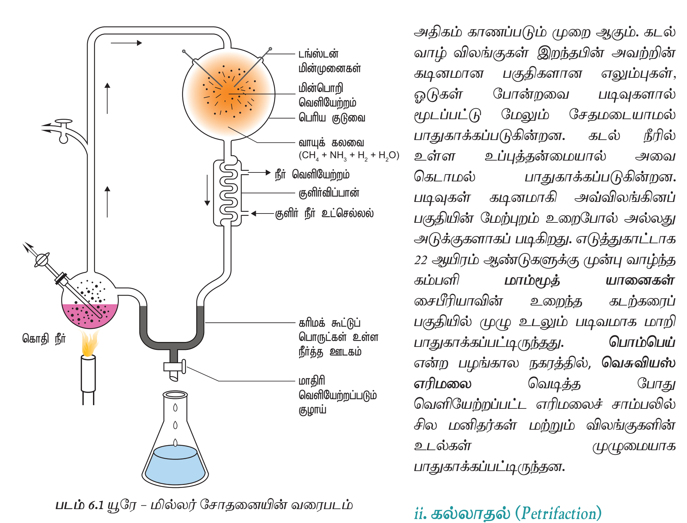

## 6.4  உயிரியப் பரிணாமத்திற்ககான

சான்றுகள்

### 6.4.1 தொொல்லுயிரிய சான்றுகள்

தொொல்லுயிரியல் என்பது புதைபடிவங்கள்
மூலமாக வரலாற்றுக்கு முந்ததைய உயிரினங்களை
ஆய்வு
செய்வது
ஆகும்.
பரிணாமத்தின்
உணமையான சாட்சிகள் அல்லது பரிணாமத்தின்
பல்வவேறு
புவியியல்
அடுக்குகளுக்கான
ஆவணங்களாக
புதைபடிவங்கள்
கருதப்படுகின்றன. பூமியின் படிவப் பாறைகளில்
தாவரங்கள் அல்லது விலங்குகளின் எச்சங்கள்
பாதுகாக்கப்படுதல்
புதைபடிவமாக்கம்
எனப்படும். இவற்றில் மூன்று முக்கிய வகைகள்
உள்ளன.

i. எஞ்சிய உடல் பகுதிகள் (Actual Remains)
விலங்குகளின் மிகக் கடினமான உடல்
பகுதிகளான எலும்புகள், பற்கள் அல்லது ஓடுகள்
ஆகியவை
பூமியின்
அடுக்குகளில்
மாற்றமில்லாமல்
அப்படியே
பாதுகாக்கப்படுகின்றன. இது புதைபடிவமாக்கலில்

அதிகம் காணப்படும் முறை ஆகும். கடல்
வாழ் விலங்குகள் இறந்தபின் அவற்றின்
கடினமான பகுதிகளான எலும்புகள்,
ஓடுகள்
போன்றவை
படிவுகளால்
மூடப்பட்டு மேலும் சேதமடையாமல்
பாதுகாக்கப்படுகின்றன.
கடல்
நீரில்
உள்ள
உப்புத்தனமையால்
அவை
கெடாமல்
பாதுகாக்கப்படுகின்றன.
படிவுகள் கடினமாகி அவ்விலங்கினப்
பகுதியின் மேற்புறம் உறைபோல் அல்லது
அடுக்குகளாகப் படிகிறது. எடுத்துகாட்டாக
22 ஆயிரம் ஆண்டுகளுக்கு முன்பு வாழ்ந்த
கம்பளி
மாம்மூத்
யானைகள்
சைபீரியாவின்
உறைந்த
கடற்கரைப்
பகுதியில் முழு உடலும் படிவமாக மாறி
பாதுகாக்கப்பட்டிருந்தது.
பொொம்பபெய்
என்ற பழங்ககால நகரத்தில், வெசுவியஸ்
எரிமலை
வெடித்த
போது
வெளியேற்றப்பட்ட எரிமலைச் சாம்பலில்
சில மனிதர்கள் மற்றும் விலங்குகளின்
உடல்கள்
முழுமையாக
பாதுகாக்கப்பட்டிருந்தன.

ii. கல்லாதல் (Petrifaction)
விலங்குகள் இறந்த பின்னர் அவற்றின்
உணமையான உடல் பகுதிகளின் மூலக்கூறுகள்,
தாது உப்புகளின் மூலக்கூறுகளால் பதிலீடு
செய்யப்படுகின்றன. மேலும் அவற்றின் மூல உடல்
பகுதிகள், சிறிது சிறிதாக அழிந்து விடுகின்றன.
இம்முறையிலான
புதைபடிவமாக்கல்
முறை
கல்லாதல்
எனப்படும்.
இம்முறையிலான
புதைபடிவமாக்கல்
முறையில்
இரும்பு
பைரைட்டுகள், சிலிகா, கால்சியம் கார்பனேட்
மற்றும் கால்சியம் மற்றும் மெக்னீசியத்தின்
பைகார்பனேட்டுகள் போன்ற முக்கிய தாது
உப்புக்கள் பெரும் பணியாற்றுகின்றன.

iii. இயற்ககையான அச்சுகளும்
வார்ப்புகளும்
இறந்த விலங்குகளின் உடல்கள் படிப்படியாக
சிதைந்த பின்பும், அவற்றின் உடல் மெனமையான
சேறு போன்ற பகுதியில் அழியாத பதிவை
உருவாக்குகின்றன. இப்பதிவு பின்பு கடினமாகி
கல்லாக மாறுகிறது. இவ்வகைப் பதிவுகள்
அச்சுகள் எனப்படும். இந்த அச்சுகளின் உட்புறம்
உள்ள குழிகள் தாது உப்புகளால் நிரப்பப்பட்டு

படிவமாக மாறுகின்றன. இவை வார்ப்புகள்
எனப்படும். விலங்குகளின் கடினமாக்கப்பட்ட
மலப்பொருட்கள்,
கோப்ரோலைட்டுகள்
(Coprolites)
எனும்
சிறு
உருண்டடைகளாக
காணப்படுகின்றன. இந்த கோப்ரோலைட்டுகளை
ஆய்வு செய்வதால் வரலாற்றுக்கு முந்ததைய
காலத்தில் வாழ்ந்த விலங்குகளின் உணவுப்
பழக்கத்தினை அறிந்து கொொள்ளலாம்.

ñQî¡
FIƒèô‹

«ñŸ¬è ⽋¹

உனது பள்ளிக்கு அருகில் உள்ள
அருங்ககாட்சியகத்திற்கு உனது ஆசிரியருடன்
சென்று பார்த்து, அங்குள்ள பாலூட்டி மற்றும்
பிற விலங்குகளின் எலும்புகளை அடையாளம்
காண்க.
புகழ்வவாய்ந்த
எழும்பூர்
அருங்ககாட்சியம் சென்னையில் உள்ளது.

### 6.4.2 ஒப்பீட்டு உள்ளமைப்பியல்

சான்றுகள்
வெவ்வேறு உயிரினத் தொொகுப்புகளின்
அமைப்பில்
காணப்படும்
ஒற்றுமைகள்
அவற்றுக்கிடையே
உள்ள
தொொடர்பபை
சுட்டிக்காட்டுகின்றன.
எடுத்துக்காட்டாக
வெவ்வேறு
முதுகெலும்பி
விலங்குகளின்
முன்னங்ககால்கள் குறித்த ஒப்பீட்டு ஆய்வு
அவற்றின் அமைப்பில் உள்ள ஒற்றுமையைக்
குறிக்கிறது. இத்தகைய தொொடர்பபை, அமைப்பொத்த
உறுப்புகள், செயலொொத்த உறுப்புகள், எச்ச
உறுப்புகள்,
இணைப்பு
உயிரிகள்
மற்றும்
முதுமரபு
உறுப்பு
மீட்சி
(Atavism)
ஆகிய
தலைப்புகளில் அறியலாம்.

அமைப்பொத்த உறுப்புகள்
(Homologous Structures)
முதுகெலும்பிகளின்
முன்னங்ககால்கள்
மற்றும் பின்னங்ககால்கள் குறித்த ஒப்பீட்டு
உடற்கூறியல் ஆய்வுகள், அவையனைத்தும் ஒரே
அடிப்படை
வரைவியைக்
கொொண்டிருக்கிறது
என்பதைக்
காட்டுகிறது.
வெவ்வேறு
முதுகெலும்பிகளின்
முன்னங்ககால்களின்
அடிப்படை
அமைப்பில்,
ஒற்றுமைகள்
காணப்படுகின்றன. அவையனைத்தும் மேற்ககை
எலும்பு, ஆர எலும்பு, அல்னனா, மணிக்கட்டு
எலும்புகள், உள்ளங்ககை எலும்புகள் மற்றும்
கைவிரல் எலும்புகள் போன்ற ஒரே விதமான
எலும்புகளால் ஆக்கப்பட்டுள்ளன.

ªõ÷õ£™

ðø¬õ

Ü™ù£

̬ù

°F¬ó

Ýó ⽋¹

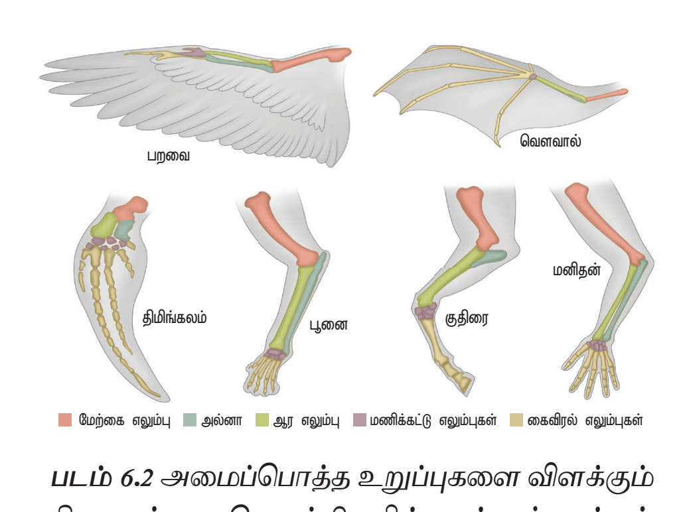
உருவாக்கத்தில் ஒரே மாதிரியாக அமைந்து
ஆனால் வெவ்வேறு செயல்களை செய்யக்கூடிய
உறுப்புகள்
அமைப்பொத்த
உறுப்புகள்
எனப்படும்.
இவை
விரி
பரிணாமத்தை
(Divergent
Evolution)
ஏற்படுத்தக்கூடியவை
(படம் 6.2).
இதே போல் காகிதப் பூவில் (Bougainvillea)
உள்ள முட்கள் மற்றும் சுரை (Curcurbita) மற்றும்
பட்டாணியில் (Pisum sativum) காணப்படும் பற்றுக்
கம்பிகள் அமைப்பொத்த உறுப்புகளாக உள்ளன.
காகிதப் பூவில் உள்ள முட்கள் அவற்றை மேய்ச்சல்
விலங்குகளிலிருந்து பாதுகாக்கின்றன. சுரை
மற்றும் பட்டாணியில் (Pisum sativum) உள்ள பற்றுக்
கம்பிகள் பற்றிப் படர உதவுகின்றன.

செயலொொத்த உறுப்புகள்
(Analogous Stuctures)

அமைப்பு அடிப்படையில் வேறுபட்டிருந்ததாலும்
ஒரேவிதமான
செயலைச்
செய்யக்
கூடிய
உறுப்புகள், செயலொொத்த உறுப்புகள் எனப்படும்.
எடுத்துக்காட்டாக பறவைகள் மற்றும் பூச்சிகளின்
இறக்கைள் வெவ்வேறு தோற்ற அமைப்பை்
பெற்றிருந்ததாலும் அவை ‘பறத்தல்’ என்ற ஒரே
செயலைச் செய்கின்றன. இது குவி பரிணாமத்திற்கு
(Convergent Evolution) வழிகோலுகிறது (படம் 6.3).
பாலூட்டி மற்றும் ஆக்டோபஸ் ஆகியவற்றின்
கண்கள்
மற்றும்
பெங்குவின்
மற்றும்
டால்பின்களில்
காணப்படும்
தசையாலான
அகலத்
துடுப்புகள்
(Flippers)
ஆகியவை
செயலொொத்த
உறுப்புகளுக்குப்
பிற
எடுத்துக்காட்டுகள் ஆகும். சீனிக் கிழங்கில் வேர்
மாற்றுரு மற்றும், உருளைக் கிழங்கின் தண்டின்
மாற்றுரு ஆகியவை செயலொொத்த உறுப்புகள்
ஆகும். இரண்டு தாவரங்களிலும் இவை ‘உணவு
சேமிப்பு’
என்ற
பொொதுவான
செயலை
மேற்கொள்கின்றன.

¬èMó™ ⽋¹èœ

Ü™ù£
ñE‚膴
⽋¹èœ
Ýó ⽋¹
«ñŸ¬è
⽋¹

பெருங்குடல் பிதுக்கம் செயலிழந்து அளவில்
குன்றி புழுப்போன்ற குடல்வவால் என்னும் எச்ச
உறுப்பாக மாறியது. வால் முள்ளளெலும்பு,
அறிவுப்பற்கள், காதில் உள்ள தசைகள், உடல்
உரோமங்கள், ஆண்களில் மார்பகம் மற்றும்
கண்களில் உள்ள நிக்டிடேடிங் சவ்வு போன்றவை
மனிதனில் காணப்படும் பிற எச்ச உறுப்புகளாகும்.

இணைப்பு உயிரிகள் (Connecting Links)

º¡ Þø‚¬è

இரண்டு மாறுபட்ட தொொகுப்பைச் சேர்ந்த
உயிரினங்களின்
பண்புகளையும்
ஒருங்ககே
பெற்றுள்ள உயிரினங்கள் இணைப்பு உயிரிகள்
எனப்படும். எ.கா பெரிபேட்டஸ் (வளைத்தசைப்
புழுக்கள் மற்றும் கணுக்காலிகள் தொொகுதிகளை
இணைக்கும் உயிரி), ஆர்க்கியோப்டடெரிக்ஸ்
(ஊர்வன மற்றும் பறவைகளை இணைக்கும்
உயிரி).

முது மரபு உறுப்புகள் மீட்சி (Atavistic
Organs)
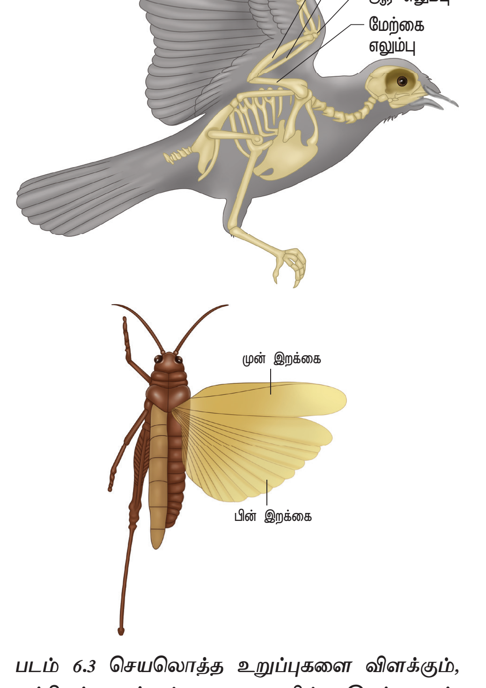

எச்ச உறுப்புகள் (Vestigial Organs)
ஒரு சில உறுப்புகளால் அவற்றைப் பெற்றுள்ள
உயிரினங்களுக்கு எந்தப் பயனும் இல்லை.
மேலும் உயிரிகளின் உயிர்வவாழ்க்கை்கும் அவை
தேவையற்றவை. இவையே எச்ச உறுப்புகள்
எனப்படும்.
உயிரினங்களில்,
உறுப்புகளின்
மீதங்களாகக் கருதப்படுகின்ற எச்ச உறுப்புகள்
அவற்றின் மூதாதை உயிரினங்களில் நன்கு
வளர்ச்சி பெற்றுச், செயல்படும் உறுப்புகளாக
இருந்திருக்கக்கூடும். ஆனால் பயன்படுத்தப்படாத
காரணத்தால் பரிணாமத்தின் போக்கில் அவை
மறைந்திருக்கலாம். எடுத்துக்காட்டாக மனிதனின்
குடல்வவால், பெருங்குடல் பிதுக்கத்தின் எஞ்சிய
பகுதி ஆகும். இவை முயல் போன்ற தாவர
உண்ணிகளில்
செயல்படும்
உறுப்புகளாக
உள்ளன.
இவற்றின்
பெருங்குடல்
பிதுக்கப்பகுதியில்
செல்லுலோஸ்
செரித்தல்
நிகழ்ச்சி
நடைபெறும்.
மனித
உணவில்
செல்லுலோஸின்
தேவை
குறைந்ததால்

நன்கு பரிணாமம் பெற்ற உயிரினங்களில்,
திடீரென எச்ச உறுப்புகள் வெளித் தோன்றுவது
முது மரபு உறுப்பு மீட்சி எனப்படும். எ.கா.
மனிதனில்
வளர்கருவில்
வால்
இருப்பது
முது மரபு உறுப்பு மீட்சி ஆகும்.

### 6.4.3 கருவியல் சான்றுகள்

(Embryological Evidences)
கருவியல் என்பது கருமுட்டையிலிருந்து முழு
உயிரினம் வளர்ச்சி அடைவதைப் படிக்கும்
அறிவியல்
பிரிவு
ஆகும்.
வெவ்வேறு
உயிரினங்களின் கரு வளர்ச்சியை கவனமாக
ஆராயும் போது, அவற்றுக்கிடையே கருவளர்ச்சி
நிலைகளிலும்,
வடிவங்களிலும்
ஒற்றுமை
இருப்பது உணரப்படுகிறது.
அனைத்து முதுகெலும்பிகளிலும் இதயத்தின்
கருவளர்ச்சி ஒரே முறையில் நடைபெறுகிறது.
இவையனைத்திலும் ஓரிணைக் குழல் போன்ற
அமைப்பு
தோன்றி
பின்னர்
இவ்வமைப்பு
மீன்களில்
இரண்டு
அறைகளையுடைய
இதயமாகவும்,
இருவாழ்விகளிலும்,
பெரும்பபாலான
ஊர்வனவற்றிலும்
மூன்று
அறைகளை உடைய இதயமாகவும், முதலை,
பறவைகள் மற்றும் பாலூட்டிகளில் நான்கு
அறைகளை உடைய இதயமாகவும் வளர்ச்சி
அடைகிறது. அனைத்து முதுகெலும்பிகளுக்கும்
பொொதுவான மூதாதை உயிரினம் இருந்ததை
இவ்வொற்றுமை காட்டுகிறது.

இதனால், 19ம் நூற்றாண்டடைச் சேர்ந்த
அறிவியல் அறிஞர்கள், உயர்நிலை விலங்குகள்
தமது
கரு
வளர்ச்சியின்போது
கீழ்நிலை
விலங்குகளின் (மூதாதையர்கள்) கருவளர்ச்சி
நிலைகளைக் கடப்பதாகக் கருதினர். எர்னஸ்ட்
வான் ஹேக்கல் உயிர்வழித் தோற்ற விதி (உயிர்
மரபியல்
விதி)
(Biogenetic
Law)
அல்லது
தொொகுத்துரைக் கோட்பபாட்டை (Recapitulation Theory)
உருவாக்கினார். இதன்படி ஒரு தனி உயிரினத்தின்
வாழ்க்கை சுழற்சி (தனி உயிரி வளர்ச்சி) (Ontogeny)
அவ்வுயிரியின்
இனவரலாற்றைத்
(Phylogeny)
தொொகுத்துரைக்கிறது. இதனை ‘ஒரு தனி உயிரியின்
கரு
வளர்ச்சி
அதன்
இன
வரலாற்றை
தொொகுத்துரைக்கிறது’
(Ontogeny
Recapitulates
Phylogeny) எனலாம். உயர்நிலை விலங்குகளின்
கரு வளர்ச்சி நிலைகள், அதன் மூதாதை
விலங்குகளின் முதிர் உயிரியைப் போல உள்ளன.
மனித கருவளர்ச்சியின் போது தோன்றும்
தொொண்டடை செவுள் பிளவுகள், கருஉணவுப் பை
மற்றும் வால் ஆகியவற்றை இதற்கு எடுத்து
காட்டுகளாகக் கூறலாம் (படம் 6.4).
உயிர்
மரபியல்
விதி
அனைத்து
உயிரினங்களுக்கும்
பொொருந்துவதில்லை.
விலங்குகளின் கருவளர்ச்சி நிலைகள் அதன்
மூதாதையர்களின் முதிர்உயிர்களைப் போல
இருப்பதில்லை என இப்போது நம்பப்படுகிறது.
மனிதக் கரு வளர்ச்சியின் போது மூதாதை
விலங்குகளின் கரு வளர்ச்சி நிலைகளை மட்டுமே
காட்டுகின்றனவே தவிர அவை முதிர் உயிரியைப்
போன்றிருப்பதில்லை.
பல்வவேறு
உயிரினங்களின்
க ரு க் ்க ளு க் கி டையே ய ா ன
ஒப்பீட்டு
ஆய்வு,
அவற்றின்
அமைப்பிலுள்ள ஒற்றுமையைக்
காட்டுகின்றன. மீன், சலமான்டர்,
ஆமை, கோழி மற்றும் மனிதக்
கருக்கள் ஒற்றைச் செல்லான
கருமுட்டையில் துவங்கி பிளத்தல்
முறையில்
பல்கிப்
பெருகி,
கருக்கோளமாகி பின்பு மூவடுக்கு
கருக்கோளமாக
மாற்றம்
அடைகின்றன.
மேற்கூறிய
இப்பண்பு
அனைத்து
விலங்குகளும்
பொொதுவான
மூ த ா தை யி ட மி ரு ந் து
தோ ன் றி யி ரு ப் ்ப தையே
காட்டுகிறது.

மூலக்கூறு சான்றுகள்
அடுத்தடுத்த தலைமுறைகளில் டி.என்.ஏ
மற்றும் ஆர்.என்.ஏ போன்ற மூலக்கூறுகள்
மற்றும் புரதங்களின் வரிசை அமைப்பில் ஏற்படும்
மாற்றங்களையே
மூலக்கூறு

குறிக்கிறது.
மூலக்கூறுகளின்
அமைப்பில்
ஏற்படும் மாற்றங்களை விளக்க பரிணாம
உயிரியல்
மற்றும்
இனக்கூட்ட
மரபியல்
கோட்பபாடுகள் பயன்படுகின்றன.
உயிரினங்களின் வாழ்வியல் நிகழ்வுகளைக்
கட்டுப்படுத்தும்
புரதங்கள்
மற்றும்
பிற
மூலக்கூறுகளை சிற்றினங்களிடையே பாதுகாக்க
முடிவது மூலக்கூறு உயிரியல் பிரிவின் பயனுள்ள
வளர்ச்சி
ஆகும்.
பாதுகாக்கப்பட்ட
இம்மூலக்கூறுகளில்
(DNA,
RNA
மற்றும்
புரதங்கள்) காலப்போக்கில் ஏற்படும் ஒரு சிறிய
மாற்றம் ‘மூலக்கூறு கடிகாரம்’ (Molecular Clock)
என அழைக்கப்படுகிறது. பரிணாமம் குறித்த
ஆய்வுகளில்
பயன்படும்
மூலக்கூறுகள்
சைட்டோகுரோம் – சி (சுவாச வழிப்பாதை)
மற்றும்
ரைபோசோம்
ஆர்.என்.ஏ
(புரதச்
சேர்க்கை) ஆகியவை ஆகும்.

## 6.5  உயிரியப் பரிணாமக்

கோட்பபாடுகள்

### 6.5.1 லாமார்க்கின் கோட்பபாடு

ஜீன் பாப்டிஸ்ட் டி லாமார்க் என்பவர் தான்
முதன்முதலாக, பரிணாமக் கோட்பபாட்டினை
தனது புகழ்வவாய்ந்த ‘விலங்கியல் தத்துவம்’
 

Hy

¶¿¼{g¸s

ރ¼

‚´{1

¼4ºy

º{gƒ¸ÎØÃÎ
ƒà´v

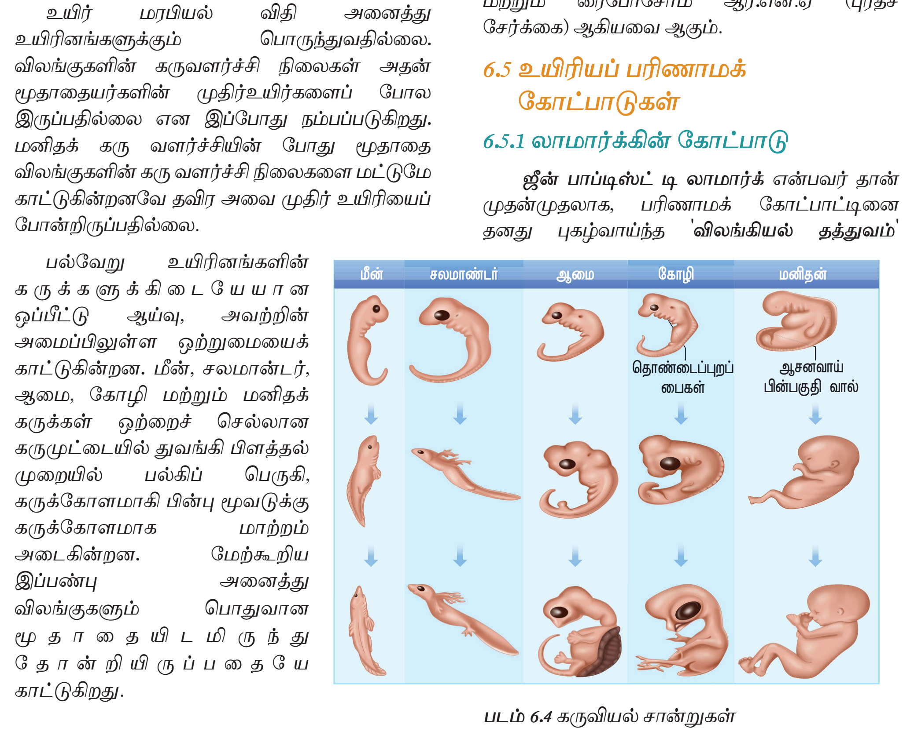

(Philosophic Zoologique)
(1809) என்ற நூலில்
குறிப்பிட்டுள்ளார்.
லாமார்க்
கோட்பபாட்டின்
இரண்டு முக்கியக் கொொள்ககைகள்.
i. பயன்படு மற்றும் பயன்படாக் கோட்பபாடு
அடிக்கடிப் பயன்படுத்தப்படும் உறுப்புகள்
அளவில் பெரிதாகின்றன. அதே வேளையில்
பயன்படுத்தப்படாத
உறுப்புகள்
சிதைந்து
அழிகின்றன. ஒட்டகச் சிவிங்கியின் கழுத்து,
பயன்படு விதிக்கும் மற்றும் பாம்புகளில் கால்கள்
இல்லாத்
தனமை
பயன்படா
விதிக்கும்
எடுத்துகாட்டுகள் ஆகும்.
ii. பெறப்பட்ட பண்புகள் மரபு கடத்தல் கோட்பபாடு
ஒரு உயிரினத்தின் வாழ்நநாளின் போது
உருவாக்கப்படும் பண்புகள், பெறப்பட்ட பண்புகள்
எனப்படும். இப்பண்புகள் அடுத்த தலைமுறைக்கு
கடத்தப்படுகின்றன.

லாமார்க் கோட்பபாட்டிற்ககான எதிர்
கருத்துகள்
ஆகஸ்ட் வீஸ்மமான் என்பவர் லாமார்க்கின்
‘பெற்ற பண்புகள் கடத்தப்படுதல் கோட்பபாட்டினைத்’
தவறென்று நிரூபித்தார். இவர், தனது சோதனையில்
தொொடர்ந்து
இருபது
தலைமுறைகளாக
சுண்டடெலிகளின் வாலினைத் துண்டித்து பின்னர்
இனப்பபெருக்கத்தில் ஈடுபடுத்தினார். முடிவில்
அனைத்து
சுண்டடெலிகளும்
முழுமையான
வாலுடனே பிறந்தன. இதன் மூலம் உடல் செல்களில்
ஏற்படும் மாற்றம் அடுத்த தலைமுறைக்குக்
கடத்தப்படாது என்றும், இனப்பபெருக்க செல்களில்
ஏற்படும் மாற்றங்கள் மட்டுமே மரபுக்கடத்தலுக்கு
உரியன என்றும் வீஸ்மமான் நிரூபித்தார்.

புதிய- லாமார்க்கியம்
லாமார்க் கோட்பபாட்டை ஆதரிக்கும் (புதிய
லாமார்கியர்கள்) கோப், ஆஸ்பர்ன், பக்கார்ட்
மற்றும்
ஸ்பபென்சர்
போன்றோர்,
இக்கோட்பபாட்டினை அறிவியல் அடிப்படையில்
விளக்க முயன்றனர். அனைத்து உயிரினங்களும்
சூழலுக்கேற்ப
தங்களைத்
தகவமைத்துக்கொள்ளும் என்பது பொொதுவானது
எனக் கருதினர். சுற்றுச்சூழலில் மாற்றங்கள்
ஏற்படும்போது
அதற்ககேற்ப
தங்களைத்
தகவமைத்துக் கொொள்வதற்ககாக புதிய பண்புகளை
உயிரினங்கள் பெற்றுக் கொொள்கின்றன. புறச்
சூழலில் எற்படும் மாற்றம் அவற்றின் உடல்
செல்களைத் தூண்டி சில ‘சுரப்புகளைச்’ சுரக்க
வைக்கின்றன. இவை இரத்தத்தின் மூலமாக இனச்

செல்களை அடைந்து அடுத்த சேய் உயிரினங்களில்
மாற்றங்களை ஏற்படுத்துகின்றன.

### 6.5.2 டார்வினின் இயற்ககைத் தேர்வு

கோட்பபாடு
சார்லஸ்
டார்வின்
தனது
பரிணாமக்
கோட்பபாட்டை ‘இயற்ககைத் தேர்வு வழி சிற்றினத்
தோற்றம்’ என்ற நூலில் விளக்கியுள்ளார். இவர்
உலகின் பலபகுதிகளில் பயணம் மேற்கொண்டு,
தாவரங்கள் மற்றும் விலங்குகளைக் குறித்து
விரிவாக
ஆய்வு
செய்ததார்.
அவர்
உயிரினங்களுக்கிடையே பல்வவேறு வகையான
மற்றும்
குறிப்பிடத்தக்க
ஒற்றுமைகள்
காணப்படுவதையும்,
அைவ
சூழலுக்கேற்ப
பொொருத்தமான
தகவமைப்புகளைப்
பெற்றிருப்பதையும் கண்டறிந்ததார். அவ்வாறு தகுதி
பெற்ற
உயிரினங்கள்
தகுதிபெறாத
உயிரினங்களைவிட நன்கு வாழும் என்றும்,
அவை அதிக வாரிசு உயிரிகளை உருவாக்கும்
என்றும், இதற்கு இயற்ககை தெரிந்ததெடுத்தல் ஒரு
காரணம் என்றும் நிரூபித்தார்.
டார்வின் கோட்பபாடு, பல்வவேறு உணமைகள்,
கருத்துக்கள்
மற்றும்
தாக்கங்களை
அடிப்படையாகக் கொொண்டதாகும். அவையாவன.
1. மிகை இனப்பபெருக்கம் (அல்லது) அளவற்ற
பிறப்பித்தல் திறன்
அனைத்து
உயிரினங்களும்
தன்
இனக்கூட்டத்தை
அதிக
எண்ணிக்கையில்
பெருக்கமடையச் செய்கின்றன. எடுத்துக்காட்டாக,
சால்மன் மீன்கள் இனப்பபெருக்க காலத்தில் சுமார்
28 மில்லியன் முட்டைகளை இடுகின்றன.
அவற்றின் அனைத்து முட்டைகளும் பொொரித்தால்
சில தலைமுறைகளிலேயே கடல் முழுதும்
சால்மன்
மீன்
நிறைந்து
காணப்படும்.
மிகக்குறைவான இனப்பபெருக்கத்திறன் உடைய
யானை, தனது வாழ்நநாளில் 6 குட்டிகளை மட்டுமே
ஈனும். தடையேதும் ஏற்படாத நிலையில் ஏறத்தாழ
750 ஆண்டுகளில் 6 மில்லியன் வாரிசுகளை
யானை உருவாக்கியிருக்கும்.
2. வாழ்க்கைப் போராட்டம்
உயிரினங்கள், உணவு, இருப்பிடம்,மற்றும்
இனப்பபெருக்கத்
துணைக்காகப்
போராடுகின்றன.
இவை
கட்டுப்படுத்தும்
காரணிகளாக மாறும் நிலையில் இனக்கூட்ட
உறுப்பினர்களுக்கிடையே போட்டி ஏற்படுகிறது.

டார்வின் இப்போராட்டங்களை மூன்று வழிகளில்
விளக்குகிறார்.
சிற்றினங்களுக்குள்ளான போராட்டம் – ஒரே
சிற்றினத்தைச் சேர்ந்த உயிரினங்களுக்கிடையே
உணவு, இருப்பிடம் மற்றும் இனப்பபெருக்கத்
துணைக்காக ஏற்படும் போராட்டம்.
சிற்றினங்களுக்கிடையேயான போராட்டம் –
வெவ்வேறு சிற்றினங்களுக்கிடையே உணவு
மற்றும் இருப்பிடத்திற்ககான போராட்டம்.

விலங்குகள்

அத்தகுதியை

எவ்வாறு

பெறுகின்றன என்பதை விளக்கவில்லை.
- 

 பெரும்பபாலும்

அடுத்த

தலைமுறைக்குக்

கடத்தப்படாத சிறு மாறுபாடுகளை மட்டுமே
டார்வின் கவனத்தில் கொொண்டடார்.
- 

 உடல் செல் மற்றும் இனப்பபெருக்க செல்களில்
ஏற்படும்

மாற்றங்களை

அவர்

வேறுபடுத்தவில்லை.
- 

 எச்ச உறுப்புகள், அழிந்துவிட்ட மாம்மூத்

சுற்றுச்சூழலுடன் போராட்டம் - காலநிலை
வேறுபாடு, வெள்ளம், நிலநடுக்கம், வறட்சி
மற்றும்
பல
சூழல்
காரணிகளுடன்
இணக்கமாவதற்ககான போராட்டம்

யானைகளின் நீளமான தந்தங்கள் மற்றும்

3. மாறுபாடுகள் தோன்றுதல்

முற்படவில்லை.

எந்த இரண்டு உயிரினங்களும் ஒன்றுபோல்
இருப்பதில்லை.
உருவமொொத்த
இரட்டையர்களிடையே
கூட
வேறுபாடுகள்
காணப்படும். ஒரே பெற்றோருக்குப் பிறக்கும்
குழந்ததைகள் கூட நிறம், உயரம், பழக்க
வழக்கங்கள்
போன்ற
பண்புகளால்
வேறுபட்டுள்ளனர். விலங்குகளில் தோன்றும்
பயனுள்ள
மாறுபாடுகள்,
அவற்றை
அவதிகளிலிருந்து
மீட்க
உதவுகின்றன.
இப்பண்புகள்
அடுத்த
தலைமுறைக்குக்
கடத்தப்படுகின்றன.
4. இயற்ககைத் தேர்வு வழி சிற்றினத் தோற்றம்
டார்வினின் கூற்றுப்படி இயற்ககையே மிகச்
சிறந்த தேர்ந்ததெடுக்கும் சக்தி ஆகும். சிறிய
தனிமைப்படுத்தப்பட்ட குழு உயிரினங்களில்,
இயற்ககைத் தேர்வு காரணமாக புதிய சிற்றினம்
தோன்றுவதை
டார்வின்
ஒப்பிடுகிறார்.
வாழ்வதற்ககான போராட்டமே, தகுதி வாய்ந்த
உயிரினங்கள் தப்பிப் பிழைப்பதற்ககான காரணம்
என்று அவர் கருதினார். அவ்வகை உயிரினங்கள்
மாறுபட்ட சூழ்நிலைக் கேற்ப வாழ தம்மைத்
தகவமைத்துக் கொொள்கின்றன.

டார்வினியத்திற்ககான எதிர்கருத்துக்கள்
டார்வினியக் கோட்பபாட்டிற்கு எதிராக எழுந்த
சில எதிர்கருத்துக்கள்:
- 

 மாறுபாடுகள் தோன்றும் முறை குறிந்து
டார்வின் சரியாக விளக்கவில்லை.

- 

 தகுதியுடையன பிழைத்தல் என்பதை மட்டும்
டார்வினியம்

விளக்குகிறது.

ஆனால்

அயர்லலாந்து

மான்களின்

கொொம்புகள் போன்ற அளவுக்கதிமாக சிறப்புப்
பெற்றிருத்தல்

குறித்து

டார்வின்

விளக்க

புதிய டார்வினியம்
இயற்ககைத் தேர்வு வழியாக பரிணாமம்
நடைபெறுகிறது
என்னும்
டார்வினிய
கோட்பபாட்டிற்ககான புதிய விளக்கங்களே புதிய
டார்வினியம் எனப்படும். ஏனெனில், டார்வினியக்
கோட்பபாடு அது தோன்றிய காலத்திலிருந்து
பல்வவேறு மாற்றங்களைச் சந்தித்தது. பரிணாமம்
குறித்த புதிய உணமைகள் மற்றும் அறிவியல்
கண்டுபிடிப்புகள் ஆகியவற்றின் அடிப்படையில்
டார்வினியம் பல்வவேறு மாற்றங்களைப் பெற்றது.
மேலும் வால்ஸ், ஹென்ரிச், ஹேக்கல், வீஸ்மமேன்
மற்றும் மென்டல் ஆகியோர் இக்கோட்பபாட்டினை
ஆதரித்தனர். திடீர் மாற்றம், மாறுபாடுகள்,
தனிமைப்படுத்தல் மற்றும் இயற்ககைத் தேர்வு
காரணமாக ஒரு இனக் கூட்டத்தின் மரபணு
நிகழ்வவெண்களில்
ஏற்படும்
மாறுபாடுகளை
இக்கோட்பபாடு வலியுறுத்துகிறது.

### 6.5.3 திடீர் மாற்றக் கோட்பபாடு

திடீர் மாற்றக் கோட்பபாட்டை முன் வைத்தவர்
ஹிகோ டி விரிஸ் ஆவார். திடீர் மாற்றம் என்பது
உயிரினங்களில் ஏற்படும் உடனடியான, சீரற்ற
மற்றும் மரபுகடத்தலில் பங்ககேற்ககாத மாற்றங்கள்
ஆகும். ஹிகோ டி விரிஸ், அந்தி ப்ரிம் ரோஸ்
(ஈனோதீரா லாமார்க்கியானா) தாவரத்தில் ஆய்வு
மேற்கொண்டு, அதில் திடீர் மாற்றம் காரணமாக
ஏற்பட்ட மாறுபாடுகளைக் கண்டறிந்ததார்.
பெரிய
மற்றும்
உடனடியாக
ஏற்படும்
மாறுபாடுகள்
மட்டுமே
புதிய
சிற்றினம்
தோன்றுவதற்குக் காரணம் என்பது டி விரிஸ்

நீளமான

கருத்தாகும். ஆனால் லாமார்க் மற்றும் டார்வின்
ஆகியோர்
உயிரினங்களில்
ஏற்படும்
படிப்படியான மாறுபாடுகள் அனைத்தும் ஒன்று
சேர்ந்து புதிய சிற்றினம் உருவாகக் காரணமாகிறது
என்று நம்பினர்.
திடீர்மமாற்றங்கள் என்பவை சீரற்ற மற்றும்
இலக்கற்றவை
என்று
ஹியூகோ
டீவிரிஸ்
நம்பினார். ஆனால் டார்வினின் ஆதரவாளர்கள்
இவை சிறிய மற்றும் இலக்குக் கொொண்டவை
என்று நம்பினார்கள்.
புதிய சிற்றினம் உருவாக திடீர்மமாற்றமே
காரணம் என ஹியூகோ டீவிரிஸ் நம்பினார்.
இது தாவுதல் (saltation - ஒரு படியில் ஏற்படும்
பெரிய
திடீர்மமாற்றம்)
என்றும்
அழைக்கப்படுகிறது.

திடீர் மாற்றக் கோட்பபாட்டின் சிறப்புப்
பண்புகள்
- 

 திடீர் மாற்றம் அல்லது தொொடர்ச்சியற்ற
மாறுபாடுகள் அடுத்த தலைமுறைக்குக்
கடத்தப்படும் தனமை கொொண்டது.

- 

 இயற்ககையாக
இனப்பபெருக்கம்
செய்யும்
இனக்கூட்டத்தில்
அவ்வப்போது
திடீர்
மாற்றங்கள் ஏற்படும்.

- 

 திடீர் மாற்றம் முழுமையான நிகழ்வு ஆதலால்
இடைப்பட்ட உயிரினங்கள் காணப்படாது.

- 

 திடீர்
மாற்றம்
உட்பட்டது ஆகும்.

இயற்ககைத்

தேர்வுக்கு

### 6.5.4 நவீன உருவாக்கக் கோட்பபாடு

(Modern Synthetic Theory)
சீவால் ரைட், ஃபிஷ்ஷர், மேயர், ஹக்ஸ்லலே
டோப்சசான்சுகி, சிம்ஸ்சன் மற்றும் ஹேக்கல்
போன்றோர்
டார்வினுக்குப்
பிந்ததைய
கண்டுபிடிப்புகளின் அடிப்படையில் இயற்ககைத்
தேர்வுக்
கோட்பபாட்டை
விளக்கினர்.
இக்கோட்பபாட்டின்படி மரபணு திடீர்மமாற்றம்,
குரோமோசோம் பிறழ்ச்சி, மரபணு மறுசேர்க்கை,
இயற்ககைத் தேர்வு மற்றும் இனப்பபெருக்க ரீதியாக
தனிமைப்படுத்துதல் ஆகிய ஐந்து அடிப்படை
காரணிகள் கரிமப் பரிணாம நிகழ்வுக்குக்
காரணமாகின்றன.
i.  
மரபணு திடீர் மாற்றம் என்பது மரபணுக்களின்
அமைப்பில் ஏற்படும் மாற்றங்கள் ஆகும். இது
மரபணு திடீர் மாற்றம் /புள்ளி திடீர் மாற்றம்

என்றும் அழைக்கப்படும். இது உயிரினங்களின்
புறத்
தோற்றங்களை
மாற்றியமைத்து
அவற்றின் சேய் உயிரிகளில் மாறுபாடுகளை
உருவாக்குகிறது.
ii.  குரோமோசோம் பிறழ்ச்சி என்பது நீக்கம்,
சேர்த்தல், இரட்டிப்பாக்கம், தலைகீழாக்கம்
மற்றும்
இடமாற்றம்
காரணமாக
குரோமோசோம்
அமைப்பில்
ஏற்படும்
மாற்றங்கள் ஆகும். இவையும் உயிரினங்களின்
புறத்
தோற்றங்களை
மாற்றியமைத்து
அவற்றின் சேய் உயிரிகளில் மாறுபாடுகளை
உருவாக்குகின்றன.
iii.  மரபணு மறுசேர்க்கை என்பது குன்றல்
பிரிதலின் போது ஏற்படும் குறுக்ககெதிர்
மாற்றத்தால்
நிகழ்கிறது.
இவை
ஒரு
சிற்றினத்தைச்
சேர்ந்த
உயிரினங்களில்
மரபணு மாற்றங்களை உருவாக்குகின்றன.
இம்மாற்றங்கள்
அடுத்த
தலைமுறைக்கு
கடத்தப்படும்.
iv.  இயற்ககைத் தேர்வு எந்த வித மரபணு
மாறுபாடுகளையும்
தோற்றுவிப்பதில்லை.
ஆனால்
தேர்வு
சக்தி
சில
மரபணு
மாற்றங்களை
மட்டுமே
உயிரினங்களில்
அனுமதிக்கிறது.
மற்றவை
நிராகரிக்கப்படுகின்றன. (பரிணாமத்திற்ககான
உந்து சக்தி)
v.  இனப்பபெருக்க ரீதியாக தனிமைப்படுத்துதல்
முறைகள்
தொொடர்புடைய
உயிரினங்களுக்கிடையே
இனப்பபெருக்கம்
நடைபெறுவதைத் தடுக்கிறது.

### 6.5.5 மனித இனத்தால் உருவாகும்

இயற்ககைத்
மெலானினாக்கம்)

தேர்வு

(தொொழிற்சசாலை

இயற்ககைத்
தேர்வு
நடைபெறுவதை
‘தொொழிற்சசாலை மெலானின் ஆக்கம்’ மூலம்
தெளிவாக
விளக்க
முடியும்.
கரும்புள்ளி
அந்திப்பூச்சி (பிஸ்டன் பெட்டுலேரியா) யில்
காணப்படும் தொொழிற்சசாலை மெலானின் ஆக்கம்
இயற்ககைத்
தேர்வுக்கான
மிகச்
சிறந்த
எடுத்துக்காட்டாகும். இவை, வெள்ளை நிற
இறக்கை மற்றும் கருப்பு நிற இறக்கை என
இரண்டு நிறங்களில் காணப்பட்டன. இங்கிலாந்தில்
தொொழில்மயமாக்கலுக்கு
முன்பு
வெள்ளை
மற்றும் கருப்புநிற அந்துப்பூச்சிகள் இரண்டுமே
பரவலாகக்
காணப்பட்டன.
தொொழில்
மயமாக்கலுக்கு
முன்பு
வெள்ளை
நிற

லைக்கன்களின்
அடர்த்தியான
வளர்ச்சி
மரங்களில் காணப்பட்டதால், வெள்ளை நிற
இறக்கைள் கொொண்ட அந்துப்பூச்சிகள் கருப்பு நிற
இறக்கைள் கொொண்ட அந்துப்பூச்சிகளை விட
அதிகமாகக் காணப்பட்டன. வெள்ளை நிற
பின்புலத்தின்
காரணமாக,
வெள்ளை
நிற
அந்துப்பூச்சிகள்
கொொன்றுண்ணிகளிடமிருந்து
எளிதில்
தப்பித்தன.
ஆனால்
தொொழில்மயமாக்கலுக்குப் பின்னர் மரங்களின்
தண்டுப் பகுதிகள் தொொழிற்சசாலைகளிலிருந்து
வெளியேறும் புகை மற்றும் கரியால் கரிய நிறமாக
மாறின.
இதனால்
லைக்கன்களின்
எண்ணிக்கையும்
குறைந்தது.
ஏனெனில்
மாசடைந்த பகுதிகளில் லைக்கன்களால் வளர
இயலாது. புகை மற்றும் கரியால் பின்புலம் கருமை
நிறமாக மாறியதால் வெள்ளை நிற இறக்கைள்
கொொண்ட அந்துப்பூச்சிகள் கொொன்றுண்ணிகளால்
எளிதில் அடையாளம் காணப்பட்டபோது கருமை
நிற பின்புலத்தால் கருப்பு நிற இறக்கைள்
கொொண்ட
அந்துப்பூச்சிகளாக
உருவமறைப்பு
(Camouflage) பெற்றன. அதனால் கரிய நிறமுடைய
அந்துப்பூச்சிகள்,
இயற்ககையால்
தேர்வு
செய்யப்பட்டு அவற்றின் எண்ணிக்கை வெள்ளை
நிற அந்துப்பூச்சிகளை விட உயர்ந்தது. இயற்ககை,
கருப்பு நிற அந்துப்பூச்சிக்கு நேர்மறை தேர்வு
அழுத்தத்தை வழங்கியது. ஒரு இனக்கூட்டத்தில்
தகுந்த தகவமைப்புப் பெற்ற உயிரினங்கள்
இயற்ககைத் தேர்வு காரணமாக அதிகமான
வாரிசுகளை
உருவாக்குவதால்
அவற்றின்
எண்ணிக்கை உயரும் என்பதையே மேற்கண்ட
எடுத்துக்காட்டு உணர்த்துகிறது.
செயற்ககைத் தேர்வு என்பது காடுகள், கடல்கள்
மற்றும் மீன் வளங்களை மனிதன் மிகையாகப்
பயன்படுத்துவது, தீங்குயிர்க் கொொல்லிகள், களைக்
கொொல்லிகள்
மற்றும்
மருந்துகளைப்
பயன்படுத்துவது ஆகிய நிகழ்வுகளின் பக்க
விளைவாகும். நூற்றுக் கணக்கான ஆண்டுகளாக
மனிதன் வெவ்வேறு வகையான நாய்களைத்
தேர்வு செய்துள்ளான். இவை அனைத்தும் ஒரே
சிற்றின நாய்களின் வேறுபட்ட மாற்றுருக்கள்
ஆகும். மனிதன் புதிய இனங்களைக் குறுகிய
காலத்தில் உருவாக்குவது போல, தாராளமான
வளங்கள் மற்றும் அதிக கால அளவு ஆகியவற்றைக்
கொொண்டு, இயற்ககை தேர்வின் மூலம் புதிய
சிற்றினத்தை எளிதாக உருவாக்க முடியும்.

### 6.5.6 தகவமைப்புப் பரவல்

(Adaptive Radiation)

ஒரு
மூதாதை
இனத்திலிருந்து
புதிய
சிற்றினங்கள்,
புதிய
வாழிடங்களில்
வாழ்வதற்ககேற்ற தகவமைப்புகளுடன் தோன்றும்
பரிணாம
நிகழ்வு
தகவமைப்புப்
பரவல்
எனப்படும். தகவமைப்புப் பரவலை நெருங்கிய
தொொடர்புடைய உயிரினங்களில், மிகக் குறுகிய
கால இடைவெளிகளில் எளிதில் நிரூபிக்கலாம்.
டார்வினின்
குருவிகள்
மற்றும்
ஆஸ்திரேலியாவைச் சேர்ந்த பைப்பாலூட்டிகள்
ஆகியவை தகவமைப்புப் பரவலுக்குச் சிறந்த
எடுத்துக்காட்டுகள்
ஆகும்.
ஒரு
தனிமைப்படுத்தப்பட்ட
புவியியல்
பரப்பில்,
அமைப்பு
மற்றும்
செயலில்
ஒத்திருக்கும்
ஒன்றுக்கும் மேற்பட்ட தகவமைப்புப் பரவல்
தோன்றுவதற்குக் காரணம் ‘குவி பரிணாமம்’
ஆகும்.

டார்வினின் குருவிகள்

இப்பறவைகளின் மூதாதையர் 2 மில்லியன்
ஆண்டுகளுக்கு முன்பு காலபாகஸ் பகுதிக்கு
வந்து சேர்ந்தவை. டார்வின் ஆய்வு மேற்கொண்ட
போது, உடல் அளவு, அலகின் வடிவம் மற்றும்
உணவுப் பழக்கம் ஆகிய பண்புகளால் வேறுபட்ட

சிற்றினங்களாகப்
பரிணமித்திருந்தன.
அவற்றின் உடல் அளவு மற்றும் அலகின் வடிவம்
ஆகியவற்றில் ஏற்பட்ட மாறுபாடுகளால் அவை
வெவ்வேறு வகை உணவுகளான பூச்சிகள்,
விதைகள், கள்ளித் தாவரத்தின் மகரந்தத் தேன்
மற்றும் உடும்பின் இரத்தம் ஆகியவற்றை உண்ண
முடிகிறது. இப்பண்புகளை இயற்ககைத் தேர்வு,
வழி நடத்துகிறது. டார்வின் கண்டறிந்த பல்வவேறு
வகை குருவிகளைப் படம் 6.5ல் காணலாம்.
டார்வினின்
குருவிகளில்
உள்ள
டி.என்.ஏ.க்களில்
காணப்படும்
ALX1
மரபணுக்களில் ஏற்பட்ட மரபணு மாற்றங்களே
அவற்றின் வெவ்வேறு வகை அலகு வடிவ
அமைப்பிற்குக்
காரணமாகும்.
ALX1
மரபணுக்களில் ஏற்பட்ட சிறிய திடீர்மமாற்றம்
டார்வினிய குருவிகளின் அலகு அமைப்பின் புறப்
பண்புகளில் மாற்றங்களை ஏற்படுத்துகின்றது.
ஆஸ்திரேலியாவில் உள்ள பைப்பாலூட்டிகள்
மற்றும் வட அமெரிக்காவில் உள்ள நஞ்சுக்கொடி
பாலூட்டிகள் ஆகிய இரண்டு துணை வகுப்பைச்
சேர்ந்த

பாலூட்டிகளும்

இடப்பபெயர்ச்சித்

திறன்

உணவு

மற்றம்

கால

வளம்,
நிலை

Ø Üô° Gôõ£› °¼M
(T«ò£v¬ðê£ ®çHCLv)

°¼M

CPò Ì„C à‡E
ñóõ£› °¼M
(è£ñ£K¡èv 𣘾ôv)

‹ Üô°
÷J´
¶¬
èœO»
‡E

ñóõ
£›

°¼
H®ˆ¶
Mè
‡µ
œ
‹
Ü
ô

Ì„C
à‡E

î¬
óõ
œ
Mè
°
°¼
Üô
‹
†´
ªõ

î£õó à‡E
ñóõ£› °¼M
(H÷£®vHê£
Aó£Có£v†Kv)

°

î¬óõ£› CPò °¼M
(T«ò£v¬ðê£
çHÎLT«ù£ê£)

£›

ªðKò Ì„C
à‡E ñóõ£›
°¼M (è£ñ£K¡èv
C†ì£°ô£)

M”
à‡E

AO Üô° «ð£¡ø¶

ஆகியவற்றுக்கான தகவமைப்புகளை மேற்கண்ட
முறைப்படியே பெற்றுள்ளன. இவை இரண்டும்
மூதாதையரிடமிருந்து

மில்லியன்

ஆண்டுகளுக்கு முன் தனியாகப் பிரிந்தன. பின்னர்
இவை ஒவ்வொன்றும் தனித்தனி மரபுக் கால்களாக
தன்னியல்பபாகப்

பரிணமித்தன.

ஆஸ்திரேலிய

பைப்பாலூட்டிகள் மற்றும் வட அமெரிக்க நஞ்சுக்
கொொடி

பாலூட்டிகளும்,

காலத்தாலும்,

புவிப்பரவலாலும் வேறுபட்டு இருந்ததாலும் அவை
ஒரே வாழிடத்தில் வாழும் வாழ்க்கை முறைகளைக்
கொொண்ட பல சிற்றினங்களை உருவாக்கியுள்ளன.
இவற்றின்

வடிவம்,

இடப்பபெயர்ச்சி

முறை,

உணவூட்டம் மற்றும் உணவு தேடும் முறையில்
உள்ள

ஒற்றுமை,

இனப்பபெருக்க

அவற்றின்

முறைகளை

வேறுபட்ட

அடிப்படையாகக்

கொொண்டது. இப்பண்புகள் அவற்றின் தெளிவான
பரிணாமத் தொொடர்புகளை விளக்குகின்றன.
ஆஸ்திரேலியாவில்

200க்கும்

மேற்பட்ட

பைப்பாலூட்டிகளும், ஒரு சில சிற்றினங்களைச்
சேர்ந்த

நஞ்சுக்

கொொடி

பாலூட்டிகளும்

வாழ்கின்றன. இப்பையுடைய பாலூட்டிகள், வட
அமெரிக்காவில்

பரவியுள்ள

நஞ்சுக்

கொொடி

பாலூட்டிகள் போலவே தகவமைப்பு பரவல் மூலம்
ஆஸ்திரேலியாவின் வெவ்வேறு வாழிடங்களில்
பரவலாக வாழ்கின்றன.

## 6.6 பரிணாமம் நடைபெறும் முறை

நுண்பரிணாமம் (சிறு அளவில் நடைபெறும்
பரிணாமம்) என்பது ஒரு இனக்கூட்டத்தில்
அல்லீல்
நிகழ்வவெண்களில்
ஏற்படும்
மாற்றங்களைக் குறிக்கிறது. இயற்ககைத் தேர்வு,
மரபியல் நகர்வு, திடீர் மாற்றம் மற்றும் மரபணு
ஓட்டம் ஆகிய நான்கு அடிப்படைக் காரணிகளால்,
இனக்கூட்டத்தின்
அல்லீல்
நிகழ்வவெண்கள்
மாற்றமடைகின்றன.

î¬óõ£› ï´ˆîó‚
°¼M
(T«ò£v¬ðê£
ç«ð£˜®v)
ªðKò î¬óõ£›
°¼M
(T«ò£v¬ðê£
«ñ‚Qó£v†Kv)

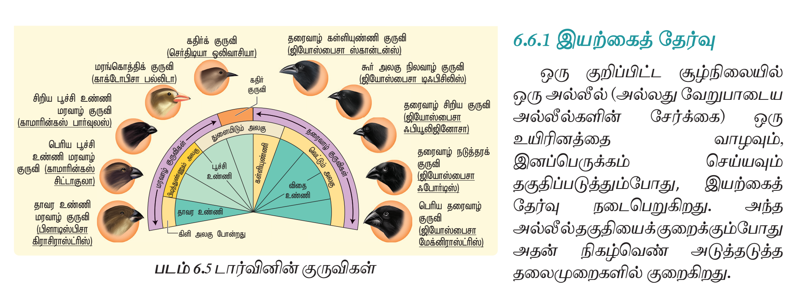

பொொது

### 6.6.1 இயற்ககைத் தேர்வு

î¬óõ£› èœO»‡E °¼M
(T«ò£v¬ðê£ v裡ì¡v)

èF˜‚ °¼M
(ªê˜F®ò£ åLõ£Cò£)
ñóƒªè£ˆF‚ °¼M
(裂«ì£Hê£ ð™Lì£)
èF˜

ஒரு குறிப்பிட்ட சூழ்நிலையில்
ஒரு அல்லீல் (அல்லது வேறுபாடைய
அல்லீல்களின்
சேர்க்கை)
ஒரு
உயிரினத்தை
வாழவும்,
இனப்பபெருக்கம்
செய்யவும்
தகுதிப்படுத்தும்போது, இயற்ககைத்
தேர்வு
நடைபெறுகிறது.
அந்த
அல்லீல் தகுதியைக் குறைக்கும்போது
அதன் நிகழ்வவெண் அடுத்தடுத்த
தலைமுறைகளில் குறைகிறது.

ஒரு குறிப்பிட்ட மரபணுவின்
பரிணாமப் பாதை என்பது, பல்வவேறு பரிணாம
செயல்முறைகள் ஒரே நேரத்தில் செயல்படுவதன்
விளைவாகும். எடுத்துக்காட்டாக ஒரு மரபணுவின்
அல்லீல் நிகழ்வவெண், மரபணு ஓட்டம் மற்றும்
மரபியல் நகர்வு ஆகிய இரண்டு காரணிகளால்
மாற்றப்படலாம். அதே நேரத்தில் மற்றொரு
மரபணு திடீர் மாற்றத்தினால், இயற்ககைத் தேர்வு
ஏற்கத்தக்க புதிய அல்லீலை உருவாக்கலாம்
(படம் 6.6).
தேர்வு
முறைகள்:
மூன்று
வகையான
இயற்ககைத் தேர்வு முறைகள் காணப்படுகின்றன
i. நிலைப்படுத்துதல் தேர்வு (மைய நோக்குத்
தேர்வு) (Centripetal Selection)
இவ்வகைத் தேர்வு முறை நிலையான
சுற்றுச்சூழல் இருக்கும்போது செயல்படுகிறது
(படம் 6.7 அ). இம்முறையில் சராசரி புறத்தோற்றப்
பண்புகள்
உடைய
உயிரினங்கள்
தப்பிப்
பிழைக்கும். ஆனால் இரு பக்கங்களிலும் உள்ள
சூழலுக்கு ஒவ்வாத மிகை பண்பு உயிரினங்கள்,
உயிரினத் தொொகையிலிருந்து நீக்கப்படும். இங்கு
புதிய
சிற்றினமாக்கல்
நிகழாது.
ஆனால்
இனக்கூட்டத்திற்குள், புறத்தோற்றப் பண்புகளில்
உள்ள
நிலைத்தனமை
அடுத்தடுத்த
தலைமுறைகளிலும் மாறாமல் பேணப்படும்.
எடுத்துக்காட்டாக, புயலின் போது தப்பி வாழ்ந்த
சிட்டுக்குருவிகள் எண்ணிக்கை சராசரி அளவை
ஒட்டி இருக்கும். புயலுக்குத் தாக்குப்பிடிக்க
இயலாத சிட்டுக்குருவிகளின் எண்ணிக்கை
மாறுபாடுகளின்
விளிம்புகளில்
சேகரமாகி
விடுகிறது.
இப்போக்கு
நிலைப்படுத்துதல்
தேர்வினைக் குறிக்கும்.
ii. இலக்கு நோக்கிய தேர்வு முறை
(Directional Selection)
படிப்படியாக
மாற்றம்
பெறும்
சுற்றுச்
சூழல், இலக்கு நோக்கிய தேர்வு முறைக்கு
உட்படுத்தப்படுகிறது (படம் 6.7 ஆ). இவ்வகையான

AA

èKò Gø ð£¬ø àœ÷ Åö™ Þ«ôê£ù
꣋ð™ Gø õ‡´èœ, èKò
õ‡´è¬÷Mì ðø¬õè÷£™ ÜFèñ£è
à‡íŠð†ìù.

Aa

X Aa
X
X
aa
aa
‘X’ âù‚ °PŠHìŠð†ì¬õ ðø¬õè÷£™
aa
Aa
à‡íŠð†ì¬õ.
Aa
Xaa X
aa

Ü´ˆî î¬ôº¬ø

Aa
AA

Aa

aa

AA

AA
aa

Aa

AA

Aa

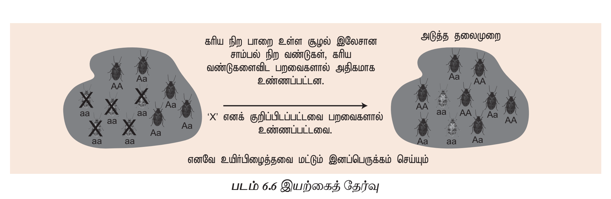
தேர்வு முறையில், புறத்தோற்றப் பண்புகள்
பரவலின் ஒரு முனையிலிருந்து மறுமுனையை
நோக்கி
படிப்படியாக
உயிரினங்கள்
நீக்கப்படுகின்றன. இதற்கு எடுத்துக்காட்டாக,
ஆண் மற்றும் பெண் சிட்டுக் குருவிகளின் உடல்
அளவில் உள்ள வேறுபாடுகளைக் கூறலாம்.
ஆண் மற்றும் பெண் சிட்டுக் குருவிகள்
புறத்தோற்றத்தில் ஒன்றுபோலத் தோன்றினாலும்,
அவற்றின் உடல் எடை வேறுபாடுகளைக்
காணப்படும். பெண் குருவிகள் அதன் உடல்
எடையோடு தொொடர்புடைய இலக்கு நோக்கிய
தேர்வு முறையை வெளிக்காட்டுகிறது.

¹øˆ«î£ŸøŠ ð‡¹èÀ¬ìò
àJKùƒèœ â‡E‚¬è

iii.  உடைத்தல் முறைத் தேர்வு
(மைய விலக்குத் தேர்வு) (Centrifugal Selection)
ஒரே விதமான சுற்றுச் சூழல், நிலைமாற்றம்
பெற்று, பல்வகை சுற்றுச்சூழல் நிலைகளைக்
கொொண்டதாக
மாறும்போது
இவ்வகைத்
தேர்வுமுறை செயல்படுகிறது (படம் 6.7 இ).
இம்முறையில் இருமுனைகளிலும் காணப்படும்

à„C àòóñ£è¾‹
جñò£è¾‹
àœ÷¶

Ü) G¬ôŠð´ˆ¶î™ «î˜¾ º¬ø

ÞòŸ¬èˆ
«î˜Mù£™
«î˜¾
ªêŒòŠð´‹
¹øˆ«î£Ÿø‹

புறத்தோற்றப் பண்புகளை உடைய உயிரினங்கள்
தேர்வு செய்யப்படுகின்றன. ஆனால் சராசரி
புறத்தோற்றப் பண்புகளை உடைய உயிரினங்கள்
இனக்கூட்டத்திலிருந்து
நீக்கப்படுகின்றன.
இதனால் இனக்கூட்டம், துணை இனக்கூட்டங்கள்
அல்லது துணை சிற்றினங்களாகப் பிரிகின்றன.
இந்த அரிதான வகைத் தேர்வு முறையில் இரண்டு
அல்லது இரண்டுக்கும் மேற்பட்ட மாறுபட்ட
சிற்றினங்கள் தோன்றுகின்றன. இது தகவமைப்புப்
பரவல் (Adaptive Radiation) என்றும் அழைக்கப்படும்.
எடுத்துக்காட்டு: காலபாகஸ் தீவுகளில் வாழும்
டார்வினின் குருவிகளில், உணவாகப் பயன்படும்
விதையின் அளவுக்கேற்ப அவற்றின் அலகுகளின்
நீளம் மாறுபடுகிறது.
குழுத் தேர்வு மற்றும் பாலினத் தேர்வு
ஆகியவை பிற தேர்வு முறைகள் ஆகும். பொொது
நலன் (Altruism) மற்றும் உறவுமுறைத் தேர்வு
(Kin Selection) ஆகியவை குழுத் தேர்வு முறையின்
இரு முக்கிய வகைகளாகும்.
êó£êK Ü÷¾œ÷
àJKùƒèœ
«î˜¾
ªêŒòŠð´î™

à„C å¼¹ø‹
«ï£‚A ïè˜î™

Ý) Þô‚° «ï£‚Aò «î˜¾º¬ø

Þó‡´ à„Cèœ à¼õ£î™

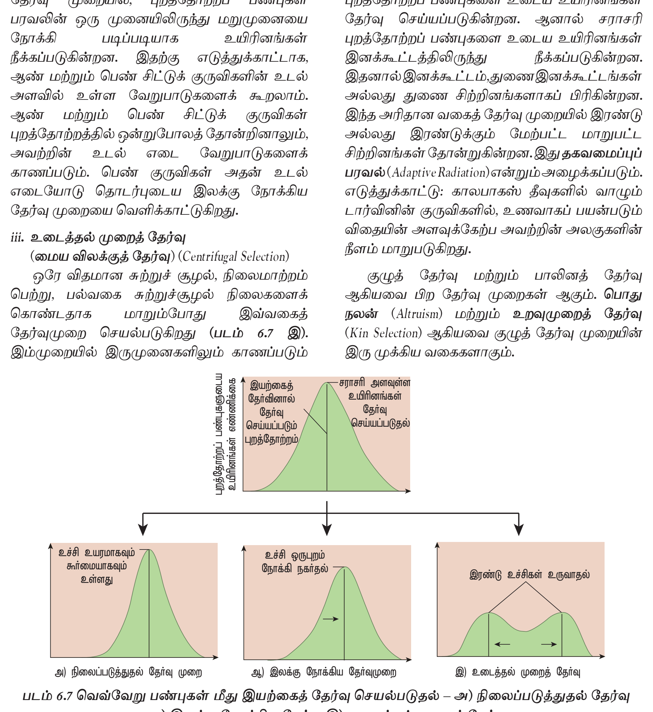

### 6.6.2 மரபணு ஓட்டம்

உருவாக்கினாலும் (நிறுவனர் விளைவு) மரபியல்

இனச்சசெல்கள்
வழியாக
மரபணுக்கள்
இடம்பபெயர்தல் அல்லது ஒரு இனக்கூட்டத்தில்
தனிப்பட்ட
உயிரினங்களின்
உள்ளேற்றம்
(உட்பரவல்)
அல்லது
வெளியேற்றம்
(வெளிப்பரவல்) ஆகியவை மரபணு ஓட்டம்
எனப்படும்.
இனக்கூட்டத்தினுள்
நுழையும்
உயிரினங்கள் மற்றும் இனச்சசெல்கள் புதிய
அல்லீல்களைக் கொொண்டிருக்கலாம் அல்லது
இனக்கூட்டத்தில்
இருக்கும்
அல்லீல்களின்
விகிதத்தை
விட
மாறுபட்ட
விகிதங்களில்
ஏற்கனவே உள்ள அல்லீல்களே கொொண்டு
வரப்படலாம்.

நிகழ்வதற்ககான
வலிமையான காரணியாக மரபணு ஓட்டம்
திகழ்கிறது (படம் 6.8).
ðóõ™

AA

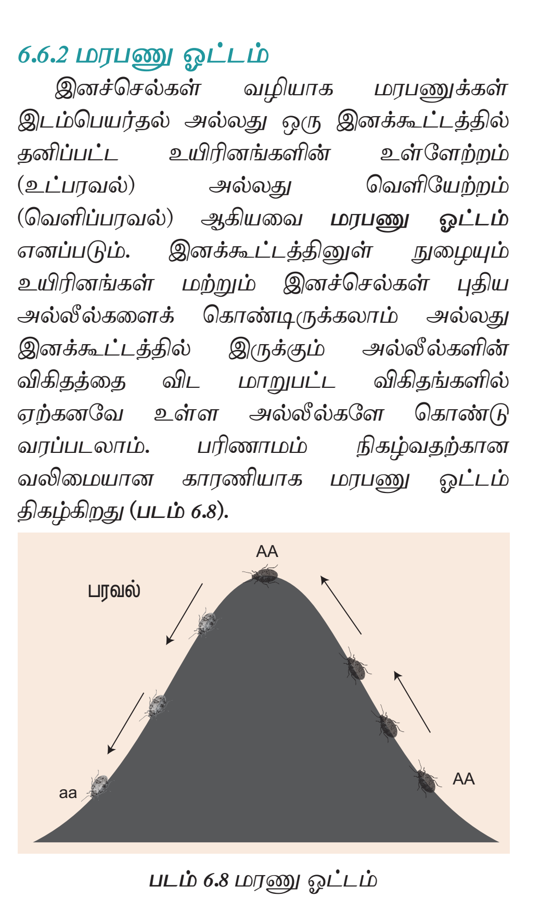

### 6.6.3 மரபியல் நகர்வு / சீவால்

ரைட் விளைவு (Genetic Drift / Sewall
Wright Effect)
வாய்ப்புகள் காரணமாக (மாதிரி சேகரித்தலில்
அடுத்தடுத்த

இனக்கூட்டத்தின்
மாற்றத்தை

தலைமுறைகளில்

அல்லீல்

ஏற்படுத்தும்

மரபியல்

இனக்கூட்டத்தின்

ஒரு

நிகழ்வவெண்களில்
பரிணாம

ஆகும்.

நகர்வு

நிகழ்வவே

மரபியல்

அனைத்து

நகர்வு

அளவுகளிலும்

நடைபெறும். ஆனால் இதன் விளைவுகள் சிறிய
இனக்கூட்டத்தில் வலிமை உடையதாக இருக்கும்
(படம் 6.9). இதன் விளைவாக சில அல்லீல்கள்
இழக்கப்படலாம், (நனமை தரும் அல்லீல்கள்
உட்பட)

அல்லது

நிலைநிறுத்தப்படலாம்.
காரணமாக

இனக்கூட்டத்தின்

அளவு

மூல

சிறுபகுதி

பிரிந்து

அல்லீல்கள்
இடர்பபாடு

அல்லது

சில
இயற்ககை

குறைந்திருந்ததாலும்

$$
DD

DD
DD
DD

†ƒÃÀ{Ä À{kÎØ
´{¾¹¼{´ y‘ ªˆhº ºƒ¿ƒÃ
Àgˆ´v ¼fˆj
¶iº)´ƒÂ
¬ÙÀ{b†j 

$D
$D
$D

$D

DD

$ y *´uÀg      
D y *´uÀg      

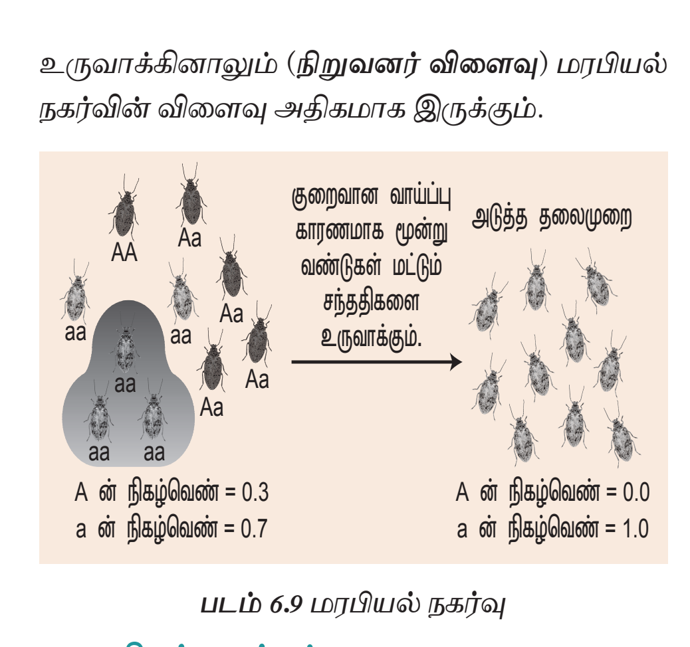

### 6.6.4 திடீர் மாற்றம்

திடீர் மாற்றம், மரபியல் மாறுபாடுகள்
தோன்றுவதற்ககான மூலகாரணமாக இருந்ததாலும்,
பெரும்பபாலான உயிரினங்களில் திடீர் மாற்ற வீதம்
குறைவாகவே இருக்கும். எனவே ஒரு அல்லீல்
நிகழ்வவெண்ணில் ஏற்படும் புதிய திடீர் மாற்றம்
அடுத்தடுத்த தலைமுறைகளில் பெரிய அளவில்
இருக்காது.

AA

பிழை),

நகர்வின் விளைவு அதிகமாக இருக்கும்.

(சீசாகழுத்து

விளைவு)

இனக்கூட்டத்திலிருந்து
சென்று

புதிய

ஒரு

கூட்டத்தை

## 6.7  ஹார்டி வீன்பபெர்க் கொொள்ககை

(Hardy-Weinberg Principle)
திறந்த வெளிகளில் உள்ள புல்வகைகள்,
காடுகளில் காணப்படும் ஓநாய்கள், மனித உடலில்
காணப்படும் பாக்டீரியாக்கள் போன்ற அனைத்து
இனக்கூட்டங்களும் இயற்ககையாக பரிணாமம்
அடைபவையே. அனைத்து இனக்கூட்டங்களிலும்
சில
மரபணுக்களாவது
பரிணாமத்திற்கு
உள்ளாகின்றன,

என்றறால்
உயிரினங்கள் நிறைவை நோக்கி நகர்கின்றன
என்று பொொருளல்ல. மாறாக இனக் கூட்டங்கள்
அதன் மரபியல் கட்டமைப்பை அடுத்தடுத்த
தலைமுறைகளில்
மாற்றியமைத்துக்
கொொள்ளுகின்றன என்பதாகும். எடுத்துக்காட்டாக
ஓநாய்
இனக்கூட்டத்தில்,
சாம்பல்
நிற
உரோமத்திற்ககான மரபணு நிகழ்வவெண் மாற்றம்
பெற்று கருப்பு நிற உரோமத்தை உருவாக்கும். சில
நேரங்களில் இதுபோன்ற மாற்றங்கள் இயற்ககைத்
தேர்வு அல்லது வலசைபோதல் அல்லது சில
சீரற்ற நிகழ்வுகள் காரணமாக ஏற்படலாம்.
ஒரு இனக்கூட்டத்தில் பரிணாமம் நிகழாமல்
இருப்பதற்ககான
நிலைகளை
ஆராயலாம்.
இங்கிலாந்ததைச்
சேர்ந்த
ஹார்டி
மற்றும்
ஜெர்மனியைச் சேர்ந்த வீன்பபெர்க் ஆகியோர் “ஒரு

இனக்கூட்டத்தில் மரபணு ஓட்டம், மரபியல்
நகர்வு, திடீர் மாற்றம், மரபணு மறுசேர்க்கை
மற்றும் இயற்ககைத் தேர்வு ஆகிய காரணிகள்
இல்லாத நிலையில் அல்லீல்களின் நிகழ்வவெண்
அடுத்தடுத்த
தலைமுறைகளிலும்
மாறாமல்
இருக்கும்” எனக்கூறினர். ஒரு இனக்கூட்டம்
ஹார்டி வீன்பபெர்க் சமநிலையில் இருக்கும்போது
அல்லீல்களின் நிகழ்வவெண் மற்றும் மரபு வகை
(Genotype) அல்லது அல்லீல்களின் தொொகுப்பு
ஆகியவை அடுத்தடுத்த தலைமுறைகளிலும்
மாறாமல் நிலையானதாக இருக்கும். பரிணாமம்
என்பது
ஒரு
இனக்கூட்டத்தின்
அல்லீல்
நிகழ்வவெண்களில் கால ஓட்டத்தில் ஏற்படும்
மாற்றங்கள் ஆகும். எனவே ஹார்டி வீன்பபெர்க்
சமநிலையைக் கொொண்டிருக்கும் இனக்கூட்டத்தில்
பரிணாமம் நிகழாது,

மற்றும்

வண்டுகளின் மிகப்பபெரிய இனக்கூட்டத்தை
எடுத்துக்கொண்டடால் கருஞ்சசாம்பல் (கருப்பு)
மற்றும் வெளிர் சாம்பல் ஆகிய இரண்டு
நிறங்களில் அவை இருப்பதாகக் கொொள்ளலாம்.
வண்டுகளின் உடல் நிறத்தை் தீர்மமானிக்கும்
மரபணு ‘A’ ஆகும். ‘AA’ மற்றும் ‘Aa’ மரபணுவாக்கம்
உள்ள
வண்டுகள்
கருஞ்சசாம்பல்
நிறமுடையதாகவும், ‘aa’ மரபணுவாக்கம் உள்ள
வண்டுகள் வெளிர் சாம்பல் நிறமுடையதாகவும்
உள்ளன. இவ்வினக்கூட்டத்தில் ‘A’ அல்லீலின்
நிகழ்வவெண் (p) 0.3 எனவும் மற்றும் ‘a’ அல்லீலின்
நிகழ்வவெண் (q) 0.7 எனவும் இருந்ததால் p+q=1
ஆகும். ஹார்டி வீன்பபெர்க் சமநிலை பெற்ற
இனக்கூட்டத்தில்
அதன்
மரபணுவாக்க
நிகழ்வவெண்ணை
ஹார்டி
வீன்பபெர்க்
சமன்பபாட்டைக் கொொண்டு கணக்கிடலாம்,

பெற்றோர்

மரபணுவாக்க

நிகழ்வவெண்

கீழ்க்கண்டவாறு

அமையும்.

அடுத்த

தலைமுறையை

உருவாக்கும்

இனச்சசெல்

குழுமத்தின்

மற்றும்

‘A’

‘a’

அல்லீல்களின்

நிகழ்வவெண் ஒரே மாதிரியாக இருந்ததால் அதன்
சந்ததிகளின் பண்புகளில் எந்த மாறுபாடுகளும்
தோன்றறாது. அடுத்த தலைமுறை சந்ததிகளின்
மரபணுவாக்க நிகழ்வவெண் 9% AA, 42% Aa மற்றும்
49% aa ஆகவே இருக்கும்.
இவ்வண்டுகள்
இனப்பபெருக்கம்

சீரற்ற

முறையில்

செய்வதாகக்

கொொண்டடால்

(ஆண் மற்றும் பெண் இனச்சசெல்களை, இனச்சசெல்
குழுமத்திலிருந்து
தலைமுறை

தேர்வு

செய்தல்)

உயிரினங்களில்

அடுத்த

மரபணுவாக்கம்

தோன்றுவதற்ககான நிகழ்தகவு, எந்ததெந்த வகைப்
இனச்சசெல்கள்

இணைகின்றன

என்பதைப் பொொருத்து அமையும்.

ஹார்டி - வீன்பபெர்க் விதியின் ஊகங்கள்
திடீர் மாற்றம் இனமை – திடீர் மாற்றத்தின்
காரணமாக புதிய அல்லீல் உருவாக்கம், மரபணு
இரட்டிப்படைதல் அல்லது மரபணு நீக்கம் ஆகிய
எதுவும் இல்லை.
சீரற்ற

இனச்சேர்க்கை

ஒவ்வொரு

உயிரினமும் இனச்சேர்க்கையில் ஈடுபடுவதற்ககான
வாய்ப்பை் பெறுகின்றன. குறிப்பிட்ட மரபணு
ஆக்கத்திற்கு

முக்கியத்துவம்

தராமல்

இவற்றுக்கிடையேயான இனச்சேர்க்கை சீரற்ற
முறையில் உள்ளது.
மரபணு

ஓட்டம்

இனமை

(p+q)2 = p2 + 2pq + q2

இனக்கூட்டத்திலிருந்து தனிப்பட்ட உயிரினங்களோ

p2 = AA ன் நிகழ்வவெண்

அல்லது

2pq = Aa ன் நிகழ்வவெண்
q2 = aa ன் நிகழ்வவெண்

அவற்றின்

உள்சசெல்ககை

(உள்ளேற்றம்)

அல்லது

வெளிச்சசெல்ககை

(வெளியேற்றம்)

எதிலும்

ஈடுபடுவது இல்லை.

p = 0.3, q = 0.7எனில்

மிகப்பபெரிய

p = (0.3) = 0.09 = 9% AA

இனக்கூட்டத்தின்

2pq = 2 (0.3) (0.7) = 0.42 = 42% Aa

இருக்கவேண்டும்.

வண்டு

இனக்கூட்டம்

ஹார்டி

வீன்பபெர்க் சமநிலையில் இருப்பதை அறியலாம்.
இச்சமநிலையிலுள்ள வண்டுகள் இனப்பபெருக்கம்
செய்ததால்

அடுத்த

தலைமுறையில்

உயிரினத்தொகை
அளவு

அல்லீல்

அல்லீல்களும்,

எல்லையற்றதாக

இயற்ககைத் தேர்வு இனமை

q2 = (0.7)2 = 0.49 = 49% aa
இதனால்

இனச்சசெல்களோ

வாழவும்,

– அனைத்து
இனப்பபெருக்கம்

செய்யவும் தகுதியுடையவை.
மேற்கண்ட ஊகங்களில் ஏதேனும் ஒன்று
பொொருந்தவில்லை

என்றறாலும்,

இனக்கூட்டம்

ஹார்டி – வீன்பபெர்க் சமநிலையில் இருக்காது.
அல்லீல்

நிகழ்வவெண்கள்

தலைமுறையில்

மாறும்போது

அடுத்தடுத்த

நிகழும்.

## 6.8  மனிதனின் தோற்றம் மற்றும்

பாலூட்டிகளின் பரிணாமம்
ஜுராசிக்
காலத்தின்
தொொடக்கத்தில்
சுமார்

மில்லியன்
ஆண்டுகளுக்கு
முன்பு
நிகழ்ந்தது.
ஆசியா
மற்றும் ஆப்பிரிக்கா பகுதியில்
ஹோமினிட்களின்

நிகழ்ந்தது.
பொொருட்களை
உருவாக்கும்
திறன்
மற்றும்
கலாச்சாரம் ஆகியவற்றில் பிறவிலங்குகளை விட
மனித இனம் மேம்பட்டது என்பதை ஹோமினிட்கள்
மெய்ப்பித்தனர்.
சுமார்
14 மில்லியன் ஆண்டுகளுக்கு முன்பு வாழ்ந்த
ராமாபித்திகஸ்
(Ramapithecus),
மற்றும்
சிவாபித்திகஸ் (Sivapithecus) போன்ற வரலாற்றுக்கு
முந்ததைய
மனிதர்களின்
புதைபடிவங்கள்
கிடைத்துள்ளன. அவை மனிதக் குரங்கு போன்ற
டிரையோபித்திகசிலிருந்து
(Dryopithecus)
தோன்றியதாகக்
கருதப்படுகிறது.
டிரையோபித்திகஸ்
மற்றும்
ராமாபித்திகஸ்
ஆகியவை உடல்முழுவதும் முடிகளைக் கொொண்டு
கொொரில்லா மற்றும் சிம்பன்சிகளைப் போல
நடந்தன. ராமாபித்திகஸ், ஆஸ்ட்ரலோபித்திகஸின்
சாத்தியமான முன்னோடி என கருதபடுகிறது.
ஆகவே
இவர்கள்
நவீன
மனிதர்கள்
எனப்படுகிறார்கள். மேலும் இவர்கள் தாவர
உண்ணிகளாகவே இருந்தனர்.
சுமார் 5 மில்லியன் ஆண்டுகளுக்கு முன்னால்
கிழக்கு ஆப்பிரிக்கா புல்வவெளிகளில் வாழ்ந்ததாகக்
கருதப்படும் ஆஸ்ட்ரலோபித்திகஸ் (Australopithecus)
‘ஆஸ்திரேலியக்
குரங்கு
மனிதன்’
என
அழைக்கப்படுகிறது. இம்முன்னோடி மனிதன்,
1.5மீ உயரம் கொொண்டு, இரண்டு கால்களால்
நடக்கும் திறன், அனைத்துண்ணிப் பண்பு, பாதி
நிமிர்ந்த நிலை, குகை வாழ் தனமை ஆகிய
பண்புகளைப் பெற்றிருந்ததான். தாழ்ந்த நெற்றி,
கண்களின் மேல் புருவ மேடுகள், துருத்திய
நிலையில் உள்ள முகம், கன்னங்களற்ற தனமை,
350 – 450 கனசெமீ அளவுகொொண்ட திறன்குறைந்த

மூளை, மனிதனைப் போன்ற பல்லமைப்பு,
முதுகெலும்புத் தொொடரில் இடுப்புப் பக்க வளைவு,
ஆகியவை இதன் சிறப்புப் பண்புகளாகும். ஹோமோ
ஹாபிலிஸ் (Homo habilis) உயிரினம் 2 மில்லியன்
ஆண்டுகளுக்கு
முன்பு
வாழ்ந்தது.
இதன்
மூளையின் அளவு 650 - 800 கன செமீ ஆகும்.
மேலும் தாவர உண்ணிகளான இவை இரண்டு
கால்களால்
இடப்பபெயர்ச்சி
செய்வதுடன்
செதுக்கப்பட்ட
கற்களாலான
கருவிகளை
பயன்படுத்தும் திறனையும் பெற்றிருந்தன.
முதன்முதலாக

மனிதனைப்போலத்

தோற்றமளித்த ஹோமோ எரக்டஸ் (Homo erectus)
உயிரினம் 1.7 மில்லியன் ஆண்டுகளுக்கு முன்பு
தோன்றியது, பார்வவைக்கு மனிதனைப் போன்றறே

ஹோமோ எரக்டஸ், நவீன
மனிதனைவிட தட்டையான, தடினமான மண்டடை
ஓடு, 900 கன செமீ அளவு கொொண்ட மூளை மற்றும்
இறைச்சி உண்ணும் தனமை ஆகிய பண்புளைப்
பெற்றிருந்தன.
தோற்றமளித்த

ஹோமோ எர்ககாஸ்டர் (Homo ergaster) மற்றும்
ஹோமோ எரக்டஸ் (Homo erectus) ஆகியவை
ஆப்பிரிக்காவை விட்டு வெளியேறிய முதல்
இனங்களாகும். சுமார் 34,000 – 1,00,000
ஆண்டுகளுக்கு முன் ஜெர்மனியின் நியாண்டர்
பள்ளத்தாக்கில்
வாழ்ந்த
நியாண்டர்ததால்
மனிதனின் மூளை அளவு 1400 கனசெமீ ஆகும்,
இவ்வகை மனிதன், பாதி நிமிர்ந்த நிலை,
தட்டையான மண்டடை ஓடு, சாய்வவான நெற்றி,
மெலிதான பெரிய கண்குழிகள், கனமான
கண்புருவ மேடுகள், துருத்திய தாடைகள் மற்றும்
கன்னங்கள் அற்ற தனமை ஆகிய பண்புகளால்
நவீன
மனிதனிடமிருந்து
வேறுபடுகிறான்.
இவர்கள்
விலங்கினங்களின்
தோலைப்
பயன்படுத்தி தங்கள் உடலைப் பாதுகாக்கவும்,
நெருப்பை் பயன்படுத்தவும், இறந்தவர்களைப்
புதைக்கவும் அறிந்திருந்தனர். வேளாணமை,
வீட்டு விலங்கு வளர்ப்பு போன்ற எதையும்
அவர்கள் செய்யவில்லை. மனிதப் பரிணாமத்தின்
பாதையில் இவ்வின உருவாக்கம் முக்கியக்
கிளையாகும்.
நவீன
ஐரோப்பியர்களின்
மூதாதையர்கள் எனக்கருதப்படும், குரோமேக்னன்
(Cro-Magnon) , பிரான்ஸ் நாட்டின் குரோமேக்னன்
பாறைப் பகுதிகளில் வாழ்ந்ததாகக் கருதப்படுகிறது.
அவர்கள் பல்வவேறு சூழ்நிலைகளில் வாழும்

ராமாபித்திகஸ் ஆஸ்ட்ரலோபித்திகஸ் ஹோமோ ஹாபிலிஸ்

ஹோமோ எரக்டஸ்

நியாண்டர்ததால்

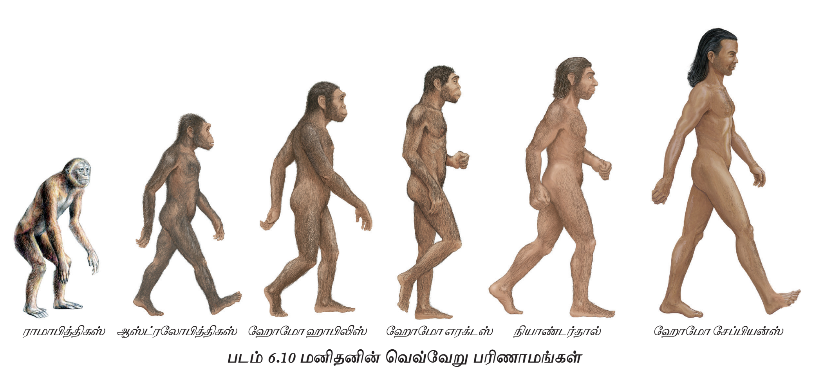

திறனைப்

பெற்றிருந்ததோடு,

குகைகளிலும்,

முறைகள் ஆகியவை முக்கியமான இரு வகைகள்

தரைகளிலும், சுவர்களிலும் படங்கள் வரையும்

ஆகும்.

பண்பினையும் பெற்றிருந்தனர்.

தனிமைப்படுத்தும் முறை, இரு வேறு சிற்றின

ஹோமோ சேப்பியன்ஸ் (Homo Sapiens) எனும்
நவீன மனித இனம் சுமார் 25,000 ஆண்டுகளுக்கு
முன்பு
ஆப்பிரிக்காவில்
தோன்றி
மற்ற
கண்டங்களுக்குப்
பரவி,
தனித்தனி
வகை
இனங்களாக வளர்ச்சியடைந்தது. அவர்களின்
மூளை அளவு ஏறத்தாழ 1300 - 1600 கன செ.மீ
ஆகும்.
இவர்கள்
பயிர்சசாகுபடி
செய்யத்
தொொடங்கியிருந்தனர் மேலும் வீட்டு விலங்குகளை
வளர்த்தலிலும் ஈடுபட்டிருந்தனர்.

உயிரிகள் இனச்சேர்க்கை்காக நெருங்குவதைத்

## 6.9 தனிமைப்படுத்துதல் முறைகள்

கருமுட்டைக்கு முந்ததைய தனிமைப்
படுத்தும் முறைகள்

தனிமைப்
படுத்துதல்
என்பது
ஒரு
இனக்கூட்டத்தில் உள்ள உயிரினங்களை துணை
இனக்கூட்டங்களாகப் பிரிக்கும் முறை ஆகும்.
இதனால் துணை இனக்கூட்டத்தின் மரபியல்
ஒருங்கமைவு பேணப்படுகிறது. ஒரே பகுதியில்
வசிக்கும் நெருங்கிய தொொடர்புடைய சிற்றினங்கள்
ஒன்றோடொொன்று இனப்பபெருக்கத்தில் ஈடுபடாது.
ஏனெனில் அவை தனிமைப்படுத்துதலுக்கான
தடைகளால்
பிரிக்கப்பட்டுள்ளன.
தனிமைப்படுத்துதலுக்கான தடைகள் என்பவை
அகக்கலப்பின் மூலம் இனப்பபெருக்கம் செய்வதைத்
தடுக்க இரு சிற்றினங்கள் இடையே பரிணமித்த
பண்பபாகும்.
பல்வவேறு வகை தனிமைப்படுத்துதலுக்கான
தடைகள் கண்டறியப்பட்டுள்ளன. கருமுட்டைக்கு
முந்ததைய தனிமைப்படுத்தும் முறைகள் மற்றும்
கருமுட்டைக்கு

பிந்ததைய

தனிமைப்படுத்தும்

கருமுட்டைக்கு

தடுப்பதாகும். இத்தடுப்பு சூழ்நிலை, பருவகாலம்,
நடத்தை

மற்றும்

புறப்பண்பு

ஆகியவற்றை

உள்ளடக்கியதாகும்.

கருமுட்டைக்குப்

தனிமைப்படுத்தும்

முறைகள்

பிந்ததைய
கருவுறுதல்

நடைபெற்ற பின் செயல்படத் துவங்கும். அவை
கலப்புயிரி

மலட்டுத்தனமை,

கலப்புயிரி

வாழ

இயலாமை மற்றும் கலப்புயிரி நிலைகுலைதல்
ஆகியவற்றை உள்ளடக்கியதாகும்.

i. சுற்றுச் சூழல் தனிமைப்படுத்துதல் அல்லது
வாழிடத் தனிமைப்படுத்துதல்
ஒரே இனக்கூட்டத்தைச் சேர்ந்த உயிரினங்கள்
வாழிட

வேறுபாட்டால்

ஒன்றறையொொன்று

பிரிந்திருத்தல் இவ்வகைத் தனிமைப்படுத்துதலில்
சேரும். எடுத்துகாட்டாக ரானா ஏரியோலேட்டா
என்ற

தவளையினம்,

ஆமைகள்

பாலூட்டிகள்

தோண்டிய

அல்லது

வளைகளில்

பகல்

நேரத்தில் வாழும். அவை புற்கள் நிரம்பிய
ஆழமற்ற

குளங்களில்

இனப்பபெருக்கம்

கிரில்லியோ
என்ற
தவளையினம்
ஆழமான
பகுதிகளில்
இனப்பபெருக்கம்
செய்யும்.
இந்த
இரு
சிற்றினங்களுக்கிடையே
உள்ள
வாழிட
வேறுபாடு காரணமாக தங்களின் சிற்றினத்
தனித்தனமைகளைப் பேணுகின்றன.

செய்யும்.

ரானா

முந்ததைய

ii. பருவகாலத் தனிமைப்படுத்துதல்
இவ்வகைத்
தனிமைப்படுத்துதலில்
இனப்பபெருக்க காலங்களில் உள்ள வேறுபாடு
அகக்கலப்பைத் தடுக்கின்றன.
எ.கா. பூபோ அமெரிக்கானஸ் என்ற தேரை
இனம் வசந்தகாலத்திற்கு வெகு முன்னதாக
இனப்பபெருக்கம்
செய்கிறது.
ஆனால்
பூபோ ஃபௌலேரி (Bufo fowleri) என்ற இனம்
வசந்த காலத்திற்குப் பின் இனப்பபெருக்கம்
செய்கிறது. இவ்விரு இனங்களும் வெவ்வேறு
பருவகாலங்களில் இனப்பபெருக்கம் செய்வதால்
அவற்றின் சிற்றின அடையாளங்களைத் தக்க
வைத்துக் கொொள்கின்றன.
iii.
பாலின
(அல்லது)
நடத்தையியல்
தனிமைப்படுத்துதல் (அல்லது) நடத்தை சார்ந்த
தனிமைப்படுத்துதல்
உயிரினங்களின் பாலின நடத்தையில் உள்ள
வேறுபாடுகள்
காரணமாக
இனச்சேர்க்கை
தவிர்க்கப்படுகிறது.
இச்சிற்றினங்கள்
வாழிடத்தாலோ
அல்லது
பருவகாலத்தாலோ
தனிமைப்படுத்தப்படுவதில்லை.
நெருங்கிய
தொொடர்புடைய தவளை இனங்களாகிய ஹைலா
வெர்சிகோலார் (சாம்பல் நிற மரத் தவளை)
மற்றும்
ஹைலா
ஃபீமோராலிஸ்
(பைன்
மரத்தவளை)
ஆகியவற்றின்
இனச்
சேர்க்கை்கான அழைப்புக் குரல் மாறுபட்டு
இருப்பதால் அவற்றுக்கிடையே அகக் கலப்பு
நடைபெறுவது தடுக்கப்படுகிறது.
iv. புறத்தோற்றப் பண்பு அல்லது அமைப்பு சார்ந்த
தனிமைப்படுத்துதல்
இவ்வகைத் தனிமைப்படுத்துதல் முறையில்
இருவேறு சிற்றின உயிரினங்களின் பிறப்பு
உறுப்புகள் அமைப்பில் உள்ள வேறுபாடுகளால்
கலப்பு இனச்சேர்க்கை தவிர்க்கப்படுகிறது. பூஃபோ
குவர்சிகஸ் மற்றும் பூஃபோ வாலிசெப்ஸ் ஆகிய
தேரை இனங்களின் பிறப்பு உறுப்புகளின்
அளவில் உள்ள வேறுபாடு காரணமாக அவை
கலப்பு இனச்சேர்க்கை செய்வதில்லை.
v. உடற்சசெயலியல் தனிமைப்படுத்துதல்
சிலசமயங்களில்
வெவ்வேறு
சிற்றினங்களுக்கிடையே
இனச்
சேர்க்கை
நடைபெற்றாலும்,
இனச்சசெல்கள்
இணைந்து
கருவுறுதல் நடைபெறுவது அமைப்பு சார்ந்த
அல்லது உடற்சசெயலியல் சார்ந்த காரணிகளால்

தடுக்கப்படுகிறது,
(எ.கா.)
டுரோசோபைலா
விரிலிஸ் (Drosophila virilis) இனத்தின் விந்து
செல்கள்,
டுரோசோபைலா
அமெரிக்கானா
(Dropsophila americana) இனப் பூச்சிகளின் விந்து
கொொள்பபையில் ஒரு நாள் மட்டுமே உயிர்வவாழும்.
அதே சமயம் டுரோசோபைலா அமெரிக்கானா
இனப்பூச்சியின் விந்து செல்கள் நீண்ட காலம்
உயிர் வாழும்.
vi. செல்லியல் தனிமைப்படுத்துதல்
இரு வெவ்வேறு சிற்றினத்தைச் சேர்ந்த
உயிரிகளின்,
ஆண்
மற்றும்
பெண்
இனச்சசெல்களில் உள்ள குரோமோசோம்களின்
எண்ணிக்கை
வேறுபாட்டின்
காரணமாக
கருவுறுதல்
நிகழ்வதில்லை.
(எ.கா)
காளைத்தவளை, ரானா கேடஸ்பியானா மற்றும்
எலித் தவளை ரானா ஏரியோலேட்டா.

கருமுட்டைக்கு பிந்ததைய தனிமைப்
படுத்தும் முறைகள்
i. கலப்புயிரி வாழ இயலாமை
இவ்வகைத் தனிமைப்படுத்துதல் முறையில்
விந்து செல், அண்ட செல்லுக்குள் நுழைந்து
கருவுறுதல் நிகழும். கரு வளர்ந்து உயிரிகளாக
மாறும். ஆனால் அவை இனப்பபெருக்க முதிர்ச்சி
அடைவதற்கு முன்பு இறந்துவிடும். சில மீன்கள்,
தவளைகள் மற்றும் வண்டுகளில் இருவேறு
சிற்றினங்களுக்கிடையே
இனச்சேர்க்கை
நடைபெற்றாலும்
மரபியல்
ஒவ்வாமை
காரணமாக அவற்றின் வாரிசுகள் உயிர்வவாழ
முடிவதில்லை.
ii. கலப்புயிரி மலட்டுத்தனமை
இவ்வகைத் தனிமைப்படுத்துதல் முறையில்
இருவேறு
சிற்றினங்கள்
இனச்சேர்க்கை
செய்வதால் உருவாகும் கலப்புயிரி, மலட்டுத்
தனமை உடையதாக உள்ளது. இதற்குக் காரணம்,
குன்றல் பிரிதலின் போது குரோமோசோம்கள்
சரிவரப்
பிரிந்து
ஒதுங்ககாமையே
ஆகும்.
(எ.கா.) கோவேறு கழுதை (குதிரை மற்றும்
கழுதையைக் கலப்பு செய்து உருவாக்கப்பட்ட
கலப்பினம்)
iii. கலப்பினம் உடைதல்
F1 கலப்பியிரி வாழத்தகுதியானதாகவும்,
இனப்பபெருக்கத் திறன் உடையதாகவும் இருக்கும்.
ஆனால் F2 கலப்புயிரி வாழத் தகுதியற்று
மலட்டுத் தனமை உடையதாக இருக்கும்.

## 6.10 சிற்றினமாக்கம்

ஒரு சிற்றினம் பரிணாம மாற்றம் பெற்று ஒன்று
அல்லது ஒன்றுக்கும் மேற்பட்ட, வேறுபட்ட
சிற்றினங்களாக
மாறுவது
சிற்றினமாக்கம்
எனப்படும். எ.இ எமர்சன் என்பவர் சிற்றினத்தை
‘மரபு ரீதியாக தனித்துவம் வாய்ந்த, இனப்பபெருக்கத்
தனிமை பெற்ற, இயற்ககையான இனக்கூட்டம்’
என்று வரையறை செய்கிறார். சிற்றினமாக்கம்
என்பது பரிணாமத்தின் அடிப்படை நிகழ்ச்சியாகும்.
ஒரே மரபு வழியாக, ஒரு சிற்றினம் பரிணாம
மாற்றம் அடைவது ‘மாறுதல்கள் இல்லாத’
(Agenesis) அல்லது ‘இனம் சார்ந்த (Phyletic Speciation)
சிற்றினமாக்கம்’ என அழைக்கப்படுகிறது. ஒரு
சிற்றினம் பிரிதல் அடைந்து இரண்டு அல்லது
இரண்டுக்கும்
மேற்பட்ட
சிற்றினங்களாக
மாறுவது
கிளாடோஜெனிசிஸ்
அல்லது
விரிபரிணாமம் எனப்படும்.

### 6.10.1 ஓரிடச் சிற்றினமாக்கம் (அல்லது)

இனப்பபெருக்கம் சார்ந்த சிற்றினமாக்கம்
இவ்வகை சிற்றினமாக்கம் முறையில், ஒற்றை
மூதாதையிடமிருந்து இரண்டு புதிய சிற்றினங்கள்
பரிணாமம் பெற்றுத் தோன்றுகின்றன. அவை
இரண்டுமே ஒரே புவிப்பகுதியில் வாழ்கின்றன.
இவ்வகை சிற்றினமாக்கல் முறையில் இரண்டு
அல்லது இரண்டுக்கும் மேற்பட்ட சிற்றினங்கள்
பங்ககேற்கலாம். மூதாதை உயிரினத்திலிருந்து
தோன்றிய புதிய சிற்றினங்கள் மரபு மாற்றங்கள்
பெற்று இயற்ககையால் தேர்வு செய்யப்படுவதால்
அவை தமது பெற்றோர் இனக்கூட்டத்துடன்
இனப்பபெருக்கம் செய்வதில்லை. இவ்வாறான
இனப்பபெருக்கத்
தனிமைப்படுத்துதல்
வலிமையானதாகும்.
இவ்வாறு
தனிமைப்படுத்தப்பட்ட
சிற்றினங்களில்,
புறத்தோற்ற நெகிழ்வுத்தனமை, சிற்றினமாக்கலின்
முக்கிய முதல் படி நிலையாக உருவாகியுள்ளது.
வட அமெரிக்காவில், ஆப்பிள் பழங்களை
உண்ணும் ஆப்பிள் புழுக்களின் தகவமைப்பினை
இதற்கு எடுத்துக்காட்டாகக் கூறலாம். வட
அமெரிக்காவில் ஆப்பிள் மரங்களை இறக்குமதி
செய்யும் காலம் வரை, ஒட்டுண்ணி ஆப்பிள் புழு
ஈக்கள் (Rhagoletis pomonella) காட்டு ஹாவ்ததார்ன்
பழங்களில் தங்கள் முட்டைகளை இட்டன. பின்பு
அதன் இனக்கூட்டத்தின் ஒரு துணைப் பகுதி,
அப்பகுதியில் வளர்க்கப்பட்ட ஆப்பிள் மரங்களின்
(Malus domestica) பழங்களில் தங்கள் முட்டைகளை

இட்டன. இச்சிறு பகுதி ஆப்பிள் புழு ஈக்கள் பிற
ஈக்களிலிருந்து
வேறுபட்டு,
புதிய
தாவர
சிற்றினத்தை விருந்தோம்பியாகத் தேர்ந்ததெடுத்தன.
அவற்றின் சந்ததிகள், வளர்க்கப்படும் ஆப்பிள்
தாவரங்களில் வாழப் பழகிக் கொொண்டன.
புறத்தோற்ற நெகிழ்வுத் தனமை என்பது
ஒன்றுக்கும்
மேற்பட்ட
புறத்தோற்றப்
பண்புகளை உருவாக்கும் மரபணுவாக்கத்தின்
திறன் ஆகும். மிதவை உயிரினங்களில் பருவ
நிலைகளுக்கேற்ப காணப்படும் இந்நநெகிழ்வுத்
தனமை
‘சைக்ளோ
மார்ஃபோசிஸ்’
(Cyclomorphosis) எனப்படும்.

### 6.10.2 வேற்றிடச் சிற்றினமாக்கம் / புவி

சார்ந்த சிற்றினமாக்கம்
இவ்வகை சிற்றினமாக்கல் முறையில் ஒரு
உயிரியல் இனக்கூட்டத்தைச் சேர்ந்த ஒத்த
சிற்றினங்கள்
தனிமைப்படுத்தப்படும்போது
மரபணு ஓட்டம் தடுக்கப்படுகிறது. புவியியல்
தடை காரணமாக ஒரே சிற்றினத்தைச் சேர்ந்த
இனக்கூட்டம் பிரிந்து இரண்டு சிற்றினங்களாக
மாறுகிறது.
இதனால்
புதிய
சிற்றினங்கள்
உருவாகின்றன.
எடுத்துகாட்டு,
டார்வினின்
குருவிகள். நிலம் பிரிவடைதல், வலசைபோதல்
அல்லது மலைகள் உருவாக்கம் ஆகியன புவி
சார்ந்த
தடைகள்
ஆகும்.
இரண்டு
சிற்றினங்களுக்கிடையே
தடைகள்
உருவாகும்போது
சுற்றுச்சூழல்
மற்றும்
பருவகாலங்களில் மாற்றங்கள் ஏற்படுவதால்
அதற்ககேற்ப,
பிரிக்கப்பட்ட
உயிரினங்களில்
தகுந்த
தகவமைப்புகள்
தோன்றுகின்றன.
இத்தகவமைப்புகள்
வேறுபாடுகளை
உருவாக்குகின்றன.
அவை
தேவையான
தகவமைப்பு
மாற்றங்களைப்
பெறவில்லை
என்றறால் அவற்றால் உயிர்வவாழ முடியாது. இங்கு
பாலினத் தனிமைப்படுத்துதல் என்பது வலிமை
குன்றியது.

## 6.11 விலங்குகள் மரபற்றுப்போதல்

விலங்கினங்கள்
மரபற்றுபோதல்
பொொதுவானதும் தவிர்க்க இயலாததும் ஆகும்.
ஏனெனில் சில சிற்றினங்கள் சுற்றுச்சூழலில்
ஏற்படும் பெரியஅளவிலான அல்லது விரைவான
மாறுதல்களுக்கேற்ப எப்போதும் தங்களைத்
தகவமைத்துக் கொொள்ள முடியாது. மரபற்றுப்
போதலின் தாக்கத்தை மூன்று நிலைகளில்
அறியலாம்.

அட்டவணை 6.2 – கேம்ப்ரியன் காலத்திலிருந்து ஏற்பட்ட பெருந்திரளாக மரபற்றுப்போன ஐந்து நிகழ்வுகளின்
விவரம்
காலஅளவு (மில்லியன்
ஆண்டுகளுக்கு முன்)

மறைவுக் காலம்

மறைந்து போன கடல் வாழ் விலங்குகள் விழுக்காடு
பேரினங்கள்

சிற்றினங்கள்

ஆர்டோவிசியன் காலம் முடிவு

டிவோனியன் காலம் முடிவு

பெர்மியன் காலம் முடிவு

டிரையாசிக் காலம் முடிவு

கிரட்டேஷியஸ் காலம் முடிவு

சிற்றினம்
மரபற்றுப்போதல்
என்பது
சுற்றுச்சூழலில் ஏற்படும் (வெள்ளம் போன்ற)
நிகழ்வின் காரணமாகவும் அல்லது நோய் அல்லது
உணவு
பற்றாக்குறை
போன்ற
உயிரியல்
காரணங்களாலும் ஒரு சிற்றினம் முழுமையாக
நீக்கப்படுவதாகும்.
பெருந்திரள் மரபற்றுப்போதல் ஒரு நிலப்பரப்பு
அல்லது
சூழ்நிலை
மண்டலத்தில்
உள்ள
பாதிக்கும் மேற்பட்ட சிற்றினங்கள் எரிமலை
வெடிப்பு போன்ற காரணங்களால் ஒரே நேரத்தில்
அழிந்து
போகின்றன,
கேம்பிரியன்
பருவத்திலிருந்து ஐந்து முக்கிய பெருந்திரள்
மரபற்றுப்போதல்
நிகழ்ந்துள்ளன.
இவை
K-T மறைவு (கிரட்டேஷியல் – டெர்ஷியரி மறைவு)
என
அழைக்கப்படுகின்றன.
இதனை
அட்டவணை 6.2ல் காணலாம்.
K-T மறைவு என்பது ஜெர்மமானியச்
சொொற்களான
கிரட்டேஷியஸ்
மற்றும்
டெர்ஷியரி பருவங்களைக் குறிக்கும்.

உலக
அளவில்
மரபற்றுப்போதல்
பெருமளவிலான சிற்றினங்கள் அல்லது பெரிய
வகைப்பாட்டுக் குழுக்கள், கண்டங்கள் அளவில்
அல்லது உலக அளவில மரபற்றுப் போகின்றன.
உறைபனி
உலகம்
அல்லது
CO2 அளவு
அதிகரித்ததன்
காரணமாக
நிகழ்ந்த
மரபற்றுப்போதல் ஆகிய நிகழ்வுகள் இதற்கு
எடுத்துக்காட்டுகளாகும்.
இவ்வாறு
மரபற்றுபோதலால்
புதிய
வாழிடங்கள்
உருவாக்கப்படுகின்றன. இதனால் பெரும்பபானமை
அழிவிலிருந்து தப்பிய உயிரினங்கள் விரிந்து
பரவிட ஏதுவாகிறது.

பாடச்சுருக்கம்
பரிணாம உயிரியல் என்பது பூமியில் பல
மில்லியன் ஆண்டுகளுக்கு முன்பு தோன்றிய
உயிரின வகைகளின் வரலாறு குறித்து படிக்கும்
அறிவியல் பிரிவு ஆகும். உலகம் எவ்வாறு
தோன்றியது? உலகில் உயிரினங்கள் எவ்வாறு
தோன்றின? இந்தப் பேரண்டப் பெருவெளியில்
மனித
இனத்தின்
முக்கியத்துவம்
என்ன?
ஆகியவை நம் மனதில் எழும் முக்கிய வினாக்கள்
ஆகும். இந்தப் பாடத்தில் உயிரினத் தோற்றம்
குறித்த
பல்வவேறு
கோட்பபாடுகள்
விளக்கப்பட்டுள்ளன. பரிணாம நிகழ்ச்சிக்கான
முக்கிய
சான்றுகளாகிய
புதைபடிவங்கள்,
கருவியல்,
புறத்தோற்றவியல்,
மூலக்கூறு
உயிரியல்
ஆகியவை
பொொதுவான
மூதாதையிலிருந்து
உயிரினங்கள்
எவ்வாறு
தோன்றின என்பதை விளக்குகின்றன.
லாமார்க், டார்வின் மற்றும் ஹியூகோ-டிவிரிஸ்
ஆகியோரால்
முன்
வைக்கப்பட்ட
பரிணாமக் கோட்பபாடுகள் சிக்கலான பரிணாம
நிகழ்ச்சியை விளக்குகின்றன. புவியியற்ககால
அட்டவணையில்
உள்ள
பல்வவேறு
பெருங்ககாலங்கள்,
பருவங்கள்
மற்றும்
சிறுகாலங்கள்
அந்தந்தக்
காலங்களில்
பெரும்பபானமையாக
வாழ்ந்த
சிற்றினங்கள்
குறித்த விபரங்களை அளிக்கிறது. மரபணு மற்றும்
மரபணுவாக்க
நிகழ்வவெண்களின்
கணித
முறையிலான
பரவல்,
சிறிய
சிற்றினத்
தொொகுதிகளில் மாறாமல் சமநிலையில் உள்ளன
என
ஹார்டி
மற்றும்
வீன்பபெர்க்
(1608)
தெரிவித்துள்ளனர். இயற்ககைத் தேர்வு மற்றும்
மரபணுகுழுமம் ஆகிய காரணிகள் ஹார்டிவீன்பபெர்க் சமநிலையைப் பாதிக்கின்றன.
மனித
அல்லது

இனம்
மனிதக்

பிரைமேட்டுகளிலிருந்து
குரங்கு
போன்ற

மூதாதையிலிருந்து தோன்றியிருக்கலாம் என
மனிதப்
பரிணாமவியல்
தெரிவிக்கிறது.
மனிதக்குரங்கு
மற்றும்
நஞ்சுக்கொடி
பாலூட்டியிலிருந்து
மனித
இனம்
(ஹோமோ சேப்பியன்ஸ்) தனித்த இனமாகத்
தோன்றியதும், அவற்றின் மூளை அளவு, உணவுப்
பழக்கம் மற்றும் பிற பண்புகளில் உள்ள ஒற்றுமை
‘ஒரு தனி உயிரியின் கரு வளர்ச்சி அதன் இன
வரலாற்றைப் தொொகுத்துரைக்கிறது’ என்பதனை
நிரூபிக்கிறது.
ஒரு இனக்கூட்டத்தில் உள்ள உயிரினங்கள்
சிறுபிரிவுகளாகப்
பிரிக்கப்பட்டு
அவற்றின்
மரபியல் அடையாளங்கள் பாதுகாக்கப்படுகின்றன.
உயிரினத் தனிமைப்படுத்துதல் முறைகள் மற்றும்
சிற்றினமாக்கல்
நிகழ்ச்சி,
வெவ்வேறு
சிற்றினத்தைச் சேர்ந்த உயிரினங்களுக்கிடையே
அகக்கலப்பு
நடைபெறுவதைத்
தடுக்கிறது.
உயிரினங்கள்
மறைவதற்ககான
காரணங்கள்
மற்றும் அவற்றின் விளைவுகள் இப்பாடப்
பகுதியில் விளக்கப்பட்டுள்ளன.

## மதிப்பீடு

1.  பூமியில் முதல் உயிரினங்கள்
தோன்றியது.
அ) காற்றில்

ஆ) நிலத்தில்

இ) நீரில்

ஈ) மலைப்பகுதியில்

2. ‘ இயற்ககைத் தேர்வு வழி சிற்றினத் தோற்றம்‘
என்ற நூலை வெளியிட்டவர்
அ) சார்லஸ் டார்வின் ஆ) லாமார்க்
இ) வீஸ்மமான்
ஈ) ஹியூகோ டி விரிஸ்

3.  கீழ்க்கண்டவற்றில் எது ஹியூகோ டி விரிஸின்
பங்களிப்பு?
அ)திடீர் மாற்றத் தேர்வுக் கோட்பபாடு
ஆ) இயற்ககைத் தேர்வுக் கோட்பபாடு
இ)  முயன்று பெற்றபண்பு மரபுப்பண்பபாதல்
கோட்பபாடு
ஈ) வளர்கரு பிளாசக் கோட்பபாடு

4.  பறவைகள் மற்றும் வண்ணத்துப்
பூச்சிகளின் இறக்கைள் கீழ்க்கண்ட எதற்கு
எடுத்துக்காட்டுகளாகும்.
அ)  பரவல் முறை
தகவமைப்பு
இ) விரி பரிணாமம்

ஆ) குவி பரிணாமம்
ஈ) மாறுபாடுகள்

5. ‘ தொொழிற்சசாலை மெலானினாக்கம்‘ என்ற
நிகழ்வு கீழ்க்கண்ட எதனை விளக்குகிறது?
அ) இயற்ககைத் தேர்வு
ஆ) தூண்டப்பட்ட திடீர்மமாற்றம்
இ) இனப்பபெருக்கத் தனிமைப்படுத்தல்
ஈ) புவியியல் தனிமைப்படுத்தல்

6.  டார்வினின் குருவிகள் கீழ்க்கண்ட எதற்கு
எடுத்துகாட்டுகள் ஆகும்?
அ) இணைப்பு உயிரிகள்
ஆ)பருவகால வலசைபோதல்
இ) தகவமைப்பு பரவல்
ஈ) ஒட்டுண்ணி வாழ்க்கை முறை

7.  வளர்கரு பிளாசக் (Germplasm) கோட்பபாட்டைக்
கூறியவர் யார்?
அ) டார்வின்
இ) லாமார்க்

ஆ) ஆகஸ்ட் வீஸ்மமேன்
ஈ) ஆல்ஃப்ரட் வாலாஸ்

8.  புதைபடிவங்களின் வயதைத் தீர்மமானிக்க
உதவுவது?
அ) மின்னணு நுண்ணோக்கி
ஆ) புதைபடிவங்களின் எடை
இ) கார்பன் முறை வயது கண்டறிதல்
ஈ)  படிவங்களின் எலும்புகளை ஆராய்தல்

9.  புதைபடிவங்கள்
காணப்படுகிறது?

பொொதுவாக

அ) வெப்பப் பாறைகள்
ஆ) உருமாறும் பாறைகள்
இ) எரிமலைப் பாறைகள்
ஈ) படிவுப் பாறைகள்

10.  ஒரு உயிரினத்தின் பரிணாம
எவ்வாறு அழைக்கப்படும்?

வரலாறு

அ) மூதாதைத் தனமை
ஆ) ஆன்டட்டோஜெனி
இ) பைலோஜெனி (இன வரலாறு)
ஈ) தொொல்லுயிரியல்

11.  ஊர்வன இனத்தின் பொொற்ககாலம்
அ) மீசோசோயிக் பெருங்ககாலம்
ஆ) சீனோசோயிக் பெருங்ககாலம்
இ) பேலியோசோயிக் பெருங்ககாலம்
ஈ) புரோட்டிரோசோயிக் பெருங்ககாலம்

12.  எந்தக் காலம் ‘மீன்களின்
அழைக்கப்படுகிறது?

காலம்’

என

அ) பெர்மியன்
ஆ) டிரையாசிக்
இ) டிவோனியன் ஈ) ஆர்டோவிசியன்

எங்ககே

13.  நவீன மனித
சேர்ந்தது?

இனம்

எந்த

காலத்தைச்

அ) குவார்டடெர்னரி ஆ)கிரட்டேஷியஸ்
இ) சைலூரியன் ஈ) கேம்ப்ரியன்

14. நியாண்டர்ததால் மனிதனின் மூளை அளவு
அ) 650-800 க. செ.மீ
ஆ) 1200 க. செ.மீ
இ) 900 க.செ.மீ
ஈ) 1400 க. செ.மீ.

15.  டார்வினின்
கூற்றுப்படி,
பரிணாமத்திற்ககான காரணம்

கரிம

அ)  ஒரே சிற்றினத்திற்குள் போராட்டம்
ஆ)  சிற்றினங்களுக்கு
இடையே
உள்ள
போராட்டம்
இ)  நெருங்கிய
தொொடர்புடைய
சிற்றினங்களுக்குள் போட்டி
ஈ)  இடையூறு செய்யும் சிற்றினம் காரணமாக
உணவு உண்ணும் திறன் குறைதல்

16.  ஒரு இனக்கூட்டம் ஹார்டி வீன்பபெர்க்
சமநிலையில் எப்போது இருக்காது?
அ)  உயிரினங்கள் தேர்வு செய்து கலவியில்
ஈடுபடும்போது
ஆ)  திடீர்மமாற்றம் இல்லாத நிலையில்
இ)  வலசை போதல் இல்லாத நிலையில்
ஈ)  இனக்கூட்டத்தின்அளவு
பெரிதாக
இருந்ததால்.

17.  தொொனமையான
பூமியில்
வாயுக்களைப் பட்டியலிடுக.

18.  மூன்று வகை புதைபடிவமாக்கல் வகைகளை
விவரி.

19.  குவி பரிணாமம் மற்றும் விரிபரிணாம
நிகழ்ச்சிகளை ஒவ்வொரு எடுத்துகாட்டுடன்
வேறுபடுத்துக.

20.  ஹார்டி - வீன்பபெர்க் சமன்பபாடு (p2+2pq+q2=1)
இனக்கூட்டத்தில்
சமநிலை
இருப்பதை
எவ்வாறு
விளக்குகிறது?
மரபியல்
சமநிலையைப் பாதிக்கும் ஏதேனும் நான்கு
காரணிகளைப் பட்டியலிடுக.

21.  திடீர்மமாற்றம், இயற்ககைத் தேர்வு மற்றும்
மரபியல் நகர்வு ஆகிய நிகழ்வுகள் ஹார்டி

வீன்பபெர்க்
சமநிலையை
எவ்வாறு
பாதிக்கின்றன என்பதை விளக்குக.

22.  உயிரினங்கள்
தகுதிநிலையை
எவ்வாறு விளக்குகிறார்?

டார்வின்

23.  டார்வினியக் கோட்பபாடுகளுக்கான முக்கிய
எதிர் கருத்துக்கள் யாவை?

24.  இயற்ககைத் தேர்வு செயல்படுதலை, கரும்புள்ளி
அந்திப்பூச்சியினை
எடுத்துக்காட்டாகக்
கொொண்டு விளக்குக,
இந்நிகழ்ச்சியை
எவ்வாறு அழைக்கலாம்?

25.  டார்வினின் குருவிகள் மற்றும் ஆஸ்திரேலிய
பைப்பாலூட்டிகள் ஆகியவை தகவமைப்புப்
பரவலுக்கான
சிறந்த
எடுத்துகாட்டுகள்
ஆகும் சொொற்றொடரை நியாப்படுத்துக்க.

26.  லாமார்க்கின்
பெறப்பட்ட
பண்புக்
கோட்பபாட்டினை தவறென நிரூபித்தவர் யார்?
எவ்வாறு நிரூபித்தார்?

27.  புதிய சிற்றினத் தோற்றத்தை விளக்கும்
டி.விரிஸ்சின் திடீர் மாற்றக் கோட்பபாடு,
எவ்வாறு லாமார்க் மற்றும் டார்வினியக்
கோட்பபாடுகளிலிருந்து வேறுபடுகிறது?

28.  நிலைப்படுத்துதல் தேர்வு, இலக்கு நோக்கிய
தேர்வு மற்றும் உடைத்தல் முறைத் தேர்வு
முறைகளை உதாரணங்களுடன் விளக்குக.

29.  மனித இனத்தின் பரிணாமத் தோற்றத்தின்
நிலைகளை
கீழ்நோக்கு
வரிசையில்
வரிசைப்படுத்துக.

காணப்பட்ட

ஆஸ்ட்ரலோபித்திகஸ்→ஹோமோ எரக்டஸ்
→ஹோமோ சேப்பியன்ஸ்→ராமாபித்திகஸ்
→ ஹோமோ ஹாபிலிஸ்

30.  நியாண்டர்ததால் மனிதன் மற்றும் நவீன
மனிதனுக்கிடையே
உள்ள
தோற்ற
வேறுபாடுகள் யாவை?

31.  தனிமைப்படுத்துதல் முறைகளை வரையறை
செய்க.
அதன்
வகைகளை
தகுந்த
எடுத்துக்காட்டுகளுடன் விளக்குக,

32.  எ.இ.எமர்சன் சிற்றினமாக்கலை எவ்வாறு
வரையறை
செய்துள்ளார்?
இதன்
வகைகளைத் தகுந்த எடுத்துகாட்டுக்களுடன்
விளக்குக.

33.  பூமியிலிருந்து ஒரு குறிப்பிட்ட
மரபற்றுப்
போவதற்ககான
காரணங்களை விளக்குக.

சிற்றினம்
முக்கிய

34.  சிற்றினங்கள் மரபற்றுப்போவதால் ஏற்படும்
மூன்று தாக்கநிலைகளை விவரி.

‚á{‚¼{ ‚¶Î+½yY

‚á{‚¼{ ®¾b¸Y

‚á{‚¼{ á{+/Y

ÞYf¾‚¿{+h)´Y

¾{¼{+h)´Y

„ƒ¾‚½{+h)´Y

¼4ºÎ à.¹{¼j
´Ù0½t

¬-.Äh ‚º{wÃj

¼¾+½t »´sÛ

¼¾à‰ ²f¸j

á{s„ Lyàsb
¶¼*ƒ¿

ßÄb“f¸j

àÃÎàf¸
àgØ´v

ß½wƒ´h ‚ºsÛ

) s¼{wÃj

¼‘‚¶sbƒ´

ß¿b† ‚»{b$½Š

¬ƒ¸ÎØ ƒÃ

*ƒ¿ÎàˆhŠºt

á{s„ Lyàsb
¶¼*ƒ¿ƒ½ à{)b†j
´{¾(´v

ß½wƒ´h ‚ºsÛ

) s¼{wÃj

º{tÚ-.½t

¬-s ‚À)-½t

¶{y‘´v

à.¹{¼j

&w3ļ{b´t

†0à.¹{¼j 
¶½¿{hºƒÀ  

ØÃh‚º{wà ¼w‘j 
¬vƒ¼Î+½t

0.à.¹{¼j 
ªƒ¼Îà{hºƒÀ

¬-¾wà À1
¬-s ‚º{yÃt

&ÃÎØÎ
àƒ¸ÎØ

º{Ä{´h
‚º{y‘ºt

## கருத்து வரைபடம்

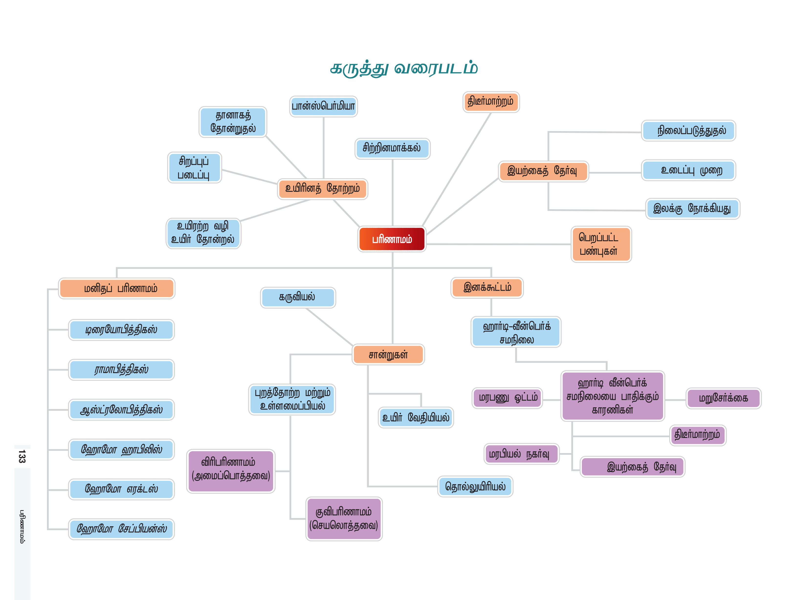
