# பாடம் 7: மனித நலம் மற்றும் நோய்கள்

> மூலம்: தமிழ் வழிப் பாடநூல், PDF பக்கங்கள் 142–160.

> குறிப்பு: கீழுள்ள தேடக்கூடிய உரை துல்லியமான படங்கள், அட்டவணைகள் மற்றும் அமைப்பிற்கு அசல் பக்கங்களைப் பார்க்கவும்.

அலகு - III

மனித நலன் மற்றும்
நோய்கள்

பாடம்

## பாட உள்ளடக்கம்

## 7.1  பொொதுவான மனித நோய்கள்

## 7.2  தனிப்பட்ட மற்றும் பொொதுச் சுகாதார

பராமரிப்பு

## 7.3  விடலைப் பருவம்- தவறான போதை

மருந்து மற்றும் மதுப்பழக்கம்

## 7.4  மன நலன் - மன அழுத்தம்

## 7.5  மனித வாழ்க்கை முறை

குறைபாடுகள்

## கற்றலின் நோக்கங்கள் :

-  பல்வவேறு பாக்டீரியா, வைரஸ், பூஞ்சசை
மற்றும் குடற்புழுவின நோய்களைப் பற்றி
கற்றுக் கொொள்ளுதல்.
-  மலேரியா ஒட்டுண்ணியின் வாழ்க்கைச்
சுழற்சியை புரிந்து கொொள்ளுதல்.
-  போதை மருந்துகள் மற்றும்
மதுவினால் விளையும் தீய
விளைவுகளை உணர்தல்.
-  அவரவருடைய நடத்தை,
உடல் நல பராமரிப்பு மற்றும்
வாழ்க்கை முறைகள் ஆகியவற்றுக்கான
பொொறுப்பை உணர்தல்.
-  மனநலன் மற்றும் தங்கள்
நல்வவாழ்விற்ககாக பின்பற்றப்படும்
வாழ்க்கை முறை மாற்றங்கள்
ஆகியவற்றின் முக்கியத்துவத்தைப்
புரிந்து கொொள்ளுதல்.

தும்மலின் போது வெளிப்படும்
கோழைத்துளிகள் நோய்களைப்
பரப்புகின்றன.

உ

லக சுகாதார நிறுவனத்தின் (WHO)
வரையறையின்படி
“உடல்நலம்
என்பது
வெறுமனே
நோய்கள்
இல்லா
நிலையன்று.
உடல், மனம் மற்றும் சமூக
அளவிலான முழுமையான நல்வவாழ்வுக்கான
நிலையே உடல்நலம் என்பதாகும்". மக்கள் உடல்
நலமுடையவர்களாக, இருந்ததால் தங்களுடைய
வேலையில் அதிக திறனுடையவர்களாகவும்
இருப்பார்கள்.
இதையே ‘நோயற்ற வாழ்வவே
குறைவற்ற செல்வம்’ என நாம் கூறலாம்.
உடல்நலம் மக்களின் வாழ்நநாள் காலத்தை
அதிகரிப்பதோடு மட்டுமல்லாமல் குழந்ததைகள்
மற்றும் முதியவர்களின் இறப்பு வீதத்தையும்
குறைக்கின்றது. நல்ல உடல்நலத்தை பராமரிக்க,
தன் சுத்தம், முறையான உடற்பயிற்சி மற்றும்
சரிவிகித உணவு ஆகியவை முக்கியமானதாகும்.

## 7.1  பொொதுவான மனித நோய்கள்

(Common diseases in human beings)
நோய் என்பது உடல் அல்லது மனதில்
ஏற்படும் கோளாறுகள் (அ) குறைகள் ஆகும்.
இதில் சுற்றுச்சூழல் காரணிகள், நோயூக்கிகள்,
மரபிய முரண்பபாடுகள் மற்றும் வாழ்க்கை முறை
மாற்றங்களால்
ஏற்படும்
புறத்தோற்ற,
உடற்சசெயலியல் மற்றும் உளவியல் ரீதியான
முரண்பபாடுகள் ஆகியவை அடங்கும். தொொற்று
நோய்கள் மற்றும் தொொற்றா நோய்கள் என
நோய்களை இரு பெரும்பிரிவுகளாகப் பிரிக்கலாம்.
ஒரு நபரிடமிருந்து மற்றொருவருக்கு பரவும்
நோய்கள் தொொற்று நோய்கள் அல்லது பரவும்
நோய்கள் (Communicable diseases) எனப்படுகிறது.

ெபாtவாக ம த க  காண ப   ேநா க
பா

rய ேநா க
- cதேபt
- pேள
- „ trயா
- காலரா
- ைடபா  
- nேமா யா

ைவர  ேநா க

p ைச
ேநா க

pேராேடாேசாவா
ேநா க
- சாதாரண ச (த„ம )
- ேக›„„யாc  • மேலrயா
- pடாள ைம
- அmpயாc 
(ெபாŠ‹ k v‘k) • பாத பைட
- ஆ pr க
- தட ைம
t க vயாt
- க lர  அழ–c
- காலா - அசா 
- ெட‘k கா ˜ச 
- c kŠkŠயா
- cŠன ைம
- இள p ைள வாத 

pvன
ேநா க
- அ காrயாc 

- யாைன கா ேநா

(ஃைபேலrயாc )

(ேபாlேயா ைமl„ )

இந்நோய்களை
உண்டடாக்கும்
உயிரிகள்
நோயூக்கிகள் (Pathogens) ஆகும். இவை காற்று, நீர்,
உணவு, உடல் தொொடர்பு மற்றும் நோய்க்கடத்திகள்
மூலம் பரவுகின்றன. வைரஸ், பாக்டீரியா, பூஞ்சசை,
புரோட்டோசோவா
ஒட்டுண்ணிகள்
மற்றும்
புழுவின
ஒட்டுண்ணிகள்
போன்றவை
நோயூக்கிகள் ஆகும்.
தொொற்று நோய்கள்
பொொதுவானவை. மேலும், இத்தகைய நோயால்
ஒவ்வொருவரும் ஏதேனும் ஒரு
நேரத்தில்
பாதிக்கப்படுவர்.
பெரும்பபாலான
பாக்டீரிய
நோய்கள் குணப்படுத்தப்பட கூடியவை. ஆனால்,
வைரஸ் நோய்கள் அனைத்தும் குணப்படுத்த
கூடியவை அல்ல. எய்ட்ஸ் போன்ற சில தொொற்று
நோய்கள் இறப்பை ஏற்படுத்தக்கூடியன.
நோய்தத்ததொற்றிய
நபரிடமிருந்து
ஆரோக்கியமான நபருக்கு எந்த நிலையிலும்
பரவாதவை தொொற்றாநோய்கள் ஆகும். மரபு
வழியாகவோ
(சிஸ்டிக்/ஃபைப்ரோசிஸ்),
ஊட்டச்சத்து குறைபாடுகளாவோ (வைட்டமின்
குறைபாட்டு நோய்கள்) மற்றும் உடற்சிதைவின்
காரணமாகவோ
(மூட்டுவலி,
மாரடைப்பு,
பக்கவாதம்) இந்நோய்கள் ஏற்படலாம். தொொற்றா
நோய்களில் புற்றுநோய் இறப்பை ஏற்படுத்தக்
கூடியதாகும்.

### 7.1.1  பாக்டீரிய நோய்கள் மற்றும்

வைரஸ் நோய்கள்
பாக்டீரிய நோய்கள்

அதிக
எண்ணிக்கையிலான
பாக்டீரிய
சிற்றினங்கள்
இருந்தபோதிலும்,
ஒரு
சில
பாக்டீரியங்கள் மட்டுமே மனித நோய்களோடு
தொொடர்புடையவை.
இவை,
நோயூக்கி
பாக்டீரியங்கள்
எனப்படுகின்றன.
இந்நோயூக்கிகள் வெளியிடும் நச்சுப்பொருட்கள்
உடலைப் பாதிக்கின்றன. பொொதுவான நோயூக்கி

பாக்டீரியாவின் எதிர்ப்புத்திறன்
(Bacterial resistance)
குறிப்பிட்ட பாக்டீரியத் தொொற்றிற்கு எதிராக
உயிர் எதிர்ப் பொொருளை அடிக்கடி பயன்படுத்தும்
போது,

பாக்டீரியா

அந்த

உயிர்

எதிர்பப்பபொருளுக்கு எதிராக எதிர்ப்புத்திறனை
பெறுகின்றது.

எனவே பாக்டீரியத் தொொற்றினை

குணப்படுத்த

அந்த

குறிப்பிட்ட

உயிர்எதிர்பப்பபொருளை அதன் பிறகு பயன்படுத்த
முடியாது.

சில

பாக்டீரியாக்கள்

பல

உயிர்எதிர்பப்பபொருட்களுக்கான எதிர்ப்புத்திறனை
வளர்த்துக் கொொண்டுள்ளன. எனவே, இவ்வகை
பாக்டீரியாக்களால் ஏற்படுத்தப்படும் தொொற்றினை
குணப்படுத்துவது கடினம்.
கீழ்க்கண்ட படிநிலைகளை அறிவதன் மூலம்
பாக்டீரியாவின்

எதிர்ப்புத்திறன்

அபாயத்தை

தொொற்றினை

குணப்படுத்த

குறைக்க முடியும்.
- 

சிறிய

உயிர்எதிர்பப்பபொருள் பயன்படுத்துவதை தவிர்க்க
வேண்டும். இதற்ககான பாதுகாப்பை நம்முடைய
நோய் தடைகாப்பு மண்டலமே மேற்கொள்ளும்.
- 

சாதாரண சளி அல்லது காய்ச்சல் போன்ற

வைரஸ்

தொொற்றினை

குணப்படுத்த

உயிர்

எதிர்பப்பபொருட்களை பயன்படுத்தக் கூடாது.
- 

மருந்து சீட்டை எப்போதும் பின்பற்ற

வேண்டும்.

மருந்து

எடுத்துக்

கொொள்ள

அவ்வப்போது தவறுதல் அல்லது மருந்தினை
முழுமையாக
உயிர்

எடுத்துக்

கொொள்ளாமலிருத்தல்

எதிர்பப்பபொருள்

எதிர்ப்புத்திறனை

அதிகரிக்கும்.

குறிப்பிட்ட

அட்டவணை 7.1 மனித பாக்டீரியா நோய்கள்
வ.
எண்

நோய்கள்

நோய்க்காரணி

ஷிஜெல்லோசிஸ்

ஷிஜெல்லா
சிற்றினம்

(Shigellosis)
(பேசில்லரி
சீதபேதி)
புபோனிக் பிளேக்
(Bubonic Plague)
(கருப்பு மரணம்)

டிப்தீரியா
(Diptheria

(Corynebacterium

டெட்டனஸ் (Tetanus)
(அசையாத் தாடை)

டைஃபாய்டு

நிணநீர்
முடிச்சுகள்

நீர்த்திவலைகள்
வழித் தொொற்று

குடல்

மலக்கழிவு கலந்த
உணவு மற்றும் நீர்/
மலக்கழிவு வாய்
வழியாக

கடுமையான
வயிற்றுப்போக்கு
மற்றும் நீரிழப்பு

இழுப்பு

காயத்தின்
வழியாக
தொொற்றுதல்

தாடை தசைகள்
விறைத்தல், மிகை
இதயத்துடிப்பு, முகம்
மற்றும் தாடை
தசைஇழுப்பு

குடல்

மலக்கழிவு கலந்த
உணவு மற்றும் நீர்
வழியாக

தலைவலி,
அசௌகரியமான
வயிறு, காய்ச்சல்,
மற்றும்
வயிற்றுப்போக்கு

நுரையீரல்

நீர்த்திவலைகள்
வழித் தொொற்று

காய்ச்சல், இருமல்,
வலியுடன் கூடிய
சுவாசம் மற்றும்
பழுப்பு நிற சளி

நுரையீரல்

நீர்த்திவலைகள்
வழித் தொொற்று

மூக்கின் வழியாக
அடர் கோழை
வெளியேற்றம்

(Clostridium tetani)
சால்மோனெல்லா

டைஃபி
(Salmonella typhi)
ஸ்ட்ரரெப்டோகாக்கஸ்
நிமோனியே

காசநோய்

மைக்கோ பாக்டீரியம்
டியூபர்குளோசிஸ்
(Mycobacterium tuberculosis)

பாக்டீரியங்கள் மற்றும் அவற்றினால் ஏற்படும்
நோய்கள் பற்றிய விவரங்கள் அட்டவணை -7.1 ல்
கொொடுக்கப்பட்டுள்ளன.
பாக்டீரியங்கள் காற்று, நீர் மூலமாகவோ
அல்லது
நீர்த்திவலைகள்
/
தூசிகள்
போன்றவற்றை உள்ளிழுத்தல் மூலமாகவோ
அல்லது நோய்த் தொொற்றிய ஒருவரின் பாத்திரங்கள்
மற்றும் ஆடைகள் போன்றவற்றைப் பரிமாறிக்
கொொள்வதன் மூலமாகவோ பரவுகின்றன.
‘வைடால் சோதனை’ (Widal test) மூலம்
டைபாய்டு
காய்ச்சல்
இருப்பதை
உறுதி
செய்யலாம்.

(Xenopsylla
cheopis)

காய்ச்சல்,
தலைவலி,வீங்கிய
நிணநீர் முடிச்சுகள்
காய்ச்சல், தொொண்டடை
வலி, கரகரப்பான
தொொண்டடை மற்றும்
சுவாசித்தலில்
இடர்பபாடு

கிளாஸ்ட்ரிடியம்
டெட்டனி

(Streptococcus pneumoniaae)

நோய்க்கடத்தி
தெள்ளுப்பூச்சி

குரல்வளை,
தோல், சுவாச
மற்றும்
இனப்பபெருக்கப்
பாதை

(Vibrio cholerae)

(Pneumonia)

(Tuberculosis)

வயிற்று வலி, நீரிழப்பு,
மலக்கழிவில் இரத்தம்
மற்றும் கோழை
காணப்படுதல்

விப்ரியோ காலரே

(Typhoid)

நிமோனியா

குடல்

மலக்கழிவு கலந்த
உணவு மற்றும் நீர்
/ நேரடியாக வாய்
மலம் வழி

(Yersinia pestis)

டீப்தீரியே

காலரா (Cholera)

அறிகுறிகள்

எர்சினியா பெஸ்டிஸ்

diphtheriae)

பரவும் முறை

(Shigella sp)

கோரினிபாக்டீரியம்

நோய்த்
தொொற்றும் பகுதி

வைரஸ் நோய்கள்

வைரஸ்கள்
என்பவை
உயிருள்ள
செல்களுக்குள்
இனப்பபெருக்கம்
செய்கின்ற,
மிகச்சிறிய அகச்சசெல் நிலைமாறா ஒட்டுண்ணிகள்
ஆகும். உயிருள்ள செல்களுக்கு வெளியே, ஓர்
உயிருள்ள உயிரினத்தின் பண்புகளை இவை
பெற்றிருக்காது.
வைரஸ்கள்
உயிருள்ள
செல்களுக்குள் நுழைந்து புதிய வைரஸ்களை
உருவாக்க அச்சசெல்களைத் தூண்டுகின்றன. புதிய
வைரஸ்கள்
செல்லை
உடைத்துக்கொண்டு
வெளியேறி, உடலின் மற்ற செல்களுக்குள்
நுழைந்து
மனிதர்களுக்கு
நோயை
ஏற்படுத்துகின்றன.
ரைனோ
வைரஸ்கள்

அட்டவணை 7.2 மனித வைரஸ் நோய்கள்
வ.

நோய்த்
தொொற்றும் பகுதி

நோய்கள்

நோய்க்காரணி

பரவும் முறை

அறிகுறிகள்

சாதாரண சளி
(தடிமல்)
(Common Cold)

ரைனோ வைரஸ்கள்
Rhinoviruses)

சுவாசப் பாதை

நீர்த் திவலைகள்

மூக்கடைப்பு மற்றும்
கோழை வெளியேற்றம்,
தொொண்டடை வலி, இருமல்
மற்றும் தலைவலி

புட்டாளம்மை
(Mumps)
(பொொன்னுக்கு
வீங்கி)

மம்ப்ஸ் வைரஸ்
(ஆர்.என்.ஏ வைரஸ்)
பாராமிக்சோ வைரஸ்
(Paramyxo virus)

உமிழ்நீர்ச் சுரப்பி

உமிழ்நீர் மற்றும்
நீர்த் திவலைகள்

மேலண்ண
சுரப்பியில்(Parotid) வீக்கம்
ஏற்படுதல்

தட்டம்மை
( Measles)

ருபல்லா வைரஸ்
(Rubeolla virus)
(ஆர்.என்.ஏ வைரஸ்)
பாராமிக்சோ வைரஸ்
(Paramyxo virus)

நீர்த் திவலைகள்

கரகரப்பான, தொொண்டடை,
மூக்கு ஒழுகல், இருமல்,
காய்ச்சல், மற்றும் தோல்,
கழுத்து, காதுகளில்
ஏற்படும் சிவப்பு நிறத்
தடிப்புகள்

கல்லீரல்
அழற்சி
( Viral Hepatitis)

கல்லீரல்

பெற்றோர் வழி,
இரத்தப் பரிமாற்றம்

கல்லீரல் சிதைவு,
மஞ்சள் காமாலை,
குமட்டல், மஞ்சள் நிற
கண்கள், காய்ச்சல்
மற்றும் வயிற்று வலி

ஹெப்பாடைட்டிஸ்–B
வைரஸ்

சின்னம்மை
(Chicken pox)

வேரிசெல்லாஸோஸ்டர்
வைரஸ் (Varicella- Zoster
virus )
(டி.என்.ஏ வைரஸ்)

சுவாசப்பாதை,
தோல் மற்றும்
நரம்பு மண்டலம்

நீர்த் திவலைகள்
மற்றும் நேரடி
தொொடர்பு

லேசான காய்ச்சலுடன்
தோல் அரிப்பு, தோல்
தடிப்பு மற்றும்
கொொப்புளம்

இளம்பிள்ளை
வாதம்
(Polio)

போலியோ வைரஸ்
(ஆர்.என்.ஏ வைரஸ்)

குடல், மூளை,
தண்டுவடம்

நீர்த் திவலைகள்,
வாய்வழி
மலத்தொற்று

காய்ச்சல், தசை விறைப்பு
மற்றும் வலுவிழத்தல்,
பக்கவாதம் மற்றும்
சுவாசக் கோளாறு

டெங்கு
காய்ச்சல்
(Dengue fever)

டெங்கு வைரஸ் (அ)
ஃபிளேவி வைரஸ் (DENV
அல்லது 1-4 வைரஸ்)

தோல் மற்றும்
இரத்தம்

நோய்க்கடத்தியான
ஏடிஸ் ஏஜிப்டி
கொொசுக்கள்

திடீரென தோன்றும்
அதிக காய்ச்சல்,
தலைவலி, தசை மற்றும்
மூட்டுவலி

சிக்குன்குன்யயா
(Chikun gunya)

ஆல்ஃபா வைரஸ்
(டோகா வைரஸ்)
(Alphavirus/Togavirus)

நரம்பு மண்டலம்

நோய்க்கடத்தியான
ஏடிஸ் ஏஜிப்டி
கொொசுக்கள்
(Aedes aegypti)

காய்ச்சல், மூட்டுவலி,
தலைவலி மற்றும்
மூட்டுகளில் வீக்கம்

எண்

(

தோல் மற்றும்
சுவாசப்பாதை

மனிதர்களை அதிகம் தொொற்றும் நோய்களில்
ஒன்றறான “சாதாரண சளி” (Common cold) என்ற
மனித உடல் நலக்குறைவை ஏற்படுத்துகின்றன.
உடல் உறுப்புகளில் தோன்றும் அறிகுறிகளை
அடிப்படையாகக் கொொண்டு வைரஸ் நோய்கள்
சாதாரண சளியானது 150 க்கும் மேற்பட்ட
வெவ்வேறு வகையான ரைனோ வைரசுகளால்
ஏற்படுகிறது. மேலும் அவைகளின்
RNA
ஜீனோம் தொொடர்ந்து திடீர் மாற்றங்களால்
மாறிக்கொண்டடே இருக்கும் காரணத்தினால்,
சாதாரண சளிக்கு ஒரு பொொதுவான தடுப்பூசி
உருவாக்குவதில் மிகுந்த சிக்கல் ஏற்படுகிறது.

பொொதுவாக
நான்கு
வகைகளாகப்
பிரிக்கப்பட்டுள்ளன.
(i)
சுவாச
நோய்கள்
(இன்புளூயன்சசா தொொற்றிய சுவாசப் பாதை) (ii)
தோல்
நோய்கள் (சின்னம்மை மற்றும்
தட்டம்மையால் பாதிக்கப்பட்ட தோல் மற்றும்
தோலின் கீழ் அடுக்கு) (iii) உள்ளுறுப்பு நோய்கள்
( மஞ்சள் காய்ச்சல் மற்றும் டெங்கு காய்ச்சலால்
பாதிக்கப்பட்ட இரத்தம் மற்றும் உள்ளுறுப்புகள்).
(iv)
நரம்பு
நோய்கள்
(ரேபிஸ்
மற்றும்
இளம்பிள்ளை வாதத்தால் பாதிக்கப்பட்ட மைய
நரம்பு மண்டலம்) மனிதனில் உண்டடாகும் சில
வைரஸ் நோய்கள் பற்றிய
விவரங்கள்,
அட்டவணை 7.2 -ல் கொொடுக்கப்பட்டுள்ளன.

நிபா
வைரஸ்
(Nipah
virus)
என்பது
ஒரு
சூனோடிக்
(zoonotic)
வைரஸ்
(விலங்குகளிடமிருந்து
மனிதனுக்கு
பரவக்கூடியது) ஆகும். இது தொொற்று கலந்த
உணவின் மூலம் பரவுகிறது. இவ்வைரஸ்
தொொற்றிய
மக்களிடம்,
அறிகுறிகளற்ற
தொொற்று முதல், தீவிர சுவாச நோய் மற்றும்
இறப்பை
ஏற்படுத்தக்கூடிய
மூளைவீக்க
நோய் வரையிலான பல்வவேறு நோய்கள்
தோன்றுகின்றன.

டிரோபோசோய்ட் (Trophozoite) ஆகும். இவை
விருந்தோம்பியின்
பெருங்குடற்சுவரைத்
துளைத்துச் சென்று திசு சிதைவு நொொதியை
(Histolytic enzymes)
வெளிவிடுகிறது. இதனால்
குடற்புண், இரத்தக்கசிவு, வயிற்றுவலி மற்றும்
அதிக கோழையுடன் கூடிய மலக்கழிவு ஆகியவை
ஏற்படுகின்றன.
இந்நோயின்
அறிகுறிகள்
வயிற்றுப்போக்கு
முதல்
இரத்தம்
மற்றும்
கோழையுடன்
கூடிய
சீதபேதி
வரை
வேறுபடுகின்றன.
மலக்கழிவு
கலந்த
கெட்டுப்போன உணவு மற்றும் நீரில் இருந்து
ஒட்டுண்ணியை
கடத்தும்
கடத்தியாக
வீட்டு ஈக்கள் (Musca domestica) செயலாற்றுகின்றன.
எ
ேடாேசா 

உணv  km 

pளா மா ச v

ப ன் றி க் ்ககா ய் ்ச்ச ல்
முதன்முதலில் 1919 ஆம்
ஆண்டு தொொற்று நோயாக
அ ங் கீ க ரி க் ்க ப் ்ப ட் டு ,
இ
ன்
்ற
ள
வு
ம்
பருவக்காலங்களில் ஏற்படும் காய்ச்சலாக
அறியப்படுகிறது. H1N1 வைரஸ் மூலம்
பன்றிக்காய்ச்சல்
ஏற்படுகிறது.
காய்ச்சல்,
இருமல், தொொண்டடை வலி, குளிர், வலுவிழத்தல்
மற்றும் உடல்வலி போன்றவை இந்நோயின்
அறிகுறிகளாகும்.
குழந்ததைகள்,
கருவுற்ற
பெண்கள் மற்றும் வயதானவர்களில் ஏற்படும்
கடுமையான தொொற்று, அபாய நிலையை
ஏற்படுத்தும்.

### 7.1.2 புரோட்டோசோவா நோய்கள்

மனித உடலில் ஏறத்தாழ 15 புரோட்டோசோவா
இனங்கள் ஒட்டுண்ணிகளாக வாழ்ந்து நோயை
ஏற்படுத்துகின்றன.
அமீபியாசிஸ் ( Amoebiasis) என்பது எண்டமீபா
ஹிஸ்டோலைடிகா (Entamoeba histolytica) எனும்
புரோட்டோசோவாவினால்
ஏற்படுத்தப்படும்,
அமீபிக் சீதபேதி அல்லது அமீபிக் பெருங்குடல்
அழற்சி நோயாகும். இவை மனித பெருங்குடலில்
உள்ள கோழை செல்கள், பாக்டீரியாக்களையும்
உட்கொண்டு வாழ்கின்றன (படம் 7.1). இந்த
ஒட்டுண்ணியின்
நோயுண்டடாக்கும்
நிலை

pற pளாச 
அக pளாச 

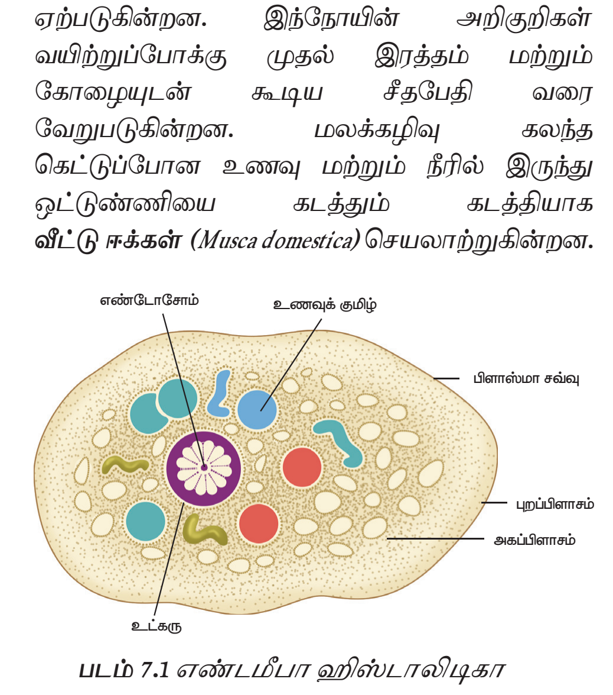
ஆப்பிரிக்க
தூக்க
வியாதி
என்பது
டிரிப்பனோசோமா
சிற்றினங்களால்
ஏற்படுத்தப்படுவதாகும். பொொதுவாக செட்சி (Tsetse)
என்றஇரத்தஉறிஞ்சிஈக்களால்டிரிப்பனோசோமா
கடத்தப்படுகிறது. டிரிப்பனோசோமாவின் மூன்று
சிற்றினங்கள் மனிதனில்
தூக்கவியாதியை
ஏற்படுத்துகின்றன.
1. டி. கேம்பியன்ஸ் (T. gambiense), கிளாசினா
பல்பபாலிஸ் (Glossina palpalis) என்ற செட்சி ஈக்களால்
பரவுகிறது. இது கேம்பியன் காய்ச்சல் (Gambian
fever) அல்லது மத்திய ஆப்பிரிக்க தூக்க வியாதியை
ஏற்படுத்துகிறது (படம் 7.2).
2. டி.ரோடீசியன்ஸ் (T. rhodesiense) கிளாசினா
மோர்சிடன்ஸ் (G. morsitans) என்ற வகை செட்சி
ஈக்களால் பரவுகிறது. இது ரோடீசியன் அல்லது
கிழக்கு
ஆப்பிரிக்க
தூக்க
வியாதியை
ஏற்படுத்துகிறது.
3. டி. குரூசி (T. cruzi), டிரையடோமா
மெஜிஸ்டடா (Triatoma magista) என்ற பூச்சிகளால்
பரவுகிறது. இது சாகாஸ் நோய் அல்லது அமெரிக்க
தூக்க வியாதி (American trypanosomiasis) என்ற
நோயை ஏற்படுத்துகிறது.

காலா-அசார்
அல்லது
வயிற்றை
லீஷ்மமேனியாசிஸ் என்ற நோய் லீஷ்மமேனியா
டோனோவானி (Leishmania donovani) என்னும்
ஒட்டுண்ணியால்
ஏற்படுகிறது.
இவற்றை
மணல்பூச்சி (Phlebotomus) என்ற நோய்க்கடத்திகள்
பரப்புகின்றன. இந்நோயால், எண்டோதீலியல்
செல்கள், எலும்பு மஜ்ஜை, கல்லீரல், நிணநீர்
சுரப்பிகள் மற்றும் மண்ணீரலின் இரத்தக்
கு ழ ா ய் ்க ள்
த

த கைசyைழ
ஆகியவற்றில் தொொற்று
ஏற்படுகிறது.
எடை
இைண த
கைசyைழ
குறைதல்,
இரத்த
சோகை,
காய்ச்சல்,
அைலyய க
ச v
கல்லீரல்
மற்றும்
ெமபடல­
மண்ணீரல்
வீக்கம்
ஆ கி ய வை
இ ந்நோ யி ன்
உ கr
அறிகுறிகளாகும்.
ேசm p
உணv
tக க

மலேரியாவானது
பல்வவேறு வகையான
அ
tக
பி ள ா ஸ் ம ோ டி ய
ைகன ேடாpளா 
இ ன ங் ்க ள ா ன
பி.
வைவாக்ஸ்
(P. vivax), பி.ஓவேல் (P. ovale)

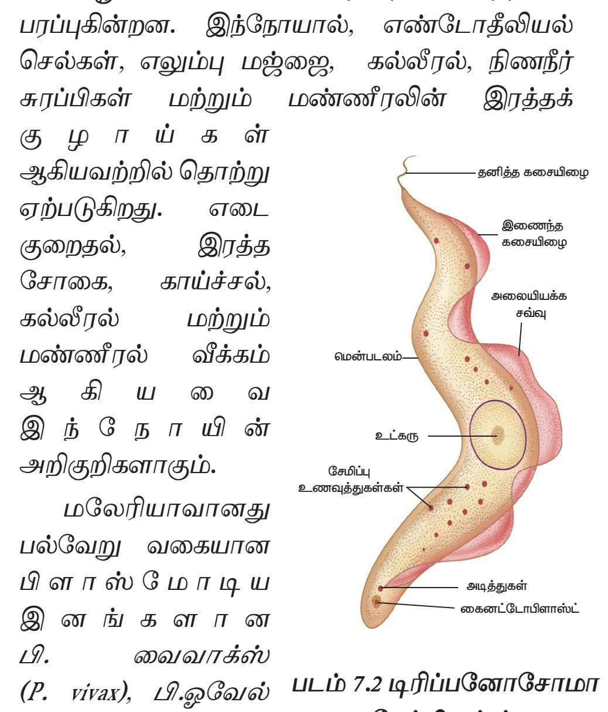, பி.மலேரியே
(P. malariae) மற்றும்
பி. பால்சிபாரம் (P. falciparum) ஆகியவற்றால்
ஏற்படுகிறது (அட்டவணை 7.3). பிளாஸ்மோடியம்,
டிரோபோசோயிட்டுகள்
(Trophozoits)
என்ற
முதிர்நிலையில்
மனிதனின்
இரத்தச்
சிவப்பணுக்களில்
வாழ்கின்றன.
இது
நோய்தத்ததொற்றிய பெண் அனாபிலஸ் கொொசு
கடிப்பதன்
மூலம்
ஒருவரிடமிருந்து
மற்றவர்களுக்குப் பரவுகிறது.

பிளாஸ்மோடியத்தின்
வாழ்க்கைச்
சுழற்சி (Life cycle of Plasmodium)
பி.
வைவாக்ஸ்,
இரு
விருந்தோம்பிகளைக் (Digenic)
கொொண்ட உயிரி ஆகும். இதன்
வாழ்க்கை
சுழற்சியில்
முதனமை விருந்தோம்பியாக
பெண் அனாபிலஸ் கொொசுவும்,
இரண்டடாம் நிலை விருந்தோம்பியாக மனிதனும்
செயலாற்றுகின்றனர்.
பிளாஸ்மோடியத்தின்
வாழ்க்கை சுழற்சியில், சைஷோகோனி, (Schizogony)
கேமோகோனி
(Gamogony)
மற்றும்
ஸ்போரோகோனி (Sporogony) என்ற மூன்று
நிலைகள் காணப்படுகின்றன (படம் 7.3).
நோய்தத்ததொற்று கொொண்ட பெண் அனாபிலஸ்
கொொசு ஒரு மனிதனைக் கடிக்கும் போது மலேரியா
ஒட்டுண்ணிகள், மனிதனின் இரத்த ஓட்டத்தினுள்
நுழைகின்றன.
கொொசு இரத்தத்தை உறிஞ்சும்
போது
தன்
உமிழ்நீருடன்
சேர்த்து
ஸ்போரோசோயிட்டுகளையும் உட்சசெலுத்துகிறது.
இதனால் ஸ்போரோசோயிட்டுகள் உடனடியாக
மனிதனின் இரத்த ஓட்டத்தில் நுழைந்து பின்
கல்லீரல் செல்களை (Hepatic cells) அடைகின்றன.
மேலும், இவை கல்லீரல் செல்களில், பாலிலா
பலபிளவு
(சைஷோகோனி)
முறையில்
பெருக்கமடைந்து
மீரோசோயிட்டுகளை
(Merozoites) உற்பத்தி செய்கின்றன. கல்லீரல்
செல்களிலிருந்து வெளிவரும் மீரோசோயிட்டுகள்
இரத்தச் சிவப்பணுக்களைத் தாக்குகின்றன.
இரத்தச்
சிவப்பணுகளுக்குள்
நுழைந்த,
மீரோசோயிட்டுகள்
ஒரு
செல்லுடைய
டிரோபோசோயிட்டுகளாக (Trophozoites) வளர்ந்து
அளவில் பெரிதாகின்றன. அதன் மையத்தில்

அட்டவணை 7.3 மலேரியாவின் வகைகள்
வ.
எண்

மலேரியா வகை

நோய்க்காரணி

சிவப்பணு சுழற்சியின் காலம்

டெர்ஷியன், தீங்கற்ற டெர்ஷியன் (அ) வைவாக்ஸ்
பி. வைவாக்ஸ்
மலேரியா

48 மணி நேரம்

குவார்டன் மலேரியா

பி. மலேரியே

72 மணி நேரம்

மிதமான டெர்ஷியன் மலேரியா

பி. ஒவேல்

48 மணி நேரம்

வீரிய மிக்க
மலேரியா

பி. ஃபால்சிபாரம்

36-48 மணி நேரம்

டெர்ஷியன்

(அ)

குவாடிடியன்

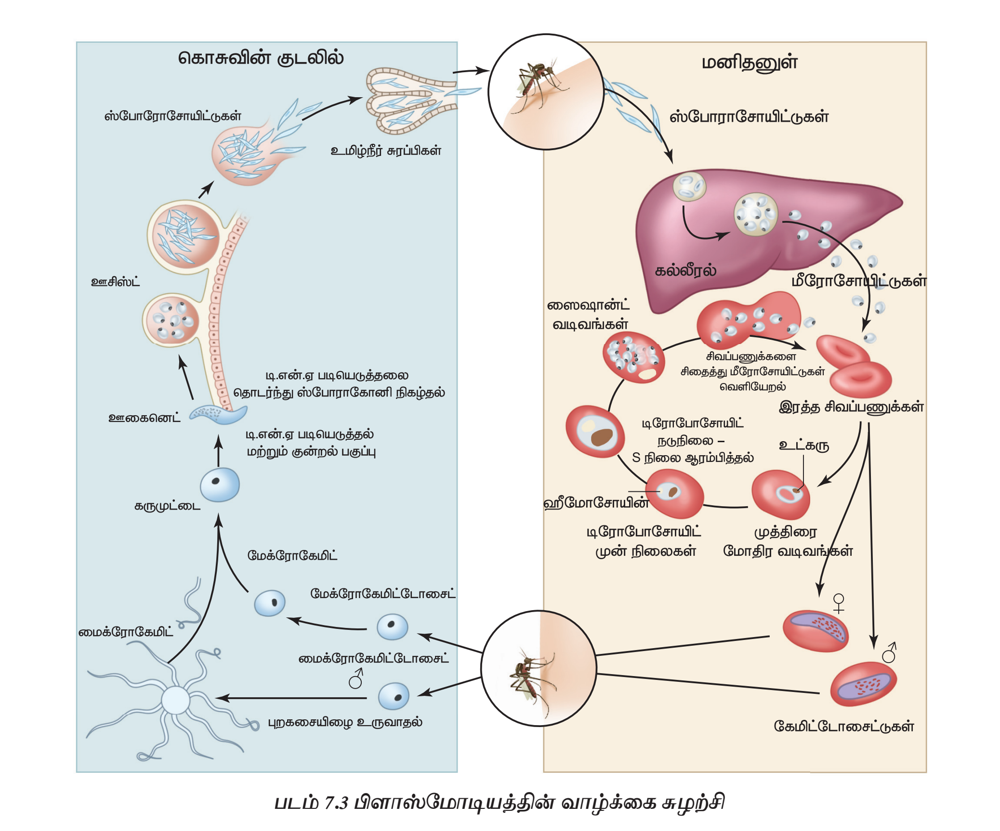
உருவான
நுண்குமிழ்,
பெரிதாகி
சைட்டோபிளாசத்தின்
ஒருபுறமாக
தள்ளப்படுவதால் முத்திரை மோதிர நிலை
(Signet
ring)
உருவாகின்றது.
பின்னர்
டிரோபோசோயிட்டுகளின்
உட்கரு
பாலிலா
இனப்பபெருக்க
முறையில்
பிளவுற்று
சைஷாண்டுகளை
உருவாக்குகின்றன. பெரிய
சைஷாண்டுகளில் மஞ்சள் நிறத்துடன் கூடிய
பழுப்பு நிறமியான ‘ஷஃப்னரின் துகள்கள்’
(Schuffners
granules)
காணப்படுகின்றன.
சைஷாண்டுகள் பிளவுற்று ஒற்றை உட்கருவைக்
கொொண்ட
மீரோசோயிட்டுகளை
உருவாக்குகின்றன.
இறுதியில்,
இரத்தச்
சிவப்பணுக்கள்
வெடித்து
மீரோசோயிட்டுகளையும்
ஹீமோசோயின்
நச்சினையும்
இரத்தத்தில் வெளியிடுகின்றன.
மீரோசோயிட்டுகள் பிற புதிய நல்ல நிலையில்
உள்ள
சிவப்பணுக்களைத்
தாக்குகின்றன.
மீரோசோயீட்டுகள் கொொண்ட சிவப்பணுக்கள்
வெடிப்பதனால் சுழற்சி முறையில் காய்ச்சலும்

மற்ற அறிகுறிகளும் ஏற்படுகின்றன. இந்த இரத்தச்
சிவப்பணு நிலை சுழற்சி, தோராயமாக ஒவ்வொரு
48 முதல் 72 மணி நேரத்திற்கு ஒருமுறை மீண்டும்
மீண்டும் நடைபெறும். இக்கால அளவானது
பிளாஸ்மோடிய இனத்திற்கு ஏற்ப மாறுபடுகிறது.
மீரோசோயிட்டுகள் திடீரென வெளிப்படுவதால்
RBCக்கள் தாக்கப்படுதல் தூண்டப்படுகிறது. சில
நேரங்களில்
மீரோசோயிட்டுகள்
மேக் ர ோ கே மி ட்ட ோ சை ட் டு களாக வு ம் ,
மைக் ர ோ கே மி ட்ட ோ சை ட் டு களாக வு ம்
மாற்றமடைகின்றன.
இவை
கொொசுவின்
உடலினுள் நுழையும் போது முறையே பெண்
இனச் செல்லாகவும், ஆண் இனச் செல்லாகவும்
வளர்ச்சியடைகின்றன
கொொசுவின்
குடலில்
பாதிப்படைந்த
சிவப்பணுக்கள் உடைவதால் வெளியேறும் ஆண்
மற்றும்
பெண்
இனச்சசெல்கள்
இணைந்து
ஊகைனெட் (Ookinete)
என்ற இரட்டைமய
கருமுட்டையை உருவாக்குகின்றன. கொொசுவின்
குடற்சுவரைத் துளைத்துச் செல்லும் ஊகைனெட்,

ஊசிஸ்ட்டுகளாக
(Oocyst)
மாறுகின்றன.
ஊசிஸ்ட்டுகள்
குன்றல்
பகுப்பு
முறையில்
பிளவுற்று
ஸ்போரோசோயிட்டுகளை
உருவாக்குகின்றன.
இந்நிகழ்விற்கு
ஸ்போரோகோனி (Sporogony) என்று பெயர். இந்த
ஸ்போரோசோயிட்டுகள் கொொசுவின் உமிழ்நீர்ச்
சுரப்பியை நோக்கி நகர்ந்து சென்று தங்குகின்றன.
இச்சுழற்சி
இத்துடன்
நிறைவுபெறுகிறது.
இவ்வாறு
தன்
உமிழ்நீர்
சுரப்பியில்
ஸ்போரோசோயிட்டுகளைக்
கொொண்ட
கொொசுவானது மற்றொரு மனித விருந்தோம்பியை
கடிக்கும்
பொொழுது
ஸ்போரோசோயிட்டுகள்
உட்சசெலுத்தப்பட்டு புதிய சுழற்சி தொொடங்குகிறது.

நிலைகளில் கம்பூசியா போன்ற கொொசுக்களின்

மலேரியாவானது இரத்தச் சிவப்பணுக்களில்
பாதிப்பை
ஏற்படுத்துவது
மட்டுமல்லாமல்,
மண்ணீரல்
மற்றும்
உள்ளுறுப்புகளையும்
பாதிக்கின்றது. மலேரியாவின் அடைகாப்புக்காலம்
12 நாட்கள் ஆகும். தலைவலி, குமட்டல் மற்றும்
தசை வலி ஆகியவை மலேரியாவின் தொொடக்கால
அறிகுறிகளாகும்.

1950 ஆம் ஆண்டு உலக சுகாதார நிறுவனம்

மீரோசோயிட்டுகள்,
ஹீமோசோயின்
(Haemozoin)
நச்சு
மற்றும்
சிவப்பணு
சிதைபொொருள்கள் ஆகியவை ஒத்திசைந்து இரத்த
ஓட்டத்திற்குள் வெளியேறுவதனால் நோய்க்கான
அறிகுறிகள் தோன்றுகின்றன. அவை மலேரியா
வலிப்பு (Malarial paroxysms), எனும் குளிர் நடுக்கம்,
அதிகப்படியான காய்ச்சல் இவற்றைத் தொொடர்ந்து,
வியர்த்தல் ஆகியவையாகும். மலேரியா நச்சானது
மேக்ரோஃபேஜ்
செல்களைத்
தூண்டுவதால்
வெளியிடப்படும் கட்டி சிதைவு காரணி (TNF-α)
மற்றும் இன்டர்லியூக்கின் ஆகியவை காய்ச்சல்
மற்றும் குளிரை ஏற்படுத்துகின்றன

தடுப்புமுறை
நோய்க்கடத்திகளை அழிப்பதன் மூலம் நோய்
கடத்தல் சுழற்சியை உடைக்கலாம். கொொசுக்கள்
தங்களின்

முட்டைகளை

இம்முட்டைகள்

நீரில்

நீரினுள்

இடுகின்றன.
பொொரித்து

இளவுயிரிகளை
வளர்க்கலாம்.

உண்ணும்
பேசில்லஸ்

(Bacillus thuringiensis) எனும்

துரிஞ்சியன்சிஸ்
பாக்டீரியாக்களைத்

தெளிப்பதன் மூலம் கொொசுக்களின் இளவுயிரிகளை
கொொல்ல முடியும். இத்தயாரிப்பு, பிற உயிரிகளுக்கு
நச்சாக இருப்பதில்லை. மலேரியாவிற்கு எதிரான
சிறந்த

பாதுகாப்பு

என்பது

கொொசுக்கடியைத்

தவிர்த்தல் ஆகும். கொொசுக் கடியைத் தவிர்க்க
கொொசு

வலைகளையும்,

சாளரம்

மக்கள் அறிவுறுத்தப்படுகிறார்கள்.
(WHO)

மலேரியா

ஒழிப்புத்

அறிமுகப்படுத்தியது.

அதனை அழிக்கும் மருந்துகளுக்கு எதிராகவும்
கொொசுக்கள்

DDT

மற்றும்

பூச்சிக்கொல்லிகளுக்கு

எதிர்ப்புத்திறனை வளர்த்துக் கொொண்டு விட்டதன்
காரணமாக இத்திட்டம் தோல்வியடைந்தது.
மலேரியா
தடுப்பூசி,
மலேரியாவைத்
தடுக்க
பயன்படுகிறது. 2015 வரை
ம லோ ரி ய ா வி ற் ்ககா ன
அங்கீகரிக்கப்பட்ட
ஒரே
தடுப்பூசி RTS, S (மஸ்குரிக்ஸ்) என்பதாகும்.
குறைந்த திறனுள்ள (26-50%) இம்மருந்து
நான்கு முறை உட்சசெலுத்தப்படுகிறது. இது
குறைந்த திறனை உடையதால் உலக சுகாதார
நிறுவனமானது 6 முதல் 12 வார வயதுள்ள
குழந்ததைகளுக்கு இதை (RTS, S தடுப்பூசி)
பயன்படுத்த பரிந்துரைப்பதில்லை.

### 7.1.3 பூஞ்சசை நோய்கள்

பாக்டீரியாவிற்கு

வெகு

வளர்கின்றன.

உண்டடாக்கும்

நோய்க்காரணி

மேற்பரப்பிற்குச்

சென்று

காற்றைச்

பிற

எதிராகவும்

பூஞ்சசைகள்

நீரின்

திட்டத்தை

பிளாஸ்மோடியமானது

முன்பிலிருந்ததே

இவை

மற்றும்

கதவுகளுக்கு கம்பி வலைகளையும் பயன்படுத்த

இளவுயிரிகளாக (லார்வவாக்களாக) வெளியேறி
ஆனால்,

மீன்களை

காலத்திற்கு
நோயை
என

அங்கீகரிக்கப்பட்டுள்ளது.டெர்மட்டோமைகோசிஸ்

சுவாசிக்கின்றன. நீரின் மேற்பரப்பில் எண்ணணெய்

(Dermatomycosis)

என்பது

தெளிப்பதன் மூலம் கொொசுவின் லார்வவாக்கள்

(Trichophyton), மைக்ரோஸ்போரம் (Microsporum)

மற்றும் கூட்டுப்புழுக்கள் சுவாசிக்க முடியாத

மற்றும்

நிலையை ஏற்படுத்தலாம். குளங்கள், நீர்ப்பாசனம்,

(Epidermophyton) ஆகிய பூஞ்சசை பேரினங்களால்

வடிகால் பள்ளங்கள் மற்றும் பல நிரந்தர நீர்

ஏற்படும் தோல் தொொற்றாகும்.

எபிெடர்மோஃபைட்டான்

டிரைகோபைட்டான்

படர் தாமரை (Ringworm) என்பது மனிதர்களுக்கு
தொொற்றக்கூடிய சாதாரண நோயாகும் (படம் 7.4).
தோல்,

நகங்கள்

காணப்படும்

மற்றும்

தலைப்பகுதியில்

தோல்,

செதில்

வறண்ட

போன்ற

புண்கள் இந்நோயின் முக்கிய அறிகுறிகளாகும்.
தொொடைஇடுக்குகள்

மற்றும்

கால்விரலிடைப்

பகுதிகளின் தோல் மடிப்புகளில் உள்ள

வெப்பம்

மற்றும் ஈரப்பதம் இப்பூஞ்சசைகள் வளர உதவுகின்றன.
பாதங்களில் ஏற்படும் படர் தாமரையான சேற்றுப்புண்
(Athlete’s foot) டினியா பெடிஸ் (Tinea pedis) எனும்
பூஞ்சசையால்

ஏற்படுகிறது

(படம்

7.5).

படர்ததாமரையானது பொொதுவாக மண்ணிலிருந்தும்
அல்லது நோய்தத்ததொற்றிய நபர்கள் பயன்படுத்திய
ஆடைகள், துண்டுகள் மற்றும் சீப்பு ஆகியவற்றின்
வழியாகவும் பரவுகின்றது.

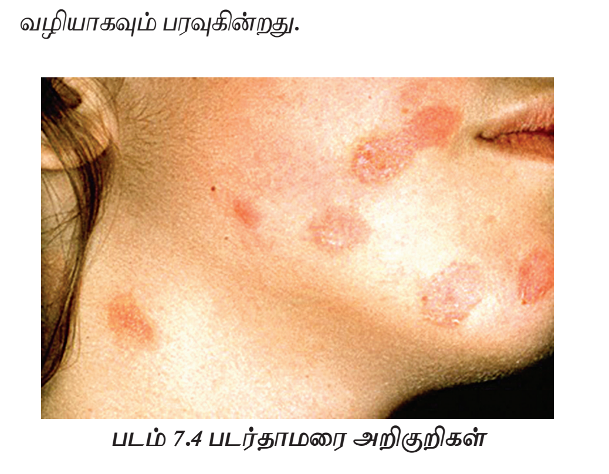

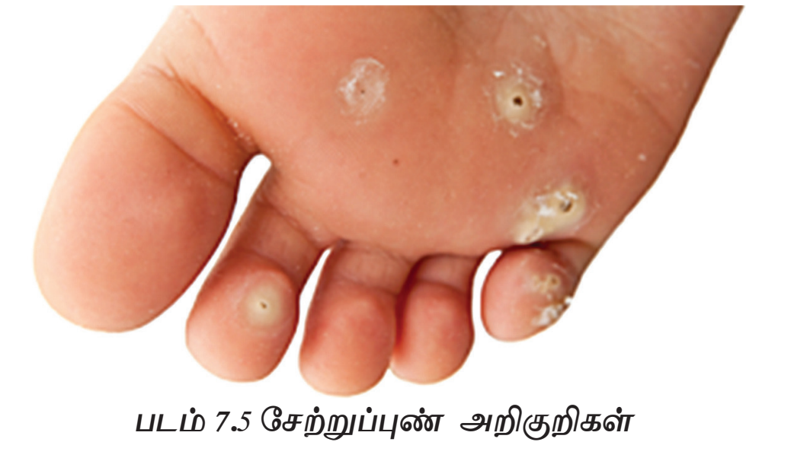

### 7.1.4 புழுவின நோய்கள்

மனிதர்களின் குடல்

மற்றும் இரத்தத்தில் அக

ஒட்டுண்ணிகளாக இருக்கும் புழுக்கள், புழுவின
நோய்களை

(Helminthiasis)

உருளைப்புழு

நோய்

ஏற்படுத்துகின்றன.
(Ascariasis)

மற்றும்

யானைக்கால் நோய் (Filariasis) ஆகிய இரண்டும்
அதிகமாக

பரவலாகக் காணப்படும் புழுவின

நோய்களாகும்.

உதகடƒ k ய
அஸ்ககாரிஸ் என்பது
m கtˆ வா 
கv
ஒற்றை விருந்தோம்பியை
n க­ tைள
(monogenic)
கொொண்ட
ப கவா 
ேகா
ஒட்டுண்ணி
ஆகும்.
இதில்
பால்வழி
வே று ப ா ட் டு த் ்த ன் மை
ெபாt pைழ
p ய 
காணப்படுகிறது. குடலில்
c டா க
அக ஒட்டுண்ணிகளாக
வாழும்
அஸ்ககாரிஸ்
வy   pற  ேநா k
லும்பிரிகாய்ட்ஸ் (Ascaris
வைளத வா 
lumbricoides) புழுக்களால்
மலவா 
உருளைப்புழு
நோய்
உண்டடாகிறது.
இவை
பொதுவாக உருளைப்புழுக்கள்

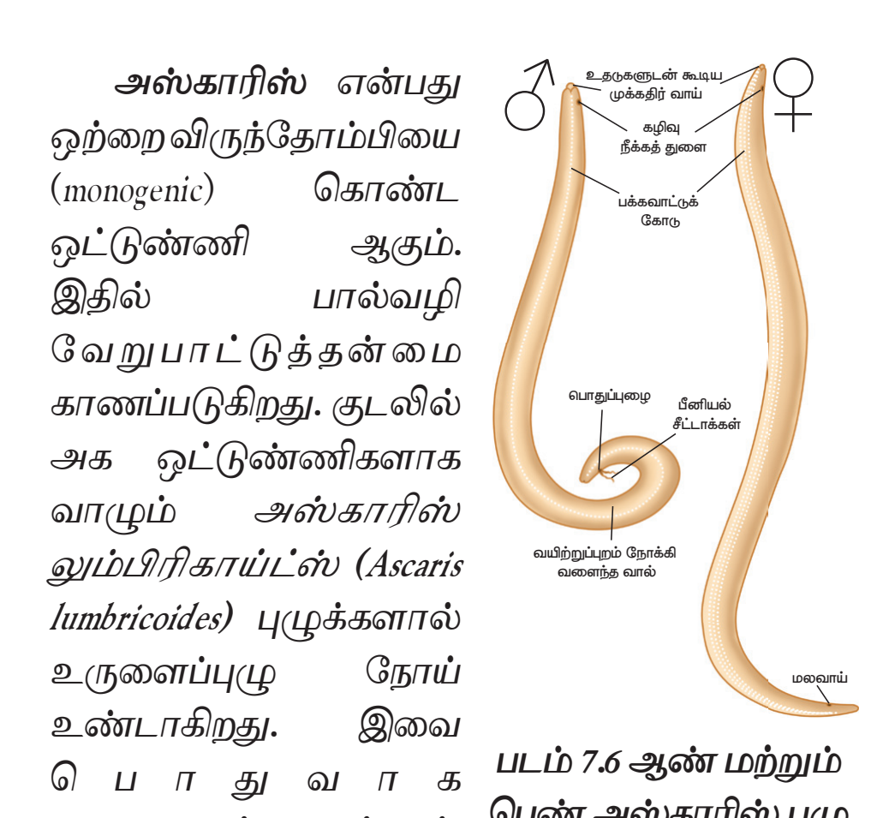
(Round
worm)
என்றழைக்கப்படுகின்றன
(படம்
7.6).
இந்நோயானது கெட்டுப்போன உணவு மற்றும்
நீரின்
வழியாக
வரும்
வளர்கருக்களை
உட்கொள்வதன் மூலம் பரவுகின்றது. குழந்ததைகள்
அசுத்தமான மண்ணில் விளையாடும் பொொழுது
முட்டைகள் கையிலிருந்து வாய்க்குள் செல்ல
வாய்ப்பிருக்கிறது. வயிற்று வலி, வாந்தி, தலைவலி,
இரத்த சோகை, எரிச்சல் மற்றும் வயிற்றுப்போக்கு
ஆகியவை
இந்நோயின்
அறிகுறிகளாகும்.
குழந்ததைகளுக்கு
ஏற்படும்
அதிகப்படியான
தொொற்றினால்
ஊட்டச்சத்து
குறைபாடு,
கடுமையான வயிற்று வலி மற்றும் குறை வளர்ச்சி
ஆகியவை
ஏற்படுகின்றன. மேலும் இது
குடலழற்சி (enteritis), கல்லீரல் அழற்சி (Hepatitis)
மற்றும்
மூச்சுக்குழலழற்சி
(Bronchitis)
ஆகியவற்றையும் ஏற்படுத்துகிறது.

யானைக்கால் புழு (Filarial worm) என்று
பொொதுவாக
அழைக்கப்படும்
உச்சரீரியா
பான்கிராஃப்டி
(Wuchereria
bancrofti)
எனும்
ஒட்டுண்ணியால் யானைக்கால் நோய் உண்டடாகிறது
(படம் 7.7).
மனிதர்களின் நிணநீர் நாளங்கள்
மற்றும்
நிணநீர்
முடிச்சுகளில்
இவை
காணப்படுகின்றன. பாலின வேறுபாடு (Dimorphic),
குட்டியீனும் தனமை (Viviparous) ஆகிய பண்புகளைக்
கொொண்ட இப்புழுவின் வாழ்க்கைச் சுழற்சி, மனிதன்
மற்றும் பெண் கியுலக்ஸ் கொொசு என்ற இரு
விருந்தோம்பிகளைக் கொொண்டு நிறைவடைகிறது.
பெண்
யானைக்கால்
புழுவால்
மைக்ரோபைலேரியே லார்வவாக்கள் எனப்படும்
இளம் உயிரிகள் (Juvenile) தோற்றுவிக்கப்படுகின்றன.
இந்த இளம் உயிரிகள் நிணநீர் முடிச்சுகளில் முதிர்

உயிரிகளாக வளர்ச்சியடைகின்றன. புழுக்களின்
திரட்சியால் நிணநீர் மண்டலத்தில் ஏற்படும்
அடைப்பு, நிணநீர் முடிச்சுகளில் வீக்கத்தை
ஏற்படுத்துகிறது. சிலருக்கு நிணநீர் நாளங்களில்
ஏற்படும் அடைப்பின் காரணமாக கால்கள்,
விதைப்பை (Scrotum) மற்றும் பால் சுரப்பிகளில்
யானைக்கால் நோய் ஏற்படுகிறது (படம் 7.7).

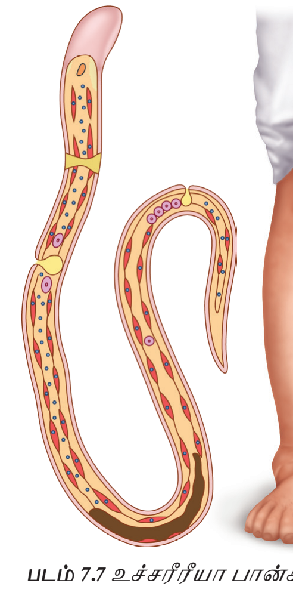

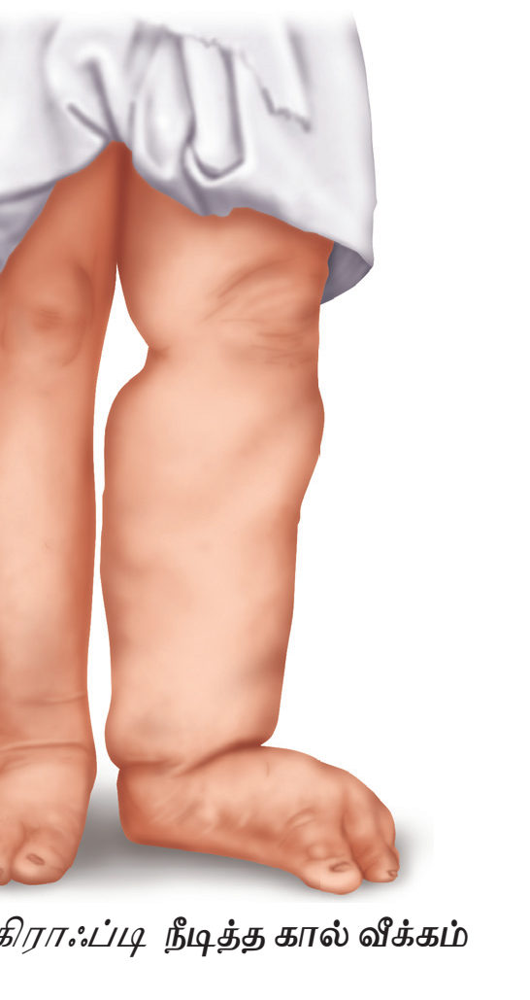

## 7.2  தனிப்பட்ட மற்றும் பொொதுச்

சுகாதார பராமரிப்பு: (Maintenance of
personal and public hygiene)
சுகாதாரம் என்பது நல்ல உடல்நலத்தை
பாதுகாப்பதற்ககாக
மேற்கொள்ளப்படும்
நடவடிக்கைளின் தொொகுப்பு ஆகும். உலக
சுகாதார நிறுவனத்தின் (WHO) படி சுகாதாரம்
என்பது “உடல் நலத்தைப் பராமரிக்கவும் நோய்கள்
பரவுவதை தடுக்கவும் உதவும் சூழ்நிலைகள்
மற்றும் நடவடிக்கைள்” ஆகும். தனிப்பட்ட
சுகாதாரம்
என்பது
குளித்தல்,
கைகளைக்
கழுவுதல், நகங்களை வெட்டுதல், சுத்தமான
ஆடைகளை உடுத்துதல் ஆகியவற்றின் மூலம் தம்
உடலை சுத்தமாக பராமரித்தல் ஆகும். மேலும்
வீடு மற்றும் பணிபுரியும் இடங்களில் உள்ள
தரைப்பகுதிகள்,
கழிப்பறைகள்
மற்றும்
குளியலறை வசதிகள் ஆகியவற்றை சுத்தமாகவும்,
நோயூக்கிகள்
இல்லாமல்
வைத்திருப்பதும்
தனிப்பட்ட சுகாதாரத்தைக் குறிக்கிறது.
நம்முடைய பொொது இடங்களில் அதிகமான
தொொற்று,
அசுத்தம்
மற்றும்
கிருமிகள்

காணப்படுகின்றன. நாம் தொொடும் ஒவ்வொரு
பொொருளின் மேற்பரப்பிலும், நாம் சுவாசிக்கும்
காற்றிலும் மாசுபடுத்திகளும், நுண்ணுயிரிகளும்,
அடங்கியுள்ளன. பொொது இடங்கள் சுத்தமில்லாமல்
இருப்பது மட்டுமல்லாது உண்பதற்கு முன்,
கழிவறைக்குச் சென்று வந்த பின் அல்லது
முகத்தை மூடாமல் தும்மிய பின்னர் தங்களுடைய
கைகளை கழுவாதவர்களைக் கண்டு நாம்
வியப்படைகிறோம். டைஃபாய்டு, அமீபியாசிஸ்
மற்றும் உருளைப்புழு நோய் போன்ற பல்வவேறு
தொொற்று நோய்கள், தொொற்றுள்ள உணவு மற்றும்
நீரின் மூலம் பரவுகின்றன.
பல்வவேறு தொொற்றும் மற்றும்
தொொற்றா
நோய்களை
சிறப்பாகக்
கட்டுப்படுத்தும்
முறைகளை
அறிவியல்
மற்றும்
தொொழில்நுட்பங்களில்
ஏற்பட்டுள்ள
முன்னேற்றங்கள் வழங்குகின்றன. தடுப்பூசிகளின்
பயன்பபாடு மற்றும் நோய் எதிர்ப்பு திறனூட்டல்
திட்டங்களை
செயல்படுத்துதல்
ஆகியவை,
இந்தியாவிலிருந்து பெரியம்மை (Small pox)
நோயை
ஒழிக்க
உதவியது.
மேலும்
இளம்பிள்ளைவாதம், டிப்தீரியா, நிமோனியா
மற்றும் டெட்டனஸ் போன்ற பல்வவேறு தொொற்று
நோய்கள், தடுப்பூசிகளைப் பயன்படுத்தியதாலும்
மற்றும்
மக்களிடையே
விழிப்புணர்வவை
ஏற்படுத்தியதாலும் கட்டுப்படுத்தப்பட்டுள்ளன.

## 7.3  விடலைப்பருவம்- தவறான

போதை மருந்து மற்றும்
மதுப்பழக்கம் (Adolescence – drug
and alcohol abuse)
பூப்பபெய்துதலில் தொொடங்கி முதிர்ச்சியடைதல்
நிறைவடையும் காலகட்டமான 12-19 வயது
வரையிலான உடல் மற்றும் இனப்பபெருக்க
உறுப்புகளின்
தீவிர
வளர்ச்சிக்
காலமே
விடலைப்பருவம்
எனப்படும்.
மேலும்
விடலைப்பருவம் என்பது ஒருவரின் உளவியல்
மற்றும் சமூக அளவிலான அதிக அளவு
மாற்றங்களை
ஏற்படுத்தும்
செயல்மிகு
காலமாகும். இப்பருவத்தினர் குழு (நண்பர்கள்)
அழுத்தத்தினால்
எளிதில்
பாதிக்கப்படும்
வாய்ப்பிருக்கிறது. இதனால் பல இளைஞர்கள்
போதை மருந்துகள் மற்றும் மதுப் பழக்கத்தினை
ஏற்படுத்திக்
கொொள்ளும்
மனநிலைக்குத்
தள்ளப்படுகிறார்கள். முறையான கல்வி மற்றும்

வழிகாட்டுதலே இளைஞர்களை போதை மருந்து
மற்றும் மதுவை வேண்டடாம் என்று சொொல்லவும்,
நலமான வாழ்க்கை முறையை பின்பற்றவும்
தூண்டும்.

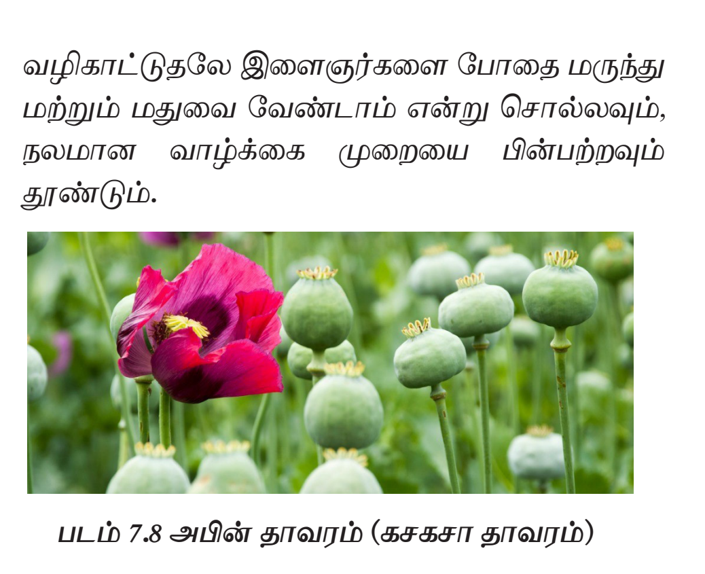
மது என்பது மனத்தின்
மீது செயல்படும்
(Psychoactive) மருந்ததாகும். இது மூளையின் மீது
வினையாற்றி
ஒருவரின்
மனம்
மற்றும்
நடத்தையை
பாதிக்கின்றது.
இது
நரம்பு
மண்டலத்தின் செயல்பபாட்டை குறைக்கும் மன
அழுத்தவூக்கி (Depressant) ஆகும். சில மருந்துகளை
அதனுடைய இயல்பபான மருத்துவ பயன்பபாட்டின்
நோக்கத்தை தவிர்த்து, அதிக அளவிலும் மற்றும்
குறுகிய கால இடைவெளியிலும் ஒருவரின் உடல்,
உடற்சசெயலியல் மற்றும் உளவியல் ஆகியவற்றில்
பாதிப்பை
ஏற்படுத்தும்
வகையில்
பயன்படுத்துவதே, போதை மருந்துப் பழக்கம் (Drug
abuse) எனப்படும்.

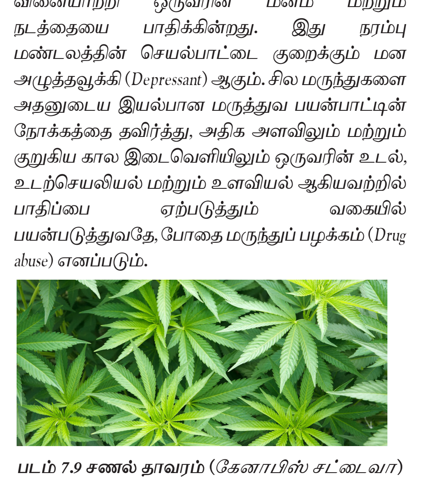
ஒஃபியாய்டுகள் (Ophioids), கேனபினாய்டுகள்
(Cannabinoids),
கோகா-அல்கலாய்டுகள்
(Coca- alkaloids), பார்பிசுரேட்டுகள் (Barbiturates),
ஆம்ஃபிடமைன்கள்
(Amphetamines)
மற்றும்
எல்.எஸ்.டி ( LSD- Lysergic acid diethylamide) ஆகியவை
பொொதுவாக வரையறையின்றி பயன்படுத்தப்படும்
போதை மருந்துகளாகும்.
ஒஃபியாய்டு என்பது மைய நரம்பு மண்டலம்
மற்றும் குடல் பாதைகளில் காணப்படும் குறிப்பிட்ட
ஒஃபியாய்டு உணர்வவேற்பிகளுடன் இணையும்
போதை மருந்ததாகும். ஹெராய்ன் (Heroin) என்பது
டைஅசிட்டைல் மார்ஃபின் என்ற வெள்ளை நிற
மணமற்ற மற்றும் கசப்பான படிக நிலையிலுள்ள

கூட்டுப்பொருளாகும். இது கசகசா செடியின்
(poppy
plant)
பூக்களிலிருந்து
பிரித்ததெடுக்கப்படுகின்ற
மார்ஃபினை
அசிட்டைலேற்றம் (acetylation) செய்வதன் மூலம்
பெறப்படுகின்றது (படம் 7.8). மார்ஃபின் என்பது
அறுவை
சிகிச்சையின்
பொொழுது
பயன்படுத்தப்படும் வலிமையான வலி நீக்கி
மருந்ததாகும். இது பெரும்பபாலும் பரவலாக
பயன்படுத்தப்படும் போதை மருந்ததாகும். இது
உடலின்
செயல்பபாடுகளை
குறைக்கும்
மனஅழுத்தவூக்கியாக செயல்புரிகின்றது.
கேனபினாய்டுகள் என்பவை கேனாபிஸ்
சடைவா ( Cannabis sativa) என்ற இந்திய சணல்
(Hemp plant) செடியிலிருந்து பெறப்படுகின்ற கூட்டு
வேதிப்பொருட்களாகும் (படம் 7.9). மரிஜூவானா
(Marijuana), கஞ்சசா (Ganja), ஹசிஷ் (Hashish) மற்றும்
சாரஸ்
(Charas)
போன்றவற்றின்
முக்கிய
மூலாதாரமாக விளங்குபவை இயற்ககையான
கேனபினாய்டுகள் ஆகும். இது நரம்புணர்வு
கடத்தியான
டோபமைன்
(Dopamine)
கடத்தப்படுதலில் குறுக்கிடுவதுடன், மைய நரம்பு
மண்டலத்தின் (CNS) செயல்பபாட்டைத் தூண்டும்
திறனைப் பெற்றுள்ளதால் அதிக ஆற்றல் மற்றும்
மகிழ்ச்சி (Euphoria) உணர்வவையும் ஏற்படுத்துகிறது.
கோகைன் என்பது, எரித்ரோசைலம் கோகா
(Erythroxylum coca) எனும் தாவரப் பெயர் கொொண்ட
கோகா
தாவரத்தின்
இலைகளிலிருந்து
பெறப்படுகின்ற வெள்ளை நிற பொொடியாகும். இது
பொொதுவாக கோக் (Coke) அல்லது கிராக் (Crack)
எனப்படுகிறது. இது மனமருட்சி (Hallucination) மற்றும்
பிரமை (Paranoia) உள்ளிட்ட தீவிர உடல் மற்றும்
உளவியல் சார்ந்த கோளாறுகளை ஏற்படுத்துகிறது.
அட்ரோபா பெல்லாடோன்னா (Atropa belladonna)
மற்றும் டாட்டுரா (Datura) ஆகியவை மன மருட்சியை
ஏற்படுத்தும்
பண்பபைக்
கொொண்ட
மற்ற
தாவரங்களாகும் (படம் 7.10 மற்றும் படம் 7.11).
மன அழுத்தம் மற்றும் தூக்கமினமை போன்ற
மன நோயாளிகளை குணப்படுத்த பயன்படும்
மருந்துகளான
மெத்தாம்ஃபிட்டமின்கள்
(Methamphetamines)
ஆம்ஃபிட்டமின்கள்
(Amphetamines), பார்பிசுரேட்டுகள், (Barbiturates)
அமைதியூக்கிகள் (Tranquilizers) மற்றும் எல்.எஸ்.டி
போன்றவை அடிக்கடி பயன்படுத்தப்படுகின்றன.
புகைபிடிப்பதற்கும், மெல்லுவதற்கும் மற்றும்
மூக்குப்பொடியாகவும்
புகையிலை
பயன்படுத்தப்படுகிறது. இது இரத்தத்தில் கார்பன்
மோனாக்சசைடு அளவை அதிகரிப்பதோடு ஹீமுடன்
இணைந்த ஆக்சிஜன் அடர்வவையும் குறைப்பதால்
உடலில் ஆக்சிஜன் பற்றாக்குறை ஏற்படுகிறது.

அட்டவணை 7.4 போதை மருந்து வகைகள்
வ.
தொொகுதி குழு (Group)
எண்

போதை மருந்துகள் (Drugs)

விளைவுகள் (Effects)

கிளர்வூட்டிகள் (Stimulants)

ஆம்ஃபிடமைன்கள், கோகைன்,
நிக்கோட்டின் மற்றும்
புகையிலை (Tobacco)

மூளையின் செயல்பபாட்டைத்
துரிதப்படுத்துகின்றன

மன அழுத்தவூக்கிகள் (Depressants)

மது, பார்பிட்டுரேட்டுகள்,
அமைதியூக்கிகள் (Tranquilizers)

மூளையின் செயல்பபாட்டைக்
குறைக்கின்றன

போதை மருந்து
(Narcotic / Analgesics)

அபின் (Opium), மார்ஃபின்

மத்திய நரம்பு மண்டலத்தின்
மீது மன அழுத்தவூக்கியாக
செயல்புரிகிறது

லைசர்ஜிக் அமில டைஎத்தில்
அமைடு(LSD)
ஃபென்சசைக்ளிடைன்
(Phencyclidine)

ஒருவரின் பார்த்தல், கேட்டல்
மற்றும் உணர்தல் வழியை
சிதைக்கிறது

/வலி

நிவாரணிகள்

மன மருட்சி மருந்துகள் (Hallucinogens)

கிளர்வூட்டிகள்,
மன
அழுத்தவூக்கிகள்
மரிஜூவானா, கஞ்சசா, சாரஸ்
மற்றும் மன மருட்சி மருந்துகள்

மத்திய நரம்பு மண்டலத்தின்
மீது மன அழுத்தவூக்கியாகவும்
மற்றும் இரத்த ஓட்ட
மண்டலத்தையும் பாதிக்கின்றன

நபரை வேலை, வீடு மற்றும் பணம் மட்டுமின்றி
நட்பு, குடும்ப உறவுகள் மற்றும் இயல்பபான
உலகின்
தொொடர்புகள்
போன்றவற்றையும்
இழக்கச் செய்கிறது. மகிழ்ச்சி மற்றும் நன்றறாக
இருப்பது போன்ற தற்ககாலிக உணர்வுகளான
உளவியலோடு இணைந்த சில விளைவுகளை
போதை
மருந்துகள்
மற்றும்
மதுவிற்கு
அடிமையாதல் ஆகியவை தோற்றுவிக்கின்றன.
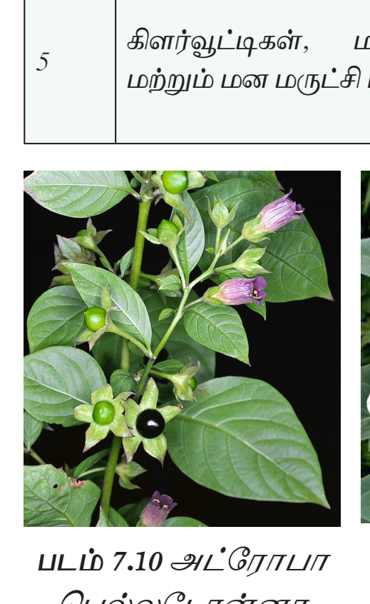

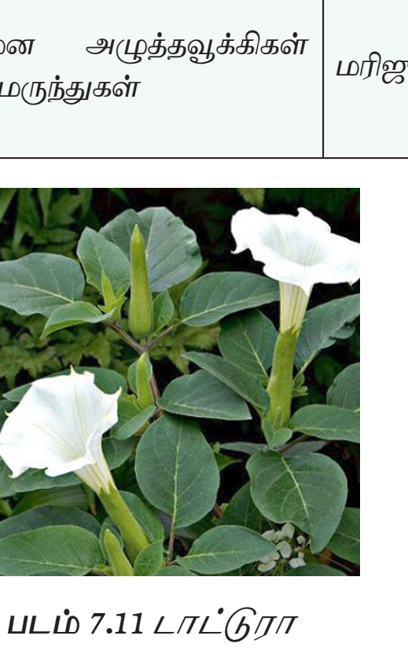

இதயம் , நுரையீரல் மற்றும் நரம்பு மண்டலத்தில்
கோளாறுகளை ஏற்படுத்தும் தனமை கொொண்ட
நிகோடின், கார்பன் மோனாக்சசைடு மற்றும் தார்
ஆகியவை
புகையிலையில்
அடங்கியுள்ளன.
நிகோட்டின், அட்ரினல் சுரப்பிகளைத் தூண்டுவதன்
மூலம் வெளியேறும் அட்ரினலின் மற்றும் நார்
அட்ரினலின் ஹார்மோன்கள், இரத்த அழுத்தம்
மற்றும் இதயத்துடிப்பு வீதத்தை அதிகரிக்கச்
செய்கின்றன.

### 7.3.1  பழக்க அடிமைப்பாடு நிலை

மற்றும் சார்பு நிலை
பழக்க அடிமைப்பாடு என்பது ஒரு நபர் தனக்கு
பாதிப்பை ஏற்படுத்தும் அளவிற்கு ஆல்கஹால்
போன்ற
சிலவற்றை
செய்யவோ
அல்லது
எடுத்துக்கொள்ளவோ அல்லது பயன்படுத்தவோ
தூண்டும் உடல் சார்ந்த அல்லது உளவியல்
ரீதியான
தேவையாகும்.
இப்பழக்கம்
அழிவைத்தரும். இந்த போதை பழக்கம் ஒரு

போதை மருந்துகள் மற்றும் மது ஆகியவற்றை
மீண்டும் மீண்டும் பயன்படுத்துவதால் உடலில்
உள்ள உணர்வவேற்பிகளின் தாங்குதிறன் அளவு
பாதிக்கப்படுகிறது.
பின்னர்
இந்த
உணர்வவேற்பிகள் அதிகளவு போதை மருந்து
மற்றும் மதுவிற்கு மட்டுமே வினைபுரியும். இதன்
விளைவாக மேலும் அதிக அளவில் போதை
மருந்துகளையும், மதுவையும் எடுத்துக்கொள்ள
வேண்டியதாகிவிடும்.வழக்கமாக போதை மருந்து
மற்றும் மதுவை மிகுதியாகப் பயன்படுத்தும்
போது அவை தம்மீது உடல் மற்றும் உளவியல்
சார்ந்த சார்பு நிலையைத் தோற்றுவிக்கும்.
எப்பொழுது அச்சார்பு வளர்கின்றதோ அப்போது
போதை மருந்து பயன்படுத்துபவர் மனதளவில்
போதை
மருந்துடன்
“மாட்டிக்
கொொண்ட”
நிலையைப்
பெறுகிறார்.
போதை
மருந்து
பயன்படுத்துபவர் தொொடர்ந்து போதை மருந்ததை
மட்டுமே நினைக்கிறார். மேலும் அதன் மீது
அவருக்கு தொொடர்ச்சியான கட்டுப்படுத்தப்பட
முடியாத ஏக்கம் ஏற்படுகிறது. இந்த நிலையே
மகிழ்ச்சி
உணர்வு
(Euphoria)
எனப்படும்.
இந்நிலையில்
போதை
மருந்ததை

பயன்படுத்துபவரின் மனமும் உணர்ச்சிகளும்
போதை மருந்ததால் ஆக்கிரமிக்கப்பட்டிருக்கும்.
உடல்
சார்ந்த
சார்பு
நிலை
என்பது
பயன்படுத்துபவரின் உடலுக்கு தொொடர்ச்சியாக
போதை மருந்து தேவைப்படும் நிலையாகும்.
போதை
மருந்து
அல்லது
மதுவை
எடுத்துக்கொள்வதை திடீரென நிறுத்தும் போது
அவன் அல்லது அவளுக்கு “விலகல் அறிகுறிகள்”
(Withdrawal symptoms) தோன்றுகின்றன. உணர்வின்
வழி குழப்ப நிலையை அடைவதோடு போதை
மருந்து
இல்லாத
நிலைக்கு
எதிரான
தனமையையும் உடல் பெற்று விடுகிறது. லேசான
நடுக்கம் முதல் வலிப்பு வரை, கடுமையான
கிளர்ச்சி, மனஅழுத்த உணர்வு,கவலை, பதட்டம்,
படபடப்பு, எரிச்சல், தூக்கமினமை, தொொண்டடை
வறட்சி,
என பயன்படுத்தப்படும் போதை
மருந்தின்
வகையைப்பொறுத்து
விலகல்
அறிகுறிகள் மாறுபடும்.

### 7.3.2 போதை மருந்துகள் மற்றும்

மதுவினால் உண்டடாகும் விளைவுகள்

போதை
மருந்துகள்
மற்றும்
மதுவை
எடுத்துக்கொண்ட பிறகு சில நிமிடங்களுக்கு
மட்டுமே
குறுகிய
கால
விளைவுகள்
தோன்றுகின்றன.
போதை
மருந்துக்கு
அடிமையானவர்கள் நன்றறாக இருப்பது போன்ற
போலி
உணர்வவையும்
மற்றும்
இன்பமாக
தோன்றுகிற
குறை
மயக்க
நிலையையும்
உணர்கிறார்கள். மகிழ்ச்சி உணர்வு, வலி, மந்த
உணர்வு, நடத்தையில் மாற்றம், இரத்த அழுத்தம்,
ஆழ்ந்த உறக்கம், குமட்டல் மற்றும் வாந்தி
போன்றவை சில குறுகிய கால விளைவுகள் ஆகும்.
போதை
மருந்துகள்
மற்றும்
மது
போன்றவற்றை அதிகமாக பயன்படுத்துதல் தீவிர
சேதத்தை
ஏற்படுத்தக்கூடிய
நீண்டகால
விளைவுகளையும் ஏற்படுத்துகின்றன. இவற்றை
பயன்படுத்துபவரின் உடல் மற்றும் மனதில்
ஏற்படும் தொொந்தரவுகள் அவர்களின் வாழ்வவை
தாங்க

முடியாத

அளவிற்கு

சித்திரவதைக்குள்ளாக்கி விடும். எடுத்துக்காட்டாக
அதிகமாக குடிப்பது, கல்லீரல் மற்றும் மூளையில்
நிரந்தர சேதத்தை ஏற்படுத்துகிறது.
விடலைப்பருவ
பயன்படுத்துவது

காலத்தில்
நீண்டகால

ஏற்படுத்துகின்றன.

மது

விளைவுகளை

கல்லீரலின்

கொொழுப்பை

சிதைக்கும் திறனில் மது குறுக்கிடுகிறது. நீண்ட
காலமாக கொொழுப்பு சேர்வதாலும் அதிக அளவில்
மது

அருந்துவதாலும்

கல்லீரல்

செல்கள்

அழிக்கப்படுகின்றன. மேலும் இறந்த செல்களின்
இடத்தில் வடு திசுக்கள் வளர்கின்றன. கல்லீரலில்
இந்த வடு உருவாதல் “கல்லீரல் சிதைவுநோய்”
(Liver cirrhosis) எனப்படும். அதிகப்படியான அமில
உற்பத்தியால்

இரைப்பைச்

சுவரின்

படலம்

மதுவினால்

சிதைக்கப்பட்டு

குடற்புண்

ஏற்பட

வழிவகுக்கும்.

அதிகமாக

பயன்படுத்துவது,

மதுவை

இதயத்தசைகளை

பலவீனமடையச் செய்து இதயத் தசை நார்களில்
வடு

திசுக்களை

ஏற்படுத்துகின்றது.

இதன்

விளைவாக அதிகமாக குடிப்பவர்களுக்கு மிகை
இரத்த அழுத்தம், பக்கவாதம், இதய தமனி நோய்
மற்றும்

மாரடைப்பு

போன்ற

அதிக

அபாய

நோய்களுக்கான வாய்ப்புகள் அதிகரிக்கின்றன.
“கொொர்சகாஃப் நோய்” (Korsakoff syndrome) என்ற
கடுமையான நினைவு குறைபாட்டு நோய் மதுவை
அதிகமாக பயன்படுத்துவதால் ஏற்படுகிறது.

### 7.3.3 தடுப்பு முறைகள் மற்றும்

கட்டுப்பாடு

போதை
மருந்துகள்
மற்றும்
மது
குடிப்பதிலிருந்து
ஒருவரை
தடுப்பது
நடைமுறையில் சாத்தியமாகக் கூடியதே ஆகும்.
போதை மருந்து மற்றும் மதுவை வரையறையின்றி
பயன்படுத்துவதை தடுக்க உதவும் சில வழிகள்
கீழே தரப்பட்டுள்ளன.

1. நண்பர்களின் அழுத்தத்தை்
திறமையாகக் கையாளுதல்

பதின் பருவத்தினர் போதை மருந்துகளை
எடுக்க துவங்குவதன் மிகப்பபெரிய காரணம்
மதுவின் மீது ஏற்பட்ட உடல் மற்றும்
உணர்ச்சி
சார்ந்த
சார்பு
நிலையின்
காரணமாக மது குடிப்பதை கட்டுப்படுத்த
முடியாத நிலையே ஆல்கஹாலிசம் அல்லது
மிதமிஞ்சிய மதுப்பழக்கமாகும். சுகாதார
வல்லுநர்கள்
மூலம்
ஆலோசனை
வழங்குவது இதற்ககான சிகிச்சையாகும்.
மருத்துவமனைகளில்
தரப்படும்
நச்சு
நீக்கும் திட்டம் மற்றும் பிற மருத்துவ
வசதிகள் ஆகியவை கூடுதலாக உதவி
தேவைப்படுவோருக்கு
உதவுவனவாகும்.
புகை பிடித்தல் மற்றும் மது குடிப்பதை
குறைக்க விரும்புபவர்களுக்கு மருந்துகளும்
கிடைக்கின்றன.

அவர்களுடைய நண்பர்கள்/ நண்பர் குழுக்களால்
தரப்படும் அழுத்தமாகும். எனவே, போதை
மருந்துகள் மற்றும் மது போன்ற தீங்குதரும்
பொொருட்களைத் தவிர்க்க வேண்டுமெனில் நல்ல
நண்பர்கள்
குழுவை
பெற்றிருப்பது
முக்கியமானதாகும்.

நம்புவதே சரியென நம்புவதில் உறுதியாக நிற்பது

2. பெற்றோர்கள் மற்றும் நண்பர்களின்
உதவியை நாடுதல்

நடவடிக்கைள்

பெற்றோர்கள்
மற்றும்
நண்பர்கள்
குழுவிடமிருந்து உடனடியாக உதவியை பெற
முயற்சிப்பதால்
அவர்களிடமிருந்து
உரிய
வழிகாட்டுதல்களைப் பெற முடியும். நெருங்கிய
மற்றும்
நம்பகமான
நண்பர்களிடமிருந்து
உதவியை பெற முயற்சிக்கலாம். தங்களுடைய
பிரச்சினைகளை தீர்த்துக் கொொள்ள சரியான
ஆலோசனையை பெறுவது, இளைஞர்களின்,
கவலை மற்றும் குற்ற உணர்வுகளைக் களைய
உதவி புரியும்.

இணைந்தும்

3. கல்வி மற்றும் ஆலோசனை
கல்வி மற்றும் ஆலோசனை உருவாக்கும்
நேர்மறையான அணுகுமுறை, வாழ்க்கையின் பல
சிக்கல்களை எதிர்கொள்ளவும் ஏமாற்றங்களைத்
தாங்கிக் கொொள்ளவும் வழி வகுக்கின்றது.

என்று பொொருள்படும். நேர்மறையான மனநலன்
ஆரோக்கியத்தின்

முக்கிய

நலமுடைய

ஒரு

நபர்

பிரதிபலிக்கிறார்.

மன

ஆரோக்கியத்துடன்

போதைப்பழக்கத்திற்கு
அடிமையாகும்
போக்கை் காட்டும் அறிகுறிகளை ஆசிரியர்களும்
பெற்றோர்களும் கண்டறிதல் அவசியமாகும்.

5. தொொழில்முறை மற்றும் மருத்துவ
உதவியை நாடுதல்
போதைக்கு அடிமையானோர் தங்களுடைய
பிரச்சினைகளிலிருந்து மீண்டடெழ, தகுதியுள்ள
உளவியலாளர்கள்,
மனநல
ஆலோசகர்கள்,
அடிமை மீட்சி மற்றும் மறுவாழ்வு திட்டங்கள்
போன்ற வடிவங்களில் உதவிகள் கிடைக்கின்றன.

## 7.4  மன நலன் – மன அழுத்தம் (Mental

health- Depression)
மன நலன் என்பது சுய மரியாதையுடன் கூடிய
நல்ல மன நிலையைக் குறிக்கும். சுய மரியாதை
என்பது தன்னையே விரும்புவது மற்றும் தான்

ஆளுமையை

ரீதியாக
உள்ள

நல்ல
மக்களின்

எப்பொழுதுமே

சமூகத்தின்

இவர்கள் படைப்பாளர்களாகவும் மற்றவர்களுடன்
வாழ்கிறார்கள்.

மன

நலன்

வாழ்க்கையின் தரத்தை உயர்த்துகிறது.
மன அழுத்தம் என்பது பொொதுவான மன நலக்
குறைபாடு ஆகும். இது மக்களிடையே சோர்ந்த
மனநிலை, ஆர்வம் அல்லது

மகிழ்ச்சி குறைவு

குற்றஉணர்வு அல்லது தன் மதிப்பு குறைப்பு,
அமைதியற்ற
குறைந்த

தூக்கம்

ஆற்றல்

அல்லது

மற்றும்

பசியினமை,

குறைந்த

கவனம்

போன்றவற்றை ஏற்படுத்துகிறது.

மன அழுத்தத்தின் அறிகுறிகள்
1.  தன்னம்பிக்கை மற்றும் சுய மரியாதையை
இழத்தல்.
2.

கவலை

3.  பொொதுவாக மகிழ்ச்சி தரக்கூடிய அல்லது
ஆர்வமிக்கவற்றை அனுபவிக்க இயலாத
நிலை.
உடற்பயிற்சி,

தியானம்,

யோகா

மற்றும்

ஆரோக்கியமான

உணவு

பழக்கம்

போன்ற

மாற்றங்கள்

மன

வாழ்க்கை

முறை

அழுத்தத்திலிருந்து விடுபட உதவியாக இருக்கும்.
உடற்பயிற்சியானது

உடலைத்

தூண்டி

(Serotonin)

செரடோனின்

மற்றும்

(Endorphins)

எண்டடார்ஃபின்களை

சுரக்கச்

செய்கிறது. இந்த நரம்புணர்வு கடத்திகள் மன
அழுத்தத்தைக் குறைக்கின்றன. தினசரி வாழ்வில்
மேற்கொள்ளப்படும் உடற்பயிற்சி நேர்மறையான
மனப்பானமையை உருவாக்குகின்றது.
உடற்பயிற்சி திட்டங்களில் பங்ககேற்பது,
1.

சுய மரியாதையை அதிகரிக்கும்,

2.

தன்னம்பிக்கையை மேம்படுத்தும்,

3.

அதிகார உணர்வவை உருவாக்கும்,

4.

சமூக

தொொடர்புகள்

மற்றும்

உறவு

முறைகளை மேம்படுத்தும்.

நல்ல

மன

பாராட்டையும், வெகுமதியையும் பெறுகின்றன.

4. ஆபத்தான அறிகுறிகளைக்
கண்டறிதல்

பகுதியாகும்.

அனாமதேய குடிகாரர்கள் (Alcoholic anonymous)
அனாமதேய குடிகாரர்கள் என்ற அமைப்பை பல ஆண்டுகளாக வாழ்வில் நம்பிக்கை இழந்து, குடியில்
மூழ்கியிருந்த ஒரு தொொழில் அதிபரும் ஒரு மருத்துவரும் சேர்ந்து 1935ஆம் ஆண்டு தொொடங்கினர். குடியை
நிறுத்தவும், மீண்டும் குடிக்காமல் இருக்கவும் ஒருவருக்கொருவர் உதவிக் கொொண்ட இவர்கள் பிறகு,
அனாமதேய குடிகாரர்கள் எனும் அமைப்பை நிறுவி மற்ற குடிகாரர்களுக்கு உதவி புரிந்தனர். அது முதல்
‘அனாமதேய குடிகாரர்கள்’ எனும் அமைப்பு உலகம் முழுவதும் பரவியது.
உடலில் அதிக அளவு வளர்சிதை மாற்றம்

1.

உலகில்

ஏற்படும்

இறப்புகளில்

31%

நடைபெறும் உறுப்பு மூளை ஆகும். எனவே இது

வாழ்க்கை முறை குறைபாடுகளால் ஏற்படும் இதய

செயல்பட

நோய்களால் நிகழ்கின்றன.

தொொடர்ச்சியான

ஊட்டச்சத்துகளின்

உள்ளேற்றம் அவசியமாகிறது. குறை உணவினால்
ஆரோக்கியமான

உடலுக்கு

தேவையான

ஊட்டச்சத்துகளை வழங்க முடியாது. இதனால்
கவலை

மற்றும்

மன

அழுத்தம்

போன்ற

அறிகுறிகள் தூண்டப்படுகின்றன.

“நோயற்ற வாழ்வவே குறைவற்ற செல்வம்”
என்ற பழைய கூற்று மனிதர்களுக்கு உணமையாக
பொொருந்தும். வாழ்க்கை முறை மாற்றங்களால்
வளர்ந்து வரும் பல மருத்துவ சூழ்நிலைகள்
நோய்கள்

குறைக்கின்றன.
போதை

மனித

வாழ்நநாளைக்

புகைப்பிடித்தல்,

மருந்ததை

மது

மற்றும்

பயன்படுத்துதல்,

அதிக

கொொழுப்புள்ள உணவை எடுத்துக்கொள்ளுதல்,
உடற்பயிற்சியினமை
வாழ்க்கை

அல்லது

ஆகியவை

இயக்கமில்லா

வாழ்க்கை

முறை

குறைபாடுகளை தோற்றுவிக்கின்றன.
உலக சுகாதார நிறுவனம் (WHO) தனது
அறிக்கையில் நீரிழிவு நோய், இதயம் மற்றும்
நுரையீரல் நோய்கள் போன்ற தொொற்றா நோய்கள்
வடிவில் உள்ள வாழ்க்கைமுறை குறைபாடுகள்
பொொதுசுகாதார பேரழிவை நோக்கிய மெதுவான
நகர்வு என எச்சரித்துள்ளது.
வாழ்க்கைமுறை
குறைபாடுகளால்

உடல்

தொொடர்பபான
ஒவ்வொரு

ஆண்டும்,

ஆயிரக்கணக்கில் அல்ல, 30 முதல் 60 வயதுடைய

உழைப்பில்லா

வாழ்க்கைமுறை,

போன்ற

வைட்டமின்

வைட்டமின்

D

குறைபாடுகளை

ஏற்படுத்துகின்றன.

இதனால்

களைப்பு, சோர்வு, முதுகுவலி, மன அழுத்தம்,
எலும்பு

## 7.5  மனித வாழ்க்கை முறை

குறைபாடுகள் (Lifestyle disorders in
human beings)

மற்றும்

2.

இழப்பு,

தசை

வலி

ஆகியவை

தோன்றுகின்றன.
3.

வயது

தொொடர்பபான

தோற்றுவிக்கும்

சமூக

பிரச்சினைகளை

தனிமைப்படுத்துதலும்

(Social isolation) வாழ்க்கை முறை குறைபாடுகளில்
அடங்கும்.
4.

அதிக

கலோரி

மதிப்புடைய

கார்போஹைட்ரரேட் மற்றும் கொொழுப்பு நிறைந்த
குப்பை உணவுகளை (Junk food) உண்ணுதல் உடல்
பருமன்

மற்றும்

ஆரம்ப

கால

உடல்

நல

பிரச்சினைகளை ஏற்படுத்தும்.
5. நார்ச்சத்து
மற்றும்

குறைந்த

பதப்படுத்தப்பட்ட

அடைக்கப்பட்ட

உணவை

எடுத்துக்கொள்ளுதல்

மலச்சிக்கலை

தோற்றுவிக்கும்.
6.

வயிற்றில்

அல்லது

வலி

ஏற்படும்
மற்றும்

அசௌகரியம்
குடல்

இயக்க

கோளாறுகளுடன் மலம் கழித்தலில் ஏற்படும்
தொொந்தரவுகளால்

இன்று

பல

மக்கள்

பாதிக்கப்பட்டுள்ளனர். மன அழுத்தம் மற்றும்
மற்ற

உடல்நலக்

கோளாறுகளால்

இந்நோய்

ஏற்படுகிறது.

வாழ்க்கை முறை மாற்றங்கள்
1.

குப்பை உணவுகள் மற்றும் பதப்படுத்திகள,

மில்லியன் கணக்கான மக்கள் இறக்கின்றனர்,

நிறமூட்டிகள் கலந்த உணவுகள் உண்ணுவதை

என உலக சுகாதார நிறுவனம் நம்புகிறது.

தவிர்க்க வேண்டும்.

கீழ்ககாணும்

உணமைகள்

வாழ்க்கைமுறை

குறைபாடுகளை சிறப்பாக புரிந்துகொொள்ள உதவும்.

2. வேகமாக

நடத்தல்,

யோகா

போன்ற

உடற்பயிற்சிகளை வழக்கமாக செய்தல் வேண்டும்.

3.

வாழ்க்கைமுறைக்

கோளாறுகளுக்கும்

மற்றும்
லீஷ்மமேனியா
போன்ற
புரோட்டோசோவாக்கள் முறையே அமீபிக் சீதபேதி,
மலேரியா மற்றும் காலா அசார் ஆகிய நோய்களை
ஏற்படுத்துகின்றன. தன் உடல் தூயமை மற்றும்
சுகாதாரம், கழிவுகளை முறையாக அகற்றுதல்,
பாதுகாப்பான குடிநீர் மற்றும் நோய்த்தடுப்பேற்றம்
போன்றவை நோய்களை தடுப்பதற்கு மிகவும்
பயன்படும்.
இளைஞர்கள்
மற்றும்
விடலைப்பருவத்தினர் போதை மருந்துகள் மற்றும்
மதுவுக்கு அடிமையாவது மேலுமொொரு கவலையைத்
தருவதாகும். நண்பர்களின் அழுத்தம், தேர்வு மற்றும்
போட்டி தொொடர்பபான மன அழுத்தம் போன்றவற்றால்
போதை
மருந்துகள்
மற்றும்
மதுவிற்கு
அடிமையாதல் நிகழ்கிறது. அடிமையாகிய ஒரு நபர்
அனைத்து வகையான அடிமையாதலிலிருந்தும்
தம்மை
விடுவித்துக்
கொொள்ள
முறையான
ஆலோசனை, கல்வி மற்றும் தொொழில்முறை
மருத்துவ உதவியை நாடல் வேண்டும்.

மேல் ஏதாவது உடல் நலப் பிரச்சினைகள் என்றறால்
மருத்துவரின் ஆலோசனைகளைக் கடைபிடிக்க
வேண்டும்.
4.

புகைபிடித்தல் மற்றும் மது குடிப்பதை

தவிர்க்க வேண்டும்.
5. வைட்டமின்கள்

மற்றும்

புரதங்கள்

நிறைந்த சரிவிகித உணவை உண்ண வேண்டும்.
6.

ஒவ்வொரு நாளும் 7-8 மணி நேரம்

தூங்குதல் வேண்டும்.

பாடச்சுருக்கம்
உடல் நலம் என்பது முழுமையான உடல்
மற்றும் உளவியல் நல்வவாழ்வு நிலையாகும்.
நுண்ணுயிரிகள்
போன்ற
பல
காரணிகள்
மனிதர்களுக்கு
உடல்நலக்குறைவை
ஏற்படுத்துகின்றன. எண்டமீபா, பிளாஸ்மோடியம்

ஆர்வமூட்டும் உணமைகள்
1.  உறையவைத்தல்
(Freezing)
முறையில்
பாக்டீரியாக்களை கொொல்ல இயலாது. இதன்
மூலம் அதனுடைய வளர்ச்சியை மட்டுமே
நிறுத்த முடியும்.

புதுச்சேரியில் உள்ளது. இம்மையத்துடன்
யானைக்கால் நோய் மற்றும் ஒருங்கிணைந்த
நோய்கடத்தி கட்டுப்பாடு முறைகள் ஆராய்ச்சி
மற்றும் பயிற்சியில் ஈடுபட்டுள்ளது.

2.  உயிர் எதிர் பொொருள்கள் (Antibiotics) தீமை
செய்யும் பாக்டீரியாக்களை கொொல்வதோடு
மட்டுமல்லாமல் நம் உடலில் உள்ள நனமை
செய்யும்
பாக்டீரியாக்களையும்
கொொல்கின்றன.
3.  சிறுநீர் பாதை தொொற்று (UTI- Urinary Tract
infection) என்பது சாதாரணமாக உலகம்
முழுவதும் ஒவ்வொரு வருடமும் 150
மில்லியன் மக்களை பாதிக்கும் பாக்டீரியா
தொொற்றாகும்.
4.  உலக மலேரியா தினம் ஏப்ரல் 25 ஆகும்.
5.  ஐஸ்லலாந்து (Iceland) மற்றும் ஃபரோ தீவுகள்
(Faroe islands) மட்டுமே உலகில் ‘கொொசு
இல்லாத’ நாடுகள் ஆகும்.
6.  நோய்கடத்தி தடுப்பு ஆராய்ச்சி மையம் (VCRC)

7.  பூச்சிகளை மலடாக்கும் தொொழில் நுட்பம்
(SIT): இத்தொழில் நுட்பத்தின் மூலம் ஒரு
நிலப்பரப்பிலிருந்து
வெற்றிகரமாக
நீக்கப்பட்ட தீங்குயிரி, திருகுப்புழு (Screw –
worm fly) எனும் பூச்சியினமாகும்.
8.

 ஸிகா வைரஸ் (Zika virus) மூளை புற்று
நோய்க்கு எதிரான அறுவை சிகிச்சை
ஆயுதமாக பயன்படுத்த முடியும்.

செயல்பபாடுகள்
செயல்பபாடு:1 மாணவர்கள் தினசரி வாழ்க்கையில் நுண்ணுயிரிகளின் தாக்கத்தை ஆராய்தல் மற்றும்
அதனுடைய பயன்பபாட்டு திறனை எண்ணிப்பார்த்தல். மேலும் அவர்கள் சுயமாக ஆராய்ச்சிகளை
மேற்கொள்வதோடு, அவற்றின் கண்டுபிடிப்புகளை தெரிவித்தல்.
செயல்பபாடு:2 மாணவர்கள் தயிரில் உள்ள நுண்ணுயிரிகளை கண்டறிவதற்ககாக தற்ககாலிக பூச்சை
தயாரித்தல்.
செயல்பபாடு:3 சில நோய்கள் காற்று வழியாக எவ்வாறு பரவுகின்றன என்பதை விளக்க குழுவின்
தலைவர் தன் குழுவின் முன் காற்றுக் குமிழ்களை ஊதிக்காட்டுதல்.
செயல்பபாடு:4 எந்த ஒட்டுண்ணி மற்ற ஒட்டுண்ணிகளை கடத்தும் விருந்தோம்பியாக செயல்படுகிறது?
விவாதி.
செயல்பபாடு:5 உன்னுடைய நண்பர்கள் உன்னை “கோழை பையன்” என்று அழைக்கிறார்கள்.
ஏனெனில், நீ புகையிலையை புகைப்பதில்லை மற்றும் மெல்லுவதில்லை. என்ன பதிலை நீ கூறுவாய்?
எவ்வாறு நீ உன்னுடைய பலத்தை நிரூபிப்பாய்?

## மதிப்பீடு

1.  பிளாஸ்டிமோடியத்தால்
ஏற்படும் மலேரியா______
மூலம் பரவுகின்றது.
அ) காற்று
ஆ) தொொடர்பு
இ)  உணவின் மீதுள்ள தெள்ளுப்பூச்சிகள்
ஈ) கொொசு கடித்தல்

2.  30 வயதுடைய பெண்ணிற்கு 14 மணி நேரமாக
இரத்தம் கலந்த வயிற்றுக்போக்கு தொொடர்ந்து
வெளியேறுகிறது. கீழ்க்கண்ட எந்த உயிரி இந்த
கேட்டினை ஏற்படுத்தும்?
அ) ஸ்ட்ரரெப்டோகாக்கஸ் பயோஜென்ஸ்
ஆ) கிளாஸ்டிரிடியம் டிஃபிசைல்
இ) ஷிஜெல்லா டிஸ்சசென்ட்ரியே
ஈ) சால்மோனெல்லா என்ட்ரரைடிடிஸ்

3.  கீழ்க்கண்ட எந்த நோய் நீர்த்திவலைகள் மூலம்
பரவுகிறது?
அ) துலாரெமியா ஆ) லிஸ்டடெரியோசிஸ்
இ) சின்னம்மை
ஈ) புட்டாளம்மை

4.  பிளாஸ்மோடியத்தின் புறச்சிவப்பணு சைஷோ
கோனி நடைபெறும் இடம்___________
அ) இரத்த சிவப்பணு ஆ) லியூக்கோசைட்டுகள்
இ) இரைப்பை
ஈ) கல்லீரல்

5.  பி . வைவாக்ஸின் ஸ்போரோசோயிட்டுகள்
___________ ல் உருவாக்கப்பட்டது.
அ) கேமிட்டோசைட்டுகள் (இனச்சசெல்கள்)
ஆ) ஸ்போரோபிளாஸ்டுகள்

இ) ஊசிஸ்டுகள்
ஈ) ஸ்போர்கள்

6.  குழந்ததைப்பருவ பக்கவாதத்தை ஏற்படுத்தும்
இளம்பிள்ளைவாதம் ____________ வழியாக
உடலில் நுழைகிறது.
அ) தோல்
ஆ) வாய் மற்றும் மூக்கு
இ) காதுகள்
ஈ) கண்கள்

7.  ஆம்ஃபிடமைன்கள் மத்திய நரம்பு மண்டலத்தை
(CNS) கிளர்வூட்டுபவையாகும். அதே போல்
பார்பிடுரேட்டுகள் ___________ ஆகும்.
அ) மைய நரம்பு மண்டல கிளர்வூட்டி
ஆ) மன மருட்சி ஏற்படுத்துபவை
இ) அ மற்றும்ஆ இரண்டும்
ஈ) மைய நரம்பு மண்டல சோர்வூட்டி

8.  மரிஜூவானா___________
லிருந்து
பிரித்ததெடுக்கப்படுகிறது.
அ) சணல் செடியின் சருகுகள் மற்றும் பூக்கள்
ஆ) எர்ககாட் பூஞ்சசை
இ) சணல் தாவர வேர்கள்
ஈ) கோகா தாவரம்

9.  சரியாக பொொருந்திய இணையைத் தேர்ந்ததெடு
அ) ஆம்ஃபிடமைன்கள்- கிளர்வூட்டி
ஆ)  லைசர்ஜிக் அமிலம் டைஎத்திலமைடுபோதை மருந்து
இ) ஹெராயின்- உளவியல் மருந்து
ஈ) பென்சோடைஅசபைன்- வலி நீக்கி

10.  மனிதனில்
சேற்றுப்புண்ணை
ஏற்படுத்துவது___________
அ) பாக்டீரியா
இ) வைரஸ்

ஆ) பூஞ்சசை
ஈ) புரோட்டோசோவா

11.  ___________ அதிகமாக எடுத்துக்கொள்வது
கல்லீரல் அழற்சி நோயை ஏற்படுத்துகிறது.
அ) அபின்

ஆ) மது

இ) புகையிலை

ஈ) கோகெய்ன்

நோய்கள்

12.  மலேரியா ஒட்டுண்ணியின் ஸ்போரோசோயிட்
_________ல் காணப்படுகிறது.
அ)  நோய்தத்ததொற்றிய பெண்
கொொசுவின் உமிழ்நீர்

அனாபிலஸ்

ஆ)  மலேரியாவால் பாதிக்கப்பட்ட
இரத்த சிவப்பணுக்கள்

மனித

இ)  நோய்தத்ததொற்றிய மனிதர்களின்
மண்ணீரல்
ஈ) பெண் அனாபிலஸ் கொொசுவின் குடல்

13. ஹீமோசோயின் என்பது
அ) ஹீமோகுளோபினின் முன்னோடி
ஆ)  ஸ்ட்ரரெப்டோகாக்கஸிலிருந்து
வெளியேறும் நச்சு
இ)  பிளாஸ்மோடியம்
வெளியேறும் நச்சு

இனத்திலிருந்து

ஈ)  ஹீமோஃஃபைலஸ்
வெளியேறும் நச்சு

இனத்திலிருந்து

14.  டாடுரா
(Datura)
தாவரத்திலிருந்து
உருவாக்கப்படும் போதை மருந்து
அ) மன மருட்சியை ஏற்படுத்துபவை
ஆ) சோர்வூட்டி

இ) கிளர்வூட்டி

ஈ) வலி நீக்கி

15.  நோயூக்கிகள் மற்றும் அவைகள் உண்டடாக்கும்
நோய்களை பொொருத்தி, கீழே உள்ள சரியான
பொொருந்து குறியீட்டை தேர்ந்ததெடு.
A.  லீஷ்மமேனியா
டோனோவனி

- i. அமீபியாசிஸ்

B. உச்சரீரீயா
பான்கிராஃப்டி

- ii. காலா-அசார்

C. டிரிப்பனோசோமா
கேம்பியன்ஸ்
- iii. தூக்க வியாதி
D. எண்டமீபா
ஹிஸ்டடாலிடிகா

16.  கீழ்க்காணும் அட்டவணையை நிறைவு செய்.

- iv. யானைக்கால் நோய்

அ) A-ii,

B-iv,

C-iii,

D-i

ஆ) A-ii,

B-iv,

C-i,

D-iii

இ) A-iii,

B-i,

C-ii,

D-iv

ஈ) A-i,

B-iv,

C-iii,

D-ii

நோய்க்காரணி

புட்டாளம்மை
சின்னம்மை
டெங்கு காய்ச்சல்

17. தொொண்டடை அடைப்பான் மற்றும் டைஃபாய்டு
ஆகியவற்றின் நோய்க்காரணிகள், பரவும்
முறை மற்றும் அறிகுறிகளைக் குறிப்பிடுக.

18.  பேசில்லரி சீதபேதி மற்றும் அமீபிக் சீதபேதி ஒப்பிட்டு வேறுபடுத்துக

19.  ஒரு நோயாளி காய்ச்சல் மற்றும் குளிருடன்
மருத்துவமணையில்
அனுமதிக்கப்படுகிறார்.
மீரோசோயிட்டுகள்
அவரது
இரத்தத்தில்
காணப்பட்டன. உன்னுடைய கண்டறிதல் என்ன?

20.  அ)  யானைக்கால்
நோயை
யானைக்கால்
புழுவின்
பெயரை எழுதுக.
ஆ)  யானைக்கால்
எழுதுக

நோயின்

ஏற்படுத்தும்
அறிவியல்
அறிகுறிகளை

இ) இந்த நோய் எவ்வாறு பரவுகிறது.

21.  போதை
மருந்துகள்
மற்றும்
மதுப்
பழக்கத்திலிருந்து விலகும் போது ஏற்படும்
விலகல் அறிகுறிகளை வரிசைப்படுத்துக.

22.  காலா – அசார் என்றறால் என்ன?

23. ‘ சாதாரண சளிக்கு’ எதிராக தடுப்பு மருந்ததை
உற்பத்தி செய்ய முடியாதது பற்றி நீ என்ன
நினைக்கிறாய்?

24.   மனித வைரஸ் நோய்களின் நோய்க்காரணிகள்,
பரவும்
முறை
மற்றும்
அறிகுறிகளை
அட்டவணைப்படுத்துக.

25.   புரோட்டோசோவா நோய்களைப் பற்றி ஒரு
சிறு குறிப்பு வரைக.

26.   மனிதனில் பிளாஸ்மோடியத்தின் வாழ்க்கைச்
சுழற்சியை விளக்குக.

27.   போதை மற்றும் மதுவை வரையறையின்றி
பயன்படுத்துவதைத் தடுக்க சில வழிகளைப்
பரிந்துரை செய்க.

நோய்தத்ததொற்றும்
இடம்

மனித நலன் மற்றும் நோய்கள்

´{¿{ ª¶{s

™b´ 0½{) 

KY‚¼4½{ 
‚¸{‚Ä{ À{4

„.Îàö{¼{ 
‚´j+½yY

¼g «

¶f& «

´¸h)´v À1 
à¾Ûj ‚»{k´v

´fˆÎ‚à{Ä ¬¹Û 
¼w‘j F.y ¿j
 à¾Ûj ‚»{k´v

‚¶Ãz‘Îعz

‚´g„„½{&Y
œeƒ¶ 
‚»{k´v

¶{º{¾¹ ¶2

ƒ¾‚Ä{ ƒÀ¾Y

‚à{/‚½{ ƒÀ¾Y

¼jÎY ƒÀ¾Y

Øf¸{Âjƒ¼

³+‚Â0 ƒÀ¾Y 
ª  ¸c† ƒÀ¾Y

‚À.¶t¿{ 
‚Å{Y¸s ƒÀ¾Y

‚¸{´{ ƒÀ¾Y

ªY´{.Y
 Új+.´{kfY

$ž¿bY ´{Ö

¬d¶JJ½{ 
à{y$¾{³Î„

áÎà{ƒ¸f„Y 
B ƒÀ¾Y 

´tK¾t ªÁw&

ß¾hºj ¼w‘j 
+à ¬¸t )¾Àc´v

ªY´{.½{&Y

½{ƒÄb´{t ‚»{k

ªÖhº¼{Ä ¼g(y 
¿j à¾Ûj ‚»{k´v

¸f¸ÄY

$Â{Y„.„½j 
¸f¸4

&b†y†y½{ 

¯„Y ´{Ö

¸c† ´{kd¶t

´¸h)´v À1 
à¾Ûj ‚»{k´v

¼Ä ¼Ùf&
 ¼ÙiŠ´v

‚à{ƒº ¼ÙiŠ

¼Ä ªhºÝb$´v

$ÂsÝf„´v

´fˆÎ‚à{Ä ¬¹Û 
¼w‘j F.y ¿j
 à¾Ûj ‚»{k´v

‚»{kb´¸h)´v À1 
à¾Ûj ‚»{k´v

‚»{kb´¸h)´v À1 
à¾Ûj ‚»{k´v

+‚Âb

®s&4½{ àY„Y

®/ ºvÎœd&

&yÄjƒ¼

 ஗஁ஏ஘୾ 
ஂ௠୿ஜௌ୷இஜ   
ஂௌ௳஀ஏஆஜ  
୯୽ஜ୼ஏஶஂஜ  
௳஘இ௵୷இஜ

Ùàt¿{ ƒÀ¾Y

ºf¸jƒ¼

´{w3y À1 à¾Ûj ‚»{k´v

ƒÀ¾Y 
‚»{k´v

 IE FMå
 Iä²Ý 
ZFTÞ>ã

à{b .½{ 
‚»{k´v

؏0Ä
 ‚»{k´v

y *‚¼{4½{

Yf¾Î‚¸{´{b´Y
 *‚¼{4½{

´{w3y À1 à¾Ûj ‚»{k´v

„ÎE.½{

‚´{.4à{b .½j 
„ÎE.‚½

؂¾{f‚¸{‚¶{À{ 
‚»{k´v

ßÂj+vƒÂ À{ºj

´fˆÎ‚à{Ä ¬¹Û 
¼w‘j F.y ¿j
 à¾Ûj ‚»{k´v

¼‚¿.½{

+Â{Y‚¼{„½j 
ƒÀÀ{bY

ªH+½{&Y

àg 
ªÄ{+¿{Y 
´{Ö

®g¸Hà{
 8Y‚¸{/„´{

## கருத்து வரைபடம்

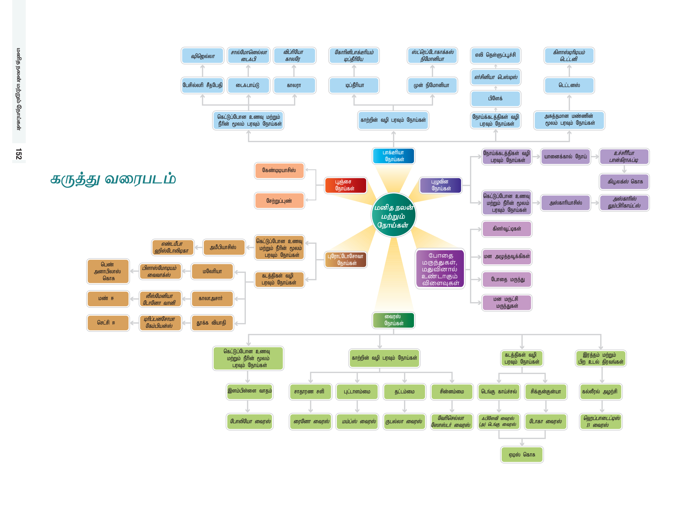

ƒ¸³à{kˆ

‚à&t¿. <º‚à)

´fˆÎ‚à{Ä ¬¹Û ¼w‘j 
F.y ¿j à¾Ûj ‚»{k´v

0Î.‚½{ 
´{¿‚¾

¶{t‚¼{Ät¿{ 
ƒ¸³+

6Çt¿{
