# பாடம் 2: மனித இனப்பெருக்கம்

> மூலம்: தமிழ் வழிப் பாடநூல், PDF பக்கங்கள் 20–43.

> குறிப்பு: கீழுள்ள தேடக்கூடிய உரை துல்லியமான படங்கள், அட்டவணைகள் மற்றும் அமைப்பிற்கு அசல் பக்கங்களைப் பார்க்கவும்.

அலகு - I

பாடம்

## பாட உள்ளடக்கம்

2.1

மனித இனப்பபெருக்க மண்டலம்

2.3

மாதவிடாய் சுழற்சி

2.2

2.4
2.5

2.6
2.7

இனச்சசெல்உருவாக்கம்

 மாதவிடாய் கோளாறுகள் மற்றும் மாதவிடாய்
சுகாதாரம்

கருவுறுதல் மற்றும் கரு பதிதல்

 கர்ப்ப பராமரிப்பு மற்றும் கரு வளர்ச்சி

மகப்பேறு மற்றும் பாலூட்டுதல்

## கற்றலின் நோக்கங்கள் :

-  விடலைப் பருவத்தில் ஆரோக்கியமான

இனப்பபெருக்க வாழ்வு பற்றிய விழிப்புணர்வவை
உருவாக்குதல்.

ஒவ்வவொரு குழந்ததை பிறக்கும்போதும் மனித இனத்தின்
இனப்பபெருக்கத் திறன் மீண்டும் பிறக்கிறது.
-ஜேம்ஸ் அகீ

ம

னிதன்
உயிர்வவாழ்வதற்ககாக
மனித
உடலின்
ஒவ்வொரு
உறுப்பும்
தொொடர்ச்சியாகப்
பணியாற்றி
உடலின்
சமநிலையைப் (Homeostasis) பேணுகின்றன. மனித
இனம் தழைப்பதற்கு மனித இனப்பபெருக்க
மண்டலம் முக்கியமான ஒன்றறாகும். ஒரு உயிரி
தனது சந்ததியை உருவாக்காமல், தான் மட்டும்
நீண்ட ஆயுளுடன் ஆரோக்கியமாக வாழ இயலும்.
ஆனால், ஒரு சிற்றினத்தைச் சேர்ந்த உயிரிகள்
அழிந்துவிடாமல் இப்புவியில் நிலைத்து இருக்க
இனப்பபெருக்கம் இன்றியமையாததாகும்.
இனப்பபெருக்க மண்டலத்தின் நான்கு முக்கிய
செயல்பபாடுகளாவன:
- 

மண்டலங்களின் அமைப்பை

இனச் செல்களான விந்து மற்றும் அண்ட
செல்களை உருவாக்குதல்.

- 

-  ஆண் மற்றும் பெண் இனப்பபெருக்க

இவ்விதம் உருவான செல்களைக் கடத்துதல்
மற்றும் தக்க வைத்தல்.

- 

வளரும் கருவிற்குத் தேவையான ஊட்டம்
அளித்துப் பேணுதல்.

- 

ஹார்மோன்களை உற்பத்தி செய்தல்.

-  ஆண் மற்றும் பெண் இனப்பபெருக்க
புரிந்துகொொள்ளுதல்.

மண்டலங்களோடு தொொடர்புடைய
அமைப்புகளின் பணிகளை
விவரித்தல்.

-  விந்து செல்உருவாக்கம் மற்றும் அண்ட செல்

மனிதனில் நிகழும் முக்கிய இனப்பபெருக்க
நிகழ்வுகள் கீழே தரப்பட்டுள்ளன.

-  கருவுறுதலின் போதும், கருவுற்ற பின்பும்

- 

இனச்சசெல்உருவாக்கம் (Gametogenesis) – விந்து
செல் உருவாக்கம் மற்றும் அண்ட செல்
உருவாக்கம் ஆகிய செயல்பபாடுகள் மூலம்
விந்து செல்கள் மற்றும் அண்ட செல்கள்
உருவாதல்.

- 

விந்து உள்ளேற்றம் (Insemination) – ஆண் தனது
விந்து
செல்களை
பெண்ணின்
இனப்பபெருக்கப்பாதையினுள் செலுத்துதல்.

உருவாக்க நிகழ்வுகளை ஒப்புமைப்படுத்துதல்.
பெண்ணின் உடலில் தோன்றும் மாற்றங்களை
விவாதித்தல்.

-  இனப்பபெருக்கத்தில் ஹார்மோன்களின் பங்ககை
மதிப்பீடு செய்தல்.

-  கர்ப்ப கால நிகழ்வுகளையும், கரு வளர்ச்சியையும்
பற்றி புரிந்து கொொள்ளுதல்.

- 

கருவுறுதல் (Fertilization) – ஆண் மற்றும் பெண்
இனச்சசெல்கள் இணைந்து கருமுட்டையை
உருவாக்குதல்.

- 

பிளவிப்பபெருகல்
(Cleavage)

ஒற்றைச்
செல்லான
கருமுட்டையில்
விரைவாக
மறைமுக செல் பிரிதல் நடந்து பல செல்களை
உடைய கருக்கோளமாக மாறுதல்.

- 

கரு பதிதல் (Implantation) – கருப்பையின்
உட்சுவரில் கருக்கோளம் பதிதல்

- 

தாய் சேய் இணைப்புத் திசு உருவாக்கம்
(Placentation) – வளர் கருவிற்கும் தாயின்
கருப்பைச்
சுவருக்கும்
இடையில்
உணவூட்டப்பொருட்கள் மற்றும் கழிவுகளின்
பரிமாற்றத்திற்ககாக தாய் சேய் இணைப்புத்
திசுக்களால் ஏற்படுத்தப்படும் நெருக்கமானப்
பிணைப்பு.

இயல்பபான முறையில் செயல்படவும் உதவுகின்றன.
துணை
உறுப்புகள்,
இனச்சசெல்களைக்
கடத்துவதற்கும், தக்க வைப்பதற்கும், வளரும்
கருவிற்கு
தேவையான
ஊட்டமளித்து
பேணுதலிலும் உதவுகின்றன.

## 2.1  மனித இனப்பபெருக்க மண்டலம்

ஓரிணை விந்தகங்கள், துணை நாளங்கள்,
சுரப்பிகள் மற்றும் புற இனப்பபெருக்க உறுப்புகள்
ஆகியவற்றின் தொொகுப்பே ஆண் இனப்பபெருக்க
மண்டலம் ஆகும் (படம் 2.1).

- 

மூவடுக்குக் கருக்கோளமாக்கம் (Gastrulation) –
ஓரடுக்கு
கருக்கோளமானது
மூன்று
முதனமை
மூலஇனச்சசெல்
அடுக்குகள்
கொொண்ட மூவடுக்கு கருக்கோளமாக மாறுதல்

- 

உறுப்பாக்கம் (Organogenesis) – மூன்று மூல
இனச்சசெல் அடுக்குகளிலிருந்தும் சிறப்புத்
திசுக்கள்,
உறுப்புகள்
மற்றும்
உறுப்பு
மண்டலங்கள் உருவாகுதல்.

- 

மகப்பேறு
(Parturition)

தாயின்
கருப்பையிலிருந்து சிசு வெளியேற்றப்படும்
செயல்.

விந்தகங்கள் ஆணின் முதனமை பாலுறுப்புகள்
ஆகும்.
இவை ஓரிணை முட்டை வடிவ
அமைப்புகளாக
விதைப்பையினுள்
அமைந்துள்ளன (படம் 2.2) (அ). வயிற்றையின்
வெளிப்புறமாக அமைந்துள்ள தோலால் ஆன பை
போன்ற அமைப்பு விதைப்பை ஆகும். இயல்பபான
மனித
உடல்
வெப்பத்தில்
வீரியமான
விந்தணுக்களை உற்பத்தி செய்ய இயலாது.
எனவே,
விதைப்பையானது
வயிற்றையின்
வெளியில்
அமைந்து
இயல்பபான
உடல்

வெப்பநிலையைவிட 2 C முதல் 3 C குறைவான
வெப்பநிலையை விந்தகங்களுக்கு அளிக்கிறது.
இவ்வாறு
விதைப்பையானது
ஒரு
‘வெப்ப
நெறிப்படுத்தி’யாகச் (Thermo regulator) செயல்
புரிவதால் விந்துசெல் உருவாக்கம் (Spermatogenesis)
நடைபெறுகிறது.

இச்சசெயல்பபாடுகள் அனைத்தும் முதனமை
இனப்பபெருக்க உறுப்புகள் மற்றும் அதைச் சார்ந்த
துணை
உறுப்புகளால்
நடைபெறுகின்றன.
முதனமை இனப்பபெருக்க உறுப்புகளான அண்டகம்
மற்றும் விந்தகம் ஆகியவற்றிலிருந்து முறையே
அண்ட செல்கள் மற்றும் விந்து செல்கள் உற்பத்தி
செய்யப்படுகின்றன. பிட்யூட்டரி சுரப்பி மற்றும்
முதனமை இனப்பபெருக்க உறுப்புகளிலிருந்து
சுரக்கப்படும் ஹார்மோன்கள், இரண்டடாம் நிலை
பால் பண்புகளை உருவாக்கவும், இனப்பபெருக்க
மண்டலம்
முதிர்ச்சி
அடையவும்
மற்றும்

ஒவ்வொரு
விந்தகமும்
‘டியூனிகா
அல்புஜினியா’ (Tunica albuginea) என்னும் நாரிழைத்
தனமை
கொொண்ட
வெளிப்புற
உறையால்
மூடப்பட்டுள்ளது.
ஒவ்வொரு
விந்தகமும்
தடுப்புச்சுவர்களால் 200 முதல் 250 கதுப்புகளாகப்
பிரிக்கப்பட்டுள்ளன. ஒவ்வொரு கதுப்பும் 2 முதல்
4 விந்தக நுண்குழல்களைக் (Seminiferous tubules)
கொொண்டுள்ளன. மிகுந்த சுருள் தனமையுடன்
காணப்படும்
இவ்விந்தக
நுண்குழல்கள்
%80 விந்தகப் பொொருட்களை உற்பத்தி செய்கின்ற
விந்து உற்பத்தித் தளங்களாகும்.

மறை விந்தகம் (Cryptorchism)

விந்தகங்களுள் ஏதேனும் ஒன்றோ அல்லது இரண்டுமோ
விதைப்பையினுள் இறங்ககாமல் உடலுக்குள்ளேயே தங்கிவிடும் நிகழ்ச்சிக்கு மறை விந்தகம் (‘விந்தக உள் தங்கல்’)
(Cryptorchism: Crypto = மறைக்கப்பட்ட + Orchis = விந்தகம்) என்று பெயர். பிறந்த ஆண் குழந்ததைகளுள் 1% முதல் 3%
குழந்ததைகளில் இந்நிலை காணப்படுகிறது. இத்தகைய குழந்ததைகள் பிற்ககாலத்தில் விந்தணு உற்பத்தி செய்ய
இயலாமல் மலட்டுத்தனமை கொொண்டவர்களாகலாம். இளம் வயதிலேயே அறுவை சிகிச்சை செய்து
இக்குறைபாட்டைச் சரி செய்யலாம்.

ஆண்
இனப்பபெருக்க
ம ண் ்டலத் த ோ டு
தொொடர்புடைய
துணை
(£HznŽÒ
(£Hzf’Ø p
நாளங்களாகும் (படம் 2.2)
ÓÖf’Î{
(ஆ). விந்தகக் கதுப்பிலுள்ள
2m˜ Ñ Ùo
2m˜nŽÒ
விந்தக நுண் குழல்கள்
2m˜ Œ×4Ô£ Ñ Ùo
¿k’5
(Seminiferous tubules) ஒன்று
›Õ [Îj ”Õn(£Hz א’Ø p
சேர்ந்து
டியூபுலஸ்
2mÐÊ Ó{ ”ž~ ’Ø{
ÓÖl˜ŽÙ
¿k’5/ƒ œƒ œŽÛ
ரெக்ட்டஸ் எனும் விந்து
Ò{Ò   0lÕ{ ”Õn2mÐÊo
நேர் நுண் கால்வவாயாக
2ŽÐnŽÒ
மாறி (Tubulus rectus) விந்து
செல்களை ரீட் டெஸ்டிஸ்
என்னும்
பகுதிக்குள்
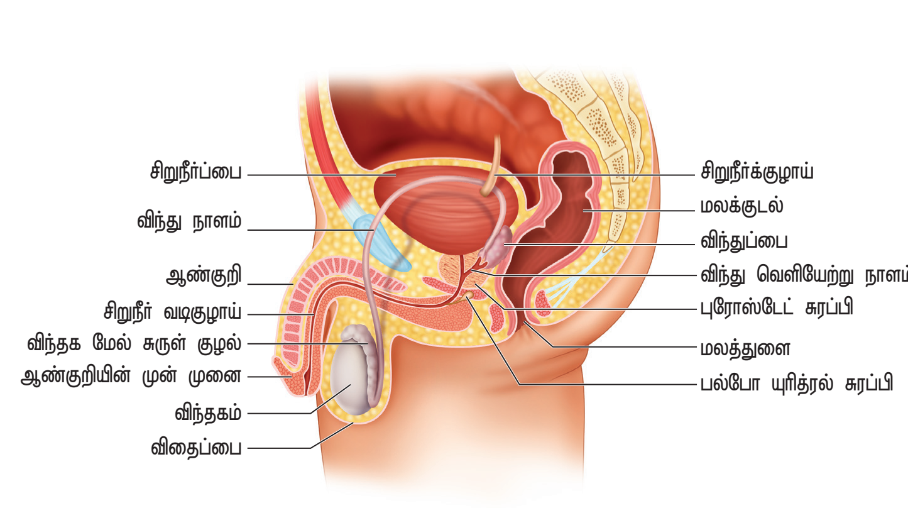
அனுப்புகின்றன.
ரீட்
டெஸ்டிஸ்
என்பது
விந்தக நுண் குழலில் காணும் அடுக்கு
விந்தகத்தின் பின் பகுதியில் அமைந்துள்ள
எபிதீலியம் இருவகை செல்களைக் கொொண்டுள்ளது.
நுண்குழல்களாலான வலைப்பின்னல் போன்ற
அவை, செர்டோலி செல்கள் (Sertoli cells) அல்லது
அமைப்பாகும். இப்பகுதியிலிருந்து வெளியேறும்
செவிலிச்சசெல்கள் (Nurse cells) மற்றும் விந்து
விந்து செல்கள் விந்து நுண் நாளங்கள் வழியாக
உற்பத்தி செல்கள் (Spermatogonic cells) ஆகும். நீண்ட
விந்தக மேல் சுருள் குழலுக்குள் நுழைகின்றன.
பிரமிடு வடிவம் கொொண்ட செர்டோலி செல்கள்
மிகவும் சுருண்டு காணப்படும் இந்த ஒற்றைக்
விந்தணுவாக்கத்தின்
போது
விந்துக்கள்
குழலில் விந்து செல்கள் தற்ககாலிகமாகச் சேமித்து
முதிர்ச்சியடையும் வரை அவற்றிற்கு உணவூட்டம்
வைக்கப்படுகின்றன. இங்ககே அவை செயலியல்
அளிக்கின்றன. மேலும் விந்து செல் உற்பத்தியின்
ரீதியாக
முதிர்ச்சியடைந்து,
அதிக
போது இவை இன்ஹிபின் (Inhibin) என்னும்
இயங்குதிறனையும்,
கருவுறச்
செய்யும்
ஹார்மோனைச் சுரந்து எதிர்மறை பின்னூட்ட
திறனையும்
பெறுகின்றன.
கட்டுப்பாட்டை மேற்கொள்கின்றன. விந்து உற்பத்தி
செல்கள் குன்றல் பகுப்படைந்து முதிர்ந்த விந்து
செல்களாக வேறுபாடு அடைகின்றன.
விந்து நுண் குழல்களைச் சூழ்ந்துள்ள
மெனமையான இணைப்புத்திசுவினுள் இடையீட்டு
செல்கள் (Interstitial cells) அல்லது லீடிக் செல்கள்
(leydig cells) பொொதிந்து காணப்படுகின்றன.
நாளமில்லாச் சுரப்பித் தனமையைப்
பெற்றுள்ள இச்சசெல்கள் பாலூட்டிகளில்
உள்ள
விந்தகங்களின்
முக்கியப்
பண்பபாக விளங்குகிறது. இச்சசெல்கள்
விந்துசெல்லாக்கத்தை்
தொொடங்கும்
ஹார்மோனான
டெஸ்டோஸ்டீரோன்
(Testosterone)
எனும்
ஆண்
இன
ஹார்மோனைச் (Androgens) சுரக்கின்றன.
நோய்த்தடைகாப்புத் திறன்பபெற்ற பிற
செல்களும் காணப்படுகின்றன.
ரீட் டெஸ்டிஸ் (Rete testis), விந்து
நுண் நாளங்கள் (Vasa efferentia), விந்தக
மேல் சுருண்ட குழல் (epididymis) மற்றும்
விந்து நாளங்கள் (Vas deferens) ஆகியவை
விந்தக மேல் சுருண்ட குழலின் முடிவுப்பகுதி
விந்து நாளத்திற்குள் திறக்கிறது. அங்கு விந்துப்பை
நாளத்துடன் (Duct of seminal vesicle) இணைந்து

CÁc˜‚°ö£Œ
CÁc˜Š¬ð
M‰¶Š¬ð
¹«ó£v«ì† ²óŠH
ð™«ð£&»Kˆó™ ²óŠH
M‰¶ ï£÷‹
M‰îè «ñ™
²¼œ °ö™
݇°PJ¡
º¡ º¬ù
M¬îŠ¬ð
M‰îè‹

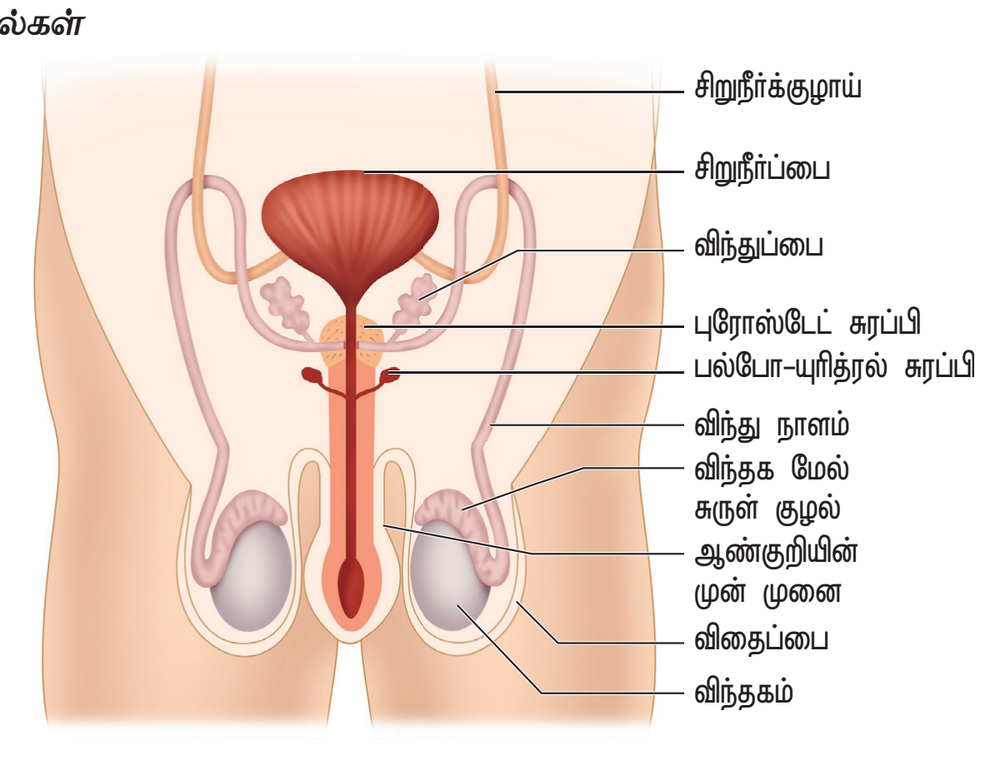

Þóˆî‚°ö™èœ
ñŸÁ‹ ïó‹¹èœ
M‰¶ ï£÷‹
âH®®Iv

(v
தக ேம  cr  °ö™)

g† ªìv®v
M‰¶ ¸‡ ï£÷‹
®ÎQè£ Ü™¹TQò£
®Î¹ôv ªó‚ìv

(v
t ேந  n  கா வா )

M‰îè ¸‡ °ö™èœ
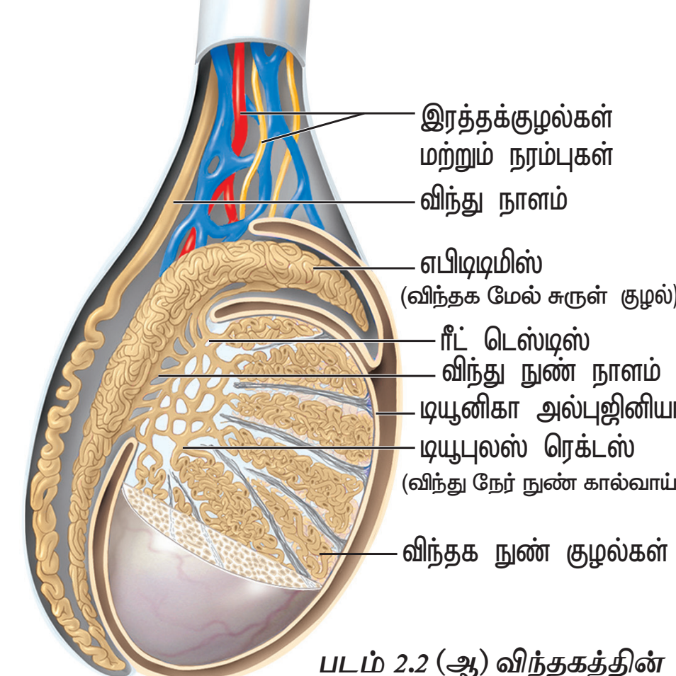
உட்புறத் தோற்றம்

சுரப்பிகள்
காணப்படுகின்றன.
இவை
வழவழப்பான உயவுப் பொொருளைச் சுரக்கின்றன.
புரோஸ்டடேட் சுரப்பியானது சிறுநீர்ப்பையின்
அடியில்,
சிறுநீர்
வடிகுழாயைச்
சூழ்ந்தமைந்துள்ளது.
இது
இலேசான
அமிலத்தனமை கொொண்ட திரவத்தைச் சுரக்கிறது.
இத்திரவத்தில் சிட்ரரேட், பலவித நொொதிகள்
மற்றும் புரோஸ்டடேட் சுரப்பிக்கே உரிய குறிப்பிட்ட
ஆன்டிஜென்கள் ஆகியவை காணப்படுகின்றன.
விந்துப்பைகள், புரோஸ்டடேட் சுரப்பி மற்றும்
பல்போயுரித்ரல் சுரப்பிகளிலிருந்து சுரக்கும்
விந்துக்கள் மற்றும் செமினல் பிளாஸ்மமா
ஆகியவற்றைக் கொொண்ட பால் போன்ற வெணமை
நிற திரவமே ‘விந்து திரவம்’ (Semen or Seminal fluid)
எனப்படும். இது விந்து செல்களைக் கடத்தும்
ஊடகமாகவும்,
உணவூட்டமளிப்பதற்கும்
பயன்படுகிறது. மேலும், விந்து செல்களைப்
பாதுகாப்பிற்கும், அவற்றின் இயக்கத்திற்கும்
தேவையான
வேதிப்பொருட்களையும்
கொொண்டுள்ளது.

விந்து
உந்து
நாளத்தை
(Ejaculatory
duct)
உருவாக்குகிறது. விந்து உந்து நாளமானது
புரோஸ்டடேட் சுரப்பியை ஊடுருவிச் சென்று சிறுநீர்
வடிகுழாயில் (Urethra) திறக்கிறது. இது ஆண்
இனப்பபெருக்க மண்டலத்தின் முடிவுப் பகுதி
ஆகும். இதன் மூலம் வெவ்வேறு நேரங்களில்
சிறுநீர் மற்றும் விந்து திரவங்கள் தனித்தனியாக
வெளியேறுகின்றன.
சிறுநீர்
வடிகுழாய்
சிறுநீர்ப்பையில் தொொடங்கி, ஆண் குறி (Penis)
வழியாகச் சென்று அதன் நுனியில் அமைந்துள்ள
சிறுநீர்ப் புறத்துவாரத்தின் (Urethral meatus) வழியாக
வெளியில் திறக்கிறது.

ஆண்குறி (Penis) என்பது ஆணின் கலவி
உறுப்பாகச் செயல்படும் புற இனப்பபெருக்க
உறுப்பாகும்.
இது
விறைப்புத்தனமைக்கு
உதவிபுரியும்
சிறப்புவகைத்
திசுக்களால்
ஆக்கப்படுள்ளதால்
விந்து
உள்ளேற்றம்
எளிதாகின்றது.
ஆண்குறியின்
பருத்த
முனைப்பகுதி கிளான்ஸ் பீனிஸ் எனப்படும். இது
நுனித்தோல் (Fore skin) அல்லது முனைத்தோல்
(Prepuce)
என்ற
தளர்வவான
தோலால்
மூடப்பட்டுள்ளது.

ஆண் இனப்பபெருக்க மண்டலத்தில் ஓரிணை
விந்துப்பைகளும் (Seminal vesicles), கௌப்பர்
சுரப்பிகள் (Cowper's gland) என அழைக்கப்படும்
ஓரிணை பல்போயுரித்ரல் (Bulbourethral gland)
சுரப்பிகளும் மற்றும் ஒற்றை புரோஸ்டடேட்
சுரப்பியும் (Prostate gland) துணை சுரப்பிகளாக
உள்ளன. விந்துப்பைகள் ‘செமினல் பிளாஸ்மமா’
(Seminal plasma) என்னும் காரத்தனமையுள்ள
திரவத்தைச்
சுரக்கின்றன.
இத்திரவத்தில்
ஃப்ரக்டோஸ்,
அஸ்ககார்பிக்
அமிலம்,
புரோஸ்டகிளான்டின்கள்
மற்றும்
விந்து
திரவத்தை
உறைய
வைக்கும்
நொொதியான
‘வெஸிகுலேஸ்’
(Vesiculase)
போன்றவை
காணப்படுகின்றன.
இந்நொதி, விந்து செல்
இயக்கத்தை துரிதப்படுத்துகிறது. புரோஸ்டடேட்
சுரப்பியின்
கீழ்ப்புறமாக
பல்போயுரிதரல்

ஆண்
இனப்பபெருக்க
மண்டலத்தைவிட
சிக்கலான அமைப்பாக பெண் இனப்பபெருக்க
மண்டலம் உள்ளது. ஏனெனில், இனச்சசெல்
உருவாக்கம் தவிர வளர்கருவை உணவூட்டி
பராமரிக்க வேண்டிய பணியும் இவ்வமைப்புக்கு
உள்ளது.
ஓரிணை அண்டகங்கள் (Ovaries),
ஓரிணை அண்ட நாளங்கள் (Oviducts), கருப்பை
(Uterus), கருப்பை வாய் (Cervix), பெண் கலவிக்
கால்வவாய் (Vagina) மற்றும் இடுப்புப் பகுதியில்
அமைந்துள்ள
புற
இனப்பபெருக்க
உறுப்பு/
பெண்குறி (Vulva)போன்றவற்றை உள்ளடக்கியது
பெண் இனப்பபெருக்க மண்டலமாகும் (படம் 2.3)
(அ). இவையும் பால் சுரப்பிகளும் இணைந்து
அண்டம்
வெளியீடு,
கருவுறுதல்,
கர்ப்பம்,
மகப்பேறு மற்றும் குழந்ததை பராமரிப்பு போன்ற
செயல்பபாடுகளுக்கு அமைப்பு ரீதியாகவும் செயல்
ரீதியாகவும் ஆதரவளிக்கின்றன.

ʞnŽÒf
’Ø p
¾kÎÊo

škHj(Ê~

ʞnŽÒ

ʞnŽÒ 
× pn Ғ+
ÓÖf’Î{

(£HznŽÒ
(£Hz
א’Ø p
”Ó0
(5Ð}

ÊÖ2f
Ê {× p
ÓÖl˜× Õo

Ò0Ð}

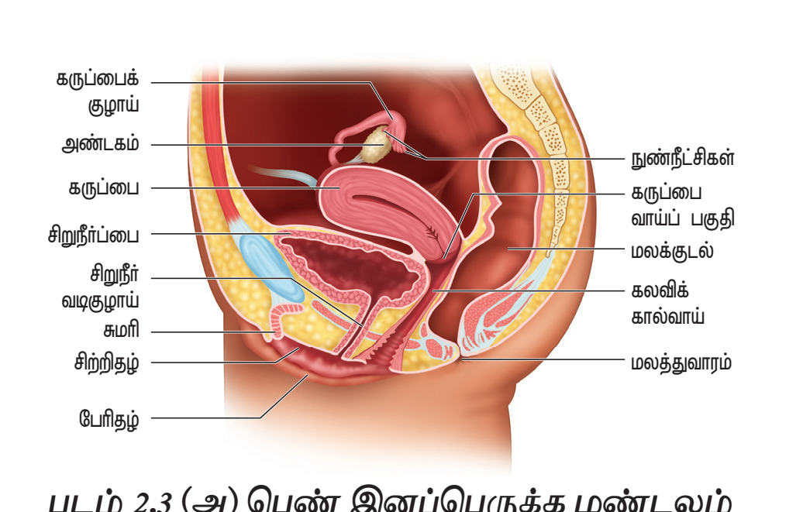
– இடுப்புப் பகுதித் தோற்றம்
பெண் இனச்சசெல்லான ‘அண்ட செல்லை’
உருவாக்கும் உறுப்பான அண்டகங்கள்ததான்
பெண் பாலுறுப்புகளுள் முதனமையானதாகும்.
அடிவயிற்றின்
இரண்டு
பக்கங்களிலும்
பக்கத்திற்கு
ஒன்றறாக
அண்டகங்கள்
அமைந்துள்ளன. அண்டகம் 2 முதல் 4 செ.மீ நீளம்
கொொண்ட நீள் வட்ட அமைப்பாகும். ஒவ்வொரு
அண்டகமும் மெல்லிய கனசதுர வடிவ எபிதீலிய
செல்களால் ஆன இனச்சசெல் எபிதீலியத்தினால்
(Germinal Epithelium) சூழப்பட்டுள்ளது. இதற்குள்
அமைந்த அண்டகப் பகுதி ‘அண்டக இழைய
வலை’ (Ovarian stroma) ஆகும். இந்த இழைய வலை
வெளிப்புற புறணி (கார்டடெக்ஸ்) மற்றும் உட்புற
மெடுல்லா ஆகிய பகுதிகளைக் கொொண்டுள்ளது.
இனச்சசெல்
எபிதீலியத்தின்
அடிப்பகுதியில்
‘டியூனிகா அல்புஜீனியா’ (Tunica albuginea) எனும்
அடர்த்தியான இணைப்புதிசு உள்ளது. பல்வவேறு
வளர்ச்சி நிலைகளில் அண்டக நுண்பபை செல்கள்
காணப்படுவதால்
கார்டடெக்ஸ்
பகுதியானது
அடர்த்தியாகவும், துகள்களை உடைய அமைப்பு
போன்றும் தோற்றமளிக்கிறது. அபிரிமிதமான
இரத்தக் குழல்களையும், நிணநீர் நாளங்களையும்
நரம்பிழைகளையும்
கொொண்ட
தளர்வவான
இணைப்புத்
திசுவால்
மெடுல்லா
பகுதி
ஆக்கப்பட்டுள்ளது. ‘மீசோவேரியம்’ (mesovarium)
எனும்
தசை
நாரினால்
இடுப்புச் சுவர்ப் பகுதியுடனும்
கருப்பையுடனும் அண்டகம்
இணைக்கப்பட்டுள்ளது.
ஃ பெல்லோ ப் பி ய ன்
நாளங்கள்,
(கருப்பை
நாளங்கள் அல்லது அண்ட
நாளங்கள்), கருப்பை மற்றும்
கலவிக் கால்வவாய் ஆகியவை
பெண்
இனப்பபெருக்க
®g‚¸{¼f.½j
ƒ¼‚½{¼f.½j
à.¼f.½j

மண்டலத்தின் துணை உறுப்புகளாகும். ஒவ்வொரு
ஃபெல்லோப்பியன்
குழாயும்
அண்டக
விளிம்பிலிருந்து
கருப்பை
வரை
நீண்டு
காணப்படுகிறது. ஃபெல்லோப்பியன் குழாயின்
முன் முனைப்பகுதியில் புனல் வடிவிலான
‘இன்ஃபன்டிபுலம்’ (புனலுரு) என்னும் அமைப்பு
காணப்படுகிறது. புனலுருவின் விளிம்பில் விரல்
போன்ற ‘நுண் நீட்சிகள்’ (fimbriae), அமைந்துள்ளன.
அவை அண்ட வெளியீட்டின் போது (Ovulation)
விடுபடும் அண்டத்தை் தன்னை நோக்கி
இழுப்பதற்குப் பயன்படுகின்றன.
புனலுருவின்
வாய்ப்பகுதி
அகன்று
ஆம்புல்லா
எனும்
மையப்பகுதியாக
விரிவடைகிறது.
ஃபெல்லோபியன் குழாயின் கடைசிப் பகுதியான
இஸ்த்மஸ் (Isthmus) குட்டையானதாகவும் தடித்த
சுவரைக் கொொண்டும் காணப்படுகிறது. இது
ஆம்புல்லாவையும் புனலுருவையும் கருப்பையுடன்
இணைக்கிறது (படம் 2.3 (அ) & 2.3 (ஆ).
உள்ளீடற்ற, தசையாலான தடித்த சுவரைக்
கொொண்ட,
இரத்தக்குழாய்கள்
நிறைந்த,
தலைகீழான
பேரிக்காய்
வடிவத்துடன்
காணப்படும் உறுப்பான கருப்பை, இடுப்பு
குழியினுள் சிறுநீர்ப்பைக்கும் மலக்குடலுக்கும்
இடையில் அமைந்துள்ளது.
கருப்பையின்
பெரும்பபாலான பகுதி ‘உடல்’ என்றும் அதன்
மேற்புற கோள வடிவப் பகுதி (குவிந்த பகுதி)
‘குவிமுகடு’ (fundus) என்றும் அழைக்கப்படும்.
கருப்பையானது ஒரு குறுகிய கருப்பை வாயின்
(Cervix)
வழியாக
கலவிக்
கால்வவாயினுள்
திறக்கிறது.
கருப்பை வாயினுள் காணப்படும்
வெற்றிடம் ‘கருப்பை வாய் கால்வவாய்’ (Cervical canal)
எனப்படும். இக்கால்வவாய் கலவிக்கால்வவாயினுள்
புறத்துளை
(External
orifice)
வழியாகவும்
கருப்பையினுள்
உட்துளை
(Internal
orifice)
வழியாகவும் திறக்கிறது. கருப்பை வாய் கால்வவாய்,
கலவிக்கால்வவாய் இரண்டும் சேர்த்து பிறப்புக்
கால்வவாய் (birth canal) எனப்படும்.
´Ù΃à

ßYh¼Y
ªg¸»{Â
„ÛÎ à†)

³àt‚¿{Î+½y
»{Âj

ØÄÚÙ

ŒgFf&´v
´Ù΃à À{kÎà†)
´Ù΃à À{kb ´{tÀ{k
´¿0b ´{tÀ{k

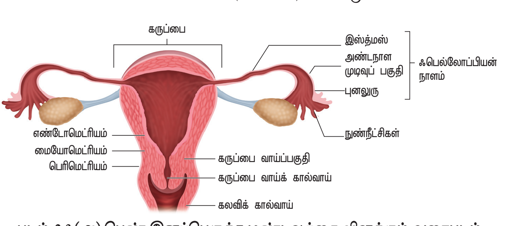

கருப்பைச்
சுவரானது
மூன்று
அடுக்கு
திசுக்களால் ஆனது. அவை, வெளிப்புற மெல்லிய
அடுக்கான ‘பெரிமெட்ரியம்’ (Perimetrium) என்னும்
ஊனீர் சவ்வு, தசையாலான தடித்த நடு அடுக்கான
‘மையோமெட்ரியம்’ (Myometrium) மற்றும் உட்புற
சுரப்பு அடுக்கான ‘என்டோமெட்ரியம்’ (Endometrium)
ஆகும்.
மாதவிடாய்
சுழற்சியின்போது
என்டோமெட்ரியம் பல சுழற்சி மாற்றங்களுக்கு
உட்படுகிறது. குழந்ததை பிறப்பின்போது வலுவான
சுருக்கங்களை ஏற்படுத்துவதில் மையோமெட்ரியம்
ஈடுபடுகிறது.
கருப்பை வாய்ப்பகுதியிலிருந்து வெளிப்புறம்
வரை நீண்டுள்ள தசைநாரிழைகளாலான பெரிய
குழாய் ‘கலவிக் கால்வவாய்’ (Vagina) எனப்படும்.
இதுவே, பெண் கலவி உறுப்பாகும். பேரிதழ்கள்
(Labia majora), சிற்றிதழ்கள் (Labia minora), கன்னித்திரை
(hymen) மற்றும் சுமரி (Clitoris) ஆகியவற்றை
உள்ளடக்கிய புற இனப்பபெருக்க உறுப்பு (Vulva)
கலவிக்கால்வவாய்க்கு வெளியே காணப்படுகிறது.
கலவிக்கால்வவாய்த்
திறப்பின்
பின்புறமாக
வலது மற்றும் இடது புறங்களில் அமைந்துள்ள
சுரப்பிகள் ‘பர்தத்தோலின் சுரப்பிகள்’ (Bartholin’s
glands) (பெரிய வெஸ்டிபியூலார் சுரப்பிகள்) ஆகும்.
இவை வழவழப்பான கோழை திரவத்தை உயவுப்
பொொருளாக கலவிக் கால்வவாயினுள் சுரக்கிறது.
இவை ஆண்களில் உள்ள பல்போயுரித்ரல்
சுரப்பிகளுக்கு ஒப்பானவை. கலவிக்கால்வவாயின்
முன்புறச்சுவரிலும் மற்றும் சிறுநீர் வடிகுழாயின்
முனையைச் சூழ்ந்தும் காணப்படும் மற்றொரு
சுரப்பி ஸ்கீன்ஸ் சுரப்பி (Skene’s gland) ஆகும். இதுவும்
உயவுத் தனமையுள்ள திரவத்தைச் சுரக்கின்றது.
இவை
செயற்பபாட்டில்,
ஆண்களில்
உள்ள
புரோஸ்டடேட் சுரப்பிக்கு ஒப்பானவை.

மனித உடலில் உள்ள
வலுவான
தசைகளில்
பெண்ணின்
உடலில்
உள்ள
கருப்பைத்
தசையும் ஒன்றறாகும்.
கலவிக்கால்வவாயின் வெளிப்புறத் துளையின்
ஒரு பகுதியானது ஒரு மெல்லிய வளைய
வடிவத்திசுவினால் மூடப்பட்டுள்ளது.
இது
கன்னித்திரை எனப்படும். பெரும்பபாலும் முதல்
கலவியின் போது இது கிழிந்து விடும். இருப்பினும்
சில பெண்களில் இது சிதைவுறாமலும் இருக்கலாம்.
கீழே விழுதல், குலுங்கல், மிதிவண்டி ஓட்டுதல்,

குதிரைச் சவாரி செய்தல் போன்ற உடல் சார்ந்த
நிகழ்வுகளினாலும் பெண்களின் கன்னித்திரைச்
சவ்வு பாதிக்கப்படலாம். எனவே, கன்னித்திரை
ஒரு
பெண்ணின்
கன்னித்தனமையை
எடுத்துக்காட்டுவதாக அமையாது.

º{c† ºƒ¶ »{s
ª„΂à{Y )Ö
´ŠÎØ
Àf¸ À„À
*Ã,Î à†)
à{t ´{jØ
à{t ¬iŠ »{Âj
à{t †1´v
à{t »{Âj
Ö¾ÎØ Œg†Át´ƒÂb
´{g¸ Œg ´ŠÎØ
à{t Œg†Át´v

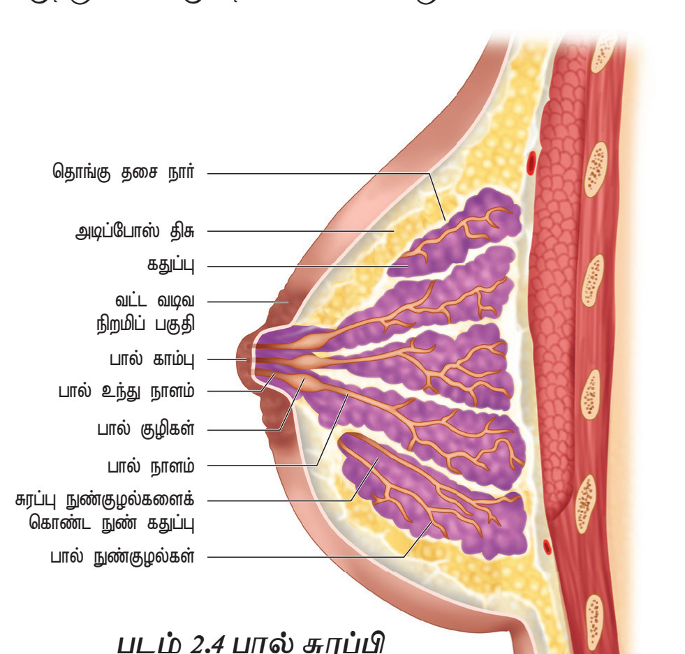
ஆண், பெண் இருபாலரிலும் காணப்படும் பால்
சுரப்பிகள் (Mammary glands) மாறுபாடடைந்த
வியர்வவைச் சுரப்பிகள் ஆகும். ஆண்களில் இவை
அளவில் குறைந்து செயலற்ற எச்ச உறுப்பாகவும்,
பெண்களில்
இயல்பபான,
செயல்படும்
உறுப்பாகவும் காணப்படுகிறது. மார்புப் பகுதியில்
ஓரிணை பால் சுரப்பிகள் அமைந்துள்ளன.
ஒவ்வொரு பால் சுரப்பியிலும் சுரப்பித் திசுக்களும்
வேறுபட்ட அளவுகளில் கொொழுப்பும் உள்ளன.
மார்பகங்களின்
மத்தியில்
பால்ககாம்பு
அமைந்துள்ளனது.
இதனைச்
சுற்றி
நிறமிகளாலான ஏரியோலா என்னும் வட்ட வடிவ
பரப்பு காணப்படுகிறது. ஏரியோலர் பகுதியின்
மேற்பரப்பில் ஏரியோலார் சுரப்பிகள் எனப்படும்
பல எண்ணணெய்ச் சுரப்பிகள் உள்ளன. இவை
பால்ககாம்பின் மேற்புறத்தில் உள்ள தோலில்
வெடிப்புகள்
ஏற்படுவதைத்
தடுக்கின்றன.
ஒவ்வொரு பால் சுரப்பியின் உட்புறத்திலும்
கொொழுப்பு
மற்றும்
இணைப்புத்திசுக்களால்
பிரிக்கப்பட்ட 2 முதல் 25 கதுப்புகள் (lobes)
காணப்படுகின்றன
(படம்
2.4).
ஒவ்வொரு
கதுப்பிலும் பல நுண் கதுப்புகள் உள்ளன. இவை
ஒவ்வொன்றிலும்
எபிதீலிய
செல்களால்
சூழப்பட்ட பல மீச்சிறு கதுப்புகள் (acini or alveoli)
உள்ளன. இச்சசெல்கள் பாலைச் சுரக்கின்றன.
மீச்சிறு கதுப்புகள், பால் நுண் குழல்களுக்குள்

(Mammary tubules) திறக்கின்றன.
ஒவ்வொரு
கதுப்பிலிருந்தும் வரும் பால் நுண்குழல்கள்
ஒன்றிணைந்து பால் நாளமாக (Mammary duct)
மாறுகின்றன. பல பால் நாளங்கள் ஒன்று கூடி
அகன்ற பால் விரிமுனைகளை (Mammary ampulla)
உருவாக்குகின்றன.
இவை பால் காம்பில்
காணப்படும்
பால்
உந்து
நாளங்களோடு
(Lactiferous duct) இணைக்கப்பட்டுள்ளன.
பால்
காம்பின் கீழ் ஒவ்வொரு பால் உந்து நாளமும்
பால்குழி (lactiferous sinus) யாக விரிவடைகின்றது.
இது பாலைத் தேக்கி வைக்கும் இடமாகச்
செயல்படுகிறது. ஒவ்வொரு பால் உந்து நாளமும்
பால் காம்பின் நுனிப்பரப்பில் உள்ள நுண்ணிய
துளை
வழியே
தனித்தனியாக
வெளியே
திறக்கின்றன.
பெண்களில், இயல்பபான மார்பக வளர்ச்சி
பூப்பபெய்துதலில் தொொடங்கி ஒவ்வொரு மாதவிடாய்
சுழற்சியின்
போதும்
முன்னேற்றமடைகிறது.
கருவுறாத பெண்களில் பால் சுரப்பிகள் சரியாக
வளர்ச்சியடைந்திருப்பதில்லை. மேலும் மார்பக
அளவானது அதில் படிந்துள்ள கொொழுப்புப்
படிவுகளைப் பொொறுத்து அமைகிறது. மார்பகத்தின்
அளவிற்கும் பால் சுரப்புத் திறனுக்கும் எவ்வித
தொொடர்பும் இல்லை.

## 2.2  இனச்சசெல் உருவாக்கம்

(Gametogenesis)

நுண்குழலின்
உட்பகுதியில்
முதிராத
ஸ்பபெர்மட்டோகோனியா அல்லது விந்து தாய்
செல்களாக (Sperm mother cells) உருப்பபெறுகின்றன
(படம் 2.6) (அ). இச்சசெல்களில் பூப்பபெய்துதலின்
போது தொொடங்குகின்ற மறைமுக செல் பிரிவு
வாழ்நநாள் முழுவதும் தொொடர்கின்றது.
vªð˜ñ£®†
M‰¶
 ªê™
ªê˜«ì£L
ªê™èœ
Þ¬ìf†´„
ªê™

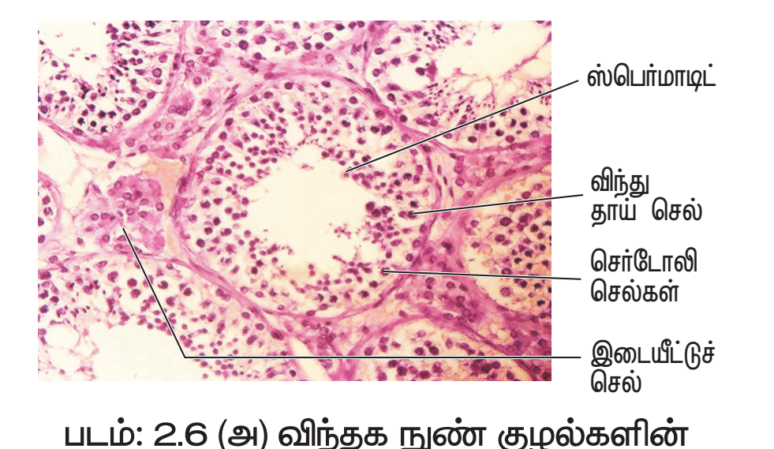
குறுக்கு வெட்டுத் தோற்றம்

விந்து செல்லாக்கத்தின் முதல் நிலையில்,
விந்து தாய் செல்கள் செர்டோலி செல்களுக்கு
ஊடாக
நகர்ந்து,
விந்து
நுண்குழல்களின்
உள்ளீடற்ற மையப்பகுதியை நோக்கி செல்கின்றன.
அங்கு அவை மாறுபாடடைந்து, அளவில் பெரிதாகி
முதல்நிலை விந்து செல்லாக (Primary spermatocyte)
உருப்பபெறுகின்றன. இச்சசெல்கள் 23 இணை
அதாவது 46 குரோமோசோம்களைக் கொொண்ட
இரட்டை மய செல்களாகும். இச்சசெல்களில் சில,
முதல் குன்றல் பகுப்பின் விளைவாக இரண்டடாகப்
பிரிந்து இரண்டடாம் நிலை விந்து செல்களை
(Secondary spermatocyte) உருவாக்குகின்றன. இவை
23 குரோமோசோம்களை மட்டுமே கொொண்டுள்ள
ஒற்றைமய செல்களாகும்.
இரண்டடாம் நிலை

பாலினப்பபெருக்க உயிரிகளில் முதல்நிலை
பாலுறுப்புகளிலிருந்து
விந்துக்களும்
அண்ட
செல்லும் உருவாகும் நிகழ்ச்சி இனச்சசெல்
உருவாக்கம் எனப்படும். இச்சசெயல்பபாட்டில்
0iŠ ¶t ¬ÙÀ{b´j
குன்றல் பகுப்பு முக்கியப்பங்கு வகிக்கிறது
 Q
0iŠ º{k ¶t
(படம் 2.5).

விந்து செல் உருவாக்கம்
(Seminiferous tubuler)
விந்தகங்களின்
விந்தக
நுண்
குழல்களில் (Semiferous tubules) வரிசையாக
நடைபெறும்
செயல்களினால்
ஆண்
இனச்சசெல்கள்
அல்லது
விந்துக்கள்
உற்பத்தி
செய்யப்படுதல்
விந்து
செல்உருவாக்கம்
எனப்படும்.
விந்து
வளர்ச்சியின் போது கரு மூல இனச்
செல்கள்
(Primordial
germ
cells)
விந்தகங்களுக்கு நகர்ந்து சென்று, விந்தக
ªg¸ ¶t ¬ÙÀ{b´j
ÀÂs´Ù
À{ubƒ´

 Q

¼ƒÃ´ ¶t +.ºt

¼ƒÃ´ ¶t +.ºt
ºt*ƒ¿
0iŠ ¶t

 Q

 Q

†yÃt à†ÎØ ,
ß¾g¸{j *ƒ¿
0iŠ ¶t

Q

ºt
ŠÙÀ Q
¬‘ÎØ

Q

†yÃt à†ÎØ ,,
Yàs¼{„f

Q

Q

Q

Q

Yàs,‚½{Ç4&Y

)siº
0iŠ ¶t

Q

Q

ªg¸ º{k ¶t

Q

Q

ºt *ƒ¿
ªg¸ ¶t
ªg¸j 0ˆàˆºÚb† yØ
†yÃt à†ÎØ , *ƒÃÀƒ¸ºt

Q

ß¾g¸{j *ƒ¿
ªg¸ ¶t

).
ßÄ΁àÙb´
´{¿j
ß¾g¸{j
ŠÙÀ Q
¬‘ÎØ

†yÃt à†ÎØ ,,
*ƒÃÀƒ¸ºt
Q

)siº
ªg¸ ¶t

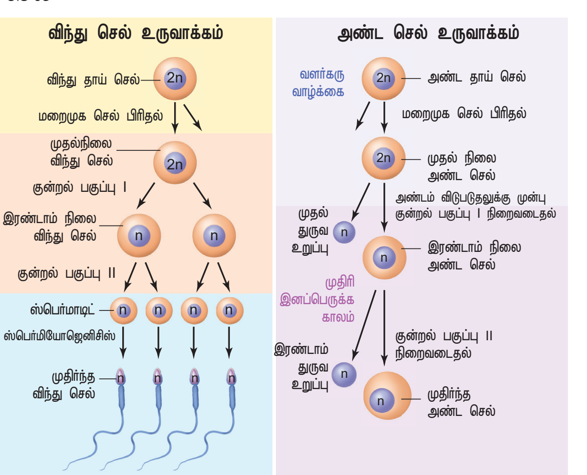

விந்து செல்கள் இரண்டடாம் குன்றல் பகுப்பின்
இறுதியில் நான்கு ஒற்றைமய ஸ்பபெர்மமாடிட்களை
(Spermatid) உருவாக்குகின்றன. இவ்வாறு உருவான
ஸ்பபெர்மமாடிட்கள் முதிர்ந்த முழுமையான விந்து
செல்லாக மாறும் செயல் ‘ஸ்பபெர்மியோஜெனிசிஸ்’
(Spermiogenesis) எனப்படும்.
இறுதியாக, விந்து
நுண்குழல்களின் உட்பகுதியில் முதிர்ந்த விந்து
செல்கள் விடுவிக்கப்படும் நிகழ்ச்சிக்கு ‘விந்து
செல் வெளியேற்றம்’ (Spermiation) என்று பெயர்.
விந்து செல்உருவாக்க நிகழ்ச்சி முழுவதுமாக
நடந்து முடிவதற்கு 64 நாட்கள் ஆகின்றன.
எல்லாக் காலங்களிலும் விந்து நுண் குழல்களின்
பல்வவேறு பகுதிகளிலும் விந்து செல்உருவாக்க
நிகழ்வின்
பல்வவேறு
வளர்ச்சி
நிலைகள்
காணப்படுகின்றன (படம் 2.6) (ஆ). ஒவ்வொரு
நாளும் ஏறத்தாழ ஒரே எண்ணிக்கையில் அதாவது
200 மில்லியன் என்னும் வீதத்தில் விந்து செல்கள்
உற்பத்தி ஆகிக் கொொண்டடேயிருக்கின்றன.
0iŠ
º{k ¶t´v
¶s‚¸{/
¶t´v
ºt *ƒ¿
0iŠ ¶t

ß¾g¸{j *ƒ¿
0iŠ ¶t
Yàs¼{„f

)siº
0iŠ ¶t

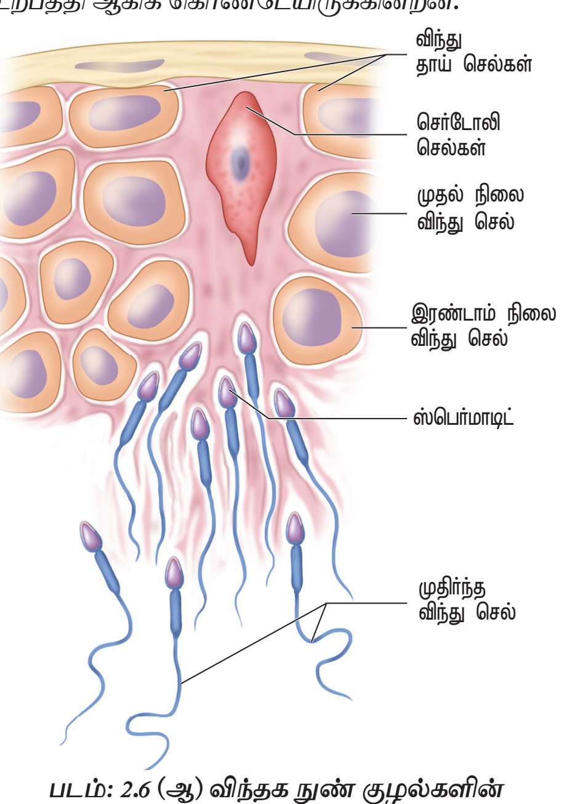
பெரிதாக்கப்பட்ட தோற்றம்
பூப்பபெய்தும்
வயதில்
ஹைபோதலாமஸ்
சுரக்கும்
கொொனடோடிரோபின்
வெளிவிடு
ஹார்மோனின் (GnRH) அளவு அதிகரிக்கும்
போது, விந்து செல்லாக்க நிகழ்ச்சி தொொடங்குகிறது.
முன் பிட்யூட்டரி மீது GnRH செயல்பட்டு அதனை
‘நுண்பபைசெல்
தூண்டும் ஹார்மோன்’(FSH)
மற்றும் லூட்டினைசிங் ஹார்மோன் (LH) ஆகிய
இரண்டு கொொனாடோட்ரோபின்களை வெளியிடத்

தூண்டுகிறது.
FSH விந்தக வளர்ச்சியைத்
தூண்டுவதுடன் செர்டோலி செல்களிலிருந்து
‘ஆன்டட்ரரோஜன் இணைவுப்புரத’ (Androgen binding
protein) உற்பத்தியையும் அதிகரிக்கச் செய்து
ஸ்பபெர்மியோஜெனிசிஸ்
நிகழ்ச்சி
நடைபெற
உதவுகிறது. LH, இடையீட்டு செல்கள் (Leydig cells)
மீது
செயல்பட்டு
டெஸ்டோஸ்டீரோன்
உற்பத்தியைத் தூண்டுவதன் மூலம் விந்து
செல்உருவாக்க நிகழ்ச்சியைத் தூண்டுகிறது.

மனித விந்து செல்லின் அமைப்பு
கசையிழை கொொண்ட, நகரும் தனமையுடைய
நுண்ணிய செல்களாக மனித விந்தணுக்கள்
உள்ளன (படம் 2.7). விந்து செல்லின் முழு உடல்
பகுதியும் பிளாஸ்மமா சவ்வினால் சூழப்பட்டு தலை,
கழுத்து, நடுத்துண்டு மற்றும் வால் எனும் நான்கு
பகுதிகளுடன்
காணப்படுகிறது.
தலையில்
அக்ரோசோம் (Acrosome) மற்றும் உட்கரு ஆகிய
இரண்டு பகுதிகள் உள்ளன. அக்ரோசோம், விந்து
செல்லின் தலைப்பகுதியில் உட்கருவிற்கு மேல்
ஒரு தொொப்பி போன்று கூரமையான அமைப்பாக
அமைந்துள்ளது. இது ஸ்பபெர்மமாட்டிடுகளின்
கோல்ககை
உறுப்புகளிலிருந்து
உருவாகிறது.
கருவுறுதலின்போது அண்ட செல்லின் உறைகளை
துளைத்துச் செல்ல உதவி புரியும் திறன் கொொண்ட
விந்து-லைசின்
(Sperm-lysin)
எனப்படும்
புரதச்சசெரிப்பு நொொதியான ‘ஹயலூரோனிடேஸ்’
(Hyaluronidase) என்னும் நொொதியை அக்ரோசோம்
தன்னுள்ளே
கொொண்டுள்ளது.
உட்கரு,
தட்டையான முட்டை வடிவம் கொொண்டதாகும்.
விந்து செல்லின் தலைக்கும் நடுப்பகுதிக்கும்
இடையில்
உள்ள
மிகவும்
குட்டையான
Ü‚«ó£«ê£‹
î¬ô
பகுதி
கழுத்து
à†è¼
எனப்படும்.
இதில்
迈¶
உட்கருவின்
அருகில்
அமைந்த
‘அணமை
ï´ˆ
¶‡´
செ ன் ட் ரி யோ லு ம் ’
அதிலிருந்து
சற்று ¬ñ†«ì£è£‡†Kò£
தொொலைவில் அமைந்த
õ£™
‘ சே ய் மை
செ ன் ட் ரி யோ லு ம் ’
காண ப் ்ப டு கி ற து .
பி ள வி ப் ்பபெ ரு க லி ன்
போது கருமுட்டையின்
முதல் பிளவில் அணமை 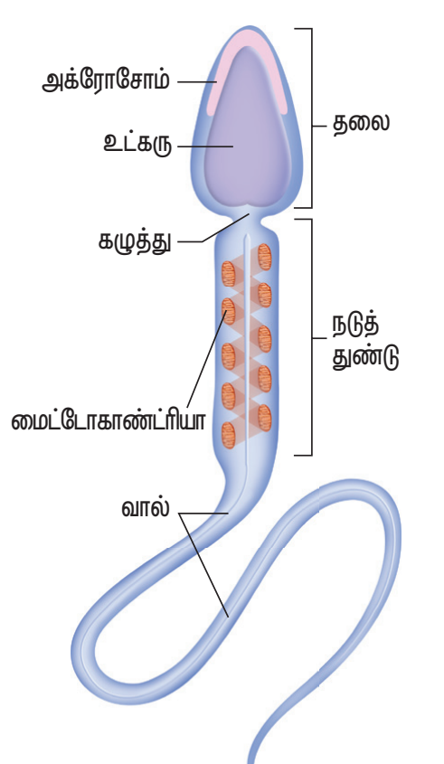
செல்லின் அமைப்பு
சென்ட்ரியோல்
பங்கு

வகிக்கிறது. விந்து செல்லின் அச்சு இழையை
உருவாக்க
சேயமை
சென்ட்ரியோல்
பயன்படுகிறது. விந்து செல்லின் நடுப்பகுதியில்
அச்சு
இழையைச்
சற்றி
திருகுபோன்று
மைட்டோகாண்ட்ரியங்கள்
அமைந்துள்ளன.
இதற்கு ‘மைட்டோகான்ட்ரியல் திருகு’ அல்லது
‘நெபன்ககென்’ (Nebenkern) என்று பெயர். இது, விந்து
நகர்வுக்குத் தேவையான ஆற்றலை ATP மூலக்கூறு
வடிவில் உற்பத்தி செய்கிறது. ஒரு விந்து செல்லின்
நீளமான பகுதி அதன் வால் பகுதி ஆகும். இது
மெல்லிய இழையாக நீண்டு கூரமையாக
முடிவடைந்துள்ளது.
‘ஆக்சோனீம்’ (Axoneme)
எனப்படும் மைய அச்சு இழையையும் அதைச்
சூழ்ந்த
புரோட்டோபிளாச
உறையையும்
கொொண்டதாக வால் பகுதி உள்ளது. வால் பகுதி
சாட்டை
போன்று
இயங்கி
விந்தணுவை
முன்னோக்கி நகரச் செய்கிறது. கலவியின் போது
200 முதல் 300 மில்லியன் விந்து செல்கள்
வெளியேற்றப்படுகின்றன. இவற்றுள் சுமார் 60%
விந்து செல்கள் இயல்பபான வடிவத்துடனும்,
அவற்றில் குறைந்தபட்சம் 40% விந்து செல்களாவது
வீரியமான
நகர்வுத்
தனமையுடனும்
காணப்படுவது இயல்பபான கருவுறுதலுக்கான
தேவையாகும்.

அண்ட செல் உருவாக்கம் (Oogenesis)

பெண் இனப்பபெருக்க முதனமை உறுப்பான
அண்டகங்களிலிருந்து பெண் இனச்சசெல்லான
அண்டம்
(அல்லது)
முட்டை
உருவாகும்
நிகழ்ச்சியே ‘அண்ட செல் உருவாக்கம்’ ஆகும்.
கரு வளர்ச்சியின் போது சிசுவின் அண்டகங்களில்
உள்ள இனச்சசெல் எபிதீலியம் மறைமுகப் பிரிவின்
வழி பிரிந்து இலட்சக்கணக்கான ‘ஊகோனியா’
(Oogonia) எனப்படும் ‘அண்ட தாய் செல்களை’
உற்பத்தி செய்கின்றன. பிறந்த பிறகு குழந்ததையின்
அண்டகங்களில் புதிதாக அண்ட தாய் செல்கள்
தோன்றுவதோ
அல்லது
சேர்க்கப்படுவதோ
இல்லை. அண்ட தாய் செல்கள் குன்றல் பகுப்பு
Iன் முதற்பிரிவு நிலையை (Prophase I) அடைந்து
முதல்நிலை அண்ட செல்களைத் (Primary Oocytes)
தோற்றுவிக்கின்றன.
இச்சசெல்கள்
இந்த
நிலையிலேயே
தற்ககாலிகமாக
நிறுத்தப்படுகின்றன. பின்பு இந்த செல்கள்
ஓரடுக்கு கிரானுலோசா செல்களால் சூழப்பட்டு
முதல்நிலை நுண்பபை செல்களாக (Primary follicles)
மாறுகின்றன படம் 2.8 (அ). பிறப்புக்கும்
பூப்பபெய்துதலுக்கும் இடைப்பட்ட காலத்தில் அதிக

எண்ணிக்கையிலான நுண்பபை செல்கள் சிதைந்து
மறைகின்றன.
எனவே, பூப்பபெய்துதலின்போது
60,000 முதல் 80,000 நுண்பபை செல்கள் மட்டுமே
ஒவ்வொரு அண்டகத்திலும் எஞ்சியுள்ளன.
yÃ{j *ƒ¿ ß¾g¸{j *ƒ¿
Œgƒà ¶t Œgƒà ¶t

ºt*ƒ¿
Œgƒà
¶t

¿
Œgƒà
¶t´v

ß¾hº
»{Âc´v

´{sàY
ªt+´yY

´{sàY
¥f„½j

)siº
$¾{³+½y
Œgƒà ¶t

ß¾g¸{j *ƒ¿
ªg¸ ¶t

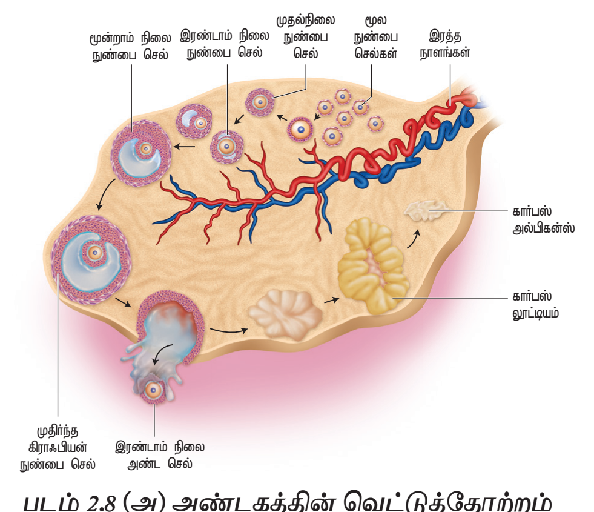
முதல்நிலை நுண்பபை செல்களைச் சுற்றி பல
அடுக்கு கிரானுலோசா செல்களும் புதிதாகத்
தோன்றிய
தீக்கா
என்னும்
அடுக்கும்
காணப்படுகின்றன இவை இரண்டடாம் நிலை
நுண்பபைசெல்களாக
(Secondary
follicles)
உருவாகின்றன. பின்பு, இவற்றினுள் ஆண்ட்ரம்
(Antrum) எனும் திரவம் நிரம்பிய மூன்றறாம் நிலை
நுண்பபைசெல்களாக (Tertiary follicles) மாறுகின்றன.
இந்நிலையில் ‘தீகா’ அடுக்கு ‘வெளிப்புற தீகா’
(Theca externa) மற்றும் ‘உட்புற தீகா’ (Theca interna)
என இரு அடுக்குகளாகத் தம்மை அமைத்துக்
கொொள்கிறது.
இச்சமயத்தில் மூன்றறாம் நிலை
நுண்பபை செல்களின் உள்ளே உள்ள முதல்நிலை
அண்ட செல்கள், வளர்ந்து, குன்றல் பகுப்பு 1ஐ
நிறைவு செய்து இரண்டடாம் நிலை அண்ட
செல்களாக மாறுகின்றன. ஆனால், இப்பகுப்பானது
சமமற்றதாக உள்ளதால் ஒரு பெரிய ஒற்றைமய
இரண்டடாம்நிலை
அண்ட
செல்லும்
(Secondary Oocyte) ஒரு சிறிய ‘முதல் துருவ உறுப்பும்’
(First polar body) உருவாகின்றன. முதல் துருவ
உறுப்பு சிதைவுறுகிறது.
கருவுறுதலின்போது,
இரண்டடாம் நிலை அண்ட செல்லானது குன்றல்
பகுப்பு-IIக்கு உட்பட்டு ஒரு பெரிய அண்ட
செல்லையும் (Ovum) சிறிய இரண்டடாம் துருவ
உறுப்பையும் (second polar body) உருவாக்குகிறது.
முதல் துருவ உறுப்பை் போன்றறே இரண்டடாம்
துருவ உறுப்பும் சிதைவடைகிறது.
மூன்றறாம்

நிலை நுண்பபை செல் முதிர்ந்து ‘கிராஃபியன்
ஃபாலிகிளாக’ அல்லது முதிர்ந்த நுண்பபை
செல்லாக
(mature
follicle)
உருப்பபெறுகிறது.
கருவுறுதல் நிகழாவிட்டால் குன்றல் பகுப்பு-II
நிறைவடையாமல்
அண்டம்
சிதைவுறுகிறது.
எனவே,
பெண்களின்
இனச்சசெல்உருவாக்க
நிகழ்வில், ஒவ்வொரு முதல்நிலை அண்ட
செல்லும்
முதிர்ந்த,
ஒற்றைமய
குரோமோசோம்களைக் கொொண்ட ஒரேயொொரு
அண்டத்தை மட்டுமே உருவாக்குகிறது.
மனித
செல்களில்
மிகச்சிறியவை
விந்து
செ ல் ்க ள ா கு ம்
மிகப்பபெரியவை அண்ட
செல்கள் ஆகும்.

அண்ட செல்லின் அமைப்பு
(Structure of ovum)
மனித அண்ட செல்லானது நுண்ணிய, ஓடற்ற,
கரு உணவு அற்ற தனமையுடைய செல் ஆகும்.
(படம்
2.8(ஆ))
இதன்
சைட்டோபிளாசம்
‘ஊபிளாசம்’ (Ooplasm) என்று அழைக்கப்படும்.
இதனுள் காணப்படும் பெரிய உட்கருவிற்கு
‘வளர்ச்சிப்பை’ (Germinal Vesicle) என்று பெயர்.
அண்ட செல் மூன்று உறைகளைக் கொொண்டது.
மெல்லிய ஒளி ஊடுருவும் ‘விட்டலின் சவ்வு’
(Vitelline membrance) உட்புறத்திலும் தடித்த ‘சோனா
பெலூசிடா’ (Zona pellucida) அடுக்கு நடுப்பதியிலும்
மற்றும் நுண்பபை செல்களால் சூழப்பட்ட தடித்த
‘கரோனா ரேடியேட்டா’ (Corona radiata) உறை
வெளிப்புறத்திலும் அமைந்துள்ளன. விட்டலின்
சவ்வுக்கும் சோனா பெலூசிடாவுக்கும் இடையில்
ஒரு

குறுகிய

‘விட்டலின்

புற

(Perivitelline space) காணப்படுகிறது.

இடைவெளி’

´‚¾{Ä{ ‚¾„‚½f¸{
‚¶{Ä{ à¥&¸{
0f¸/y ¶ÑÛ
¬f´Ù
ßÄd¶t ƒà
ªg¸ ƒ¶f‚¸{+Â{¶j

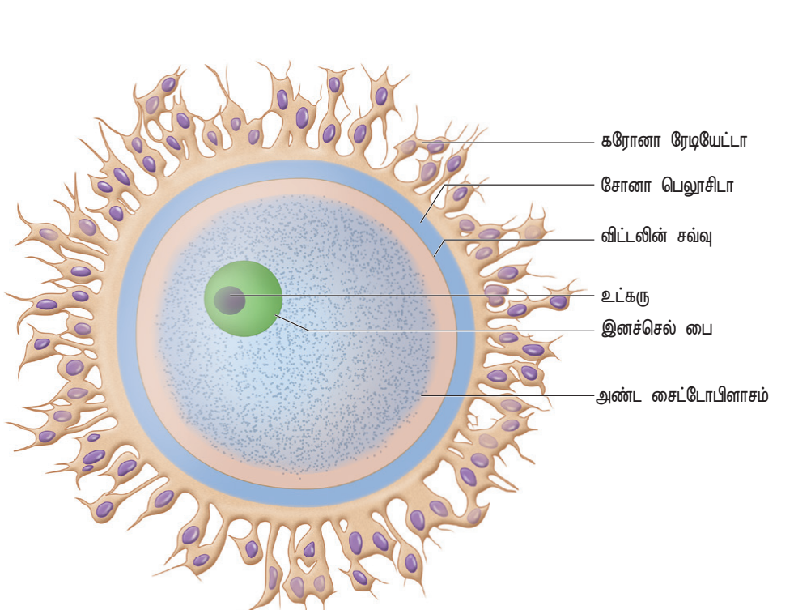
பிறக்கும்
போது
இ ல ட் ்ச க் ்க ண க் ்க கா ன
அண்ட
செல்களை
அண்டகத்தில் கொொண்டு
பிறக்கும்
பெண்ணின்
உடலிலிருந்து மாதவிடாய் நிறைவு வரை
வெறும் 300 முதல் 400 அண்ட செல்கள்
மட்டுமே விடுவிக்கப்படுகிறது.
அதே சமயம் ஆண்கள் தங்களது வாழ்நநாளில்
500 பில்லியனுக்கு அதிகமான விந்தணுக்களை
உற்பத்தி செய்கின்றனர்.

## 2.3  மாதவிடாய் சுழற்சி

(Menstrual Cycle)
பெண்களின்
இனப்பபெருக்க
காலமான
பூப்படைதல் (Puberty/menarche) முதல் மாதவிடாய்
நிறைவு (Menopause) வரை கர்ப்ப காலம் நீங்கலாக
சுமார் 28/29 நாட்களுக்கு ஒரு முறை ‘மாதவிடாய்
சுழற்சி’ அல்லது ‘அண்டக சுழற்சி’ நிகழ்கிறது.
ஒரு மாதவிடாய்க்கும் அடுத்த மாதவிடாய்க்கும்
இடைப்பட்ட
காலத்தில்
கருப்பையின்

அண்டகக் கட்டிகள் (Polycystic Ovary Syndrome [PCOS])
பெண்களின் இனப்பபெருக்க வயதில் நாளமில்லாச் சுரப்பிகளின் கோளாறுகளால் பெண்களை பாதிக்கும்
PCOS எனப்படும் அண்டகக் கட்டிகள் தோன்றுகின்றன. பாலிசிஸ்டிக் என்றறால் பல கட்டிகள் / கூடுகள்
என்று பொொருள். இது அண்டகத்திற்குள், ஓரளவு முதிர்வடைந்த நுண்பபை செல்கள் ஒவ்வொன்றும் ஒரு
அண்ட செல்லைத் தன்னகத்தே கொொண்டு காணப்படுதலைக் குறிக்கும். ஆனால், இவை கருவுறத்தக்க
முதிர்ச்சியடைந்த அண்ட செல்லாக மாறுவதில்லை. இவையே அண்டகக் கட்டிகள் எனப்படும். இதனால்
பாதிக்கப்பட்ட பெண்களுக்கு ஒழுங்கற்ற மாதவிடாய் சுழற்சி, அதிகப்படியான ஆண் ஹார்மோன் உற்பத்தி,
முகம் மற்றும் உடலில் அதிகப்படியான முடி வளர்ச்சி (Hirsutism). முகப்பருக்கள், உடல் பருமன், கருவுறும்
தனமை குறைவு மற்றும் சர்க்கரை நோய்க்கு ஆட்படுதல் போன்றவை ஏற்படுகின்றன. நலமான வாழ்க்கை
முறை, எடை குறைப்பு மற்றும் இலக்கு நோக்கிய ஹார்மோன் சிகிச்சை போன்றவை மூலம் இப்பாதிப்புகளைச்
சரி செய்யலாம்.

என்டோமெட்ரியத்தில்
நிகழும்
சுழற்சி
மாற்றங்களே மாதவிடாய் சுழற்சி எனப்படும்.
ஒழுங்ககான மாதவிடாய் சுழற்சி இயல்பபான
இனப்பபெருக்க நிலையைக் குறிக்கிறது.

எண்டோமெட்ரியம் பல்கிப் பெருகி தன்னைப்

மாதவிடாய் சுழற்சி கீழ்ககாணும் நிலைகளைக்
கொொண்டது (படம் 2.9).

ஆகிய

1. மாதவிடாய் நிலை
2. ஃ பாலிக்குலார் நிலை அல்லது பெருகு நிலை
3. அண்ட செல் விடுபடு நிலை
4.  லூட்டியல் அல்லது சுரப்பு நிலை

மாதவிடாய் சுழற்சியானது
நிலையில்

தொொடங்குகிறது. இந்நிலையில்
3-5

நாட்கள்

வரையில்

மாதவிடாய்

ஒழுக்கு

ஏற்படுகிறது.

புரோஜெஸ்டிரான்

மற்றும்

ஈஸ்டட்ரரோஜன்

ஹார்மோன்களின்

அளவு

குறைவதால்

கருப்பையின்

உட்சுவரான

என்டோமெட்ரியம்

மற்றும் அதனோடு இணைந்த இரத்தக்குழல்கள்
சிதைவடைந்து

மாதவிடாய்

ஒழுக்கு

வெளிப்படுகிறது.

விடுவிக்கப்பட்ட

அண்டம்

கருவுறாவிட்டால்

மட்டுமே

மாதவிடாய்

ஏற்படுகிறது.

மாதவிடாய் ஏற்படாமல் இருப்பது

கருவுற்று

இருப்பதற்ககான

இருப்பினும்

மன

அறிகுறியாகும்.

அழுத்தம்,

ஹார்மோன்

கோளாறுகள் மற்றும் இரத்த சோகை போன்ற
காரணங்களாலும்

மாதவிடாய்

ஏற்படாமல்

இருக்கலாம்.

2. ஃ பாலிக்குலார் நிலை (அல்லது)
பெருகு நிலை (Follicular phase or
Proliferative phase)
மாதவிடாய்
இருந்து

சுழற்சியின்

அண்டம்

காலகட்டமே

ஆம்

நாளில்

விடுபடும்

வரை

உள்ள

நுண்பபை

நிலை

எனப்படும்.

இந்நிலையில் அண்டகத்திலுள்ள முதல்நிலை
நுண்பபை

செல்கள்

முழுமையாக

வளர்ச்சியடைந்து முதிர்ந்த கிராஃபியன் நுண்பபை
செல்களாக மாறுகின்றன.
நுண்பபை நிலையில்

நுண்பபை செல்களைத் தூண்டும் ஹார்மோன்
(FSH) மற்றும் லூட்டினைசிங் ஹார்மோன் (LH)
இனப்பபெருக்க

(Gonadotropins)
அண்டகம்

சுரப்பு

மற்றும்

ஹார்மோன்களின்
சீராக

அதிகரிப்பதால்

கருப்பை

தூண்டப்பட்டு

மேற்கண்ட மாற்றங்கள் நிகழ்கின்றன. இதனால்
நுண்பபை

செல்களின்

வளர்ச்சியும்

அவற்றிலிருந்து
சுரக்கும்
அளவும் அதிகரிக்கின்றன.

ஈஸ்டட்ரரோஜனின்

3. அண்ட செல் விடுபடு நிலை
(Ovulatory phase)

1. மாதவிடாய் நிலை
(Menstrual phase)
மாதவிடாய்

புதுப்பித்துக் கொொள்கிறது.

அதே வேளையில்

மாதவிடாய் சுழற்சியின் மைய காலகட்டமான
சுமார் 14 ஆம் நாளில் LH மற்றும் FSH
ஹார்மோன்களின் அளவு உச்ச நிலையை
அடைகிறது. இவ்வாறு மாதவிடாய் சுழற்சியின்
மைய நாளில் அதிக அளவில் LH உற்பத்தியாவது
‘LH எழுச்சி’ (LH surge) எனப்படும். இதனால்
முதிர்ந்த கிராஃபியன் நுண்பபை உடைந்து அண்ட
அணு (இரண்டடாம் நிலை அண்ட செல்)
அண்டகச் சுவரின் வழியாக வெளியேற்றப்பட்டு
வயிற்றுக்குழியை அடைகிறது. இந்நிகழ்ச்சியே
‘அண்டம் விடுபடுதல்’ (Ovulation) எனப்படும்.

4. லூட்டியல் அல்லது சுரப்பு நிலை
(Luteal or Secretory phase)
லூட்டியல் நிலையில், எஞ்சியுள்ள கிராஃபியன்
நுண்பபை
ஒரு
இடைக்கால
நாளமில்லாச்
சுரப்பியான ‘கார்பஸ் லூட்டியம்’ (Corpus luteum)
என்னும்
அமைப்பாக
மாறுகிறது.
என்டோமெட்ரியத்தைப் பராமரிக்க உதவும் முக்கிய
ஹார்மோனான ‘புரோஜெஸ்டிரானை’ கார்பஸ்
லூட்டியம் அதிக அளவில் சுரக்கிறது. கருவுறுதல்
நிகழ்ந்ததால், கருமுட்டை பதிவதற்கு ஏற்ற சூழலை
புரோஜெஸ்டிரான் உருவாக்குகிறது. கருப்பையின்
உட்சுவர் ஊட்டச்சத்து நிரம்பிய திரவத்தை
கருப்பையினுள் வளரும் கருவிற்ககாக சிறிதளவு
உற்பத்தி செய்கிறது. எனவே இது ‘சுரப்பு நிலை’
என்றும் அழைக்கப்படுகிறது. கர்ப்ப காலத்தில்
மாதவிடாய் சுழற்சியின் அனைத்து நிகழ்வுகளும்
நிறுத்தப்பட்டு மாதவிடாயும் நின்றுவிடுகிறது.
கருவுறுதல்
நிகழாவிட்டால்
கார்பஸ்
லூட்டியம் முற்றிலுமாகச் சிதைவுற்று ‘கார்பஸ்
அல்பிகன்ஸ்’ (Corpus albicans) எனும் வடுத் திசுவை

LH â¿„C è£ôˆF¡ 14Ý‹ ï£O™

Ü) º¡ H†Î†KJL¼‰¶ FSH ñŸÁ‹ LH ²óˆî™

Ü‡ì‹ M´ðì ɇìŠð´î™.
-Ö†®¬ùCƒ ý£˜«ñ£¡ (LH)

çð£LA¬÷ˆ ɇ´‹ ý£˜«ñ£¡(FSH)

܇ì‹
M´ð´î™

Ý) ܇ìè G蛾èœ

îQˆî ºF˜‰î
¸‡¬ð ªê™
ðô ¸‡¬ð ªê™èœ õ÷˜„C»Áî™

裘ðv
Ö†®ò‹

裘ðv
Ü™Hè¡v

Ö†®ò™ G¬ô

çð£L°ô£˜ G¬ô
Þ) ܇ìè ý£˜«ñ£¡èœ

¹«ó£ªüv®«ó£¡

ßv†«ó£ü¡

⡫죪ñ†KòˆF¡
î®ñ¡

ß) கr
ைபy  ⇫죪ñ†KòˆF™
ï¬ìªðÁ‹ G蛾èœ

èœ

ªð¼‚è G¬ô»ì¡ Þóˆî æ†ì‹ Gó‹Hò ⡫죪ñ†Kò‹

ÞóˆîŠ«ð£‚° ñŸÁ‹
⡫죪ñ†Kò ²õ˜ àKî™

ñ£îM죌 G¬ô

çð£L°ô£˜ G¬ô

Ö†®ò™ G¬ô

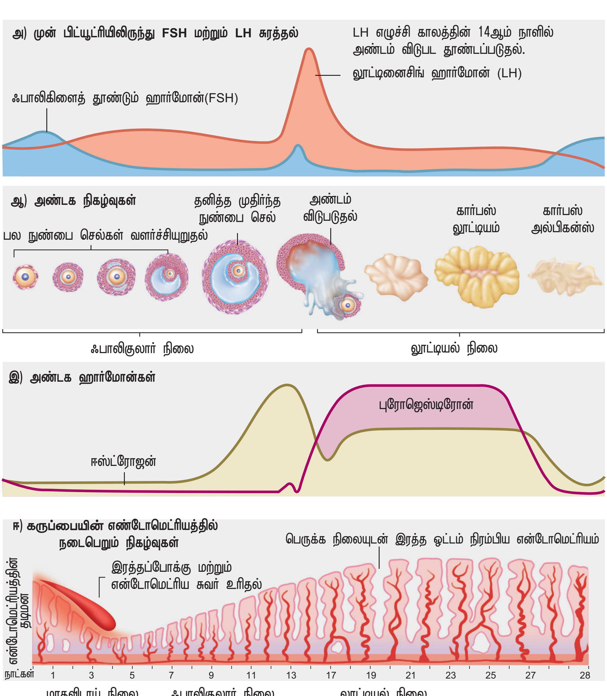
உருவாக்குகிறது.
மேலும் என்டோமெட்ரிய
சிதைவும்
தொொடங்குவதால்
மாதவிடாய்
ஏற்படுகிறது. இது அடுத்த மாதவிடாய் சுழற்சியின்
தொொடக்கமாகும்.

2.4. மாதவிடாய் கோளாறுகள்

மாதவிடாய்
ஏற்படாதிருத்தல்
‘மாத
விலக்கினமை’
(Amenorrhoea)
எனப்படும்.
18 வயது வரை பூப்படையாமல்
இருந்ததால்
அந்நிலைமைக்கு ‘முதல்நிலை மாதவிலக்கினமை’

(Primary amenorrhoea) என்று பெயர். தொொடர்ச்சியாக,
அடுத்தடுத்த
மூன்று
மாதங்களுக்கு
மாதவிலக்கினமை
காணப்பட்டால்
அது
இரண்டடாம் நிலை மாதவிலக்கினமை (Secondary
amenorrhoea) என்று அழைக்கப்படும்.
மாதவிடாய்
சுழற்சியின்
கால
அளவு
21 நாட்களுக்கும் குறைவாக இருந்ததால் அந்நிலை
‘பல
மாதவிடாய்
நிலை’
(Polymenorrhoea)
எனப்படும்.
முன் பிட்யூட்டரி சுரப்பியின்

மிகையான
செயல்பபாட்டினால்
அடிக்கடி
அண்டம் விடுபடுதல், உளவியல் ரீதியான
பாதிப்புகள் மற்றும் ஊட்டச்சத்துக் குறைபாடு
ஆகியவை
இதற்ககான
காரணங்களாகும்.
கிளாமிடியாசிஸ்
(chlamydiasis)
அல்லது
கொொனோரியா (Gonorrhoea) போன்ற பால்வினை
தொொற்றுகளின் நீண்டநாள் தாக்கத்தால் கருப்பை
வீக்கமடைந்து
பல
மாதவிடாய்
நிலை
தோன்றலாம்.
மாதவிடாயின் போது வலி ஏற்படுதல் ‘வலி
மிகு மாதவிடாய்’ (Dysmenorrhoea) எனப்படும். இது
பொொதுவாக அதிகம் காணப்படும் மாதவிடாய்
கோளாறு ஆகும். இதில் இரு வகைகள் உள்ளன.
அவை, ‘முதல்நிலை வலிமிகு மாதவிடாய்’ (Primary
dysmenorrhoea) மற்றும் இரண்டடாம் நிலை வலிமிகு
மாதவிடாய் (Secondary dysmenorrhoea). கருப்பையில்
சுரக்கும் புரோஸ்டோகிளான்டின் சுரப்பினால்
மாத விடாய்க்காலத்தில் ஏற்படும் வலி, பிடிப்புகள்
முதல் வகையைச் சேர்ந்தவை. கருப்பை உட்சுவர்
அழற்சி
(Endometriosis)
அல்லது
கருப்பை
நீர்க்கட்டிகள் / நார்த்திசுக்கட்டிகள் (Uterine fibroids)
போன்றவற்றினால் இனப்பபெருக்க மண்டலத்தில்
ஏற்படும் கோளாறுகள் காரணமாக மாதவிடாயின்
போது ஏற்படும் வலிகள் இரண்டடாவது வகையைச்
சேர்ந்தவை ஆகும்.
ஒரு பெண்ணின் இயல்பபான அன்றறாடச்
செயல்பபாடுகளைப் பாதிக்கக்கூடிய அளவிற்கு
ஏற்படும் கடுமையான மற்றும் நீண்டநாள்
மாதவிடாயானது
‘மாதவிடாய்
மிகைப்பு’
(Menorrhagia) எனப்படும்.
ஹார்மோன்களின்
சமநிலை அற்ற தனமை, அண்டகங்களின்
செயல்பபாடினமை, கருப்பை நார்த்திசுக்கட்டிகள்,
அண்டகம், கருப்பை மற்றும் கருப்பை வாய்
ஆகியவற்றில் தோன்றும் புற்றுநோய் போன்ற
பல்வவேறு காரணங்களால் மாதவிடாய் மிகைப்பு
ஏற்படலாம்.
குழந்ததைப்பேறு அடையும் வயதைக் கொொண்ட
பெண்களில் ஏற்படும் சீரற்ற மாதவிடாய் தாமத
மாதவிலக்கு
(Oligomenorrhoea)
எனப்படும்.
மாதவிடாய்
காலங்களில்
ஏற்படும்
சிறிய
மாற்றங்கள்
இயல்பபானவை.
ஆனால்,
35 நாட்களுக்கு மேல் மாதவிடாய் ஏற்படாத நிலை
காணப்பட்டால் அது தாமத மாதவிலக்கு நிலை
எனக் கண்டறியலாம்

மாதவிடாய் சுகாதாரம்
பெண்களின் ஆரோக்கியம், பொொதுவான நல்ல
உடல் நலம், கண்ணியம், அதிகாரம் செலுத்துதல்,
படைப்புத்திறன்
போன்றவற்றிற்கு
முக்கியமானதாக
மாதவிடாய்
சுகாதாரம்
பேணுதல் திகழ்கிறது. மாதவிடாய் சுகாதாரத்தை
சரியாகப் பேணாத பெண்கள் மாதவிடாயின்போது
அதிக மன அழுத்தம், பயம் மற்றும் சங்கடத்திற்கு
உள்ளாகிறார்கள். இதனால், படிக்கும் மாணவியர்
ஒவ்வொரு மாதமும் மாத விடாயின்போது
ஒழுங்ககாகப் பள்ளிக்குச் செல்லாமல் செயல்பபாடு
குறைந்து வீட்டிலேயே தங்கி விடும் நிலை
ஏற்படுகிறது.
தூயமையான,
பாதுகாப்பான
உறிஞ்சும்
தனமையுடைய
துணிகள்,
விடாய்க்கால
அணையாடை (Sanitary napkins), விடாய்க்கால
பஞ்சுப்பட்டை (Pads), விடாய்க்கால உறிபஞ்சு
(Tampons) மற்றும் மாதவிடாய்க் கோப்பை (Menstrual
cups)
போன்ற
பொொருட்களைக்
கொொண்டு
மாதவிடாயைக் கையாளலாம். தேவைக்கேற்ப
4 முதல் 5 மணி நேரங்களுக்கு ஒரு முறை
விடாய்க்கால அணையாடைகளை மாற்றுவதால்,
தூயமையும் நோய்க்கிருமித் தொொற்றிலிருந்து
பாதுகாப்பும் வசதியான உணர்வும் கிடைக்கிறது.
இது பெண்களின் மாதவிடாய் காலங்களில்
தரமான வாழ்க்கை்கும் வழி கோலுகிறது.
பயன்படுத்தப்பட்ட
விடாய்க்கால
அணையாடைகளை ஒரு தாளில் சுற்றி அழிக்க
வேண்டும். திறந்த வெளிகளிலும் கழிவறைகளில்
நீர்
வெளியேறும்
குழாய்களுக்குள்ளும்
அவற்றைத் தூக்கி எறியக் கூடாது. கழிவுநீர்க்
குழாய்களில் அவற்றைப் போடுவதால் கழிவு நீர்
வெளியேற்றும் குழாய்கள் அடைபட்டு நீர் மாசு
பட ஏதுவாகிறது.
விடாய்க்கால அணையாடை சுத்திகரிப்பு
(Disposal of napkins)
அறிவியல்
முறைப்படியும்,
சுகாதார
நோக்கோடும், மாதவிடாய் கழிவுகள் அடங்கிய
விடாய்க்கால
அணையாடையை
(Napkins)
எரித்துச் சாம்பல் ஆக்குவதே சுற்றுச்சூழலுக்கு
உகந்த முறையாகும். பள்ளிகள், கல்லூரிகள்,
மற்றும்
பொொது
இடங்களில்
உள்ள
கழிவறைகளில்
எரித்துச்
சாம்பலாக்கும்
அடுப்புகளும்
(Incinerators)
விடாய்க்கால
அணையாடை விற்கும் தானியங்கி கருவிகளும்
நிறுவப்படுவதற்ககான
பணிகள்
தொொடங்கியுள்ளன.

மாதவிடாய் நிறைவு (Menopause)
மாதவிடாய் நிறைவு என்பது பெண்களின்
வாழ்வில், அண்டம் விடுபடுதல் நின்று மாதவிடாய்
முற்றிலுமாக
நின்று
விடும்
நிகழ்வவாகும்.
சராசரியாக 45 முதல் 50 வயதுக்குட்பட்ட
பெண்களில் இது நிகழ்கிறது.
அண்டகத்தின்
முதனமைப்
பணிகள்
நிரந்தரமாக
நிறுத்தப்படுவதை இது குறிக்கிறது.

## 2.5  கருவுறுதல் மற்றும் கரு பதித்தல்

(Fertilisation and Implantation)
ஒரு ஒற்றைமய விந்தணு ஒரு ஒற்றைமய
அண்ட
செல்லுடன்
இணைந்து
கருவுற்ற
அண்டத்தை அல்லது இரட்டைமய கருமுட்டையை
உருவாக்கும் நிகழ்ச்சி ‘கருவுறுதல்’ எனப்படும்.
பெண்ணின் இனப்பபெருக்கக் கால்வவாயினுள்
செலுத்தப்படும் விந்து செல்கள் ‘திறனேற்றம்’
(Capacitation)
என்னும்
உயிர்வவேதியச்
செயல்பபாட்டின் மூலம் அண்ட செல்லைத்
துளைத்து அதைக் கருவுறச் செய்கின்றன. அண்ட
நாளத்தின் ஆம்புல்லா பகுதியிலுள்ள இஸ்த்மஸ்
சந்திப்பை நோக்கி அண்ட செல்லும் விந்து
செல்லும் ஒரே நேரத்தில் கடத்தப்பட்டால் மட்டுமே
கருவுறுதல் நிகழும்.
விந்து
செல்,
அண்ட
செல்லுக்குள்
நுழைவதற்கு முன்பு அது அண்ட செல்லை
சூழ்ந்துள்ள கரோனா ரேடியேட்டாவின் பல
அடுக்கு
கிரானுலோசா
(ஃபாலிகுலார்)
 

 

 

 

0iŠ ¶t/y ¬f´Ù ¼w‘j ߺ¾ 
à{Ùf´v ªg¸ ¶t/’v 
ŒƒÁ$yÃÄ 

 

செல்களைத் துளைக்க வேண்டும் (படம்2.10).
ஃபாலிகுலார் செல்கள் ‘ஹயலூரோனிக் அமிலம்’
என்னும் ஒட்டிணைப்புப் பொொருளால் ஒன்றுடன்
ஒன்று ஒட்டப்பட்டுள்ளன. விந்து செல்லின்
அக்ரோசோம்
சவ்வு
சிதைவுற்று,
‘ஹயலூரோனிடேஸ்’ (Hyaluronidase) எனும் புரதச்
செரிப்பு நொொதி வெளிப்படுகிறது இது கரோனா
ரேடியேட்டா
மற்றும்
சோனா
பெலுசிடா
ஆகியவற்றைச் சிதைப்பதால், விந்து செல் அண்ட
செல்லிற்குள் நுழைகிறது. இதற்கு ‘அக்ரோசோம்
வினை’ (Acrosomal reaction) என்று பெயர்.
கருவுறுதல்
நிகழ்ந்தவுடன்
அண்டத்தின்
சைட்டோபிளாசத்தில் காணப்படும் கார்டிகல்
துகள்கள் அண்டத்தைச் சுற்றி கருவுறுதல் சவ்வு
(Fertilization membrane) என்னும் ஒரு தடையை
ஏற்படுத்தி மேலும் விந்து செல்கள் உள்
நுழைவதைத் தடுக்கின்றன. இதனால் ‘பல விந்து
செல்களால்
கருவுறுதல்’
நடைபெறுதல்
(Polyspermy) தடுக்கப்படுகிறது.
கரு முட்டையின் முதல் பிளவானது ஒரே
மாதிரியான இரண்டு கருக்கோளச் செல்களைத்
(Blastomeres)தோற்றுவிக்கின்றன. இவற்றிலிருந்து

செல்கள்,
பின்பு

செல்கள்
என
எண்ணிக்கையில்
அதிகரித்துக்
கொொண்டடே
செல்கின்றன. கருவுற்று 72 மணி நேரத்திற்குப்
பிறகு தளர்வவாக இணைக்கப்பட்ட 16 அல்லது
அதற்கு மேற்பட்ட செல்களைக் கொொண்ட செல்
தொொகுப்பு உருவாகிறது. இதற்கு ‘மோருலா’ (Morula)
என்று பெயர் (படம் 2.11).

´{s„´t Š´v´v ±y3ƒ¹iŠ 
´Ùۑºt ¶ÑÛ ®y’j ºˆÎØd¶ÑƒÀ 
¬ÙÀ{b$ à¿ 0iº‰b´v ¬v 
ŒƒÁºt  SRO\VSHUP\  ºˆb´Îàˆ$Ê 

ßiº »{)½{t ‚¶{Ä{ à¥&¸{ 
&ƒºb´Îàfˆ 0iŠ ¶t ªg¸
¶t/y +Â{Y¼{ ¶ÑƒÀ 
ªƒ¸$Ê 
ßiº ߃¹Û ªb‚¾{‚¶{j 
0ƒÄƒ½h ™gˆ$Ê   
ßÑ0ƒÄ-t  0iº‰À{Ċ ‚¶{Ä{ 
àÚ&¸{ à†)-t á½¥‚¾{4‚¸Y 
»{)ƒ½ À2-ˆ$Ê 

 

 

Œgƒà
¶t´v
 

Œgƒà ¶t´2y ¬ƒÃ À1½{´ 
0iŠ ¶t »´siŠ ¶y‘ ªg¸h)y 
‚¶{Ä{ à¥&¸{0t ¬v ¯w+ 
¿b“‘´¸y ߃¹$Ê 

0iŠ ¶t/y
¬f´Ù

 

´{s„´t
Š´v´v

‚¶{Ä{ à¥&¸{
‚¶{Ä{ àÚ&¸{
 

ªg¸¶t
+Â{Y¼{ ¶ÑÛ
ªg¸¶t
ªb‚¾{‚¶{j
ƒ¶f‚¸{+Â{¶j

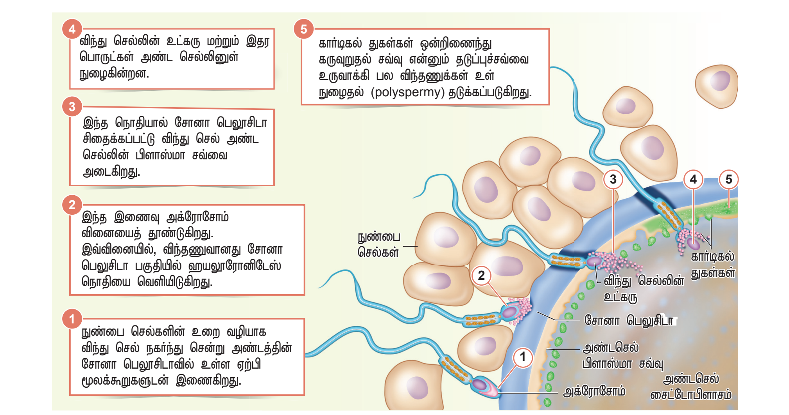

¾  ʞœjŽÎ
ʞ Ú œjŽÎ 

¿  Ñ ƒ’
ŒÌ{ ,ŽÖ

À  Ó žÖ

Á  ¿ÕoÒ,ŽÖ
ʞfÊ Ùo

ʞ £Ð{
¾kÎ ŒÌ{

  ÂjÒ+mÐ
ʞfÊ Ùo

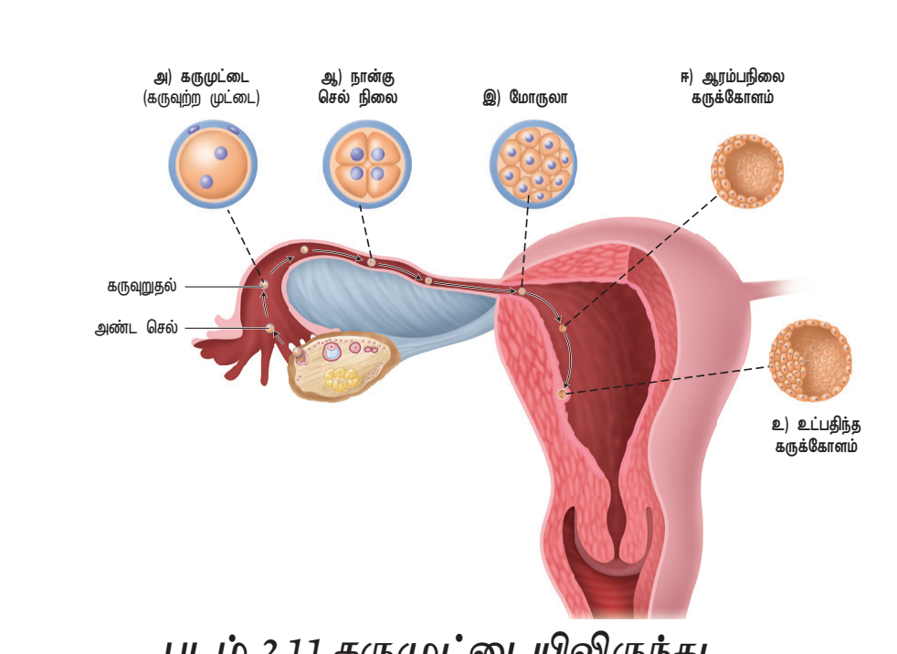
கருக்கோளம் வரை: அண்ட நாளத்திற்குள்
வளர் கருவின் பாதை
இரட்டைக் குழந்ததைகள்
- ஒரே கர்ப்பத்தில் உருவாகும் இரண்டு சிசுக்கள்
இரட்டைக் குழந்ததைகள் (twins) எனப்படும்.
உருவமொொத்த அல்லது ஒரு கருமுட்டை
இரட்டையர்கள் (identical or monozygote twins) –
கருமுட்டையின் முதல் பிளவிப் பெருகலின்
போது உருவாகும் இரண்டு கருக்கோள
செல்கள் தனித்தனியே பிரிந்து வளர்வதால்,
இவர்கள் உருவாகிறார்கள். இவர்கள் ஒரே
பாலினத்தவராக,
உருவ
ஒற்றுமை
கொொண்டவர்களாக,
ஒரே
வகையான
மரபணுக்களைக்
கொொண்டவர்களாகக்
காணப்படுவர்.
- உருவம் மாறுபட்ட அல்லது இரு கருமுட்டை
இரட்டையர்கள் (Fraternal or Dizygote twins) –
இவர்கள், இருவேறு அண்ட செல்கள் இருவேறு
விந்து செல்களால் கருவுற்றதனால் உருவான
கருமுட்டைகளிலிருந்து உருவானவர்கள். இந்த
இரட்டையர்கள் ஒரே பாலினத்தவராகவோ
அல்லது
வேறுபட்ட
பாலினத்தவராகவோ
இருப்பர். ஆனால் உருவத்தில் மாறுபட்டிருப்பர்.
- சயாமிஸ் – ஒட்டிப் பிறக்கும் இரட்டையர்கள்.
புரோஜெஸ்டீரானின் தாக்கத்தினால் அண்ட
நாளங்களிலுள்ள
மென்தசைகள்
தளர்வடைகின்றன.
வளரத்தொடங்கிய
கருமுட்டை அண்டநாளத்தின் வழியாக 4 முதல் 5
நாட்கள் நகர்ந்து சென்று கருப்பைக் குழியை
அடைகின்றன.
இறுதியாக
கருப்பையின்
உட்சுவரில் கரு பதிகிறது.
இந்நிலையில்,
கருவானது ஏறத்தாழ 100 செல்களைக் கொொண்ட
ஒரு உள்ளீடற்ற பந்து போன்ற அமைப்பாகக்
காணப்படுகின்றது.
இதற்கு கருக்கோளம்
(blastocyst) என்று பெயர்.
இதன் உள்ளீடற்ற
உட்பகுதியில் திரவம் நிரம்பிக் காணப்படுகிறது.
கருக்கோளமானது
ஒரடுக்கினால்
ஆன
டிரோஃஃபோபிளாஸ்ட் (trophoblast) என்னும் பெரிய
தட்டையான செல்களையும் 20 முதல் 30 கோள
வடிவ அகச்சசெல் திரள்களையும் கொொண்டுள்ளது.
இந்த
அகச்சசெல்
திரள்கள்,
கருவாக
வளர்ச்சியடைந்து
கருப்பையின்
உட்சுவரில்
பதிகிறது. இதற்கு ‘கரு பதிதல்’ (implantation) என்று
பெயர். இதன் முடிவில் கர்ப்பம் தொொடங்குகிறது.
கருவுற்ற அண்டம் கருப்பைக்கு வெளியே பதிந்து
வளரும் நிகழ்வு ‘இடம் மாறிய கர்ப்பம்’
(Ectopic pregnancy) எனப்படும். இதில் 95% கரு
பதிதலானது
அண்ட
நாளங்களுக்குள்
நடைபெறுகிறது. அண்ட நாளங்களுக்குள்ளேயே
கரு வளரத் துவங்குவதால், உட்புற இரத்தக்கசிவு
மற்றும் நோய்தத்ததொற்று ஆகியவை ஏற்படுகிறது.
சிலருக்கு அண்ட நாளம் வெடித்து இறப்பு கூட
ஏற்படலாம்.

## 2.6  கர்ப்ப பராமரிப்பு மற்றும் கரு

வளர்ச்சி (Maintenance of pregnancy
and Embryonic development)

கரு
பதிதல்
நிகழ்ந்தவுடன்
ஓரடுக்குக்
கருக்கோளத்தின்
(Blastula)
உட்புறமுள்ள
அகச்சசெல் திரள், ’எபிபிளாஸ்ட்’ மற்றும் (epiblast and
hypoblast)‘
ஹைபோபிளாஸ்ட்’
என்று
இரு
அடுக்குகளாகப்
பிரிகிறது.
இதில்
ஹைப்போபிளாஸ்ட் கருவின் அக அடுக்காகவும்
எபிபிளாஸ்ட் புற அடுக்காகவும் செயல்படுகின்றன.
மீதமுள்ள செல்கள் இவ்வடுக்குகளின் இடையில்
அமைந்து நடு அடுக்காகிறது. கருக்கோளச்சசெல்கள்
நகர்ந்து மூல இனச் செல் அடுக்குகளை
உருவாக்குகிறது.
இதன் முடிவில், ஓரடுக்குக்
கருக்கோளம்
மூவடுக்குக்
கருக்கோளமாக
(Gastrula)
மாறும்
நிகழ்ச்சி
மூவடுக்கு
கருக்கோளமாக்கம்
(Gastrulation)
எனப்படும்.
ஒவ்வொரு மூல இனச் செல் அடுக்கிலிருந்தும்
(Germ layers) அவற்றுக்கே உரிய ‘திசுக்கள்’,
‘உறுப்புகள்’, உறுப்பு மண்டலங்கள்’ ஆகியவை
உறுப்பாக்க நிகழ்வின் மூலம் (Organogenesis)
உருவாகின்றன.
கருசூழ்புறப்படலங்களான
ஆம்னியான்,
கோரியான், ஆலன்டடாயிஸ் மற்றும் கருவுணவுப்பை
ஆகியவை வளர் கரு உலர்ந்து போகாமல்
பாதுகாத்தல், இயக்க அதிர்வு தாங்குதல், ஊட்டச்
சத்துப் பொொருட்களை உறிஞ்சுதல் மற்றும் வாயுப்
பரிமாற்றம் ஆகிய செயல்களைச் செய்கின்றன
(படம் 2.12). ஆம்னியான், இரட்டை அடுக்குகளால்
ஆன ஒளி ஊடுருவும் சவ்வினைக் கொொண்டும்,

ஆமனியாட்டிக்
திரவத்தால்
நிரப்பப்பட்டும்
காணப்படுகிறது.
இது வளர் கருவிற்கு ஒரு
மிதவைச் சூழலை தந்து அதைக் காயங்களிலிருந்து
பாதுகாக்கிறது. மேலும், கரு நகர்வதற்கு ஒரு
ஊடகத்தை அளித்து அதன் வெப்பநிலையைச்
சீராகப் பராமரிக்கும் பணியையும் செய்கிறது.
கருவுணவுப்பையானது வளர்கருவின் உணவுப்
பாதையின் ஒரு பகுதியை உருவாக்குவதுடன்,
ஆரம்பநிலை இரத்த செல்களுக்கும் இரத்தக்
குழல்களுக்கும் மூலாதாரமாகவும் விளங்குகிறது.
Ð pÌp
ÀŽÏn›l+”
Hj(Ê~

Ð pÌp
ÀŽÏn›l+”

¿ÖƒÎ /[
ʞnŽÒ
Ñ Ùo
×Ùzʞ
Ò6f’Î
+Õ×o

ŒÐ n›~
ŒÊ 
ʞnŽÒ
Ê 0Ô ƒ
Ò6f’Îo

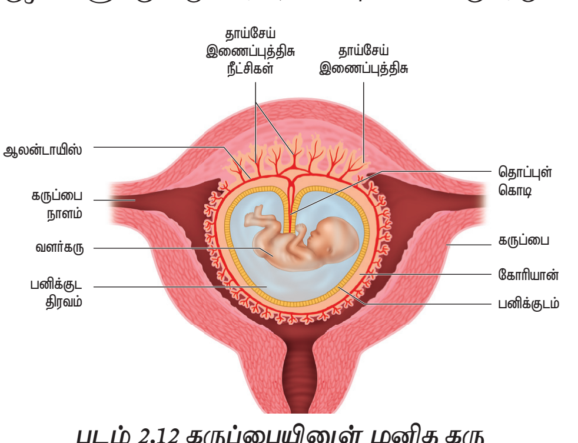
கரு உணவுப்பையின் வால்முனைப்பகுதியில்,
கருத்திசுக்களாலான ஒரு சிறிய வெளிப்பிதுக்கத்தை
ஆலன்டடாய்ஸ் உருவாக்குகிறது.
தொொப்புள்
கொொடியின் அடிப்படை அமைப்பான ஆலன்டடாய்ஸ்,
கருவை
தாய்சசேய்
இணைப்புத்திசுவோடு
இணைப்பதுடன், இறுதியில் சிறுநீர்ப்பையின் ஒரு
பகுதியாகவும் மாறுகிறது. கருசூழ்ப்படலத்தின்
வெளிப்படலம் கோரியான் ஆகும். இது தாய்சசேய்
இணைப்புத்திசுவை உருவாக்குதல் மற்றும் மற்ற
கருசூழ் படலங்களையும் கருவையும் மொொத்தமாகச்
சூழ்ந்து பாதுகாப்பது ஆகிய பணிகளை செய்கிறது.
கருக்கோளத்தின் ட்ரோஃபோபிளாஸ்ட் செல்கள்
‘கோரியானிக்
வில்லை’
எனப்படும்
பல
விரல்போன்ற நீட்சிகளை உருவாக்குகின்றன.
இந்நீட்சிகள் கருவின் இரத்தத்தை எடுத்துச்
செல்கின்றன.
இவற்றைச் சுற்றிலும் தாயின்
இரத்தம் நிரம்பிய குழிகள் காணப்படுகின்றன.
கோரியானிக்
வில்லைகளும்
கருப்பைத்
திசுக்களும் இணைந்து தட்டு வடிவ தாய்-சேய்
இணைப்புத்திசுவை உருவாக்குகின்றன. தாய் சேய்
இணைப்புத்திசு
(Placenta)
கர்ப்பகாலத்தில்
தற்ககாலிகமாக உருவாக்கப்படும் நாளமில்லாச்
சுரப்பியாகும். மேலும் இது தொொப்புள் கொொடி மூலம்
கருவைக் கருப்பைச் சுவருடன் இணைத்து
உணவூட்டம், சுவாசம், கழிவு நீக்கம் போன்ற

செயல்களைச் செய்யும் உறுப்பாக செயல்படுகிறது.
கர்ப்பத்தின் நான்ககாவது வாரத்தில் கருவில்
உருவாகும் இதயம், இரத்தத்தை தொொப்புள் கொொடி,
தாய் சேய் இணைப்புத்திசு மற்றும் தனது சொொந்த
திசுக்கள் ஆகிய பகுதிகளுக்கு அனுப்புகிறது.
மூலஇனச்சசெல் அடுக்குகள் (Primary germ layers)
ஆதித் திசுக்களாகச் (Primitive tissues) செயல்பட்டு
அனைத்து
உடல்
உறுப்புகளையும்
உருவாக்குகின்றன. புற அடுக்கிலிருந்து (ectoderm)
மைய நரம்பு மண்டலம் (மூளை மற்றும்
தண்டுவடம்), புற அமைவு நரம்பு மண்டலம்
(Peripheral Nervous System), எபிடெர்மிஸ், அதன்
வழித்தோன்றல் பகுதிகள் (Derivatives) மற்றும் பால்
சுரப்பிகள் ஆகியவை உருவாகின்றன.
நடு
அடுக்கிலிருந்து
(mesoderm)
இணைப்புத்திசு,
குருத்ததெலும்பு
மற்றும்
எலும்பு,
தசைகள்,
சிறுநீரகஇனப்பபெருக்க உறுப்புகளான சிறுநீரகம்,
சிறுநீர்நநாளம், இனப்பபெருக்க உறுப்புகள் ஆகியவை
உருவாகின்றன. அக அடுக்கிலிருந்து இரைப்பைசிறுகுடல் பாதை மற்றும் சுவாசப் பாதையின்
எபிதீலியம், கல்லீரல், கணையம், தைராய்டு
மற்றும் பாராதைராய்டு ஆகிய உறுப்புகள்
உருவாகின்றன.
மனிதர்களில் கரு வளர்ச்சிக் காலம் 280
நாட்கள் அல்லது 40 வாரங்களாகும். இந்த கால
கட்டத்தை ‘கர்ப்ப காலம்’ (Gestation period) என
அழைக்கிறோம். இதை நம் வசதிக்கேற்ப ஒரு
பருவத்திற்கு மூன்று மாதங்கள் வீதம் மூன்று
முப்பருவங்களாகப் பிரிந்துக்கொள்ளலாம். ‘முதல்
முப்பருவம்’ (First trimester) உறுப்பு உருவாக்கத்திற்கு
முக்கிய காலமாகும்.
இதயம், கை, கால்கள்,
நுரையீரல்கள், கல்லீரல் மற்றும் புற இனப்பபெருக்க
உறுப்புகள்
போன்ற
முக்கிய
உறுப்புகள்
இப்பருவத்தில் உருவாகின்றன.
‘இரண்டடாம்
முப்பருவத்தின்’ (second trimester) முடிவில் முகம்
நன்கு உருவாகிறது. முகத்தில் உள்ள பண்புகளான
கண்ணிமைகள், கண்ணிமை மயிர், இமைத்தல்
போன்றவை நன்கு வளர்ச்சியடைகின்றன. உடல்
பகுதி மெல்லிய மயிரிழைகளால் மூடப்பட்டுள்ளது.
தசைத்திசு வளர்ச்சியடைகிறது.
எலும்புகள்
கடினமடைகின்றன.
‘மூன்றறாவது முப்பருவ’
(Third trimester) முடிவில், முழு வளர்ச்சியடைந்த
கரு மகப்பேறுக்கு தயாராக உள்ளது.
கர்ப்ப காலத்தில் தாய்சசேய் இணைப்புத்திசு
தற்ககாலிக நாளமில்லாச் சுரப்பியாகச் செயல்பட்டு
‘மனித
கோரியானிக்
கொொனடோடிரோபின்
(hCG)’,
மனித
கோரியானிக்

சொொமட்டோமாம்மோடிரோபின் (hCS)’ அல்லது
‘மனித பிளாசன்டல் லாக்டோஜென் (hPL)’,
ஈஸ்டட்ரரோஜன் மற்றும் புரோஜெஸ்டிரான் என
கருவளர்ச்சிக்கு முக்கியத்துவம் வாய்ந்த பல
ஹார்மோன்களை உற்பத்தி செய்கிறது. கர்ப்ப
காலத்தின் இறுதிக் கட்டத்தில் அதாவது குழந்ததை
பிறப்பின்போது சுரக்கும் ‘ரிலாக்ஸின்’ எனும்
ஹார்மோன்
இடுப்புப்பகுதியிலுள்ள
எலும்பிணைப்பு
நார்களைத்
தளர்வடையச்
செய்து குழந்ததை பிறத்தலை எளிதாக்குகிறது.
hCG,
hPL
மற்றும்
ரிலாக்ஸின்
ஆகிய
ஹார்மோன்கள் கர்ப்ப காலங்களில் மட்டுமே
உற்பத்தி
செய்யப்படுகின்றன
என்பது
குறிப்பிடத்தக்கது. மேலும், கர்ப்ப காலத்தில் இதர
ஹார்மோன்களான
ஈஸ்டட்ரரோஜன்,
புரோஜெஸ்டிரோன், கார்ட்டிசோல், புரோலாக்டின்,
தைராக்சின் மற்றும் ஏனையவற்றின் அளவு
தாயின் இரத்தத்தில் பல மடங்கு அதிகரிக்கின்றன.
கரு
வளர்ச்சியை
ஊக்குவிப்பதில்
இந்த
ஹார்மோன்கள் முக்கியப் பங்ககாற்றுகின்றன.
பெண்களின்
கருப்பை
பொொதுவாக 3 அங்குல நீளமும் 2
அங்குல அகலமும் கொொண்டது.
ஆனால்,
கர்ப்ப
காலத்தில்
இக்கருப்பையின் அளவு 20 மடங்கு பெரிதாகிறது.

## 2.7  மகப்பேறு மற்றும் பாலூட்டுதல்

(Parturition and Lactation)
மகப்பேறு (Parturition) என்பது கர்ப்பகாலம்
நிறைவடைந்து குழந்ததை பிறத்தலைக் குறிக்கும்
சொொல்லாகும்.
கருப்பையிலிருந்து குழந்ததை
வெளிவரும்போது
உடலில்
ஏற்படும்
வரிசைக்கிரமமான நிகழ்வுகள் மகப்பேறு வலி
எனப்படும் (Labour pain) ஆகும்.
கர்ப்பகாலம்
முழுமையுமே அவ்வப்போது இலேசான மற்றும்
வலிமையான சுருக்கங்களை கருப்பை ஏற்படுத்திக்
கொொண்டடே
இருக்கிறது.
இச்சுருக்கங்கள்
‘பிராக்ஸ்டன் ஹிக்ஸ்’ சுருக்கங்கள் (Braxton-Hicks
contractions) ஆகும். இச்சுருக்கங்கள் பொொய்யான
பிரசவவலியை ஏற்படுத்துகின்றன. கரு வளர
வளர ஈஸ்டட்ரரோஜனின் அளவு அதிகரித்து
கருப்பைச் சுருக்கங்களையும் அதிகப்படுத்துகிறது.
இச்சுருக்கங்கள் கரு உருப்பபெறவும் கரு கீழ்நோக்கி
இடம்பபெயரவும்
உதவுகிறது.
இந்த
இடப்பபெயர்ச்சியின் காரணமாக கருப்பை வாய்
மற்றும்
கலவிக்கால்வவாய்
ஆகியவை
விரிவடைவதன் விளைவாக ‘நியூரோஹியூமோரல்
அனிச்சை்
செயல்’
(Neurohumoral
reflex)
நடைபெறுகிறது. இந்த அனிச்சை்சசெயல் ‘கரு
வெளித்தள்ளல் அனிச்சை் செயல்’ (foetal ejection
reflex) அல்லது ‘ஃபெர்குஸன் அனிச்சை் செயல்’
(Fergusan reflex) என்றும் அழைக்கப்படும். இந்த
அனிச்சை்
செயலின்
விளைவால்
நியூரோஹைபோஃஃபைசிஸ் உற்பத்தி செய்யும்
ஹார்மோனான ஆக்ஸிடோசின், கருப்பையில்
ஆற்றல் மிகுந்த சுருக்கங்களை உருவாக்கி பிறப்பு
வழியின் வழியாக குழந்ததை வெளியேறும்
நிகழ்வவை நிறைவு செய்கிறது. மேற்குறிப்பிட்ட
இந்நிகழ்வுகள் அனைத்தும் சேர்த்து ‘மகப்பேறு’
அல்லது ‘குழந்ததை பிறப்பு’ எனப்படுகிறது.
ரிலாக்ஸின் எனும் ஹார்மோன் தாய்சசேய்
இணைப்புத்திசுவால்
சுரக்கப்படுகிறது.
இது
கார்பஸ் லூட்டியத்திலும் காணப்படுகிறது. இடுப்பு
எலும்பு மூட்டுகளைத் தளர்வடையச் செய்து
கருப்பை
வாய்ப்
பகுதியை
வலிமையான
சுருக்கங்களால் விரிவடையச் செய்து குழந்ததை
பிறத்தலை எளிதாக்கும் ஹார்மோன் ரிலாக்ஸின்
ஆகும். பனிக்குடம் (ஆம்னியான் உறை) உடைந்து
கலவிக் கால்வவாய் வழியாக பனிக்குட திரவ
வெளியேற்றத்தை் தொொடர்ந்து குழந்ததை பிறப்பு
நிகழ்கிறது. தாய்சசேய் இணைப்புத்திசு, தொொப்புள்
கொொடியின் எச்சங்கள் போன்றவை (After birth)
குழந்ததை பிறந்த பின் வெளித்தள்ளப்படுகின்றன.
அறுவை வழி மகப்பேறு (CAESAREAN)

கருப்பையில் குழந்ததையின் நிலை
(Position),
தாய்
சேய்
இணைப்புத்திசுவின்
தனமை
போன்ற
காரணங்களால் பிறப்புக் கால்வவாய்வழியாக
இயல்பபான
குழந்ததை
பிறப்பு
நடைபெற
இயலாதபோது தாயின் வயிற்றுப் பகுதியிலும்
கருப்பையிலும் அறுவை சிகிச்சை மூலம் சிறு
வெட்டு ஏற்படுத்தி குழந்ததை வெளியில்
எடுக்கப்படுகிறது.
இதற்கு ‘வயிறு வழி
மகப்பேறு’ (Abdominal delivery) அல்லது ‘அறுவை
வழி மகப்பேறு’ (caesarean section) என்று பெயர்.
பால் சுரப்பிகள் பாலை உற்பத்தி செய்யும்
நிகழ்ச்சி ‘பால் சுரத்தல்’ (Lactation) எனப்படும்.
ஒவ்வொரு மாதவிடாய் சுழற்சியின்போதும், கர்ப்ப
காலத்தின் போதும், பாலூட்டும் போதும் பால்
சுரப்பிகளில் மாற்றம் ஏற்படுகின்றன.
கர்ப்ப
காலத்தின்
இறுதியில்
ஈஸ்டட்ரரோஜன்,

புரோஜெஸ்டிரோன் மற்றும் மனித தாய்சசேய்
இணைப்புத்திசு லாக்டோஜென் (Human Placental
Lactogen – hPL) ஆகியவை அதிகரிக்கின்றன.
இதனால்,
ஹைபோதலாமஸ்
தூண்டப்பட்டு
புரோலாக்டின்
விடுவிப்பு
காரணிகள்
விடுவிக்கப்படுகின்றன. இவற்றால் தூண்டப்பட்ட
முன் பிட்யூட்டரி பால் உற்பத்திக்குக் காரணமான
புரோலாக்டின் ஹார்மோனைச் சுரக்கிறது.
பால் சுரப்பியின் மீச்சிறு கதுப்புகளிலிருந்து
விசையுடன் பாலை வெளித்தள்ள ஆக்ஸிடோசின்
உதவுகிறது.
இது நிர்பந்த அனிச்சை செயல்
(Let down reflex)எனப்படும். பாலூட்டும் காலத்தில்,
காலியான கருப்பையை தூண்டி சிறிது சிறிதாகச்
சுருங்கச் செய்து கருப்பையை கர்ப்ப காலத்திற்கு
முந்ததைய நிலைக்கு மாற்றும் வேலையையும்
இந்த ஹார்மோன் செய்கிறது.
குழந்ததை
பிறந்ததிலிருந்து சில நாட்களுக்கு பால் சுரப்பிகள்,
மஞ்சள் நிற ‘சீம்பபாலைச்’ (Colostrum) சுரக்கின்றன.
இதில் லாக்டோஸ் குறைந்த அளவிலும், புரதம்,
வைட்டமின் A மற்றும் தாது உப்புக்கள் அதிக
அளவிலும் காணப்படுகின்றன.
சீம்பபாலில்
கொொழுப்பு கிடையாது. மேலும் சீம்பபாலில் அதிக
அளவு
IgA
வகை
எதிர்பப்பபொருள்கள்
காணப்படுகின்றன.
இது
குழந்ததையின்
உணவுப்பாதையில்
ஏற்படும்
பாக்டீரியத்

தொொற்றைத்
தடுப்பதற்குப்
பயன்படுகிறது.
குழந்ததைகளுக்கு
எளிதில்
செரிக்கக்கூடிய
அனைத்துவித ஊட்டச் சத்துப் பொொருட்களையும்
கொொண்ட மிகச்சரியான உணவாக ‘தாய்ப்பால்’
உள்ளது. குழந்ததையின் முதல் 6 மாத காலம்
வரைத் தாய்ப்பால் மட்டுமே போதுமானது.
தாய்மமார்கள்
குழந்ததைகளுக்கு
தவறாமல்
தாய்ப்பால் ஊட்டுவதால் குழந்ததை நலமுடன்
வளர்வது உறுதி செய்யப்படுகிறது.

சீம்பபால் (Colostrum)

குழந்ததை
பெற்றவுடன்
உடனடியாக
பெண்ணின் உடலில் உற்பத்தியாகும் சத்து
நிறைந்த, நோயெதிர்ப்புப் பொொருட்கள் கொொண்ட,
வளர்ச்சி மற்றும் திசுவில் பழுது நீக்கம் செய்யும்
காரணிகள் நிரம்பிய திரவமே சீம்பபால் ஆகும்.
இது
குழந்ததையின்
நோய்த்தடைகாப்பு
மண்டலத்தை் தூண்டி அதனை முதிர்வடையச்
செய்கின்ற.
இயற்ககை
நுண்ணுயிர்
எதிர்ககாரணியாக செயல்படுகிறது. இந்த முதல்
தாய்ப்பால்
தரும்
இயற்ககையான
நல்ல
பலன்களை வேறு எந்த செயற்ககை உணவாலும்
ஈடுகட்ட
இயலாது.
எனவே,
பிறந்த
குழந்ததைகளுக்கு சீம்பபாலை ஊட்டுவது மிகவும்
அவசியம் ஆகும்.

உலக தாய்ப்பால் ஊட்டும் வாரம் – ஆகஸ்ட் முதல் வாரம் (World Breast feeding Week – WBW)
‘உலக தாய்ப்பால் ஊட்டும் செயல் கூட்டமைப்பு’ (World Alliance for Breast feeding Action WABA), உலக

சுகாதார நிறுவனம் (WHO) மற்றும் யுனிசெஃப் போன்ற நிறுவனங்கள் முதல் ஆறுமாதங்களுக்கு தாய்ப்பால்
ஊட்டுவதன் முக்கியத்துவத்தை வலியுறுத்துகின்றன. மேலும் தொொடர்ச்சியாக, இரண்டடாண்டுகள் வரை
குழந்ததைகளுக்கு கூடுதலாக தாய்ப்பால் ஊட்டி தங்கள் குழந்ததைகளை ஆரோக்கியத்துடன் வளர்க்கவும் புதிய
தாய்மமார்களை ஊக்கப்படுத்துகின்றன. புதிதாய்ப் பிறந்த குழந்ததைகளுக்கு ஏற்படும் மஞ்சள் காமாலை,
நிமோனியா, காலரா போன்ற நோய்களையும் உயிரைக் கொொல்லும் உடல் நலச்சிக்கல்களையும் இதன்மூலம்
தடுக்கலாம். தாய்ப்பால் வங்கி மற்றும் பேருந்து நிலையங்களில் தாய்ப்பால் ஊட்டும் அறை போன்ற திட்டங்களைத்
தமிழக அரசு செயல்படுத்தி வருகிறது. தாய்ப்பால் ஊட்டுவதன் முக்கியத்துவத்தை உணர்த்தும் விழிப்புணர்வு
நிகழ்ச்சிகள் ஒவ்வோராண்டும் ஆகஸ்ட் மாத முதல் வாரத்தில் நடத்தப்படுகின்றன.

ஆர்வமூட்டும் உணமைகள்
1.  அண்ட செல்லைக் கருவுறச் செய்ய இயலாத விந்து செல்களைக் கொொண்ட ஆண்கள் மலட்டுத்தனமை
கொொண்டவர்களாவர்.
2. ஆண்களில் விந்து செல்லை உற்பத்தி செய்ய இயலாத நிலை ‘அசூஸ்பபெர்மியா ’ (Azoospermia) எனப்படும். 
3.  புரோஸ்டடேட் சுரப்பி வீக்கம் ‘புரோஸ்டடேட்டை்டிஸ்’ எனப்படும். இதனால் சிறுநீர் கழித்தல் கடினமாகிறது.
4.  அறுவை சிகிச்சை மூலம் விந்தகங்களை நீக்குதல் அல்லது ஆண் மலடாக்கம் ‘ஆர்க்கிடெக்டமி’
(Orchidectomy) எனப்படும்.
5. முதல் விந்து திரவ வெளியேற்றத்திற்கு ஸ்பபெர்மமார்க்கி (Spermarche) என்று பெயர்.

பாடச்சுருக்கம்

ஒரு சிற்றினம் தழைப்பதற்கும் தொொடர்ந்து
வாழ்வதற்கும்
இனப்பபெருக்கம்
முக்கியமான
ஒன்றறாகும். மனிதர்கள் குட்டி ஈன்று பால் கொொடுக்கும்
பாலினப் பெருக்க வகையினர் ஆவர்.
இனச்சசெல்உருவாக்கம், விந்து உள்ளேற்றம்,
கருவுறுதல்,
பிளவிப்பபெருகல்,
தாய்சசேய்
இணைப்புத்திசு
உருவாக்கம்,
மூவடுக்கு
கருக்கோளமாக்கம், உறுப்பாக்கம்,
கரு பதிதல்
மற்றும் மகப்பேறு என தொொடர்படிநிலை நிகழ்வுகளை
இனப்பபெருக்கம் உள்ளடக்கியுள்ளது.
பெண் இனப்பபெருக்க மண்டலத்தில் ஓரிணை
அண்டகங்கள், ஓரிணை அண்ட நாளங்கள், கருப்பை,
கருப்பைவாய், கலவிக்கால்வவாய் மற்றும் புற
இனப்பபெருக்க உறுப்புகள் ஆகியவை உள்ளன. ஆண்
இனப்பபெருக்க மண்டலத்தில் ஓரிணை விந்தகங்கள்,
ஓரிணை நாளத்தொகுப்பு, துணை சுரப்பிகள் மற்றும்
புற இனப்பபெருக்க உறுப்புகள் (ஆண்குறி) ஆகியவை
உள்ளடங்கி உள்ளன.

இனச்சசெல் உருவாக்கம் ஆணில் விந்து
செல்உருவாக்கம் என்றும் பெண்ணில் அண்ட
செல்உருவாக்கம் என்றும் அழைக்கப்படுகிறது.
பெண்ணின் இனப்பபெருக்க சுழற்சி மாதவிடாய்
சுழற்சி என அழைக்கப்படுகிறது. இது பூப்பபெய்துதலில்
தொொடங்குகிறது.
மாதவிடாய் சுழற்சியின்போது
அண்ட செல் விடுபடுகிறது. இதனுடன் விந்து செல்
இணைந்து கருமுட்டையாகிறது.
தொொடர்ச்சியான மறைமுக செல் பிரிவுகளால்
கருமுட்டை பகுக்கப்பட்டு கருக்கோளமாக மாறி பின்
கருப்பையின் உட்சுவரில் பதிகிறது.
மனித கரு
முழுமையாக
வளர்ச்சியடைந்து
குழந்ததை
பிறப்பதற்கு 280 நாட்கள் அல்லது 40 வாரங்கள்
ஆகின்றன. கரு முழுவளர்ச்சியடைந்த பிறகு
குழந்ததை பிறக்கிறது. பிறந்த குழந்ததைக்கு தாய்ப்பால்
ஊட்டப்பட்டு வளர்க்கப்படுகிறது.

அருணாச்சலம் முருகானந்தம்

த
நப  ஆ v

கண்டுபிடிப்பாளர் மற்றும் சமூக ஆர்வலர்

உலகின் மிகவும் விலை மலிவான, விடாய்க்கால அணையாடை (Sanitary napkin) தயாரிக்கும் கருவியை
உருவாக்கிய மனிதர் திரு. அருணாச்சலம் முருகானந்தம் ஆவார். நாடு முழுவதும் கிராமப்
புறங்களிலுள்ள ஏழைப் பெண்களுக்கு மிகக் குறைந்த விலையில் அணையாடைகளை அளிப்பதே
இவருடைய முக்கிய நோக்கமாகும். மாதவிடாய் காலத்தில் பெண்கள் (இவர் மனைவி உட்பட)
சுகாதாரமற்ற பொொருட்களான இலைகள், பழைய துணிகள் ஏன் சாம்பலைக் கூட பயன்படுத்துவதைக்
கண்டு அதிர்ச்சி அடைந்த அவர், இம்முறைகளை மாற்ற எண்ணினார். இந்தியாவில் சுமார் 70%
இனப்பபெருக்கம் தொொடர்பபான நோய்களுக்கு சுகாதாரமற்ற மாதவிடாய் பழக்கவழக்கங்கள் தான்
காரணமாகின்றன. பூப்பபெய்திய பின் 23% பேர் பள்ளிக்குச் செல்வதில்லை என்பதும் தெரிய வந்தது.
இதனால், கிராமப்புற பெண்களிடம் சுகாதாரமான மாதவிடாய் பழக்கங்களை ஏற்படுத்தி அவர்களின்
வாழ்வவாதாரங்களை முன்னேற்றி ஒரு சமுதாயத் தாக்கத்தை ஏற்படுத்த அவர் விரும்பினார்.
1999ல் தனது ஆராய்ச்சிப் பணியைத்துவங்கிய திரு அருணாச்சலம் சுமார் ஐந்ததாண்டுகள் கழித்து
ஒரு விடாய்ககால அணையாடை தயாரிக்கும் விலை மலிவான எந்திரத்தை வெற்றிகரமாக உருவாக்கினார்.
அவர் தனது கண்டுபிடிப்பின் முன்மமாதிரியை சென்னையிலுள்ள இந்திய தொொழில்நுட்ப நிறுவனத்தில்
(IIT) 2006 ஆம் ஆண்டு நடைபெற்ற ‘தேசிய கண்டுபிடிப்புகள்’ தொொடர்பபான போட்டியில் சமர்ப்பித்தார்.
943 கண்டுபிடிப்புகள் களம் கண்டபோதும் இவரது எந்திரமே முதல் பரிசைத் தட்டிச் சென்றது.
18 மாதங்களுக்குள் 250 எந்திரங்களை உருவாக்கி அவற்றை வட இந்திய மாநிலங்களான பீகார், மத்திய
பிரதேசம், இராஜஸ்ததான் மற்றும் உத்தரபிரதேசம் ஆகியவற்றக்கு அனுப்பி வைத்தார்.
2014ல் ‘டைம்’ இதழில் செல்வவாக்கு மிகுந்த 100 மனிதர்களுள் ஒருவராக அருணாச்சலம் முருகானந்தம்
அடையாளப்படுத்தப்பட்டார். 2016ல் இவருக்கு பத்மஸ்ரீ விருது வழங்கப்பட்டது.

è¼ õ÷˜ G¬ôèœ
Þ¼ðˆ¶ ï£¡è£õ¶ õ£ó‹
¸¬ófó™èœ ï¡°
õ÷˜„Cò¬ì‰¶œ÷ù. ¶Kî è‡
ܬê¾èœ ªî£ìƒ°A¡øù
õ÷˜è¼M¡ â¬ì ÜFèK‚èˆ
ªî£ìƒ°Aø¶.

ðFù£ø£õ¶ õ£ó‹
è£™èœ ÞÁF õ÷˜„C
G¬ô¬ò ܬìA¡øù.
ܬê¾èœ ªîKA¡øù.

Þ¼ðî£õ¶ õ£ó‹
è¼M¡ c÷‹ ÜFèK‚Aø¶. î¬ôJ½‹
è‡E¬ñèO½‹ º® è£íŠð´Aø¶.
«î£L™ ⇪팄²óŠHèœ
ÜFèK‚A¡øù.
ð¡Qªó‡ì£õ¶ õ£ó‹
è‡èÀ‹ 裶èÀ‹
ªîO¾ø‚ è£íŠð´A¡øù.
c‡ì ⽋¹èO™ 裙CòŠ
ð®¾èœ ªîKA¡øù. CÁc˜
à¼õ£‚è‹ ªî£ìƒ°Aø¶.

â†ì£õ¶ õ£ó‹
¬è, è£™èœ ñŸÁ‹ Mó™èœ
º¿õ¶ñ£è à¼õ£A»œ÷ù.
ܬê¾èœ ¶õƒA àœ÷ù.
î¬ô‚°‹ ñ£˜¹Š ð°F‚°‹
Þ¬ìJ™ 迈¶ à¼õ£Aø¶.
¹ø ÞùŠªð¼‚è àÁŠ¹èœ
݇ / ªð‡ «õÁ𣆬ì
à혈¶A¡øù.

Þ¼ðˆ¶ â†ì£õ¶ õ£ó‹
«ï£ªòF˜Š¹ ñ‡ìô‹ õ÷óˆ
ªî£ìƒ°Aø¶. ñˆFò ïó‹¹
ñ‡ìô‹ õ÷˜„C»ÁAø¶.
MNˆF¬ó ï¡°
õ÷˜„Cò¬ì‰¶œ÷¶.

ºŠðˆ¶
Þó‡ì£õ¶ õ£ó‹
àì™ â¬ì M¬óõ£è
ÜFèK‚Aø¶. «î£½‚°
Ü®J™ ªè£¿Š¹
ð®õî£ô¢ «î£™
I¼¶õ£Aø¶.

ºŠðˆ¶ Ýø£õ¶ õ£ó‹
Þóˆî ï£÷ƒèœ º¿¬ñò£è
õ÷˜„Cò¬ì‰¶œ÷ù. °ö‰¬î
î£J¡ Þ´Š¹Š ð°FJÂœ
î¬ôW› G¬ô¬ò ܬìAø¶.

è£õ¶ õ£ó‹
º¡CÁ°ì™, ï´‚°ì™ ñŸÁ‹ H¡CÁ°ì™
ÝAò¬õ à¼õ£î™. Þîò‹ ªêò™ðìˆ
ªî£ìƒ°Aø¶. º¡ ͬ÷ ªîOõ£è‚
è£íŠð´Aø¶. ¶´Š¹ õ®õ ªñ£†´è÷£è
º¡ùƒ¬èèœ è£íŠð´A¡øù.

ðî£õ¶ õ£ó‹
°ö‰¬î º¿¬ñò£è
õ÷˜„C»ŸÁœ÷¶. °ö‰¬î
HøŠðˆ îò£˜ G¬ôJ™
àœ÷¶.

## மதிப்பீடு

1.  முதிர்ந்த விந்து செல்கள்
சேகரிக்கப்படும் இடம்

2.  ஆண்பபால் ஹார்மோனான டெஸ்டோஸ்டீரோன்
சுரக்கும் இடம்
அ) செர்டோலி செல்கள்
ஆ) லீடிக் செல்
இ) விந்தகமேல் சுருள்குழல்
ஈ) புரோஸ்டடேட் சுரப்பி

ஆணின்

எவ்வுறுப்புக்கு

அ) விதைப்பை
ஆ) ஆண்குறி
இ) சிறுநீர் வடிகுழல் ஈ) விந்தகம்

3.  விந்து திரவத்தின் பெரும்பபானமைப் பகுதியைச்
சுரக்கும் துணைச் சுரப்பி

4.  பெண்ணின்
ஒப்பானது?

5.  கரு பதியும் இடம்
அ) கருப்பை ஆ) வயிற்றுக்குழி
இ) கலவிக் கால்வவாய்
ஈ) ஃபெல்லோப்பியன் குழாய்

6.  தொொப்புள் கொொடியை உருவாக்கும் கரு சூழ்
படலத்தின் அடிப்படை
அ) ஆலன்டடாயிஸ் ஆ) ஆம்னியான்
இ) கோரியான்

ஈ) கரு உணவுப்பை

7.  குழந்ததை பிறப்புக்குப்பின் பால் சுரத்தலைத்
தொொடங்கி வைப்பதும் தொொடர்ச்சியாகச் சுரக்க
வைக்கவும் உதவும் முக்கிய ஹார்மோன்
அ) ஈஸ்டட்ரரோஜன்

ஆ) FSH

இ) புரோலாக்டின்

ஈ) ஆக்ஸிடோசின்

8.  பாலூட்டியின் முட்டை
அ) மீசோலெசிதல், ஓடற்றது
ஆ) மைக்ரோலெசிதல், ஓடற்றது
இ) ஏலெசிதல், ஓடற்றது
ஈ) ஏலெசிதல், ஓடுடையது

ஈ) IgM

9. அண்ட செல்லைத் துளைத்துச் செல்வதற்கு முன் விந்து செல்லில் நடைபெறும் நிகழ்வு
அ) ஸ்பபெர்மியேஷன் ஆ) கார்டிகல் வினைகள்
இ) ஸ்பபெர்மியோஜெனிசிஸ் ஈ) திறனேற்றம்

10.  குழந்ததை பிறந்தவுடன் உடனடியாகச் சுரக்கும்
பாலின் பெயர்

அ) விந்தக நுண் குழல்கள்
ஆ) விந்து நாளம்
இ) விந்தகமேல் சுருள்குழல்
ஈ) விந்துப்பை

அ) கோழை ஆ) சீம்பபால்
இ) லாக்டோஸ்
ஈ) சுக்ரோஸ்

11.  சீம்பபாலில் அதிகம் காணப்படுவது

12.  ஆண்டட்ரரோஜன் இணைவுப்புரதத்தை உற்பத்தி
செய்பவை
ஆ) ஹைபோதலாமஸ்

இ) செர்டோலி செல்கள் ஈ) பிட்யூட்டரி சுரப்பி

அ) விந்துப்பை  ஆ) பல்போயுரித்ரல் சுரப்பி
இ) புரோஸ்டடேட்சுரப்பி
ஈ)கோழைச்சுரப்பி
சுமரி

அ) IgE ஆ) IgA இ) IgD

அ) லீடிக் செல்கள்

13.  தவறான இணையைக் கண்டுபிடி
அ) இரத்தப்போக்கு நிலை
- ஈஸ்டட்ரரோஜன்
மற்றும் புரோஜெஸ்டிரான் குறைதல்
ஆ) நுண்பபை செல்கள் ஃபாலிகுலார் நிலை –
ஈஸ்டட்ரரோஜன் அதிகரித்தல்
இ) லூட்டியல் நிலை – FSH அளவு அதிகரிப்பு
ஈ) அண்டம் விடுபடு நிலை – LH எழுச்சி
 கூற்று மற்றும் காரண வினாக்கள்:
கீழ்க்கண்ட வினாக்களில் இரண்டு கூற்றுகள்
கொொடுக்கப்பட்டுள்ளன.
ஒன்று கூற்று (கூ)
ஆகும். மற்றொன்று காரணம் (கா). சரியான
விடையை கீழ்க்காணும் வகையில் குறிப்பிடுக.
அ) ‘ கூ’ மற்றும் ‘கா’ இரண்டும் சரியானால் ‘கா’
என்பது ‘கூ’ வின் சரியான விளக்கம் ஆகும்.
ஆ) ‘ கூ’ மற்றும் ‘கா’ இரண்டும் சரியானவை
ஆனால் ‘கா’ என்பது ‘கூ’ வின் சரியான
விளக்கம் இல்லை.
இ) ‘கூ’ சரியானது ஆனால் ‘கா’ தவறானது.
ஈ) ‘கூ’ மற்றும் ‘கா’ இரண்டும் தவறானவை.

14.  கூற்று - ஆணில் விந்தகங்கள் வயிற்றுக்கு
வெளியே
விதைப்பையினுள்
காணப்படுகின்றன.
 காரணம்
விதைப்பை
வெப்ப
நெறிப்படுத்தியாகச் செயல்பட்டு விந்தகத்தின்
வெப்பநிலையை 200C குறைத்து இயல்பபான
விந்தணு உற்பத்திக்கு உதவுகிறது.
விடை : அ)

15.  கூற்று - அண்டம் விடுபடுதல் என்பது
கிராஃபியன்
நுண்பபையிலிருந்து
அண்டம்
வெளியேறும் நிகழ்ச்சியாகும்.

 காரணம் - இது மாதவிடாய் சுழற்சியின் நுண்பபை
(ஃபாலிகுலார்) நிலையில் நடைபெறுகிறது.

16.  கூற்று – விந்து செல்லின் தலைப்பகுதியில்
அக்ரோசோம்
மற்றும்
மைட்டோ
காண்ட்ரியாவைக் கொொண்டிருக்கிறது.
 காரணம் – அக்ரோசோம் திருகு வடிவிலமைந்த
மைட்டோகாண்ட்ரியங்களைக் கொொண்டுள்ளது.
விடை : ஈ)

17.  வலிமிகுந்த
மாதவிடாய்
அழைக்கப்படும்
அ) டிஸ்மமெனோரியா
ஆ) மெனோரேஜியா
இ) அமெனோரியா
ஈ) ஆலிகோமெனோரியா

இவ்விதம்

18.  கீழ்க்கண்ட எந்த மாதவிடாய்க் கோளாறு
சரியாகப் பொொருத்தப்பட்டுள்ளது?
அ) மெனோரோஜியா – ஒழுங்கற்ற மாதவிடாய்
ஆ)  ஏமெனோரியா –  மாதவிடாய்
இல்லாதிருத்தல்
இ)  டிஸ்மமெனோரியா –  அதிகப்படியான
மாதவிடாய்
ஈ)  ஆலிகோமெனோரியா –  வலி மிகுந்த
மாதவிடாய்

19.  ஸ்பபெர்மியோஜெனிசில் மற்றும் ஸ்பபெர்மட்டோ
ஜெனிசிஸ் – வேறுபடுத்துக.

20.  புதிதாய் பிறந்த ஆண் மற்றும் பெண்
குழந்ததைகளில் கருவளர்ச்சியின் எந்நிலையில்
இனச்சசெல் உருவாக்கம் நிகழ்கிறது?

21.  விரிவாக்கம் தருக.
அ) FSH

ஆ) LH இ) hCG

ஈ) hPL

22.  மனிதரில் பல விந்து செல் கருவுறுதல் எவ்விதம்
தடுக்கப்படுகிறது?

23.  சீம்பபால் என்றறால் என்ன? அதன் முக்கியத்துவம்
யாது?

24.  தாய்சசேய் இணைப்புத்திசு ஒரு நாளமில்லாச்
சுரப்பித் திசு – நியாயப்படுத்து

25.  முதிர்ந்த
விந்தணுவின்
பாகங்கள் குறி.

படம்

வரைந்து

26.  இன்ஹிபின் என்றறால் என்ன? அதன் பணிகள்
யாவை?

27.  விந்தக அமைவிடத்தின் முக்கியத்துவத்தைக்
குறிப்பிடு.

28.  விந்துத்திரவத்தில் அடங்கியுள்ள பொொருட்கள்
யாவை?

அ) அண்டசெல் விடுபடும் படத்தை அடையாளம்
கண்டு, அண்டசெல்உருவாக்கத்தில் அது எந்த
நிலையைக் குறிக்கிறது என்பதையும் கண்டறிக.
ஆ) மேற்கண்ட நிகழ்வுகளுக்குக் காரணமான
அண்டக மற்றும் பிட்யூட்டரி ஹார்மோன்களின்
பெயர்களை எழுதுக.
இ) அதே நேரத்தில், எதிர் பார்க்கப்படும் கருப்பை
மாற்றங்களை விளக்குக.
ஈ) C மற்றும் H நிலைகளுக்கிடையேயுள்ள
வேறுபாட்டை எழுதுக.

29.  கருவுறுதல் மற்றும் கருவுற்ற கருமுட்டையின்
பதித்தல் நிகழ்வவை விளக்குக.

விடை : இ)

30.  இனச்சசெல்உருவாக்கம் – வரையறு?

31.  அண்ட
செல்லின்
அமைப்பைத்
வரைபடங்களுடன் விவரி.

தகுந்த

32.  மனித விந்து செல்உருவாக்கம் மற்றும் அண்ட
செல்உருவாக்கம் நிகழ்வுகளை வரைபடம்
மூலம் விளக்குக.

33.  மாதவிடாய் சுழற்சியின் பல்வவேறு நிலைகளை
விளக்குக.

34.  குழந்ததை பிறப்பு மற்றும் பாலூட்டுதலில்
ஆக்ஸிடோசின்
மற்றும்
ரிலாக்சின்
ஹார்மோன்களின் பங்கினை விளக்குக.

35.  கொொடுக்கப்பட்டுள்ள படத்தைக் கண்டறிந்து
‘அ’, ‘ஆ’ ‘இ’ மற்றும் ‘ஈ’ எனக் குறியிடப்பட்டுள்ள
பாகங்களின் பெயர்களைக் குறிக்க.

ஈ
அ
ஆ
இ

36.  கீழேயுள்ள படத்தில் பெண்ணின் அண்டகத்தில்
ஏற்படும் தொொடர் நிகழ்வுகள் தரப்பட்டுள்ளன.

37.  பல்வவேறு மாதவிடாய்க்
பட்டியலிடுக.

குறைபாடுகளைப்

àt‚à{Ž.h¾t
Ö¾Î+

Þg ´¿0
¬‘ÎØ

0iŠ »{Âj

0iº´
Œg†Át´v

؂¾{Y‚¸f
Ö¾Î+

0iŠ
)¾Àj

0iº´c´v

ºyƒ¼ ¬‘ÎØ´v

0iŠÎ
ƒà´v

Šƒ¹d Ö¾Î+´v

Þg ßÄ΁àÙb´ ¼g¸¿j

à{¥f¸t

¼´Î‚à‘

´Ù ÀÂsd&

´Ùà)ºt

´Ùfƒ¸ 

¥f„½t
*ƒ¿
´¿0b
´{tÀ{k

³à{/†¿{s
*ƒ¿

¼{º0¸{k
*ƒ¿

ªg¸j
0ˆàˆºt *ƒ¿

à{t Ö¾Î+´v

¼{º0¸{k ÖÁw&

´Ù΃à

³àt‚¿{Î+½y
†Á{k

ªg¸´j

Šƒ¹d Ö¾Î+´v

àg ßÄ΁àÙb´ ¼g¸¿j 
ºyƒ¼ ¬‘ÎØ´v

ªg¸¶t ¬ÙÀ{b´¼z
ªg¸ ¶t

´Ùۑºt 

0iŠ¶t

0iŠ¶t ¬ÙÀ{b´¼z

ßÄd¶¿z ¬ÙÀ{b´¼z

¼4º ßÄ΁àÙb´j

## கருத்து வரைபடம்

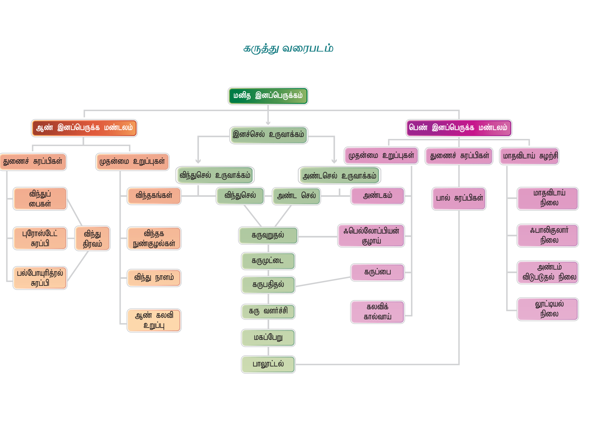
