# பாடம் 8: நோய்த்தடைக்காப்பியல்

> மூலம்: தமிழ் வழிப் பாடநூல், PDF பக்கங்கள் 161–183.

> குறிப்பு: கீழுள்ள தேடக்கூடிய உரை துல்லியமான படங்கள், அட்டவணைகள் மற்றும் அமைப்பிற்கு அசல் பக்கங்களைப் பார்க்கவும்.

அலகு – III

நோய்த்தடைக்காப்பியல்

பாடம்
நம்முள் உறைந்துள்ள இயற்ககை ஆற்றலே
உணமையான நோய் குணப்படுத்தியாகும்.
- இப்போக்கரேடஸ்

## பாட உள்ளடக்கம்

- 8.1  நோய்த்தடைகாப்பியலின் அடிப்படை

கோட்பபாடுகள்

- 8.2 இயல்பு நோய்த்தடைகாப்பு

- 8.3 பெறப்பட்ட நோய்த்தடைகாப்பு

- 8.4 நோய்த்தடைகாப்பு துலங்கல்கள்

- 8.5 நிணநீரிய உறுப்புகள்

- 8.6  எதிர்பப்பபொருள் தூண்டிகள்

(ஆன்டிஜென்கள்)

- 8.7 எதிர்பப்பபொருட்கள் (ஆன்டிபாடிகள்)

- 8.8  எதிர்பொருள் தூண்டி மற்றும்

எதிர்பொருள் இடைவினைகள்

- 8.9 தடுப்பு மருந்துகள்

- 8.10  தடுப்பு மருந்ததேற்றம் மற்றும்

நோய்த்தடுப்பாக்கம்

- 8.11 மிகைஉணரமை

- 8.12 தடைகாப்புக் குறைவு நோய்

- 8.13 சுயதடைகாப்பு நோய்கள்

- 8.14 கட்டி நோய்த்தடைக்காப்பியல்

## கற்றலின் நோக்கங்கள் :

- நோய்த்தடைகாப்பியலின் அடிப்படை
கோட்பபாடுகளை புரிந்து
கொொள்ளுதல்.
- இயல்பு நோய்த்தடைகாப்பு
மற்றும் பெறப்பட்ட
நோய்த்தடைகாப்பு

முதனமை மற்றும் இரண்டடாம் நிலை
தடைகாப்பு துலங்கல், செயலாக்க மற்றும்
மந்தமான நோய்த்தடுப்பு

ஆகியவற்றிற்கிடையே உள்ள வேறுபாட்டை
அறிதல்.
- நோய்த்தடுப்பு திட்டத்தின் முக்கியத்துவத்தை
உணர்தல்.
- மிகை உணர்தனமையின் கோட்பபாடுகளை
புரிந்து கொொள்ளுதல்.

நா

ம் இதற்கு முந்ததைய பாடத்தில்
பல்வவேறு
நோய்தொற்றுகளையும்
அதனால் மனிதனுக்கு ஏற்படக் கூடிய நோய்களைப்
பற்றியும் விரிவாக படித்துள்ளோம். இப்பாடத்தில்
நமது உடல் ஆற்றல்மிக்க நோய்த்தடைகாப்பு
அமைப்பின் மூலம் நோய் தொொற்றுகளில் இருந்து
எவ்வாறு நம்மை பாதுகாக்கிறது என விரிவாக
விவாதிக்கலாம்

## 8.1  நோய்த்தடைகாப்பியலின்

அடிப்படை கோட்பபாடுகள் (Basic
Concepts of Immunology)

என்பது
நோய்த்தடைக்காப்பு
மண்டலத்தைப்
பற்றிய
படிப்பாகும்.
இம்மண்டலம்
பல்வவேறு
நோய்கிருமிகளிடமிருந்து நம்மை பாதுகாக்கிறது.
உடலுக்குள் அயல்பொருளாக நுழையும் சூழ்நிலை
முகவர்களிடமிருந்து, உடலை பாதுகாக்க உடல்
பயன்படுத்தும் அனைத்து செயல்முறைகளையும்
இது குறிக்கிறது.
153 நோய்த்தடைகாப்பியல்

நோய்த்தடைகாப்பு
அமைப்பு
நமது
உடலில்
சரிவர
செயல்படவில்லை
எனில்
நோயை ஏற்படுத்தும் நுண்கிருமிகளுக்கு அது
சாதகமாக அமைந்து தொொற்று ஏற்பட்டு பின்
நோய் உண்டடாகிறது.
நோயை உண்டடாக்கும்
நோயூக்கிகளுக்கு
எதிரான
உடலின்
ஒட்டுமொொத்த செயல்திறனே நோய்த்தடைகாப்பு
என்றழைக்கப்படுகிறது. இதற்கு நோய் எதிர்ப்பு
என்றும் பெயருண்டு. இத்தனமை குறைவிற்கு,
எளிதில் இலக்காகும் தனமை என்று பெயர்.
நோய்த்தடுப்பு என்பது அதிக இலக்கு திறன்
கொொண்டதாகும்.

புரதங்கள், பாலிசாக்கரைடுகள், நியூக்ளிக்
அமிலங்கள் போன்ற பெரும்பபானமையானவை
ஏற்பு உயிரிகளில் அயல்பொருட்களாக இருக்கும்
போது தடைகாப்பு துலங்கலை தூண்டுகின்றன.
தடைக்காப்பு துலங்கலை ஏற்படுத்தும் திறன்
பெற்ற எந்தவொொரு பொொருளும், எதிர்பப்பபொருள்
தூண்டி (Antigen) என அழைக்கப்படுகிறது.
(ஆன்டிபாடி - எதிர்பப்பபொருள், ஜென்ரேட்டர்
- தூண்டி). நோய்த்தடைக்காப்பை இயல்பு
நோய்த்தடைகாப்பு
மற்றும்
பெறப்பட்ட
நோய்த்தடைகாப்பு என இரு பெரும் பிரிவுகளாகப்
பிரிக்கலாம் (படம் 8.1).

நமது உடலில் நுழையும் நுண்கிருமிகளை
அழித்தல் அல்லது வெளியேற்றல் மற்றும்
அவற்றினால் உருவாக்கப்படும் நச்சுக்களை
செயலிழக்கச் செய்தல் போன்ற பல்வவேறு
துலங்கல்களை
நமது
நோய்த்தடைக்காப்பு
அமைப்பு செயல்படுத்துகிறது.
இத்தகைய
வினை இயற்ககையில் அழிவுவினை என்றறாலும்
விருந்தோம்பியின் உடலில் நுழைந்த அயல்
மூலக்கூறுகளுக்கு
எதிராக
மட்டுமே
செயல்படுமே
தவிர
விருந்தோம்பிற்கு
எதிராக செயல்படாது.
அயல்பொருட்களை
நம் உடலில் இருந்து வேறுபடுத்தி அறியும்
திறன்
நோய்த்தடைக்காப்பு
அமைப்பின்
மற்றொரு
அடிப்படை
சிறப்பம்சமாகும்.
எனினும்
எப்போதாவது,
எதிர்பொருள்
தூண்டிகளையும் தன் சொொந்த செல்களையும்
வேறுபடுத்தி
அறிவதில்
நோய்த்தடைகாப்பு
அமைப்பு
தோல்வியுறுவதால்,
அவை
விருந்தோம்பியினுடைய
சொொந்த
மூலக்கூறுகளுக்கு
எதிராக
தீவிரமாக
செயல்புரிகின்றன. அதனால் உண்டடாகக்கூடிய
சுய தடைகாப்பு குறைநோய்கள் உயிரினத்தில்
இறப்பை ஏற்படுத்தக் கூடியதாகும்.

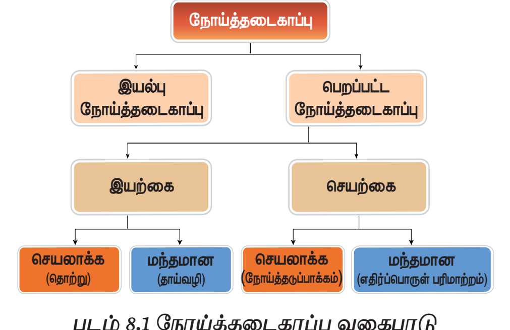

## 8.2 இயல்பு நோய்த்தடைகாப்பு

(Innate Immunity)

பல்வவேறு நுண்ணுயிரிகளுக்கு எதிராக
இலக்கு தனமையற்ற முறையில், பரந்த அளவிலான
நோய்த்தொொற்று
முகவர்களுக்கு
எதிரான
இயல்பு நோய்த்தடைகாப்பின் செயல்பபாடுகள்
அட்டவணை 8.1, படம் 8.2 ல் காட்டப்பட்டுள்ளன.
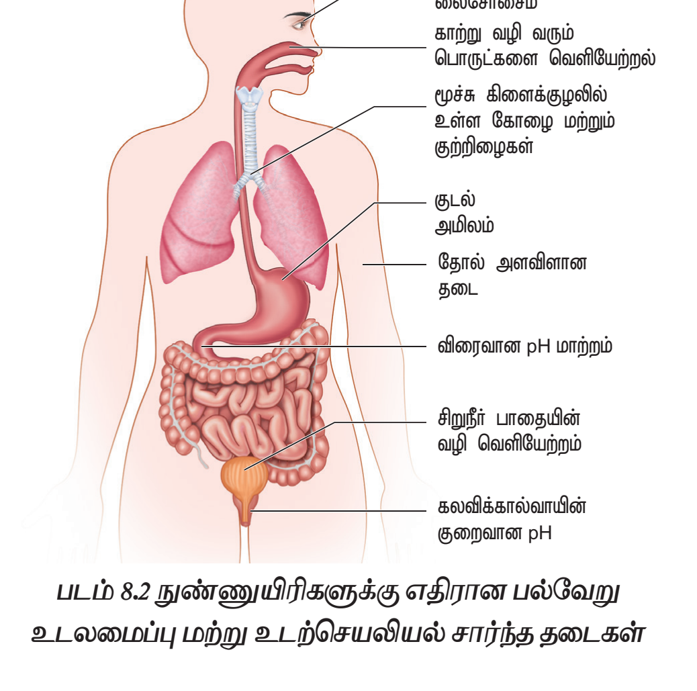

அட்டவணை 8.1

இயல்பு நோய்த்தடைகாப்பு – வகைகள் மற்றும் செயல்படும் முறைகள்

இயல்பு
நோய்த்தடைகாப்பு வகைகள்

செயல்படும் முறைகள்

1. உடல் அமைப்புச் சார்ந்த தடைகள் (Anatomical barriers)
தோல்

கோழைப்படலம்

உடலின் உள்ளே நுழையும் நுண்ணுயிரிகளை தடுக்கிறது – அதன்
அமிலச்சூழல் (pH 3-5) நுண்ணுயிரிகளின் வளர்ச்சியை குறைக்கிறது.
கோழையில்
அயல்பொருட்கள்
சிக்கிக்
ஒட்டிக்கொள்வதில்
நுண்ணுயிரிகளுடன்
போட்டியிடுகின்றன

கொொள்கின்றன.
கோழைகள்

2. உடற்சசெயலியல் சார்ந்த தடைகள் (Physiological barriers)
உடல் வெப்பநிலை

இயல்பபான உடல் வெப்பநிலை மற்றும் காய்ச்சல் நுண்கிருமிகளின்
வளர்ச்சியை தடைசெய்கின்றன

குறைந்த pH

வயிற்று சுரப்பிகள் சுரக்கும் அமிலம் (HCl) நாம் உட்கொள்ளும்
உணவோடு சேர்ந்து வரும் நுண்ணுயிரிகளை கொொல்கிறது.

வேதிய நடுவர்கள்
(Chemical mediators)

லைசோசைம் பாக்டீரியாவின் எதிர்ப்புக் காரணியாக செயல்பட்டு
பாக்டீரியாவின் செல்சுவரைத் தகர்க்கின்றன.
இன்டர்ஃபெரான்கள்
தொொற்றில்லா செல்களில் வைரஸ் எதிர்ப்பை தூண்டுகின்றன.
வெள்ளையணுக்களால் உருவாக்கப்படும் நிரப்புப் பொொருட்கள்
நோயூக்கி நுண் கிருமிகளை சிதைக்கின்றன அல்லது செல் விழுங்குதலை
எளிதாக்குகின்றன.

3. செல்விழுங்குதல் சார்ந்த
தடைகள் (Phagocytic barriers).

சிறப்பு வாய்ந்த செல்கள் (மோனோசைட்டுகள், நியூட்ரோபில்கள்,
திசுவில் உள்ள மேக்ரோஃபேஜ்கள்) நுண்ணுயிரிகளை முழுமையாக
விழுங்கி அவற்றை செரிக்கிறது.

4. வீக்கம் சார்ந்த
தடைகள்(Inflammatory barrriers)

காயம் மற்றும் நோய்கிருமிகளால் இரத்த கசிவு ஏற்படுகின்ற
போது, அப்பகுதியில் செரோட்டோனின், ஹிஸ்டமைன் மற்றும்
புரோஸ்டோகிளான்டின் ஆகிய வேதிய சமிக்ஞஞைப் பொொருள்களை
கொொண்டுள்ள இரத்தம் வெளியேறுகிறது. இப்பொருட்கள் விழுங்கு
செல்களை பாதிக்கப்பட்ட பகுதிக்கு உட்சசெலுத்துகின்றன. இந்நிகழ்வு
இரத்தகுழாய்சுவர் வழி இரத்தபொொருள் வெளியேறுதல் அல்லது
டையபீடெசிஸ் (Diapedesis) என்று பெயர்.

## 8.3  பெறப்பட்ட நோய்த்தடைகாப்பு

(Acquired Immunity)

ஒரு உயிரினம், பிறந்த பிறகு, தன் வாழ்நநாளில்
பெறும் நோய்த்தடைகாப்பே பெறப்பட்ட நோய்த்
தடைகாப்பு எனப்படும்.
மேலும் இது, ஒரு
குறிப்பிட்ட நுண்கிருமிக்கு எதிரான உடல்
எதிர்ப்புத் திறன் ஆகும்.
எதிர்பப்பபொருள் தூண்டி குறிப்பிட்ட இலக்கைத்
தாக்கும் தனமை, பல்வகைமைத் தனமை, சுய
மற்றும் அயல் மூலக்கூறுகளைக் கண்டறிதல்

மற்றும் நோய்த்தடைகாப்பு சார்ந்த நினைவாற்றல்
ஆகியவை
இவ்வகை
நோய்த்தடைகாப்பின்
சிறப்புப் பண்புகளாகும்.

பெறப்பட்ட
கூறுகள்

நோய்த்தடைகாப்பின்

பெறப்பட்ட நோய்த்தடைக்காப்பில், இரண்டு
கூறுகள் உள்ளன. 1. செல்வழி நோய்த்தடை
காப்பு 2. திரவவழி நோய்த்தடைகாப்பு அல்லது
எதிர்பப்பபொருள் வழி நோய்த்தடைகாப்பு

155 நோய்த்தடைகாப்பியல்

அட்டவணை 8.2
செயலாக்க மற்றும் மந்தமான நோய்த்தடைகாப்புகளுக்கிடையேயான வேறுபாடுகள்
வ.
எண்

செயலாக்க நோய்த்தடைக்காப்பு

மந்தமான நோய்த்தடைக்காப்பு

செயலாக்க நோய்த்தடைக்காப்பில்
தடைகாப்பு பொொருட்கள் (எதிர்பப்பபொருட்கள்)
விருந்தோம்பியின் உடலில்
உருவாக்கப்படுகின்றன.

மந்தமான நோய்த்தடைக்காப்பில் தடைகாப்பு
பொொருட்கள் (எதிர்பொருட்கள்) விருந்தோம்பியின்
உடலில் உருவாக்கப்படுவதில்லை. மாறாக
பெற்றுக் கொொள்ளப்படுகிறது. இதில்
விருந்தோம்பியின் பங்களிப்பு கிடையாது.

நுண்கிருமி அல்லது எதிர்பொருள்
தூண்டிகளின் தூண்டுதலால் இவை
உருவாக்கப்படுகின்றது.

வெளியில் இருந்து பெற்ற எதிர்பப்பபொருட்களால்
உற்பத்தியாகின்றன.

இது நீடித்த மற்றும் சிறந்த பாதுகாப்பை
அளிக்கிறன.

இது நிலையற்ற மற்றும் குறைந்த பாதுகாப்பை
அளிக்கிறது.

நோய்த்தடைகாப்பியல் நினைவாற்றலைப்
பெற்றுள்ளது.

நோய்த்தடைகாப்பியல் நினைவாற்றல் இல்லை

இவ்வகை நோய்த்தடைக்காப்பு சிறிது
காலத்திற்கு பிறகு தான் செயல்திறன்
உடையதாக மாறும்.

இவ்வகை நோய்த்தடைக்காப்பில், உடனே
நோய்த்தடைகாப்பு உருவாகிறது.

1.  செல்வழி
(Cell mediated Immunity)

நோய்த்தடைகாப்பு

எதிர்பப்பபொருள்களின்
உதவியின்றி,
செல்களினாலேயே
நோயூக்கிகள்
அழிக்கப்படுவது
செல்வழி
நோய்த்
தடைகாப்பு எனப்படும். இதற்கு T- செல்கள்
மேக்ரோஃபேஜ்கள் மற்றும் இயற்ககைக் கொொல்லி
செல்கள் ஆகியவை உதவிபுரிகின்றன.
2.  எதிர்பப்பபொருள்வழி
நோய்த்தடைகாப்பு/
திரவவழி
நோய்த்தடைகாப்பு
(Antibody mediated Immunity / Humoral mediated
Immunity)
எதிர்பப்பபொருட்களை
உற்பத்தி
செய்து
அதன் வழியாக நோயூக்கிகளை அழிக்கும்
முறைக்கு எதிர்பப்பபொருள்வழி நோய்த்தடைகாப்பு
அல்லது
திரவவழி
நோய்த்தடைகாப்பு
என்று பெயர். எதிர்பப்பபொருள் தூண்டிகளை
முன்னிலைபடுத்தும் செல்கள் (Antigen presenting
cells) மற்றும் T-உதவி செல்கள் ஆகியவற்றின்
துணையோடு
B-செல்கள்
இத்தடைகாப்பை
செயலாக்குகின்றன. எதிர்பப்பபொருள் உற்பத்தி,
முதுகெலும்பிகளின் சிறப்புப் பண்பபாகும்.

பெறப்பட்ட
வகைகள்
பெறப்பட்ட

நோய்த்தடைகாப்பின்
நோய்த்தடைகாப்பு,

செயலாக்க

நோய்த்தடைகாப்பு
நோய்த்தடைகாப்பு
(அட்டவணை 8.2).

மற்றும்
என
இரு

மந்தமான
வகைப்படும்

அ. செயலாக்க நோய்த்தடைகாப்பு
(Active Immunity)
உடலில், எதிர்பொருளை உருவாக்குவதன்
மூலம் ஏற்படும் நோய்த்தடைகாப்பு சார்ந்த
எதிர்ப்புத்
திறனே
செயலாக்க
நோய்த்
தடைகாப்பாகும். இது தனி நபரின் நோயெதிர்ப்புத்
துலங்கல்களை பயன்படுத்தி பெறப்படுகிறது.
இது இறுதியில் நினைவாற்றல் செல்களின்
தோற்றத்திற்கு வழி வகுக்கிறது.
செயலாக்க
நோய்த்தடைகாப்பு ஒரு நோய்தத்ததொற்று அல்லது
தடுப்பூசி போடுவதன் விளைவாக உருவாகிறது.

ஆ) மந்தமான
(Passive Immunity)

நோய்த்தடைகாப்பு

இவ்வகை தடைகாப்பில், எதிர்பப்பபொருள்
தூண்டிகளுக்கு
எதிராக
எதிர்பப்பபொருள்
உற்பத்தி அவசியமில்லை. புறச்சூழலிலிருந்து
எதிர்பொருட்கள்
உயிரிக்குள்
செலுத்தப்படுகின்றன.
எனவே,
தனிநபரின்
தடைகாப்பு துலங்கல் வினை செயலாக்கம்
பெறாமல்
மந்த
நோய்த்தடைக்காப்பு
பெறப்படுகிறது.
இதனால்,
நினைவாற்றல்
செல்களின் தோற்றமுறவில்லை.

அட்டவணை 8.3
முதல்நிலை மற்றும் இரண்டடாம் நிலை தடைக்காப்பு துலங்கல்களுக்கிடையேயான வேறுபாடுகள்
வ.
எண்

முதல்நிலை தடைக்காப்பு துலங்கல்கள்

இரண்டடாம் நிலை தடைக்காப்பு துலங்கல்கள்

ஒரு எதிர்பப்பபொருள் தூண்டி முதன் முதலாக
நோய்தடைக்காப்பு அமைப்புடன் தொொடர்புக்
கொொள்வதால் இவை உருவாகின்றன.

முதல் நிலையில் சந்தித்த அதே எதிர்பப்பபொருள்
தூண்டியை இரண்டடாவது அல்லது
அடுத்தடுத்து எதிர்கொள்ளும் போது
இத்தடைக்காப்பு உருவாகிறது.

எதிர்பப்பபொருளின் செறிவு 7 முதல்
10 நாட்களில் உச்ச நிலையை அடைகிறது.

எதிர்பப்பபொருளின் செறிவு 3 முதல் 5 நாட்களில்
உச்ச நிலையை அடைகிறது.

இவ்வகை நோய்தடைக்காப்பு உருவாக
நீண்ட நேரம் தேவைப்படுகிறது.

இவ்வகை நோய்தடைக்காப்பு உருவாக
குறைவான நேரமே போதுமானது.

எதிர்பப்பபொருள் அளவு விரைவாக
வீழ்ச்சியடைகிறது.

எதிர்பப்பபொருளின் அளவு நீண்ட காலம் உயர்
நிலையில் உள்ளது.

நிணநீர் முடிச்சுகள் மற்றும் மண்ணீரலால்
வெளிப்படுத்தப்படுகிறது.

எலும்புமஜ்ஜை அதனை தொொடர்ந்து
நிணநீர் முடிச்சுகள் மற்றும் மண்ணீரலால்
வெளிப்படுத்தப்படுகிறது.

எலும்பு
மஜ்ஜையில்
இரத்த செல்கள் உருவாகும்
ச ெ ய ல் மு றை க ள் ,
ஹீ ம ட் ட ோ ப ா ய சி ஸ்
(Haematopoiesis)
என
அழைக்கப்படுகிறது.

## 8.4  நோய்த்தடைக்காப்பு துலங்கல்கள்

(Immune Responses)

தடைகாப்பு துலங்கல்கள் முதல்நிலையை
அல்லது இரண்டடாம் நிலையைச் சார்ந்ததாக
இருக்கலாம் (அட்டவணை 8.3).
முதல்நிலை தடைக்காப்பு துலங்கல் - ஒரு
நோயூக்கி நோய்த்தடைக்காப்பு அமைப்புடன் முதன்
முதலாக தொொடர்பு கொொள்ளும்போது இத்தகைய
முதல்நிலை தடைக்காப்பு வெளிப்படுகிறது. இந்த
தடைகாப்பின் போது தடைகாப்பு மண்டலம்
எதிர்பொருள் தூண்டியை இனம் காணுதல்,
அதற்கு எதிரான எதிர்பப்பபொருளை உற்பத்தி
செய்தல் மற்றும் இறுதியாக நினைவாற்றல்
லிம்போசைட்டுகளை
உருவாக்குதல்
ஆகியவற்றை அறிந்து கொொள்கிறது. இவ்வகை
துலங்கல் மந்தமாகவும், குறுகிய காலம் மட்டும்
செயல்படக்கூடியதாகவும் உள்ளன.

இரண்டடாம் நிலை தடைக்காப்பு துலங்கல்
ஒரு நபர் மீண்டும் அதே நோயூக்கியை

இரண்டடாம் முறையாக எதிர்கொள்ளும்போது
இரண்டடாம்
நிலை
தடைக்காப்பு
துலங்கல்
நடைபெறுகிறது. இந்நேரத்தில் நோய்த்தடைகாப்பு
நினைவாற்றல்
தோற்றுவிக்கப்பட்டதும்
நோய்த்தடைகாப்பு
மண்டலம்
உடனடியாக
எதிர்பப்பபொருள்
உற்பத்தியை
துவக்குகிறது.
எதிர்பப்பபொருள் தூண்டிகளை கண்டறிந்த சில
மணி நேரத்திற்குள்ளே பல புதிய பிளாஸ்மமா
செல்கள்
உற்பத்தி
செய்யப்படுகின்றன.
2 அல்லது 3 நாட்களுக்குள் இரத்தத்தில் உள்ள
எதிர்பப்பபொருளின் செரிவு படிப்படியாக உயர்ந்து
முதல்நிலைத் துலங்கலை விட அதிக அளவை
அடைகிறது. எனவே இதனை ஊக்கி துலங்கல்
(Booster response) எனவும் அழைக்கலாம்.

## 8.5  நிணநீரிய உறுப்புகள்

(Lymphoid Organs)
நோய்த்தடைகாப்பு மண்டலத்தைச் சேர்ந்த,
அமைப்பிலும் மற்றும் பணியிலும் வேறுபட்ட பல
உறுப்புகள் மற்றும் திசுக்கள் உடல் முழுவதும்
பரவியுள்ளன. லிம்போசைட்டுகளின் தோற்றம்,
முதிர்ச்சி மற்றும் பெருக்கம் ஆகியவற்றில்
பங்ககேற்கும் உறுப்புகள் நிணநீரிய உறுப்புகள் என
அழைக்கப்படுகின்றன (படம் 8.3).
பணியின்
அடிப்படையில்
இவற்றை
முதல்நிலை
அல்லது
மைய
நிணநீரிய
உறுப்புகள் (Primary or central lymphoid organs)
மற்றும் இரண்டடாம் நிலை அல்லது புற அமைப்பு
நீணநீரிய உறுப்புகள் (secondary or peripheral
157 நோய்த்தடைகாப்பியல்

ºî™G¬ô
GícKò àÁŠ¹èœ

Þó‡ì£‹ G¬ô
GícKò àÁŠ¹èœ

¬îñv

Gíc˜ º®„²èœ

ñ‡aó™

CÁ°ìL™ àœ÷
«ðò˜ F†´èœ
⽋¹
ñx¬ü

Gíc˜ º®„²èœ

முதல்நிலை நிணநீரிய உறுப்புகள்
(Primary Lymphoid organs)

பறவைகளின்
ஃபேப்ரீசியஸ்
பை,
பாலூட்டிகளில்
எலும்பு
மஜ்ஜை
மற்றும்
தைமஸ்
சுரப்பி
போன்றவை
முதல்நிலை
நிணநீரிய
உறுப்புகளாகும்.
இவை
லிம்போசைட்டுகளின் உற்பத்தி மற்றும் தொொடக்க
நிலைத் தேர்வு ஆகியவற்றில் பங்ககேற்கின்றன.
இவ்வகை லிம்போசைட்டுகள் ஒவ்வொன்றும்
எதிர்பப்பபொருள்
தூண்டியின்
மீது
குறிப்பு
தனமை கொொண்டவை. முதல்நிலை நிணநீரிய
உறுப்புகளில் முதிர்ச்சியடைந்த லிம்போசைட்
செல்கள் மட்டுமே நோய்தடைக்காப்பு திறன்
பெற்ற செல்களாகின்றன (Immunocompetent cells).
பாலூட்டிகளில் B- செல்களின் முதிர்ச்சி எலும்பு
மஜ்ஜையிலும் மற்றும் T- செல்களின் முதிர்ச்சி
தைமஸிலும் நடைபெறுகின்றன.

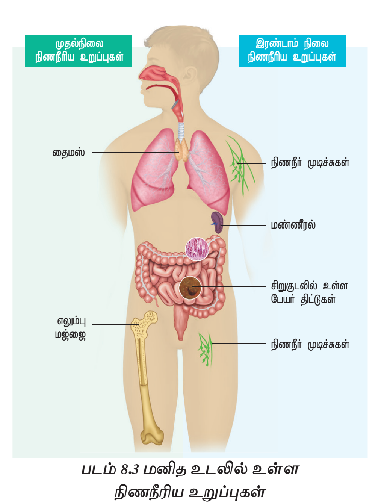

lymphoid organs) என பிரிக்கலாம். முதல்நிலை
நிணநீரிய
உறுப்புகள்
லிம்போசைட்களின்
முதிர்ச்சிக்கு தேவையான சூழலை வழங்குகிறது.
இரண்டடாம்
நிலை
நிணநீரிய
உறுப்புகள்
எதிர்பப்பபொருள் தூண்டிகளை பிடித்து அவற்றை
முதிர்ந்த லிம்போசைட்டுகளுடன் சேர்க்கின்றன.
பின்னர் லிம்ஃபோசைட்டுகள் எதிர்பப்பபொருள்
தூண்டிகளுடன்
சண்டடையிட்டு
அவற்றை
அழிக்கின்றன.

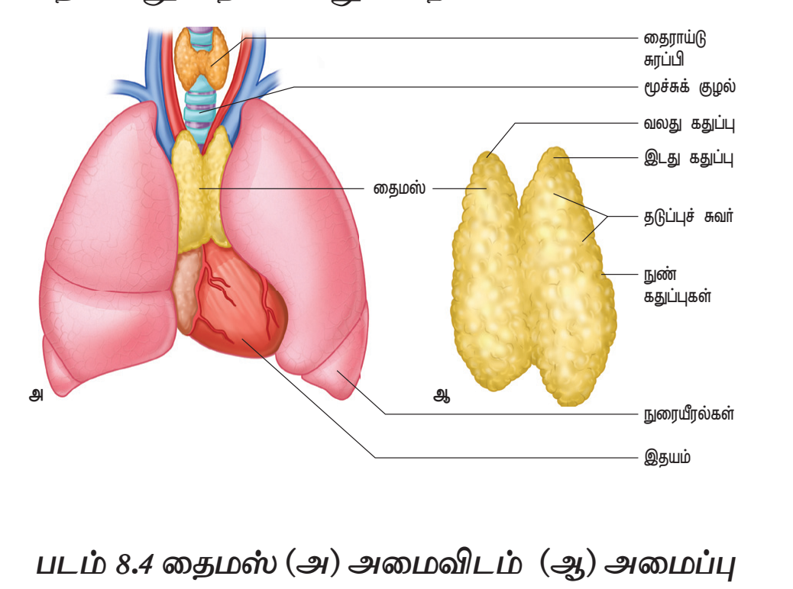

தைமஸ் (Thymus)

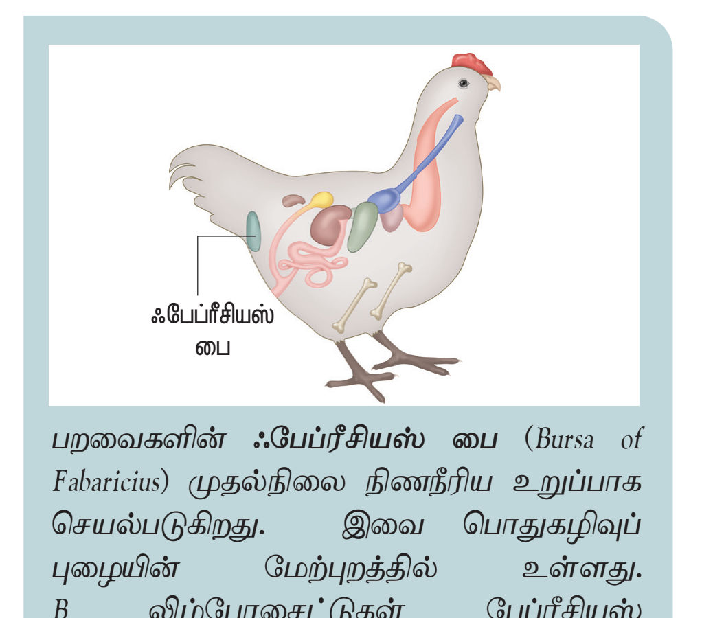

பறவைகளின் ஃபேப்ரீசியஸ் பை (Bursa of
Fabaricius) முதல்நிலை நிணநீரிய உறுப்பாக
செயல்படுகிறது.
இவை பொொதுகழிவுப்
புழையின்
மேற்புறத்தில்
உள்ளது.
B
லிம்போசைட்டுகள்
பேப்ரீசியஸ்
பையில்
முதிர்ச்சியடைந்து
திரவழி
நோய்தடைக்காப்பில் ஈடுபடுகின்றன..

தட்டையான இரண்டு கதுப்புகளை கொொண்ட
தைமஸ்,
மார்பபெலும்புக்குப்
பின்புறமும்
இதயத்திற்கு
மேலாகவும்
அமைந்துள்ளன.
தைமசின் ஒவ்வொரு கதுப்பும் பல எண்ணற்ற
நுண்
கதுப்புகளால்
ஆக்கப்பட்டுள்ளது.
நுண்கதுப்புகளை இணைப்புத் திசுவால் ஆன
தடுப்புச் சுவர் பிரிக்கிறது. ஒவ்வொரு நுண் கதுப்பும்
கார்டடெக்ஸ் என்னும் புற அடுக்கையும் மெடுல்லா
என்னும் அக அடுக்கையும் கொொண்டுள்ளன.
கார்டடெக்ஸ்
பகுதியில்
தைமோசைட்டுகள்
என்னும் முதிர்ச்சியடையாத T செல்கள் அடர்ந்து
காணப்படுகின்றன.
மெடுல்லாவில் குறைந்த
அளவிலான முதிர்ச்சியடைந்த தைமோசைட்டுகள்
காணப்படுகின்றன.
தைமஸிலிருந்து
தைமோசின் என்னும் மிக முக்கிய ஹார்மோன்
உற்பத்தியாகிறது. அது ‘T’ செல்களைத் தூண்டி
அவற்றை
முதிர்ச்சியடையச்
செய்கிறது

மற்றும் தடைகாப்பு திறன் பெற்ற செல்களாக
மாற்றுகின்றன. பதின்பருவத்தின் தொொடக்கத்தில்
இச்சுரப்பி செயல்நலிவுறுகிறது. அவ்விடத்தில்
அடிபோஸ் திசு பதிலீடாக வளர்கிறது. பிறந்த
குழந்ததைகளிலும் விடலைப்பருவத்தினரிடத்திலும்
தைமஸ் அதிக செயல்திறனுடன் செயல்புரிகிறது
(படம் 8.4).

எலும்பு மஜ்ஜை (Bone marrow)
எலும்பு மஜ்ஜை ஒரு நிணநீரிய திசுவாகும்.
இது எலும்பின் பஞ்சு போன்ற பகுதியினுள்
வைக்கப்பட்டுள்ளது.
எலும்பு மஜ்ஜையில்
காணப்படும் மூலச் செல்கள் (Stem cells),
குருதியாக்க
செல்கள்
(Haematopoietic
cells)
என அழைக்கப்படுகின்றன.
இச்சசெல்கள்
செல்பிரிதல் மூலம் பல்கி பெருகும் ஆற்றலைக்
கொொண்டுள்ளன.
மேலும் இவை தண்டுச்
செல்களாகவே நீடிக்கின்றன அல்லது வேறுபாடு
அடைந்து பல்வவேறு இரத்த செல்களாக மாறுகின்ற
திறன் கொொண்டவையாக உள்ளன.

இரண்டடாம் நிலை அல்லது புறஅமைவு
நிணநீரிய உறுப்புகள்

இரண்டடாம் நிலை அல்லது புறஅமைவு
நிணநீரிய
உறுப்புகளில்
எதிர்பப்பபொருள்
தூண்டிகள் ஒரு முகப்படுத்தப்பட்டிருப்பதால்,
அவற்றோடு
முதிர்ந்த
லிம்போசைட்டுகள்
எளிதில் வினைபுரிய ஏதுவாகின்றது. மண்ணீரல்,
நிணநீர் முடிச்சுகள், குடல்வவால், வயிற்றுக்குடல்
பாதையில் உள்ள பேயர் திட்டுகள், டான்சில்கள்,
அடினாய்டுகள், MALT (கோழை படலம் சார்ந்த
நிணநீரியத் திசுக்கள்) GALT (குடல் சார்ந்த
நிணநீரிய
திசுக்கள்)
BALT
(மூச்சுக்குழல்
சார்ந்த
நிணநீரிய
திசுக்கள்)
போன்றவை
இரண்டடாம் நிலை நிணநீரிய உறுப்புகளுக்கு
எடுத்துகாட்டுகளாகும்.

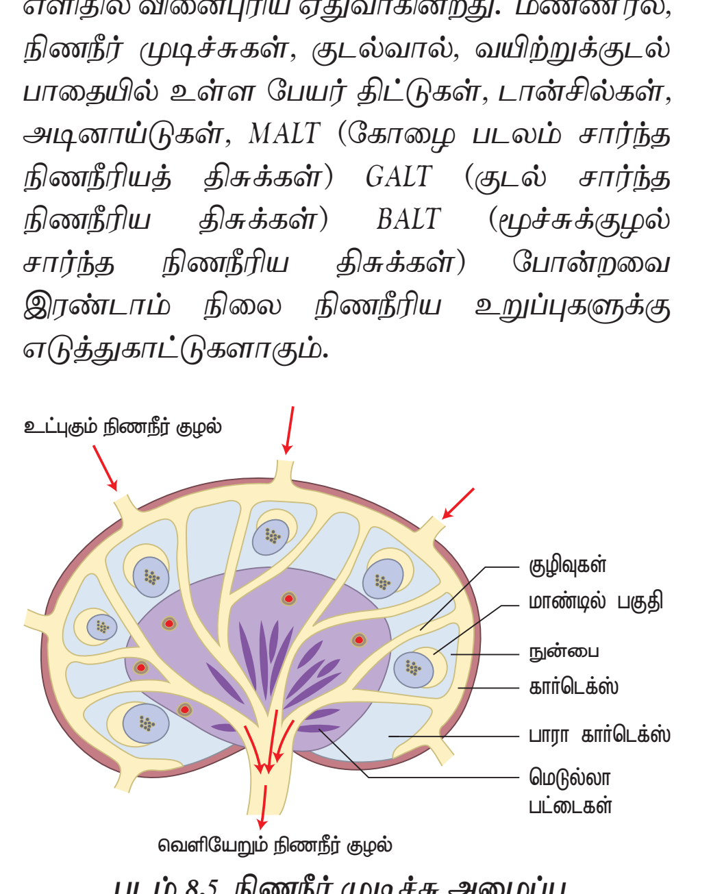

பேயர்
திட்டுகள்
(Peyers’s
patches)
நீள்வட்ட வடிவத்தில் தடித்து காணப்படும்
ஒரு திசுவாகும். இவை மனிதன் மற்றும்
முதுகெலும்பு
உயிரிகளின்
சிறுகுடலில்
உள்ள கோழையை சுரக்கும் படலத்தில்
புதைந்துள்ளன.
பேயர்
திட்டுகள்
மேக்ரோஃபேஜ்கள், டென்ரரைட்டிக் செல்கள்,
T செல்கள் மற்றும் B செல்கள் போன்ற
பல்வவேறு வகையான நோய்தடைக்காப்பு
செல்களைக் கொொண்டுள்ளன.
டான்சில்கள்
(Tonsils)
(அண்ண
டான்சில்கள்) ஒரு இணையான மென்
திசுவாகும். இவை தொொண்டடையின் பின்புறம்
அமைந்துள்ளன.
டான்சில்கள் நிணநீர்
மண்டலத்தின் ஒரு பகுதியாகும்.
இவை
தொொற்றுகளுக்கு எதிராக போராடுவதில்
உதவுகின்றன. மேலும் இவை உள்நுழையும்
பாக்டீரியா
மற்றும்
வைரஸ்
போன்ற
நுண்கிருமிகளை தடுத்து நிறுத்துகின்றன.
மண்ணீரல் (Spleen) ஒரு இரண்டடாம் நிலை
நிணநீரிய உறுப்பாகும். இது வயிற்றுக்குழிக்கு
மேலே உதரவிதானத்துக்கு நெருக்கமாக
அமைந்துள்ளன. T மற்றும் B செல்களை
கொொண்டுள்ள மண்ணீரல் செல்வழி மற்றும்
திரவவழி நோய்தடைகாப்பில் ஈடுபடுகின்றன.

நிணநீர் முடிச்சு (Lymph node)
நிணநீர்
முடிச்சு
சிறிய
அவரைவிதை
போன்ற வடிவத்தை உடையது. இவை உடலின்
நோய் எதிர்ப்பு மண்டலத்தின் ஒரு பகுதியாகும்.
இவை
திசு
இடைவெளியில்
நுழைகின்ற
எதிர்பப்பபொருள்
தூண்டியை
அழிக்கின்ற
முதல் அமைப்பாகும்.
நிணநீர் முடிச்சுகள்
நிணநீர் திரவத்துடன் வருகின்ற பொொருட்களை
வடிகட்டி பிடிக்கின்றன.
மாக்ரோஃபேஜ்கள்
மற்றும்
லிம்போசைட்டுகள்
போன்ற
வெள்ளையனுக்களால்
நிணநீர்
முடிச்சு
நிரம்பியுள்ளது. உடல் முழுக்க நூற்றுக்கணக்கான
நிணநீர் முடிச்சுகள் பரவியுள்ளன.
இவை
ஒன்றுடன்
ஒன்று
நிணநீர்
நாளங்களால்
இணைக்கப்பட்டுள்ளன.
நிணநீர் என்பது
தெளிவான ஒளி ஊடுருவக்கூடிய, நிறமற்ற,
ஓடக்கூடிய மற்றும் செல்லுக்கு வெளியே
காணப்படும் திரவ இணைப்பு திசுவாகும். நிணநீர்
முடிச்சுகளின் வழியாக நிணநீர் பாய்ந்து வரும்

159 நோய்த்தடைகாப்பியல்

அ டி ன ா ய் டு க ள்
என்பது
வாயினுடைய
கூ ரை ப கு தி யி ல்
(Roof
of
mouth)
மென்
அண்ணத்துக்கு பின்னால்,
நுகர்ச்சி
உறுப்பு
தொொண்டடையுடன்
சேருமிடத்தில் அமைந்துள்ள சுரப்பியாகும்.
அடினாய்டுகள், எதிர்பொருட்களை உற்பத்தி
செய்து தொொற்றுக்கு எதிரான செயலுக்கு
உதவிபுரிகின்றன. பொொதுவாக இவை விடலை
பருவத்தின் (Adolescence) போது சுருங்க
தொொடங்கி முதிர்ககாலத்தில் (Adulthood) மறைந்து
விடுகின்றன.
போது எதிர்பப்பபொருள் தூண்டி பொொருட்களை
வடிகட்டி
பிடித்து
விழுங்கு
செல்கள்,
நுண்பபை செல்கள் மற்றும் விரலமைப்புடைய
டென்டிரைட்டிக்
செல்கள்
ஆகியவற்றால்
அழிக்கப்படுகின்றன.
கார்டடெக்ஸ்,
பாராகார்டடெக்ஸ்
மற்றும்
மெடுல்லா ஆகிய மூன்று அடுக்குகள் நிணநீர்
முடிச்சில் உள்ளன (படம் 8.5). வெளி அடுக்கான
கார்டடெக்ஸில் B-லிம்போசைட்டுகள், மேக்ரோ
பேஜ்கள், நுண்பபை டென்டிரைட்டிக் செல்கள்
ஆகியவை உள்ளன. கார்டடெக்ஸஸுக்கு கீழே உள்ள
பகுதி பாராகார்டடெக்ஸ் ஆகும். இதில் ஏராளமான
T-லிம்போசைட்டுகள்
மற்றும்
விரலமைப்பு
கொொண்ட டென்டிரைட்டிக் செல்கள் ஆகியவை
உள்ளன. மெடுல்லாவின் உள்பகுதியில் குறைந்த
அளவிலான B-லிம்போசைட்டுகள் உள்ளன.
ஆனால் அதில் பெரும்பபாலானவை எதிர்பொருள்
மூலக்கூறுகளை உற்பத்தி செய்யும் பிளாஸ்மமா
செல்களாகும். நிணநீர் முடிச்சு பகுதிகளான
கார்டடெக்ஸ், பாராகார்டடெக்ஸ் மற்றும் மெடுல்லா
பகுதி வழியாக நிணநீர் மிக நிதானமாக
செல்லும் போது விழுங்கு செல்கள் மற்றும்
டெண்ரரைட்டிக் செல்கள் நிணநீர் வழியாக வரும்
எதிர்பப்பபொருள் தூண்டிகளை வடிகட்டுகின்றன.
நிணநீர் முடிச்சை விட்டு நிணநீர் வெளியேறும்
போது நிணநீர் முடிச்சுகளுக்குள் நுழைந்த
எதிர்பப்பபொருள்
தூண்டிக்கு
எதிராக
மெடுல்லாவின் பிளாஸ்மமா செல்கள் சுரந்த
ஏராளமான எதிர்பப்பபொருட்களை தன்னுடன்
எடுத்துச் செல்கிறது.
லிம்போசைட்டுகளின்
எண்ணிக்கை அதிகரிக்கும்போதும் தடைக்காப்பு
துலங்கலை
ஆற்றலுடன்
செயல்படுத்தும்
போதும்
நிணநீர்
முடிச்சுகள்
வீங்குவதை

கோழைபடலம் சார்ந்த
நிணநீரியத்
திசுக்கள் (MALT) உணவு மண்டலம், சுவாச
மண்டலம் மற்றும் சிறுசீரக இனப்பபெருக்க
பாதையில் சிறிய அளவில் பரவியுள்ளன.
MALTல்
ஏராளமான
எண்ணிக்கையில்
லிம்போசைட்டுகளின் வகையான T மற்றும்
B செல்கள் பிளாஸ்மமா செல்கள் மற்றும்
மேக்ரோஃபேஜ்கள் ஆகியவை உள்ளன.
இவை கோழை எபிதீலிய படலத்தின்
வழியாக வரும் எதிர்பப்பபொருள் தூண்டிகளை
அழிக்கின்றன. இது இம்யுனோகுளோபுலின்
A எதிர்ப்பு பொொருளையும் கொொண்டுள்ளது
குடல்சசார்ந்த
நிணநீரியத் திசுக்கள்
(GALT) கோழைப்படலம் சார்ந்த நிணநீரியத்
திசுக்களின் ஒரு பகுதியாகும்.
இவை
குடலில் நுழையும் நுண்ணுயிர் கிருமிகளில்
(எதிர்பொருள் தூண்டிகள்) இருந்து உடலை
பாதுகாக்கும் அமைப்பாக செயல்படுகிறது.
மூச்சுக்குழல் சார்ந்த
நிணநீரியத்
திசுக்கள் (BALT) கோழைப்படலம் சார்ந்த
நிணநீரியத் திசுக்களின் ஒரு பகுதியாகும்.
இவை நிணநீரிய திசுக்களால் (டான்சில்கள்,
நிணநீர் முடிச்சுகள், நிணநீர் நுண்பபைகள்)
ஆக்கப்பட்டுள்ளன.
இவை
நுகர்ச்சி
குழிகளில் இருந்து நுரையீரல் வரையுள்ள
சுவாசப் பதையின் கோழைப் படலத்தில்
காணப்படுகின்றன.
தெளிவாக காணமுடிகிறது. இவ்வீக்கம் நோய்
தொொற்றின் அறிகுறியாகும். உடலெங்கும் நிணநீர்
முடிச்சுகள் பலகுழுக்களாக உள்ளன. அடிக்கடி
வீங்கும் நிணநீர் முடிச்சுகள் கழுத்து, கீழ்ததாடை,
கக்கங்கள் (armpits) மற்றும் தொொடை இடுக்கு ஆகிய
பகுதிகளில் காணப்படுகின்றன.

நோய்த்தடைக்காப்பு மண்டலத்தின்
செல்கள் (Cells of the immune system)
நோய்த் தடைக்காப்பு மண்டலம் ஒன்றறை
ஒன்று சார்ந்த பல செல்களால் ஆக்கப்பட்டுள்ளன.
இச்சசெல்கள் நுண்கிருமிகள் மற்றும் புற்றுநோய்
கட்டி செல்களின் வளர்ச்சி ஆகியவற்றிடமிருந்து
உடலை பாதுகாக்கின்றன. வளர்ந்த மனிதனின்
இரத்ததில்
உள்ள
செல்
பொொருட்களை
அட்டவணை 8.4 ல் காணலாம்.
இந்த அனைத்து வகையான செல்களும்
பகுதி திறன் (Pluripotent) கொொண்ட குருதியாக்க
மூலச் செல்களில் (Haematopotic stem cells)

அட்டவணை 8.4

இரத்தத்தில் உள்ள செல் பொொருட்கள்

செல்வகை

செல்களின் எண்ணிக்கை /μl

விழுக்காடு

இரத்தசிவப்பணுக்கள்

4200,000 – 6500,000

இரத்த வெள்ளையணுக்கள்
துகள்களற்ற வெள்ளையணுக்கள்
லிம்போசைட்டுகள்

1500 – 4000

20-30

மோனோசைட்டுகள்

200-950

2-7

துகள்உள்ள வெள்ளையணுக்கள்
நியூட்ரோபில்கள்

2000-7000

50-70

பேசோபில்கள்

50-100

<1

இயோசினோபில்கள்

40-500

2-5

பிளேட்லலெட்டுகள்

150,000-500,000

ð°F Fø¡ ªè£‡ì Íô„ ªê™
GícKò ªê™èO¡
Ýó‹ð G¬ô

î¬ê꣘‰î ªê™èO¡
Ýó‹ð G¬ô

B ªê™

CõŠðµ
ªê™èO¡
Ýó‹ðG¬ô

CõŠðµ

T ªê™
¶èœ ꣘‰î «ñ£«ù£¬ê†
ªê™èO¡ Ýó‹ðG¬ô

«ð«ê£çH™ ìòµ‚èœ Þ«ò£C«ù£çH™

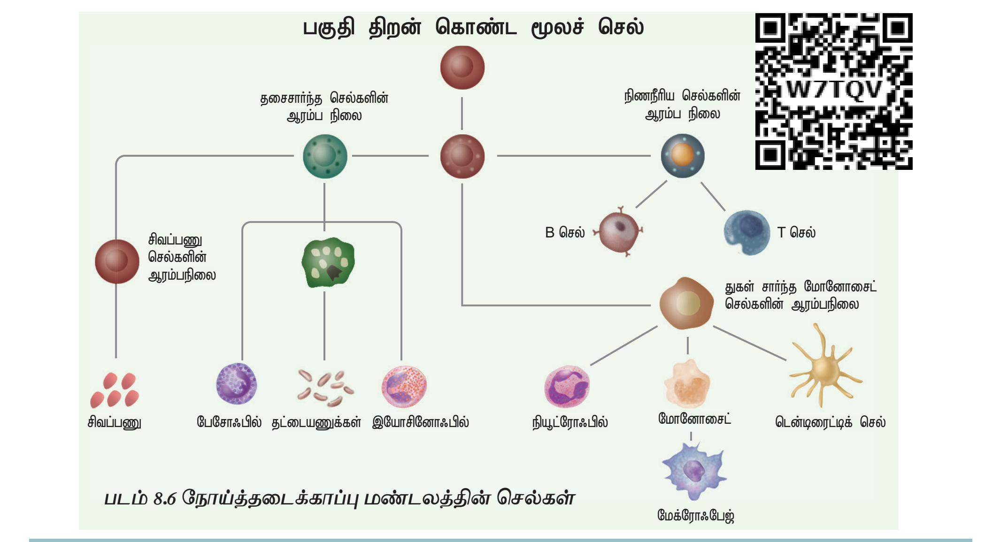
ªê™èO¡ Ýó‹ðG¬ô

«ð«ê£çH™ ìòµ‚èœ Þ«ò£C«ù£çH™

GΆ«ó£çH™

படம் 8.6 நோய்த்தடைக்காப்பு மண்டலத்தின் செல்கள்

«ñ£«ù£¬ê†

ªì¡®¬ó†®‚ ªê™

«ñ‚«ó£ç«ðx

டென்ரரைடிக் செல்கள் நீண்ட, மெல்லிய சவ்வின் நீட்சிகாலால் சூழப்பட்டு, நரம்பு செல்லின்
டென்ரரைட்டுகள் போலத் தோன்றுவதால் அவை அவ்விதம் அழைக்கப்படுகிறது. இவை எதிர் பொொருள்
தூண்டிகளை T-ஹெல்பர் செல்களிடம் வழங்குகிறது. நான்கு வகையான டென்ரரைட்டு செல்கள்
அறியப்பட்டுள்ளன. அவையாவன லாங்கர்ஹஹான்கள், இடையீட்டுச் செல்கள், மைலாய்டு மற்றும்
லிம்ப்பாய்டு செல்களாகும்.
இருந்து

தோன்றியவையாகும்.

மூலச்

செல்லும்,

ஒவ்வொரு

சிவப்பணுக்கள்,

வெள்ளையணுக்கள் மற்றும் பிளேட்லலெட்டுகள்
ஆகிய அனைத்தையும் உருவாக்கும் திறனைப்
பெற்றுள்ளன.

எதிர்பப்பபொருள் தூண்டிகளை

குறிப்பாக

இனம்கண்டு

அவற்றுக்ககெதிரான

தடைகாப்பு

துலங்கலை

வெளிப்படுத்துபவை

லிம்போசைட்டுகள்

மட்டுமே.

இலக்கற்ற

தடைகாப்பு துலங்கல், எதிர்பொருள் தூண்டிகளை

முன்னிலைப்படுத்துதல் மற்றும் சைட்டோகைன்
உற்பத்தி ஆகியவற்றை இரத்தத்திலுள்ள பிறவகை
வெள்ளையணுக்கள் செய்கின்றன.

லிம்போசைட்டுகள்
இரத்தத்திலுள்ள
வெள்ளையணுக்களில்
ஏறத்தாழ 20-30% லிம்போசைட்டுகள் ஆகும்.
இச்சசெல்லின்
பெரும்பகுதியை
உட்கரு
நிரப்பியுள்ள நிலையில் சிறிய அளவிலான
சைட்டோபிளாசம்
மட்டும்
காணப்படுகிறது.
161 நோய்த்தடைகாப்பியல்

B மற்றும் T என இரண்டு வகை லிம்போசைட்டுகள்
உள்ளன.
இருவகை செல்களும் எலும்பு
மஜ்ஜையில் தோன்றுகின்றன. இதில் ‘B’ செல்கள்
எலும்பு
மஜ்ஜையிலேயே
தங்கி,
வளர்ந்து
முதிர்ச்சி அடைந்து B- லிம்போசைட்டுகளாக
மாறுகின்றன. பின்னர் சுற்றோட்ட மண்டலத்தின்
வழியாக உடலெங்கும் சுற்றி வருகின்றன.
இவற்றில் சில இரத்தத்திலேயே தங்கி விட
மற்றவை
இரண்டடாம்
நிலை
நிணநீரிய
உறுப்புகளான நிணநீர் முடிச்சு, மண்ணீரல்
ஆகியவற்றை
சென்றடைகின்றன.
T-லிம்போசைட்டுகள் எலும்பு மஜ்ஜையிலிருந்து
வெளியேறி,
தைமஸை
அடைந்து
முதிர்ச்சி அடைகின்றன.
முதிர்ந்தவுடன்,
B செல்கள் போலவே T செல்களும் அதே
பகுதியிலேயே
சென்று
சேருகின்றன.
லிம்போசைட்டுகள் தங்கள் பரப்பின் மீது
உணர்வவேற்பி
புரதங்களைப்
பெற்றுள்ளன.
B- செல்களின் புறப்பரப்பில் காணப்படுகின்ற
உணர்வவேற்பிகள் (Receptors) எதிர்பப்பபொருள்
தூண்டிகளுடன் இணைந்தவுடன் B- செல்கள்
தூண்டப்பட்டு, விரைவாக பெருக்கமடைந்து
பிளாஸ்மமா செல்களை உற்பத்தி செய்கின்றன.
பிளாஸ்மமா செல்கள் எதிர்பப்பபொருளை உற்பத்தி
செய்கின்றன. சில ‘B’ செல்கள் எதிர்பப்பபொருளை
உற்பத்தி
செய்யாமல்
நினைவாற்றல்
செல்களாகின்றன. நினைவாற்றல் செல்கள்
இரண்டடாம் நிலை தடைகாப்பு துலங்கல்களில்
(Secondary Immune Responses) ஈடுபடுகின்றன.
T –லிம்போசைட்டுகள் எதிர்பப்பபொருள்களை
உற்பத்தி செய்வதில்லை. மாறாக, எதிர்பப்பபொருள்
தூண்டி
முன்னிலைப்படுத்தும்
நோயூக்கி
செல்களை அடையாளம் கண்டு அழிக்கின்றன.
T-செல்களில் உதவி T-செல்கள், கொொல்லி
T-செல்கள் என இரு பெரும் வகைகள்
காணப்படுகின்றன.
உதவி T-செல்கள், சைட்டோகைன் எனும்
வேதிப்பொருளை
வெளியேற்றுகின்றன.
இவ்வேதிப்பொருள்,
B-செல்களைத்
தூண்டுகின்றன.
உடலெங்கும் சுற்றிவரும்
கொொல்லி T- செல்கள், சேதமடைந்த செல்களையும்
தொொற்றுக்களையும் அழிக்கின்றன (படம் 8.6).
மேற்கண்ட
செல்களைத்
தவிர்த்து,
நியுட்ரோஃபில்கள்
மற்றும்
மோனோசைட்
செல்களும், செல் விழுங்கல் முறையில் அயல்
செல்களை அழிக்கின்றன. மோனோசைட்டுகள்
பெரிய
செல்களாக,
முதிர்ச்சியடைந்ததும்
மேக்ரோஃபேஜ்கள் என்று அழைக்கப்படுகின்றன.

இவையும் அயல் உயிரிகளை, செல்விழுங்கல்
முறையில் அழிப்பனவாகும்.

## 8.6  எதிர்பப்பபொருள் தூண்டிகள்

(Antigens)

எதிர்பொருள் தூண்டிகள் எனும் சொொல்லுக்கு
இருவிதமாக பொொருள் கொொள்ளப்படுகிறது. ஒன்று
இவை தடைக்காப்பு துலங்கலை உண்டடாக்கும்
மூலக்கூறுகளை விளக்குகிறது.
மற்றொன்று
முன்னர்
உருவாகிய
எதிர்பப்பபொருளுடன்
வினைபுரியும் மூலக்கூறுகளைக் குறிக்கிறது.
பொொதுவாக எதிர்பப்பபொருள் தூண்டிகள் என்பவை
கண்டுபிடிக்கக் கூடிய தடைக்காப்பு துலங்கல்களை
ஏற்படுத்தும் பெரிய சிக்கலான மூலக்கூறுகளாகும்.
மேலும் ஒரு குறிப்பிட்ட எதிர்பப்பபொருள் அல்லது
T-செல் புற ஏற்பியுடன் வினைபுரியும் ஒரு
பொொருளே எதிர்பப்பபொருள் தூண்டி எனப்படும்.
மேலும்
இச்சொல்,
தடைகாப்பு
தூண்டி
(Immunogen) என்பதற்கு இணைபொொருட்சொல்லாக
பயன்படுத்தப்படுகிறது.
முதனமை திசுபொொருத்த
எதிர்பப்பபொருள்
தூண்டிகள்
என்பவை
செல்களின்
புறபரப்பில்
காணப்படும்
எதிர்பொருள் தூண்டிகளாகும்.
இவை
தடைக்காப்பு துலங்கல்களை தூண்டுவதன்
விளைவாக ஒரே இன உயிரிகளுக்கிடையே
மாற்றப்படும்
உறுப்புகள்
நிராகரிக்கப்படுகிறது. (Rejection of Allografts)

தடைக்காப்பு தூண்டி (Immunogen) என்பவை
தடைக்காப்பு துலங்கல்களை தூண்டக்கூடிய
ஒரு மூலக்கூறு ஆகும். ஹாப்டடென்கள் (Haptens)
என்பவை தடைகாப்பு துலங்கலைத் தூண்டடாத,
ஆனால் ஏற்கனவே உருவாக்கப்பட்ட குறிப்பிட்ட
எதிர்பப்பபொருளுடன் வினைபுரியக்கூடியதாகும்.
எதிர்பப்பபொருள்
தூண்டிக்ககெதிரான
தடைக்காப்பு
துலங்கல்களை
அதிகரிக்க
செய்கின்ற வேதிப்பொருள் துணையூக்கிகள்
(Adjuvants)
எனப்படும்.
எபிடோப்
(Epitope)
என்பவை எதிர்பொருள் தூண்டியின் செயல்மிகு
பகுதியாகும்.
மேலும் இது எதிர்பப்பபொருள்
தூண்டி நிர்ணயக்கூறுகளாகும்.
பாராடோப்
(Paratope) என்பது எதிர்பப்பபொருள் தூண்டி
பிணையும் பகுதியாகும்.
எதிர்பப்பபொருளின்
பகுதியான இது எதிர்பப்பபொருள் தூண்டிகளைக்
கண்டறிந்து அவற்றுடன் பிணைகின்றன.

எதிர்பப்பபொருள் தூண்டிகளின் வகைகள்
உருவாக்கத்தின்
எதிர்பொருள்
எதிர்பப்பபொருள்

அடிப்படையில்

தூண்டிகளை
தூண்டிகள்’

‘புறந்தோன்றி
மற்றும்

‘அகந்தோன்றி எதிர்பப்பபொருள் தூண்டிகள்’ என
இருவகையாக பிரிக்கலாம்.
எ தி ர் ்பப்பபொ ரு ள்
உருவாக்கும்
திறன்
(Antigenicity)
என்பது
ஒரு
எதிர்பப்பபொருள்
தூண்டி
ஒரு குறிப்பிட்ட தடைக்காப்பு துலங்கலால்
உருவான எதிர்பப்பபொருளுடன் வினைபுரிய
அனுமதிக்கும் பண்பபாகும்.
நுண்ணுயிரிகள்,
மகரந்த
துகள்கள்
மருந்துபொொருட்கள்
மற்றும்
மாசுபடுத்திகள்
வெளிச்சூழலில்
இருந்து
விருந்தோம்பியின்
உடலில்
நுழைவதால்
அவைகள்
புறந்தோன்றி
எதிர்பொருள்
தூண்டிகள்
என அழைக்கப்படுகின்றன.
தனி உயிரியின்
உடலுக்குள்ளே
உருவாகும்
எதிர்பப்பபொருள்
தூண்டிகள்
அகந்தோன்றி
எதிர்பொருள்
தூண்டிகளாகும்.
எ.கா மனித இரத்தவகை
எதிர்பொருள் தூண்டிகள்.

## 8.7 எதிர்பொருள்கள் (Antibodies)

எதிர்பப்பபொருள்
தூண்டிகளுக்கு
எதிராக
உற்பத்தி
செய்யப்படும்
புரத
மூலக்கூறுகளே
எதிர்பொருட்கள்
அல்லது
இம்யுனோகுளோபுலின்
(Ig)
எனப்படும்.
இவை எதனால் உருவாக்கப்பட்டதோ அந்த
எதிர்பப்பபொருள்
தூண்டியோடு
மட்டுமே
வினைபுரியக்கூடியதாகும்.
நம் உடலுக்குள்
நோயூக்கிகள்
உள்நுழைந்தவுடன்
அவற்றுக்கு எதிராக, B-லிம்போசைட்டுகள்,
எதிர்பப்பபொருட்கள் என்னும் புரதப் பொொருட்களை
உற்பத்தி செய்கின்றன. எனவே எதிர்பொருள்
தூண்டிகளுக்கு எதிராக B-செல்கள் உற்பத்தி
செய்யும்
செல்கள்
பிளாஸ்மமா
செல்கள்
எனப்படும். உடற்சசெயலிய மற்றும் உயிர்வவேதிய
பண்புகளை
அடிப்படையாகக்
கொொண்டு
எதிர்பப்பபொருட்கள் IgG (காமா), IgM (மியு), IgA
(ஆல்ஃபா), IgD (டெல்டடா) மற்றும் IgE (எப்சிலான்)
என வகைப்படுத்தப்பட்டுள்ளது.

1950
களில்
போர்டடெர்
(Porter)
மற்றும்
ஈடெல்மமென்
(Edelmen)
ஆகியோர்,
செய்த
சோதனைகளின்
முடிவில்,
இம்யுனோகுளோபினின் அடிப்படை அமைப்பு
கண்டுபிடிக்கப்பட்டது.
இந்த
எதிர்பப்பபொருள்
Y-வடிவ அமைப்புடன் நான்கு பாலிபெப்டடைடு
சங்கிலிகளை கொொண்டதாகும். அவற்றில் ஒத்த
அமைப்புடைய, நீளம் குறைவான, இரண்டு
இலகுவான அல்லது லேசான சங்கிலிகளும்
(L-சங்கிலிகள்) நீளம் அதிகமான இரண்டு
கனமாக சங்கிலிகளும் (H-சங்கிலிகள்) உள்ளன.
இம்மூலக்கூறின் இலகுவான சங்கிலிகள் ஏறத்தாழ
25,000 டால்டன் மூலக்கூறு எடையையும் (ஏறத்தாழ
-214 அமினோ அமிலம்) கனமான சங்கிலிகள்
ஏறத்தாழ 50,000 டால்டன் மூலக்கூறு எடையையும்
(ஏறத்தாழ 450 அமினோ அமிலம்) கொொண்டுள்ளன.
பாலிபெப்டடைடு சங்கிலிகள் டை-சல்பபைடு (-S-S)
பிணைப்பால் ஒன்றறாக இணைக்கப்பட்டுள்ளன.
ஒவ்வொரு இலகுவான சங்கிலியும் ஒரு கனமான
சங்கிலியுடன் இணைக்கப்பட்டுள்ளது.
அதே
நேரத்தில்
இரண்டு
கனமான
சங்கிலிகள்
ஒன்றுடன் ஒன்று இணைக்கப்பட்டு Y-வடிவ
அமைப்பை உருவாக்குகின்றன (படம் 8.7). எனவே,
எதிர்பப்பபொருளை H2L2 எனக்குறிப்பிடுகின்றனர்.
ஏறத்தாழ நடுப்பகுதியில், அசையும் கீல் (Hinge)
அமைப்பினை கன சங்கிலிகள் பெற்றுள்ளன.
âF˜ªð£¼œ ɇ®
Þ¬íMì‹

ñ£Áð´‹ ð°Fèœ
Þô°õ£ù êƒAL
Þó†¬ì Ꙭð´
H¬íŠ¹
G¬ôò£ù ð°F
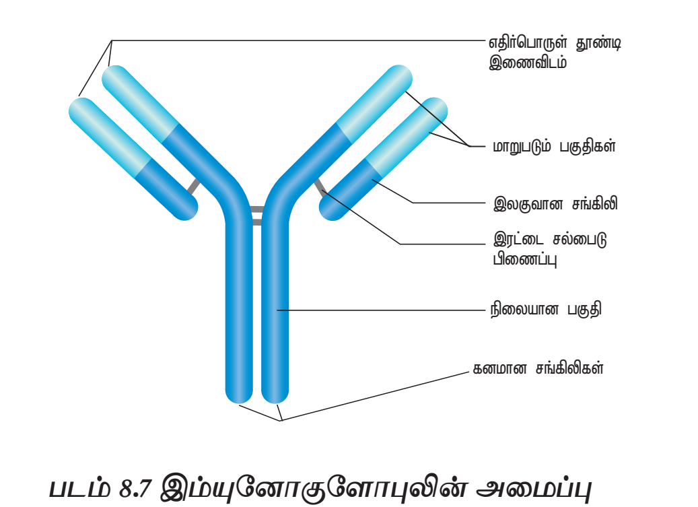
ஒவ்வொரு சங்கிலியும் (L மற்றும் H)
இரண்டு முனைகளைக் கொொண்டுள்ளது. ஒன்று
C-முனையாகும் (கார்பபாக்ஸஸைல்) மற்றொன்று
N-முனை அல்லது அமினோ முனையாகும்.
ஓர்
இம்யுனோகுளோபுலினில்
இரண்டு
பகுதிகள் உள்ளன. அவற்றில் மாறுபடும் பகுதி
(V) ஒரு முனையிலும் (Variable region) பெரிய
நிலையான பகுதி (C) (Constant region) இன்னொரு
163 நோய்த்தடைகாப்பியல்

முனையிலும்
அமைந்துள்ளன.
வெவ்வேறு
எதிர்பப்பபொருள் தூண்டிகளோடு வினைபுரியும்
எதிர்பப்பபொருட்களில் பல்வவேறுபட்ட V பகுதிகளிள்
காணப்படுகின்றன.
ஆனால் அவற்றின் C
பகுதிகள் அனைத்து எதிர்பப்பபொருட்களிலும்
ஒன்றறாக இருக்கின்றன.
எனவே, ஒற்றை
எதிர்பப்பபொருளின்
ஒவ்வொரு
கையிலும்
உள்ள கன மற்றும் இலகு சங்கிலிகளின் V
பகுதிகள் இணைந்து எதிர்பப்பபொருள் தூண்டி
நிர்ணயக்கூறுகள்
பொொருந்துவதற்ககேற்ற
குறிப்பிட்ட வடிவம் கொொண்ட எதிர்பப்பபொருள்
தூண்டி பிணைப்பு இடத்தை உருவாக்குகின்றன.
இதன் விளைவாக ஒவ்வொரு ஒற்றைப்படி
எதிர்பப்பபொருளிலும் இரண்டு எதிர்பப்பபொருள்
தூண்டிபிணைப்பு இடங்கள் காணப்படுகின்றன.
எதிர்பப்பபொருள் ஒற்றைப் படியின் தண்டடாக
இருக்கக்கூடிய ‘C’ பகுதி, எதிர்பப்பபொருளின்
வகையை நிர்ணயிக்கிறது. அதே வேளையில்
அனைத்து
எதிர்பொருளுக்கான
பொொது
வேலைகளையும் செய்கின்றன. எதிர்பொருள்
தூண்டிகளை திரிபடைய செய்தல் (Agglutination),
வீழ்படிவாக்குதல்
(Precipitation),
அவற்றின்
நச்சை சமநிலைபடுத்தல் (Neutralization) மற்றும்
எதிர்பொருள் தூண்டிகளின் மீது மேல் பூச்சு
செய்தல் (Opsonisation) போன்ற பணிகளை
இம்யுனோகுளோபின் செய்கின்றன.

## 8.8  எதிர்பொருள் தூண்டி மற்றும்

எதிர்பப்பபொருள் இடைவினைகள்
(Antigen and antibody interaction)
ஒரு
எதிர்பப்பபொருள்
தூண்டி
மற்றும்
எதிர்ப்
பொொ ரு ள்க ளு க் கி டை ய ா ன
வினையே
திரவ
வழி
அல்லது எதிர்பொருள் வழி
நோய்த்தடை க் ்ககா ப் பு க் கு
அ டி ப் ்படை ய ா க
அமைகின்றது. எதிர்பொருள் தூண்டி மற்றும்
எதிர்பப்பபொருள்களுக்கிடையான
வினை
மூன்று
நிலைகளில்
நடைபெறுகின்றது.
முதல்நிலையில்
எதிர்பொருள்
தூண்டிஎதிர்பப்பபொருள்
கூட்டமைப்பு
உருவாகிறது.
இரண்டடாவது நிலையில் திரிபடைய செய்தல்
மற்றும் வீழ்படிவாதல் போன்ற செயல்கள்
நடைபெறுகின்றன.
மூன்றறாவது நிலையில்
எதிர்பப்பபொருள்
தூண்டிகளை
அழித்தல்
அல்லது நச்சை சமநிலைப்படுத்துதல் ஆகியவை
நடைபெறுகின்றன. (படம் 8.8).

எதிர்பப்பபொருள் தூண்டிஎதிர்பப்பபொருள் வினையின் இணைப்பு
விசை
இவ்விசையானது

காரணிகளால்
அமைகின்றன.
இவை எதிர்பொருள் தூண்டி
மற்றும் எதிர்பொருள் இடையேயான நெருக்கம்,
சகபிணைப்பு அல்லாத (Non covalent) அல்லது
மூலக்கூறுகளிடையேயான
விசை
மற்றும்
எதிர்பப்பபொருள் ஈர்ப்பு ஆகியவையாகும்.
தூண்டியும் எதிர்பப்பபொருளும் நெருக்கமாக
பொொருந்தினால் இணைப்பு உறுதியாக இருக்கும்.
ஆனால் அவை விலிகியிருந்ததால் இணைப்பின்
வலிமை குறைவாக இருக்கும். எதிர்பொருள்
தூண்டியையும்
எதிர்பப்பபொருளையும்
பிணைக்ககூடிய பிணைப்பு சக பிணைப்பில்லாத
பண்பு கொொண்டதாகும்.
மின்நிலை விசை
பிணைப்புகள்,
ஹைட்ரஜன்
பிணைப்பு,
வான்டர்வவால் ஆற்றல் மற்றும் நீர் விலக்கு பிணைப்பு
ஆகியன சகபிணைப்பற்ற பிணைப்புகளாகும்.
ஒரு
எதிர்பப்பபொருள்
தூண்டியின்
நிர்ணயக்கூறுகளுக்கும் ஒரு எதிர்பப்பபொருளின்
பிணைப்பிடத்திற்கும் இடையேயான வினைகளின்
வலிமையே எதிர்பப்பபொருள் ஈர்ப்பு எனப்படும்.
எதிர்பப்பபொருள்தூண்டி

எதிர்பப்பபொருள்
வினைகளின் பயன்பபாடுகளாவன:
இரத்த
பரிமாற்றத்தின் போது இரத்த வகைகளை
நிர்ணயித்தல்,
தொொற்றுகிருமிகளை
கண்டறிவதற்ககான சீரம் சார்ந்த உறுதிபடுத்தும்
சோதனை, அயல்பொருட்களை கண்டறிவதற்ககான
தடைக்காப்பு மதிப்பீட்டிலான சோதனை, சீரத்தில்
புரதம் உள்ளதா என்பதைக் கண்டறிய உதவும்
சோதனை மற்றும் சில தடைக்காப்பு குறைவு
நோய்களின் பண்புகளை கண்டறியும் சோதனை
போன்றவற்றில் தூண்டி-எதிர்பப்பபொருள் வினை
பெரிதும் பயன்படுகிறது.

எதிர்பப்பபொருள்தூண்டி மற்றும்
எதிர்பப்பபொருள் வினைகளின் வகைகள்
வீழ்படிவாக்க வினை (Precipitin reaction) :
கரையக்கூடிய எதிர்பப்பபொருள் தூண்டி மற்றும்
எதிர்பப்பபொருள்
ஆகியவற்றுக்கிடையேயான
வினைகள் மூலம் காணக்கூடிய வீழ்படிவு
உருவாகிறது. இது வீழ்படிவாக்க வினை (Precipitin
reaction) எனப்படும். எதிர்பொருள் தூண்டியுடன்
வினைபுரிந்து
வீழ்படிவுகளை
உருவாக்கும்

âF˜Šªð£¼œ -& âF˜Šªð£¼œ Þ¬ìM¬ùèœ

ï´G¬ôò£î™
(¹ø, iKòIö‰î )

Fó†Cò£î™ (¶èœ ꣘‰î
âF˜Šªð£¼œ ɇ®)

i›ð®õ£î™ (è¬ó»‹
âF˜ªð£¼œ ɇ®)

GóŠ¹ÃÁ ñ‡ìô‹
GóŠ¹
Íô‚ÃÁ

𣂯Kò£

âF˜ªð£¼œ
ɇ® Íô‚ÃÁèœ

𣂯Kò£

õNõ°‚Aø¶

¶¬÷

Üò™ªê™

ÜFèKˆî™

ªê™M¿ƒ°î™

i‚è‹
è£ò‹

ªê™C¬î¾

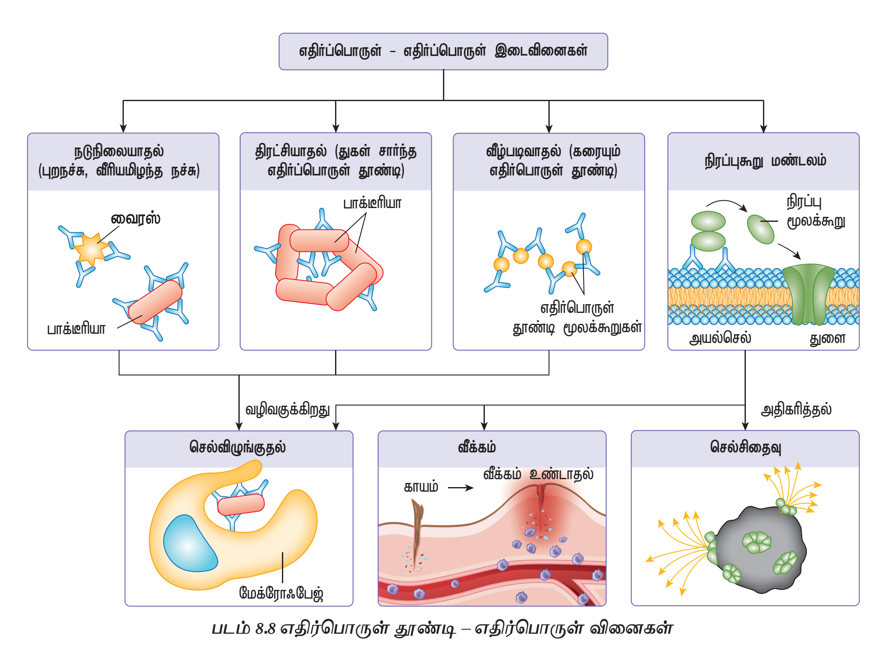
எதிர்பப்பபொருட்கள் வீழ்படிவாக்கிகள் (Precipitins)
என அழைக்கப்படுகின்றன.
திரட்சி
அடைதல்
(Agglutination):
ஒரு
துகள்
தனமை
கொொண்ட
எதிர்பப்பபொருள்
தூண்டி
எதிர்பப்பபொருளுடன்
வினைபுரியும்
போது அத்துகள் எதிர்பப்பபொருள் தூண்டிகள்
திரிபடைகின்றன அல்லது திரட்சி அடைகின்றன.
இது திரட்சி வினை அல்லது திரிபடைதல் வினை
என்று அழைக்கப்படுகின்றது. திரிபடைதலை
உருவாக்கும்
எதிர்பப்பபொருள்
திரளி
(அக்ளூட்டினின்) எனப்படுகிறது.
மேல்ப்பூச்சாக்கம்
அல்லது
மேம்படுத்தப்பட்ட ஒட்டுதல் (Opsonisation or
Enhanced attachment): ஒரு நோயூக்கியை ஒரு
விழுங்கி செல் சிதைத்தோ அல்லது விழுங்கியோ
அழிக்க
அடையாமிடுதலைக்
குறிக்கிறது.
மேல்பூச்சாக்க
முறையில்
மேல்பூச்சாக்கி
(Opsonin)
எனப்படும்
எதிர்பப்பபொருள்,
நோயூக்கியின் செல்சவ்வில் உள்ள உணர்
வேற்பியுடன்
(Receptor)
பிணைகின்றன.
பிணைப்பு
ஏற்படுத்தப்பட்டவுடன்
விழுங்கி
செல்கள் (Phagocytic cells) மேல்பூச்சு செய்யப்பட்ட
நோயூக்கிகளை நோக்கி ஈர்க்கப்படுகின்றன.

இதனால் செல் விழுங்குதல் அதிக திறமையுடன்
நிகழும்.
எனவே, மேல்பூச்சாக்கம் என்பது
நோயூக்கிகளை
மேல்பூச்சாக்கி
(Opsonin)
என்னும் பொொருளால் மூடி அடையாளமிட்டு
நோய்த்தடைக்காப்பு
செல்கள்
அவற்றை
அழிப்பதற்கு வழி செய்தல் ஆகும்.
நடுநிலையாக்கம் (Neutralization): எதிர்பப்பபொருள்
தூண்டிஎதிர்பப்பபொருள்
இடையேயான
இவ்வினையின் போது பாக்டீரியா மற்றும் வைரஸ்
ஆகியவற்றின் புறநச்சுகள் (Exotoxins) குறிப்பிட்ட
எதிர்பொருள்கள் மூலம் செயலிழக்க செய்து
வெளியேற்றப்படுகின்றன.
நடுநிலையாக்கத்தில்
எதிர்பொருட்கள் நச்சு எதிர்பொருட்கள் (Anti
toxins) என அழைக்கப்படுகின்றன.
இந்த
நச்சு
எதிர்பப்பபொருட்கள்
பாக்டீரிய
புறநச்சு
அல்லது முறித்த நச்சு (டாக்சசாய்டு) விற்கு
எதிராக
விருந்தோம்பியின்
செல்களால்
உருவாக்கப்படுகின்றன.

## 8.9 தடுப்பு மருந்துகள் (Vaccines)

ஒரு
குறிப்பிட்ட
நோய்க்ககெதிராக
செயல்திறனுள்ள
பெறப்பட்ட
நோய்த்தடைக்காப்பினைத் தரக்கூடிய உயிரியத்
165 நோய்த்தடைகாப்பியல்

வl kைற க ப டைவ

àJ¼œ÷
«ï£Î‚A
àJ¼œ÷ ÞòŸ¬è î´ŠÌC ñ¼‰¶

(ðôiùñ£‚èŠð†ì¬õ)

«ï£Î‚AòŸø¬õ
(î´ŠÌC ñ¼‰¶)
வl kைற க ப ட உyr ள த  pc மr t

«õFò

ªêòÖ‚èIö‰î¬õ

ñ£Áð£´

àJ¼œ÷
«ï£Î‚A



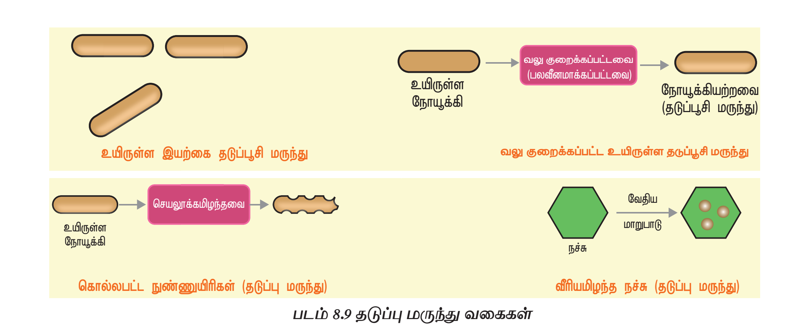
தயாரிப்பே தடுப்பு மருந்து எனப்படும். இது அந்த
நோய்க்கிருமிகளை ஒத்த, பலவீனமாக்கப்பட்ட
அல்லது செயலாக்கமிழந்த அல்லது கொொல்லப்பட்ட
நுண்ணுயிரியாகவோ
அல்லது
அவற்றின்
நச்சுப்பொருள்களாகவோ அல்லது அதன் புறப்பரப்பு
புரதமாகவோ இருக்கலாம். தடுப்பு மருந்துகள் நமது
உடலுக்கு வைரஸ் மற்றும் பாக்டீரியாவிலிருந்து
தன்னை
எவ்வாறு
பாதுகாத்துக்
கொொள்ள
வேண்டும் என்று கற்பிக்கின்றன.
தடுப்பு
மருந்துகள், மிகச் சிறிய அளவுகளில் செயலாக்கம்
நீக்கப்பட்ட அல்லது பலவீனமாக்கப்பட்ட வைரஸ்
அல்லது பாக்டீரியாவையோ அல்லது அவற்றின்
பகுதிகளையோ கொொண்டிருக்கின்றன.
அது
நமது தடைக்காப்பு மண்டலத்தை எவ்வித நோயும்
உண்டடாகாத நிலையில் அந்நோய் கிருமிகளை
அடையாளம் காண அனுமதிக்கிறது. சில தடுப்பு
மருந்துகள் ஒரு முறைக்கு மேல் கொொடுக்கபட
வேண்டும் (உயிரூட்ட தடுப்பு மருந்ததேற்றம்).
எதிர்ககாலத்தில் நோய்க்கிருமிகள் நமது உடலை
உணமையாக தாக்கும்போது நோய்த்தடைக்காப்பு
அளிப்பதை இது உறுதி செய்கின்றது.
தடுப்பு மருந்துகள் நோய்த் தடுப்பாக்க
செயல் முறைகளை துவங்குகின்றன.
முதல்,
இரண்டடாம் மற்றும் மூன்றறாம் தலைமுறைத்
தடுப்பு மருந்துகள் என தடுப்பு மருந்துகள்
வகைப்படுத்தப்பட்டுள்ளன.
முதல் தலைமுறை தடுப்பு மருந்து மேலும்
வீரியமிழந்த
உயிருள்ள
தடுப்பு
மருந்து,
கொொல்லப்பட்ட நுண்ணுயிரிகளைக் கொொண்ட
தடுப்பு மருந்து மற்றும் முறிந்த நச்சு (படம் 8.9)
என வகைப்படுத்தப்படுகின்றன.
வீரியமிழந்த

உயிருள்ள
தடுப்பு
மருந்தில்
வயதான,
குறைவான வீரியம் கொொண்ட வைரஸ்கள்
பயன்படுத்தப்படுகின்றன.
(எ.கா) தட்டம்மை,
புட்டாளம்மை
மற்றும்
ரூபெல்லா
(MMR)
மற்றும் சின்னம்மை (வேரிசெல்லா) தடுப்பு
மருந்து. கொொல்லப்பட்ட (செயலிழக்க செய்த)
தடுப்பு மருந்துகள் என்பவை வெப்பம் மற்றும்
பிறமுறைகளால் கொொல்லப்பட்டவை அல்லது
செயலிழக்கம் செய்யப்பட்டவையாகும். எ.கா.
சாலக் போலியோ தடுப்பு மருந்து. முறிந்த
நச்சு தடுப்பு மருந்தில், பாக்டீரியா அல்லது
வைரஸ்களால் சுரக்கப்பட்ட நச்சு அல்லது
த டு ப் பு ம ரு ந் து க ள ை
நோய் தீர்க்கும் மருந்ததாக
பயன்படுத்தும் முறை தடுப்பு
மருந்து சிகிச்சை எனப்படும்.
டாக்டர் எட்வர்ட் ஜென்னர்
1796 ல் பெரியம்மை நோய்க்கான தடுப்பு
மருந்ததை முதன் முதலில் தயாரித்தார்.
போலியோ தடுப்பு மருந்ததை (கொொல்லப்பட்ட
நுண்ணுயிரிகளை கொொண்ட தடுப்பு மருந்து)
டாக்டர் ஜோனந் சால்க் என்பவர் தயாரித்தார்.
வாய்
வழி
எடுத்துக்கொள்ளக்கூடிய
வீரியமிழந்த
உயிருள்ள
போலியோ
தடுப்பு மருந்ததை டாக்டர் ஆல்பர்ட் சாபின்
என்பவர் தயாரித்தார்) லூயிஸ் பாஸ்டர்
(1885) வெறிநாய்கடி, ஆந்தராக்ஸ் மற்றும்
காலரா நோய்க்கான தடுப்பு மருந்துகளை
கண்டுபிடித்தார். BCG தடுப்பு மருந்து
கால்மமெட் மற்றும் குயரின் ஆகியோரால்
காசநோய்க்கு எதிராக 1908 ஆம் ஆண்டு
பிரான்சில் தயாரிக்கப்பட்டது.

வேதிப்பொருள்கள் உள்ளன.
இவை நோய்
தொொற்றின்
தீய
விளைவுகளுக்கு
எதிரான
நோய்தடைகாப்பை நமக்கு அளிக்கின்றன. (எ.கா)
முத்தடுப்பு மருந்து (DPT) (தொொண்டடை அடைப்பான்,
கக்குவான் – இருமல் மற்றும் இரணஜன்னி).
இரண்டடாம் தலைமுறை தடுப்பு
மருந்துகள்
என்பவை
நோயூக்கிகளின்
புறப்பரப்பு
எதிர்பப்பபொருள்
தூண்டிகளைக்
கொொண்டவையாகும். (எ.கா) கல்லீரல் அழற்சி B
தடுப்பு மருந்து.
மூன்றறாம் தலைமுறை தடுப்பு மருந்துகள்
செயற்ககையாக தயாரிக்கப்பட்ட தூயமையான
ஆற்றல் மிக்க தடுப்பு மருந்துகளாகும். தடுப்பு
மருந்தின் சமீபத்திய புரட்சி டி.என்.ஏ தடுப்பு
மருந்து அல்லது மறுசேர்க்கை தடுப்பு மருந்து
ஆகும். (பாடம் 10ல் விரிவாக விளக்கப்பட்டுள்ளது)

## 8.10  தடுப்பு மருந்ததேற்றம் மற்றும்

நோய்த்தடுப்பாக்கம்
(Vaccination and Immunization)

தடுப்பு மருந்ததேற்றம் என்பது குறிப்பிட்ட
நோய்க்கு
எதிரான
நோய்தடைக்காப்பை
ஏற்படுத்துவதற்ககாக நமது உடலில் தடுப்பு
மருந்ததை செலுத்துவதாகும். நோய்த்தடுப்பாக்கம்
என்பது ஒரு குறிப்பிட்ட நோய்க்கு எதிரான
நோய்த்தடைக்காப்பை
நமது
உடல்
உருவாக்குவதாகும். நோய்தடுப்பாக்கம் என்பது
தடுப்பு மருந்ததேற்றத்திற்கு பிறகு நமது உடலில்
ஏற்படும் உணமையான மாற்றங்களை குறிக்கிறது.
தடுப்பு மருந்துகள் நோய் கிருமிகளுக்கு எதிராக
செயல்புரிந்து நோய் கிருமிகள் குறித்த தகவல்கள்
நினைவாற்றலாக பதியப்படுகிறது.
இதனால்
இரண்டடாவது முறையாக அந்நோய்கிருமி நம்
உடலில் நுழையும் போது விரைவாக அதை
வெளியேற்றுகிறது.
ஒரு முறை நமது உடல்
நோய்க்ககெதிராக செயல்பட கற்றுகொொண்டடால்
அந்நோய்க்கு எதிரான தடைக்காப்பினை நமது
உடல் பெற்றுவிட்டது என பொொருள் கொொள்ளலாம்.

## 8.11 மிகைஉணரமை (Hypersentivity)

மனிதர்களில் சிலர் தமது சுற்றுபுறத்தில் உள்ள
சில பொொருட்களுக்கு எதிராக ஒவ்வாமையை
கொொண்டுள்ளனர். சுற்றுபுறத்தில் காணப்படும்
சில நோய் எதிர்ப்பு தூண்டிகளை நமது உடல்
எதிர்கொள்ளும்போது
நமது
தடைக்காப்பு
மண்டலம் மிகை துலங்கலை ஏற்படுத்துவது
ஒவ்வாமை எனப்படும்.
வரம்புமீரிய

தடைகாப்பு
துலங்கலுக்குக்
காரணமான
பொொருட்கள் ஒவ்வாமை தூண்டிகள் (Allergens)
என அழைக்கப்படுகின்றன.
ஒரு ஒவ்வாமை
தூண்டி
என்பது
ஒவ்வாமை
வினைகளை
ஏற்படுத்தும் ஒரு எதிர்பப்பபொருள் தூண்டி
ஆகும். ஒவ்வாமை தூண்டிகள் நமது உடலை
அடைந்த சில நொொடிகளில் ஒவ்வா வினைகள்
தொொடங்கி ஏறத்தாழ அரைமணி நேரம் வரை
நீடிக்கிறது.
மகரந்த துகள்கள்,
தூசுகளில்
உள்ள சிற்றுண்ணிகள் (Mites) மற்றும் பூச்சிகளில்
காணப்படும் சிலவகை நச்சு புரதங்கள் ஆகியவை
பொொதுவான
ஒவ்வாமை
தூண்டிகளுக்கு
எடுத்துக்காட்டுகளாகும். வைக்கோல் காய்ச்சல்
(Hay fever) மற்றும் ஆஸ்துமா ஆகியவை
ஒவ்வாமைக்கு எடுத்துக்காட்டுகளாகும். தும்மல்,
கண்களில் நீர்கக்கோத்தல், மூக்கு ஒழுகுதல்
மற்றும் சுவாசிப்பதில் சிரமம் போன்றவை
ஒவ்வாமை வினையின் அறிகுறிகளாகும். IgE
மற்றும் மாஸ்ட்சசெல்களால் செயல்படுத்தப்படும்
மிகை தடைக்காப்பு துலங்கல்களின் ஒரு வகையே
ஒவ்வாமை எனப்படும்.
மாஸ்ட் செல்களால்
வெளியேற்றப்படும
ஹிஸ்டமின்
மற்றும்
செரட்டோனின் போன்ற வேதிப்பொருட்களாலும்
ஒவ்வாமை ஏற்படலாம்.
அனாபைலாக்சிஸ் என்பது உடனடியாக ஏற்படும்
மிகை உணர்வவாக்க வினையாகும். இது திடீர்
என முறையாக, தீவிரமாக மற்றும் உடனடியாக
தோன்றும் அதிதீவிர ஒவ்வாமை வினையாகும்.

## 8.12 தடைக்காப்பு குறைவு நோய்

செயல்திறனற்ற தடைக்காப்பு துலங்கல்
(எய்ட்ஸ் - AIDS)

தடைக்காப்பு மண்டலத்தின் ஒன்று அல்லது
அதற்கு மேலான ஆக்கக் கூறுகளின் செயலிழப்பால்
தடைக்காப்பு
குறைவு
நிலை
ஏற்படுகிறது.
முதல்நிலை தடைக்காப்பு குறைபாடுகள் மரபியல்
குறைபாட்டு
காரணங்களால்
ஏற்படுகிறது.
இரண்டடாம் நிலை தடைக்காப்பு குறைபாடுகள்
நோய் தொொற்றுகள், கதிர் வீச்சு, செல்சிதைக்கும்
மற்றும்
நோய்த்தடைக்காப்பை
ஒடுக்கும்
மருந்துகள் ஆகியவற்றால் ஏற்படுகிறது.
எய்ட்ஸ் என்பது ‘பெறப்பட்ட நோய்த்தடைகாப்பு
குறைவு சிண்டட்ரரோம்’ (Acquired Immuno Deficiency
Syndrome) எனப்படும்.
இந்நோய் ஒருவரது
வாழ்நநாளில் தாமாகவே பெற்றுக் கொொண்ட
தடைக்காப்பு மண்டல குறைபாட்டு நோயாகும்.
167 நோய்த்தடைகாப்பியல்

இது பிறவி நோயல்ல.
எய்ட்ஸ் நோய் (HIV)
மனித நோய்த்தடைகாப்பு குறைவு வைரஸ்
தொொற்றால் ஏற்படுவதாகும். இந்த வைரஸ், உதவி
T-செல்களை
தேர்ந்ததெடுத்து
தொொற்றுகிறது.
நோய்கிருமி தொொற்றிய உதவி T-செல்களால்
எதிர்பப்பபொருள் உணடாக்கும் B செல்களை
தூண்ட முடியாமல் போவதால் இவ்வைரஸ்
தொொற்றுக்கு எதிரான இயற்ககை தடைக்காப்பு
நடவடிக்கைள் தோல்வியுறுகின்றன. மரபியல்
பண்புகள்
அடிப்படையிலும்,
எதிர்பொருள்
தூண்டிகளின் வேறுபாட்டின் அடிப்படையிலும்,
எச்.ஐ.வி-1, எச்.ஐ.வி-2 என இருவகையாக
எச்.ஐ.வி வகைப்படுத்தப்பட்டுள்ளது.

எச்.ஐ.வியின் அமைப்பு

மனிதனின்
நோய்த்தடைக்காப்பு
குறைவு
வைரஸ் ‘லென்டிவைரஸ்’ பேரினத்தை சார்ந்தது.
இவ்வைரஸை
மின்னணு
நுண்ணோக்கி
வழியே உற்றுநோக்கும் போது 100-120 nm
விட்டமும், அடர்ந்த மையம் மற்றும் லிப்போபுரத
உறையையும்
கொொண்ட
கோளவடிவில்
காணப்படுகிறது. மேல்உறையில் gp41 மற்றும்
gp120 என்றழைக்கப்படும் கிளைக்கோ புரத
நுண்முட்கள் (Spikes) காணப்படுகின்றன. இதன்
மையத்தில் 2 பெரிய ஒற்றை இழை ஆர்.என்.
ஏக்கள் உள்ளன.
இந்த ஆர்.என்.ஏக்களுடன்
ரிவர்ஸ் டிரான்ஸ்கிரிப்டடேஸ் நொொதிகள் இணைந்து
காணப்படுகின்றன.
மேலும்
இதனுடன்
புரோட்டியேஸ் மற்றும் ரிபோ நீயூக்ளியேஸ்
நொொதிகளும் காணப்படுகின்றன. இதன் மையம்
கேப்சிட் என்ற புரத உறையால் சூழப்பட்டுள்ளது.
கேப்சிட் உறையை தொொடர்ந்து மேட்ரிக்ஸ் புரத
உறை ஒன்றும் உள்ளது (படம் 8.10).

எச்.ஐ.வி கடத்தப்படுதல்

பெரும்பபாலும் மேக்ரோபேஜ் செல்களுக்குள்
எச்.ஐ.வி வைரஸ் அதிகம் காணப்படுகிறது.
செல்லுக்கு வெளியே ஆறு மணி நேரம் மட்டுமே
உயிர்வவாழும் இந்த வைரஸ், செல்லுக்குள்
1.5 நாட்கள் வரை உயிர்வவாழ்கின்றன. பாதுகாப்பற்ற
உடல்உறவு, பாதிக்கப்பட்ட நபரின் இரத்த தொொடர்பு
கொொண்ட ஊசிகள், உறுப்பு மாற்றம் இரத்த ஏற்றம்
மற்றும் எச்.ஐ.வி பாதிக்கப்பட்ட தாயின் மூலம்
குழந்ததைக்கு ஏற்படும் நேரடி கடத்தல் என
பலவழிகளின் மூலம் எச்.ஐ.வி கடத்தப்படுகின்றது.
பூச்சிகளின் வழியாகவோ, சாதாரண தொொடுதல்
வழியாகவோ எச்.ஐ.வி பரவுவதில்லை.

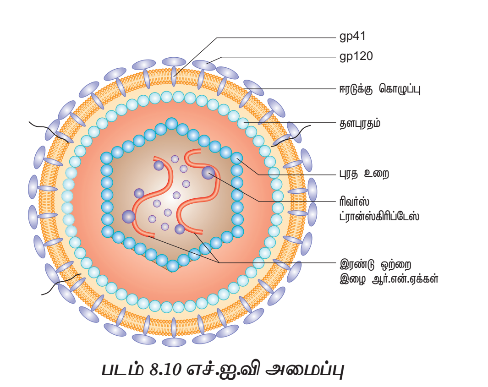
ஒரு மனிதனின் உடலில் நுழைந்த பிறகு,
எச்.ஐ.வி மேக்ரோபேஜ் செல்களில் நுழைந்து
தன்னுடைய ஆர்.என்.ஏ மரபணுத் தொொகுதியை
ரிவர்ஸ்
டிரான்ஸ்கிரிப்டடேஸ்
நொொதியின்
உதவியால் வைரஸின் டி.என்.ஏவாக மாற்றிக்
கொொள்கிறது. இந்த வைரஸ் டி.என்.ஏ விருந்தோம்பி
செல்களின் டி.என்.ஏவுடன் இணைந்து தொொற்று
ஏற்பட்ட செல்களை வைரஸ் துகள்களை உற்பத்தி
செய்ய வைக்கிறது. இவ்வாறு மேக்ரோஃபேஜ்கள்
தொொடர்ச்சியாக வைரஸ்களை உற்பத்தி செய்வதன்
மூலம் அவை எச்.ஐ.வி தொொழிற்சசாலையாக
செயல்படுகின்றன.
அதே நேரத்தில் உதவி T
லிம்போசைட்டுக்களினுள் நுழைந்த எச்.ஐ.வி
பெருகி சந்ததி வைரஸ்களை உற்பத்தி செய்து
கொொள்கின்றன.
இவ்வாறாக
வெளிவந்த
சந்ததி வைரஸ்கள் இரத்தத்தின் மற்ற உதவி
T செல்களையும் தாக்குகின்றன. இந்நிகழ்வு
தொொடர்வதால் விருந்தோம்பியின் உடலில் உதவி
T லிம்போசைட் செல்களின் எண்ணிக்கை
படிப்படியாக
குறைய
தொொடங்குகின்றது.
இந்நிகழ்வு நடைபெறும் காலத்தில் பாதிக்கப்பட்ட
மனிதருக்கு தொொடர்ந்த குறுகிய கால காய்ச்சல்,
பேதி மற்றும் உடல் எடை இழப்பு ஆகியவை
ஏற்படுகின்றன. உதவி T லிம்போசைட்டுகளின்
எண்ணிக்கை
குறைபாட்டின்
காரணமாக
பாதிக்கப்பட்ட மனிதருக்கு நோய்தடைக்காப்பு
குறைபாடு ஏற்பட்டு பலவித நோய்த்தொொற்றுக்கு
ஆளாகி, எவ்வித நோய் தொொற்றையும் தடுக்க
இயலாத நிலைக்கு உள்ளாகிவிடுகிறார்.
எச்.ஐவி தொொற்றினை கண்டறிய எளிய
இரத்த பரிசோதனை முறைகள் உள்ளன. எலிசா
சோதனை (ELISA- Enzyme Linked Immuno Sorbent
Assay) எச்.ஐ.வி எதிர்பப்பபொருட்கள் உள்ளனவா

என கண்டறியும் சோதனையாகும்.
இது
முதல்நிலை சோதனையாகும்
வெஸ்ட்டர்ன்
பிளாட் சோதனை மிகவும் நம்பகதனமை வாய்ந்த
உறுதிபடுத்தும் சோதனையாகும். இது வைரஸின்
மைய புரதங்களை கண்டறிகிறது. இவ்விரண்டு
சோதனைகளிலும் எச்.ஐ.வி எதிர்பப்பபொருட்கள்
இரத்தத்தில் இருப்பது உறுதிப்படுத்தப்பட்டால்,
அந்நபர் எச்.ஐ.வி பாதிப்புக்கு உள்ளானவராக
கருதப்படுகிறார்.
எய்ட்ஸ் ஒரு குணப்படுத்த முடியாத நோயாகும்.
இந்நோய் வராமல் தடுத்துக்கொள்வதே மிக
சிறந்த வழிமுறையாகும். பாதுகாப்பான உடலுறவு
முறைகளை போதித்தல், பாதுகாப்பான இரத்த
மாற்றுமுறைகள், ஒரு முறை மட்டுமே ஊசிகளை
பயன்படுத்துதல். உடலுறவின் போது கருத்தடை
உறைகளை பயன்படுத்துதல், போதை மருந்துகள்
பயன்பபாடு தடுப்பு, தேசிய எய்ட்ஸ் கட்டுபாட்டு
அமைப்பு (National control organization – NACO), அரசு
சாரா அமைப்புகள் (NGO) மற்றும் உலக சுகாதார
அமைப்பு (WHO) மூலமாக எய்ட்ஸ் விழிப்புணர்வு
நிகழ்ச்சிகளை நடத்துதல் போன்றவை எய்ட்ஸ்
பரவுதலை தடுக்கும் வழிமுறைகளாகும்.

## 8.13  சுயதடைகாப்பு

(Autoimmune diseases)

நோய்கள்

சுயதடைகாப்பு நோய் என்பது சுய மற்றும்
அயல்
மூலக்கூறுகளை
(எதிர்பப்பபொருள்
தூண்டிகள்) பிரித்தறிய இயலாத தனமையினால்
ஏற்படும் வழக்கத்திற்கு மாறான தடைகாப்பு
துலங்கல்களின் விளைவாகும். நமது உடல் சுய
எதிர்பப்பபொருட்களையும் (auto antibodies) மற்றும்
செல்நச்சாக்க T செல்களையும் (Cytotoxic T cells)
உற்பத்தி செய்து நமது திசுக்களை அழிக்கின்றன.
இது நோய்த் தனமையாக வெளிப்பட்டு சுய
தடைக்காப்பு
நோயாக
அறியப்படுகிறது.
இவ்வகையில் சுயதடைகாப்பு குறைபாடு என்பது
இலக்கு தவறிய தடைகாப்பு துலங்கலாகும்.
இதில் T செல் மற்றும் சுய எதிர்பப்பபொருளுடன்
விருந்தோம்பியின் எதிர்பப்பபொருள் தூண்டிகள்
வினைபுரிவது கண்டறியப்பட்டுள்ளது. உடலின்
செல்களே
அதே
உடலில்
எதிர்பப்பபொருள்
தூண்டிகளாக
செயல்படுவது
சுய
எதிர்பப்பபொருள் தூண்டிகள் (Auto antigens) என
அழைக்கப்படுகின்றன.
சுய தடைக்காப்பு நோய்கள் மனிதனில்
இரண்டு பெரும்பிரிவுகளாக பிரிக்கப்பட்டுள்ளன.
அவை உறுப்பு சார்ந்த மற்றும் உறுப்பு சாரா
சுயதடைக்காப்பு நோய்களாகும். உறுப்பு சார்ந்த
நோயில் சுயதடைக்காப்பு நிகழ்வுகள் பெரும்பபாலும்

ஏதேனும் ஒரு குறிப்பிட்ட உறுப்புக்கு எதிராகவே
அமைகின்றன. இதில் சுய எதிர்பப்பபொருட்கள் அந்த
உறுப்பின் பணிகளை தடைச்சசெய்கின்றன. எ.கா
ஹசிமோட்டோ தைராய்டு வீக்க நோய், கிரேவின்
நோய் (தைராய்டு சுரப்பி) மற்றும் அடிசன் நோய்
(அட்ரினல் சுரப்பி)
உறுப்புச்சாரா மண்டலக் கோளாறுகளில்
சுயதடைக்காப்பு நிகழ்வுகள் உடல் முழுவதும்
பரவுகின்றன. எகா. ரூமாட்டிக் மூட்டுவலி மற்றும்
தண்டு வட மரப்பு நோய்கள்.

## 8.14  கட்டி

நோய்த்தடைக்காப்பியல்
(Tumour Immunology)

கட்டி அல்லது திசுபெருக்கம் (Neoplasm)
என்பது கட்டுப்படுத்த முடியாமல் பெருகும்
செல்களின் கூட்டமாகும். கட்டி தொொடர்ச்சியாக
வளர்ச்சியடைந்து இயல்பபான திசுக்களையும்
ஆக்கிரமிப்பது புற்றுநோய் எனப்படும். கட்டியில்
இருந்து உடலின் மற்ற பாகங்களுக்கும் பரவி
இரண்டடாம் நிலை கட்டிகளை ஏற்படுத்துகின்றன.
இந்நிலைக்கு
வேற்றிட
பரவல்
அல்லது
மெட்டாஸ்டடாசிஸ் (Metastasis) என்று பெயர்.
பண்புகளின்
அடிப்படையில்
கட்டிகளை
பெனைன் (Benign) அல்லது சாதாரண கட்டிகள்
மற்றும்
மாலிக்னன்ட்
(Malignant)
அல்லது
புற்றுநோய்
கட்டிகள்
என
பிரிக்கலாம்.
சாதரான கட்டி என்பது கட்டுப்படுத்த முடியாத
அபரிதமான
வளர்ச்சியுடையது.
ஆனால்
உடலின் மற்ற திசுக்களை ஆக்கிரமிக்காத
தனமையுடைவையாகும். புற்றுநோய் கட்டியின்
செல்கள் கட்டுப்படுத்த முடியாத அபரிதமான
வளர்ச்சியுடையவை.
ஆனால்
கட்டியின்
செல்கள் பிரிந்து உடலின் மற்ற ஆரோக்கியமான
திசுக்களுக்கும் பரவக்கூடியதாகும்.
இயல்பபான செல்களில் செல் வளர்ச்சி
மற்றும் வேறுபாடடைதல் போன்றவை முறையாக
கட்டுப்படுத்தப்பட்டு
நெறிபடுத்தப்படுகின்றன.
ஆனால் புற்றுநோயால் பாதிக்கப்பட்ட செல்களில்
நெறிப்படுத்துதல்
முறை
மீறப்படுகின்றன
இயல்பபான செல்களில், ‘தொொடர்பு தடை’ மூலம்
கட்டுப்பாடற்ற செல் வளர்ச்சி தடுக்கப்படுகிறது.
ஆனால் புற்றுசெல்களில் இப்பண்பு இல்லை.
இதன் விளைவாக, புற்று செல்கள் தொொடர்
செல்பிளவினால் எண்ணிக்கையில் அதிகரித்து
கட்டி எனப்படும் திசுக் கூட்டத்தை உருவாக்குகிறது
(அட்டவணை 8.5).
ஒரு செல் புற்றுசெல்லாக மாற்றப்படும்போது
அதன் புதிய புறப்பரப்பு எதிர்பப்பபொருள் தூண்டியை
பெறுகின்றன.
இதனால்
சில
இயல்பபான
169 நோய்த்தடைகாப்பியல்

எதிர்பப்பபொருள் தூண்டிகளை இழக்கின்றன.
புற்றுநோய் செல்களின் படலத்தின் மீது உள்ள இந்த
எதிர்பப்பபொருள் தூண்டிகள் நோய்த்தடைக்காப்பு
துலங்கல்களை
வெளிப்படுத்துகின்றன.
புற்றுநோயில் செல்வழி மற்றும் திரவவழி
நோய்த்தடைக்காப்பு
துலங்கல்களைக்
காணலாம்.
புற்றுசெல்கள் அயல்பொருட்கள்
இல்லையென்பதால் நமது உடலின் நோய் எதிர்ப்பு
ஆற்றல் அதனை கண்டறிவது தவிர்க்கப்படுகிறது.
இதனால் செல்கள் முரண்பபாடானப் பணிகளை
செய்கின்றன. எனவே இவற்றை குணப்படுத்துவது
சிக்கலானதாகும்.
உடற்சசெல் திடீர்மமாற்றத்தால் தோன்றுகின்ற
புற்றுசெல்களை
தொொடர்ந்து
கண்ககாணித்து
அழிப்பதே நோய்த்தடைகாப்பு மண்டலத்தின்
முதனமைப்
பணியாகும்
என்பது
நோய்த்தடைக்காப்பு கண்ககாணிப்புக் கோட்பபாட்டின்
கருத்தாகும். வயது முதிர்வு, பிறவி குறைபாடு
மற்றும்
பெறப்பட்ட
தடைகாப்பு
குறைபாடு
போன்ற காரணங்களால் கண்ககாணிப்புத் திறன்
குறைகிறது. இதனால் புற்றுநோய்க்கான வாய்ப்பு
அதிகரிக்கிறது.
நோய்த் தடைக்கண்ககாணிப்புத்
திறன் திறம்பட இருக்கும்போது புற்று நோய்கள்
தோன்றறாது. கட்டி தோன்றுவது கண்ககாணிப்புக்
குறைவின் அறிகுறியாகும்.

புற்றுநோய் தடைக்காப்பு சிகிச்சை
(Immunotherapy of cancer)
தடைக்காப்பு
சிகிச்சையை
உயிரியல்
சிகிச்சை
எனவும்
அழைக்கலாம்.
இச்சிகிச்சையில்
பயன்படுத்தப்படும்
பொொருட்கள் உடல் அல்லது ஆய்வகத்தில்
(ஓரின எதிர்பப்பபொருள் – monoclonal antibodies)
உருவாக்கப்படுகின்றன. இப்பொருள்கள் மூலம்
நோய்த்தடைக்காப்பு
அமைப்பின்
பணியை
எதிர்க்கவோ அல்லது மேம்படுத்தவோ முடியும்.
புற்றுநோய்க்ககெதிரான தடைக்காப்பு சிகிச்சை
பல்வவேறு வகைகளில் மேற்கொள்ளப்படுகிறது.
புற்றுக்கட்டியை உடலில் இருந்து நீக்கிய பிறகு
மீதம் எஞ்சி இருக்கின்ற புற்றுச்சசெல்களை
நோய்தடைக்காப்பு
சிகிச்சையின்
மூலம்
நீக்குவது முக்கியமானதாகும்.
கூட்டு அறுவை சிகிச்சை, கதிர்வீச்சு
சிகிச்சை,
வேதிச்சிகிச்சை
மற்றும்
நோய்தடைக்காப்பு
சிகிச்சைகள்
போன்ற
ஒருங்கிணைந்த
சிகிச்சைமுறைகளை
பின்பற்றுவதால் புற்றுநோய்க்கு எதிரான சிறந்த
பலனை பெறமுடியும்.

அட்டவணை 8.5 இயல்பபான செல்லுக்கும் மற்றும் புற்றுசெல்லுக்கும் இடையேயான வேறுபாடுகள்
இயல்பபான செல்கள்

புற்றுநோய் செல்கள்

இச்சசெல்கள் சிறியதாகவும் ஒரே மாதிரியான

பெரிய மாறுபட்ட வடிவிலான உட்கருவையும்

வடிவத்தையும் அதிக சைட்டோபிளாச

குறைவான சைட்டோபிளாச அளவையும்

அளவையும் கொொண்டவை

கொொண்டவை.

செல்லின் அளவு மற்றும் அவற்றின் வடிவம்

செல்லின் அளவு வடிவங்களில்

ஆகியவை ஒரே மாதிரியாக உள்ளன. செல்கள்,

மாறுபாடுடையன. செல்கள் வரிசையமப்பு

தெளிவான திசுக்களாக

ஒழுங்கற்று காணப்படும்.

வரிசையமைக்கப்பட்டுள்ளன.
வேறுபட்ட செல் அமைப்புகளை உடையன.

இயல்பபான பல சிறப்பு வாய்ந்த பண்புகளை

இயல்பபான செல் புறத்தோற்ற

இழக்கின்றன. சில செல் புறத்தோற்ற சுட்டிகளை

சுட்டிகளை (Surface marker) வெளிப்படுத்துகின்றன.

(Surface marker) அதிகமாக வெளிப்படுத்துகின்றன.

பிளவுறும் செல்களின் அளவு குறைவு.

பிளவுறும் செல்களின் எண்ணிக்கை அதிகம்.

மேலும் இச்சசெல்கள் தெளிவான

மேலும் இச்சசெல்கள் தெளிவற்ற செல்

பிளாஸ்மமா சவ்வால் பிரிக்கப்பட்டுள்ளன.

சுவரால் சூழப்பட்டுள்ளன.

நோய்தடைக்காப்பின் பயன் தரு வாய்ப்புகள்
அரசு

உறுப்புகளாகும். நிணநீர் முடிச்சுகள், மண்ணீரல்,

இத்துறையில்

MALT, GALT மற்றும் BALT ஆகியவை இரண்டடாம்

பட்டம் பெற்றுள்ள இளம் பட்டதாரிகளுக்கு
எண்ணற்ற

மஜ்ஜை ஆகிய இரண்டும் முதல்நிலை நிணநீரிய

தனியார்

மற்றும்

மருத்துவமனைகளில்

உறுப்புகள் எனப்படும. தைமஸ் மற்றும் எலும்பு

வேலைவாய்ப்புகள்

இருக்கின்றன. நோய் தடைக்காப்பு சிகிச்சை

நிலை நிணநீரிய உறுப்புகளாகும்.
எதிர்பப்பபொருள்

தூண்டி

என்பது

ஒரு

அயல்பொருளாகும்.

இது

குறிப்பிட்ட

செல்லிய

எதிர்பொருள்களுடன்

வினைபுரியம்

தனமை

நோய் தடைகாப்பியல், ஒவ்வாமை, மாற்றி

கொொண்டுள்ளதாகும்.

தடைக்காப்பு

தூண்டி

பொொருந்துதல்

என்பது

துலங்கலை

தொொடங்கி

நுண்ணியிரி,
ஆய்வக

நோய்தடைக்காப்பியல்,

நோய்தடைக்காப்பியல்,
நோய்

தடைக்காப்பியல்

நரம்பு வீக்க குறைபாடுகள், கட்டி நோய்
தடைகாப்பியல். கண்நோய் தடை காப்பியல்,
தடுப்பூசி

நோய்த்தடைக்காப்பியல்

வீக்கம்

ஆகிய

துறைகள்

மற்றும்

தடைகாப்பியல்

தொொடர்பபான பயன்தரு வாய்ப்புகள் உள்ளன.

நோய்தடைக்காப்பு

என்பது

மண்டலத்தைப்

பற்றி

நோய்த்தடைக்காப்பு மண்டலம்
நுழையும்

அயல்பொருட்களை

அடையாளம் கண்டு அவற்றை அழிக்கின்றன.
நோயூக்கிகளுக்கு

எதிராக

செயல்படும்

உடல்திறனே தடைகாப்பு ஆகும்.
நோய்த்தடைக்காப்பியலை
வகையாக

இரண்டு

பிரிக்கலாம்.

அவையாவன

இயல்பு நோய்த்தடைகாப்பு மற்றும் பெறப்பட்ட
நோய்த்தடைகாப்பு

ஆகும்.

நோய்த்தடைக்காப்பியலை

பெறப்பட்ட

செயலாக்க

மற்றும்

மந்தமான நோய்த்தடைகாப்பு என இருவகையாக
பிரிக்கலாம்

பொொருளாகும்.

ஹாப்டடென்கள்

என்பது தடைக்காப்பு துலங்கலைத் தூண்டடாது
ஆனால்

ஏற்கனவே

இலக்கு

எதிர்பொருள்களுடன்

எதிர்பொருள்

உண்டடாக்கப்பட்ட
வினைபுரியம்.

தூண்டியினால்
துலங்கல்களை

உண்டடாகும்
(எதிர்பப்பபொருள்

உற்பத்தி) அதிகரிக்க உதவுபவை துணையூக்கிகள்

நோய்தடைக்காப்பியல்

உடலில்

வைக்கும்

தடைக்காப்பு

பாடச்சுருக்கம்

படிப்பதாகும்.

தடைக்காப்பு

செயலாக்க

நோய்த்தடைக்காப்பு

செல்வழி நோய்த்தடைக்காப்பு

மற்றும் திரவ

ஆகும். எபிடோப் என்பது ஒரு எதிர்பொருள் தூண்டி
இணையுமிடம் ஆகும்.
தூண்டியின்
பாராடோப்

இவை எதிர்பொருள்

செயல்மிகு
என்பது

பகுதியாகும்.

எதிர்பப்பபொருளின்

ஒரு

பகுதியாகும். வீழ்படிவாதல், திரிபடைய செய்தல்,
நடுநிலையாக்கல்

மற்றும்

மேல்பூச்சாக்கம்

போன்றவை எதிர்பொருள் தூண்டி – எதிர்பொருள்
வினையின் வகைகளாகும்.
தடுப்பூசி

மருந்துகள்

ஒரு

உயிரியல்

தயாரிப்பு

முறையாகும்.

செயலாக்கத்

திறனுடைய

பெறப்பட்ட

நோய்தடைகாப்பை

இவை

அளிக்கின்றன.

அமைப்பின்

நோய்தடைக்காப்பு

இயல்பற்ற

செயல்பபாடு

மிகை

வழி நோய்த்தடைக்காப்பு என இரு வழிகளில்

உணரமைத்தனமை, தடைக்காப்பு குறை நோய்

செயல்படுகிறது. நுண்கிருமிகளால் தாக்கப்படும்

அல்லது சுய தடைக்காப்பு ஆகிய நோய்களுக்கு

உடல் அதற்ககெதிராக தடைக்காப்பு துலங்கல்களை
வெளிப்படுத்துகிறது.
முதல்நிலை

மற்றும்

துலங்கல்கள்

என

பிரிக்கலாம்.

இத்துலங்கல்கள்
இரண்டடாம்
இரண்டு

லிம்போசைட்டுகளின்

நிலை

வகையாகப்
தோற்றம்,

வழிவகுகின்றன. கட்டி அல்லது திசு பெருக்கம்
என்பது

கட்டுபாடற்று

பெருகும்

செல்களின்

குழுக்களாகும். ஒருங்கிணைந்த சிகிச்சைகளான
கதிர்வீச்சு

சிகிச்சை,

வேதிச்சிகிச்சை

வளர்ச்சி, முதிர்ச்சியுறுதல் மற்றும் பெருக்கம்

ஒருங்கிணைந்த

செயல்பபாட்டின்

ஆகியவற்றில் பங்ககேற்கும் உறுப்புகள் நிணநீரிய

புற்றுநோய்க் கட்டுப்படுத்தப்படுகிறது.

ஆகிய
மூலம்

171 நோய்த்தடைகாப்பியல்

7.

## மதிப்பீடு

1. சீம்பால் வழங்குவது
அ) இயற்கையாக பெறப்பட்ட செயலாக்க நோய்த்தடைக்காப்பு
ஆ) இயற்கையாக பெறப்பட்ட மந்தமான நோய்த்தடைக்காப்பு
இ) செயற்கையாக பெறப்பட்ட செயலாக்க நோய்த்தடைக்காப்பு
ஈ) செயற்கையாக பெறப்பட்ட மந்தமான நோய்த்தடைக்காப்பு

2. பாரடோப் என்பது
அ) மாறுபடும் பகுதிகளில் உள்ள எதிர்ப்பொருள் இணையும் பகுதி
ஆ) கனமான பகுதிகளில் உள்ள எதிர்ப்பொருள் இணையும் பகுதி
இ) மாறுபடும் பகுதிகளில் உள்ள எதிர்பொருள் தூண்டிகள் இணையும் பகுதி
ஈ) கனமான பகுதிகளில் உள்ள எதிர்பொருள் தூண்டிகள் இணையும் பகுதி

3. ஒவ்வாமையில் தொடர்புடையது
அ) IgE
ஆ) IgG
இ) Ig
ஈ) IgM

4. உடனடி வினைக்கு காரணமாக இருப்பது
அ) ஒவ்வாமை எதிர்வினை
ஆ) நச்சுகளின் சுரப்பு
இ) ஹிஸ்டமைன்களின் சுரப்பு
ஈ) மேற்கூறிய அனைத்தும்

5. வெவ்வேறு பகுதிகளுக்கு புற்றுநோய் செல்கள் பரவுதல் – என அழைக்கப்படுகிறது.
அ) வேற்றிடப் பரவல்
ஆ) ஆன்கோஜீன்கள்
இ) புரோட்டோ – ஆன்கோஜீன்கள்
ஈ) மாலிக்னன்ட் நியோப்ளாசம்

6. எய்ட்ஸ் வைரஸில் காணப்படுவது
அ) ஒற்றை இழை ஆர்.என்.ஏ
ஆ) இரட்டை இழை ஆர்.என்.ஏ
இ) ஒற்றை இழை டி.என்.ஏ
ஈ) இரட்டை இழை டி.என்.ஏ

7. கீழ்க்கண்டவற்றுள் ஒன்றைத் தவிர அனைத்தும் புற நிணநீரிய உறுப்புகள் ஆகும்
அ) நிணநீர் முடிச்சுகள்
ஆ) மண்ணீரல்
இ) கோழைச்சவ்வு சார்ந்த நிணநீர் திசுக்கள்
ஈ) தைமஸ்

8. கீழ்க்கண்டவற்றுள் எது மேக்ரோபேஜ்?
அ) மோனோசைட்டுகள்
ஆ) எரித்ரோசைட்டுகள்
இ) த்ரோம்போசைட்டுகள்
ஈ) லிம்போசைட்டுகள்

9. இன்டர்பெரான்களை பற்றிய உண்மையான கருத்து எது?
அ) செயற்கையாக தயாரிக்கப்பட்ட வைரஸ் எதிர்பொருள்
ஆ) வைரஸ் செல்களின் இரட்டிப்பாதலை தடுக்கின்றது.
இ) இது ஒரு குறிப்பிட்ட வைரஸுக்கானது
ஈ) இது தொற்றுகளை ஏற்படுத்தும்

10. செல் வழி நோய்த்தடைகாப்பில் __________
மற்றும்

திரவ

வழி

நோய்த்தடைகாப்பில்

__________________பெரும்பபானமையாக

அ) IgE

ஆ) IgG

ஈடுபடுகின்றன.

இ) Ig

ஈ) IgM

அ) B செல்கள் / T செல்கள்

உடனடி வினைக்கு காரணமாக இருப்பது

ஆ) எபிடோப் / எதிர்பொருள் தூண்டி

அ) ஒவ்வாமை எதிர்வினை

இ) T செல்கள் / B செல்கள்

ஆ) நச்சுகளின் சுரப்பு

ஈ) எதிர்பொருள் / எதிர்பொருள் தூண்டி

ஈ) மேற்கூறிய அனைத்தும்
வெவ்வேறு
பகுதிகளுக்கு
புற்றுநோய்
செல்கள் பரவுதல் – என அழைக்கப்படுகிறது.
அ) வேற்றிடப் பரவல்
ஆ) ஆன்கோஜீன்கள்
இ) புரோட்டோ – ஆன்கோஜீன்கள்
ஈ) மாலிக்னன்ட் நியோப்ளளாசம்

11. B செல்களை தூண்டுவது
அ) நிரப்புக் கூறுகள்
ஆ) எதிர்பொருள்
இ) இன்டர்பபெரான்
ஈ) எதிர்பொருள் தூண்டி

12. திரிபடையச் செய்தல் மற்றும் வீழ்ப்படிவாதல்
வினைகளில், எதிர்பொருள் தூண்டி ஒரு
____________ ம ற் று ம் ____________
ஆகும்.

அ) ஒற்றை இழை ஆர்.என்.ஏ

அ) முழுசெல் / கரையும் மூலக்கூறு

ஆ) இரட்டை இழை ஆர்.என்.ஏ

ஆ) கரையும் மூலக்கூறு / முழுசெல்

இ) ஒற்றை இழை டி.என்.ஏ

இ) பாக்டீரியா / வைரஸ்

ஈ) இரட்டை இழை டி.என்.ஏ

ஈ) புரதம் / எதிர்பொருள்

13. எதிர்பப்பபொருள்களை அதிக அளவு உற்பத்தி
செய்து வெளியிடும் B செல் வகை யாது?
அ) நினைவாற்றல் செல்கள்

ஆ) முதல்

மற்றும்

நிலை

தடைகாப்பு துலங்கல்கள்
இ) செயலாக்க

ஆ) பேசா பில்கள்

இரண்டடாம்
மற்றும்

மந்தமான

நோய்த்தடைகாப்பு

இ) பிளாஸ்மமா செல்கள்

ஈ) செல்வழி

ஈ) கொொல்லி செல்கள்

மற்றும்

திரவவழி

நோய்த்தடைகாப்பு

14. ஒருவருக்கு அடிபட்டு காயம் ஏற்படுகிறது.
திசு சிதைவினால் உருவாகும் இந்த காயம்
____________க்கு எடுத்துக்காட்டாகும்

மற்றும்

தடைகாப்புக் குறைவு நோய்

எங்கு உற்பத்தி செய்யப்படுகிறது. அது மற்ற

ஆ) உடற்சசெயல் சார்ந்த தடைகாப்பு

செல்களிடமிருந்து எவ்வாறு வேறுபடுகிறது.

இ) பேகோசைட்டோசிஸ்

ஏதேனும்

ஈ) வீக்கம்

15. கீழே கொொடுக்கப்பட்டுள்ள சில மனித
உறுப்புகளில் ஒரு முதல்நிலை மற்றும்
ஒரு இரண்டடாம் நிலை நிணநீர் உறுப்பை
அடையாளம் கண்டு அதன் பங்கினை விளக்கு.
அ) கல்லீரல்
ஆ)தைமஸ்
இ) தைராய்டு
ஈ) டான்சில்

16. மனித உடம்பின் பாதுகாப்பில்
எவ்வாறு செயல்படுகிறது?

உமிழ்நீர்

17. நோய்த்தடைகாப்பு
செயல்படுகிறது.

எவ்வாறு

இரண்டு

வேறுபாடுகளைக்

குறிப்பிடுக.

18. மேக்ரோஃபேஜ்கள் சார்ந்த தடை வகையை
கூறி அதனை விளக்கு

19. இன்டர்ஃபெரான்கள் என்றறால் என்ன? அதன்
பங்கினை கூறுக.

20. வீக்கத்தின் போது உற்பத்தி செய்யப்படும
வேதிய
எச்சரிக்கை
சமிக்ஞஞைகளை
பட்டியலிடுக.

21. பின்வருவனற்றுக்கிடையே
வேறுபாடுகளை எழுதுக.

நோய்

22. B செல் மற்றும் T செல் மனித உடலில்

அ) இயந்திர தடைகாப்பு

மண்டலம்

உ) சுயதடைகாப்பு

உள்ள

அ) இயல்பு நோய்த்தடைகாப்பு மற்றும்
பெறப்பட்ட நோய்த்தடைகாப்பு

நோய்த்தடைகாப்பு

மண்டலத்தில்

ஈடுபட்டுள்ள செல்கள் எவை?

23. மனித

உடலில்

நுழைந்த

ரெட்ரோவைரஸ்

பிறகு,

இரட்டிப்படையும்

செயல்முறையை விளக்குக.

24. எதிர்பப்பபொருட்கள்

H 2L 2

எனக்

குறிப்பிடப்படுவது ஏன்?

25. இம்யுனேகுளோபுலிளின் அமைப்பை தகுந்த
படத்துடன் விளக்கு

26. இயல்பு

27. மேல்பூச்சாக்கம் விழுங்கு செல்களில் ஏன்
திறன் வாய்ந்ததாக கருதப்படுகிறது?

28. தடுப்பு மருந்துகள் என்றறால் என்ன? அதன்
வகைகள் யாவை?

29. எச்.ஐ.வியால் தொொற்றிய ஒரு நபருக்கு எய்ட்ஸ்
உள்ளதா என்பதை எவ்வாறு கண்டறிவாய்?

30. சுயதடைகாப்பு

நோய்

மாற்றப்பட்ட

தடைகாப்பு

என்பது

திசை

துலங்கலாகும்-

நியாயப்படுத்துக.

173 நோய்த்தடைகாப்பியல்

î´ŠÌC
񼉶

ªè£™L
T ªê™èœ

G¬ù¾
T ªê™èœ
âF˜Šªð£¼œ
ɇ®èœ

எt

ெபாr  t  எt

ெபாr  vைனy
இைண
p vைச

எt

ெபாr t  
ம    எt

ெபாr 
vைனக வைகக 

(â.è£) Þóˆî
CõŠðµ‚èœ

«ï£Œ
î¬ì‚裊Hò™
«è£†ð£´èœ

âF˜Šªð£¼œ

GícKò
àÁŠ¹èœ

î¬ì‚裊¹
¶ôƒè™èœ

ெசயலாக
ேநாதைட
கா
p
k க 

«ï£Œî¬ì裊H™
ß´ð´‹ ªê™èœ

Þó‡ì£‹ G¬ô
GícKò
àÁŠ¹èœ

ºî™G¬ô
GícKò
àÁŠ¹èœ

Þó‡ì£‹ G¬ô
î¬ì‚裊¹
¶ôƒè™èœ

ºî™G¬ô
î¬ì裊¹
¶ôƒè™èœ

âF˜Šªð£¼œ õN «ï£Œ
î¬ì‚裊¹ Ü™ô¶ Fóõ
õN «ï£Œ î¬ì‚裊¹

²òî¬ì‚裊¹
«ï£Œ (â.è£) 
õì ñóŠ¹ «ï£Œ

ªðøŠð†ì «ï£Œ
î¬ì‚裊¹

ªðøŠð†ì «ï£Œ
î¬ì‚裊¹ õ¬èèœ

ªê™õN «ï£Œ î¬ì‚裊¹

Þò™¹ «ï£Œ
î¬ì‚裊¹

î´ŠÌC ñ¼‰¶

î´ŠÌC ñ¼‰«îŸø‹/
«ï£Œ î´Šð£‚è‹

I¬è»í˜¾
(â.è£) åšõ£¬ñ

î¬ì‚裊¹ °¬ø
«ï£Œ (â.è£) ⌆v

膮 «ï£Œ
î¬ì‚裊Hò™

ɇìŠð†ì
T ªê™èœ

G¬ù¾
B ªê™èœ

ɇìŠð†ì
B ªê™èœ

âF˜Šªð£¼œ

## கருத்து வரைபடம்

Gíc˜
º®„²

⽋¹
ñx¬ü

¬îñv

இணையச் செயல்பபாடு
நோய்த்தடைக்காப்பியல்

ELISA சோதனை பற்றி அறிதல்
படிநிலைகள்
படி 1 :  கீழ்க்காணும் உரலி/விரைவுக்குறியீட்டைப் பயன்படுத்தி இச்சசெயல்பட்டிற்ககான இணையப்
பக்கத்திற்குச் செல்க.
படி 2 :  மெய்நிகர் ஆய்வுசாலை செயல்பபாட்டில் வழங்கப்படும் நெறிமுறைகளைப் பின்பற்றி
centrifugation முதல் ELISA வரை தொொடர்க.
படி 3 :  செயல்பபாட்டுச் சாளரத்தின் வலதுபுறம் உள்ள “Diagnosis, Background, Notebook, Glossary and Help”
ஆகியவற்றை சொொடுக்கி அவற்றின் செயல்முறைகளை விரிவாக அறிக.
படி 4 :  செயல்பபாட்டுச் சாளரத்தின் வலது கீழ்புறமுள்ள “Launch Gene Body”ஐ சொொடுக்கி cloning.
படியாக்கம் பற்றி அறிக.
படி 5 :  ELISA வை நிறைவு செய்து, சோதனைக்குட்படுத்தப்பட்டவர் நோய் தொொற்று உடையவரா என
ஆய்ந்தறிக.

படி 1

படி 2

படி 3

படி 4

உரலி : http://media.hhmi.org/biointeractive/vlabs/immunology/index.html?_
ga=2.219254809.1253796128.1545143882-264360672.1545143882

*படங்கள் அடையாளத்திற்கு மட்டுமே .
தேவையெனில் Adobe Flash யை அனுமதிக்க.

175 நோய்த்தடைகாப்பியல்
