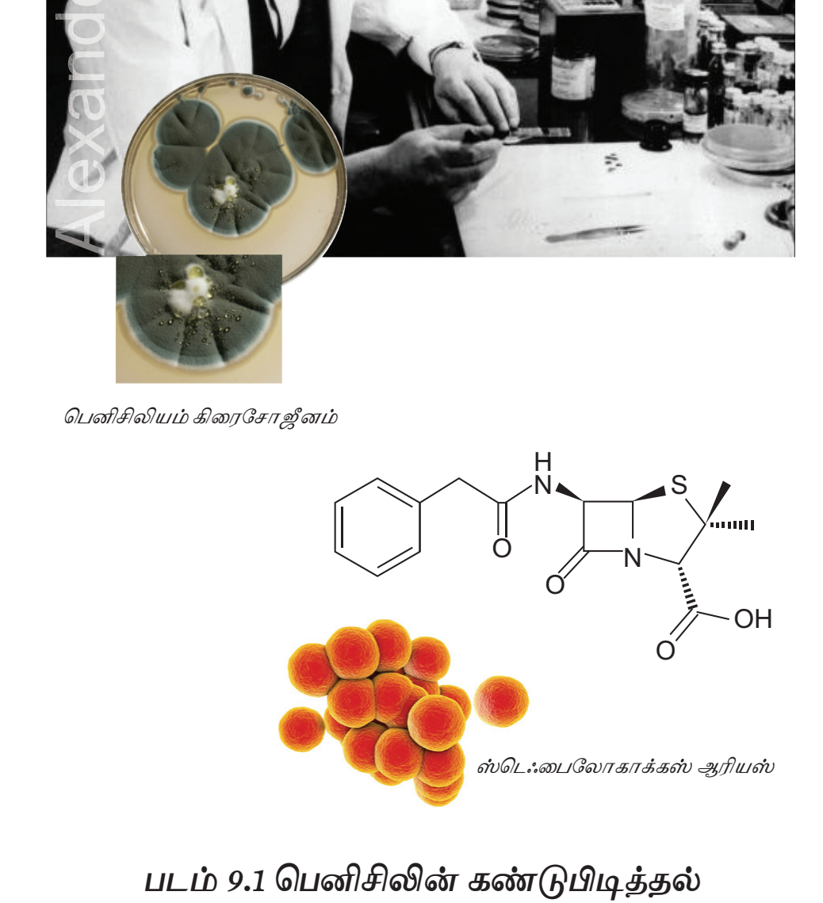
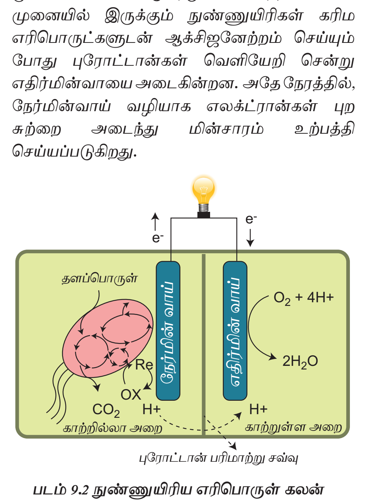
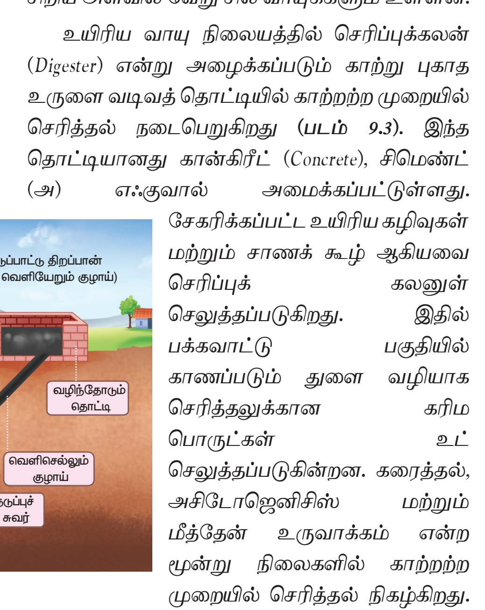
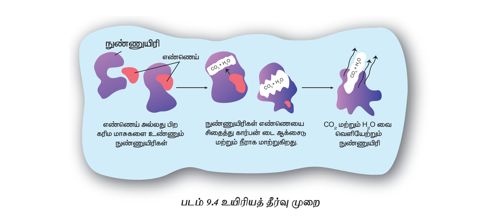
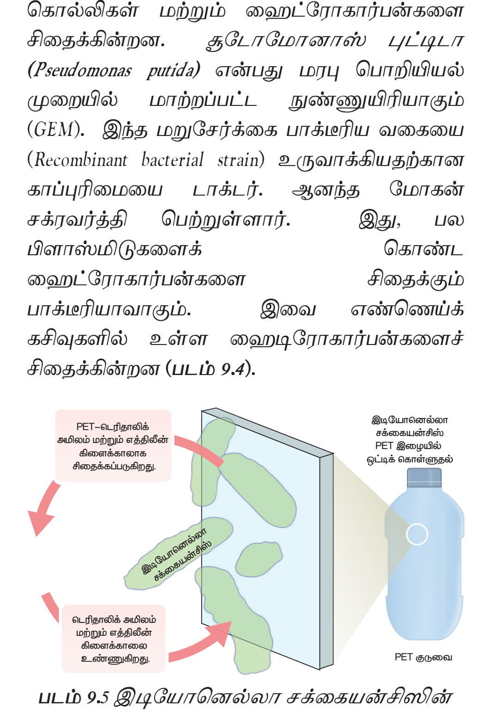
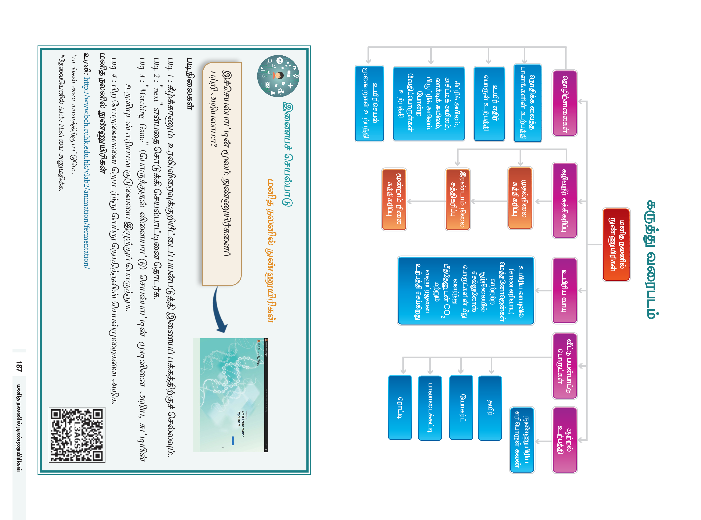

# பாடம் 9: மனித நலனில் நுண்ணுயிரிகள்

> மூலம்: தமிழ் வழிப் பாடநூல், PDF பக்கங்கள் 184–195.

> குறிப்பு: கீழுள்ள தேடக்கூடிய உரை துல்லியமான படங்கள், அட்டவணைகள் மற்றும் அமைப்பிற்கு அசல் பக்கங்களைப் பார்க்கவும்.

அலகு - III

மனித நலனில்
நுண்ணுயிரிகள்

பாடம்
“சாக்ரோமைசஸ் செரிவிசியே என்ற ஈஸ்ட்
இனம் அடுமனை மற்றும் பான தயாரிப்பு
தொொழிற்சசாலையில் பயன்படுகிறது.”

## பாட உள்ளடக்கம்

9.1.
9.2.
9.3.

9.4.
9.5.

 வீட்டு பயன்பபாட்டுப் பொொருட்களில்
நுண்ணுயிரிகள்
 தொொழிற்கூடங்களின் உற்பத்திப்
பொொருட்களில் என்பவை
 கழிவு நீர் சுத்திகரித்தல் மற்றும்
ஆற்றல் உற்பத்தியில்
நுண்ணுயிரிகள்
 உயிர்வவாயு உற்பத்தியில்
நுண்ணுயிரிகள்
உயிரியத்தீர்வு

## கற்றலின் நோக்கங்கள் :

-  நோயூக்கிகளிடமிருந்து
பயன் நுண்ணுயிரிகளை
(probiotics)
வேறுபடுத்தியறிதல்.
-  வீட்டு பயன்பபாட்டுப்
பொொருட்களில் நுண்ணுயிரிகளின்
பயன்களை உணர்தல்.
-  உயிர் எதிர்பப்பபொருள் உற்பத்தி மற்றும்
நொொதிக்க வைத்த பானங்கள் பற்றி
அறிதல்.
-  கழிவு நீர் சுத்திகரிப்பு மற்றும் ஆற்றல்

மனித நலனில் நுண்ணுயிரிகள்

உற்பத்தியில் நுண்ணுயிரிகளின்
முக்கியத்துவத்தை அறிந்து கொொள்ளுதல்.
-  உயிரியத்தீர்வில் நுண்ணுயிரிகளின்
பயன்பபாட்டை உணர்தல்.

நு

ண்ணுயிரிகளான
பாக்டீரியாக்கள்,
பூஞ்சசைகள்,
புரோட்டோசோவாக்கள்,
சில பாசிகள், வைரஸ்கள், வைரஸ் மூலகம்
(viroid)
மற்றும்
பிரையான்கள்
(Prions)
போன்றவை, பூமியின் உயிரியல் மண்டலத்தின்
முக்கிய கூறுகள் ஆகும்.
பயன்தரக்கூடிய
பலவகையான நுண்ணுயிரிகள் மனிதர்களின்
நல்வவாழ்வில் பெரும் பங்ககாற்றுகின்றன. இவை
மண்,
நீர்,
காற்று,
விலங்குகள்
மற்றும்
தாவரங்களின்
உடல்கள் உட்பட எல்லா
இடங்களிலும் பரவி உள்ளன. பாக்டீரியா மற்றும்
பூஞ்சசை
போன்ற
நுண்ணுயிரிகள்
வளர்
ஊடகத்தில் வளர்ந்து கூட்டமாக வாழ்பவை.
இக்கூட்டங்களை
வெறும்
கண்களாலேயே
பார்க்க இயலும்.
மனிதர்களுக்கு நனமை
பயக்கும் சில நுண்ணுயிரிகளைப் பற்றி இனி
காணலாம்.

## 9.1  வீட்டு பயன்பபாட்டுப்

பொொருட்களில் நுண்ணுயிரிகள்
அன்றறாட வாழ்வில், நாம் தயாரிக்கும் இட்லி,
தோசை, பாலாடைக்கட்டி, தயிர், யோகர்ட்,

பிசைந்த மாவு, ரொொட்டி, வினிகர் போன்ற பல
உணவுப் பொொருட்களில் நுண்ணுயிரிகள் மற்றும்
அதன் விளை பொொருட்கள் பயன்படுத்தப்படுகின்றன.
லேக்டிக் அமில பாக்டீரியா (Lactic acid bacteria) என்று
பொொதுவாக அழைக்கப்படும் லேக்டோபேசில்லஸ்
அசிடோஃஃபிலஸ்
(Lactobacillus
acidophilus),
லேக்டோபேசில்லஸ் லேக்டிஸ் (Lactobacillus lactis)
மற்றும்
ஸ்ட்ரரெப்டோகாக்கஸ்
லேக்டிஸ்
(Streptococcus lactis) போன்றவை லாக்டிக் அமில
பாக்டீரியா என்று அழைக்கப்படுகிறது. இவைகள்
பயன் தரும் நுண்ணுயிரிகள் (புரோபயோடிக்)
வகையைச் சார்ந்தவை. இவை இரைப்பை மற்றும்
உணவுப்பாதையில்
நோய்
உண்டடாக்கும்
நுண்ணுயிரிகளின்
வளர்ச்சியை
கட்டுப்படுத்துகின்றன.
பாலில்
வளரும்
லேக்டிக்
அமில
பாக்டீரியாக்கள் பாலில் உள்ள பால் புரதத்தை
செரித்து கேசின் எனும் தயிராக மாற்றுகிறது.
தூய பாலில் உறை (inoculums or starter) (அ) மூல
நுண்ணுயிரிகள் சேர்க்கப்படும் சிறிதளவு தயிரில்
மில்லியன் கணக்கில் லேக்டோபேசில்லை இன
பாக்டீரியாக்கள் உள்ளன.
அனுகூலமான

வெப்பநிலையில் (≤40 C) இவை எண்ணிக்கையில்
பெருகி, பாலை தயிராக மாற்றுகிறது. பாலை விட
தயிரில் அதிக சத்தான கரிம அமிலங்கள் மற்றும்
வைட்டமின்கள் உள்ளன.
பிரிபையோடிக் (Prebiotic):
இவை
நார்ச்சத்துள்ள
உணவில்
உள்ள
கூ ட் டு ப் ப ொ ரு ட் ்க ள்
ஆகும்.
நனமை
பயக்கும்
நுண்ணுயிரிகளின்
வளர்ச்சியையும்,
செயல்திறனையும் இவை தூண்டுகின்றன.
புரோபையோட்டிக் (Probiotic): இவை பயன் தரும்
நுண்ணுயிர்கள்
ஆகும்.
இவற்றை
உண்ணும்போது குடல்வவாழ் நுண்ணுயிர்கள்
விருத்தியடைவதால்
அல்லது
புதுப்பிக்கப்படுவதால் பல உடல்நலன் சார்ந்த
நனமைகள் ஏற்படுகின்றன
பாக்டீரியாக்களைப்
பயன்படுத்தி
பாலை
நொொதிக்க வைப்பதன் மூலம் யோகர்ட் மற்றும்
அதன் துணை பொொருளான லாக்டிக் அமிலம்
ஆகியவை
உற்பத்தி
செய்யப்படுகின்றன.

ஸ்ட்ரரெப்டோகாக்கஸ்
தெர்மோஃபைலஸ்
(Streptococcus
themophilus)
மற்றும்
லாக்டோபேசில்லஸ் பல்ககேரிகஸ் (Lactobacillus
bulgaricus) ஆகியவை, பால் புரதத்தை உறையச்
செய்துவதுடன் பாலில் உள்ள லாக்டோசை,
லாக்டிக்
அமிலமாகவும்
மாற்றுகின்றன.
யோகர்டின் சுவைக்கு / மணத்திற்கு அதில் உள்ள
அசிட்டால்டிஹைடு காரணமாகும்.
பல
வகையான
சுவைகள்
மற்றும்
அமைப்புகளில் உருவாக்கப்படும் பால் பொொருளான
பாலாடைக்கட்டி, பால் புரதமான கேசினை திரிய
வைப்பதன்
மூலம்
உருவாக்கப்படுகிறது.
பாலாடைக்கட்டி உற்பத்தியின் பொொழுது, அமில
நிலைக்கு மாற்றப்பட்ட பால் திரிவதற்ககாக
ரென்னட்
(Rennet)
என்னும்
நொொதி
சேர்க்கப்படுகிறது.
இறுதியாக,
உறைந்த
திடப்பொருளைப் பிரித்து எடுத்து அழுத்துவதன்
மூலம்
பாலாடைக்கட்டி
பெறப்படுகிறது.
லாக்டோகாக்கஸ், லாக்டோபேசில்லஸ் (அ)
ஸ்ட்ரரெப்டோகாக்கஸ் போன்ற வினைத்தொடக்க
பாக்டீரியாக்களின் உதவியோடு பல வகையான
பாலாடைக்கட்டிகள் உருவாக்கப்படுகின்றன.
தெற்கு ஆசியாவில் குறிப்பாக இந்தியாவில்
பொொதுவாக பனீர் (Paneer) எனப்படும், புதிய
பாலாடைக்கட்டி பயன்படுத்தப்படுகிறது. கொொதிக்க
வைத்த பாலில் எலுமிச்சை சாறு, வினிகர் (அ)
உண்ணத் தகுந்த அமிலங்கள் சேர்த்து பாலை
திரியச் செய்து பனீர் தயாரிக்கப்படுகிறது.
புரோபியோனிபாக்டீரியம்ஷெர்மமானியை(Propionibacterium shermanii) என்ற பாக்டீரியா உற்பத்தி
செய்யும் அதிகப்படியான கார்பன்-டை-ஆக்ஸஸைடு
தான் உற்பத்தி ஸ்விஸ் பாலாடைக்கட்டிகளில்
காணப்படும் பெருத்துளைகளுக்கு காரணமாகும்.
இட்லி மற்றும் தோசை மாவை நொொதிக்கச்
செய்வதற்கு லியூகோநாஸ்டடாக் மீசென்டிராய்ட்ஸ்
(Leuconostoc mesenteroides) என்ற பாக்டீரியமும், அதே
போல் ரொொட்டி தயாரிப்பதற்கு பயன்படும் மாவை
சக்ரோமைசஸ் செரிவிசியே (Saccharomyces cerevisiae)
(அடுமனை ஈஸ்ட்) என்ற ஈஸ்ட்டும் நொொதிக்கச்
செய்கின்றன. குளுக்கோஸ் நொொதித்தலின் போது
உருவாகும் எதில் ஆல்கஹால் மற்றும் கார்பன்டை-ஆக்ஸஸைடு ஆகியவை மாவு புளிப்பதற்ககான
காரணிகளாகும். நொொதித்த மாவிலிருந்து ரொொட்டி
தயாரிக்கும் போது கார்பன்-டை-ஆக்ஸஸைடும்
எதில் ஆல்கஹாலும் வெளியேறுவதால் ரொொட்டி
மெனமையாகவும் துளைகள் நிரம்பியதாகவும்
கிடைக்கிறது.

மனித நலனில் நுண்ணுயிரிகள்

ஒற்றை செல் புரதம் என்பவை உண்ணத்தகுந்த
ஒரு செல்
நுண்ணுயிரியான ஸ்பபைருலினா
(Spirulina) போன்றவற்றைக் குறிக்கிறது. பாசிகள்,
ஈஸ்ட், பூஞ்சசை (அ) பாக்டீரியா போன்றவற்றை
தனியாகவோ (அ) கலந்தோ (அ) சேர்தத்தோ
வளர்த்து அதிலிருந்து கிடைக்கும் புரதத்தை
உணவின் உட்பொருளாகவோ (அ) புரதத்திற்கு
மாற்று உணவாகவோ எடுத்துக் கொொள்ளலாம்.
இவை
மனிதர்கள்
உண்பதற்கு
ஏற்றவை.
கால்நடைத் தீவனமாகவும் பயன்படுத்தலாம்.

## 9.2  தொொழிற்கூடங்களின் உற்பத்திப்

பொொருட்களில் நுண்ணுயிரிகள்
மனிதர்கள்
பயன்படுத்தும்
எண்ணற்ற
மதிப்புமிக்க
பொொருட்களை
உருவாக்க
நுண்ணுயிரிகள்
பயன்படுத்தப்படுகின்றன.
பானங்கள், உயிர் எதிர்பப்பபொருட்கள், கரிம
அமிலங்கள்,
அமினோ
அமிலங்கள்,
வைட்டமின்கள், உயிரி எரிபொொருள், ஒற்றை செல்
புரதம், நொொதிகள், ஸ்டீராய்டுகள், தடுப்பூசிகள்,
மருந்துகள், போன்றவை தொொழிற்சசாலைகளில்
தயாரிக்கப்படுகின்றன.
தொொழிற்சசாலைகளில்
நுண்ணுயிரிகளை அதிக அளவில் உற்பத்தி
செய்ய பெரிய நொொதிகலன்கள் (Fermentors)
தேவைப்படுகின்றன. தேவையான அளவு காற்றை
உட்சசெலுத்தும் வசதி, வெப்பம் மற்றும் அமில
காரத்தனமை (pH) அளவுகளை நிர்வகிக்கும்
அமைப்பு மேலும், அளவுக்கு அதிகமாக நிரம்பி
வழியும்
நுண்ணுயிர்
கழிவுப்பொருளை
வெளியேற்றும் வசதி ஆகியவற்றை உடைய
மூடிய உயிர்வினைக் கலனே இந்நொதிகலனாகும்.

ஸ்ட்ரரெப்டோமைசின் என்ற உயிர்எதிர்பப்பபொருளை
செல்மமேன் வேக்ஸ்மமேன் (Selman Waksman) என்பவர்
கண்டறிந்ததார்.
அது மட்டுமின்றி 1943 ஆம்
ஆண்டில் உயிர் எதிர்பொருள் என்ற சொொல்லையும்
முதலில் அவர் பயன்படுத்தினார்.
i)

நுண்ணுயிர்

பகைமை

(Antibiosis):

நோயுண்டடாக்கும் நுண்ணுயிரிகளை கொொல்வது
உயிர் எதிர்பப்பபொருளின் பண்பபாகும்.
ii) பலதரப்பட்ட நோய்களை உண்டடாக்கக்கூடிய
பாக்டீரியாக்களை எதிர்த்து பரந்த செயலாற்றலுள்ள

உயிர் எதிர்பொருள்கள் (Broad spectrum antibiotics)
செயல்படுகின்றன.

iii) குறுகிய செயலாற்றலுள்ள உயிர் எதிர்பொருள்கள்
(Narrow spectrum antibiotics) குறிப்பிட்ட நோய்களை

தோற்றுவிக்கும் பாக்டீரீயக் குழுக்களை மட்டுமே
எதிர்த்து செயல்படுகின்றன.

Alexander Fleming

ஒற்றை செல் புரதம் (SCP)

### 9.2.1  உயிர் எதிர்பப்பபொருள் உற்பத்தி

உயிர்
எதிர்பப்பபொருள்
என்பவை
நுண்ணுயிரிகளால்
உற்பத்தி
செய்யப்படும்
வேதிப்பொருட்கள் ஆகும்.
இது குறைந்த
செறிவில்,
நோயை
உண்டடாக்கும்
பிற
நுண்ணுயிரிகளின் வளர்ச்சியை தடுக்கவோ
அல்லது
கொொல்லவோ
செய்யும்.
உயிர்
எதிர்பப்பபொருள் என்பது “உயிரிக்கு எதிரானவை”
என பொொருள்படும். இவை, பிளேக், மூளைப்படல
அழற்சி, தொொண்டடை அடைப்பான், சிபிலிஸ்
(கிரந்தி), தொொழு நோய், காச நோய் போன்ற
நோய்களுக்கு சிகிச்சையளிக்கப் பயன்படுகின்றன.
மனித நலனில் நுண்ணுயிரிகள்

ெப
clய  kைரேசாjன 

H
N
O
O

S
N
O

OH

 ெடஃைபேலாகா க  ஆrய 

(அலெக்ஸஸாண்டர் ஃபிளமிங்)

பெனிசிலின்
மருந்ததை
பயன்படுத்துவதில்
உள்ள
பெரிய
இடர்
மீஉணரமை
(Hypersensitivity) ஆகும். இதனால்
குமட்டல், வாந்தி, அரிப்புகள், மூச்சுத்திணறல்
மற்றும் இறுதியில் இரத்த நாள அழிவுகள்
போன்றவை ஏற்படுகின்றன. ஒவ்வாமையை
பரிசோதனை
செய்வதற்ககாக
மருத்துவர்
நோயாளியின் முன் கையில் சிறிய ஊசியால்
சிறிதளவு
வீரியம்
குறைந்த
மருந்ததை
செலுத்துவார்.
நோயாளிக்கு
மருந்து
ஒத்துக்கொள்ளவில்லையெனில்
மருந்து
செலுத்திய இடத்தில் சிவந்து அரிப்பு ஏற்படும்.
நோயாளிக்கு மருந்து செலுத்துவதற்கு முன்
முக்கியமாக செய்து கொொள்ள வேண்டிய
சோதனை இதுவாகும்.
அலெக்ஸஸாண்டர் ஃபிளமிங் (Alexander Fleming)
ஸ்டடெபைலோகாக்கை (Staphylo cocci) பாக்டீரியா
பற்றிய ஆராய்ச்சியை மேற்கொண்டிருந்த போது
சரியாக சுத்தம் செய்யப்படாத கண்ணாடி தட்டு
ஒன்றில் பச்சை பூஞ்சசை வளர்ந்திருப்பதையும்
அதனைச்
சுற்றி
ஸ்டடெபைலோகாக்கை
வளரமுடியவில்லை
என்பதையும்
கண்டடார்.
அதற்கு காரணம் அந்த பூஞ்சசையிலிருந்து
உற்பத்தியான வேதிப்பொருள் என்பதையும்
அவர் அறிந்ததார். 1926 ல் அந்த வேதிப்பொருளுக்கு
பெனிசிலின்
என்று
அவர்
பெயரிட்டார்
(படம் 9.1). இதுவே அவர் கண்டுபிடித்த முதல்
உயிர் எதிர்ப் பொொருளாகும்.
பெனிசிலியம்
நொொட்டேட்டம் (Penicillium notatum) மற்றும்
பெனிசிலியம்
கிரைசோஜீனம்
(Penicillium
chrysogenum) என்ற பூஞ்சசைகள் பெனிசிலினை
உற்பத்தி
செய்கின்றன.
இது
பாக்டீரியாக்கொல்லியாக
செயல்பட்டு
பாக்டீரியாவின்
செல்சுவர்
உற்பத்தியைத்
தடுக்கிறது.
நீண்ட நாட்களுக்குப் பிறகு எர்னஸ்ட் செயின்
(Earnest Chain) மற்றும் ஹோவார்டு ப்ளோரி
(Howare Florey) ஆகியோர் பெனிசிலின் மருந்ததை
மேம்படுத்தி, அதை மேலும் வீரியமுடைய உயிர்
எதிர்பப்பபொருளாக மாற்றினர்.
ஆகையால்,
இம்மருந்து “மருந்துகளின் ராணி”(Queen of Drugs)
என்று அழைக்கப்படுகிறது.
இந்த மருந்து
இரண்டடாம்
உலகப்போரில்
காயமடைந்த
வீரர்களுக்குப் பயன்படுத்தப்பட்டது. பெனிசிலின்

மருந்து கண்டுபிடிப்பிற்ககாக ஃபிளமிங், செயின்
மற்றும் ப்ளோரி ஆகிய மூவருக்கும் 1945 ஆம்
ஆண்டு நோபல் பரிசு வழங்கப்பட்டது.
டெட்ரராசைக்கிளின் (Tetracycline) என்பது பரந்த
செயலாற்றலுள்ள பாக்டீரியாக்களின் வளர்ச்சியை
மட்டுபடுத்தும் (Bacteriostatic) உயிர் எதிர்பப்பபொருள்
ஆகும். இது நுண்ணுயிரிகளின் புரத உற்பத்தியை
தடுக்கிறது.
ஸ்ட்ரரெப்டோமைசஸ்
ஆரியோபேசியன்ஸ் (Streptomyces aureofaciens) என்ற
பாக்டீரியாவிலிருந்து
பிரித்ததெடுக்கப்பட்ட
குளோர்டடெட்ரராசைக்ளின் என்பது தான் டெட்ரரா
சைக்ளின் வகையைச் சேர்ந்த முதல் உயிர்
எதிர்பப்பபொருள் மருந்ததாகும். ஸ்ரரெப்டோமைசிஸ்
கிரைஸ்ஸியஸ்
(Streptomyces
griseus)
என்ற
ஆக்டினோமைசெட்ஸ்
வகையைச்
சேர்ந்த
பாக்டீரியாவில் இருந்து ஸ்ட்ரரெப்டோமைசின்
என்ற பரந்த செயலாற்றலுள்ள (Broad Spectrum)
உயிர் எதிர்பப்பபொருள் தயாரிக்கப்படுகிறது. இந்த
மருந்து பொொதுவாக கிராம் பாசிட்டிவ் மற்றும்
கிராம் நெகட்டிவ் பாக்டீரியாக்களை குறிப்பாக
மைக்கோபாக்டீரியம்
டியுபர்குளோசிஸ்ஸை
(Mycobacterium
tuberculosis)
அழிக்கின்றது.
எரித்ரோமைசின்,
குளோரோமைசிடின்,
கிரைஸ்ஸியோஃஃபல்வின்,
நியோமைசின்,
கெனாமைசின், பாசிட்ரராசின் மற்றும் இது போன்ற
பல உயிர்எதிர்பப்பபொருட்கள் நுண்ணுயிரிகளில்
இருந்து பிரித்ததெடுக்கப்படுகின்றன.

உயிர் எதிர்பப்பபொருள் எதிர்ப்புத்திறன்
(Antibiotic Resistance)
பாக்டீரியாவை கொொல்வதற்கோ (அ) அதன்
வளர்ச்சியை
தடுத்து
நிறுத்துவதற்கோ
உருவாக்கப்பட்ட உயிர் எதிர்பப்பபொருளை வலிமை
இழக்க செய்யும் திறனை பாக்டீரியா பெறும்
போது உயிர் எதிர்பப்பபொருள் எதிர்ப்புத்திறன்
நிகழ்கிறது. இது பொொது சுகாதாரத்திற்ககான தீவிர
அச்சுறுத்தல்களில்
ஒன்றறாகும்.
உயிர்
எதிர்பப்பபொருட்களின் தவறான பயன்பபாடு மற்றும்
அளவுக்கு அதிகமான பயன்பபாடு ஆகியவை உயிர்
எதிர்பொருள்
எதிர்ப்புத்திறனை
முடுக்கிவிடுகிறது.
மேலும் இது மோசமான
தொொற்றுத் தடுப்பு கட்டுப்பாடு மூலமும் நிகழ்கிறது.
அங்கீகரிக்கப்பட்ட
உடல்நல
வல்லுனரின்
பரிந்துரையின்
பேரில்
மட்டுமே
உயிர்
எதிர்பப்பபொருளை பயன்படுத்த வேண்டும். உயிர்
எதிர்ப் பொொருளுக்கான எதிர்ப்புத் தனமையை
பாக்டீரியா
பெற்றுவிட்டால்,
உயிர்

மனித நலனில் நுண்ணுயிரிகள்

எதிர்பப்பபொருளால்
பாக்டீரியாவை
எதிர்த்து
செயல்படமுடிவதில்லை.
எனவே பாக்டீரியா
தன்னை பெருக்கிக் கொொள்கின்றன.
பரந்த
செயலாற்றலுள்ள
உயிர்
எதிர்பப்பபொருட்களை
விட
குறுகிய
செயலாற்றலுள்ள உயிர் எதிர்பப்பபொருட்களுக்கே
அதிக
முன்னுரிமை
அளிக்கப்படுகிறது.
ஏனெனில், அவை திறம்பட மற்றும் துல்லியமாக
குறிப்பிட்ட நுண்ணுயிரிகளை குறிவைத்து (அ)
இலக்கு
வைத்து
தாக்குவதோடு
அந்நுண்ணுயிரிகளில்
எதிர்ப்புத்திறன்
உருவாகும்
வாய்ப்பையும்
குறைக்கிறது.
இன்றறைய
நிலையில்
பரவலாகப்
பயன்படுத்தப்பட்டு வரும் பல்வவேறு உயிர்
எதிர்பப்பபொருட்களுக்கு எதிர்ப்புத்திறன் பெற்ற
பாக்டீரியத் திரிபுகளை ‘சூப்பர் பக்’ (Super bug)
என்ற சொொல்லால் அழைப்பர்.

### 9.2.2 நொொதிக்க வைக்கப்பட்ட பானங்கள்

(Fermented Beverages)
பழங்ககாலந்தொட்டே
நுண்ணுயிரிகள்,
முக்கியமாக ஈஸ்ட்டுகள், மதுபானங்களான
ஒயின், பீர், விஸ்கி, பிராந்தி மற்றும் ரம்
உற்பத்தியில் பயன்பபாட்டில் உள்ளது. இவற்றில்
ஒயின்கள் என்பவை பழமையான ஆல்கஹால்
மதுபான வகையாகும். ஈஸ்ட்டுகளை பயன்படுத்தி
பழசாற்றினை நொொதிக்க வைப்பதன் மூலம்
இப்பானங்கள்
தயாரிக்கப்படுகின்றன.
நொொதித்தலின் உயிர் வேதியியல் செயல்முறைகள்
மற்றும் அதன் நடைமுறை பயன்களை பற்றி
படிக்கும் பன்முறை அறிவியல் சைமாலஜி
(Zymology) எனப்படும்.
 பாஸ்டியர் விளைவு (Pasteur
effect) என்பது நொொதித்தல்
நிகழ்வின் மீது ஆக்சிஜன்
ஏற்படுத்தும்
தடையின்
விளைவாகும்.
சக்காரோமைசெஸ்
செரிவிசியே
(Saccharomyces cerevisiae), பொொதுவாக புரூயரின்
ஈஸ்ட் (Brewer’s Yeast) என அழைக்கப்படுகிறது.
இதைப் பயன்படுத்தி மால்ட் அல்லது மாவு
நிறைந்த
தானியங்கள்
மற்றும்
பழரசம்
போன்றவற்றை நொொதிக்கச் செய்து பல்வவேறு
மதுபான வகைகள் உற்பத்தி செய்யப்படுகின்றன.
மனித நலனில் நுண்ணுயிரிகள்

ஒயின் மற்றும் பீர் ஆகியன காய்ச்சி வடித்தல்
இல்லாமல் தயாரிக்கப்படுகின்றன.
ஆனால்
விஸ்கி, பிராந்தி மற்றும் ரம் ஆகியன நொொதித்தல்
மற்றும்
காய்ச்சி
வடித்தல்
முறையில்
தயாரிக்கப்படுகின்றன.
திராட்சசை ரசத்தை நொொதிக்கச் செய்வதன்
மூலம் ஒயின் உற்பத்தி செய்யப்படுகிறது. ஒயின்
மற்றும் ஒயின் உற்பத்தி செய்யும் முறைகளை
பற்றிய அறிவியலுக்கு ஈனாலாஜி (Oenology) என்று
பெயர். திராட்சசை ரசம் பல்வவேறு வகையான
சக்காரோமைசஸ்
செரிவிசியே
மூலம்
நொொதிக்கப்பட்டு ஆல்கஹாலாக மாற்றப்படுகிறது.
சிவப்பு ஒயின் மற்றும் வெள்ளை ஒயின் என
இரண்டு வகை ஒயின்கள் உள்ளன.
சிவப்பு
ஒயின்களுக்கு
கருந்திராட்சசை
பயன்படுத்தப்படுகிறது. சில சமயம் அதன் தோல்
மற்றும்
தண்டுகளும்
சேர்த்து
ஒயின்
தயாரிக்கப்படுகிறது. இதற்கு மாறாக வெள்ளை
ஒயின்கள் வெள்ளை (அ) கருந்திராட்சசையின்
பழச்சாற்றிலிருந்து மட்டும் தயாரிக்கப்படுகிறது
தோல்
மற்றும்
தண்டுகள்
இதில்
சேர்க்கப்படுவதில்லை.
பல்வவேறு மதுபானங்களில் உள்ள
ஆல்கஹால் அளவுகள்
பீர்
ஒயின்
ஒயின் குளிர்பபானம்
விஸ்கி, ஜின், ஸ்ககாட்ச்
மற்றும் வோட்ககா

- 3-5 சதவீதம்
- 9-14 சதவீதம்
- 4-6 சதவீதம்
- 35-40 சதவீதம்

சக்காரோமைசெஸ் கார்ல்பபெர்ஜஜென்சிஸ்
(Saccharomyces carlsbergensis) (அ) சக்காரோமைசஸ்
செரிவிசியே ஆகியவை முளைக்கட்டிய பார்லி
மால்ட் தானியங்களை பீராக மாற்றுகிறது.
சக்காரோமைசெஸ்
செரிவிசியே
மூலம்
நொொதிக்க வைக்கப்பட்ட கரும்பு அல்லது கரும்புச்
சர்க்கரை
அல்லது
கரும்பு
சாற்றிலிருந்து
நேரடியாக ரம் உற்பத்தி செய்யப்படுகிறது. விஸ்கி
என்பது ஒரு வகையான காய்ச்சி வடிகட்டிய
மதுபானமாகும்.
இது சக்காரோமைசஸ்
செரிவிசியே மூலம் நொொதிக்க வைக்கப்பட்ட
தானிய கூழ் மூலம் உருவாக்கப்படுகிறது.
பதநீர் என்பது தென்னிந்தியாவின் ஒரு சில
பகுதிகளில் பாரம்பரியமாக பனை மற்றும்
தென்னம் பாளையின் சாற்றிலிருந்து நொொதித்தல்

முறையில் தயாரிக்கப்படும் பானம் ஆகும்.
பொொதுவாக, இப்பானமானது தென்னை மரத்தின்
வெடிக்காத பாளையைத் தட்டுவதன் மூலம்
பெறப்படுகிறது. இது ஒரு புத்துணர்ச்சி தரும்
பானமாகும்.
பனைமர பதநீரை காய்ச்சி
பனங்கருப்பட்டி
அல்லது
பனைவெல்லம்
தயாரிக்கப்படுகிறது.
சேகரிக்கப்பட்ட பதநீர்
அசைவற்ற சூழலில் சில மணி நேரங்கள்
இருக்கும் பொொழுது அதில் இயற்ககையாக உள்ள
ஈஸ்டடானது நொொதித்தல் வினையில் ஈடுபடுவதால்
கள் (Toddy) என்ற மதுபானம் உருவாகிறது. இதில்
4% ஆல்கஹால் உள்ளது. 24 மணிநேரத்திற்கு
பிறகு
கள்,
அருந்தக்கூடிய
தனமையை
இழக்கிறது. ஆனால் இது (புளிக்காடி) வினிகர்
உற்பத்திக்குப் பயன்படுகிறது.
எத்தனால்
(C2H5OH)
உற்பத்தியில்
சக்காரோமைசெஸ் செரிவிசியே பெரும்பங்கு
வகிக்கிறது. எதில் ஆல்கஹால் தொொழிற்சசாலை
மற்றும்
ஆய்வகங்களில்
பயன்படுவதோடு,
எரிபொொருளாகவும்
பயன்படுத்தப்படுகிறது.
எனவே எத்தனால் “தொொழில்துறை ஆல்கஹால்”
என குறிப்பிடப்படுகிறது.
சைமோமோனாஸ்
மோபிலிஸ் (Zymomonas mobilis) மற்றும் சர்சினா
வென்ட்ரிகுலி
(Sarcina
ventriculi)
போன்ற
பாக்டீரியாக்களும் எத்தனால் தயாரித்தலில்
பயன்படுத்தப்படுகின்றன.
தொொழில்துறை ஆல்கஹாலின் வணிகரீதியான
உற்பத்திக்கு முக்கிய தளப்பொருளாக சர்க்கரை
ஆலைக்கழிவு (Molasses) சோளம், உருளைகிழங்கு
மற்றும்
மரக்கழிவுகள்
ஆகியவை
பயன்படுத்தப்படுகின்றன.
எத்தனால்
உற்பத்தியில்
முதலில்
தளப்பொருள்
அரைக்கப்படுகிறது.
பிறகு
ஆஸ்பர்ஜில்லஸிடமிருந்து
பெற்ற
நீர்த்த
அமைலேஸ் நொொதி சேர்க்கப்படுகிறது. இது
ஸ்டடார்ச்சை
சிதைத்து
நொொதிக்கக்கூடிய
சர்க்கரையாக மாற்றுகிறது. இதனுடன் ஈஸ்ட்
சேர்க்கப்பட்டு சர்க்கரையானது எத்தனாலாக
மாற்றப்படுகிறது. இது 96% அடர்வு கொொண்ட
எத்தனாலாக காய்ச்சி வடிக்கப்படுகிறது. இன்று
பொொதுவாக பயன்பபாட்டில் உள்ள உயிரிய
எரிபொொருட்கள், எத்தனால் மற்றும் பயோ டீசல்
ஆகியனவாகும்.
இவையே
உயிரிய
தொொழில்நுட்பத்தின்
முதல்

எரிபொொருள்
தலைமுறை

பிரதிநிதிகளாகும்.
எரிபொொருளாக எத்தனால்
பெரும்பபாலும் எரிபொொருளாக பயன்படுகிறது.
முக்கியமாக,
உயிரிய
எரிபொொருளாக,
கேசோலைனுடன்
(Gasoline)
சேர்க்கப்பட்டு
பயன்படுத்தப்படுகிறது.

C6H12O6

ஈஸ்ட்

நொொதித்தல்
(குளுக்கோஸ்)

(எத்தனால்)

ஒவ்வொரு ஆண்டும் ஆகஸ்டு 10
ஆம் நாள் உலக உயிரிய
எரிபொொருள்
தினமாகக்
கடைபிடிக்கப்படுகிறது.
மரபு
சார்ந்த புதுப்பிக்க இயலாத புதை படிவ
எரிபொொருட்களுக்கு மாற்றாக, புதுப்பிக்கக்கூடிய
உயிரிய எரிபொொருளின் முக்கியத்துவம் பற்றிய
விழிப்புணர்வவை
ஏற்படுத்த
இந்நாள்
கடைபிடிக்கப்படுகிறது. இந்நாள் உயிர் எரிபொொருள்
துறையில் அரசு எடுக்கும் பல்வவேறு முயற்சிகளை
முன்னிலைப்படுத்துகிறது.

தாவர
எண்ணைய்,
கொொழுப்பு
(அ)
உயவுகளிம்புகளில் (Greases) இருந்து பயோடீசல்
(Biodiesel) என்ற எரிபொொருள் தயாரிக்கப்படுகிறது.
டீசல் எஞ்சின்களில் எந்த மாற்றமும் செய்யாமல்
பயோடீசலைப் பயன்படுத்தலாம். பெட்ரோலியம்
சார்ந்த டீசல் எரிபொொருளை ஒப்பிடும் போது தூய
பயோடீசல் ஒரு நச்சற்ற, உயிரிய சிதைவிற்கு
உள்ளாகக் கூடிய குறைந்த அளவு காற்று
மாசுபடுத்திகளைக் கொொண்ட எரிபொொருளாகும்.
இந்திய அரசாங்கம் டிசம்பர் 2009-ல் உயிரிய
எரிபொொருள் குறித்த தேசிய கொொள்ககைக்கு
ஒப்புதல் அளித்தது காட்டாமணக்கு (Jatropha curcas)
என்ற எண்ணைய் வித்து பயோடீசல் உற்பத்திக்கு
மிக சிறந்தது என கண்டறியப்பட்டுள்ளது.
புங்கன் (Pongamia) என்னும் சிற்றினமும்
பயோடீசல்
உற்பத்திக்கு
ஏற்றது
எனக்
கருதப்படுகிறது.

### 9.2.3 வேதிப்பொருட்கள், நொொதிகள்

மற்றும் பிற உயிரிய செயல்
மூலக்கூறுகள்
நுண்ணுயிரிகள்,
வணிக
மற்றும்
தொொழில்துறை ரீதியான ஆல்கஹால் உற்பத்திக்கு
மட்டுமின்றி
கரிம
அமிலங்கள்
மற்றும்
நொொதிகளின்
உற்பத்திக்கும்

2C2H5OH + 2CO2↑

மனித நலனில் நுண்ணுயிரிகள்

பயன்படுத்தப்படுகின்றன.
சிட்ரிக் அமிலம்
தயாரிக்க ஆஸ்பர்ஜில்லஸ் நைஜர் (Aspergillus
niger),
அசிடிக்
அமிலம்
தயாரிக்க
அசிட்டோபாக்டர் அசிட்டை (Acetobacter aceti),
ஃபியுமரிக் அமிலம் தயாரிக்க ரைசோபஸ்
ஒரைசே (Rhizopus oryzae), பியூட்ரிக் அமிலம்
தயாரிக்க

கிளாஸ்டிரிடியம்

பியூட்டைரிக்கம்

(Clostridium butyricum) மற்றும் லாக்டிக் அமிலம்
தயாரிக்க

லாக்டோபேசில்லஸ்

(Lactobacillus)

ஆகியவை பயன்படுத்தப்படுகிறது.
வணிக ரீதியிலான நொொதிகளின் உற்பத்திக்கு
ஈஸ்ட் (சக்காரோமைசெஸ் செரிவிசியே) மற்றும்
பாக்டீரியாக்கள் பயன்படுகின்றன.

துணிகளில்

படிந்த எண்ணைய் கறைகளை நீக்க லைபேஸ்
நொொதி

சலவைப்

பொொருட்களில்

பயன்படுத்தப்படுகிறது.
பெக்டினேஸ்,
செல்லுலேஸ்

புரோட்டியேஸ்

போன்ற

நொொதிகள்

மற்றும்
புட்டியில்

அடைக்கப்பட்ட சாறுகளை தெளிவடைய செய்ய
பயன்படுத்தப்படுகின்றன.

பாலாடைக்கட்டி

தயாரிப்பில் ரென்னட் போன்ற நொொதிகள் பாலை
கெட்டியான தயிராக மாற்றுவதற்குப் பயன்படுகிறது.
ஸ்ட்ரரெப்டோகாக்கஸ்

பாக்டீரியாக்கள்

செய்யும்

ஸ்ட்ரரெப்டோகைனேஸ்

நொொதியும்

மரபியல்

மாற்றம்

ஸ்ட்ரரெப்டோகாக்கை
இதயத்தசை

உற்பத்தி
என்னும்

செய்யப்பட்ட

பாக்டீரியங்களும்
நலிவுறல்

நோயால்

பாதிக்கப்பட்டவர்களின் இரத்தக்குழாய்களிலுள்ள
இரத்தக்கட்டிகளைக்

கரைக்கும்

‘கட்டி

சிதைப்பானாக’ (Clot Buster) செயல்படுகின்றன.
டிரைக்கோடெர்மமா

பாலிஸ்போரம்

(Trichoderma polysporum) என்ற பூஞ்சசையிலிருந்து
உற்பத்தி

செய்யப்படும்

நோய்

தடுப்பாற்றல்

ஒடுக்கியான சைக்ளோஸ்போரின் A, உறுப்பு
மாற்றம் செய்யப்பயன்படுகிறது.
அழற்சி

எதிர்ப்பு,

ஒட்டுண்ணி

பூஞ்சசை

எதிர்ப்பு

கொொண்டுள்ளது.

மேலும் இது

எதிர்ப்பு

ஆகிய

மற்றும்

பண்புகளைக்

மோனாஸ்கஸ் பர்பூரியஸ்

(Monascus purpureus) என்ற ஈஸ்ட் மூலம் உற்பத்தி
செய்யப்படும் ஸ்டடேட்டின்கள் (Statins), இரத்த
கொொலஸ்ட்ரரால்

அளவை

குறைக்க

பயன்படுத்தப்படுகின்றன. இது கொொலஸ்ட்ரராலை
உற்பத்தி

செய்யும்

நொொதியை

போட்டி

வினைமூலம் தடை செய்கிறது. எ.கோலை மற்றும்
மனித நலனில் நுண்ணுயிரிகள்

சக்காரோமைசெஸ் செரிவிசியே ஆகியவற்றைப்
பயன்படுத்தி உற்பத்தி செய்யப்படும் மறுசேர்க்கை
மனித

இன்சுலின்,

மனிதர்களின்

மருத்துவ

சிகிச்சைக்குப் பெரிதும் பயன்படுகிறது.

## 9.3  கழிவு நீர் சுத்திகரிப்பு மற்றும் ஆற்றல்

உற்பத்தியில் நுண்ணுயிரிகள்
கழிவு நீர் என்பது ஒவ்வொரு நாளும் நகரம்
மற்றும்
பெருநகரங்களில்
உருவாகும்
மனிதக்கழிவுகளைக் கொொண்ட பயனற்ற நீர்
ஆகும்.
இதில் அதிக அளவில் கரிம
பொொருட்களும், மனிதர்களுக்கு நோயுண்டடாக்கும்
நுண்ணுயிரிகளும் மற்றும் உயிரியசிதைவிற்கு
உள்ளாகும் மாசுபடுத்திகளும் உள்ளன. வீட்டு
கழிவுகளில்,
99%
நீரும்,
தொொடங்குநிலை
திடப்பொருட்கள், பிற கரையும் தனமை கொொண்ட
கரிம மற்றும் கனிம பொொருட்கள் போன்றவை
ஒரு சதவீதமும் உள்ளன. ஆறுகள் மற்றும்
ஓடைகள் போன்ற இயற்ககையான நீர் நிலைகளில்
கழிவு
நீரை
நேரடியாக
வெளியேற்றக்
கூடாது.
கழிவு நீரை வெளியேற்றுவதற்கு
முன்னர் அதன் மாசினை குறைக்க, கழிவு நீர்
சுத்திகரிப்பு நிலையத்தின் மூலம் சுத்திகரிக்க
வேண்டும்.
நுண்ணுயிரிகள் (பாக்டீரியாத் தொொகுப்புத்
திறன்) காற்றேட்டம் செய்யப்பட்ட (இரண்டடாம்
நிலை சுத்திகரிப்பு) கழிவு நீரில் வளர்க்கப்படுகிறது.
இவை அந்நீரில் உள்ள பெரும்பங்கு கரிமப்
பொொருட்களை உட்கொண்டு அழித்து, உயிரிய
ஆக்சிஜன் தேவையையும் (BOD) குறைக்கிறது
(கழிவுநீர்ச் சுத்திகரிப்பின் விவரங்கள் பாடம் 13ல்
விவரிக்கப்பட்டுள்ளது).

### 9.3.1 நுண்ணுயிரிய எரிபொொருள் கலன்

(Microbial Fuel Cell-MFC)
இது

பாக்டீரியாக்களை

பயன்படுத்தி

அதனிடையே
இயற்ககையாக
நடைபெறும்
இடைவினைகளை, ஒப்புப்போலியாக்கி (mimicry)
மின்சசாரம் பெறும் உயிரிய மின் வேதியியல்
முறையாகும்.
கரிம
மூலக்கூறுகளை
ஆக்சிஜனேற்றம் மற்றும் ஒடுக்க வினைக்கு
ஆட்படுத்த பாக்டீரியாக்களை அனுமதிப்பதன்
மூலம் நுண்ணுயிரிய எரிபொொருள் கலன்
இயங்குகிறது
(படம்
9.2).
அடிப்படையில்
பாக்டீரியாக்களின் சுவாசமானது ஒரு பெரிய
ஆக்சிஜனேற்ற
ஒடுக்க
வினையாகும்.

நுண்ணுயிரிய எரிபொொருள் கலனில் ஒரு
நேர்மின்வவாய் மற்றும் ஒரு எதிர்மின்வவாய்
ஆகியன இருக்கும்.
இவை எலக்ட்ரரான்கள்
சுழலும்போது புரோட்டான் பரிமாற்ற சவ்வின்
மூலம்
பிரிக்கப்படுகிறது.
நேர்மின்வவாய்
முனையில் இருக்கும் நுண்ணுயிரிகள் கரிம
எரிபொொருட்களுடன் ஆக்சிஜனேற்றம் செய்யும்
போது புரோட்டான்கள் வெளியேறி சென்று
எதிர்மின்வவாயை அடைகின்றன. அதே நேரத்தில்,
நேர்மின்வவாய் வழியாக எலக்ட்ரரான்கள் புற
சுற்றை
அடைந்து
மின்சசாரம்
உற்பத்தி
செய்யப்படுகிறது.

## 9.4  உயிர் வாயு (சாண எரிவாயு)

உற்பத்தியில் நுண்ணுயிரிகள்

உயிரிய வாயு நிலையத்தில் செரிப்புக்கலன்
(Digester) என்று அழைக்கப்படும் காற்று புகாத

ஆக்சிஜனற்ற சூழலில் கரிம பொொருட்களை
சிதைவடைச் செய்வதன் மூலம் பெறப்படும் பல
வகையான வாயுக்களின் கலவையே உயிரியவாயு
(Biogas) எனப்படுகிறது.
விவசாய கழிவுகள்,
வாy
ேசகr k  ெதா  

நகராட்சி கழிவுகள், உரங்கள், தாவர பொொருட்கள்,
கழிவுநீர், உணவு கழிவுகள் மற்றும் இன்னும் பல
பொொருட்களை மூலப் பொொருட்களாகக் கொொண்டு
உயிரியவாயு
உற்பத்தி
செய்யப்படுகிறது.
ஆக்சிஜனற்ற சூழலில் நுண்ணுயிரிய வினை
மூலம் கரிம பொொருட்கள் வாயு மற்றும் கரிம
உரமாக மாற்றப்படும் பொொழுது உயிர்வவாயு
உருவாகிறது.
உயிர்வவாயுவில், மீத்தேன் (63%),
கார்பன் டைஆக்ஸஸைடு மற்றும் ஹைட்ரஜன்
ஆகியவை உள்ளன. மீத்தேனை உற்பத்தி செய்யும்
பாக்டீரியாக்கள் மெத்தனோஜென்ஸ் (Methanogens)
எனப்படும்.
அதில்
மெத்தனோபாக்டீரியம்
(Methanobacterium)
என்பது
சாதாரணமாகக்
காணப்படும். மணமற்ற உயிரியவாயு, புகையற்ற,
நீலநிறச்சுடரை தரவல்லது. மெத்தனோஜென்கள்
ஆக்ஸிஜனற்ற
கசடுகளிலும்
மற்றும்
கால்நடைகளின்
இரைப்பையிலும்
காணப்படுகின்றன.
இவை இரைப்பையில்
செல்லுலோசை சிதைக்க உதவுகின்றன. சாணம்
என
அழைக்கப்படும்
கால்நடைக்கழிவு
பொொதுவாக
கோபர்
(Gobar)
என
அழைக்கப்படுகிறது.
கால்நடை சாணத்தை
காற்றற்ற சூழலில் மக்கச் செய்வதன் மூலம் சாண
எரிவாயு உற்பத்தி செய்யப்படுகிறது.
இதில்
சிறிதளவு ஹைட்ரஜனுடன் கூடிய மீத்தேன்,
கார்பன் டைஆக்ஸஸைடு, நைட்ரஜன் மற்றும் மிகச்
சிறிய அளவில் வேறு சில வாயுக்களும் உள்ளன.

உருளை வடிவத் தொொட்டியில் காற்றற்ற முறையில்
செரித்தல் நடைபெறுகிறது (படம் 9.3). இந்த
தொொட்டியானது கான்கிரீட் (Concrete), சிமெண்ட்
(அ)

எஃகுவால்

அமைக்கப்பட்டுள்ளது.

சேகரிக்கப்பட்ட உயிரிய கழிவுகள்

வாy க   பா   tற பா 
(உy வாy ெவேய€  kழா )

மற்றும் சாணக் கூழ் ஆகியவை
செரிப்புக்

கலனுள்

செலுத்தப்படுகிறது.
பக்கவாட்டு
கல k 
ெதா  

வேதா  
ெதா  

உ ெசl t 
kழா

ெவெச l 
kழா

உ ெசl t 
ெதா  

த  p 
cவ 

ெசr p 
கல 

துளை

வழியாக

செரித்தலுக்கான

கரிம

பொொருட்கள்

உட்

செலுத்தப்படுகின்றன. கரைத்தல்,
அசிடோஜெனிசிஸ்
மீத்தேன்

உருவாக்கம்
நிலைகளில்

மற்றும்
என்ற
காற்றற்ற

முறையில் செரித்தல் நிகழ்கிறது.

தொொட்டியில்

காணப்படும்

புறத்துளையுடன்

இணைக்கப்பட்ட குழாய் வழியே உயிரியவாயு
வெளியே

அனுப்பப்படுகிறது.

மற்றொரு

புறத்துளையின் வழியாக வடிந்து வெளியேறும்
சாண கரைசல் உரமாக பயன்படுத்தப்படுகிறது.
ஒளியூட்டலுக்கும்,

சமைப்பதற்கும்

உயிர்வவாயு

பயன்படுகிறது. இந்திய வேளாணமை ஆராய்ச்சி
நிலையம்

மற்றும்

(IARI)

கதர்

கிராம

தொொழிற்சசாலை ஆணையம் (KVIC) ஆகியவற்றின்
முயற்சியால் இந்தியாவில் இத்தொழில்நுட்பம்
உருவாக்கப்பட்டது.

## 9.5 உயிரியத்தீர்வு (Bioremediation)

இயற்ககையாக உள்ள அல்லது
மரபியல் மாற்றம் செய்யப்பட்ட
மாசுபடுத்திகளை குறைப்பதும்
உயிரியத்

தீர்வு

எனப்படும்.

மற்ற

தீர்வு

வழிமுறைகளை

விட,

உயிரியத்தீர்வு,

செலவு

குறைவானது மற்றும் அதிக நிலைப்பு தனமை
கொொண்டது. உயிரியத்தீர்வவை வாழிட உள் உயிரிய
தீர்வு (in situ) (மாசுபட்ட அதே இடத்தில் மாசுபட்ட
மண் /நீரை சுத்திகரிப்பு செய்தல்) மற்றும் வாழிட
வெளி உயிரியத்தீர்வு (ex situ) (மாசுபட்ட மண்
மற்றும்

நீரை

வேறு

இடத்திற்கு

மாற்றி

சுத்திகரித்தல்) என்று வகைப்படுத்தலாம்.

### 9.5.1  உயிரியத் தீர்வில்

நுண்ணுயிரிகளின் பங்கு
காற்றினைச் சுவாசிக்கும் நுண்ணுயிரிகள்
ஆக்சிஜன்
முன்னிலையில்
மாசுக்களை
மனித நலனில் நுண்ணுயிரிகள்

இேயாென‚லா
ச ைகய c„
PET இைழy‚
ஒˆ  ெகா‰த‚

PET-ெடrதாl 
அmல  ம    எ tl 
kைள காலாக
cைத க பkறt.

நுண்ணுயிரிகளைக் கொொண்டு,
அழிப்பதும்

சிதைக்கின்றன. இவை முக்கியமாக தீங்குயிர்
கொொல்லிகள் மற்றும் ஹைட்ரோகார்பன்களை
சிதைக்கின்றன.
சூடோமோனாஸ் புட்டிடா
(Pseudomonas putida) என்பது மரபு பொொறியியல்
முறையில்
மாற்றப்பட்ட
நுண்ணுயிரியாகும்
(GEM). இந்த மறுசேர்க்கை பாக்டீரிய வகையை
(Recombinant bacterial strain) உருவாக்கியதற்ககான
காப்புரிமையை டாக்டர். ஆனந்த மோகன்
சக்ரவர்த்தி
பெற்றுள்ளார்.
இது,
பல
பிளாஸ்மிடுகளைக்
கொொண்ட
ஹைட்ரோகார்பன்களை
சிதைக்கும்
பாக்டீரியாவாகும்.
இவை
எண்ணணெய்க்
கசிவுகளில் உள்ள ஹைடிரோகார்பன்களைச்
சிதைக்கின்றன (படம் 9.4).

நைட்ரோசோமோனாஸ் யூரோப்பியாவும்
(Nitrosomonas
europaea)
பென்சீன்
மற்றும்
பலதரப்பட்ட உப்பீனி ஏறிய (Halogenated) கரிம
கூட்டுப் பொொருட்களான ட்ரரைகுளோரோஎத்திலீன்
மற்றும் வினைல் குளோரைடு போன்றவற்றைச்
சிதைக்கும் வல்லமை பெற்றுள்ளது. தற்பொழுது

PET நெகிழிகளை மறுசுழற்சி செய்யும் பணியில்
இடியோனெல்லா சாக்கையன்சிஸ் (Ideonella
sakaiensis) ஈடுபடுத்தப்பட்டுள்ளது (படம் 9.5). இந்த
பாக்டீரியா PETase மற்றும் MHETase நொொதிகளின்
துணையுடன்
நெகிழிகளை
டெரிப்த்தாலிக்
அமிலம் மற்றும் எத்திலீன் கிளைக்காலாக
சிதைக்கின்றது.

காற்றற்ற நிலையில் வாழும் நுண்ணுயிரிகள்
ஆக்சிஜனற்ற சூழலில் மாசுக்களை சிதைக்கின்றன.
டீகுளோரோமோனாஸ்
அரோமேட்டிக்கா
(Dechloromonas aromatica) என்பது காற்றற்ற சூழலில்
பென்சீனை சிதைக்கவும், டொொலுவின் மற்றும்
சைலீனை
ஆக்ஸிகரணமடையச்
செய்யும்
திறமையும் பெற்றுள்ளது.
காற்றற்ற சூழலில் வாழும் பெனிரோகேட்
கிரைசோபோரியம் (Phanerochaete chrysoporium) என்ற
பூஞ்சசை உயிரியத்தீர்வின் மூலம் தீங்குயிர்க்
கொொல்லிகள்,
பாலி
அரோமேட்டிக்
ஹைட்ரோகார்பன்கள்,
சாயங்கள்,
ட்ரரைநைட்ரோடொொலுவின், சயனைடுகள், கார்பன்
டெட்ரராகுளோரைடு போன்ற இன்னும் பல
பொொருட்களைச்
சிதைக்கும்
வலிமையான
ஆற்றலைப் பெற்றுள்ளன. டீஹாலோகோக்காய்ட்ஸ்
(Dehalococcoides species) என்னும் சிற்றினம் காற்றற்ற
சூழலில் உயிரியத் தீர்வின் மூலம் நச்சுடைய
ட்ரரைகுளோரோ ஈத்தேனை நச்சற்ற ஈத்தேனாக
மாற்றக்கூடியவை.
தாவரத்தின் உடலினுள்
வாழும் பெஸ்டலோடியோப்சிஸ் மைக்ரோஸ்போரா
(Pestaloptiopsis
microspora)
என்ற
பூஞ்சசை
பாலியூரித்தேனை சிதைக்கும் திறன் பெற்றவை.
இத்திறன்
பெற்றிருப்பதால்
அதிக
அளவு
நெகிழிகளை, உயிரியத்தீர்வின் மூலம் செரிக்க
வைக்கும்
திட்டத்திற்கு
தகுதியானதாக
அறியப்பட்டுள்ளது.

பாடச்சுருக்கம்:
அனைத்து நுண்ணுயிரிகளும் நோயூக்கிகள்
அல்ல, இவற்றுள் பல மனிதர்களுக்கு நனமை
அளிக்கக்கூடியவை ஆகும்.
நுண்ணுயிரிகள்
மற்றும் அவற்றிலிருந்து பெறப்பட்ட பொொருட்களை
நாம்
நாள்தோறும்
பயன்படுத்துகின்றோம்.
லாக்டிக் அமில பாக்டீரியாக்கள் பாலைத் தயிராக
மாற்றுகின்றன.
சாக்ரோமைசஸ் செரிவிசியே
(ஈஸ்ட்) ரொொட்டி தயாரிப்பில் பயன்படுகிறது. இட்லி
மற்றும் தோசை போன்றவை நுண்ணுயிரிகள்
மூலம்
நொொதித்த
மாவிலிருந்து
தயாரிக்கப்படுகின்றன. பாக்டீரியாக்கள் மற்றும்

பூஞ்சசை ஆகியவை பாலாடைக்கட்டி தயாரிப்பில்
பயன்படுகின்றன. தொொழிற்சசாலை பொொருட்களான
லாக்டிக் அமிலம், அசிட்டிக் அமிலம் மற்றும்
ஆல்கஹால் போன்றவை நுண்ணுயிரிகள் மூலம்
உற்பத்தி
செய்யப்படுகின்றன.
பயனுள்ள
நுண்ணுயிரிகளிடமிருந்து உற்பத்தி செய்யப்படும்
உயிர் எதிர்பப்பபொருட்கள் நோயை உண்டடாக்கும்
தீமை
தரும்
நுண்ணுயிரிகளை
கொொல்லப்
பயன்படுகிறது. செறிவூட்டப்பட்ட கசடு உருவாதல்
முறையில்
கழிவுநீரைச்
சுத்திகரிக்க
நூறு
ஆண்டுகளுக்கு
மேலாக
நுண்ணுயிரிகள்
பயன்படுத்தப்பட்டு வருகின்றது. நுண்ணுயிரிகளால்
உற்பத்தி செய்யப்படும் உயிர்-வாயு, கிராமப்புற
பகுதிகளில் ஆற்றல் மூலாதாரமாக பயன்படுகிறது.
மேலும்,
நச்சுத்தனமையுள்ள
தீங்குயிர்க்
கொொல்லிகளின்
பயன்பபாட்டைத்
தவிர்க்க
நுண்ணுயிரிகள் உயிரிய-கட்டுப்பாட்டு பொொருளாக
பயன்படுகிறது. இன்று, வேதிய உரங்கள், உயிர்
உரங்களால்
படிப்படியாக
மாற்றீடு
செய்யப்படுகின்றன. உயிரியத் தீர்வில் இயற்ககையில்
காணப்படும்
அல்லது
மரபு
மாற்றப்பட்ட
நுண்ணுயிரிகள் மாசுபடுத்திகளை குறைக்கவோ
அல்லது அழிக்கவோ பயன்படுத்தப்படுகின்றன.

## மதிப்பீடு

1. கீழ்க்கண்டவற்றுள் எந்த
நு ண் ணு யி ரி ,
தொ ொ ழி ற் ்ச சால ை க ளி ல்
சிட்ரிக் அமில உற்பத்திக்கு பயன்படுகின்றது?
அ) லாக்டோபேசில்லஸ் பல்ககாரிகஸ்
ஆ) பெனிசிலியம் சிற்றினம்
இ) அஸ்பர்ஜில்லஸ் நைஜர்
ஈ) ரைசோபஸ் நைக்ரிகன்ஸ்

2. கீழ்க்கண்டவற்றுள் எந்த இணை அவற்றால்
உருவாக்கப்படும் பொொருட்களுடன் சரியாக
பொொருந்தியுள்ளது?
அ)  அசட்டோபாக்டர்
எதிர்பப்பபொருள்

ஆ)  மெத்தனோபாக்டீரியம்
அமிலம்

உயிர்

லாக்டிக்

இ)  பெனிசிலியம் நொொடேட்டம் – அசிட்டிக்
அமிலம்
ஈ)  சக்காரோமைசெஸ்
எத்தனால்

அசெட்டி

செரிவிசியே

மனித நலனில் நுண்ணுயிரிகள்

3. வடிசாலைகளில் எத்தனால் உற்பத்திக்கு
பயன்படும் பொொதுவான தளப்பொருள்
அ) சோயா மாவு

ஆ)  ஹைட்ரஜன் சல்பபைடு, மீத்தேன் மற்றும்
சல்பர் டை ஆக்சசைடு
இ)  ஹைட்ரஜன் சல்பபைடு, நைட்ரஜன் மற்றும்
மீத்தேன்

ஆ) நிலக்கடலை

ஈ)  மீத்தேன், ஹைட்ரஜன் சல்பபைடு மற்றும்
கார்பன் டை ஆக்சசைடு

இ) கரும்பபாலைக் கழிவுகள்
ஈ) சோள உணவு

4. சைக்ளோஸ்போரின்

A
என்ற
நோய்த்தடுப்பாற்றல்
ஒடுக்கு
மருந்து
எதிலிருந்து உற்பத்தி செய்யப்படுகின்றது?
அ) அஸ்பர்ஜில்லஸ் நைஜர்
ஆ) மனாஸ்கஸ் பர்பூரியஸ்
இ) பெனிசிலியம் நொொடேட்டம்
ஈ) டிரைகோடெர்மமா பாலிஸ்போரம்

5. கார்பன் டை ஆக்ஸஸைடை
நிகழ்வினை தேர்ந்ததெடு

வெளியிடாத

6. கழிவு நீரை உயிரிய சுத்திகரிப்பு செய்வதன்
நோக்கம்
அ) உயிரிய ஆக்சிஜன் தேவையை குறைத்தல்
ஆ)  உயிரிய
ஆக்சிஜன்
அதிகரித்தல்

தேவையை

ஈ) படிவாதலை அதிகரித்தல்
உற்பத்தி

அ)  மீத்தேன், ஆக்சிஜன் மற்றும் ஹைட்ரஜன்
சல்பபைடு

மனித நலனில் நுண்ணுயிரிகள்

7. காற்றற்ற கசடு செரிப்பானில்
செய்யப்படும் வாயுக்கள்

சொொற்றொடர்களை

எதிர்ப்புத்திறன்

8. பால் எவ்வாறு தயிராக மாற்றப்படுகிறது?
தயிர் உருவாகும் முறையினை விளக்குக.

9. நுண்ணுயிரிகளால் உற்பத்தி செய்யப்படும
உயிரிய செயல் திறனுள்ள மூலக்கூறுகள்
இரண்டினையும், அவற்றின் பயன்களையும்
கூறு.

10. பின்வரும்
வரையறுக்கவும்
அ) உயிர் எதிர்பப்பபொருள்

அ) ஆல்கஹாலிக் நொொதித்தல்

ஆ) சூப்பர் பக்

ஆ) லாக்டடேட் நொொதித்தல்

இ) சைமாலஜி

இ)  விலங்குகளில்
சுவாசம்

நடைபெறும்

காற்றுச்

ஈ)  தாவரங்களில்
சுவாசம்

நடைபெறும்

காற்றுச்

11. கீழ்கண்டவற்றிக்கு குறிப்பபெழுதுக.
அ)புரூயரின் ஈஸ்ட்
ஆ) இடியோனெல்லா சாக்கையன்சிஸ்
இ) நுண்ணுயிரிய எரிபொொருள் கலன்கள்

12. கிராமப்புற பகுதிகளில் உயிரிய வாயு உற்பத்தி
நிலையங்களின்
பயன்களை
வரிசைப்படுத்துக.

13. உயிர்
எதிர்பப்பபொருள்
எப்பொழுது உருவாகிறது?

இ) படிவாதலை குறைத்தல்

14.  தொொழில்துறை
ஆல்கஹால்
என
குறிப்பிடப்படுவது எது? அதன் தயாரித்தலை
சுருக்கமாக விளக்குக.

15. உயிரியத் தீர்வு என்றறால் என்ன?

## கருத்து வரைபடம்

### இணையச் செயல்பபாடு
மனித நலனில் நுண்ணுயிரிகள்

இச்சசெயல்பபாட்டின் மூலம் நுண்ணுயிர்களைப்
பற்றி அறியலாமா?
படிநிலைகள்
படி 1 : கீழ்க்காணும் உரலி/விரைவுக்குறியீட்டைப் பயன்படுத்தி இணையப் பக்கத்திற்குச் செல்லவும்.
படி 2 : “next” என்பதை சொொடுக்கி செயல்பபாட்டினை தொொடர்க.
படி 3 :  “Matching Game” (பொொருத்துதல் விளையாட்டு) செயல்பபாட்டின் முடிவினை அறிய, சுட்டியின்
உதவியுடன் சரியான குடுவையை இழுத்துப் பொொருத்துக.
படி 4 :  பிற சோதனைகளை தொொடர்ந்து செய்து நொொதித்தலின் செயல்முறைகளை அறிக.
மனித நலனில் நுண்ணுயிரிகள்
உரலி: http://www.bch.cuhk.edu.hk/vlab2/animation/fermentation/
*படங்கள் அடையாளத்திற்கு மட்டுமே .
*தேவையெனில் Adobe Flash யை அனுமதிக்க.

மனித நலனில் நுண்ணுயிரிகள்
