# அசல் பாடநூல் பக்கங்கள்: மனித நலனில் நுண்ணுயிரிகள்

இந்தப் படங்கள் பாடநூலின் அசல் அமைப்பு, விளக்கப்படங்கள், குறிச்சொற்கள், அட்டவணைகள், செயல்பாடுகள் மற்றும் வினாக்களைப் பாதுகாக்கின்றன.

## PDF பக்கம் 170 - பாடநூல் பக்கம் 162

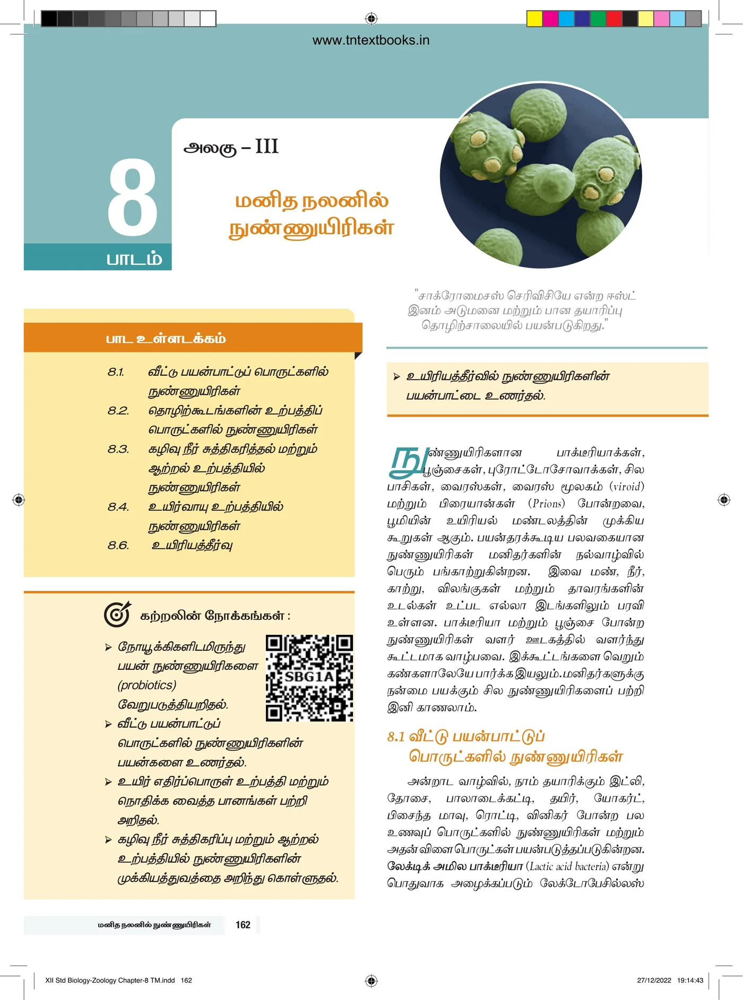

## PDF பக்கம் 171 - பாடநூல் பக்கம் 163

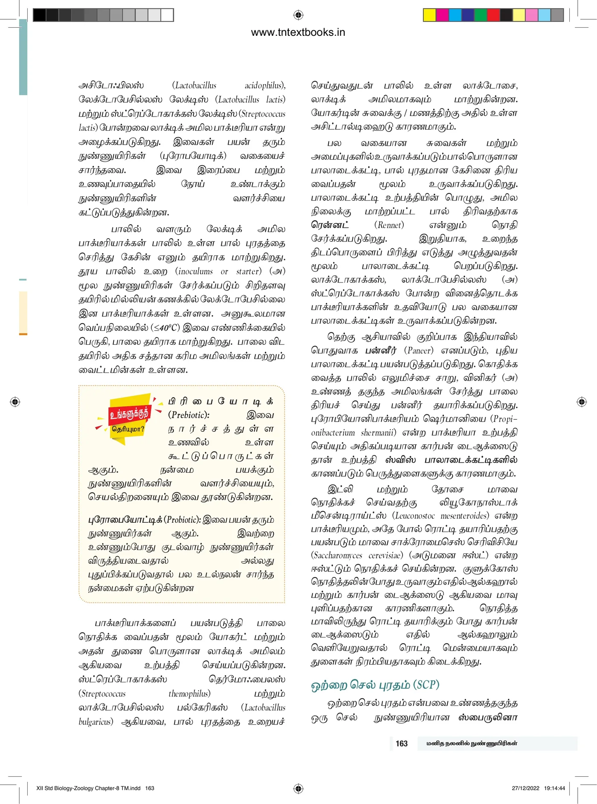

## PDF பக்கம் 172 - பாடநூல் பக்கம் 164

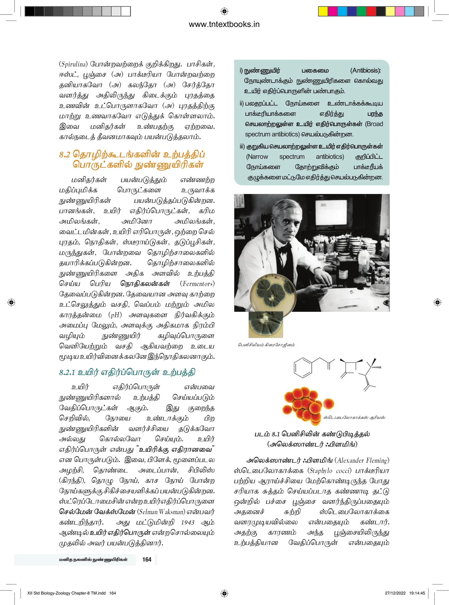

## PDF பக்கம் 173 - பாடநூல் பக்கம் 165

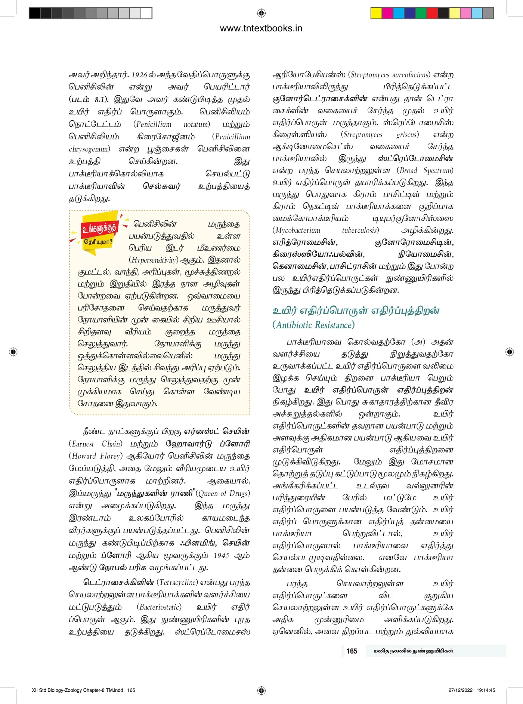

## PDF பக்கம் 174 - பாடநூல் பக்கம் 166

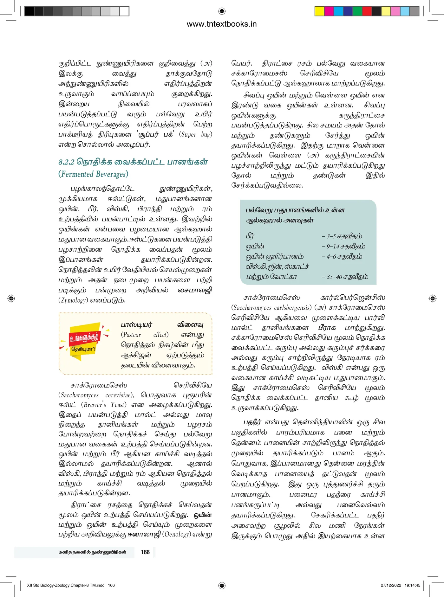

## PDF பக்கம் 175 - பாடநூல் பக்கம் 167

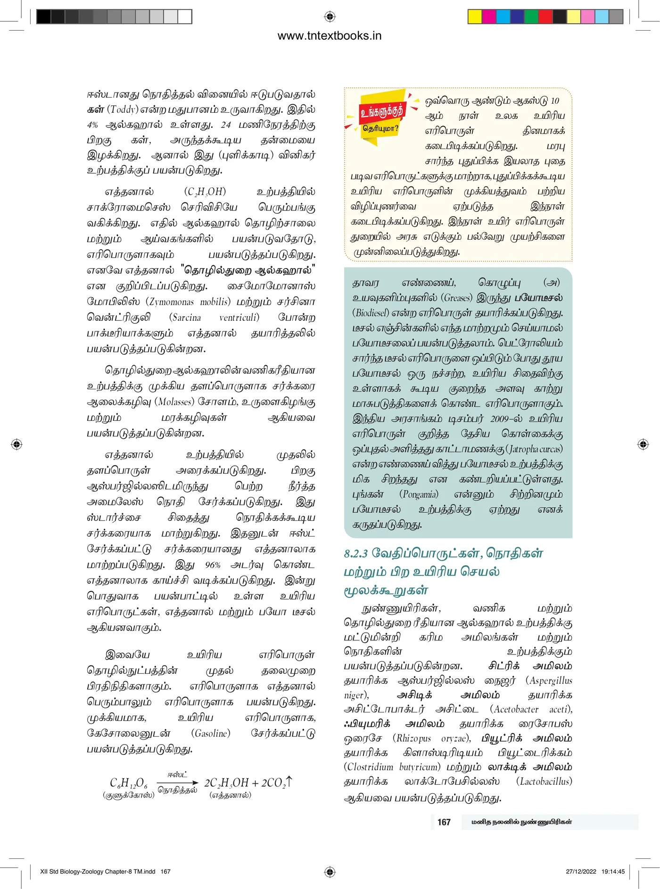

## PDF பக்கம் 176 - பாடநூல் பக்கம் 168

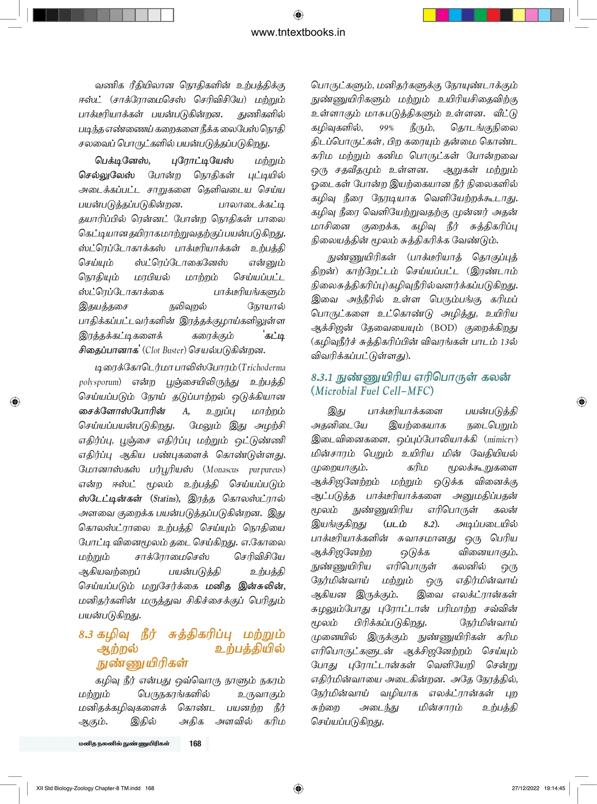

## PDF பக்கம் 177 - பாடநூல் பக்கம் 169

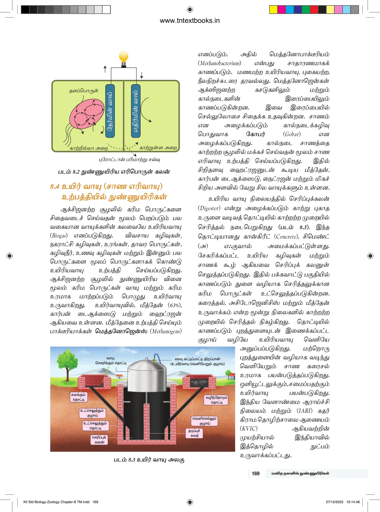

## PDF பக்கம் 178 - பாடநூல் பக்கம் 170

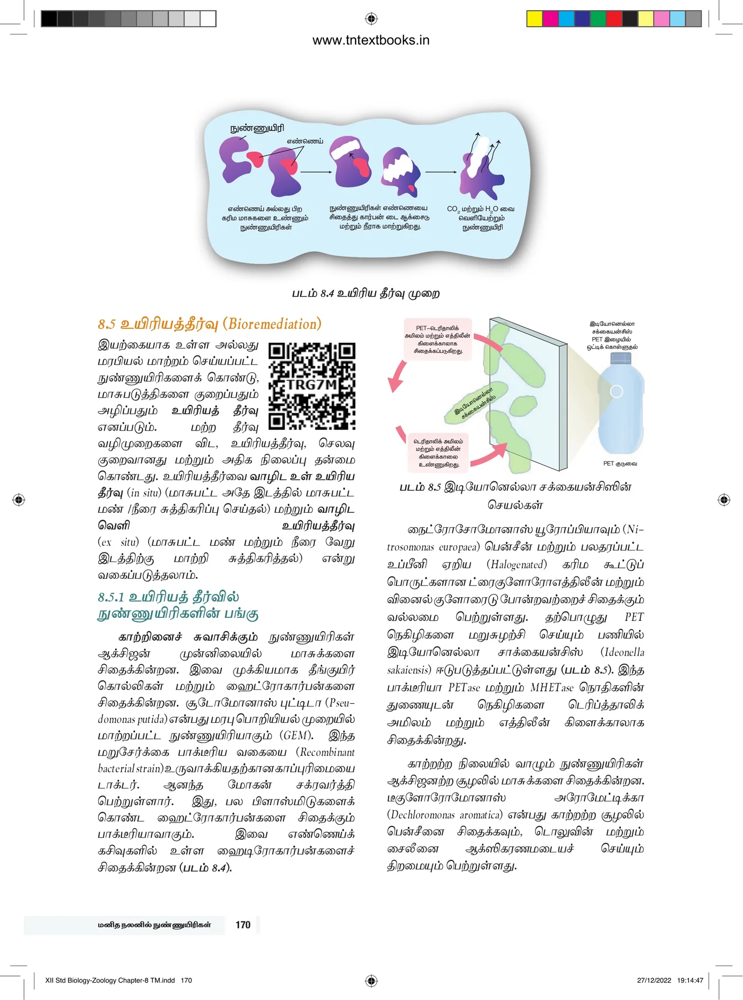

## PDF பக்கம் 179 - பாடநூல் பக்கம் 171

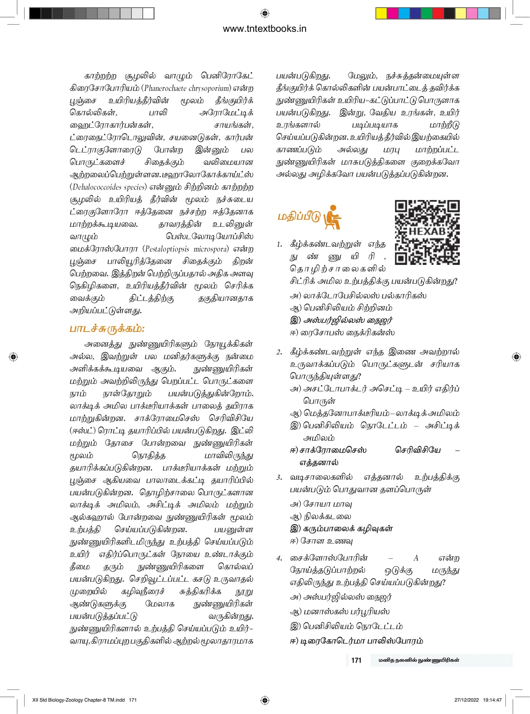

## PDF பக்கம் 180 - பாடநூல் பக்கம் 172

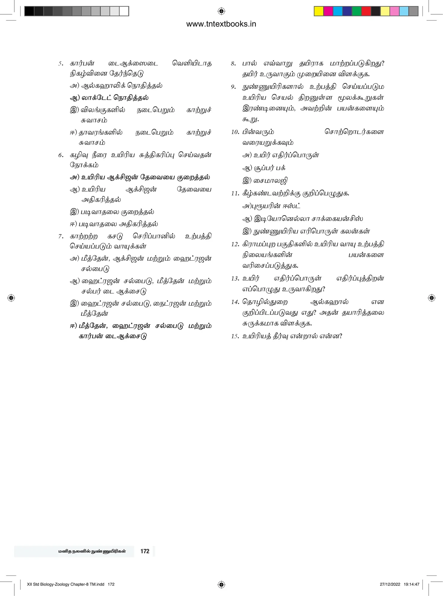

## PDF பக்கம் 181 - பாடநூல் பக்கம் 173

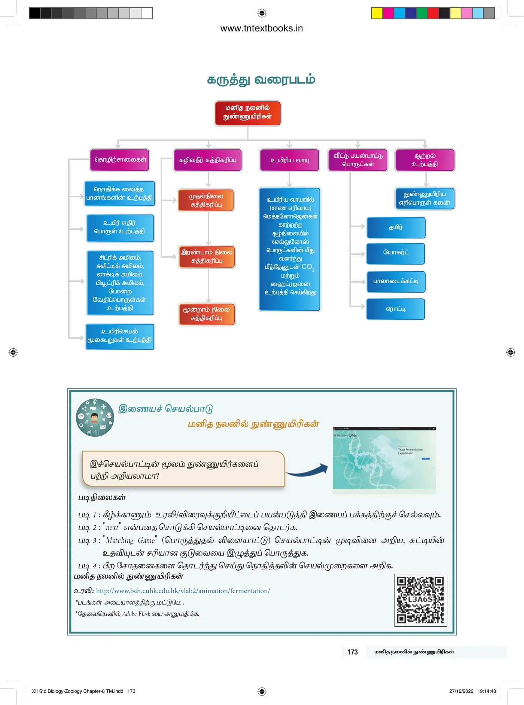
