# பாடம் 5: மூலக்கூறு மரபியல்

> மூலம்: தமிழ் வழிப் பாடநூல், PDF பக்கங்கள் 81–116.

> குறிப்பு: கீழுள்ள தேடக்கூடிய உரை துல்லியமான படங்கள், அட்டவணைகள் மற்றும் அமைப்பிற்கு அசல் பக்கங்களைப் பார்க்கவும்.

அலகு - II

பாடம்

மூலக்கூறு
மரபியல்

## பாட உள்ளடக்கம்

## 5.1  மரபுகடத்தலின் செயல் அலகாக மரபணு

## 5.2  மரபணுப் பொொருளுக்கான தேடல்

### 5.3  மரபணுப் பொொருளாக டி.என்.ஏ

## 5.4  நியுக்ளிக் அமிலங்களின் வேதியியல்

### 5.5  ஆர்.என்.ஏ உலகம்

## 5.6  மரபணுப் பொொருட்களின் பண்புகள்

### 5.7  டி.என்.ஏ திருகுச் சுழலின் பொொதிவு

### 5.8  டி.என்.ஏ இரட்டிப்பாதல்

## 5.9  படியெடுத்தல்

## 5.10  மரபணுக் குறியீடுகள்

### 5.11  கடத்து ஆர்.என்.ஏ - இணைப்பு

மூலக்கூறு

## 5.12  மொொழி பெயர்த்தல்

## 5.13  மரபணு வெளிப்பாட்டை

நெறிப்படுத்துதல்

## 5.14  மனித மரபணு திட்டம்

### 5.15  டி.என்.ஏ ரேகை அச்சிடல் தொொழில்நுட்பம்

கற்றலின் நோக்கங்கள்
- டி.என்.ஏ வை மரபணுப்
பொொருளென அடையாளம்
காணல்.
- புரோகேரியோட் மற்றும்
யூகேரியோட்டின் மரபணுத்
தொொகுப்புகளின் அமைப்பை் புரிந்து
கொொள்ளுதல்.

ஆராய்ச்சியாளர்களால், கம்பளியானையின்
மரபணுக்களை மீண்டும் உருவாக்கவும் அவை குறியீடு
செய்யும் புரதங்களைப் பற்றிப் படிக்கவும் இயலும்.
இது அழிந்துபோன கம்பளியானைகளின் மீளாக்க
வாய்ப்பிற்கு புத்துயிர் அளித்துள்ளது.

- டி.என்.ஏ மற்றும் ஆர்.என்.ஏ.வின்
நியுக்ளியோடைடுகளை வேறுபடுத்திக் கற்றல்.
- மரபணு வெளிப்பாட்டை புரிந்து கொொள்ளுதல் இரட்டிப்பாதல், படியெடுத்தல் மற்றும்
மொொழிபெயர்த்தல்.
- மரபணுக் குறியீடுகளைப் பற்றியும் அதன்
சிறப்புப் பண்புகளையும் கற்றல்.
- லேக் ஓப்பரான் மாதிரி வழிநின்று மரபணு
நெறிப்படுத்துதலை புரிந்து கொொள்ளுதல்.
- மனித மரபணு திட்டத்தின் முக்கியத்துவத்தை
உணர்தல்.
- டி.என்.ஏ ரேகை அச்சிடுதலின் பயன்பபாட்டை
விளங்கிக் கொொள்ளுதல்.

ஒ

ரு தலைமுறையிலிருந்து இன்னொரு
தலைமுறை உருவாகும் போது சில
பண்புகள் வெளிப்படுகின்றன.
சில மறைந்து
விடுகின்றன. இதற்ககான மர்மத்திரையை விலக்கி
விடை ஈந்தது மெண்டலின் கோட்பபாடேயாகும்.
பெற்றோரிடமிருந்து பரிணமித்த செய்திகள் சேய்
உயிரிகளில் பிரதிபலித்தல் மற்றும் பண்புகள்
கடத்தப்படும் முறை ஆகியவற்றை மெண்டலின்
ஆய்வுகள் வெளிக்கொணர்ந்தன. இச்சசெய்திகள்
குரோமோசோம்களில்
அமைந்துள்ளன.
நம்முடைய சிறப்புப் பண்புகள் யாவும் டி.என்.ஏ
மூலக்கூறுகளில் குறிக்கப்பட்டுள்ளன என்பது
தான் மனித அறிவின் விசாலத்தினால் இன்று
வரை அறியப்பட்டதாகும். டி.என்.ஏ ஒரு மரபணுப்
பொொருள்
என்று
கண்டறியப்பட்டிருந்ததாலும்

அது பல கேள்விகளை விடையற்றதாகவே
வைத்திருக்கிறது.
டி.என்.ஏ வில் உள்ள
செய்திகள் எவ்வாறு பயன்படுத்தப்படுகின்றன?
டி.என்.ஏ வின் வழிகாட்டுதலிலேயே புரதங்கள்
கட்டமைக்கப்படுகின்றன என்பதை இன்றறைய
அறிவியல்
அறிஞர்கள்
அறிந்துள்ளனர்.
வளர்சிதை மாற்றம் மற்றும் ஒளிச்சேர்க்கையின்
போது நடைபெறும் அனைத்து வேதிவினைகளின்
வேகத்தையும்,
செல்களின்
வடிவத்தையும்
புரதங்களே நிர்ணயிக்கின்றன.
ஒவ்வொரு
உயிரியின் பாரம்பரியம் இயல்பபையும் அதன்
மரபணுத்
தொொகுதிகளே
வரையறுக்கின்றன.
மேலும் ஒரு உயிரியை கட்டமைப்பதற்ககான
அனைத்து
செய்திகளையும்
இவைதான்
தருகின்றன. எந்தவொொரு உயிரியின் பாரம்பரியம்
தொொடர்பபான
முழுமையான
செய்திகளும்
மரபணுத்
தொொகுதிகளில்
அடங்கியுள்ளன.
மரபணுத் தொொகுதி, பல்வவேறு நியுக்ளிக் அமில
மூலக்கூறுகளாகப்
பிரிக்கப்பட்டுள்ளது.
ஒவ்வொரு நியுக்ளிக் அமில மூலக்கூறிலும்
பெரும்
எண்ணிக்கையிலான
மரபணுக்கள்
உள்ளன.
ஒவ்வொரு மரபணுவும் நியுக்ளிக்
அமிலத்தினுள் உள்ள குறிப்பிட்ட புரதத்திற்ககான
வரிசையமைப்பு ஆகும்.
டி.என்.ஏ வின்
அமைப்பு, அது இரட்டிப்பாதல், அதிலிருந்து
ஆர்.என்.ஏ உருவாக்கம் (படியெடுத்தல்), புரத
உற்பத்தியின் போது அமினோ அமிலங்களின்
வரிசையை நிர்ணயிக்கும் மரபணு குறியீடுகள்
(மொொழிபெயர்த்தல்) மரபணு வெளிப்பாட்டினை
நெறிப்படுத்துதல்
மற்றும்
மனித
மரபணு
தொொகுப்பை வரிசைப்படுத்துதலின் முக்கியத்துவம்
ஆகியவற்றை இப்பாடம் உள்ளடக்கியிருக்கிறது.

## 5.1  மரபு கடத்தலின் செயல்

அலகாக மரபணு
மரபணு என்பது, மரபுக் கடத்தலுக்கான
இயற்பிய
மற்றும்
செயலிய
அடிப்படை
அலகாகும். 1860ல் கிரிகெர் மெண்டல், மரபணு
கோட்பபாடுகளை முதன்முதலாக விளக்கினார்.
ஆனால் அவர் ஜீன் (அல்லது) மரபணு என்ற
சொொல்லை பயன்படுத்தவில்லை. அதை அவர்
‘காரணி’ (factor) என்றறே அழைத்தார்.
1909
ல் டேனிஷ் உயிரியலாளரான வில்ஹஹெல்ம்
ஜோஹன்சசென் என்பவர் மரபணு (ஜீன்) என்ற
சொொல்லை உருவாக்கினார்.
பாரம்பரியமாக
கடத்தப்படும் பண்புகளை இவை நிர்ணயிக்கின்றன
என்பதை இது குறிக்கிறது.

1902ல்
சட்டன்
(Sutton)
என்பவரால்
அறிமுகப்படுத்தப்பட்ட
கோட்பபாட்டில்
கீழ்க்கண்டவாறு
மரபணு
வரையறுக்கப்
பட்டுள்ளது. குரோமோசோம்களில் நிலையான
இடத்தை
ஆக்கிரமித்துள்ள,
மெண்டலின்
மரபு கடத்தல் விதிகளை பின்பற்றுகின்ற மற்றும்
புற பண்புகளின் வெளிப்பாட்டிற்கு காரணமாகவும்
அமைகின்ற தனித்துவ துகள்களே மரபணுக்கள்
எனப்படும். இவை கீழ்க்கண்ட பண்புகளைப்
பெற்றுள்ளன.
ஒவ்வொரு
உயிரியிலும்
உள்ள
குரோமோசோம்களின்
எண்ணிக்கையைவிட,
மரபணுக்களின் எண்ணிக்கை அதிகம். எனவே,
ஒரே குரோமோசோமில் பல மரபணுக்கள் இடம்
கொொண்டுள்ளன.
மணி கோர்த்த மாலையில் உள்ள மணிகளைப்
போல, ஒற்றை நீள் வரிசையில் மரபணுக்கள்
வரிசைப்படுத்தப்பட்டுள்ளன.
- 

ஒவ்வொரு மரபணுவும் தமக்குரிய மரபணு
அமைவிடத்தைக் (Locus) கொொண்டுள்ளன.

- 

மரபணுக்கள் அல்லீல்கள் எனப்படும் பல
ஒரு மரபணு – ஒரு நொொதி கோட்பபாடு
(One gene-one enzyme hypothesis)
1940ல், ஜார்ஜ் பீடில் மற்றும் எட்வர்டு
டாடம் ஆகியோர், சிவப்பு ரொொட்டி பூஞ்சசை
என்றழைக்கப்படும்
நியுரோஸ்போரா
கிரஸ்ஸா (Neurospora crassa) வில் செய்த
சோதனைகளின்
அடிப்படையில்
ஒரு மரபணு-ஒரு நொொதி கோட்பபாடு
உருவானது.
இக்கோட்பபாட்டின் படி
ஒவ்வொரு நொொதியின் உற்பத்தியையும் ஒரு
மரபணு கட்டுபடுத்துகிறது.
ஒரு மரபணு – ஒரு பாலிபெப்பைடு
கோட்பபாடு (One gene-one polypeptide hypothesis)
ஒரு
நொொதியென்பது
ஒன்றுக்கு
மேற்பட்ட பாலிபெப்டடைடு சங்கிலியால்
ஆக்கப்பட்டது என அறியப்பட்டுள்ளது. ஒரு
பாலிபெப்டடைடை மட்டுமே ஒரு மரபணு
உருவாக்கலாம்.
இதனால், ஒவ்வொரு
மரபணுவும் நொொதியின் மூலக்கூறில் உள்ள
ஒரேயொொரு பாலிபெப்டடைடு சங்கிலியின்
உற்பத்தியை மட்டுமே கட்டுப்படுத்தும்
என ஒரு மரபணு – ஒரு பாலிபெப்டடைடு
கோட்பபாட்டில் குறிக்கப்பட்டுள்ளது.

ñóHò™ 裆®J¡ º‚Aò G蛾èœ
1910 ñóðµ‚èœ
°«ó£«ñ£«ê£‹èO™
ܬñ‰¶œ÷ù.

1927 F¯˜ ñ£Ÿøƒèœ
ñóðµ‚èO¡ ÞòŸHò
ñ£Ÿøƒè¬÷ ãŸð´ˆ¶‹.

1871 G΂O‚
ÜIôƒèœ 致H®Š¹

1850

1944 ®.â¡.ã.
å¼ ñó¹Š
ªð£¼œ

1900

1865 ñóðµ‚èœ
¶èœ è£óEèœ

1950

1913 °«ó£«ñ£«ê£‹èœ
â¡ð¬õ ñóðµ‚èO¡
cœ õK¬êò¬ñŠ¹

1903 °«ó£«ñ£«ê£‹èœ
ð£ó‹ðKò Üô°

1953 ®.â¡.ã. F¼°
²ö™ ܬñŠ¹
1977 ΫèK«ò£†®‚
1951 ºî¡
ñóðµ‚èœ M÷‚èñO‚èŠð†ì¶.
ºîL™, ¹óî‹
1977 ®.â¡.ã. õK¬êŠð´ˆîŠð†ì¶.
õK¬êŠð´ˆîŠð†ì¶

2000

1945 ñóðµ‚èœ
¹óîˆFŸè£ù °Pf´

1958 ®.â¡.ã. £F
ð¬öòù 裈î™
º¬øJ™ Þ󆮊ð¬ìî™

- 

திடீர் மாற்றம் என்றழைக்கப்படும் நிகழ்வின்
மூலம் இருப்பிடம் மற்றும் உள் பொொருட்களில்
மரபணுக்கள் திடீரென மாற்றம் பெறுகின்றன.

- 

மரபணுக்கள்,
தன்னிய
நகலாக்கத்திறன்
(Self-Duplication) கொொண்டவை ஆதலால் தன்
நகலை தாமே உற்பத்தி செய்து கொொள்கின்றன.

## 5.2 மரபணு பொொருளுக்கான தேடல்

செல்களில் நடைபெறும் குன்றல் பிரிவின்
போது அச்சசெயலில் ஈடுபட்டுள்ள உட்கரு,
தமக்குத்
தாமே
சிறிய
தண்டு
போன்ற
உறுப்புகளாக சீரமைத்துக் கொொள்கிறது. இதற்கு
குரோமோசோம் என்று பெயர். இக்கருத்துக்களை

2001 ñQî
ñó𵈠ªî£°F
õK¬êŠð´ˆîŠð†ì¶.

1961 ñ󹂰Pf´ å¼ º‚°Pò‹

1931 ñÁ«ê˜‚¬è
°Á‚«èŸøˆF¡
Íô‹ ï¬ìªðÁAø¶.

மாற்று வடிவங்களைக் கொொண்டிருக்கலாம்.

1995 𣂯Kò
ñó𵈠ªî£°F
õK¬êŠð´ˆîŠð†ì¶

1848லேயே, ஜெர்மனியைச் சேர்ந்த தாவரவியல்
அறிஞரான
வில்ஹஹெல்ம்
ஹோஃஃப்மீஸ்டடெர்
(Wilhelm Hofmeister) குறிப்பிட்டுள்ளார். 1869 ல்,
ஸ்விஸ்
நாட்டைச்
சேர்ந்த
மருத்துவரான
பிரெடெரிக் மீஸ்ஷர் (Friedrich Meicher) செல்லின்
உட்கருவிலிருந்து நியுக்ளின் (Nuclein) எனும்
பொொருளை பிரித்ததெடுத்தார்.
இப்பொருளுக்கு
1889ல் ஆல்ட்மன் (Altman) என்பவர் நியுக்ளிக்
அமிலம் என பெயர் மாற்றினார்.
இதுவே
தற்போது
டி.என்.ஏ
என்றழைக்கப்படுகிறது.
புரதங்கள் மற்றும் டி.என்.ஏ ஆகியவற்றால்
குரோமோசோம்கள் ஆக்கப்பட்டுள்ளன என்பது
1920 வாக்கில் தெளிவானது.
மரபுசார்ந்த
செய்திகளை எடுத்துச் செல்லும் உணமையான

´ÙŠ‚´{v
 ±Ù ¶t/y ¼¾ØÎ à{Ùv ؾºj ªt¿Š *žb2b ª,¿j  „ ®y ¯  ªt¿Š Þs ®y ¯ 
ÀÎàhº{t ´{t¿Îàf¸ 6 ¶t´v 
¬v ´ƒ¾¶//ÙiŠ /Î+ˆ ¼w‘j 
¶sb´ƒ¾ Fb´j   ؾºc´v  Þs ®y ¯  
¼w‘j '1$ ºc$ 0ˆºt 

/Î+ˆ´v

ÀÎàhº{t
´{t¿Îàf¸
6 ¶t´v

¶sb´ƒ¾´v

؂¾{f ‚ÄY ° ‚¶sb´Ûj

Þs ®y ¯  ‚½Y  °
‚¶sb´Ûj

„ ®y ¯  ‚½Y  °
‚¶sb´Ûj

ؾºj ßtƒ¿

Þs ®y ¯  ßtƒ¿

„ ®y ¯  ßtƒ¿ 

5 ¶t´ƒÂd
‚¶s´´Ûj 

5 ¶t´ƒÂd
‚¶s´´Ûj 

5 ¶t´ƒÂd
‚¶s´´Ûj 

6 ¶t´v ‚º{wÃj

6 ¶t´v ‚º{wÃj

´ƒ¾¶/t  »{)´ƒÂÎ 
à½yàˆh)  ؾºj  Þs ®y ¯  
ªt¿Š „ ®y ¯  ƒÀ &ƒºhºt

6 ¶t ¬v ­¸´h)t 
5 ¶t´ƒÂd ‚¶shºt  5
¶t´v  L.½j ´{g¸ 6 
¶t´Â{´h ‚º{wà ¼{wÃj 
àwú ‚¶{)hº3ºt 

6 ¶t´v ßtƒ¿

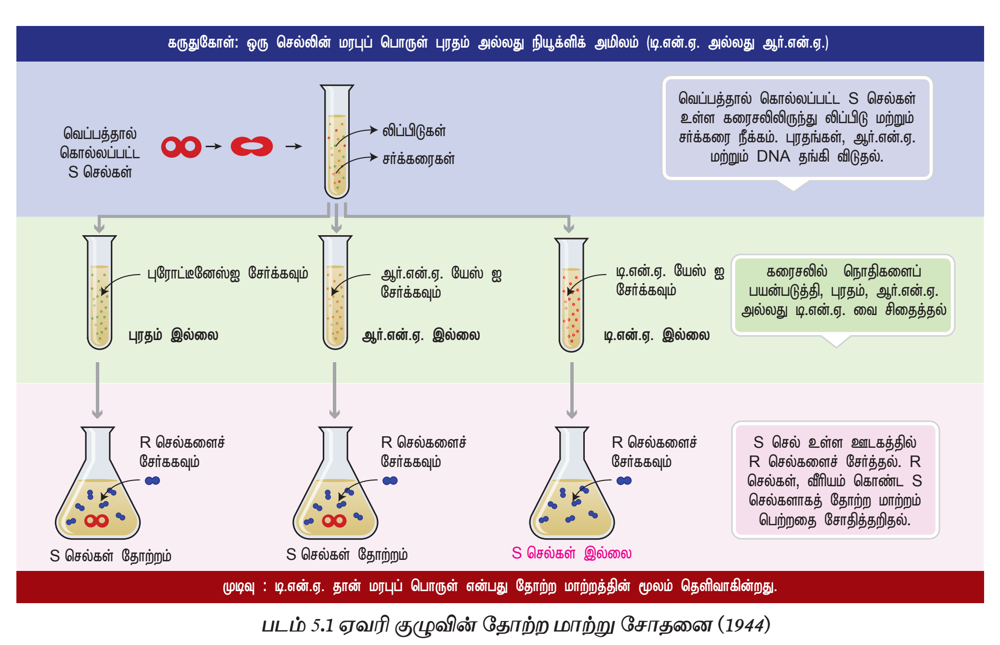

கடத்திகளை அறிவதற்ககாக பல சோதனைகள்
மேற்கொள்ளப்பட்டன.
டி.என்.ஏ
தான்
மரபணுப் பொொருள் என்பதை நிரூபித்த கிரிஃபித்
(Griffith) சோதனை, ஏற்கனவே பதினோராம்
வகுப்பு பாட நூலில் விளக்கப்பட்டுள்ளது.
பாக்டீரியாவின் மரபணுப் பொொருள் டி.என்.ஏ
தான் என்பதற்கு பாக்டீரிய தோற்றமாற்றமே
(Bacterial Transformation) முதல் சான்று என்றறாலும்
இத்தோற்றமாற்றத்திற்ககான
காரணத்தை
கிரிஃபித்தால் விளங்கிக் கொொள்ள முடியவில்லை.
அவரின்
சோதனைகளால்
மரபணுப்
பொொருளின் வேதிப்பண்பபையும் வரையறுக்க
இயலவில்லை.
பின்னர்
1944ல்,
ஆஸ்வவால்டு
ஏவரி
(Oswald
T.Avery)
காலின்
மேக்லியாட்
(Colin M.Macleod) மற்றும் மேக்லின் மெக்கார்டி
(Maclyn J.Mc Carty) ஆகியோர், ‘உடல்வவெளி’
(invitro)
முறை
மூலம்
கிரிஃபித்தின்
சோதனைகளை மீள மேற்கொண்டனர். இதன்
மூலம், வீரியமற்ற பாக்டீரியாவை வீரியம்
கொொண்டதாக
மாற்றுகிற
தோற்றமாற்ற
நிகழ்வுக்குக்
காரணமான
பொொருட்களை
அடையாளம் காண முயன்றனர். இவ்வாய்வின்
போது, வெப்பத்தினால் கொொல்லப்பட்ட S-வகை
பாக்டீரியாவிலிருந்து
டி.என்.ஏ,
ஆர்.என்.ஏ
மற்றும் புரதங்கள் பிரித்ததெடுக்கப்பட்டு அவை
R-வகை பாக்டீரியாவினுள் சேர்க்கப்பட்டன.
இதன் விளைவாக R-வகையின் சொொரசொொரப்பான
புறப்பரப்பு
மெனமையாக
மாறியது
மட்டுமல்லாமல், அவை, நோயூக்கியாகவும் மாறின
(படம் 5.1). ஆனால், டி.என்.ஏ.யேஸ் (டி.என்.ஏ
சிதைவு நொொதி) நொொதியுடன் பிரித்ததெடுக்கப்பட்ட
பகுதியை வினைபுரிய செய்த பின், செலுத்தப்பட்ட
போது, தோற்றமாற்றம் செய்யும் பண்பபை அது
இழந்திருந்தது.
ஆனால், ஆர்.என்.ஏ.யேஸ்
(ஆர்.என்.ஏ சிதைவு நொொதி) அல்லது புரோட்டினேஸ்
(புரத சிதைப்பு நொொதி) ஆகியவை எதுவும்
தோற்றமாற்ற நிகழ்வவை பாதிக்கவில்லை. எனவே,
தோற்றமாற்ற நிகழ்விற்கு டி.என்.ஏ.வே காரணம்
என்பது, டி.என்.ஏ.யேஸால் செரிக்கப்பட்டதால்
ஏற்பட்ட தோற்றமாற்ற பண்பு இழப்பிலிருந்து,
தெரிய
வருகிறது.
இச்சோதனைகள்,
டி.என்.ஏ.வே மரபணுப் பொொருளாகவும் புரதம்
அல்ல என்பதையும்
காட்டுகின்றன. ஒரு
வகை செல்லிலிருந்து (S-வகை) எடுக்கப்பட்ட
டி.என்.ஏவை இன்னொரு வகை செல்லிற்குள்
(R-வகை)
செலுத்தும்போது,
முதல்
வகை
(S-வகை) யின் சில பண்புகள் மீளக்கிடைக்கின்றன.
இம்மொத்த
நிகழ்வவே
தோற்றமாற்றம்
(Transformation) எனப்படும்.

### 5.3 மரபணுப் பொொருளாக டி.என்.ஏ

கிரிஃபித்,
எவரி
போன்றவர்களின்
சோதனைகளுக்கு அப்பால் பல உயிரியலாளர்கள்,
செல்லில் உள்ள புரதங்களே மரபுப் பண்புகளை
கடத்தும் பொொருட்கள் என்றும் டி.என்.ஏ.க்கள்
அல்ல என்றும் உறுதியாக நம்பினார்கள்.
யூகேரியோடிக்
குரோமோசோம்களில்
டி.என்.ஏவும் புரதமும் ஏறத்தாழ சமஅளவில்
இருக்கின்றன.
மரபுப்பொருளாக
இருக்க
தேவையான
ஒரு
பண்பு,
செய்திகளை
மொொழிபெயர்க்கும் திறனாகும்.
இத்திறனுக்கு
தேவையான
வேதிப்பல்வகைமையையும்,
கூட்டுத்தொகுதி
அமைப்பையும்
புரதங்களே
பெற்றுள்ளன
என்று
அவர்கள்
கருதினர்.
என்றறாலும், 1952ல் செய்யப்பட்ட ஹார்ஷஷேசேஸ் (Harshey-Chase) சோதனைகளின் முடிவுகள்,
டி.என்.ஏ.வே மரபணுப் பொொருள் என்பதற்ககான,
அனைவராலும்
ஏற்றுக்
கொொள்ளக்கூடிய,
சான்றுகளை அளித்தன.

### 5.3.1 T2 பாக்டீரியோஃஃபேஜ்ஜை

பயன்படுத்தி செய்யப்பட்ட ஹார்ஷஷே
மற்றும் சேஸ் சோதனைகள்
பாக்டீரியாக்களை தாக்கும் தனமை கொொண்ட
T2 – பாக்டீரியோஃஃபேஜ்களை பயன்படுத்தி,
1952ல் ஆல்பிரெட் ஹார்ஷஷே மற்றும் மார்ததா
சேஸ் ஆகியோர் பல சோதனைகளை செய்தனர்.
உணமையில், T2- பாக்டீரியோஃஃபேஜ் என்பது,
எஸ்சரிச்சியா கோலை (எ.கோலை) என்ற
பாக்டீரியாவை
தாக்கும்,
வைரஸ்
ஆகும்.
பாக்டீரியங்களோடு
இவ்வைரஸ்களை
கலந்ததால்,
பாக்டீரியாவின்
பரப்பின்
மீது
வைரஸ்கள் மெல்லிய படலமாக படர்கின்றன.
பின்,
அவற்றிலிருந்து
பாக்டீரியாவிற்குள்
சில
பொொருட்கள்
செலுத்தப்படுகின்றன.
பிறகு, ஒவ்வொரு பாக்டீரியமும் உடைந்து
பெரும் எண்ணிக்கையிலான புது ஃபேஜ்களை
வெளியேற்றுகின்றன. டி.என்.ஏ மற்றும் புரதம்
ஆகிய இவ்விரண்டில் எது பாக்டீரியாவுக்குள்
சென்ற
பொொருள்?
என்பதை
ஹார்ஷஷேயும்
சேஸும்
கண்டறிய
விரும்பினர்.
எல்லா
நியுக்ளிக் அமிலங்களிலும் பாஸ்பரஸ் உண்டு
ஆனால் புரதங்களில் இப்பொருள் இல்லை.
அதைப்போலவே பெரும்பபாலான புரதங்களில்
(சிஸ்டீன் மற்றும் மெதியோனைன்) கந்தகம்
உண்டு.
ஆனால் நியுக்ளிக் அமிலத்தில்

கtrய
க க தக  (35S)
அைடயாளmட ப ட pரத உைற
(cவ p)

பா

rேயாஃேபя

கtrய
க பா பர  (32 P)

அைடயாளmட ப ட DNA (cவ p)

ெதாத

கல
kத

கtrய
க க தக  (35S)
mத p உ‚ள pரத
உைறy
க„ட ய ப †‚ளt

கtrய
கதˆைம mத p
உ‚ள pரத உைறy
க„ட ய படvைல

ைமய vல
க
ைமய vல
கl
k pˆp கtrய
க
க தக  (35S) ெசக
க„ட ய படvைல

ைமய vல
கl
k pˆp கtrய
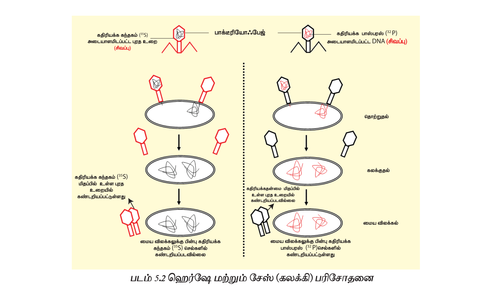
இப்பொருள் இல்லை.
ஆகவே இதனை
அடிப்படையாகக் கொொண்டு, கதிரியக்க தனமை
கொொண்ட ஐசோடோப்புகளான கந்தகத்தின் 35S,
பாஸ்பரஸின் 32P ஆகியவற்றை பயன்படுத்தி
ஹார்ஷஷேவும்
சேஸிம்
சோதனைகளை
வடிவமைத்தனர்.
இதன்
மூலம்
தொொற்று
ஏற்படுத்தும் போது வைரஸின் புரதம் மற்றும்
நியுக்ளிக்
அமிலங்களை
தனித்தனியான
பாதைகளில் கண்ககாணிக்க இயலும். 35S அல்லது 32P
ஐசோடோப்புகள் உள்ள வளர் ஊடகத்தில் உள்ள
பாக்டீரியாக்களில் தொொற்று ஏற்படுத்த ஃபேஜ்கள்

அனுமதிக்கப்பட்டன.
S உள்ள ஊடகத்தில்
வளரும் பாக்டீரியோஃஃபேஜ்ஜில் புரதங்களும்,

P உள்ள ஊடகத்தில் வளரும் ஃபேஜ்களில்
டி.என்.ஏ.க்களும் அடையாளமிடப்பட்டிருந்தன.
இவ்வாறு ஃபேஜ்களின் டி.என்.ஏவும் புரதமும்
வெவ்வேறு அடையாளங்களை பெற்றிருப்பதால்
இனம் காண்பது எளிதாகிறது.
இவ்வாறு
அடையாளமிடப்பட்ட
ஃபேஜ்களை,
அடையாளமிடப்படாத
எ.கோலை பாக்டீரியங்களோடு ஹர்ஷஷேவும்
சேஸும் கலந்தனர்.
இதனால் ஃபேஜ்கள்
பாக்டீரியங்களை
தாக்கி
அவற்றின்
மரபணுப்
பொொருட்களை
பாக்டீரியாவினுள்
செலுத்தின. இவ்வாறு தொொற்றுக்கு உள்ளான
பாக்டீரியங்களை (பாக்டீரிய சிதைவுக்கு முன்பு)
மிதமான குலுக்கலுக்கு ஆட்படுத்தி அதில்
ஒட்டியுள்ள
பொொருட்கள்
விடுவிக்கப்பட்டன.

பின்னர், பாக்டீரியங்களை ஆய்வு செய்ததில்,

P இணைந்த பொொருட்கள் மட்டுமே இருந்தன.
வெளியில் உள்ள ஊடகத்தில் 35S இணைந்த
பொொருட்கள் இருந்தன.
புதிய தலைமுறை
ஃபேஜ்களில் கதிரியக்க சோதனை செய்தபோது
அவற்றில் வெறும் 32P மட்டுமே இருந்ததும்,

S இல்லாமலிருந்ததும் கண்டுபிடிக்கப்பட்டது
(படம் 5.2). எனவே இம்முடிவுகள் மூலம்,
பாக்டீரியா செல்களுக்குள் சென்றவை டி.என்.ஏ
பொொருட்கள் மட்டுமே, புரத உறை பொொருட்கள்
அல்ல என்பது தெளிவாக்கப்பட்டது. இவ்வாறு,
ஹர்ஷஷேவும்
சேஸும்,
வைரஸிடமிருந்து
பாக்டீரியாவுக்கு
பாரம்பரிய
செய்தியைக்
கொொண்டு சென்றது புரதங்கள் அல்ல டி.என்.ஏ
மட்டுமே என இறுதியாக நிரூபித்தனர்.

## 5.4  நியுக்ளிக் அமிலங்களின்

வேதியியல்
நியுக்ளிக் அமிலங்களான, டி.என்.ஏக்களே
(அல்லது ஆர்.என்.ஏ) மரபணுப் பொொருட்கள் என்று
அடையாளம் கண்ட பின்பு, அம்மூலக்கூறுகளின்
வேதி அமைப்பினை ஆய்வு செய்வதில் நாம்
இனி முனைய வேண்டும். பொொதுவாக, நியுக்ளிக்
அமிலங்கள் நீண்ட சங்கிலியாகும்.
இதில்
நியுக்ளியோடைடுகள்
எனும்
அடுத்தடுத்து
அமைந்துள்ள துணை அலகுகளின் பாலிமெர்கள்
உள்ளன. ஒவ்வொரு நியுக்ளியோடைடு துணை
அலகும், மூன்று பகுதிகளைக் கொொண்டது. அவை,

நைட்ரஜன் கொொண்ட காரப்பொருள், பென்டோஸ்
என்னும் ஐந்து கார்பன்களைக் கொொண்ட சர்க்கரை
மற்றும் பாஸ்பபேட் குழு ஆகியனவாகும்.

பென்டோஸ் சர்க்கரை
பென்டோஸ் சர்க்கரையின் வகைக்கேற்ப,
நியுக்ளிக் அமிலங்கள் இரண்டு வகைகளாக
உள்ளன.
டி-ஆக்ஸி-ரிபோஸ்
சர்க்கரை
மூலக்கூறைக் கொொண்ட நியுக்ளிக் அமிலம்
டி-ஆக்ஸி-ரிபோ நியுக்ளிக் அமிலம் (டி.என்.ஏ)
எனவும் ரிபோஸ் சர்க்கரையைக் கொொண்ட
நியுக்ளிக் அமிலம், ரிபோநியுக்ளிக் அமிலம்
(ஆர்.என்.ஏ)
எனவும்
அழைக்கப்படுகின்றன.
புரோகேரியோட்டுகளின்
நியுக்ளியாய்டு
(Nucleoid) மற்றும் யூகேரியோட்டுகளின் உட்கரு
ஆகியவற்றில் டி.என்.ஏ காணப்படுகிறது. இவ்விரு
சர்க்கரைப் பொொருள்களுக்கிடையேயுள்ள ஒரே
வேறுபாடு டி-ஆக்ஸி ரிபோஸில் ஒரு ஆக்ஸிஜன்
குறைவாக இருப்பது மட்டுமே ஆகும்.

நைட்ரஜன் காரப்பொருள்
நைட்ரஜனை உள்ளடக்கிய காரப்பொருளின்
மூலக்கூறுகள்
காரங்களுக்கான
அடிப்படை
வேதிப்பண்பபைப்
(ஒரு
கரைசலில்
உள்ள
புரோட்டான் அல்லது H+ அயனியை ஏற்றுக்
கொொள்ளும் பொொருள்) பெற்றுள்ளன. டி.என்.ஏ
மற்றும்
ஆர்.ஏன்.ஏ
ஆகிய
இரண்டின்
நியுக்ளியோடைடு சங்கிலியிலும் நான்கு காரப்
பொொருள்கள் (இரண்டு பியுரின்கள் மற்றும்
இரண்டு பைரிமிடின்கள்) உள்ளன. அடினைன் (A)
மற்றும் குவானைன் (G) ஆகிய இரு காரங்களும்,
இரண்டு கார்பன்-நைட்ரஜன் வளையங்களை
பெற்றுள்ளன. இவ்விரு காரங்களும் பியுரின்கள்
எனப்படுகின்றன. மற்ற காரப் பொொருட்களான
தைமின் (T), சைடோசின் (C) மற்றும் யுரேசில்
(U) ஆகியவற்றில் ஒற்றை வளையம் மட்டுமே
உள்ளது.
இவற்றுக்கு பைரிமிடின்கள் என்று
பெயர். தைமின் டி.என்.ஏ.வுக்கு மட்டுமே உரியது.
அதைப்போலவே
யுரேசில்
ஆர்.என்.ஏ.வுக்கு
மட்டுமே உரியதாகும்.

பாஸ்பபேட்டின் வினை செயல் தொொகுதி
பாஸ்பபாரிக்
அமிலத்திலிருந்து
(H3PO4)
தோன்றும்
இவ்விளைபொொருளில்
மூன்று செயல்திறன் மிக்க OH குழுக்கள்
உள்ளன.
இவற்றில் இரண்டு குழுக்கள்
இழை
உருவாக்கத்தில்
பங்ககேற்கின்றன.

டி.என்.ஏ
மற்றும்
ஆர்.என்.ஏக்கள்
அமிலத்தனமை பெறுவதற்கு பாஸ்பபேட்டின்
செயலாக்கக் குழு (PO4) வே காரணமாகும்.
(ஒரு
கரைசலில்
புரோட்டான்களையோ
+
அல்லது H
அயனிகளையோ விடுவிக்கும்
பொொருள்) பாஸ்பபேட்டுகளால் உருவாக்கப்பட்ட
பிணைப்புகள்
எஸ்டடெர்கள்
ஆகும்.
பாஸ்போ-டை-எஸ்டடெர் பிணைப்பு உருவான
பின்பு, பாஸ்பபேட் குழுவிலுள்ள ஆக்ஸிஜன் அணு,
எதிர்மறை மின் தனமையைப் பெறுகின்றது.
இவ்வாறு எதிர்மறை மின்தனமை பெற்ற
பாஸ்பபேட், உட்கரு சவ்வு அல்லது செல்லுக்குள்
நியுக்ளிக் அமிலங்களின் இருப்பை உறுதி
செய்கிறது.

நியுக்ளியோசைடு மற்றும்
நியுக்ளியோடைடு
நைட்ரஜன் காரப்பொருள், ஒரு சர்க்கரை
மூலக்கூறோடு செய்யும் வேதி பிணைப்பின்
விளைவாக (சர்க்கரையின் 1வது கார்பனோடு)
நிக்ளியோசைடு உருவாகிறது. அதே சர்க்கரையின்
5வது கார்பனோடு பாஸ்பபேட் குழு இணைவதால்,
நியுக்ளியோசைடு
நியுக்ளியோடைடாக
மாறுகிறது. சுருக்க (திணமை) வினையினால்
நியுக்ளியோடைடுகள்
ஒன்றுடன்
ஒன்று
இணைந்து
பல
நியுக்ளியோடைடுகளைக்
கொொண்ட சங்கிலியை உருவாக்குகிறது.
ஒரு
நியுக்ளியோடைடுவின் சர்க்கரையின் 3-வது
கார்பனோடு பிணைந்துள்ள ஹைட்ரராக்சசைல்
(OH) குழு அடுத்த நியுக்ளியோடைடுவின்
பாஸ்பபேட்டுடன்
எஸ்டர்
பிணைப்பை
ஏற்படுத்துகிறது.
அடுத்தடுத்து
உள்ள
நியுக்ளியோடைடுகளின் சர்க்கரைப் பகுதியை
இணைக்க உதவும் வேதி பிணைப்பிற்கு பாஸ்
போ-டை-எஸ்டர் பிணைப்பு (5' → 3') என்று
பெயர். இது 5' → 3' இழையின் துருவத்துவத்தை
குறிப்பிடுகின்றது.
டி.என்.ஏ
மற்றும்
ஆர்.என்.ஏக்களின்
தெளிவான இரண்டு முனைகள் 5' மற்றும் 3'
எனும் குறிகளால் குறிக்கப்படுகின்றன. 5' என்பது,
பாஸ்பபேட்டின் செயலாக்கக் குழு இணைந்துள்ள
சர்க்கரையின் கார்பன் இடத்தையும் 3' என்பது,
ஹைட்ரராக்சசைல் (-OH) குழு இணைந்துள்ள
சர்க்கரையின்
கார்பன்
இடத்தையும்
குறிக்கிறது. ஆர்.என்.ஏவில் உள்ள ஒவ்வொரு
நியுக்ளியோடைடின்
ரிபோஸ்
சர்க்கரையின்

இரண்டடாவது இடத்தில் கூடுதலாக ஒரு OH
குழு இணைந்துள்ளது. 5' → 3' திசையை புரிந்து
கொொள்வதன் மூலம் இரட்டிப்பாதல், படியெடுத்தல்
ஆகியவற்றின் நுட்பங்களை எளிதில் புரிந்து
கொொள்ளலாம்.
மௌரில் வில்கின்ஸ் மற்றும் ரோசலின்ட்
ஃபிராங்ளின் ஆகியோர் செய்த எக்ஸ் –
கதிரியக்க சிதறல் வழி பெறப்பட்ட படங்களின்
ஆய்வினை
அடிப்படையாகக்
கொொண்டு,
ஜேம்ஸ் வாட்சன் மற்றும் ஃபிரான்சிஸ் கிரிக்
ஆகியோர், 1953ல் டி.என்.ஏவின் இரட்டை இழை
கோட்பபாட்டினை உருவாக்கினர்.
இரண்டு
பாலிநியுக்ளியோடைடு கொொண்ட சங்கிலிகளுக்கு
இடையேயான கார பிணைப்பு முக்கியத்துவம்
உடையதாகும். இது எர்வின் சார்ககாஃப்பின் (Erwin
Chargaff) கண்டுபிடிப்புகளை அடிப்படையாகக்
கொொண்டதாகும்.
அடினைன், தைமின் உடன்
(A=T) இரண்டு ஹைட்ரஜன் பிணைப்புகளாலும்
குவானைன் சைட்டோசினுடன் (G≡C) மூன்று
ஹைட்ரஜன் பிணைப்புகளாலும் பிணைக்கப்பட்டு
இணைகள் உருவாக்கப்பட்டுள்ளன என்பதை
அவர்
நிரூபித்தார்.
அடினைனுக்கும்
தைமினுக்கும்
மற்றும்
குவானைனுக்கும்
சைட்டோசினுக்கும்
இடையிலான
விகிதம்
நிலையானதாகவும் சமமாகவும் இருக்கின்றது.
பாலிநியுக்ளியோடைடு சங்கிலியின் சிறப்புப்
பண்பபாக
இக்கார
இணை
உருவாக்கம்
உள்ளது.
இவை ஒன்றுக்கொன்று நிரப்புக்
கூறுகளாக (Complementary) இருக்கின்றன. ஒரு
இழையின் கார வரிசை தெரிந்ததால் இன்னொரு
இழையின் வரிசையை கணிக்க முடியும். டி.என்.
ஏவின் அமைப்பு பற்றிய சிறப்புப் பண்புகள்
பதினோராம் வகுப்பு பாட புத்தகத்தில் ஏற்கனவே
விளக்கப்பட்டிருக்கிறது.

### 5.5 ஆர்.என்.ஏ உலகம்

மாதிரி

செல்

ஒன்றுக்குள்

டி.என்.ஏவை

விட பத்து மடங்கு அதிக அளவில் ஆர்.என்.ஏ
இருக்கிறது.
என்.ஏ

செல்களில் அதிக அளவில் ஆர்.

இருப்பதற்குக்

காரணம்,

செல்லின்

செயல்பபாடுகளில்

அதன்

பரந்துபட்ட

பங்களிப்பாகும்.

ஆர்.என்.ஏவைக்

கொொண்ட

புகையிலை மொொசைக் வைரஸ் (TMV) போன்ற
வைரஸ்களில் ஆர்.என்.ஏ மரபணுப் பொொருளாக
உள்ளது

என்று

முதன்

முதலாக

1957ல்,

ஃபிரன்ககெல் – கான்ரராட் (Fraenkel-Conrat) மற்றும்
சிங்கர் (Singer) ஆகியோர் விளக்கினர். இவர்கள்

TMV வைரஸின் புரதத்திலிருந்து ஆர்.என்.
ஏவை பிரித்ததெடுத்தனர்.
லெஸ்லி ஆர்ஜஜெல்
(Leslie Orgel), பிரான்சிஸ் பிரிக் (Francis Brick)
மற்றும் கார்ல் வோயஸ் (Carl Woese) ஆகிய மூன்று
மூலக்கூறு உயிரியலாளர்கள் பரிணாமத்தின்
முதல் நிலையாக, ஆர்.என்.ஏ உலகம் என்று
அறிமுகப்படுத்தினர்.
இக்கோட்பபாட்டின் படி,
வாழ்வதற்கும் இரட்டிப்பாதலுக்கும் தேவையான
அனைத்து மூலக்கூறுகளின் வினையூக்கியாகவும்
ஆர்.என்.ஏ இருந்தது. 1986ல், பூமியின் முதல்
மரபணுப்பொருள் ஆர்.என்.ஏ தான் என்ற
கோட்பபாட்டை சொொன்ன வால்டர் கில்பபெர்ட்
என்பவர் தான் ‘ஆர்.என்.ஏ உலகம்’ என்ற
சொொல்லை முதலில் பயன்படுத்தினார். உயிரின
வாழ்க்கையின் முக்கிய செயல்கள் (வளர்சிதை
மாற்றம், மொொழியாக்கம், பிளவுறுதல் போன்ற
இன்னும் பிற) அனைத்தும் ஆர்.என்.ஏவை
சுற்றியே
நடைபெறுகின்றன
என்பதற்கு
தற்போது தேவையான அளவிற்கு சான்றுகள்
உள்ளன.
மரபணுப்பொருள், வினையூக்கி
ஆகிய இரண்டடாகவும் செயலாற்றக்கூடிய திறன்
கொொண்டதாக ஆர்.என்.ஏ இருக்கிறது. உயிரிய
மண்டலத்தின் பல உயிர்வவேதிய வினைகளுக்கு
ஆர்.என்.ஏ வினையூக்கியாக செயல்படுகிறது.
இத்தகைய
வினையூக்கி
ஆர்.என்.ஏவுக்கு
ரிபோசைம் (Ribozyme) என்று பெயர். ஆனால்,
வினையூக்கி
என்பதால்
ஆர்.என்.ஏவுக்கு
நிலைப்புத் தனமை குறைவாகவே இருக்கிறது.
இதனால், சில வேதிப்பொருள் மாற்றங்களுடன்
இதை விட அதிக நிலைப்புத் தனமை கொொண்ட,
டி.என்.ஏ பரிணமித்தது. இரட்டை திருகுசுழல்
அமைப்பைக் கொொண்ட டி.என்.ஏ நிரப்புக் கூறு
இழைகளால் ஆக்கப்பட்டிருப்பதாலும், பழுதுநீக்க
பண்பின்
தோற்றத்தாலும்,
மாற்றங்களை
எதிர்த்து நிற்கும் ஆற்றலைப் பெற்றுள்ளது.
சில ஆர்.என்.ஏ மூலக்கூறுகள், டி.என்.ஏவுடன்
பிணைந்து, மரபணுக்களின் வெளிப்பாட்டை
நெறிப்படுத்துகிற வேலையையும் செய்கின்றன.
சில வைரஸ்கள் ஆர்.என்.ஏவை மட்டுமே மரபுப்
பொொருளாகப் பயன்படுத்துகின்றன.
2006ல்
நோபல் பரிசு பெற்ற, ஆன்ட்ரியு பையர் மற்றும்
கிரேக் மெல்லோ ஆகியோர், உயிர்களின்
வேதியியலில் செயல்மிகு உட்பொருளாக ஆர்.
என்.ஏ இருக்கிறது என கருதினர். ஆர்.என்.
ஏக்களின் வகைகள் மற்றும் அவற்றின் பங்கு
பற்றி பதினோராம் வகுப்பு பாடநூலில் விரிவாக
விளக்கப்பட்டுள்ளது.

## 5.6  மரபணுப் பொொருட்களின்

பண்புகள் (டி.என்.ஏ மற்றும்
ஆர்.என்.ஏக்கு இடையே)
ஹெர்ஷஷே மற்றும் சேஸ் ஆகியோர் தம்
சோதனைகள் மூலம், டி.என்.ஏ தான் மரபுக்
பொொருளாக செயலாற்றுகிறது என காட்டினர்.
இருப்பினும், புகையிலை மொொசைக் வைரஸ்,
பேக்டீரியோஃஃபேஜ் θB, போன்ற வைரஸ்களில்
ஆர்.என்.ஏ மரபணுப் பொொருளாக செயலாற்றுகிறது.
ஒரு மூலக்கூறு மரபணுப்பொருளாக செயலாற்ற
வேண்டுமென்றறால் அதற்ககென சில பண்புகள்
தேவைப்படுகின்றன. அவையாவன:
தன்னிய
இரட்டிப்பாதல்:
தன்னிய
இரட்டிப்பாகக் கூடிய திறன் இருக்க வேண்டும்.
நிரப்புதல் மற்றும் கார இணைகள் உருவாதல்
விதிகளின்
படி,
இரு
வகை
நியுக்ளிக்
அமிலங்களுக்கும் (ஆர்.என்.ஏ மற்றும் டி.என்.ஏ)
நேரடி நகலாக்க திறனுண்டு. புரதத்திற்கு இப்பண்பு
கிடையாது.
நிலைப்புத் தனமை: கட்டமைப்பு மற்றும்
வேதித்தனமை ஆகியவற்றில் நிலைப்புத் தனமை
வேண்டும்.
உயிரினத்தின் வயது, வாழ்க்கை
சுழற்சி நிலைகள் மற்றும் மாறும் உடற்சசெயலியல்
செயற்பபாடுகள் ஆகியவற்றால் பாதிக்கப்படாத
நிலைப்புத்
தனமையை
மரபணுப்பொருள்
பெற்றிருக்க
வேண்டும்.
கிரிஃப்பித்தின்
தோற்றமாற்றக் கோட்பபாட்டில் மரபுப்பொருளின்
முக்கியமான
பண்பு
நிலைப்புத்
தனமை
என்பதற்ககான தெளிவான சான்றுகள் உள்ளன.
பாக்டீரியாவை கொொல்லக்கூடிய வெப்பம்கூட
மரபுப் பொொருளின் சில பண்புகளை அழிப்பதில்லை.
டி.என்.ஏவின்
இரு
இழைகளும்
நிரப்புக்
கூறுகளைக் கொொண்டவை. அவற்றை வெப்பத்தால்
பிரித்தாலும்,
மீண்டும்
இயல்பு
சூழலில்
இணைந்து விடுகின்றன. மேலும், ஆர்.என்.ஏவில்
உள்ள
ஒவ்வொரு
நியுக்ளியோடைடுவிலும்
2' நிலையில் OH குழு இருக்கிறது. இது எதிர்
வினைபுரியும் குழுவாகும். ஆதலால் எளிதில்
சிதைகிறது.
அதனால்ததான்
ஆர்.என்.ஏவை
வினையூக்கியாகவும் எதிர்வினையாற்றியாகவும்
அறிகிறோம்.
ஆர்.என்.ஏவை ஒப்பிடுகையில்,
வேதியியல் ரீதியாக டி.என்.ஏ அதிக நிலைப்புத்
தனமையையும் குறைவான எதிர் வினையாற்றும்
பண்பபையும் பெற்றுள்ளது. யுரேசிலுக்கு பதிலாக
தைமின் இருப்பது டி.என்.ஏவின் நிலைப்புத்
தனமைக்கு கூடுதல் உறுதியைத் தருகின்றது.

தகவல் சேமிப்பு: மரபுப்பொருள், மெண்டலின்
பண்புகள் வடிவில் தன்னை வெளிப்படுத்திக்
கொொள்ளும் திறன் பெற்றிருக்க வேண்டும்.
ஆர்.என்.ஏ.வை
பொொறுத்த
அளவில்,
புரத
உற்பத்திக்கான
தகவல்களைத்
தருவதில்
நேரடியாக
பங்ககேற்பதால்
பண்புகளை
வெளிப்படுத்துவது எளிதானதாகும்.
ஆனால்,
டி.என்.ஏ. புரத உற்பத்திக்கு ஆர்.என்.ஏவை
சார்ந்ததே இருக்கிறது.
டி.என்.ஏ மற்றும்
ஆர்.என்.ஏ
ஆகிய
இரண்டுமே
மரபணுப்
பொொருள்கள் தான், ஆனால், டி.என்.ஏ அதிக
நிலைப்புத்தனமை
கொொண்டதால்,
மரபுத்
தகவல்களை சேமிக்க முடியும்.
ஆர்.என்.ஏ
அத்தகைய மரபுத் தகவல்களை கடத்தும்.
திடீர்
மாற்றம்
மூலம்
மாறுபாடுகள்:
மரபுப்பொருட்கள், திடீர்மமாற்றத்திற்கு ஆட்பட
வேண்டும்.
டி.என்.ஏ மற்றும் ஆர்.என்.ஏ
ஆகிய இரண்டுமே திடீர் மாற்றமடையும் திறன்
பெற்றவை. இதில், நிலைப்புத் தனமை குறைவாக
உள்ளதால் ஆர்.என்.ஏ எளிதில் வேகமாக திடீர்
மாற்றமடைகிறது. இவ்வாறே, ஆர்.என்.ஏ மரபுத்
தொொகுதியையும் குறுகிய வாழ்நநாளையும் கொொண்ட
வைரஸ்கள் வேகமாக திடீர் மாற்றமடைந்து,
பரிணமிக்கின்றன. மேற்கண்ட கருத்துக்களின்
அடிப்படையில் பார்த்தால், ஆர்.என்.ஏ மற்றும்
டி.என்.ஏ ஆகிய இரண்டுமே மரபணுப் பொொருளாக
பணியாற்றும் திறன் பெற்றவையே, என்றறாலும்
டி.என்.ஏவில்
நிலைப்புத்
தனமை
அதிகம்
என்பதால், மரபுத் தகவல்களை சேமிக்க அதற்கு
அதிக முன்னுரிமை தரப்பட்டுள்ளது.

### 5.7 டி.என்.ஏ திருகுச் சுழலின் பொொதிவு

ஒரு
பாலூட்டியின்
செல்லில்
உள்ள
டி.என்.ஏவின்
இரட்டைவட
திருகுசுழலில்,
அடுத்தடுத்துள்ள கார இணைகளுக்கிடையேயான
இடைவெளி
0.34nm
(0.34×10-9m)
ஆகும்.
மொொத்த கார இணைகளின் எண்ணிக்கையை,
இவ்விடைவெளி
அளவால்
பெருக்கினால்
(6.6×109×0.34x10-9 m/bp), வரும் ஒரு இரட்டைவட
திருகுச்சுழலின் நீளம் ஏறத்தாழ 2.2 மீ ஆகும்.
(டி.என்.ஏவின் இரட்டை வட திருகுச்சுழலின்
மொொத்த நீளம் = மொொத்த கார இணைகளின்
எண்ணிக்கை
x
அடுத்தடுத்துள்ள
கார
இணைகளுக்கிடையேயான
இடைவெளி).
எ.கோலை
பாக்டீரியாவில்
உள்ள
டி.என்.ஏவின் நீளம் ஏறத்தாழ 1.36 மி.மீ எனில்,
அதில் உள்ள கார இணைகளின் எண்ணிக்கை
4x106 bp (1.36x103 மீ/0.34x10-9) ஆகும். மாதிரி

பாலூட்டி உட்கருவின் அளவை (ஏறத்தாழ 10-6 மீ)
விட டி.என்.ஏவின் இரட்டை வட திருகுச்சுழலின்
நீளம் மிக அதிகம். ஒரு செல்லுக்குள் இவ்வளவு
நீளமான டி.என்.ஏ பாலிமெர் எவ்வாறு பொொதித்து
வைக்கப்பட்டுள்ளது?
மரபணுக்களை தன்னகத்தே வைத்துள்ள
குரோமோசோம்கள், ஒரு தலைமுறையிலிருந்து
இன்னொரு தலைமுறைக்கு பல்வவேறு பண்புகளை
கடத்துகின்றன. டு ப்ரரா (1965) என்பவர் ஒற்றை
இழை மாதிரி (Unineme) ஒன்றறை முன்மொழிந்ததார்.
அதன்படி யுகேரியோட்டுகளில், நீண்ட சுருள்
தனமை கொொண்ட மூலக்கூறான ஒற்றை இழை
டி.என்.ஏ மாதிரி ஹிஸ்டோன் புரதங்களுடன்
இணைந்துள்ளன.
பாக்டீரியங்களை விட,
தாவரங்களிலும் விலங்குகளிலும் அதிகமான
ª

டி.என்.ஏ பொொருள் உள்ளது. எனவே செல்லின்
உட்கருவுக்குள்
பொொருந்துவதற்ககேற்ப
பல
மடிப்புகளாக்கப்பட்டு
வைக்கப்பட்டுள்ளன.
எ.கோலை போன்ற புரோகேரியோட்டுகளில்
தெளிவான உட்கரு கிடையாது என்றறாலும்
டி.என்.ஏ செல்லினுள் சிதறி காணப்படுவதில்லை.
எதிர்மறை மின்தனமை கொொண்ட டி.என்.ஏ,
நேர்மறை
மின்தனமை
கொொண்ட
சில
புரதங்களோடு
இணைந்து
‘நியுக்ளியாய்டு
(Nucleoid)’ எனும் பகுதியில் காணப்படுகின்றன.
இப்பகுதியில்
புரதத்தால்
கட்டப்பட்டுள்ள
டி.என்.ஏ பல பெரிய மடிப்பு வளையங்களாக
உள்ளன.
புரோகேரியேட்டுகளின் டி.என்.ஏ
ஏறத்தாழ வட்ட வடிவமானது. மேலும் அதில்
குரோமேட்டின் அமைப்பு இல்லாததால் அவை
ஜீனோஃஃபோர்
(Genophore)
என்று
அழைக்கப்படுகின்றன.

»|Žb2‚½{‚¶{j
¿ „ ®y ¯
+ $ + % +  + 

߃¹ÎØ „ ®y ¯
Þ

+ 

   $
    $

«

ß

­
¬
„ ®y ¯
 + $ + %  +   
¼w‘j +   º¿{
ß¾gˆ ¿b“‘´v

+ 

8Y‚¸{y ®g¼j
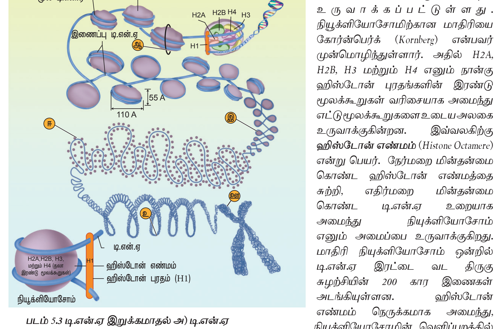
யூ கே ரி யோ ட் டு க ளி ல்
அதிக
சிக்கலான
அமைப்பு
காணப்படுகிறது.
தொொடர்ச்சியான
மீள்தோன்று
அலகுகளான
நி யு க் ளி யோசோ ம் ்க ள ா ல்
(Nucleosomes)
குரோமேட்டின்
உ ரு வ ா க் ்க ப் ்ப ட் டு ள் ்ள து .
நியூக்ளியோசோமிற்ககான மாதிரியை
கோர்ன்பபெர்க் (Kornberg) என்பவர்
முன்மொழிந்துள்ளார். அதில் H2A,
H2B, H3 மற்றும் H4 எனும் நான்கு
ஹிஸ்டோன் புரதங்களின் இரண்டு
மூலக்கூறுகள் வரிசையாக அமைந்து
எட்டு மூலக்கூறுகளை உடைய அலகை
உருவாக்குகின்றன.
இவ்வலகிற்கு
ஹிஸ்டோன் எண்மம் (Histone Octamere)
என்று பெயர். நேர்மறை மின்தனமை
கொொண்ட ஹிஸ்டோன் எண்மத்தை
சுற்றி,
எதிர்மறை
மின்தனமை
கொொண்ட
டி.என்.ஏ
உறையாக
அமைந்து
நியுக்ளியோசோம்
எனும் அமைப்பை உருவாக்குகிறது.
மாதிரி நியுக்ளியோசோம் ஒன்றில்
டி.என்.ஏ
இரட்டை
வட
திருகு
சுழற்சியின் 200 கார இணைகள்
அடங்கியுள்ளன.
ஹிஸ்டோன்
எண்மம்
நெருக்கமாக
அமைந்து,
நியுக்ளியோசோமின் வெளிப்புறத்தில்
டி.என்.ஏ
சூழ்ந்து
சுருளாகக்
காணப்படுகிறது.
அடுத்தடுத்துள்ள

நியுக்ளியோசோம்களை,
நொொதிகளின்
உதவியுடன்
இணைப்பு
டி.என்.ஏக்கள்
இணைக்கின்றன.
ஹிஸ்டோன் எண்மத்தைச்
சுற்றி டி.என்.ஏ இரு முழுமையான திருகுகளை
உருவாக்கியுள்ளன.
இரண்டு திருகுகளையும்
H1 மூலக்கூறு (இணைப்பு டி.என்.ஏ) மூடுகிறது.
H1
இல்லாத
நிலையில்
குரோமேட்டின்
மணிகோர்த்த
மாலையைப்
போல
தோன்றுகின்றது.
இவ்வமைப்பின்
எந்த
இடத்திலும்
டி.என்.ஏ
உட்சசெல்லவும்,
நியுக்ளியோசோமை
விட்டு
வெளியேறவும்
முடியும்.
ஒரு
நியுக்ளியோசோமின்
H1,
அடுத்துள்ள
நியுக்ளியோசோமின்
H1 உடன் வினைபுரிவதால் இழை, மேலும்
மடிகிறது. இடைநிலையில் உள்ள உட்கருவின்
குரோமேட்டின் இழையின் விட்டம் 700 nm வரை
இருக்கும்.
இது செயலற்ற குரோமேட்டின்
ஆகும். நியுக்ளியோசோமின் மடிப்பிலிருந்து
தோன்றும் 30nm நீளமுள்ள இழை, ஒரு
சுற்றுக்கு ஆறு நியுக்ளியோசோமைக் கொொண்ட
வரிச்சுருளமைப்பைத் (Solenoid) தோற்றுவிக்கிறது.
வெவ்வேறு H1 மூலக்கூறுகளுக்கு இடையேயான
வினையால் இவ்வமைப்பு நிலைப்புத் தனமையைப்
பெறுகிறது.
தற்போது டி.என்.ஏ வரிச்சுருள்
அமைப்புடன் சுமார் 40 மடிப்புகளைக் கொொண்டு
பொொதிக்கப்படுகிறது. படம் 5.3ல் குரோமோசோம்
அமைப்பின் உயர்படிநிலையின் வரிசைக்கிரமம்
தரப்பட்டுள்ளது.
மேலும்
உயர்நிலை
குரோமேட்டின் பொொதிவுக்கு கூடுதலான புரதத்
தொொகுதிகள் தேவையாய் உள்ளன. இப்புரதங்கள்,
ஹிஸ்டோனற்ற குரோமோசோம் புரதங்கள் (Nonhistone chromosomal proteins - NHC) எனப்படுகின்றன.
மாதிரி உட்கருவில், குரோமேட்டினின் சில
பகுதிகள்
தளர்வவாக
பொொதிக்கப்பட்டுள்ளன
(குறைவான நிறமேற்பி) இதற்கு யுகுரோமேடின்
என்று பெயர்.
இறுக்கமாக பொொதிக்கப்பட்ட
(அடர்நிறமேற்பி)
குரோமேட்டின்
பகுதி
ஹெட்டிரோகுரோமேட்டின்
எனப்படும்.
யுகுரோமேடினில் படியெடுத்தல் நிகழ்வு தீவிரமாக
நிகழும் ஆனால் ஹெட்டிரோகுரோமேடினில்
படியெடுத்தல் நிகழ்வதில்லை.

### 5.8 டி.என்.ஏ இரட்டிப்பாதல்

செல்சுழற்சியின் S-நிலையின் போது டி.என்.ஏ
இரட்டிப்பாதல் நிகழ்கிறது.
இரட்டிப்பாதலின்
போது, ஒவ்வொரு டி.என்.ஏ மூலக்கூறும்,
ஒன்றுக்கொன்று ஒத்த தனமை கொொண்ட இரண்டு
இழைகளைத் தருகின்றன. இவை பெற்றோரின்

இழைகளையும் ஒத்திருக்கின்றன.
டி.என்.ஏ
இரட்டிப்பாதல் தொொடர்பபாக மூன்று கோட்பபாடுகள்
முன்மொழியப்பட்டுள்ளன.
அவையாவன,
பழையன காத்தல் முறை இரட்டிப்பாதல், சிதறல்
முறை இரட்டிப்பாதல் மற்றும் பாதி பழையன
காத்தல் முறை இரட்டிப்பாதல்.
பழையன காத்தல் இரட்டிப்பாதலில், மூல
இரட்டை வட திருகுச்சுழல் வார்ப்புருவாகப்
பணியாற்றுகிறது.
மூல
மூலக்கூறுகள்
பாதுகாக்கப்பட்டு, முழுதும் புதிதான இரு
இழைகளாக
டி.என்.ஏ
மூலக்கூறுகள்
உற்பத்தி செய்யப்படுகின்றன.
சிதறல் முறை
இரட்டிப்பாதலில்,
மூல
மூலக்கூறு
பல
துண்டுகளாக உடைந்து, ஒவ்வொரு துண்டமும்
வார்ப்புருவாக செயல்பட்டு அதற்கு ஈடான
இழைகளை
புதிதாய்
உருவாக்குகின்றன.
இறுதியாக இரண்டு புதிய மூலக்கூறுகள்
உருவாகின்றன அதில் பழைய மற்றும் புதிய
துண்டங்கள் இணைந்ததேயுள்ளன.
3’

5’

T A
C G
A T

ªðŸ«ø£˜

C G
C G
G C
T A
C G
T A
C G
T A

ªðŸ«ø£˜
Þ¬ö

T A
A
T

A

3’
C
C G
G C

5’

T

C
C G
G C

T A

T A

C G
T A
C G

TA

C G
T A
C G

A T

T A
A T

3’

ªðŸ«ø£˜
Þ¬ö

T A
A T

5’

3’
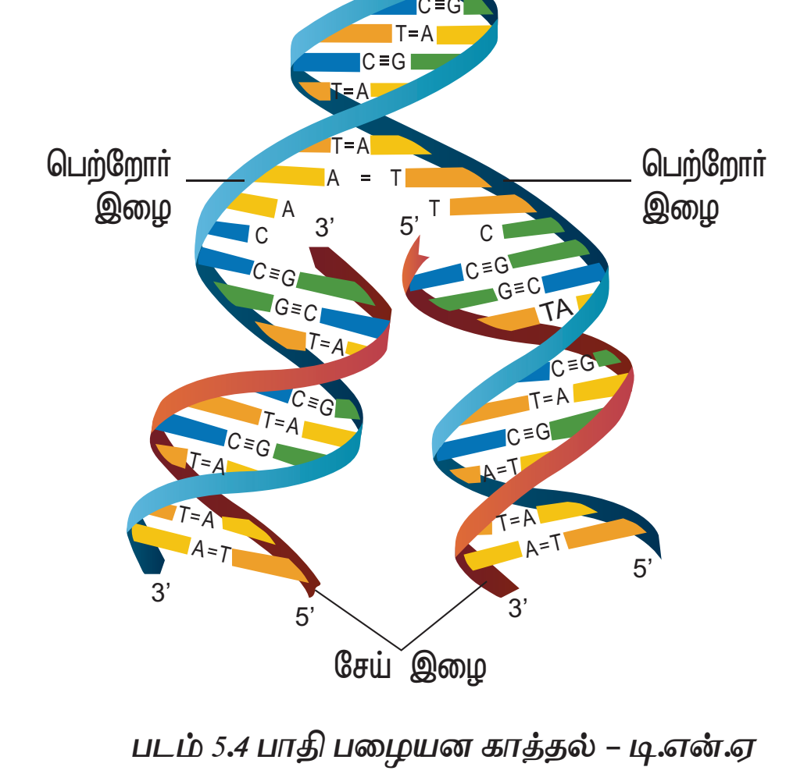
பாதி பழையன காத்தல் முறை இரட்டிப்பாதலை
முன்மொழிந்தனர்.
இது
டி.என்.ஏவின்
மாதிரி
வடிவத்தை
அடிப்படையாகக்

கொொண்டதாகும். டி.என்.ஏவின் இரு இழைகளும்
ஒரு
முனையிலிருந்து
தொொடங்கி
பிரியத்
தொொடங்குகின்றன.
இந்நிகழ்வின்
போது
ஹைட்ரஜன்
பிணைப்புகள்
உடைகின்றன.
இவ்வாறு பிரிக்கப்பட்ட ஒவ்வொரு இழையும், புதிய
இழையின் வார்ப்புருவாக செயல்படுகிறது. இதன்
தொொடர்ச்சியாக உருவாகும் இரண்டு இரட்டை
திருகுச்சுழல்
இழைகள்
ஒவ்வொன்றிலும்
வார்ப்புருவாக செயல்பட்ட ஒரு பெற்றோர்
(பழைய)
பாலிநியுக்ளியோடைடு
சங்கிலி
இழையும்
ஒரு
புதிய
நிகரொொத்த
பாலி
நியுக்ளியோடைடு சங்கிலி இழையும் உள்ளன
(படம் 5.4).

### 5.8.1 டி.என்.ஏ இரட்டிப்பாதலுக்கான

சோதனை வழி உறுதியாக்கம்
மெசெல்சசென் மற்றும் ஸ்டடால் ஆகியோர்
1958ல், டி.என்.ஏ இரட்டிப்பாதல் வழிமுறைகளை
வடிவமைத்தனர்.
இவ்வடிவமைப்பின் மூலம்,
பாதி பழையன காத்தல், பழையன காத்தல்
மற்றும் சிதறல் முறைகளை வேறுபடுத்திப்
பார்க்கவும் முயன்றனர்.
இச்சோதனையின்
போது
எ.கோலை
பாக்டீரியாவின்
இரு
குழுக்களை ஊடகத்தில், தனித்தனியாக பல
தலைமுறைகளுக்கு வளர்த்தனர். கன நைட்ரஜன்
ஐசோடோப்பான 15N அடங்கிய நைட்ரஜன்
மூலத்தைக் கொொண்ட ஊடகத்தில் ஒரு குழுவும்,
இலகு நைட்ரஜன் ஐசோடோப்பான 14Nஅடங்கிய
ஊடகத்தில் இன்னொரு குழுவும் பல தொொடர்
தலைமுறைகளாக வளர்க்கப்பட்டன. இறுதியில்,

கன நைட்ரஜனில் வளர்ந்த பாக்டீரியாக்களின்
டி.என்.ஏ வில் 15Nம், இலகு நைட்ரஜனில்
வளர்ந்தவைகளில் 14N மட்டுமே இருந்தன.

N ஐ 14N லிருந்து வேறுபடுத்தி அறிய சீசியம்
குளோரைடு
(Crcl)
அடர்த்தி
வேறுபாட்டு
மைய விலக்குசுழற்சிக்கு (Cesium chloride density
gradient
centrifugation)
உட்படுத்தப்படுகிறது.
இச்சசெயற்பபாட்டின் போது, இரு செல் குழுக்
களிலிருந்து பிரித்ததெடுக்கப்பட்ட கன மற்றும்
இலகு
டி.என்
.ஏக்கள்
இரு
தனித்தனி
பட்டைகளாகப் படிந்தன (கலப்பு டி.என்.ஏ)
(படம் 5.5).
பிறகு கன நைட்ரஜன் (15N) வளர்ப்பிலிருந்து,
பாக்டீரியாக்கள், அம்மோனியம் குளோரைடு
(NH4Cl)
மட்டுமே
உள்ள
ஊடகத்திற்கு
மாற்றப்பட்டு, அதிலிருந்து ஒவ்வொரு 20 நிமிட
இடைவெளியில் மாதிரிகள் எடுக்கப்பட்டன. முதல்
இரட்டிப்பாதலுக்குப் பிறகு பிரித்ததெடுக்கப்பட்ட
டி.என்.ஏ அடர்த்தி வேறுபாட்டு மைய விலக்கு
சுழற்சிக்கு உட்படுத்தப்பட்டது.
வீழ்படிவாக
படிந்த டி.என்.ஏ பட்டை, இதற்கு முன்பு படிந்த
கன மற்றும் இலகு பட்டைகளுக்கு இடையில்
அமைந்தது.
இரண்டடாம் இரட்டிப்பாதலுக்குப்
பிறகு (40 நிமிடங்களுக்குப்பின்) பிரித்ததெடுப்பட்ட
டி.என்.ஏ, இம்முறை இரு பட்டைகளாக படிந்தது.
ஒன்று இலகு பட்டை நிலையிலும் மற்றொன்று
இடைநிலையிலுமாய் இருந்தன. இம்முடிவுகள்,
வாட்சன் மற்றும் கிரிக் ஆகியோரின் பாதி
பழையன காத்தல் இரட்டிப்பாதல் கோட்பபாட்டினை
மெய்ப்பித்தன.

ºî™ î¬ôº¬ø

N-®.â¡.ã

Þó‡ì£‹ î¬ôº¬ø

N-®.â¡.ã

N-®.â¡.ã

20 G

40 G

¹MߘŠ¹ M¬ê

N

èù

N

N

N

èôŠ¹

N

N

Þô°

N

N-®.â¡.ã
N-®.â¡.ã
N-®.â¡.ã
N-®.â¡.ã
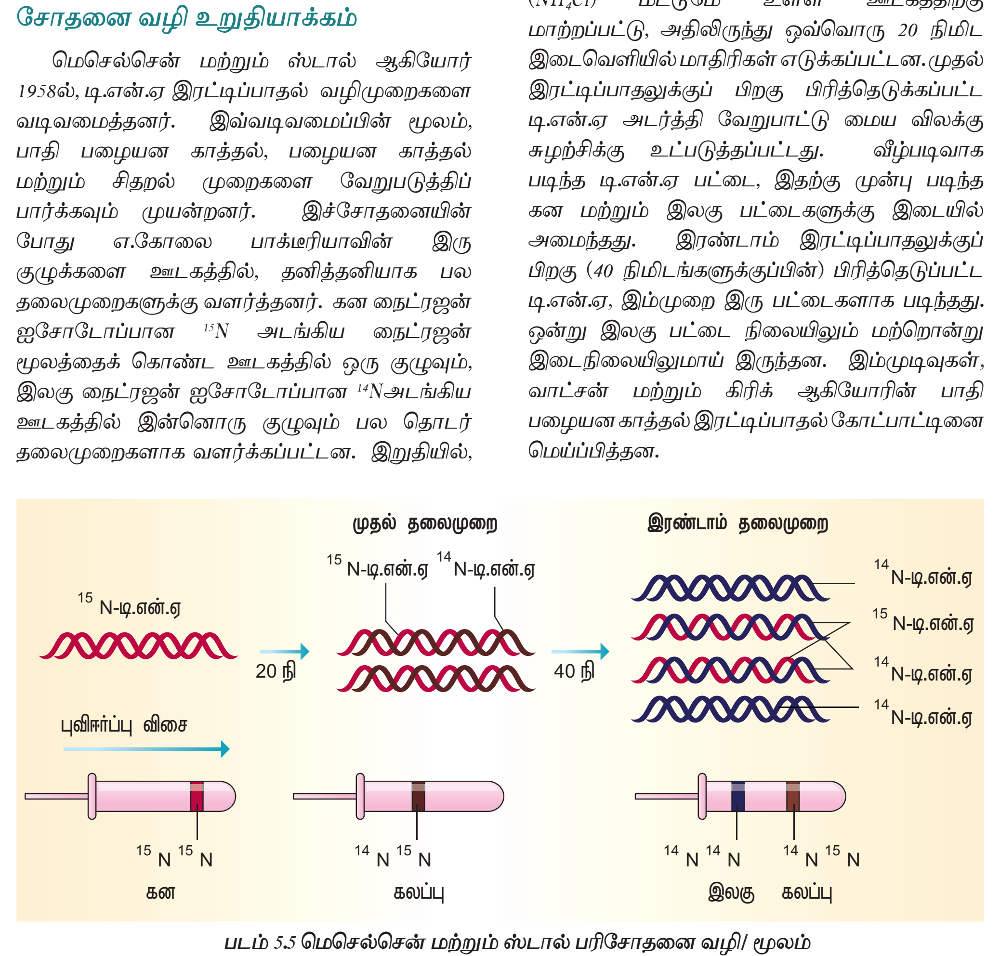

### 5.8.2 நொொதிகளும் இரட்டிப்பாதல்

முறையும்
புரோகேரியாட்டுகளில் இரட்டிப்பாதலுக்காக
மூன்று வகையான டி.என்.ஏ பாலிமெரேஸ்
நொொதிகள்
தேவைப்படுகின்றன.
(டி.என்.ஏ
பாலிமெரேஸ் I, II மற்றும் III).
இவற்றில்
டி.என்.ஏ பாலிமெரேஸ் III எனும் நொொதி
இரட்டிப்பாதலில் மிக முக்கிய பங்ககாற்றுவதாகும்.
‘கோர்ன்பபெர்க் நொொதி’ என்று அழைக்கப்படும்
டி.என்.ஏ.பாலிமெரேஸ் I மற்றும் டி.என்.ஏ.
பாலிமெரேஸ்
II
ஆகியவை
டி.என்.ஏ
பழுதுநீக்கத்தில்
பங்ககாற்றுபவை
ஆகும்.
யுகேரியோட்டுகளில் ஐந்து வகையான டி.என்.ஏ
பாலிமெரேஸ்கள் உள்ளன.
இவை குறுகிய
காலத்தில் புதிய இழையின் 3' OH- இடத்தில்
நியூக்ளியோடைடுகளின்
பல்படியாக்கல்
நிகழ்வில் வினை மாற்றியாக செயல்படுகின்றன.
4.6 x106 கார இணைகள் மட்டுமே கொொண்ட
எ.கோலையில்,
இரட்டிப்பாதல்
நிகழ்வு

நிமிடங்களில் முழுமைபெறுகிறது; அதாவது
பல்படியாக்கலின் சராசரி விகிதம் தோராயமாக
ஒரு வினாடிக்கு 2000 கார இணைகளாக இருக்க
வேண்டும். மிக வேகமாகவும், துல்லியமாகவும்
நடைபெறும் இரட்டிப்பாதல் நிகழ்வில் சிறு பிழை
ஏற்பட்டாலும் அது திடீர்மமாற்றத்திற்கு வழி
வகுக்கும். இருப்பினும், நியுக்ளியேசஸ் எனும்
நொொதிகள் இத்தகைய பிழைகளை சீர்படுத்த
உதவுகின்றன. இந்த பல்படியாக்க (Polymerization)
நிகழ்வுக்கு,
டி-ஆக்ஸி-நியுக்ளியோசைடுடிரைபாஸ்பபேட், தளப்பொருளாக செயலாற்றி
தேவையான ஆற்றலை அளிக்கிறது.
இரட்டிப்பாதலுக்கான
இடத்திலிருந்து
(அதாவது
தொொடக்க
இடம்
(Initiation site) இரட்டிப்பாதல் தொொடங்குகிறது.
புரோகேரியோட்டுகளில்
‘தொொடக்க
இடம்’
என்பது ஒன்று மட்டுமே.
ஆனால், பெரிய
அளவிலான டி.என்.ஏ மூலக்கூறுவைக் கொொண்ட
யூகேரியோட்டுகளில், பல தொொடக்க இடங்கள்
(replicons) காணப்படுகின்றன.
டி.என்.ஏவின்
நீளமான இரு இழைகளும் முழுவதுமாக ஒரே
நேரத்தில் இரட்டிப்பாதலுக்கு பிரிய வாய்ப்பில்லை.
ஏனெனில், அதற்ககான ஆற்றல் தேவை அதிகம்.
எனவே, டி.என்.ஏ திருகுச்சுழலில் சிறு திறப்பின் வழி
இது தொொடங்குகிறது. இத்திறப்பிற்கு ‘இரட்டிப்பாதல்
பிளவு’ (Replication fork) என்று பெயர். டி.என்.
ஏவின் சுருள் நீக்கத்தை டி.என்.ஏ ஹெலிகேஸ்

(DNA helicase) எனும் நொொதி செயல்படுத்துகிறது.
இவ்வாறு ஒரு இழையின் 3' → 5'
திசை
கொொண்ட வார்ப்புரு இழையில், இரட்டிப்பாதல்
தொொடர்ச்சியாக நடைபெறும்.
இவ்விழைக்கு
தொொடர் இழை அல்லது வழிகாட்டு இழை என்று
பெயர். மற்றொரு 5' → 3' திசை கொொண்ட இழையின்
இரட்டிப்பாதல்
தொொடர்ச்சியற்றதாகும்.
இவ்விழைக்கு தொொடர்ச்சியற்ற இழை அல்லது
பின்தங்கு இழை (lagging strand) என்று பெயர்
(படம் 5.6). பின் தங்கு இழையால் உருவாக்கப்பட்ட
தொொடர்ச்சியற்ற புதிய துண்டங்களை (ஒகேசாகி
துண்டங்கள்)
டி.என்.ஏ.
லிகேஸ்
நொொதி
ஒன்றிணைக்கின்றது.
 ¶  ¶

À{sÎØÙ
߃Á

 ¶  ¶
„ ®y ¯
à{/‚¼‚¾Y

±‚´¶{$
Šg¸c´v
 
 ¶

ß¾f„Îà{ºt
+ÂÛ
„ ®y ¯
à{/‚¼‚¾Y
„ ®y ¯
/‚´Y
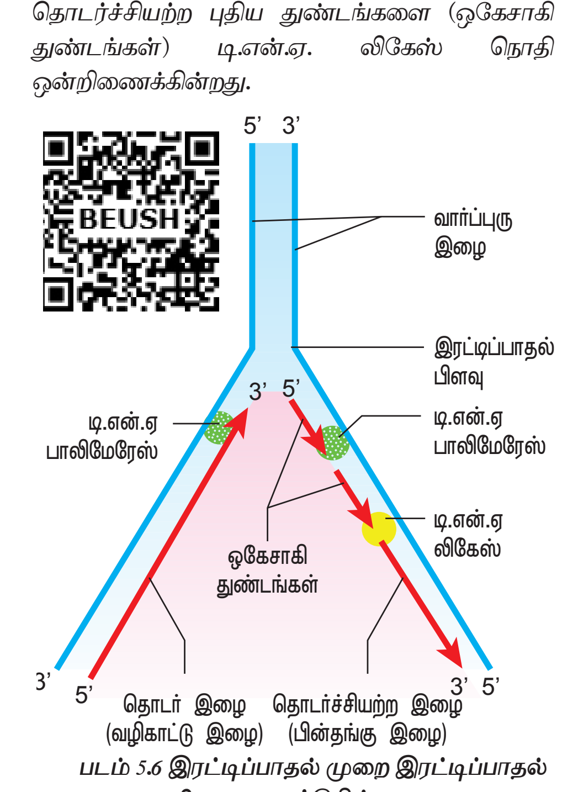
 ¶

இப்பிளவு இரு எதிர்திசைகளில் நகர்கிறது.
இதனால்
உருவாக்கப்படும்
புதிய
நிரப்பு
நியுக்ளியோடைடுகள், பெற்றோர் இழையில் உள்ள
பழைய
நியுக்ளியோடைடுகளுடன்,
டி.என்.ஏ.
பாலிமெரேஸ் நொொதியால் இணைதிறன் பிணைப்பு
(Covalent bond) கொொண்டு பிணைக்கப்படுகின்றன.
புதிய இழையின் உருவாக்கம் தொொடங்க ஆர்.என்.
ஏவின் சிறு பகுதியான, தொொடக்க இழை (Primer)
தேவைப்படுகிறது.
தொொடக்க இழை முதலில்
3'-OH முனையின் மீது ரிபோ நியுக்ளியோடைடு
வரிசையை உருவாக்கிய பின்னர் டி. ஆக்ஸி
ரிபோ-நியுக்ளியோடைடுகள் சேர்க்கப்படுகின்றன.
ஆர்.என்.ஏ
தொொடக்க
இழை
இறுதியில்

நீக்கப்படுவதால், புதிய டி.என்.ஏ இழையில் சிறு
இடைவெளி ஏற்படுகிறது. டி.என்.ஏ பாலிமெரேஸ்
நொொதியின் புற நியுக்ளியேஸ் (Exonuclease) வகை
செயல்பபாட்டினால், 5' முனையில் இவை ஒன்றன்
பின் ஒன்றறாக நீக்கப்படுகின்றன. இறுதியில், எல்லா
நியுக்ளியோடைடுகளும் அவற்றுக்குரிய இடத்தில்
நிலைத்த பின், டி.என்.ஏ. லிகேஸ் நொொதியால்
இடைவெளிகள் மூடப்படுகின்றன.
இரட்டிப்பாதலின்
தொொடக்க
இடத்தில்,
ஹெலிகேஸ் மற்றும் டோபோஐசோமெரேஸ்
நொொதிகள் (டி.என்.ஏ. கைரேஸ்) டி.என்.ஏவின்
சுருளை நீக்கி, இரு இழைகளையும் பிரித்து
Y வடிவ அமைப்பான, 'இரட்டிப்பாதல் கவையை'
தோற்றுவிக்கின்றன. ஒவ்வொரு தொொடக்கத்திலும்
இரண்டு ‘இரட்டிப்பாதல் கவைகள்’ உண்டு. டி.என்.
ஏவின் இரு இழைகளும் எதிர் அமைப்பைக்
கொொண்டவை. புதிய இழையின் 5'→3' திசையில்,
புதிய
நியுக்ளியோடைடுகளை
சேர்க்கும்
வினைக்கு டி.என்.ஏ. பாலிமெரேஸ்
மட்டுமே
வினைமாற்றியாகச் செயல்படுகிறது.
அது
3' நிலை கார்பனில் நியுக்ளியோடைடுகளை
இணைக்கின்றது.

## 5.9 படியெடுத்தல் (Transcription)

மூலக்கூறு
உயிரியலின்
புரதசேர்க்கை
மையக்கருத்தை (Central dogma) பிரான்சிஸ் கிரிக்
என்பவர் உருவாக்கினார். அதன்படி, மரபியல்
தகவல்கள் கீழ்கண்டவாறு கடத்தப்படுகின்றன.

®.â¡.ã

¹óî‹

ݘ.â¡.ã
ð®ªò´ˆî™

ªñ£Nªðò˜Š¹

Þ󆮊ð£î™

டி.என்.ஏ.வின்
ஒரு
இழையிலுள்ள
மரபுத்
தகவலானது
தூது
ஆர்.என்.ஏவின்
மரபுக் குறியீடுகளாக மாற்றும் நிகழ்விற்கு
படியெடுத்தல் எனப்படும். டி.என்.ஏ சார்ந்த
ஆர்.என்.ஏ பாலிமெரேஸ் என்ற நொொதியின்
முன்னிலையில் இந்நிகழ்ச்சி நடைபெறுகிறது.
ஆர்.என்.ஏவை மரபுப்பொருளாகக் கொொண்ட சில
ரெட்ரோவைரஸ்களில் இத்தகவல் ஓட்டம் (அ)
பாய்வு தலைகீழாக நடைபெறும் (எ.கா. HIV).
தலைகீழ் படியெடுத்தல் மூலம் ஆர்.என்.ஏ, டி.என்.
ஏவை உருவாக்குகிறது. பின் தூது ஆர்.என்.ஏவாக
படியெடுக்கப்பட்டு, மொொழிபெயர்த்தல் மூலம்
புரதமாகிறது.

மரபணுக்கள்,
தங்களின்
பண்புகளை
வெளிப்படுத்தினால் மட்டுமே ஒரு செல் திறனுடன்
செயல்பட முடியும். அதாவது, புரதம் அல்லது ஆர்.
என்.ஏ மூலக்கூறுகள் போன்ற மரபணு பொொருட்கள்
உருவாக்கப்பட வேண்டும். மரபணுவிலிருந்து
புரதத்திற்ககான
தகவல்களை
குறியீடாகச்
செல்லுக்குக் கொொண்டுசெல்லும் ஆர்.என்.ஏவை
தூது ஆர்.என்.ஏ (mRNA) என்றழைக்கப்படும்.
மரபணு படியெடுக்கப்பட வேண்டுமென்றறால்,
இரட்டைத்
திருகுச்சுழலமைப்புக்
கொொண்ட
டி.என்.ஏவின் இழைகள் தற்ககாலிகமாகப் பிரிய
வேண்டும். பின் டி.என்.ஏ வின் ஒரு வார்ப்புரு
இழையிலிருந்து
ஆர்.என்.ஏ
பாலிமெரேஸ்
நொொதியின் உதவியுடன் ஆர்.என்.ஏ உற்பத்தி
செய்யப்பட வேண்டும். இந்நொதி மரபணுவின்
ஆரம்பத்தில்
டி.என்.ஏவுடன்
இணைந்து,
திருகுச்சுழல் அமைப்பை திறக்கிறது. இறுதியில்
ஆர்.என்.ஏ
மூலக்கூறு
உற்பத்தியாகிறது.
ஆர்.என்.ஏவின்
நியுக்ளியோடைடுகள்,
அது
உருவான
டி.என்.ஏ
வார்ப்புரு
இழையின்
நிகரொொத்த அமைப்பாகும்.
படியெடுத்தலின் போது டி.என்.ஏ வின் இரு
இழைகளும் படியெடுக்கப்படுவதில்லை. இதற்கு
இரண்டு காரணங்கள் உண்டு.
1.
இரு
இழைகளுமே
வார்ப்புருவாக
செயலாற்றுமேயானால்
ஆர்.என்.ஏவிற்ககான
குறியீடு இரண்டிலும் வெவ்வேறு வரிசையில்
இருக்கும். இதனால் புரதத்தின் அமினோ அமில
வரிசையிலும் பாதிப்பு ஏற்படும்.
இதனால்
டி.என்.ஏவின் ஒரு பகுதியிலிருந்து இரு வேறு
புரதங்கள் உற்பத்தியாகி மரபுத் தகவல் பரிமாற்ற
நிகழ்முறையில் சிக்கல் ஏற்படுகின்றது.
2. இரு வித ஆர்.என்.ஏ மூலக்கூறுகள் ஒரே
நேரத்தில் உற்பத்தியாகுமேயானால், ஆர்.என்.
ஏவின் இரு இழைகளும் ஒன்றுக்கொன்று
நிகரொொத்தாக இருக்கும். எனவே அந்நிலை,
ஆர்.என்.ஏவை புரதமாக மொொழிபெயர்க்கப்படுவதை
தடுக்கிறது.

### 5.9.1 படியெடுத்தல் அலகு மற்றும்

மரபணு
படியெடுத்தல் அலகு மூன்று பகுதிகளால்
வரையறுக்கப்பட்டுள்ளது.
அவை
ஊக்குவிப்பான், அமைப்பு மரபணு மற்றும்
நிறைவி ஆகியனவாகும். 5'முனையையொொட்டி
ஊக்குவிப்பான் அமைந்துள்ளது.
ஆர்.என்.ஏ

à„½ˆhºt º{¸c†j ߸j
­b†0Îà{y

ªƒ¼ÎØ ¼¾à‰

À{sÎØ٠߃Á

*ƒÃ0

 ¶

 ¶

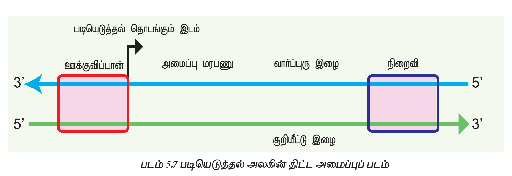
பாலிமெரேஸ் நொொதிக்கான பிணைப்பு இடத்தை
அளிக்கும் டி.என்.ஏ தொொடரே ஊக்குவிப்பான்
ஆகும். படியெடுத்தல் அலகில் ஊக்குவிப்பான்
இருப்பதால் தான், வார்ப்புரு மற்றும் குறியீட்டு
இழைகள் தெளிவாகின்றன. குறியீட்டு இழையின்
3' முனையில் நிறைவி பகுதி அமைந்துள்ளது.
அதற்ககேற்ப, அதில், ஆர்.என்.ஏ. பாலிமெரேஸின்
செயல்பபாடுகளை நிறுத்திவைக்கும் டி.என்.ஏ
வரிசையமைப்பு காணப்படுகிறது. யூகேரியோட்டு
களில்,
ஊக்குவிப்பான்
பகுதியில்
அதிக
எண்ணிக்கையிலான
அடினைன்
(A) மற்றும் தைமின் (T) ஆகியவை உள்ளன.
இப்பகுதி “டாடா பெட்டி” (TATA Box) அல்லது
“கோல்ட்பபெர்க்
ஹோக்னனெஸ்
பெட்டி”
(Goldberg-Hogness box) என்று அழைக்கப்படுகிறது.
புரோகேரியேட்டுகளில்
இப்பகுதியை,
“பிரிப்னோ பெட்டி” (Prinbnow box) என்பர்.
ஊக்குவிப்பானைத் தவிர, யூகேரியோட்டுகளுக்கு
அதிகரிப்பான்களும் தேவைப்படுகின்றன.
படியெடுத்தல் அலகில் உள்ள டி.என்.ஏவின்
இரு இழைகளும் எதிரெதிர் துருவத்துவம்
பெற்றவை.
டி.என்.ஏ சார்ந்த ஆர்.என்.ஏ.
பாலிமெரேஸ்,
ஒரு
திசையில்
மட்டுமே
பல்படியாக்கம்
செய்யக்
கூடியதாகும்.
வார்ப்புருவாக செயல்படும் இவ்விழை 3'→5'
துருவத்துவம் பெற்றது. எனவே, இது வார்ப்புரு
இழை எனப்படும். 5'→3' துருவத்துவம் கொொண்ட
இன்னொரு இழையின் கார வரிசை தூது ஆர்.
என்.ஏ. வரிசையைப் போன்று காணப்படும்.
ஆனால் இதில் யுரேசிலுக்குப் பதில் தைமின்
காணப்படும். இது படியெடுத்தல் நிகழ்வின்போது
விலகிக் கொொள்கிறது. இவ்விழை குறியீட்டு இழை
எனப்படும் (படம் 5.7).
அமைப்பு மரபணுக்கள், யுகேரியோட்டுகளில்
உள்ளது போல மோனோசிஸ்ட்ரரானிக் ஆகவோ
அல்லது
புரோகேரியோட்டுகளில்
உள்ளது

போல பாலிசிஸ்ட்ரரானிக் ஆகவோ இருக்கலாம்.
யூகேரியோட்டுகளில், ஒரு மரபணு ஒரு தூது
ஆர்.என்.ஏவாக படியெடுக்கப்பட்டு ஒரே ஒரு
புரதமாக மட்டும் மொொழி பெயர்க்கப்படும்.
இந்த
மரபணுவிற்கு
மோனோசிஸ்ட்ரரானிக்
மரபணு என்று பெயர். புரோகேரியோட்டுகளில்,
தொொடர்புடைய
மரபணுக்களின்
கூட்டமான
ஓபரான்,
குரோமோசோமில்
அடுத்தடுத்து
அமைகின்றன. எனவே படியெடுத்தலின் போது
அவை கூட்டமாக படியெடுக்கப்பட்டு ஒற்றை
தூது ஆர்.என்.ஏவை உற்பத்தி செய்கின்றன.
எனவே, இத்தகைய மரபணு பாலிசிஸ்ட்ரரானிக்
மரபணு என்று அழைக்கப்படுகின்றது.
படியெடுத்தல்
தொொடங்குவதற்கு
முன்பு,
மரபணுவின்
முன்பகுதியிலுள்ள
ஊக்குவிப்பானுடன், ஆர்.என்.ஏ பாலிமெரேஸ்
பிணைகிறது.
புரோகேரியோட்டான
பாக்டீரியாவின்
ஆர்.என்.ஏ
பாலிமெரேஸில்
‘மைய
நொொதி’
மற்றும்
‘சிக்மமா
துணை
அலகு’
உள்ளன.
மைய
நொொதி

(2α, β, β மற்றும் ω) ஆர்.என்.ஏ உற்பத்திக்கும்
முக்கியமானது. அதைப்போல் சிக்மமா துணை
அலகு ஊக்குவிப்பான்களின் அங்கீகாரத்திற்கு
பொொறுப்பாகும்.
உயிரினங்களுக்கு
ஏற்ப,
ஊக்குவிப்பானின்
வரிசையிலும்
மாற்றம்
காணப்படுகிறது.
ஆர்.என்.ஏ பாலிமெரேஸ்
டி.என்.ஏ.வை திறப்பதால் படியெடுத்தல் குமிழ்
உருவாகிறது.
ஊக்குவிப்பான்
பகுதியில்
முன்நகரும் மைய நொொதி ஆர்.என்.ஏவை உற்பத்தி
செய்து சிக்மமா துணை அலகை ஊக்குவிப்பான்
பகுதியிலேயே விட்டு விடுகிறது. ஆர்.என்.ஏவில்
கொொண்டடை ஊசி வளைவு அமைப்பை உருவாக்கும்
நிறைவி வரிசையால் மரபணுவின் முடிவு
குறிக்கப்படுகிறது. இவ்வாறான நிறைவியின்
துணை அலகின், முழுமையான செயல்பபாட்டிற்கு
அங்கீகாரப் புரதமான ‘ரோ’ (ρ) தேவைப்படுகிறது.

விதியைப்
பின்பற்றி,
பா லி ம ரே ஸ் ்களை
5'
5'
வார்ப்புரு
சார்ந்த
முறையிலும் பயன்படுத்திக்
3'
3'
®.â¡.ã F¼° Þ¬ö
ݘ.â¡.ã ð£Lªñ«óv
கொ ொ ள் கி ன்ற ன .
á‚°MŠð£¡
ப டி யெ டு த் ்த ல்
C‚ñ£ è£óE
தொ ொ ட ங் ்க ப் ்ப ட் ்ட து ம்
c†Cò¬ìî™
நி யு க் ளி யோட ை டு க ளை
வளரும்
ஆர்.என்.ஏ
3'
5'
வோடு
அடுத்தடுத்து
5'
இணைப்பதன்
மூலம்
3'
G¬øM
பாலிமெரேஸ்,
ஆர்.
σ
ݘ.â¡.ã
என்.ஏ
வின்
நீளத்தை
G¬ø¾Áî™
அ தி க ரி க் கி ற து .
மரபணுவின்
முடிவில்,
5'
3'
பாலிமெரேஸ் நிறைவியை
3'
5'
அடையும் போது ஆர்.என்.
ஏவின் சிறு பகுதி மட்டுமே
‘«ó£’ è£óE
நொொதியுடன்
பிணைந்து
ݘ.â¡.ã
ݘ.â¡.ã ð£Lªñ«óv
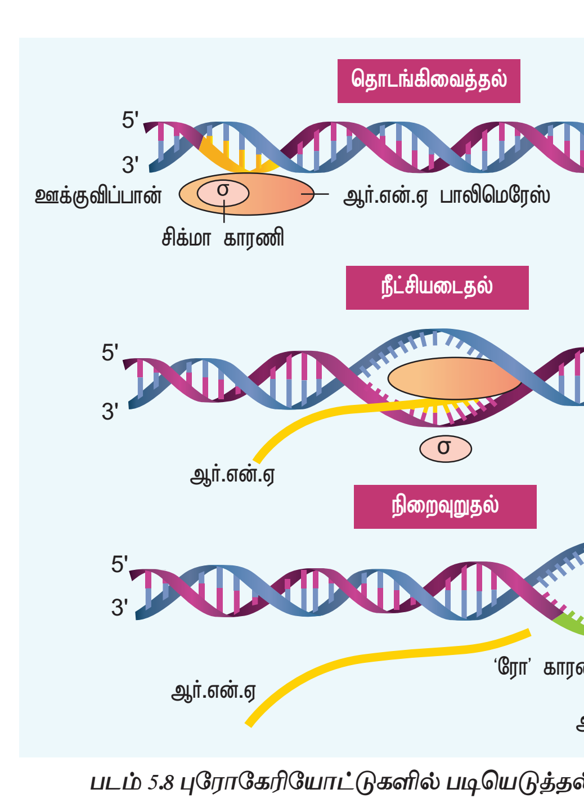
பாலிமெரேஸும் உதிர்க்கப்படுகின்றன.

### 5.9.2 படியெடுத்தல் நிகழ்முறை

ªî£ìƒA¬õˆî™

தூது
ஆர்.என்.ஏ
(mRNA), கடத்து ஆர்.என்.ஏ
(tRNA) மற்றும் ரிபோசோம்
ஆர்.என்.ஏ (rRNA) என மூன்று
வகையான ஆர்.என்.ஏக்கள்
பு ரோகே ரி யோ ட் டு க ளி ல்
காணப்படுகின்றன.
செல்லில்
நடைபெறும்
புரத
உற்பத்திக்கு
இம்மூன்று
வகை
ஆர்.என்.ஏ க்களும் தேவையாயிருக்கின்றன.
தூது ஆர்.என்.ஏ, வார்ப்புருவாகவும், கடத்து
ஆர்.என்.ஏ மரபணுவின் முக்கியக்குறியீட்டைப்
படிப்பதற்கும்
அமினோ
அமிலங்களைக்
கொொண்டு வருவதற்கும் பயன்படுகிறது. அமைப்பு
மற்றும்
வினை
மாற்றியாக
ரிபோசோம்
ஆர்.என்.ஏ
செயல்படுகிறது.
அனைத்து
ஆர்.என்.ஏ க்களின் படியாக்க செயல்களின்
வினைமாற்றியாக டி.என்.ஏ சார்ந்த ஆர்.என்.ஏ.
பாலிமெரேஸ் எனும் ஒற்றை நொொதி மட்டுமே
செயல்படுகிறது. இந்நொதி, ஊக்குவிப்பானுடன்
பிணைந்து பின்பு படியெடுத்தலை தொொடங்கி
வைக்கிறது.
பல்
படியாக்க
பிணைப்பு
இடங்களே ஊக்குவிப்பான்கள் ஆகும். இவை
நியுக்ளியோசைடு
டிரைபாஸ்பபேட்டை
தளப்பொருளாகவும்,
நிரப்புக்கூறு

தொொடங்கி வைத்தல், நீட்டுதல் மற்றும்
முடித்துவைத்தல் ஆகிய மூன்று படிநிலைகளிலும்
ஆர்.என்.ஏ.
பாலிமெரேஸ்
எவ்வாறு
வினைமாற்றியாக
செயல்படுகிறது
என்பது
மிகப்பபெரிய
வினாவாகும்.
ஆர்.என்.ஏ
பாலிமெரேஸ்,
ஆர்.என்.ஏ
நீட்டுதலுக்கு
மட்டுமே வினைமாற்றியாக செயல்படுகிறது.
தொொடக்கத்தில்
சிக்மமா
(σ)
வுடனும்,
நிறைவிக்காரணியான ‘ரோ’ (ρ) வுடனும் ஆர்.
என்.ஏ பாலிமெரேஸ் இணைந்து செயலாற்றி
படியெடுத்தலின் முறையே, தொொடக்குதல் மற்றும்
முடித்தல்
நிகழ்வுகளை
நிகழ்த்துகின்றது.
இக்காரணிகளுடனான
ஆர்.என்.ஏவின்
தொொடர்பின் மூலம் படியெடுத்தல் நிகழ்வவை
தொொடங்குவதா? முடிப்பதா என்னும் தகவலை
ஆர்.என்.ஏ பாலிமெரேஸ் பெறுகிறது.
பாக்டீரியாவில் தூது ஆர்.என்.ஏ செயல்திறன்
பெற எந்த நிகழ்முறையும் தேவையில்லை. மேலும்,
பாக்டீரியாவில் சைட்டோசோல், உட்கரு ஆகிய
பிரிவுகள் இல்லையாதலால், படியெடுத்தலும்
மொொழிபெயர்த்தலும் ஒரே இடத்தில், ஒரே
நேரத்தில் நடைபெறுகிறது.
பல நேரங்களில்
தூது ஆர்.என்.ஏ படியெடுத்தல் முடியுமுன்பபே,
மொொழிபெயர்த்தல் தொொடங்கிவிடுகிறது. ஏனெனில்,

5'

5'

3'

3'

裊¹¬øò£‚è‹

Þ¡†ó£¡

裊¹
m

5'

3' ɶ ݘ.â¡.ã

â‚ú£¡

Gppp

ݘ.â¡.ã H÷ˆî™
m

5'

ðô Ü®¬ù«ôŸø‹
3'

Gppp

எச்சங்கள்
(200-300
Poly
A)
இணைக்கப்படுகின்றன.
இந்நிகழ்வு
‘வாலாக்கம்’ (tailing) (படம் 5.9) எனப்படும்.
இவ்வாறான
செயல்முறைகளுக்கு
ஆட்பட்ட
hnRNA, தற்போது தூது
ஆர்.என்.ஏ
என
அழைக்கப்
படுகிறது.
இது
உட்கருவிலிருந்து
மொொழியாக்கத்திற்ககாக, வெளியேற்றப்
படுகிறது.

ðô A õ£™èœ
m

5'

Gppp

ɶ ݘ.â¡.ã mG
(m RNA) 5' ppp

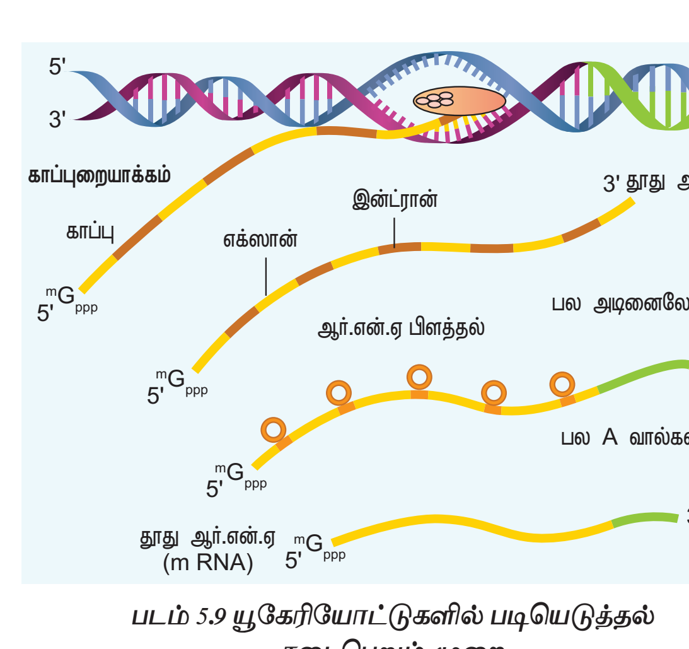
நடைபெறும் முறை
பிற செல் உறுப்புகளிலிருந்து மரபுப்பொருட்கள்
உட்கரு சவ்வினால் பிரிக்கப்பட வில்லை. இதன்
விளைவாகவே பாக்டீரியாவில் படியெடுத்தலும்,
மொொழிபெயர்த்தலும் இணைந்ததேயுள்ளன.
யூகேரியோட்டுகளின் உட்கருவில் குறைந்தது
மூன்று வகை ஆர்.என்.ஏ. பாலிமெரேஸ்கள்
காணப்படுகின்றன.
(செல் உட்பொருட்களில்
உள்ள
ஆர்.என்.ஏ
பாலிமெரேஸ்கள்
இல்லாமல்) இம்மூன்று பாலிமெரேஸ்களும்
வெவ்வேறு
பணிகளைச்
செய்கின்றன.
ஆர்.என்.ஏ
பாலிமெரேஸ்-I,
rRNA
வை
(28S, 18S 58S) படியெடுக்கிறது.
ஆர்.என்.ஏ
பாலிமெரேஸ்-III,
கடத்து
ஆர்.என்.ஏ,
5S ரிபோசோம் ஆர்.என்.ஏ மற்றும் snRNA க்களை
படியெடுக்கிறது.
ஆர்.என்.ஏ பாலிமெரேஸ்–
II, தூது ஆர்.என்.ஏவின் முன்னோடியான
hnRNA வை (வேறுபட்ட தனமையுடைய உட்கரு
ஆர்.என்.ஏ) (Heterogenous RNA) படியெடுக்கிறது.
யூகேரியோட்டுகளில்,
வெளிப்பாட்டு
வரிசையமைப்பின் குறியீடுகளான எக்ஸஸான்
(Exon) மற்றும் வரிசையமைப்பின் குறியீடுகளற்ற
இன்ட்ரரான்
(Intron)
ஆகியவற்றிற்கு,
மோனோசிஸ்ட்ரரானிக் அமைப்பு மரபணுக்கள்
இடையூறு செய்கின்றன.
பிளத்தல் (Splicing)
நிகழ்வவால், இன்ட்ரரான்கள் நீக்கப்படுகின்றன.
hnRNAவில் கூடுதலாக அதன் 5' முனையில்,
மீதைல்
குவானோசைன்
ட்ரரைபாஸ்பபேட்
இணைக்கப்படுகிறது.
இச்சசெயல்முறை
காப்புறையாக்கம்
(capping)
எனப்படுகிறது.
அதே வேளையில் 3' முனையில், அடினைலைட்

பு ரோகே ரி யோ ட் டு க ளி ல் ,
யூகேரியோட்டுகளில்
உள்ளதைப்
3'
போல
மரபணு
பிளத்தல்
பண்பு
இல்லை.
ஒவ்வொரு எக்ஸஸானும்
குறிப்பிட்ட வேலையைக் கொொண்ட ஒரு
பாலிபெப்டடைடுக்கான
குறியீட்டினை
பெற்றுள்ளன. எக்ஸஸான் வரிசையமைப்பு,
இன்ட்ரரான் நீக்கம் ஆகியவை எளிதில் நெகிழ்ந்து
கொொடுக்கும்
தனமையுடையவையாதலால்,
பாலிபெப்டடைடு
துணை
அலகுக்கான
குறியீடுகளைக் கொொண்ட எக்ஸஸான், செயல்மிகு
இடமாகி
பலவழிகளில்
இணைந்து
புதிய
மரபணுக்களை உருவாக்குகின்றன. ஒரே மரபணு,
தன் எக்ஸஸான்களை மாற்றுபிளவு முறைகளில்
பல்வவேறு
விதமாக
வரிசைப்படுத்துவதன்
விளைவாக வெவ்வேறு வகை புரதங்களை
உற்பத்தி செய்கின்றது.
விலங்குகளில், புரதம்
மற்றும் செயல்பபாடுகளின் பல்வகைத் தனமைக்கு
இது முக்கியப் பங்ககாற்றுகிறது. யூகேரியோடிக்
மரபணுக்கள் தோன்றுவதற்கு முன்போ அல்லது
பின்போ
இன்ட்ரரான்கள்
தோன்றியிருக்க
வேண்டும்.
பின்னால் தோன்றியிருப்பின்
யூகேரியோட்
மரபணுக்களுக்குள்
எவ்வாறு
அது
உள்ளேற்றப்பட்டது?
தானாகவே
பிளவுறும்
தனமை
கொொண்ட
டி.என்.ஏ
வரிசையமைப்பை
இன்ட்ரரான்கள்
பெற்று,
கிடைமட்ட
மரபணுமாற்றத்திற்கு
(உயிரிகளுக்கு
இடையேயான
கிடைமட்ட
மரபணு மாற்றம் – HGT) உதவி புரிகிறது.
புரோகேரியோட் செல்களுக்கிடையே அல்லது
புரோகேரியோட்டிலிருந்து யூகேரியோட் செல்கள்
மற்றும் யூகேரியோட் செல்களுக்கிடையேயான
கிடைமட்ட மரபணு மாற்றம் நிகழலாம். புவியில்
உள்ள உயிரிகளின் பரிணாமத்திற்கு, கிடைமட்ட
மரபணு மாற்றம் பெரும்பங்கு ஆற்றியுள்ளது
எனும்
கோட்பபாடும்
தற்ககாலத்தில்
நிலவி
வருகிறது.

## 5.10 மரபணுக் குறியீடுகள்

மரபுப்பொருளான மரபணுக்கள், செல்லில்
மரபுச்
செய்திகளை
வைத்திருப்பதோடு,
அடுத்த தலைமுறைகளுக்கும் இச்சசெய்திகளை
கடத்தக்கூடியனவாகும்.
டி.என்.ஏ
மூலக்கூறுகளில் இம்மரபுச் செய்திகள் எவ்வாறு
வைக்கப்பட்டுள்ளன? டி.என்.ஏ மூலக்கூறுகளில்
குறியீட்டு
முறையில்
எழுதப்பட்டுள்ளதா?
அவ்வாறெனில்
மரபணுக்
குறியீடுகளின்
தனமை
என்ன?
என்பதற்ககான
தேடல்
அவசியமாகிறது.
புரத
மொொழியாக்கம்
முக்குறியங்கள்
விதியை பின்பற்றுகிறது.
தூது ஆர்.என்.ஏ
வின் மூன்று காரப்பொருட்களின் வரிசை ஒரு
அமினோ அமிலத்தை குறிக்கிறது. இவ்வாறு
புரத உற்பத்திக்குத் தேவையான வெவ்வேறு
வகையான 20 அமினோ அமிலங்களுக்கான
குறியீடுகள் உண்டு.
மரபணுக்குறியீடு என்பது மரபணுவிலுள்ள
நியுக்ளியோடைடுகளுக்கு
இடையேயான
தொொடர்பபையும் அவை குறியீடு செய்யும் அமினோ
அமிலங்களையும்
குறிக்கக்
கூடியதாகும்.
மொொத்தத்தில்

முக்குறியங்களுக்கு
வாய்ப்புள்ளன. அதில் 61 முக்குறியங்கள் அமினோ
அமிலங்களைக் குறிக்கும். மற்ற மூன்றும்
பாலிபெப்டடைடு சங்கிலியின் முடிவுக்கான நிறைவு
முக்குறியங்களாகும். மொொத்தத்தில் 20 அமினோ
அமிலங்கள் புரத உற்பத்தியில் பங்ககேற்பதால்
பல அமினோ அமிலங்கள் ஒன்றுக்கு மேற்பட்ட
முக்குறியங்களால் குறியீடு செய்யப்படுகின்றன.
இவ்வாறான
பல
குறியீட்டு
முறையை
இரண்டு உணமைகள் சாத்தியமாக்குகின்றன.
முதலாவதாக,
பெரும்பபாலான
அமினோ
அமிலங்களுக்கு ஒன்றுக்கு மேற்பட்ட கடத்து
ஆர்.என்.ஏ க்கள் உண்டு.
ஒவ்வொன்றிலும்
வெவ்வேறு
எதிர்க்குறியீடுகள்
(anticodon)
உள்ளன.
இரண்டடாவதாக,
ஒவ்வொரு
முக்குறியத்தின் இரண்டு பகுதிகள், வாட்சன்
– கிரிக்கின் கார இணைகள் (A-U மற்றும் G-C)
உருவாக அனுமதிக்கிறது. ஆனால், மூன்றறாவது
நிலை அதிக நெகிழ்வுத் தனமைக் கொொண்டு
எல்லா காரணிகளும் ஏற்றுக் கொொள்ளும்
வகையில்
உள்ளன.
பெரும்பபாலான
மரபுக்குறியீடுகள் புரோகேரியோட்டுகள் மற்றும்
யூகேரியோட்டுகளில்,
பொொதுவானவையாக
உள்ளன.

டி.என்.ஏ
மூலக்கூறில்
உள்ள
கார
இணைகளின்
வரிசையமைப்பு,
உயிரிகளின்
புரதங்களில் உள்ள அமினோ அமிலங்களின்
வகையையும் வரிசையையும் தீர்மமானிக்கிறது.
கார
இணைகளின்
இத்தகைய
வரிசையே
மரபணுக் குறியீடு எனப்படும். உயிரினத்தின்
தனித்துவத்தை நிர்ணயிக்கும் புரதவகைகளை
உற்பத்தி செய்வதற்ககான வரைபடமாக இக்குறியீடு
விளங்குகிறது.
மார்ஷல் நிரன்பபெர்க் (Marshall Nirenberg), சவிரோ
ஒச்சோவா (Savero Ochoa) (பாலி நியுக்ளியோடைட்
பாஸ்பபாரிலேஸ் எனும் நொொதி இவர் பெயரால்,
ஒச்சோவாநொொதி
என்றழைக்கப்படுகிறது),
ஹர்கோபிந்த்
கொொரானா,
ஃபிரான்சிஸ்
கிரிக் மற்றும் இவர்களைப் போன்ற பல
அறிவியலாளர்கள் மரபணு குறியீடுகளுக்காக
தங்கள் பங்கினை
ஆற்றியுள்ளனர்.
தூது
ஆர்.என்.ஏவில் அமைந்துள்ள காரவரிசையே,
புரதங்களின் அமினோ அமில வரிசையை முடிவு
செய்கிறது.
இறுதியாக வடிவமைக்கப்பட்ட
மரபணுக்
குறியீடுகளுக்கான
அகராதி
அட்டவணை 5.1ல் கொொடுக்கப்பட்டுள்ளது.
மரபணுக் குறியீடுகளின் சிறப்புப் பண்புகள்
y

மரபணுக்
குறியீடுகள்
முக்குறியங்கள்
ஆகும்.
61 முக்குறியங்கள் அமினோ
அமிலங்களுக்கான குறியீடுகள் ஆகும். எந்த
அமினோ அமிலத்தையும் குறிக்காத மூன்று
முக்குறியங்கள் நிறுத்துக் குறியீடுகளாக
(Stop codon) உள்ளன.

y

மரபணுக் குறியீடுகள் பொொதுவானவைகள்
ஆகும்.
எல்லா உயிரின மண்டலங்களும்
உட்கரு
அமிலங்களையும்
அதே
முக்குறியங்களையும் பயன்படுத்தி, அமினோ
அமிலங்களிலிருந்து
புரதத்தை
உற்பத்தி
செய்கின்றன.
எடுத்துக்காட்டாக,
தூது
ஆர்.என்.ஏவில் உள்ள UUU எனும் முக்குறியம்
எல்லா உயிரிகளிலும் பினைல் அலனைன்
எனும்
அமினோ
அமிலத்துக்கானது.
எனினும்,
புரோகேரியோட்டுகளில்,
மைட்டோகாண்டிரியா, குளோரோபிளாஸ்ட்
ஆகியவற்றின் மரபுத் தொொகுதியில் இதற்கு சில
விதி விலக்குகள் இருக்கின்றன. இருப்பினும்
இத்தகைய வேறுபாடுகள், ஒற்றுமைகளை
ஒப்பிடுகையில் மிகச் சிலவேயாகும்.

அட்டவணை 5.1 மரபணு குறியீடு அகராதி
†3Ifˆ¼{1-y ß¾g¸{j *žb2‚½{ƒ¸ˆ

&

888   3KH   )   +ƒÄtª¿ƒÄy
88&   3KH   )   +ƒÄtª¿ƒÄy
88$   /HX   /   /ž&y
88*   /HX   /   /ž&y

&88   /HX   /   /ž&y
& &8&   /HX   /   /ž&y
&8$   /HX   /   /ž&y
&8*   /HX   /   /ž&y

$

$88   ,OH   ,   °‚¶{ /ž&y
$8&   ,OH   ,   °‚¶{ /ž&y
$8$   ,OH   ,   °‚¶{ /ž&y
$8*   0HW   0   ¼h)‚½{4y

*88   9DO   9   ‚Àƒ¿y
* *8&   9DO   9   ‚Àƒ¿y
*8$   9DO   9   ‚Àƒ¿y
*8*   9DO   9   ‚Àƒ¿y
†3Iˆ

y

8$8   7\U   <   ƒº‚¾{&y
8$&   7\U   <   ƒº‚¾{&y
8$$             „Û‘ºt
8$*             „Û‘ºt

8*8   &\V   &   &Y y

8*&   &\V   &   &Y y
&
8*$             „Û‘ºt
$
8**   7US   :   f.΂¸{³‚Éy *

&&8   3UR   3   ؂¾{ƒ¿y
&&&   3UR   3   ؂¾{ƒ¿y
&&$   3UR   3   ؂¾{ƒ¿y
&&*   3UR   3   ؂¾{ƒ¿y

&$8   +LV   +   8Y„„y
&$&   +LV   +   8Y„„y
&$$   *OQ   4   †‚¸{ƒ¼y
&$*   *OQ   4   †‚¸{ƒ¼y

&*8   $UJ   5   ªs7ƒÄy
&*&   $UJ   5   ªs7ƒÄy
&*$   $UJ   5   ªs7ƒÄy
&**   $UJ   5   ªs7ƒÄy

&
$
*

$&8   7KU   7   ).‚½{ƒÄy
$&&   7KU   7   ).‚½{ƒÄy
$&$   7KU   7   ).‚½{ƒÄy
$&*   7KU   7   ).‚½{ƒÄy

$$8   $VQ   1   ªYà¾{7y
$$&   $VQ   1   ªYà¾{7y
$$$   /\V   .   ƒ¿&y
$$*   /\V   .   ƒ¿&y

$*8   6HU   6   <ƒ¾y
$*&   6HU   6   <ƒ¾y
$*$   $UJ   5   ªs7ƒÄy
$**   $UJ   5   ªs7ƒÄy

&
$
*

*&8   $OD   $   ª¿ƒÄy
*&&   $OD   $   ª¿ƒÄy
*&$   $OD   $   ª¿ƒÄy
*&*   $OD   $   ª¿ƒÄy

*$8   $VS   '   ªYà{s„b ª,¿j
*$&   $VS   '   ªYà{s„b ª,¿j
*$$   *OX   (   †‚¸{,b ª,¿j
*$*   *OX   (   †‚¸{,b ª,¿j

**8   *O\   *   $ƒÂ&y
**&   *O\   *   $ƒÂ&y
**$   *O\   *   $ƒÂ&y
***   *O\   *   $ƒÂ&y

&
$
*

yÃhŠ ¼w‘j ²¾hŠ 0.À{b´j

y

இரு முக்குறியங்களுக்கிடையே காற்புள்ளி
அவசியமில்லை. ஏனெனில், செய்திகள் ஒரு
முனையிலிருந்து இன்னொரு முனைவரை
வரிசையாக படிக்கப்படுகின்றன.

y

ஒரு குறிப்பிட்ட அமினோ அமிலத்திற்கு,
ஒன்றுக்கு
மேற்பட்ட
முக்குறியங்கள்
இருக்குமானால் அக்குறியீடுகள் சிதைவு
குறியீடுகள் எனப்படும். எடுத்துக்காட்டாக
GUU, GUC, GUA மற்றும் GUG ஆகிய அனைத்து
முக்குறியங்களும் வேலைன் எனும் அமினோ
அமிலத்தை மட்டுமே குறிப்பனவாகும்.

y

இக்குறியீடுகள் குழப்பமற்றவை. ஏனெனில்
ஒவ்வொரு குறியீடும் ஒரே ஒரு அமினோ
அமிலத்தை மட்டுமே குறிக்கின்றது.

y

துருவத்துவம் என்றழைக்கப்படும் 5' ® 3'
திசையிலேயே
எப்போதும்
குறியீடுகள்
படிக்கப்படுகின்றன.

y

AUG எனும் குறியீடு இரண்டு வேலைகளைச்
செய்கின்றன.
இது தொொடக்கக் குறியீடாக
உள்ள அதே நேரத்தில் மெதியோனின்

*

8&8   6HU   6   <ƒ¾y
8&&   6HU   6   <ƒ¾y
8&$   6HU   6   <ƒ¾y
8&*   6HU   6   <ƒ¾y

ஒரு
மரபணுக்
குறியீட்டில்
உள்ள
முக்குறியங்கள் அந்த மரபணுக் குறியீட்டிற்கு
மட்டுமே உரியன. ஒரே நேரத்தில் ஒரு
மரபணுக்
குறியீட்டின்
முக்குறியங்கள்
இன்னொரு மரபணு குறியீட்டின் முக்குறிய
மாக செயல்படாது. எடுத்துக்காட்டாக GUU GUC
ஆகிய நியுக்ளியோடைடு வரிசை இரண்டு
முக்குறியங்களை மட்டுமே குறிக்கும்.

$

†3Ifˆ¼{1-y yÃ{j *žb2‚½{ƒ¸ˆ   ¶ HQG

†3Ifˆ¼{1-y ºt *žb2‚½{ƒ¸ˆ   ¶ HQG

y

அமினோ அமிலத்திற்ககான குறியீடாகவும்
உள்ளது.
UAA, UAG மற்றும் UGA ஆகியவை நிறைவுக்
குறியீடுகளாக செயல்படுகின்றன. இவற்றை
‘பொொருளற்ற குறியீடுகள்’ என்றும் அழைப்பர்.

### 5.10.1 திடீர் மாற்றமும் மரபணு குறியீடும்

திடீர்மமாற்றத்தையும், அதனால் குறிப்பிட்ட
புரதத்தின்
அமினோ
அமில
வரிசையில்
ஏற்பட்ட மாற்றத்தையும் ஒப்பிட்டதில், மரபணுக்
குறியீட்டின்
மதிப்பு
உறுதிப்படுத்தப்பட்டது.
திடீர்மமாற்றம்
பற்றிய
ஆய்வுகள்
மூலம்
மரபணுவிற்கும் டி.என்.ஏவிற்கும் உள்ள தொொடர்பு
நன்கு புரிந்துகொொள்ளப்பட்டிருக்கிறது.
ஒரு
நியுக்ளியோடைடுவில்உள்ளகாரத்திற்குபதிலியாக
இன்னொரு காரப் பொொருளை மாற்றியமைத்தலே
எளிமையான
திடீர்மமாற்றமாகும்.
இத்தகு
மாற்றங்கள் சுயமாகவோ அல்லது திடீர் மாற்றத்
தூண்டிகளாலோ நடைபெறுகின்றன. இதற்ககான
சிறந்த
எடுத்துக்காட்டு,
அரிவாள்
வடிவ
செல்களைக்கொண்ட இரத்தசோகையாகும். இது,
β ஹீமோகுளோபின் மரபணு (βHb) வில் ஏற்படும்
புள்ளி திடீர் மாற்றத்தால் உருவாகிறது. ஒவ்வொரு
ஹீமோகுளோபின்
மூலக்கூறிலும்
இரண்டு
a-சங்கிலிகள்
மற்றும் இரண்டு β சங்கிலிகள்
என மொொத்தம் நான்கு பாலிபெப்டடைடு சங்கிலிகள்
உள்ளன.
ஒவ்வொரு சங்கிலியிலுள்ள ‘ஹீம்’
பகுதியில் ஆக்ஸிஜன் பிணைதல் நடைபெறும்.
இயல்பற்ற
ஹீமோகுளோபினால்,
அரிவாள்
வடிவ
செல்
இரத்தசோகை
ஏற்படுகிறது.

õ£˜Š¹¼ ÜŸø 5’
(°Pf´) ®.â¡.ã
õK¬ê

G T G T

ÜI«ù£
ÜIô õK¬ê

«õ¬ô¡ Uv®®¡

õ£˜Š¹¼ ÜŸø 5’
(°Pf´) ®.â¡.ã
õK¬ê
ÜI«ù£
ÜIô õK¬ê

A C C T G A C T C C T G A G G A G

LÎC¡

FK«ò£¬ù¡ ¹«ó£¬ô¡

°À†ì£I‚ °À†ì£I‚
ÜIô‹
ÜIô‹

G T G C A C C T G A C T C C T G T

«õ¬ô¡ Uv®®¡

LÎC¡

FK«ò£¬ù¡ ¹«ó£¬ô¡

3’

G G A G

«õ¬ô¡

Þò™ð£ù Þóˆî
CõŠðµ‚èœ
3’

°À†ì£I‚
ÜIô‹

èF˜ ÜKõ£œ «ð£¡ø
Þóˆî CõŠðµ‚èœ
¹øˆ«î£Ÿø‹

F¯˜ñ£ŸøˆFŸ° à†ð†ì¶.
¹œO F¯˜ ñ£Ÿø‹ ¹Fò ÜI«ù£ ÜI™ õK¬ê à¼õ£‚è õN«è£½A¡ø¶.

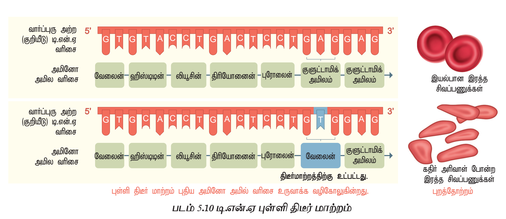

ஊசலாட்ட கோட்பபாடு (Wobble hypothesis)

ஃபிரான்சிஸ் கிரிக் 1966ல் இந்த கோட்பபாட்டினை முன்மொழிந்ததார். இக் கோட்பபாட்டின்படி, tRNAவின்
எதிர்க் குறியீட்டுக் கரத்தின் 5’ பகுதியில் உள்ள இறுதி எதிர்க் குறியீட்டுக் காரம், mRNA வின் 3’ பகுதியில்
உள்ள குறியீட்டின் இறுதியில் உள்ள பொொருந்ததாக் காரத்துடனும் இணையும் தனமையுடையது.
இது ஊசலாட்டத் தனமை எனப்படும். எனவே tRNAவின் 5’ பகுதியில் உள்ள எதிர்க்குறியீடு மற்றும்
mRNAவின் 3’ பகுதியில் உள்ள குறியீடு ஆகியவற்றின் மூன்றறாவது கார இணை சேர்தல் எப்போதும்
காரஇணை சேர்தல் விதிப்படி இருப்பதில்லை. இதனால் குறியீட்டின் மூன்றறாவது காரம் ஊசலாட்டக்
காரம் எனவும், அந்த இடம் ஊசலாட்ட இடம்
எனவும் அழைக்கப்படுகிறது. குறியீடு மற்றும் எதிர்க்
à¼õªñ£ˆî
குறியீடுகள் பொொருந்துதலில் முதல் இரண்டு காரங்கள்
LÎC¡ è숶
எப்போதும் காரஇணை சேர்தல் விதியினை பின்பற்ற
ݘ.â¡.ã‚èœ
வேண்டும். ஊசலாட்டக் காரம் மற்றும் ஊசலாட்டக்
கோட்பபாடு, மொொழிபெயர்ப்பின்போது பாலிபெப்டடைடு
சங்கிலி உற்பத்திக்குத் தேவையான tRNA க்களின்
ɶ
எண்ணிக்கையை குறைப்பதோடு, ஒரு அமினோ ݘ.â¡.ã
அமிலத்துக்கான பல மரபணுக் குறியீடுகள் இருப்பதின்
Þòô¢£ù Þ¬í«êó™
áêô£†ì Þ¬í«êó™
விளைவையும் சரி செய்துவிடுகிறது.
மேற்கண்ட ஊசலாட்ட இணை சேரலில் மூன்றறாவது குறியீடும், எதிர்க் குறியீடும் பொொருந்தவில்லை.
எனினும் இதுவும் இயல்பபான இணை சேரலைப் போல சரியான அமினோ அமிலத்தைக் (லியுசின்)
கொொண்டுவருகின்றது. எனவே ஒரே ஒரு tRNA, வேலைன் என்ற அமினோ அமிலத்திற்ககான GUU, GUC,
GUA மற்றும் GUG ஆகிய mRNA குறியீடுகளுடன் பொொருந்தி கூடுதலான tRNAக்களின் தேவையைக்
குறைக்கிறது.
ஹீமோகுளோபினின் இயல்பற்ற தனமைக்குக்
காரணம் பீட்டா குளோபின் சங்கிலியிலுள்ள
β குளோபின் மரபணுவின் ஆறாவது குறியீடு
GAG என்பதற்கு பதில் GTG என மாறியதே
ஆகும். இதன் விளைவாக, β-சங்கிலியின் 6வது
இடத்தில் குளுட்டமிக் அமிலம் என்பதற்கு
பதிலாக வேலைன் எனும் அமினோ அமிலம்
மாற்றி இணைக்கப்படுகிறது.
இது புள்ளி
திடீர்மமாற்றத்தினால் அமினோ அமிலம் மாற்றப்
பட்டதற்ககான சிறந்த எடுத்துக்காட்டாகும் (படம் 5.10).
இவ்வாறு திடீர்மமாற்றமடைந்த ஹீமோகுளோபின்,
ஆக்ஸிஜனின்
அழுத்தத்தால்
பாலிமெரை

சேஷனுக்கு ஆட்படுவதால், இரத்த சிவப்பணுக்கள்,
இருபக்க குழிவு தனமையை இழந்து அரிவாள்
வடிவத்தைப் பெறுகின்றன.
கீழ்க்கண்ட எடுத்துக்காட்டு மூலம் புள்ளி
திடீர்மமாற்றத்தை மேலும் தெளிவாகப் புரிந்து
கொொள்ளலாம்
ABC DEF GHI JKL
DEF GHI ஆகியவற்றுக்கிடையே ‘O’ எழுத்து
சேர்க்கப்பட்டால் வரிசையமைப்பு,
ABC DEF OGH IJK L என மாறும். அதே இடத்தில்
O வுடன் Q எழுத்தை சேர்க்க, வரிசையமைப்பு,
A BC DEF OQG HIJ KL என மாறும்.

மேற்கண்ட
செய்திகளால்,
ஒன்று
அல்லது
இரண்டு
நியூக்ளியோடைடுகள்
சேர்க்கப்பட்டாலும் அல்லது நீக்கப்பட்டாலும்,
சேர்க்கப்பட்ட அல்லது நீக்கப்பட்ட புள்ளியிலிருந்து
முக்குறியங்களின்
வரிசையில்
மாற்றம்
ஏற்படுகிறது. இக்குறியீடுகள் முக்குறியங்களாக
படிக்கப்படுகின்றன என்பதற்கும் மற்றும் அவை
தொொடர்ச்சியாகப் படிக்கப்படுகின்றன என்பதற்கு
இது சிறந்த மரபு அடிப்படையிலான மெய்ப்பிப்பு
ஆகும்.

### 5.11  கடத்து ஆர்.என்.ஏ (tRNA)

இணைப்பு மூலக்கூறு
செல்லின்
சைட்டோபிளாசத்தில்
சிதறி
காணப்படும் அமினோ அமிலங்களை எடுத்து
வரும்
கடத்தியாக
செயல்படுதலும்,
தூது
ஆர்.என்.ஏ மூலக்கூறில் உள்ள குறிப்பிட்ட
குறியீடுகளைப் படிப்பதுவும் கடத்து ஆர்.என்.
ஏக்களின் வேலையாகும்.
எனவே அவை
‘இணைப்பு மூலக்கூறுகள்’ எனப்படுகின்றன. இந்த
சொொற்களை ஃபிரான்சிஸ் கிரிக் உருவாக்கினார்.
ராபர்ட ஹோலே (Robert Holley) கடத்து ஆர்.என்.
ஏவின் குளோவர் இலை வடிவ மாதிரியை (Clover
leaf model) இரு பரிமாண வடிவில் முன்மொழிந்ததார்.
படம்
5.11ல்
கொொடுக்கப்பட்ட
கடத்து
ஆர்.என்.ஏவின் இரண்டடாம் நிலை கட்டமைப்பு
குளோவர் இலை வடிவத்தை ஒத்திருக்கிறது.
உணமையில்
இறுக்கமான
மூலக்கூறான
கடத்து ஆர்.என்.ஏ, தலைகீழ் ‘L’ வடிவத்தைப்
பெற்றதாகும். கடத்து ஆர்.என்.ஏவில் DHU கரம்,
நடுகரம் மற்றும் TψC கரம் என மூன்று கரங்கள்
உள்ளன.
இக்கரங்களில், அமினோ அசைல்
பிணைப்பு வளையம், எதிர் குறியீட்டு வளையம்
மற்றும் ரிபோசோம் பிணைப்பு வளையம் என
மூன்று வளையங்கள் (loops) காணப்படுகின்றன.
இவற்றுடன் மிகச்சிறிய கூடுதல் கை அல்லது
மாறி வளையம் ஒன்றும் உண்டு. அமினோ அமில
ஏற்புமுனைப் பகுதியில் அமினோ அமிலமும் அதன்
எதிர்முனையில் எதிர் குறியீட்டிற்ககான மூன்று
நியுக்ளியோடைடுகளும் இணைக்கப்பட்டுள்ளன.
தூது ஆர்.என்.ஏ வில் உள்ள குறியீட்டுடன் எதிர்
குறியீடு பொொருந்தி, வளரும் பாலிபெப்டடைடு
சங்கிலியில்
சரியான
அமினோ
அமிலம்
இணைக்கப்பட்டிருப்பதை
உறுதி
செய்கிறது.
மடித்தல் நிகழ்வின் போது ஈரிழை ஆர்.என்.ஏவில்
நான்கு வெவ்வேறு பகுதிகள் தோன்றுகின்றன.
காரங்கள் மாறுவதென்பது கடத்து ஆர்.என்.ஏவில்

சாதாரணமானது ஆகும். குறியீடு மற்றும் எதிர்
குறியீடுகளுக்கிடையேயான
ஊசலாட்டத்தின்
காரணமாக, ஒன்றுக்கு மேற்பட்ட குறியீடுகளை
கடத்து ஆர்.என்.ஏ படிக்கிறது.
கடத்து
ஆர்.என்.ஏவுடன்
கூடுதலாக
அமினோ அமிலம் சேர்க்கப்படும் செயல்முறை

$

ª,‚Ä{ ª,¿j
ßc‚´ ߃¹$yÊ  

 m ƒÄ &

&
 ¶ƒÄ
8 $
ºgˆÎà†)
& *
* &
& *
$ 8
8 $
7 ÀƒÂ½j  7\&
& *
' ÀƒÂ½j  '+8
$ 8

*$ & $& & $
' * $ & 8 & * $8
*
&
& 8* 8* 7 \ &
*
$
*
*
&
&
*'$
*
8 ƒº,„y  •‚¸{.ž.ƒ¸y
*
&
*
$
ƒ¸ƒáf‚¾{
*
¼w‘j ƒ¶„„y
* &
Ž.„y
$ 8
& * ¼{3 ÀƒÂ½j
$ \
&
$
< ®)s †3Ifˆ ÀƒÂ½j

*$ $

®)s †3Iˆ
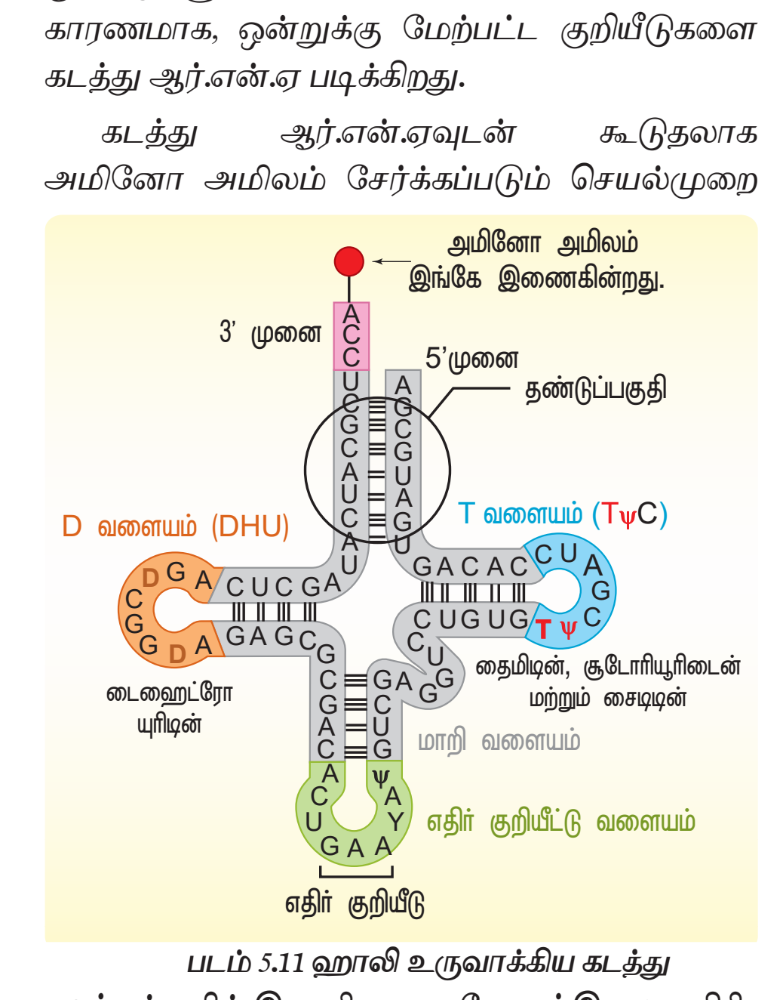
அமினோஅசைலேசன் அல்லது ஆற்றலேற்றம்
என்று அழைக்கப்படுகிறது. இதன் விளைவாக
பெறப்படும் விளைபொொருள் அமினோ அசைல்
கடத்து ஆர்.என்.ஏ (ஆற்றலேற்றம் பெற்ற கடத்து
ஆர்.என்.ஏ) எனப்படும்.
அமினோ அசைல்
ஏற்றம்பபெறாத ஆர்.என்.ஏக்கள் ஆற்றலற்றவை
எனப்படும் (படம் 5.12). இவ்வாறான இரண்டு
கடத்து ஆர்.என்.ஏக்களை ஒன்று சேர்க்கும்போது
ஆற்றல் மிக்க பெப்டடைடு பிணைப்பு உருவாகிறது.
பெப்டடைடு பிணைப்புகளைக் கொொண்டு அமினோ
அமிலங்கள் இணைக்கப்பட்டுப் பாலிபெப்டடைடு
சங்கிலி
உருவாக்கப்படுகிறது.
அமினோ
அசைல்கடத்து ஆர்.என்.ஏ சிந்தடேஸ் எனும்
நொொதி, அமினோ அசைலேஷன் வினைக்கு
வினை
வேகமாற்றியாக
செயல்படுகிறது.
வெப்பம் கொொள்வினையான இதில், ATP, நீரால்
பகுக்கப்படுகிறது.
20 வெவ்வேறு வகையான
அமினோ அசைல் கடத்து ஆர்.என்.ஏ சிந்தடேஸ்
நொொதிகள் கண்டறியப்பட்டுள்ளன. தூது ஆ.என்.
ஏவில் உள்ள குறியீடுகளை அடையாளம் காணும்
திறன் கடத்து ஆர்.என்.ஏவில் இருக்கிறதே தவிர,
இணைந்துள்ள அமினோ அமில மூலக்கூறுகளில்
இல்லை.

ÜI«ù£
ÜI«ù£ ÜIô‹
ܬê™è숶
ݘ.â¡.ã Cˆî«ìv x
aax +
+
P

அமிலங்களின் வரிசை தூது ஆர்.என்.ஏக்களின்
கார வரிசையைச் சார்ந்தது.

ATP
P

A

P

ªï£F

ÜI«ù£ Ü¬ê™ Ü®¬ùL‚ ÜIô‹
ATP
aax

P

è숶
x
+
ݘ.â¡.ã

A

+

P

P

ªï£F

ÜI«ù£
Ü¬ê™ è숶
ݘ.â¡.ã C‰î«ìv x

+
aax

+

P

A

ÝŸø™«ôŸø‹ ªø¢ø è숶 ݘ.â¡.ã

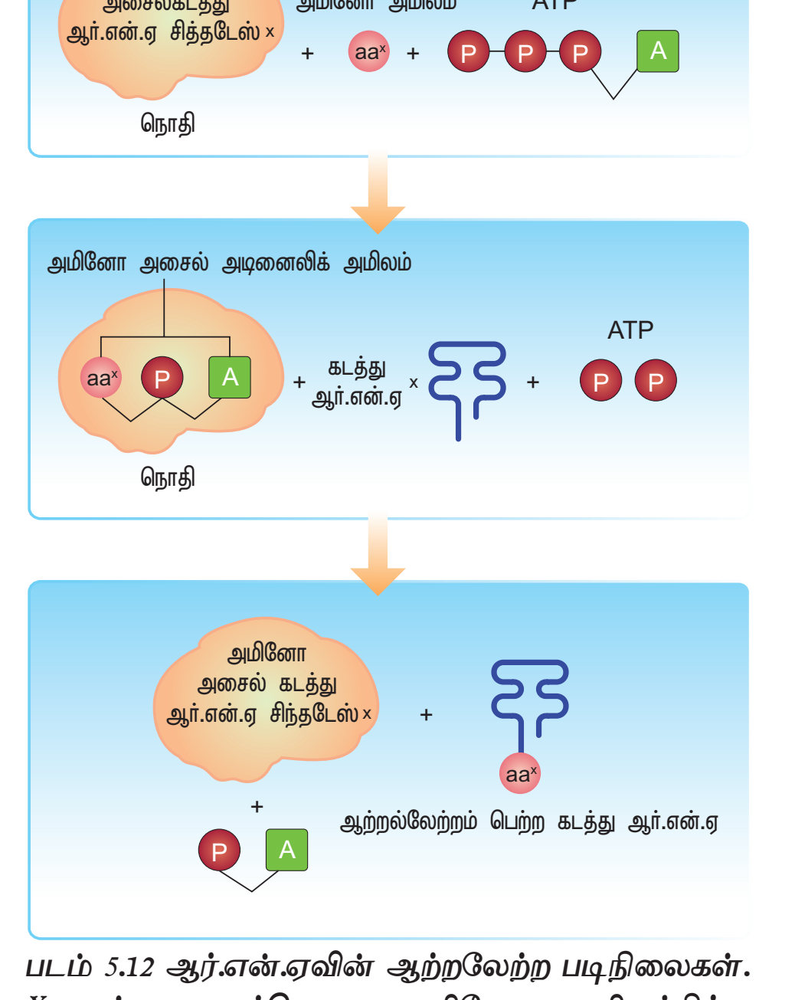
X என்பது ஒவ்வொரு அமினோ அமிலத்திற்கு
குறிப்பிட்ட கடத்தி ஆர்.என் ஏ மற்றும் குறிப்பிட்ட
அமினோ அசைல் கடத்தி ஆர்.என்.ஏ சிந்தடேஸ்
நொொதி ஆற்றலேற்றத்தில் ஈடுபடுவதை குறிக்கிறது.

## 5.12 மொொழிபெயர்த்தல்

பாலிபெப்டடைடு சங்கிலியை
உருவாக்குவதற்ககாக அமினோ
அமிலங்கள்
பல்படியாக்கம்
ஆகும்
செயல்பபாடுகளே
மொொழிபெயர்த்தல்
எனக்
குறிப்பிடப்படுகின்றது.
ரிபோ
சோமினால் முக்குறி நீக்கம் நடைபெறுகிறது.
ரிபோசோம்
தூது
ஆர்.என்.ஏ
மற்றும்
ஆற்றலேற்றம் பெற்ற கடத்து ஆர்.என்.ஏக்கள்
மூலக்கூறுகளுடன் இணைகின்றன. தூது ஆர்.
என்.ஏவின் 5' முனையிலிருந்ததே மொொழிபெயர்ப்பு
தொொடங்குகிறது. தூது ஆர்.என்.ஏ உடன், இணைந்த
பிறகு, ரிபோசோம்கள் தூது ஆர்.என்.ஏ மேல்
நகர்ந்து சென்று, குறியீட்டைப் படிக்கும் ஒவ்வொரு
முறையும் பாலிபெப்டடைடு சங்கிலியுடன் ஒரு புதிய
அமினோ அமிலத்தைச் சேர்க்கின்றன.
ஒவ்வொரு குறியீடும் அதற்ககென தனித்த,
அதோடு
பொொருந்தக்கூடிய
எதிர்குறியீடால்
படிக்கப்படுகின்றன.
எனவே
அமினோ

### 5.12.1 மொொழிபெயர்த்தல் முறை

செல்லில்
புரத
உற்பத்தி
செய்யும்
தொொழிற்சசாலை,
ரிபோசோம்
ஆகும்.
ரிபோசோமில்
அமைப்பு
ஆர்.என்.ஏக்களும்,
80க்கும் மேற்பட்ட பல்வகைப் புரதங்களும் உள்ளன.
செயலற்ற நிலையில் ரிபோசோமில் இரு துணை
அலகுகள் உள்ளன. அதில் ஒன்று பெரியதாகவும்
மற்றொன்று சிறியதாகவும் உள்ளன. சிறிய துணை
அலகுகளை தூது ஆர்.என்.ஏ சந்திக்கும்போது
மொொழிப்பபெயர்ப்பு
தொொடங்குகிறது.
70S
அளவுள்ள
புரோகேரியோட்டுகளின்
ரிபோசோமில் 50S அளவுள்ள பெரிய துணை
அலகும் 30S அளவுள்ள சிறிய துணை அலகும்
உள்ளன.
யூகேரியோட்டுகளின் ரிபோசோம்
பெரியதாகவும் (80S). 60S மற்றும் 40S ஆகிய துணை
அலகுகளைக் கொொண்டும் காணப்படுகின்றன.
‘S’ என்பதுவீழ்படிவுத் திறனை குறிப்பதாகும். இது,
ஸ்வவெட்பபெர்க் அலகால் (S) குறிக்கப்படுகிறது.
டி.என்.ஏ அல்லது ஆர்.என்.ஏவில் உள்ள கார
வரிசைகளை பிரித்து குறியீடுகளாக மாற்றும்
மாற்றுவழிகளில் ஒன்று, ‘சட்டகம் படித்தல்’ (Reading
frame) எனப்படும்.
புரதமாக மொொழிபெயர்ப்பு
செய்யக்கூடிய தொொடக்கக்குறியீட்டைக் கொொண்ட
டி.என்.ஏ அல்லது ஆர்.என்.ஏ வரிசை, ‘வெளிப்படை
சட்டகம் படித்தல்’ (Open reading frame) எனப்படும்.
தூது ஆர்.என்.ஏவில் உள்ள மொொழிபெயர்ப்பிற்ககான
அலகானது ஒரு தொொடக்க குறியீட்டினையும்,
ஒரு
நிறைவுக்
குறியீட்டினையும்
மற்றும்
பாலிபெப்டடைடு சங்கிலியை உருவாக்கும் மரபணுக்
குறியீடுகளையும் கொொண்டுள்ளன. தூது ஆர்.என்.
ஏவில் உள்ள சில வரிசைகள் மொொழிபெயர்ப்பு
செய்யப்படுவதில்லை. இது, மொொழிபெயர்க்கப்படாத
பகுதிகள் (UTR) எனக் குறிக்கப்படும். இப்பகுதி
5' முனை (தொொடக்கக் குறியீடுக்கு முன்) மற்றும்
3' முனை (நிறைவுக் குறியீடுக்குப்பின்) ஆகிய
இடங்களில்
அமைந்துள்ளன.
தொொடக்கக்
குறியீடு (AUG), குறியீட்டு வரிசையை தொொடங்கி
வைக்கிறது. மெத்தியோனைன் (met) க்கான சிறப்பு
கடத்து ஆர்.என்.ஏவால் இது படிக்கப்படுகிறது.
மெத்தியோனைனை
தாங்கிய
தொொடக்கி
கடத்து
ஆர்.என்.ஏ.
தொொடக்கக்குறியீடான
AUG யுடன் பிணைகிறது. புரோகேரியோட்டுகளில்,
N-ஃபாரமைல் மெத்தியோனைன் (fmet), தொொடக்கி
கடத்து
ஆர்.என்.ஏவுடன்
இணைந்துள்ளது.

A Þì‹

P Þì‹

தொொடக்கி
கூட்டமைப்பின்
உட்கூறுகள்,
தொொடர்ச்சியாக வினைபுரிகின்றன.
IF3, 30S
ரிபோசோமோடு இணைவதால் 30S துணை
அலகு தூது ஆர்.என்.ஏவோடு இணைகிறது.
மற்றொரு தொொடக்கக் காரணியான IF2, AUG
முக்குறியத்திற்ககான
பதில்
வினையாக,
ஆற்றலேற்றம் பெற்ற ஃபாரமைல் மெத்தியோனைன்

GTP

E
Þì‹

K«ð£«ê£‹

CPò ¶¬í Üô°

P
A
Þì‹ Þì‹

âF˜°Pf´

IF3

UAC

IF1

5’
fmet
ªî£ì‚è èìˆF ݘ.â¡.ã

IF1
IF2

EF-Tu
EF-G

IF3

ªî£ì‚è‚ è£óEèœ

c†Cò¬ìî™ è£óEèœ

+

1. ɶ ݘ.â¡.ã CPò K«ð£«ê£I¡ ¶¬í
Üô°; ªî£ì‚è è£óE»ìù¢ «ê˜‰¶ H¬íAø¶.
(IF1,2,3)
IF3

3’
AUGUUCGGU

ஆனால், யூகேரியோட்டுகளில் மாறுபாடடையாத
மெத்தியோனைன்
பயன்படுத்தப்படுகிறது.
புரோகேரியோட்டுகளின் தூது ஆர்.என்.ஏவின்
5' முனையில் தொொடக்கக்குறியீடான AUG க்கு
முன்பு சிறப்பு வரிசையைமைப்பு ஒன்று உண்டு.
ரிபோசோம் இணைப்புப் பகுதியான இதனை
ஷைன் – டால்ககார்னோ வரிசை (Shine – Dalgarno
sequence or S-D sequence) என்று அழைப்பர். சிறிய
ரிபோசோமின் துணை அலகான 16S rRNA யின்
இவ்வரிசை மொொழிபெயர்ப்பை தொொடங்குகிறது.
மொொழிபெயர்ப்பில்
ஈடுபடாத
நிலையில்
ரிபோசோமின் துணை அலகுகள் (30S மற்றும் 50S)
பிரிந்தநிலையில் இருக்கும் (படம் 5.13 அ).
எ.கோலையில்
மொொழிபெயர்த்தலின்
தொொடக்கமாக, தொொடக்கி கூட்டமைப்பு உருவாகிறது.
இக்கூட்டமைப்பில் ரிபோசோமின் 30 S துணை
அலகுகள், தூது ஆர்.என்.ஏ, ஆற்றலேற்றம்
பெற்ற N–ஃபாரமைல் மெத்தியோனைன் கடத்து
ஆர்.என்.ஏ (fmet-rRNA fmet), IF1, IF2, IF3 ஆகிய மூன்று
புரதத் தனமை கொொண்ட தொொடக்கக் காரணிகள்,
GTP மற்றும் மக்னீசியம் (Mg2+) ஆகியவை
அடங்கியுள்ளன.

IF1

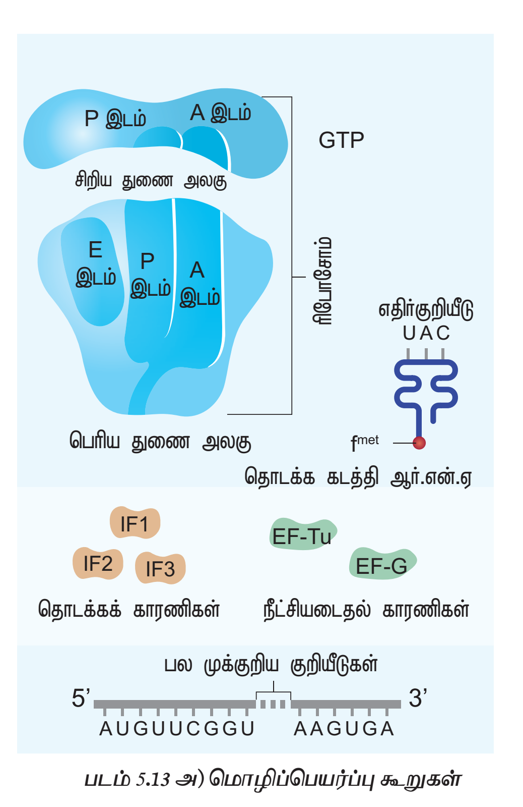
AAGUGA

UAC

GTP

ðô º‚°Pò °Pf´èœ

5’

3’

AUGUUCGGU

IF2

ªðKò ¶¬í Üô°

P A

P A

3’

AUGUUCGGU
UAC

IF2
I

GTP

AAGUGA

ªî£ì‚A Æì¬ñŠ¹
met

2. ªî£ì‚è èìˆF RNA f
ɶ RNA
°Pf´ì¡ P ÞìˆF™ H¬íAø¶. IF3
ªõOJìŠð´Aø¶.
IF1

5’

P A

3’

AUGUUCGGU
UAC

AAGUGA

AAG

+ EF-Tu
+

IF2

+

GDP

ala

GTP

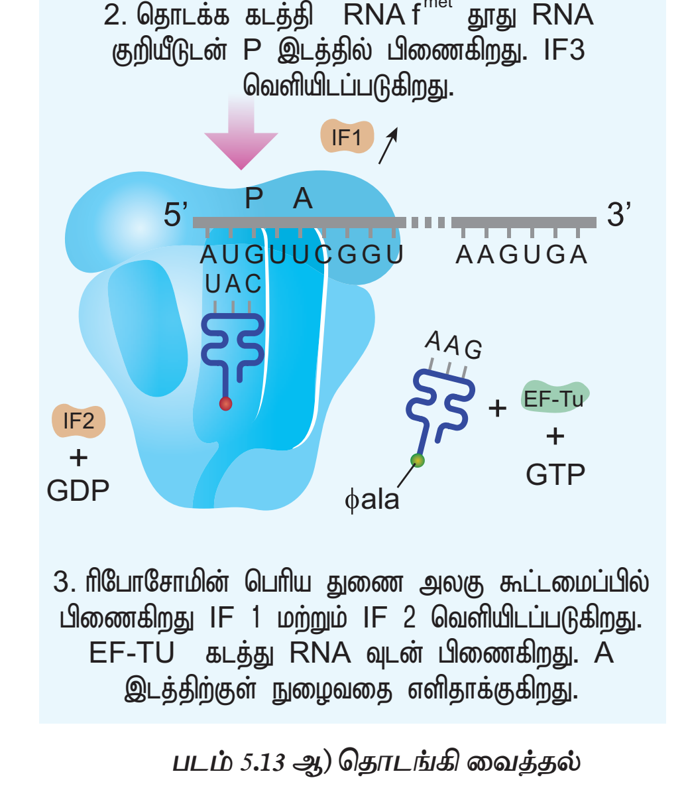
கடத்து
ஆர்.என்.ஏ
வுடனான
சிறு
துணை
அலகுகளின்
பிணைப்பை
P A
P A
5’
3’
5’
3’
மேம்படுத்துகிறது.
இச்சசெயலினால்
AUGUUCGGU
AAGUGA
AUGUUCGGU
AAGUGA
UAC AAG
AAG
UAC
படிப்புச்
சட்டகம்
அதற்குரிய
GTP
இடத்தில்
பொொருந்தி
அமைகிறது.
EF-Tu
¬ðŠ¬ì™ ®ó£¡vªðóv
இதனால் அடுத்துவரும் மூன்று ரிபோ
ªðŠ¬ì´ H¬íŠ¹
+
M¬ù¬ò ɇ´A¡ø¶.
GDP
நியுக்ளியோடைடுகள்
துல்லியமாக
மொொழிபெயர்க்கப்படுகின்றன.
1. ‘ A’ ÞìˆF™ Þó‡ì£õ¶
2. ¬ìªðŠ¬ìì´ H¬íŠ¹
ÝŸø«ôŸø è숶 ݘ.â¡.ã
à¼õ£Aø¶. ÝŸø™ ÜŸø è숶
ரிபோசோம்
துணை
அலகுகள்,
¸¬öõ¬î E F - T U âO°Aø¶.
ݘ.â¡.ã, E ÞìˆFŸ° ï蘉¶
தூது ஆர். என். ஏ
மற்றும் கடத்து
ºî™ c†Cò¬ìî™, G¬ô
K«ð£«ê£ñKL¼‰¶ ªõO«òÁAø¶.
ªî£ìƒ°Aø¶.
ஆர். என். ஏ ஆகியவை சேர்ந்த அமைப்பு,
‘தொொடக்கிக் கூட்டமைப்பு‘ எனப்படும்.
தொொடக்கிக் கூட்டமைப்பு உருவானவுடன்,
P A
P A
5’
3’
5’
3’
IF3 விடுவிக்கப்படுகிறது.
இதனால்,
AUGUUCGGU
AAGUGA
AUGUUCGGU
AAGUGA
AAG CCA
AAG
இக்கூட்டமைப்பு 50S ரிபோசோம் துணை
EF-Tu
CCA
அலகுடன் இணைந்து முழுமையான
+
+ EF-Tu
GDP
70S
ரிபோசோம்
உருவாகிறது.
EF-G
+
+
GTP
இந்நிகழ்வின்போது, ஒரு GTP மூலக்கூறு
gly
GTP
நீராற்பகுக்கப்பட்டுத்
தேவையான
4. ‘ A’ ÞìˆF™ Í¡ø£õ¶
3. ɶ ݘ.â¡.ã 3 è£óƒè÷£™
ÝŸø«ôŸø è숶 ݘ.â¡.ã
Þì‹ñ£ŸøŠð´Aø¶. E F - G
ஆற்றலை
அளிக்கிறது.
இறுதியாக ¸¬öõ¬î E F - T U âO°Aø¶.
ªñ£Nªðò˜Š¬ð G¬ô¬ò
ºî™ c†Cò¬ìî™, G¬ô
âO°Aø¶. ºî™ G†C G¬ô
தொொடக்கக் காரணிகள் (IF1, IF2, GDP)
ªî£ìƒ°Aø¶
G¬øõ¬ìAø¶.
விடுவிக்கப்படுகின்றன (படம் 5.13ஆ).
G¬ø¾Áî™ °Pf´
மரபு
மொொழிபெயர்த்தலின்
P A
5’
3’
அடுத்த நிலை நீட்சியடைதல் ஆகும்.
5’
3’
AUGUUCGGU
AAGUGA
AUGUUCGGU
AAGUGA
G
C
C
A
A
தூது ஆர்.என்.ஏவுடன் ரிபோசோமின்
A
UUC
ðô c†C G¬ôèœ
இரு துணை அலகுகளும் சேர்ந்தவுடன்,
EF-Tu
இரு
ஆற்றலேற்றம்
பெற்ற
கடத்து
+
ஆர்.என்.ஏ
மூலக்கூறுகளுக்கான
ªðŠ¬ì´ H¬íŠ¹ à¼õ£‚A¡ø¶.
GDP
பிணைப்பிடங்கள்
தோன்றுகின்றன.
5. †¬óªðŠ¬ì´ à¼õ£Aø¶
6. ð£LªðŠ¬ì´ êƒAL à¼õ£Aø¶
Þó£‡ì£õ¶ c†C G¬ô G¬ø¾. ÝŸø™ ÜŸø
ரிபோசோமில்
உள்ள
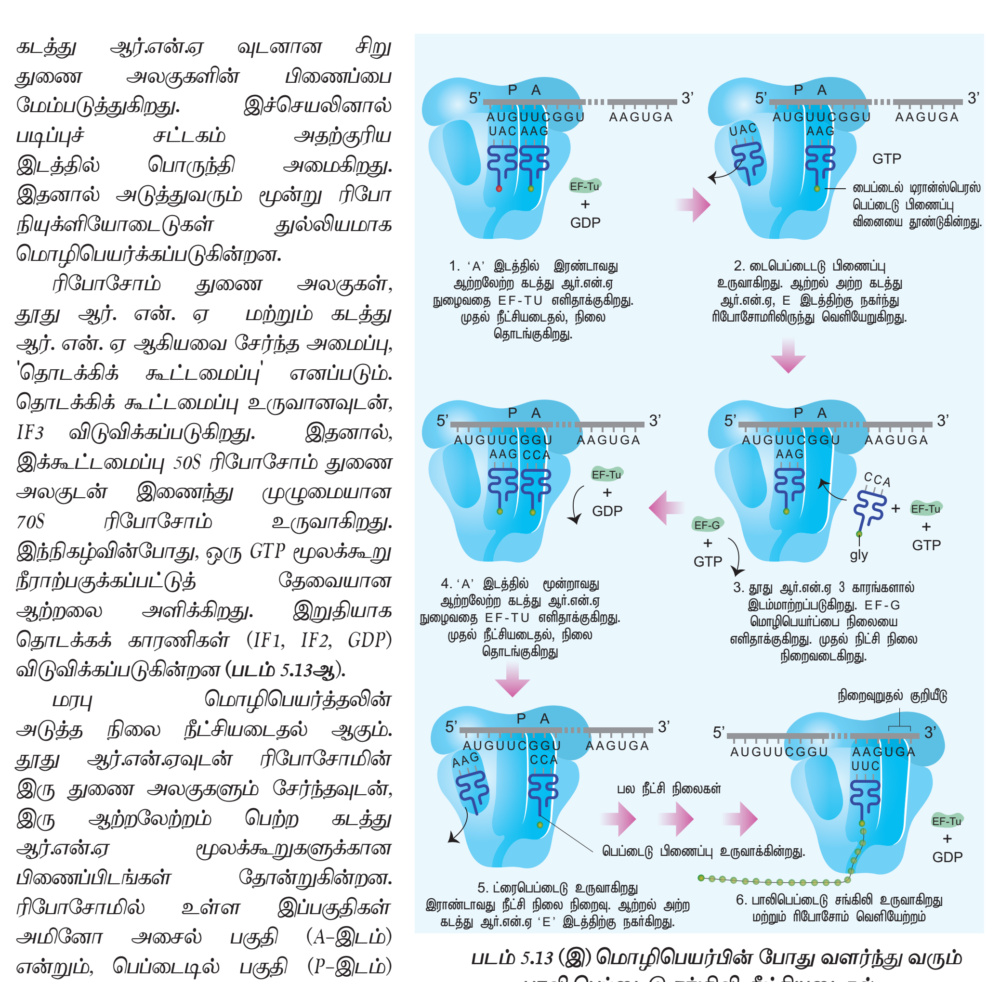
பெப்டடைடு
பிணைப்புகள்
(E-இடம்)
என்றும்
குறிக்கப்படுகின்றன.
உருவாக்கப்படுகின்றன
(படிநிலை-2).
ஆற்றலேற்றம் பெற்ற தொொடக்கிக் கடத்து ஆர்.என்.ஏ
இவ்வினைக்கு பெப்டிடைல் டிரான்ஸ்ஃபெரேஸ்
P-இடத்தில் பிணைகிறது. புரோகேரியோடிக்களின்
நொொதி வினைவேக மாற்றியாக செயல்படுகிறது.
மொொழிபெயர்த்தலின் அடுத்தநிலை இரண்டடாவது
அதே நேரத்தில் P-இடத்தில் உள்ள கடத்து
கடத்து ஆர்.என்ஏ வை ரிபோசோமின் ‘A’
ஆர்.என்.ஏ வுக்கும் அமினோ அமிலத்திற்கும்
இடத்தில் பொொருத்துவதாகும். இதனால், தூது
இடையேயான சகபிணைப்பு நீராற்பகுக்கப்பட்டு
ஆர்.என்.ஏவின் இரண்டடாவது குறியீடு மற்றும்
உடைகிறது. இவ்வினையின் விளைபொொருளான
எதிர் குறியீடு ஆகியவற்றிற்கிடையே ஹைட்ரஜன்
டைபெப்டடைடு,
A-இடத்திலுள்ள
கடத்து
பிணைப்பு
உருவாகிறது
(படிநிலை
–I).
ஆர்.என்.ஏ வின் 3' முனையில் இணைக்கப்படுகிறது.
இப்படிநிலைக்கு, சரியான கடத்து ஆர். என்.ஏ,
நீட்சியடைதல் மீண்டும் நிகழ, P-இடத்திலுள்ள
இன்னொரு GTP மற்றும் நீட்சிக் காரணிக்
கடத்து ஆர்.என்.ஏ ஆற்றல் நீக்கம் பெற்று, பெரிய
கான இரு புரதங்கள் (EF- TS மற்றும்
துணை
அலகிலிருந்து
விடுவிக்கப்படுகிறது.
EF-TU) ஆகியவை தேவைப்படுகின்றன.
ஆற்றல்
நீக்கம்பபெற்ற
கடத்து
ஆர்.என்.ஏ
கடத்து ஆர்.என்.ஏ மூலக்கூறு A-இடத்தில்
ரிபோசோமின் E-இடத்திற்கு செல்கிறது.
பொொருந்தியவுடன் இரு அமினோ அமிலங்களை

தூது ஆர்.என்.ஏ – கடத்து ஆர்.என்.ஏ
– அ.அ1 – அ.ஆ.2 கூட்டமைப்பு முழுவதும்
மூன்று நியுக்ளிடைடு தொொலைவில் P-இடம்
உள்ள
திசைநோக்கி
இடம்பபெயர்கிறது.
(படிநிலை -3). இந்நிகழ்வுக்கு நீட்சிக் காரணிகள்
பலவும் நீரால் பகுக்கப்பட்ட GTP தரும் ஆற்றலும்
தேவைப்படுகின்றன. இதன் விளைவாக தூது
ஆர்.என்.ஏவின்
மூன்றறாவது
முக்குறியம்,
ஆற்றலேற்றம் பெற்ற கடத்து ஆர்.என்.ஏவை
A-இடத்தில் அனுமதிக்கிறது (படிநிலை -4).
இவ்வகையில்
வரிசை
நீட்சி
தொொடர்ந்து
அடுத்தடுத்து நடைபெறுகிறது (படிநிலை 5
மற்றும் படிநிலை 6). ரிபோசோம் வழியாக
தூது
ஆர்.என்.ஏ
முன்னேறும்
ஒவ்வொரு
முறையும் வளரும் பாலிபெப்டடைடுடன் கூடுதல்
அமினோ அமிலங்கள் இணைக்கப்படுகின்றன.
பாலிபெப்டடைடு சங்கிலி சேர்க்கை முடிந்தவுடன்,
பெரிய அலகிலிருந்து அது விடுவிக்கப்படுகிறது
(படம் 5.13 இ).
P A

5’
AUGUUCGGU
UUC

3’

AAGUGA

1. èìˆF ݘ.â¡.ã ñŸÁ‹
ð£Lªð†¬ì´ êƒAL
ªõOJìŠð´Aø¶.

5’

3’
AUGUUCGGU

AAGUGA

GTP
GDP + P + ÝŸø™
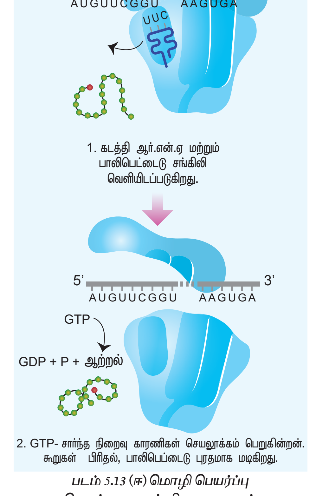

மரபு மொொழிபெயர்த்தலின் இறுதி நிலை,
‘நிறைவடைதல்’ ஆகும். ரிபோசோமின் A-இடத்தில்,
மூன்று நிறைவுக் குறியீடுகளில் ஏதாவதொொன்று
வரும்போது புரத உற்பத்தி நிறைவடைகிறது.
GTP- சார்ந்த விடுவிப்பு காரணியை இக்குறியீடு
செயலூக்கப்படுத்துவதால்,
பாலிபெப்டடைடு
சங்கிலி
உடைக்கப்பட்டு,
மொொழிபெயர்ப்பு
கூட்டமைப்பிலிருந்து
(படிநிலை1),
கடத்து
ஆர்.என்.ஏ விடுவிக்கப்படுகிறது. பிறகு, கடத்து
ஆர்.என்.ஏ
ரிபோசோமிலிருந்து
விடுவிக்கப்
பட்டவுடன்
ரிபோசோம்கள்
துணை
அலகுகளாகப்
பிரிகின்றன
(படிநிலை
2)
(படம் 5.13ஈ).

## 5.13  மரபணு வெளிப்பாட்டை

நெறிப்படுத்துதல்

டி.என்.ஏ
மரபணுக்களாக
அமைந்திருப்பதையும்,
அதில்
எவ்வாறு
மரபுத்தகவல்கள்
சேமிக்கப்பட்டுள்ளன
என்பதையும்,
அத்தகவல்
எவ்வாறு
வெளிப்படுகிறது
என்பதையும்
முந்ததைய
பாடங்கள் விளக்கின.
மூலக்கூறு மரபியலின்
அடிப்படை சிக்கலான, மரபணு வெளிப்பாட்டை
நெறிப்படுத்துதல் குறித்து இனிக் காணலாம்.
மரபணுக்களை
உசுப்பவும்
அணைக்கவும்
இயலும் என்னும் கருத்துருவிற்ககான சான்று
மிகுந்த நம்பிக்கையை அளிக்கிறது. மரபணு
வெளிப்பாடு மற்றும் அதை நெறிப்படுத்துதல்
விருந்தோம்பி
விலங்குகளில்,
நோயூக்கி
பாக்டீரியங்கள் பெருகுவதற்கு பெரும்பபாலான
எதிர்பப்பபொருட்கள்
அனுமதிப்பதில்லை.
ஏனெனில், அவை பாக்டீரியாவின் புரத
உற்பத்தியை
ஏதாவதொொரு
நிலையில்
தடுத்துவிடுகின்றன.
அமினோஅசைல்
கடத்து
ஆர்.என்.ஏவும்
தூது
ஆர்.என்.
ஏவும்
இணைவதை
எதிர்பொருளான
டெட்ரராசைக்ளின் தடை செய்கிறது. கடத்து ஆர்.
என்.ஏ மற்றும் தூது ஆர்.என்.ஏ ஆகியவற்றுக்கு
இடைேயயான வினையை நியோமைசின்
தடுக்கிறது.
ரிபோசோமில் தூது ஆர்.
என்.ஏ
இடமாற்றத்தை
எரித்ரோமைசின்
தடை செய்கிறது.
ஸ்ட்ரரெப்டோமைசின்
மொொழிபெயர்த்தலின் தொொடக்கத்தை் தடுத்துத்
தவறான
படித்தலுக்கு
உட்படுத்துகிறது.
குளோரம்பபெனிக்கால்,
பெப்டிடைல்
டிரான்ஸ்ஃபரேஸ் நொொதி மற்றும் பெப்டிடைல்
பிணைப்பு
உருவாதல்
ஆகியவற்றைத்
தடைசெய்கிறது.

குறித்து
புரோகேரியோட்டுகளில்
அதிலும்
குறிப்பாக
எ.கோலையில்
விரிவாக
ஆராயப்பட்டுள்ளது.
படியெடுத்தல் அல்லது
மொொழிபெயர்த்தல் நிகழ்வின்போது மரபணுவின்
வெளிப்பாடு,
கட்டுப்படுத்தப்படுகிறது
அல்லது நெறிப்படுத்தப்படுகிறது.
தற்போது
படியெடுத்தலின்போது,
மரபணு
வெளிப்பாடு
நெறிபடுத்தப்படுவதை விரிவாக விவாதிக்கலாம்.
வழக்கமாக
மரபணு
வெளிப்பாட்டைத்
தூண்டுதல் அல்லது தடை செய்தல் ஆகியவற்றைச்
செல்வவெளி அல்லது செல் உள்வளர்சிதை
மாற்ற பொொருட்கள் ெசய்கின்றன. தொொடர்புடைய
வேலைகளைச் செய்கிற மரபணு கூட்டத்திற்கு
ஓபரான்கள் (Operons) என்றுபெயர்.
அவை
பொொதுவாக ஒரு தூது ஆர்.என்.ஏ மூலக்கூறைப்
படியெடுக்கின்றன. எ.கோலையின் ஏறத்தாழ 260
மரபணுக்கள், 75 வெவ்வேறு ஓபரான் குழுக்களாக
உள்ளன.
ஓபரான் அமைப்பு
மரபணு
வெளிப்பாடு
மற்றும்
நெறிப்படுத்தலுக்கான அலகே ஓபரான் ஆகும்.
இவ்வலகில் ஒன்று அல்லது அதற்கு மேற்பட்ட
அமைப்பு மரபணுக்களும், அதனை அடுத்து
அமைப்பு
மரபணுவின்
படியெடுத்தலைக்
கட்டுப்படுத்தும்
இயக்கி
மரபணுவும்
அடங்கியுள்ளன.
Þs ®y ¯ à{/¼‚¾Y 
­b†0Îà{’¸y 
+ƒ¹½ ß½¿0tƒ¿  
S

S R

L

 
      ª¸b$ ™Š Þs ®y ¯

]

\

D

™g„ ßt¿{
*ƒ¿-t 

ª¸b$  ß½b$ à†)-t   
+ƒ¹iŠ Þs ®y ¯  à{/¼‚¾5y
±à¾{y à„½ˆhºƒ¿ ºˆb$Ê  

ª¸b$ 
Þ ®y ¯ à{/¼‚¾Y ­b†0Îà{’¸y 
+ƒ¹$Ê 
S

S R

L

]

\

D

™g„½|y
yÄ|ƒ¿-t 
à„½ˆhºt 

ª¸b$ ™Š Þs ®y ¯

¿{b ™Š Þs ®y ¯ 

™g„ 

¼{1à½sÎØ
F− ‚´¿b‚¸{&‚¸Y às,‚½Y

¶½tà¸{º ª¸b$  
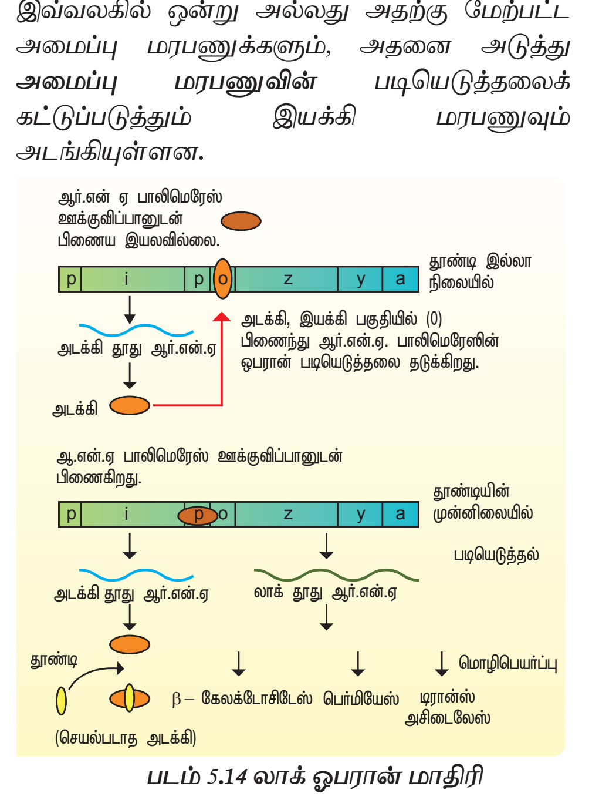
தேவைப்படும்
புரதங்கள்
ரிபோசோம் ஆர்.என்.ஏ மற்றும் கடத்து ஆர்.என்.ஏ
ஆகியவற்றை அமைப்பு மரபணுக்கள் குறியீடு
செய்கின்றன.

ஆர்.என்.ஏ
உற்பத்தியைத்
தொொடங்கி
வைக்கின்ற டி.என்.ஏவில் உள்ள சமிக்ஞஞை
வரிசைகள்,
ஊக்குவிப்பான்கள்
ஆகும்.
படியெடுத்தல்
தொொடங்குவதற்கு
முன்பு,
ஊக்குவிப்பானுடன் ஆர்.என்.ஏ பாலிமெரேஸ்
இணைகிறது.
அமைப்பு
மரபணுக்களுக்கும்
ஊக்குவிப்பான்களுக்கும் இடையே இயக்கிகள்
அமைந்துள்ளன. ஓபரானின் இயக்கி பகுதியில்
அடக்கி புரதம் பிணைகிறது.
லேக் (லேக்டோஸ்) ஓபரான்
செல்களில்
லேக்டோஸ்
வளர்சிதை
மாற்றத்திற்கு,
பெர்மியேஸ்,
b-கேலக்டோசிடோசிஸ்
(b-கேல்)
மற்றும்
டிரான்ஸ்அசிடைலேஸ்
ஆகிய
மூன்று
நொொதிகள் தேவைப்படுகின்றன. செல்லுக்குள்
லேக்டோஸ்
நுழைவதற்கு
பெர்மியேஸ்
நொொதியும்,
லேக்டோஸை
குளுக்கோஸ்
மற்றும் கேலக்டோஸாக மாற்றும் நீராற்பகுப்பு
வினைக்காக
b-கேலக்டோசிடேஸ்
நொொதியும்,
அசிடைல்
CO-A
விலிருந்து,
b-கேலக்டோசிடேஸுக்கு அசிடைல் குழுவை
இடமாற்றம்
செய்ய
டிரான்ஸ்அசிடைலேஸ்
நொொதியும் தேவைப்படுகின்றன.
லேக் ஓபரானில், ஒரு நெறிப்படுத்தி மரபணு
(i-என்பது
தடைப்படுத்தியை
குறிக்கும்),
ஊக்குவிப்பான் இடம் (p) மற்றும் இயக்கி இடம்
(O) ஆகியவை உள்ளன. இவையன்றி, லேக் z,
லேக் y மற்றும் லேக் a என மூன்று அமைப்பு
மரபணுக்களும் உள்ளன. இவை முறையே
b-கேலக்டோசிடேஸ்,
பெர்மியேஸ்
மற்றும்
டிரான்ஸ்
அசிடைலேஸ்
நொொதிகளுக்கான
குறியீடுகளைக் கொொண்டுள்ளன.
ஜேகோப் மற்றும் மோனாடு (Jacob and
Monod) ஆகியோர், மரபணு வெளிப்பாட்டையும்
நெறிப்படுத்தப்படுவதையும்
விளக்க
எ.கோலையை கொொண்டு லேக் ஓபரான் மாதிரியை
முன்மொழிந்தனர். லேக் ஓபரான் மாதிரியில்,
பாலிசிஸ்ட்ரரானிக் அமைப்பு மரபணுவின் செயலை,
ஒரு ஊக்குவிப்பான் மற்றும் ஒரு நெறிப்படுத்தி
மரபணு
ஆகியவை
நெறிப்படுத்துகின்றன.
வழக்கமாகக் குளுக்கோஸை ஆற்றல் மூலமாக
செல் பயன்படுத்துகிறது. i - மரபணு அடக்கி
தூது ஆர்.என்.ஏ வை படியெடுக்கிறது. இது,
மொொழிபெயர்ப்பு செய்யப்படுவதன் விளைவாக
‘அடக்கி புரதம்’ உற்பத்தியாகிறது. இப்புரதம்,
ஒபரானின் இயக்கி பகுதியில் பிணைவதால்
படியெடுத்தல்
தடுக்கப்படுகிறது.
இதனால்

b-கேலக்டோசிடேஸ்
உற்பத்தியாவதில்லை.
குளுக்கோஸ் இல்லாத நிலையில், ஆற்றல்
மூலமாக
லேக்டோஸ்
கிடைத்தால்,
லேக்டோஸானது
பெர்மியேஸ்
நொொதியால்,
பாக்டீரியா செல்லின் உள்ளே நுழைகிறது.
லேக்டோஸ்
தூண்டியாக
செயல்பட்டு,
அடக்கியுடன் இணைந்து அதனை செயலற்றதாக
மாற்றுகிறது. ஓபரானின் இயக்கியுடன் பிணையும்
அடக்கி புரதம் ஆர்.என்.ஏ பாலிமெரேஸை
தடுப்பதன் மூலம், ஒபரானின் படியெடுத்தல்
நிகழ்வவை தடுக்கிறது.
லேக்டோஸ் அல்லது
அல்லோ லேக்டோஸ் போன்ற தூண்டிகளுடனான
வினையின் காரணமாக அடக்கி செயலற்றதாகிறது.
இதனால்,
ஆர்.என்.ஏ பாலிமெரேஸ் இயக்கி
இடத்தில் தானாகவே இணைந்து, இயக்கியைப்
படியெடுத்து லேக் தூது ஆர்.என்.ஏ வை உற்பத்தி
செய்கிறது.
இதன் விளைவாக லேக்டோஸ்
வளர்சிதை
மாற்றத்திற்குத்
தேவையான
அனைத்து நொொதிகளும் உருவாக்கப்படுகின்றன.
(படம் 5.14). அடக்கி மூலம் லேக் ஒபரானின்
செயல்பபாடு நெறிபடுத்தப்படுதல், படியெடுத்தலின்
தொொடக்கத்தை
கட்டுப்படுத்தும்
எதிர்மறை
நிகழ்வவாகும். அதே போல நேர்மறை நிகழ்வவாலும்
லேக் ஓபரான் கட்டுப்படுத்தப்படுகிறது.

## 5.14  மனித மரபணுத் திட்டம்

(Human Genome Project – HGP)
சர்வதேச மனித மரபணுத் திட்டம் 1990 ஆம்
ஆண்டு தொொடங்கப்பட்டது. இந்த மாபெரும் திட்டம்
நிறைவுற 13 ஆண்டுகள் எடுத்துக் கொொண்டது.
இன்றறைய தேதி வரை வரிசைப்படுத்தப்பட்ட
உயிரினங்களின் மரபணுவினை விட மனித
மரபணுத் திட்டம் 25 மடங்கு பெரியதாகும்.
முதன்முதலில் நிறைவு செய்யப்பட்ட முதுகெலும்பி
மரபணு,
மனித
மரபணுவாகும்.
மனித

மரபணு ஏறத்தாழ 3x10 கார இணைகளைக்
கொொண்டுள்ளதாக கூறப்படுகிறது. மனித மரபணு
திட்டம் வேகமாக வளர்ந்து வரும் உயிரியலின்
புதிய துறையான உயிரி தகவலியலுடன் நெருங்கிய
தொொடர்புடையது ஆகும்.

### 5.14.1 மனித மரபணு திட்டத்தின்

இலக்குகள் மற்றும் வழிமுறைகள்
மனித மரபணு திட்டத்தின் முக்கிய இலக்குகள்
y

மனித டி.என்.ஏவில் உள்ள அனைத்து
மரபணுக்களையும்
(ஏறத்தாழ
30,000)
கண்டறிதல்.

y

மனித டி.என்.ஏவை உருவாக்கிய மூன்று
பில்லியன்
வேதி
கார
இணைகளின்
வரிசையை தீர்மமானித்தல்.

y

இந்த
தகவல்களை
சேமித்தல்.

y

தரவுகளை ஆய்வு செய்வதற்ககான கருவிகளை
மேம்படுத்துதல்.

y

தொொடர்புடைய
தொொழில்நுட்பங்களை
தொொழிற்சசாலைகள் போன்ற பிற துறைகளுக்கு
இடமாற்றுதல்

y

இந்த திட்டத்தில் எழும் அறம், சட்டம் மற்றும்
சமூக இடர்ப்பாடுகளைத் (ELSI) தெரிவித்தல்.

தரவுதளங்களில்

மனித மரபணு திட்ட வழிமுறைகள் இரண்டு
முக்கிய அணுகுமுறைகளை உள்ளடக்கியுள்ளது.
ஒரு
அணுகுமுறை,
ஆர்.என்.ஏவாக
வெளிப்படும் அனைத்து
மரபணுக்களையும்
கண்டறிதலை குறிக்கிறது (ESTs-வெளிப்பாடு
வரிசை முத்திரைகள்). மற்றொரு அணுகுமுறை
மேற்கோள் வரிசையாக்கம் (Annotation) ஆகும்.
இங்கு குறியீடுகள் உடைய மற்றும் குறியீடுகள்
அற்ற வரிசைகளைக் கொொண்ட முழுத் தொொகுப்பு
மரபணுக்களும் வரிசையாக்கத்திற்கு எடுத்துக்
கொொள்ளப்படுகிறது. பின்னர் வரிசையில் உள்ள
பல்வவேறுபட்ட பகுதிகளை அதன் பணிகளுடன்
ஒதுக்கப்படுகிறது.
வரிசைப்படுத்துவதற்ககாக
ஒரு
செல்லில்
உள்ள
அனைத்து
டி.என்.ஏக்களும் பிரித்ததெடுக்கப்பட்டு, சிறிய
அளவுள்ள துண்டுகளாக மாற்றப்படுகிறது.
மேலும், இவை சிறப்பு வாய்ந்த கடத்திகளைப்
(Vectors) பயன்படுத்தித் தகுந்த விருந்தோம்பிகளில்
நகலாக்கம் செய்யப்படுகிறது. இந்த நகலாக்கம்
டி.என்.ஏ
துண்டுகளை
பெருக்கமடையச்
செய்கின்றன. இது வரிசையாக்க நிகழ்வினை
எளிதாக்குகின்றது. பாக்டீரியா மற்றும் ஈஸ்ட்
ஆகிய இரண்டும் பொொதுவாக பயன்படுத்தப்படும்
விருந்தோம்பிகள் ஆகும். இந்தக் கடத்திகள் BAC
(Bacterial artificial chromosomes-பாக்டீரிய செயற்ககை
குரோமோசோம்கள்) மற்றும் YAC (Yeast artificial
chromosomes-ஈஸ்ட் செயற்ககை குரோமோசோம்கள்)
எனப்படுகின்றன.
இந்த
துண்டுகள்
தானியங்கி
டி.என்.ஏ
வரிசைப்படுத்திகளைப்
(ப்ரரெட்ரிக்
சாங்கரால்
உருவாக்கப்பட்டது)
பயன்படுத்தி வரிசைப்படுத்தப்படுகிறது. இந்த
வரிசைகள் பின்னர், சிறப்பு வாய்ந்த கணினி
நிரல்களைப்
பயன்படுத்தி
ஒன்றின்
மீது
ஒன்றமைந்த சில பகுதிகளின் அடிப்படையில்

அடுக்கப்படுகிறது.
இந்த
வரிசையாக்கம்
ஒவ்வொரு
குரோமோசோமிலும்
முறையாக
மேற்கொள்ளப்படுகிறது.
வரையறுக்கப்பட்ட
எண்டோநியூக்ளியேஸ் (Restriction endonuclease)
நொொதியால்
அடையாளம்
காணப்பட்ட
பகுதிகள் மற்றும் மைக்ரோசாட்டிலைட்டுகள்
(நுண்துணைக்கோள்) எனப்படும் அடுத்தடுத்துக்
காணப்படும்
சில
டி.என்.ஏ
வரிசைகளைப்
பயன்படுத்தி மரபணுவின் மரபிய மற்றும் அமைப்பு
வரைபடங்கள் உருவாக்கப்படுகிறது.

மற்றும் பரிணாமத்தை்
(மரபிய பல்வகைத் தனமை)
y

1 வது குரோமோசோம் 2968 மரபணுக்களை
கொொண்டுள்ளது.
அதேபோல்
Y குரோமோசோம் 231 மரபணுக்களை
கொொண்டுள்ளது.

y

மனிதனில் பல்வவேறுபட்ட ஒற்றை கார
மூல
டி.என்.ஏக்கள்
காணப்படக்கூடிய
1.4 மில்லியன் இடங்களை அறிவியலாளர்கள்
கண்டறிந்துள்ளனர். (SNPs – Single Nucleotide
Polymorphisms –ஒற்றை நியூக்ளியோடைடு
பல்லுருவமைப்பு

இது
SNIPS
என
உச்சரிக்கப்படுகிறது).
SNIPS
–ஐ
கண்டறிதல், நோய்களுடன் தொொடர்புடைய
வரிசைகளுக்கான
குரோமோசோம்
இடங்களை கண்டுபிடித்தல் மற்றும் மனித
வரலாற்றை தேடவும் உதவி புரிகிறது.

மீத்திறனுள்ள கணினிகளைப் (Super computers)
பயன்படுத்தி,
சிறுதுப்பாக்கி
வரிசையாக்கம்
(Shot gun sequencing) என்ற முறையின் மூலம் நீளமான
துண்டுகளையும் வரிசைப்படுத்துவது சமீபத்திய
முறையாகும். இது பாரம்பரிய வரிசையாக்க
முறைகளுக்குப்
பதிலாக
பயன்படுத்தப்படும்
முறையாகும்.

### 5.14.2 மனித மரபணு திட்டத்தின்

சிறப்பியல்புகள்
y

மனித மரபணு 3 பில்லியன் நியூக்ளியோடைடு
கார மூலங்களைக் கொொண்டுள்ளது.

y

மரபணு சராசரியாக 3000 கார மூலங்களைக்
கொொண்டுள்ளது. மிகப்பபெரிய மனித மரபணு,
டிஸ்டட்ரரோஃபின் (Dystrophin) 2.4 மில்லியன் கார
மூலங்களைக் கொொண்டுள்ளது.

y

மனித
குரோமோசோம்
மரபணுக்கள்
பல்வகைத்
காட்டுகின்றன.

y

தோராயமாக 30000 மரபணுக்கள் மனித
ஜீனோமில் காணப்படுகிறது. ஏறக்குறைய 99.9
நியூக்ளியோடைடு கார மூலங்கள் அனைத்து
மக்களிடமும் ஒரே மாதிரியாக உள்ளன.

y

கண்டுபிடிக்கப்பட்ட
மரபணுக்களில்

விழுக்காட்டிற்கும்
மேற்பட்ட
மரபணுக்களின் பணிகள் தெரியவில்லை.

y

2 விழுக்காட்டிற்கும் குறைவான மரபணுக்கள்
மட்டுமே புரதங்களை குறியீடு செய்கின்றன.

y

திரும்ப திரும்ப காணப்படும் வரிசைகள்
மனித மரபணுவில் மிகப் பெரிய பகுதியை
உருவாக்குகிறது. இந்த வரிசைகள் நேரடியாக
குறியீட்டு செயல்களில் பங்ககேற்பதில்லை.
ஆனால், குரோமோசோமின் அமைப்பு, செயல்

அமைப்பில்
தனமையைக்

### 5.14.3 பயன்பபாடுகள் மற்றும் எதிர்ககால

சவால்கள்

மனித குரோமோசோம் வரைபடமாக்கம்
ஒருவரின் டி.என்.ஏைவ ஆய்வு செய்வதற்கும்
மற்றும்
மரபிய
கோளாறுகளை
கண்டறிவதற்ககான வாய்ப்பினையும் அளிக்கிறது.
இது நோய்களை கண்டறிவதற்கும், குழந்ததையைப்
பெற்றுக்கொள்ள
திட்டமிடுபவர்களுக்கான
மரபிய
ஆலோசனையை
வழங்குவதற்கும்
பேருதவியாக உள்ளது. இந்த வகையான தகவல்,
புதுமையான
மரபணு
சிகிச்சைகளுக்கான
வாய்ப்புகளை
உருவாக்குகிறது.
மேலும்
மனித
உயிரியலைப்
பற்றி
புரிந்து
கொொள்வதற்கும்,
மனிதன்
அல்லாத
பிற
உயிரினங்களைப் பற்றி அறிந்து கொொள்வதற்கும்
தீர்வுக் குறிப்புகளை வழங்குகிறது. டி.என்.ஏ
வரிசைகள் அதனுடைய இயற்ககை திறன்களைப்
பற்றி அறிந்து கொொள்ளவும் அவற்றை உடல்நலம்,
விவசாயம், ஆற்றல் உற்பத்தி மற்றும் சுற்றுச்சூழல்
தீர்வு போன்றவற்றில் உள்ள சவால்களைத்
தீர்ப்பதற்கும் பயன்படுத்தப்படுகிறது. நோய்களின்
அறிகுறிகளுக்குச்
சிகிச்சையளிப்பதைவிட
நோய்க்கான
அடிப்படைக்
கராணங்களைக்
கண்டறிந்து, அவற்றுக்குச் சிகிச்சையளிப்பதே
மூலக்கூறு
மருத்துவத்தின்
முக்கியமான
முன்னேற்றமாக இருக்கும்.
y

மரபணு வரிசையாக்கம் எளிமையாக்கப்
பட்டதைத் தொொடர்ந்து, சிலர் இத்தகவல்களை

தீர்மமானிக்கிறது

சுய லாபத்திற்ககாகவோ அல்லது அரசியல்
ஆதாயத்திற்ககாகவோ பயன்படுத்தக்கூடும்.
y

காப்பீட்டு
நிறுவனங்கள்
தங்களுடைய
எதிர்ககால
மருத்துவ
செலவினங்களில்
இருந்து காப்பாற்றிக் கொொள்ள ‘மரபிய
கோளறுகளையுடைய’ மக்களுக்கு காப்பீடு
வழங்குவதை மறுக்கலாம்.

y

சரியான இனத்தை் தோற்றுவிக்க வேண்டும்
என்ற நோக்கத்தில், மனித கூட்டத்திலுள்ள
பலரிடம்
இருந்து
ஜீன்களைப்
பெற்று
இணைத்து
இனவிருத்தி
செய்ய
தொொடங்கிவிடுவார்களோ என்ற அச்சமும்
உள்ளது.

ஒரு நபரின் மருந்துகளுக்கான
துலங்கல்
எவ்வாறு
மரபணுக்களை பாதிக்கிறது
என்பதைப் பற்றி படிக்கும்
அறிவியல்
‘மருந்திய
மரபணுவியல்’ (Pharamacogenomics) ஆகும்.
இது ‘மருந்தியல்’ (pharmacology மருந்ததைப்
பற்றிய அறிவியல்) மற்றும் ‘மரபணுவியல்
(Genomics-மரபணுக்கள் மற்றும் அவற்றின்
செயல்கள் பற்றிய அறிவியல்) இணைந்து
உருவான புதிய துறை ஆகும். ஒரு நபரின்
மரபணு
உருவாக்கத்திற்கு
ஏற்ப
மருந்துகளை சரியான அளவில் நன்கு
செயல்படக்கூடிய, பாதுகாப்பான முறையில்
அளிக்க இத்துறை உதவுகிறது.

### 5.15  டி.என்.ஏ ரேகை அச்சிடல்

தொொழில் நுட்பம் (DNA finger
printing technique)
டி.என்.ஏ ரேகை அச்சிடல் தொொழில்நுட்பம்
முதலில் 1985 ஆம் ஆண்டு அலெக் ஜேஃப்ரரேஸ்
(Alec Jeflreys) என்பவரால் உருவாக்கப்பட்டது.
(2014 ஆம் ஆண்டு ராயல் சொொசைட்டி வழங்கிய
கோப்லலே பதக்கத்தைப் பெற்றவர்). ஒவ்வொரு
நபரும் ஒரே மாதிரியான வேதிய அமைப்புடைய
டி.என்.ஏைவப் பெற்றுள்ளனர். ஆனால் டி.என்.ஏ
வரிசையில் உள்ள A, T, C மற்றும் G என்ற குறியீடு
கொொண்ட கார இணைகளில் மில்லியன் கணக்கான
வேறுபாடுகள் உள்ளன. இது நம்மிடையே
தனித்தனமையைத் தோற்றுவிக்கிறது. ஆதலால்

மரபொொத்த
இரட்டையர்கள்
தவிர
நாம்
ஒவ்வொருவரும் மற்றவர்களிடமிருந்து மரபியல்
ரீதியாக வேறுபடுகிறோம். ஒரு மனிதனின்
டி.என்.ஏ
வும்
அவரின்
கைரேகைகளும்
தனித்துவம்
உடையவை.
1.5
மில்லியன்
இணை மரபணுக்களைக் கொொண்ட 23 இணை
குரோமோசோம்கள்
மனிதனில்
உள்ளன.
மரபணுக்கள் டி.என்.ஏக்களின் பகுதிகள் என்பது
நன்கு அறியப்பட்ட உணமையாகும். ஆனால்
அவற்றினுடைய நியூக்ளியோடைடு வரிசையில்
வேறுபாடுகளை கொொண்டுள்ளது.
டி.என்.
ஏக்களின்
அனைத்து
பகுதிகளும்
புரதங்களுக்கான குறியீட்டைச் செய்வதில்லை.
சில
டி.என்.ஏ
பகுதிகள்
நெறிபடுத்தும்
செயல்களைக் கொொண்டுள்ளன.
மற்றவை
இடைப்பட்ட
வரிசைகள்
(இடைப்பட்ட
பகுதிகள் – Introns) மற்றும் சில மறுதொொடரி
டி.என்.ஏ வரிசைகள் ஆகும்.
டி.என்.ஏ
ரேகை
அச்சிடலில்,
குறுகிய
மறுதொொடரி
நியூக்ளியோடைடு வரிசைகள் நபர் சார்ந்த
தனித்துவம்
கொொண்டவையாகும்.
இந்த
நியூக்ளியோடைடு வரிசைகள் “மாறி எண்
இணை மறு தொொடரிகள்“ (VNTR Variable number
tandem repeats) என்று அழைக்கப்படுகின்றன.
பொொதுவாக இரண்டு நபர்களின் VNTRகள்
மாறுபட்டுக்
காணப்படுகின்றன.
இவை,
மரபிய குறிப்பான்களாகப் (Genetic markers)
பயன்படுகின்றன.
டி.என்.ஏ வரிசைகளின் குறிப்பிட்ட சில
பகுதியிலுள்ள மறுதொொடரி டி.என்.ஏ க்களில்
(repetitive DNA) காணப்படும் வேறுபாடுகளைக்
கண்டறிதல் DNA ரேகை அச்சிடல் எனப்படும்.
ஏனெனில், இந்த வரிசையில் டி.என்.ஏவின்
சிறு பகுதிகள் மீண்டும் மீண்டும் பலமுறை
தோன்றியுள்ளது. அடர்த்தி வேறுபாட்டு மைய
விலக்கலின்போது,
தோற்றுவிக்கப்படும்
வேறுபட்ட உச்ச அளவுகளைக்கொண்டு, மொொத்த
மரபணு டி.என்.ஏக்களிலிருந்து மறுதொொடரி
டி.என்.ஏக்கள் பிரித்ததெடுக்கப்படுகிறது. மொொத்த
டி.என்.ஏக்கள் பெரிய உச்சத்தையும், மற்றவை
சிறிய உச்சத்தையும் தோற்றுவிக்கின்றன. சிறிய
உச்சத்தை
தோற்றுவிக்கும்
டி.என்.ஏக்கள்
துணைக்கோள் டி.என்.ஏக்கள் (Satellite டி.என்.ஏ)
எனப்படுகின்றன. டி.என்.ஏவில் காணப்படும் கார
இணைகள் (A:T அல்லது G:C மிகுதி), நீளம் மற்றும்
மீண்டும் மீண்டும் காணப்படும் அலகுகளின்
அடிப்படையில் துணைக்கோள் டி.என்.ஏக்கள்

°«ó£«ñ£«ê£‹ 7

°«ó£«ñ£«ê£‹ 7

°«ó£«ñ£«ê£‹ 2

°«ó£«ñ£«ê£‹ 2

°«ó£«ñ£«ê£‹16

°«ó£«ñ£«ê£‹ 16

1 î õN °«ó£«ñ£«ê£‹

îQïð˜ (A) J¡ ®.â¡.ã(A)

2  õN °«ó£«ñ£«ê£‹

îQïð˜ (A) J¡ ®.â¡.ã (B)

C

B

°«ó£«ñ£«ê£‹ 7
°«ó£«ñ£«ê£‹ 2
°«ó£«ñ£«ê£‹ 16
°Ÿø‹ ïì‰î ÞìˆF™
â´‚èŠð†ì ®.â¡.ã (C)

A

°ÁAò ñÁªî£ì˜èO¡ â‡E‚¬è

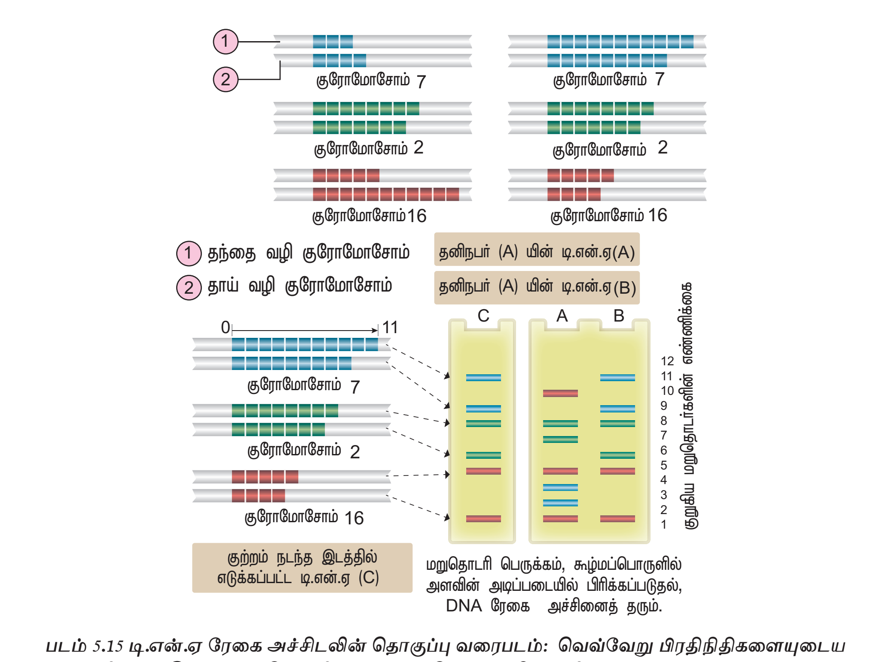
அவை நுண் துணைக்கோள் டி.என்.ஏ மற்றும்,
சிறிய துணைக்கோள் டி.என்.ஏ மற்றும் பல.
இந்த வரிசைகள் எந்த புரதத்திற்கும் குறியீடு
செய்வதில்லை. ஆனால் இது மனித மரபணுவின்
பெரும் பகுதியை கொொண்டுள்ளது. அதிகளவு
பல்லுருவமைப்பை காட்டும் இந்த வரிசைகள்
டி.என்.ஏ ரேகை அச்சிடலுக்கு அடிப்படையாக
அமைகிறது (படம் 5.15).
குற்றம் நிகழ்ந்த
இடத்திலிருந்து சேகரிக்கப்படும் தடயங்களான
இரத்தம், ரோமம் மற்றும் தோல் செல்கள்
அல்லது மற்ற மரபிய தடயங்களிலிருந்து
VNTR முறை மூலம் டி.என்.ஏவை பிரித்ததெடுத்து
குற்றம்
சுமத்தப்பட்டவரின்
டி.என்.ஏவோடு
ஒப்பிட்டு,
அவர்
குற்றவாளியா
அல்லது
நிரபராதியா என்று கண்டறிய பயன்படுகிறது.
கொொல்லப்பட்ட
நபரின்
டி.என்.ஏவை
ஆதாரமாகக்
கொொண்டு,
அந்த
நபரின்
அடையாளங்களை கண்டறிய VNTR முறை
பயன்படுகிறது.

டி.என்.ஏ ரேகை அச்சிடல் தொொழில்நுட்பத்தின்
(படம் 5.16) படிநிலைகள்
- 

டி.என்.ஏ பிரித்ததெடுத்தல்

டி.என்.ஏ ரேகை அச்சிடல் தொொழில் நுட்பத்தின்
துவக்க நிலையில் இரத்தம், விந்துத் திரவம்,
கலவிக் கால்வவாய் திரவம், முடியின் வேர்கள்,
பற்கள்,
எலும்புகள்
போன்றவற்றிலிருந்து
டி.என்.ஏ மாதிரிகள் சேகரிக்கப்படுகின்றன.
- 

பாலிமரேஸ் தொொடர்வினை (PCR)

டி.என்.ஏ
ரேகை
அச்சிடலுக்குப்
பல
நேரங்களில் குறைந்த அளவு டி.என்.ஏ மட்டுமே
கிடைக்கிறது. அதிக அளவு தேவைப்படும்போது
பாலிமரேஸ் தொொடர்வினை மூலம் டி.என்.ஏ வைப்
பெருக்க முடியும்.
- 

டி.என்.ஏ துண்டடாக்குதல்

துண்டடாக்கும் நொொதிகளைப் பயன்படுத்தி,
டி.என்.ஏ இழைகளைக் குறிப்பிட்ட இடங்களில்
வெட்டிச் சிறிய துண்டுப் பகுதிகளாக மாற்றுதல்.

Þóˆî ªê™èOL¼‰¶
®.â¡.ã HKˆªî´ˆî™

ÜFè Ü÷¾ ®.â¡.ã¬õ
ð£Lñ«óv ªî£ì˜M¬ù
Íô‹ ªð¼‚°î™

¶‡ì£‚°‹ ªï£Fè÷£™
®.â¡.ã¬õ CÁ
¶‡´è÷£‚è™
Ü裘 àœ÷ ÛñŠªð£¼O™
I¡ð°Šð£‚è º¬øJ™
®.â¡.ã ¶‡´èœ,
蟬øè÷£èŠ HK‚èŠð´î™

Þóˆî ñ£FK

â‚v èF˜ ¹¬èŠðì„ ²¼œ
ªêòô£‚èŠð†´, 臵‚°Š
¹ôŠð´‹ 蟬ø õ®õñ£è
(®.â¡.ã «ó¬è Ü„²) ñ£ŸøŠð´î™

ÛñŠªð£¼O™ àœ÷ ®.â¡.ã
è£ó «õFŠªð£–†è¬÷Š
ò¡´ˆF Ü™ô¶
ªõŠðŠ´ˆF, C¬î¾ø„
ªêŒòŠð´î™

èFKò‚èˆ
ñ»¬ìò ¶ô‚A
®.â¡.ã‚è¬÷ˆ
îò£˜ ªêŒî™

ÛñŠªð£¼O™ àœ÷
®.â¡.ã 蟬øèœ, ¬ïô£¡
êšMŸ° ñ£ŸøŠð´î™
(ê Š÷£†®ƒ º¬ø)

êšMŸ° ܼA™ â‚v
èF˜ ¹¬èŠðì„ ²¼œ
ªð£¼ˆîŠð†´ èFKò‚èˆ
ñ è‡ìPòŠð´î™

Þ‰G¬ôJ™ èFK‚èˆ
ñ»œ÷ ¶ô‚A ®.â¡.ã
êšM™ àœ÷ ®.â¡.ã
õK¬ê»ì¡ ªð£¼‰F»œ÷¶.

¶ô‚A ®.â¡.ã, êšM™
àœ÷ °PŠH†ì ®.â¡.ã
õK¬êèÀì¡
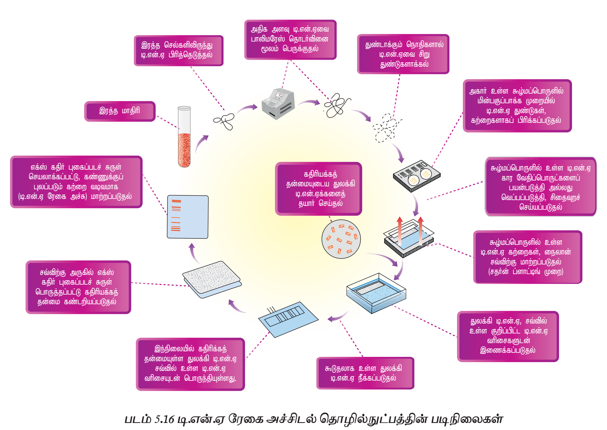
மின்பகுப்பாக்க முறையில் டி.என்.ஏக்களைப்
பிரித்ததெடுத்தல்‘
அகரோஸ்
கூழ்ம
மின்பகுப்பாக்க
முறையில், டி.என்.ஏ துண்டுகள் பல்வவேறு
அளவுகள் கொொண்ட வெவ்வேறு கற்றைகளாகப்
பிரிக்கப்படுகின்றன.
நைலான் சவ்வினைப்
பயன்படுத்தி பிரிக்கப்பட்ட டி.என்.ஏ கற்றைகள்
வடிகட்டப்படுகின்றன.
(வேதிபொொருட்களைப்
பயன்படுத்தி
டி.என்.ஏ
இழைகளுக்கு
இடையே உள்ள ஹைட்ரஜன் பிணைப்புகள்
விடுவிக்கப்பட்டு
ஒற்றை
இழையாக
மாற்றப்படுகின்றன.
- 

டி.என்.ஏ இயல்புதிரிதல்
கூழ்மப்பொருளில் உள்ள டி.என்.ஏ கார
வேதிப்பொருட்களைப் பயன்படுத்தி அல்லது
வெப்பப்படுத்தி, சிதைவுறச் செய்யப்படுகிறது.
- 

ஒற்றியெடுத்தல் (Blotting)
கூழ்மப் பொொருளில் உள்ள டி.என்.ஏ கற்றை
அமைப்பு, “அளவின் அடிப்படையில் பிரிக்கப்பட்ட
டி.என்.ஏ இழையின்“ மேல் வைக்கப்பட்ட
நைலான்
சவ்வின்
மீது
மாற்றப்பட்டு
எடுக்கப்படுகிறது. இம்முறை ‘சதர்ன் பிளாட்டிங்’
எனப்படும்.

- 

குறிப்பிட்ட
டி.என்.ஏக்ளளைத்
‘துலக்கி
டி.என்.ஏ‘
க்களைக்
(Probe)
கொொண்டு
அடையாளம் காணுதல்
கதிரியக்கத்தனமையுள்ள துலக்கி டி.என்.ஏ,
(கதிரியக்கத்
தனமையுடைய
பொொருட்கள்
பொொருத்தப்பட்ட டி.என்.ஏ இழை), டி.என்.ஏ
கற்றைகளுடன் சேர்க்கப்படுகிறது.
இந்தத்
துலக்கு டி.என்.ஏ நிரப்புக்கூறு நைட்ரஜன்
கார
வரிசைகளைக்கொண்ட
டி.என்.ஏ
துண்டுகளுடன் இணைகிறது. இந்தத் துலக்கி
டி.என்.ஏக்களை
‘ஒளிரும்
பொொருட்கள்’
அல்லது
‘கதிரியக்கத்தனமை
உடைய
ஐசோடோப்புகளைப்’
பயன்படுத்தியும்
தயாரிக்கலாம்.
- 

துலக்கி டி.என்.ஏக்களுடன் கலப்பு செய்தல்
துலக்கி டி.என்.ஏ கலப்பு செய்தவுடன்
மீதமுள்ள துலக்கி டி.என்.ஏ நீக்கப்படுகிறது.
இந்த ‘கலப்பு டி.என்.ஏ’ உடைய சவ்வின் மீது
ஒளிப்படத்தகடு பொொருத்தப்படுகிறது.
- 

மரபியல்பு – டி.என்.ஏ ரேகை அச்சிடுதலை
ஒளிப்படத்தகட்டின் மூலம் வெளிப்படுத்துதல்

இந்த
கதிரியக்க
ஒளிப்படத்தகட்டின்
மீது

அடையாளமானது
ஒரு
பிம்பத்தை

உருவாக்குகிறது (கற்றைகளின் பிம்பம்). இது
குறிப்பிட்ட டி.என்.ஏ கற்றைக்கு நிகரான பிம்பம்
ஆகும். அடர்ந்த மற்றும் மெல்லிய கற்றைகள்,
குறிப்பிட்ட தண்டு போன்ற சில அமைப்புகளை
(bars) உருவாக்குகிறது. அவை மரபுரேகை அச்சு
எனப்படும்.

டி.என்.ஏ ரேகை அச்சிடலின்
பயன்பபாடுகள்
y

தடய ஆய்வு
குற்ற
நடவடிக்கை
கொொண்ட
நபரைக்
கண்டறியவும் தாய் அல்லது தந்ததையை
தீர்மமானிக்கும்
பிரச்சினைகளுக்கு
தீர்வு
காணவும்,
குடியேற்ற
தேவைக்கான
உறவுகளை தீர்மமானிக்கவும் பயன்படுகிறது.

y

மரபு கால் வழி தொொடர் ஆய்வு
தலைமுறைகளின் வழியாக மரபணுக்கள்
கடத்தப்படுவதையும்
மற்றும்
பாரம்பரிய
நோய்களை கண்டறியவும் பயன்படுகிறது.

y

வன உயிரின பாதுகாப்பு
அருகிவரும்
இனங்களைப்
பாதுகாத்தல்,
அருகிவரும்
உயிரினங்களின்
இறந்த
திசுக்களை அடையாளம் கண்டறிவதற்ககாக
டி.என்.ஏ பதிவுகளைப் பராமரித்தல்

y

மானுடவியல் ஆய்வுகள்
இது மனித இனக்கூட்டத்தின் தோற்றம்,
இடப்பபெயர்ச்சி மற்றும் மரபிய பல்வகைத்
தனமையினை தீர்மமானிக்க பயன்படுகிறது.

பாடச்சுருக்கம்
இருபதாம் நூற்றாண்டின், ஒரு அதிமுக்கிய
உயிரியல் கண்டுபிடிப்பு, உயிரினங்களில் மரபுப்
பொொருளாக உள்ள டி.என்.ஏவைக் கண்டறிந்தது
ஆகும்.
ஒரு பண்பின் வெளிப்பாட்டிற்கும்,
பாரம்பரியத்திற்கும் காரணமான டி.என்.ஏவின்
ஒரு
பகுதி
‘மரபணு’
(Gene)
என
வரையறுக்கப்படுகிறது.
மவுரிஸ் வில்கின்ஸ் மற்றும் ரோசாலிண்ட்
ஃப்ரரான்க்ளின் ஆகியோர் X கதிர் படிகவடிவியல்
முறைப்படி
டி.என்.ஏவை
ஆய்வு
செய்து
வழங்கிய தகவல்கள் அடிப்படையில், ஜேம்ஸ்
வாட்சன் மற்றும் ஃபிரான்சிஸ் கிரிக் ஆகியோர்
1953ம் ஆண்டில் டி.என்.ஏவின் அமைப்பினைத்
தெரிவித்தனர்.
நியூக்ளிக் அமிலங்களின்

அமைப்பு
அலகுகள்
நியூக்ளியோடைடுகள்
ஆகும். ஒவ்வொரு நியூக்ளியோடைடும் மூன்று
பகுதிகளைக் கொொண்டது.
அவையாவன அ)
ஐந்து கார்பன் அணுக்கள் உடைய (Pentose)
சர்க்கரை ஆ) நைட்ரஜன் காரங்கள் மற்றும்
இ) பாஸ்பபேட் ஆகும்.
டி.என்.ஏ மற்றும்
ஆர்.என்.ஏ ஆகியவை பாலிநியூக்ளியோடைடுகள்
ஆகும். டி.என்.ஏ இரண்டு இழைகளுடன் திருகு
சுழல் வடிவமுடையது. ஆனால் ஆர்.என்.ஏ ஒரு
இழை வடிவம் கொொண்டது. சில வைரஸ்கள்
தவிர பெரும்பபாலான உயிரினங்களில் டி.என்.ஏ
மரபுப்பொருளாக உள்ளது.
மரபுப்பொருள் அல்லாத ஆர்.என்.ஏக்கள்,
தூது ஆர்.என்.ஏ (mRNA), ரிபோசோம் ஆர்.என்.ஏ
(rRNA) மற்றும் கடத்து ஆர்.என்.ஏ (tRNA) என
மூன்று வகைப்படும். இவை புரதச் சேர்க்கை்கு
உதவுகின்றன.
டி.என்.ஏ இரட்டிப்படையும்
திறனுடையது. மூன்று வகை ஆர்.என்.ஏக்களும்
டி.என்.ஏ விலிருந்து படியெடுத்தல் முறையில்
உருவாக்கப்படுகின்றன.
மெசல்சன் மற்றும்
ஸ்டடால் ஆகியோர் எ.கோலை உயிரினத்தில்,
நைட்ரஜனின் கன ஐசோடோப்பான 15N ஐப்
பயன்படுத்தி, டி.என்.ஏ பாதி பழையன காத்தல்
முறையில் இரட்டிப்படைகிறது என நிரூபித்தனர்.
தூது ஆர்.என்.ஏ மூலமாக பாலிபெப்டடைடில்
(புரதத்தில்) உள்ள அமினோ அமிலங்களின்
வரிசையைத் தீர்மமானிப்பது டி.என்.ஏ என வாட்சன்
(1958) தெரிவித்தார். மேலும் அவர் புரதச் சேர்க்கை
நிகழ்ச்சியின் மைய செயல்திட்டம், படியெடுத்தல்
மற்றும் மொொழிபெயர்ப்பு ஆகிய நிகழ்ச்சிகளை
உள்ளடக்கியது எனவும் தெரிவித்தார். டி.என்.ஏ
வின் ஒரு இழையில் உள்ள மரபுத் தகவல்கள்
நகலெடுக்கப்பட்டு ஆர்.என்.ஏ வாக மாற்றப்படும்
நிகழ்ச்சி படியெடுத்தல் எனப்படும்.
டி.என்.
ஏவிலிருந்து படியெடுக்கப்பட்ட
ஆர்.என்.ஏ,
பாலிபெப்டடைடு சங்கிலி உருவாக்கத்திற்ககான
வார்ப்புருஇழையாகச்செயல்படுகிறது. இந்நிகழ்ச்சி
மொொழிபெயர்ப்பு எனப்படும். ஒரு பாலிபெப்டடைடில்
உள்ள ஒவ்வொரு அமினோ அமிலமும் ஆர்.
என்.ஏ விலுள்ள மூன்று நியூக்ளியோடைடு
வரிசை மூலம் குறிக்கப்படுகிறது. இதற்கு மரபுக்
குறியீடு (Genetic code) என்று பெயர். தூது
ஆர்.என்.ஏ, மரபுச் செய்திகளை உட்கருவிலிருந்து
சைட்டோபிளாசத்திற்குக் கடத்துகிறது. டி.என்.ஏ
எப்பொழுதும்
உட்கருவிலேயே
உள்ளதால்,
புரதச்
சேர்க்கை
நிகழ்ச்சியும்
உட்கருவின்
உள்ளேயே நடக்கிறது.

ஜேகப் மற்றும் மோனாட் ஆகியோர் மரபணு
வெளிப்பாடு
மற்றும்
நெறிப்படுத்துதலை
விளக்கும் மிகச்சிறந்த ‘லாக் ஓபரான்’ மாதிரியை
எ.கோலையில் உருவாக்கினர்.
லாக் ஓபரான்
மாதிரியில் பாலிசிஸ்ட்ரரானிக் அமைப்பு மரபணு,
தூண்டி மரபணு மற்றும் கட்டுப்பாட்டு மரபணு
ஆகியவற்றால்
கட்டுப்படுத்தப்படுகிறது.
இது,
படியெடுத்தல்
நிகழ்ச்சித்
தொொடக்கத்தின் எதிர்மறைக் கட்டுப்பாட்டிற்ககான
எடுத்துக்காட்டாகும்.
மனித மரபணுத் தொொகுதியின் அனைத்து
மரபணுக்களையும் வரிசைப்படுத்துவதே மனித
மரபணுத் தொொகுதித்திட்டத்தின்’ நோக்கமாகும்.

பாலிமரேஸ் தொொடர்வினை எனும் ஆய்வகத்தில்
(in vitro) நடத்தப்படும் முறையின் மூலம்
நியூக்ளிக் அமிலங்கள் உருவாக்கப்படுகின்றன.
இம்முறையில், ஒரு குறிப்பிட்ட டி.என்.ஏ பகுதி
மட்டும் பெருக்கடைகிறது. மீதமுள்ள டி.என்.ஏ
மூலக்கூறுகள்
இரட்டிப்படைவதில்லை.
டி.என்.ஏ ரேகை அச்சிடல் தொொழில்நுட்பம்,
மனிதர்களுக்கிடையே உள்ள வேறுபாடுகளை
டி.என்.ஏ அளவில் கண்டறியப் பயன்படுகிறது.
இத்தொழில் நுட்பம், குற்றவியல் ஆய்வுகள், மரபு
கால்வழி ஆய்வுகள், மானுடவியல் ஆய்வுகள்
மற்றும் வன உயிரினப் பாதுகாப்பு ஆகிய
துறைகளில் பயன்படுகிறது.

## மதிப்பீடு

1. ஹெர்ஷஷே
மற்றும்
சேஸ்
ஆகியோர்
பா க் டீ ரி யோஃ ஃ பே ஜி ல்
செய்த ஆய்வு எதனைக்
காட்டுகிறது?
அ) புரதம் பாக்டீரிய செல்லுக்குள் நுழைகிறது.
ஆ) டி.என்.ஏ ஒரு மரபுப்பொருள்
இ) டி.என்.ஏவில் கதிரியக்கத் தனமையுடைய
கந்தகம் உள்ளது.
ஈ) வைரஸ்கள் உருமாற்றம் அடையும்

2. டி.என்.ஏ மற்றும்
காணப்படுவது

RNA

வில்

ஒற்றுமை

அ)  தையமின் என்ற நைட்ரஜன் காரத்தினைக்
கொொண்டிருத்தல்
ஆ) ஓரிழை உடைய சுருண்ட வடிவம்
இ)  சர்க்கரை,
நைட்ரஜன்
காரங்கள்
மற்றும் பாஸ்பபேட் ஆகியவை உடைய
நியூக்ளியோடைடுகள்
ஈ)  பீனைல் அலனைன் எனும் அமினோ
அமிலத்தில் உள்ள ஒத்த வரிசையில்
அமைந்த நியூக்ளியோடைடுகள்

3. தூது
RNA
மூலக்கூறு
உருவாக்கப்படுகிறது?

எம்முறையில்

அ) இரட்டிப்பாதல் ஆ) படியெடுத்தல்
இ) நகலாக்கம்
ஈ) மொொழிபெயர்த்தல்

4. மனித மரபணுத் தொகுதியில் உள்ள மொத்த நைட்ரஜன் காரங்களின் எண்ணிக்கை சுமார்
அ) 3.5 மில்லியன்
ஆ) 35000
இ) 35 மில்லியன்
ஈ) 3.1 பில்லியன்

5. 15N ஊடகத்தில் வளர்க்கப்படும் எ.கோலை 14N ஊடகத்திற்கு மாற்றப்பட்டு இரண்டு தலைமுறைகள் பெருக்கமடைய அனுமதிக்கப்படுகிறது. இச்செல்களிலிருந்து பிரித்தெடுக்கப்படும் டி.என்.ஏ. சீசியம் குளோரைடு அடர்வு வாட்டத்தில் நுண் மைய விலக்கு செய்யப்படுகிறது. இச்சோதனையில் டி.என்.ஏவின் எவ்வகை அடர்வுப் பரவலை நீ எதிர்பார்க்கலாம்?
அ) ஒரு உயர் மற்றும் ஒரு குறை அடர்வுக் கற்றை
ஆ) ஒரு நடுத்தர அடர்வுக் கற்றை
இ) ஒரு உயர் மற்றும் நடுத்தர அடர்வுக் கற்றை
ஈ) ஒரு குறை மற்றும் ஒரு நடுத்தர அடர்வுக் கற்றை

6. தொொடக்க மற்றும் பின்தங்கும் டி.என்.ஏ
இழைகள் உருவாக்கத்தில் உள்ள வேறுபாடு
என்ன?
அ)  டி.என்.ஏ மூலக்கூறின் 5' முனையில்
மட்டுமே இரட்டிப்படைதல் தோன்றும்.
ஆ)  டி.என்.ஏ
லைகேஸ்
நொொதி
திசையிலேயே செயல்படும்.

5→'3'

இ)  டி.என்.ஏ பாலிமரேஸ் நொொதி, வளர்ந்து
வரும் இழையின் 3' முனைப் பகுதியில்
மட்டுமே புதிய நியூக்ளியோடைடுகளை
இணைக்கும்.

ஈ)  ஹெலிகேஸ் நொொதிகள் மற்றும் ஒற்றை
இழை இணைப்புப் புரதம் ஆகியவை 5'
முனையிலேயே செயல்படும்.

7. புரதச்
சேர்க்கை
நிகழ்ச்சி
மைய
செயல்திட்டத்தின் சரியான வரிசையைக்
கண்டறிக.
அ)  படியெடுத்தல்,
மொொழிபெயர்த்தல்,
இரட்டிப்பாதல்
ஆ)  படியெடுத்தல்,
இரட்டிப்பாதல்,
மொொழிபெயர்த்தல்
இ)  நகலாக்கம்,
மொொழிபெயர்த்தல்,
படியெடுத்தல்
ஈ)  இரட்டிப்பாதல்,
படியெடுத்தல்,
மொொழிபெயர்த்தல்

8. டி.என்.ஏ இரட்டிப்பாதல் குறித்த கீழ்க்கண்ட
எந்தக் கருத்து தவறானது?
அ)  ஹைட்ரஜன்
பிணைப்பு
உடைவதால்
டி.என்.ஏ மூலக்கூறு பிரிவடைகிறது.
ஆ)  ஒவ்வொரு
நைட்ரஜன்
காரமும்
அதேபோல் உள்ள மற்றொரு காரத்துடன்
இணைவதால்
இரட்டிப்பாதல்
நடைபெறுகிறது.
இ)  பாதி
பழையன
காத்தல்
முறை
இரட்டிப்பாதலால்
புதிய
டி.என்.ஏ
இழையில்
ஒரு
பழைய
இழை
பாதுகாக்கப்படுகிறது.
ஈ)  நிரப்புக் கூறு கார இணைகள் ஹைட்ரஜன்
பிணைப்பினால் இணைக்கப்பட்டுள்ளன.

9. புரோகேரியோட்டுகளில்
நடைபெறும்
டி.என்.ஏ
இரட்டிப்பாதல்
குறித்த
எந்த
வாக்கியம் தவறானது?
அ)  டி.என்.ஏ
இரட்டிப்பாதல்
ஒற்றை
மூலத்திலிருந்து துவங்கும்.
ஆ)  டி.என்.ஏ
இரட்டிப்பாதல்
அதன்
மூலத்திலிருந்து இரு திசைகளில் நிகழும்.
இ)  ஒரு நிமிடத்திற்கு 1 மில்லியன் கார
இணைகள் என்ற வீதத்தில் இரட்டிப்பாதல்
நிகழ்கிறது.
ஈ)  ஏராளமான
பாக்டீரிய
குரோமோசோம்களில், ஒவ்வொன்றிலும்
இரட்டிப்பாதல் ஒரே சமயத்தில் நிகழ்கிறது.

10. முதன்முதலில் பொொருள் கண்டறியப்பட்ட
‘கோடான்’ _________ ஆகும். இது __________
அமினோ அமிலத்திற்ககான குறியீடு ஆகும்.
அ) AAA, புரோலைன்
ஆ) GGG, அலனைன்

இ) UUU, ஃபினைல் அலனைன்
ஈ) TTT, அர்ஜினைன்

11. மெசல்சன் மற்றும் ஸ்டடால் சோதனை
நிரூபிப்பது
அ) கடத்துகை மாற்றம் (Transduction)
ஆ) தோற்றமாற்றம் (Transformation)
இ) டி.என்.ஏ ஒரு மரபுப்பொருள்
ஈ)  பாதிபழையன காத்தல் முறை டி.என்.ஏ
இரட்டிப்பாதல்

12. ரிபோசோம்களில்
இரு
துணை
அலகுகள் உள்ளன.
சிறிய துணை
அலகு
ஒரு_________இணைவதற்ககான
இணைப்பிடத்தையும், பெரிய துணை அலகு
_____________ இணைவதற்ககான இரண்டு
இணைப்பிடங்களையும் கொொண்டுள்ளன.
விடை: mRNA,tRNA

13. ஒரு ஓபரான் என்பது.
அ)  மரபணு வெளிப்பாட்டை தடைசெய்யும்
புரதம்
ஆ)  மரபணு
வெளிப்பாட்டைத்
தூண்டும்
புரதம்
இ)  தொொடர்புடைய
செயல்களை
உடைய
அமைப்பு மரபணுக்களின் தொொகுப்பு
ஈ)  பிற மரபணுக்களின் வெளிப்பாட்டைத்
தூண்டும் அல்லது தடைசெய்யும் மரபணு

14. வளர்ப்பு ஊடகத்தில் லாக்டோஸ் இருப்பது
எதைக் காட்டுகிறது?
அ)  லாக் y, லாக் z, லாக் a மரபணுக்கள்
படியெடுத்தல் நடைபெறுதல்
ஆ)  அடக்கி மரபணு, இயக்கி மரபணுவுடன்
இணைய முடியாத நிலை
இ)  அடக்கி மரபணு இயக்கி மரபணுவுடன்
இணையும் நிலை
ஈ) ‘அ’ மற்றும் ‘ஆ’ ஆகிய இரண்டு சரி

15. மரபணு
குறியீடு
‘உலகம்
முழுவதும்
ஏற்றுக்கொள்ளத் தக்கது’. – காரணங்கள்
கூறு.

16. கீழ்க்கண்ட படியெடுத்தல் அலகில் A மற்றும் B
எனக் குறிக்கப்பட்டுள்ளவற்றை எழுதுக.

3’

5’

A

5’

3’
B

17. முதனமை இழை மற்றும் பின்தங்கும் இழை –
வேறுபடுத்துக.

18. வேறுபடுத்துக – வார்ப்புரு இழை மற்றும்
குறியீட்டு இழை

19. மனித மரபணுத் தொொகுதியில் கண்டறியப்பட்ட
ஒற்றை
நியூக்ளியோடைடு
பல்லுருவ
அமைப்பின்
மூலம்
(SNPs)
உயிரியல்
மற்றும் மருத்துவத் துறையில் புரட்சிகர
மாறுபாடுகளைக் கொொண்டுவரும் இரண்டு
வழிகளைக் கூறுக.

20. மனித
மரபணு
தொொகுதித்
திட்டத்தின்
இலக்குகள் மூன்றினைக் குறிப்பிடுக.

21. எ.கோலையில் உள்ள மூன்று நொொதிகளான
βகேலக்டோசிடேஸ்,
பெர்மியேஸ்
மற்றும்
டிரான்ஸ்
அசிட்டைலேஸ்
ஆகியவை
லாக்டோஸ்
முன்னிலையில்
உற்பத்தியாகின்றன. இந்நொதிகள் லாக்டோஸ்
இல்லாத நிலையில் உற்பதியாவதில்லை –
விளக்குக.

22. அமைப்பு
மரபணுக்கள்,
நெறிப்படுத்தும்
மரபணுக்கள் மற்றும் இயக்கி மரபணுக்களை
வேறுபடுத்துக.

23. தாழ்நிலை ‘லாக் ஓபரான்’ வெளிப்பாடு எல்லா
நேரங்களிலும் நடைபெறுகிறது. இக் கூற்றை
நியாயப்படுத்துக.

24. மனித ஜீனோம் திட்டம் பல்வவேறு மரபு
நோய்களின் சிகிச்சைக்கு வழிவகுக்கிறது. இக்
கூற்றை நியாயப்படுத்துக.

25. மனித மரபணுத் திட்டம் ஏன் மகாதிட்டம் என
அழைக்கப்படுகிறது.

26. வாட்சன் மற்றும் கிரிக் ஆகியோர் டி.என்.ஏ
அமைப்பை் பரிசோதனை செய்ததன் மூலம்
டி.என்.ஏ இரட்டிப்பாதல், குறியீடு திறன்
மற்றும் திடீர் மாற்றம் போன்ற நிகழ்ச்சிகள்
நடைபெறும்
முறை
குறித்து
என்ன
முடிவுகளுக்கு வந்தனர்?

27. கடத்து ஆர்.என்.ஏ, ‘இணைப்பு மூலக்கூறு’ என
ஏன் அழைக்கப்படுகிறது?

28. ஆர்.என்.ஏ
மற்றும்
டி.என்.ஏ
ஆகியவற்றுக்கிடையே உள்ள அமைப்பு சார்ந்த
வேறுபாடுகள் மூன்றினைக் குறிப்பிடுக.

5'
ஆ) இவ்வரைபடத்தை ‘இரட்டிப்பாதல் பிளவாகக்‘
கொொண்டு வரைக.
அதன் பாகங்களைக்
குறிக்கவும்.
இ)  டி.என்.ஏ
இரட்டிப்பாதல்
முறைக்குத்
தேவைப்படும் ஆற்றலின் மூலம் யாது?
இந்நிகழ்ச்சியில் ஈடுபடும் நொொதிகள் யாவை?
ஈ) இரண்டு வார்ப்புருவ இழைகளின் துருவத்
தனமை அடிப்படையில் புரதச் சேர்க்கையில்
ஏற்படும் மாற்றங்களைக் குறிப்பிடுக.

29. கீழ்க்கண்ட குறியீடுகளை இனங்கண்டறியும்
எதிர்குறியீடுகளை எழுதுக.
AAU, CGA, UAU மற்றும் GCA

30. அ) கீழ்க்கண்ட வரைபடத்தைக் கண்டறிக.

3'
5'
3'

31. கீழ்க்காணும் படியெடுத்தல் அலகிற்ககான
குறியீட்டு வரிசையின் படி, உருவாக்கப்படும்
தூது ஆர்.என்.ஏ வில் உள்ள நியூக்ளியோடைடு
வரிசையினை எழுதுக.
5' TGCATGCATGCATGCATGCATGCATGC 3'

32. இரண்டு
படிநிலை
புரதச்சேர்க்கை
நிகழ்ச்சியின் அனுகூலங்கள் யாவை?

33. ஹெர்ஷஷே மற்றும் சேஸ் ஆகியோர், கதிரியக்க
முறையில்
குறியிடப்பட்ட
பாஸ்பரஸ்
மற்றும் கந்தகத்தை ஏன் பயன்படுத்தினர்?
அவர்கள் கார்பன் மற்றும் நைட்ரஜனை
பயன்படுத்தினால்
அதே முடிவுகளைப்
பெறமுடியுமா?

34. நியூக்ளியோசோம்
விவரி.

உருவாகும்

முறையை

35. முதன் முதலாக உருவான மரபுப்பொருள்
ஆர்.என்.ஏ தான் என நிரூபிக்கப்பட்டுள்ளது –
காரணங்ளுடன் நிரூபிக்க.

Š¿b$

9175 ±Ù

$.³+h
à.‚¶{ºƒÄ

¬-.½¿{Âs
¶¼{º{ļ|yƒ¼
ás‚Æ
¼w‘j ‚¶Y
à.‚¶{ºƒÄ

ªƒ¸½{Âj ´gˆ  
À.ƒ¶ƒ½ Es¼{4hºt  
‚¶,hºt  º¾Û 
à†Îà{kÛ  ߸¼{w‘ºt 
¼w‘j (/6,

„ ®y ¯
‚¾ƒ´ ªd&ˆºt

à{b .½
‚º{Ãzà ¼{ÃzÃj

ߑ)½{´
„ ®y ¯ º{y
¼¾ØÎ à{Ùv

¼4º
¼¾à‰h
)f¸j

¼¾à‰
à{Ùf´ƒÂ
‚º¸t

„ ®y ¯
±Ù ¼¾ØÎ
à{Ùv
„ ®y ¯

ž‚´.‚½{„b 
à„½ˆhºt *ƒ¿ 
¶½¿{b´ *ƒ¿  
™Š Þs ®y ¯ 
߸΁à½sd& ¼w‘j 
¼{1à½sÎØ *ƒ¿ 

¼¾à‰
À2Îà{fƒ¸
»3ÎàˆhŠºt

¼{1à½sÎØ

¼¾Øb †3Iˆ

Àfˆºt  
¬ƒÃ-ˆºt  
À{¿{b´j

&Yf¾{y  ®b¶{y  
ßyf¾{y

´¸ºzŠ Þs ®y ¯0y
)ÂÄwÃj ´¸ºzŠ Þs ®y ¯0y 
ª,‚Ä{ ªƒ¶¿{b´j
À2Ifˆ ´{¿(´2y 
º{¸sàwà à†)´v

   †3Iˆ´v    *‘hº 
†3Iˆ´v  †ÁÎà¼wà  
†3Î+f¸  &ƒºÛ  ¼Ãz‘j 
¬¿´Â{0½ $8*
º{¸b´ †3Iˆ

à„½ˆhºt  ª¿† 
­b$ ªƒ¼ÎØ 
¼¾à‰ *ƒÃ0

á/‚´Y  
°‚¶{¼‚¾Y  
à{/¼‚¾Y

à„½ˆhºt

ß¾f„Îà{ºt

ß¾fƒ¸d ÖÙv 
„ ®y ¯  
*žb2‚½{ƒ¸ˆ´v  
*žb2‚½{ƒ¶ˆ´v  
ŠÙÀhºyƒ¼

¿b“‘
¼¾+½t

Þs ®y ¯

±ÃzƒÃ ߃Á 
Þ¾z ®y ¯

## கருத்து வரைபடம்

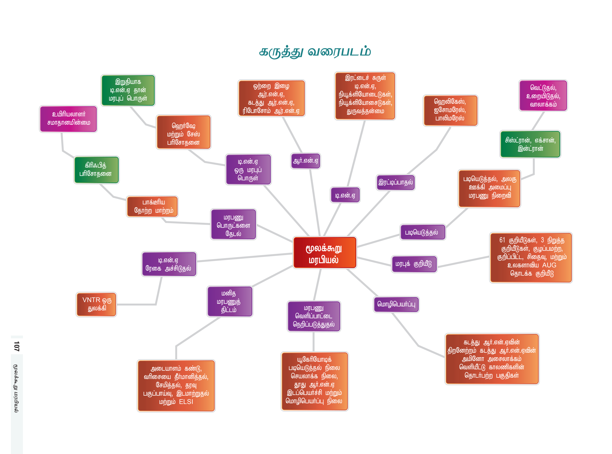
இணையச் செயல்பபாடு

மரபணுவின்
ஆராய்வோமா?

வெளிப்பாடுகளை

படிநிலைகள்:
படி 1 :  கீழ்க்காணும் உரலி/விரைவுக்குறியீட்டைப் பயன்படுத்தி “Gene Expression Essentials” என்னும்
இணையப் பக்கத்திற்குச் செல்லவும்.
படி 2 :  “Expression” என்பதை சொொடுக்கி சாளரத்தின் இடப்பக்கத்தில் உள்ள “Biomolecule Toolbox” என்ற
பெட்டியில் உள்ள மரபியல் பொொருள்களை, மூன்று வகையான மரபணுக்களுக்கும் தெரிவு
செய்து நிகழும் மாற்றத்தை காண்க.
படி 3 :  “mRNA” என்பதனை சொொடுக்கி, “Positive Transcription Factors, Negative Transcription factors & RNA
Polymerase” ஆகிய அடைப்புப் பெட்டிக்குள் உள்ள “Concentration, Affinity” ஆகிய காரணிகளுக்கான
நகர்த்தியை கொொண்டு நகர்த்துவதன் மூலம் ஏற்படும் மாற்றங்களை அறிக.
படி 4 :  “Multiple Cells” என்பதை சொொடுக்கி, காரணிகளை திருத்தியமைத்து சராசரி புரத அளவிற்கும்
நேரத்திற்குமான மாற்றங்களை வரைபடத்தில் காண்க.

படி 1

படி 2

படி 3

படி 4

உரலி: https://phet.colorado.edu/sims/html/gene-expression-essentials/latest/gene-expressionessentials_en.html
*படங்கள் அடையாளத்திற்கு மட்டுமே .
தேவையெனில் Adobe Flash யை அனுமதிக்க.

