# பாடம் 11: உயிரினங்கள் மற்றும் இனக்கூட்டம்

> மூலம்: தமிழ் வழிப் பாடநூல், PDF பக்கங்கள் 219–244.

> குறிப்பு: கீழுள்ள தேடக்கூடிய உரை துல்லியமான படங்கள், அட்டவணைகள் மற்றும் அமைப்பிற்கு அசல் பக்கங்களைப் பார்க்கவும்.

பாடம்

அலகு - V

உயிரினங்கள் மற்றும்
இனக்கூட்டம்

## பாட உள்ளடக்கம்

## 11.1  உயிரினங்கள் மற்றும் அவற்றின்

சுற்றுச்சூழல்

## 11.2 வாழிடம்

## 11.3  முக்கிய உயிரற்ற ஆக்கக் கூறுகள்

அல்லது காரணிகள்

## 11.4  உயிர்த் தொொகை மற்றும் பரவல் குறித்த

கோட்பபாடுகள்

## 11.5  உயிரற்ற

காரணிகளுக்கான
துலங்கல்கள்

## 11.6 தகவமைப்புகள்

## 11.7 இனக்கூட்டம்

## 11.8 இனக்கூட்ட இயல்புகள்

## 11.9  இனக்கூட்டம் - வயது பரவல்

## 11.10 வளர்ச்சி மாதிரிகள்/வளைவுகள்

## 11.11 இனக்கூட்டம் நெறிப்படுத்தப்படுதல்

## 11.12 இனக்கூட்டச் சார்பு

கற்றலின் நோக்கங்கள்:
கீழ்க்கண்ட பொொருள் குறித்த அறிவைப்
பெறுதல்.
- உள்நநாட்டு மற்றும் புவியியல் சார்ந்த
பரவல் – உயிரினங்களின் செறிவு.
- உயிரினங்களின் இருப்பு, செறிவு மற்றும்
செயல்கள் ஆகியவற்றால் பூமியில்
ஏற்படும் மாற்றங்கள்.
- இனக்கூட்டத்தில் உள்ள உயிரினங்கள்
மற்றும் சமுதாயங்களுக்கிடையே உள்ள
இடையுறவு.

இயற்ககையைக் காத்து நம்
எதிர்ககாலம் காப்போம்.
- உயிரினங்களின் இயற்சூழலுக்கேற்ப
அவற்றின் அமைப்பு சார்ந்த

தகவமைப்புகள் மற்றும் செயல் சார்ந்த
சீரமைவு.
- அனைத்து வகை
இடையுறவுகளுக்குமான பரிணாம
வளர்ச்சி.
- இனக்கூட்ட வளர்ச்சி, மாதிரிகள் மற்றும்
நெறிப்படுத்துதல்.
- விலங்கினத் தொொடர்புகள் சிற்றினங்களுக்குள் மற்றும்
சிற்றினங்களுக்கிடையில் உள்ள
தொொடர்புகள்.

சு

ற்றுச்சூழலியல் (Ecology) என்ற சொொல்
கிரேக்க மொொழியில், இருந்து உருவானது.

‘oikos’ என்றறால் ‘வீட்டில் உள்ள’ என்றும் மற்றும்
‘logos’ என்றறால் ‘படித்தல்’ என்றும் பொொருள்.
எனவே, சுற்றுச்சூழல் ‘வீடு’ குறித்த படிப்பில்,
அதில் உள்ள அனைத்து உயிரினங்கள் மற்றும்
அவ்வீட்டினை
செயற்பபாட்டு

வாழத்

நிகழ்வுகள்

ஆகியவை

அடங்கியுள்ளன.
சுற்றுச்சூழலியலானது,
உயிரினங்கள்,
இனக்கூட்டம், சமுதாயம், சூழ்நிலை மண்டலம்
போன்ற பல படிநிலைகளை உள்ளடக்கியது.
சுற்றுச்சூழலியலில், ‘உயிரினக்கூட்டம்’ என்ற
சொொல் தொொடக்கத்தில் ‘மனிதர்களின் தொொகுப்பு’

தகுதியுள்ளதாக்கும்

உயிரினங்கள் மற்றும் இனக்கூட்டம்

என்பதைக் குறிப்பதற்ககாக உருவாக்கப்பட்டது.
இச்சொல் தற்போது எந்தவொொரு உயிரினத்தையும்
சார்ந்த ‘உயிரினங்களின் தொொகுப்பு’ என்ற
சொொல்லாக விரிவுபடுத்தப்பட்டுள்ளது. சூழலியல்
நோக்கில்
‘சமுதாயம்’
என்பது
(உயிரியச்
சமுதாயம்) ஒரு குறிப்பிட்ட இடத்தில் வாழும்
அனைத்து இனக்கூட்டங்களையும் குறிக்கிறது.
உயிரியச் சமுதாயமும், உயிரற்ற சுற்றுச்சூழல்
காரணிகளும் ஒருங்ககே இணைந்து சூழ்நிலை
மண்டலமாகச்
(Ecosystem)
செயலாற்றுகிறது.
உயிர்த் தொொகை (Biome) என்ற சொொல், முக்கிய
தாவர வகைகளைக் கொொண்ட பெரிய பகுதி
அல்லது துணைக் கண்ட அளவிலான பகுதியைக்
குறிக்கவே பெரும்பபாலும் பயன்படும்.
மிகப்
பெரிய, ஓரளவிற்கு தன்னிறைவு பெற்ற உயிரியல்
மண்டலத்தை ‘சுற்றுச்சூழல் கோளம்’ (Ecosphere)
என்றும் குறிப்பிடலாம். இதில் பூமியில் உள்ள
அனைத்து உயிரிகளும் அடங்கும்.
இவை
இயற்பியல்
காரணிகளுடன்
இணைந்து
செயலாற்றி அவற்றின் பரவல், செறிவு, உற்பத்தி
மற்றும் பரிணாமத்தை ஒழுங்குபடுத்துகின்றன.

## 11.1  உயிரினங்கள் மற்றும் அவற்றின்

சுற்றுச்சூழல்
ஒவ்வொரு
உயிரியும்
அதற்ககே
உரிய
சுற்றுப்புறம், ஊடகம் அல்லது சுற்றுச் சூழலைப்
பெற்றுள்ளது. இவற்றுடன் உயிரி தொொடர்ச்சியாக
இணைந்து
செயல்பட்டு
அச்சூழலில்
வாழ்வதற்ககேற்ற தகவமைப்புகளை உருவாக்கிக்
கொொள்கின்றது. சுற்றுச்சூழல் என்பது உயிரினங்கள்
வாழ அல்லது இருக்கத் தேவையான பல்வவேறு
காரணிகளை உள்ளடக்கிய கூட்டுச் சொொல் ஆகும்.
ஒளி, வெப்பநிலை, அழுத்தம், நீர் மற்றும் உப்புத்
தனமை ஆகியவை எந்த சூழலிலும் தாக்கத்தை
ஏற்படுத்தக்கூடிய காரணிகளாகும்.
இவை
உயிரற்ற ஆக்கக்கூறுகள் (Abiotic components) என்று
பொொதுவாக அழைக்கப்படுகின்றன.
சுற்றுச்சூழல் என்பது தொொடர்ந்து மாறுபடக்
கூடியதும், இயங்கக் கூடியதும் ஆகும். இதில்
வெப்பநிலை மாற்றங்கள் மற்றும் ஒளி மாற்றங்கள்
ஆகியவை
பகலிரவு
மற்றும்
காலநிலை
மாற்றங்களாகும். இவை அச்சூழலில் வாழும்
உயிரினங்களில் தாக்கத்தை ஏற்படுத்துகின்றன.
ஒரு உயிரியின் வளர்ச்சி, பரவல், எண்ணிக்கை,
நடத்தை மற்றும் இனப்பபெருக்கம் ஆகியவை
சுற்றுச்சூழலின்
பல்வவேறு
காரணிகளால்
நிர்ணயிக்கப்படுகின்றன.
உயிரினங்கள் மற்றும் இனக்கூட்டம்

## 11.2 வாழிடம் (Habitat)

வாழிடம் என்பது ஒரு உயிரினம் அல்லது
உயிரினச் சமுதாயம் வாழும் இடத்தையும்,
அவற்றை சுற்றியுள்ள சூழ்நிலை மண்டலத்தில்
காணப்படும் உயிருள்ள மற்றும் உயிரற்ற
காரணிகளையும்
குறிப்பிடுகிறது.
ஒரு
சிற்றினத்தின்
அனைத்து
வாழிடங்களின்
தொொகுப்பு ‘புவிப்பரவல் வீச்சு’ (Geographical range)
எனப்படும். ஒரு குறிப்பிட்ட வாழிடத்தில் வாழும்
உயிரிகள் தங்களுக்குள் இசைந்து வாழ்வதோடு,
ஊட்ட நிலையின் ஒரு பகுதியாக இருந்து உணவுச்
சங்கிலி
மற்றும்
உணவு
வலையை
உருவாக்குகின்றன.
எடுத்துக்காட்டு: வறண்ட வாழிடத்தில் வாழும்
ஒட்டகம் அவற்றின் தோல் மற்றும் சுவாச
மண்டலத்தின் உதவியால், ஆவியாக்கிக் குளிர
வைத்தலுக்காக
நீரைத்
திறம்படப்
பயன்படுத்துகின்றன. அவை அதிகச் செறிவுள்ள
சிறுநீரை உருவாக்குவதோடு, அதன் உடல்
எடையில் 25% வரை நீரிழப்பைத் தாங்கும் திறன்
பெற்றவை.
அவற்றின் குளம்புகள் மற்றும்
திமில்கள், வறண்ட மணல் நிரம்பிய சூழலில்
வாழ்வதற்ககேற்ற தகவமைப்பை் பெற்றுள்ளன.
நீர்வவாழிடத்தில், தன்னிலை காத்தல் (Homeostasis)
மற்றும் ஊடுகலப்பு ஒழுங்குபாட்டை பராமரித்தல்
ஆகியவை சவாலாக உள்ளன. அதனால் செல்
சுருங்குவதைத் தடுப்பதற்ககேற்ற பொொருத்தமான
தகவமைப்புகளைக் கடல் வாழ் விலங்குகள்
பெற்றுள்ளன. அதே வேளையில் நன்னீர் வாழ்
விலங்குகள் செல் வெடிப்பதைத் தடுப்பதற்ககான
தகவமைப்புகளைப் பெற்றுள்ளன. இவை தவிர
மீன்கள் போன்ற உயிரினங்கள், துடுப்புகள்
(இடப்பபெயர்ச்சி), நீந்துவதற்ககேற்ற படகுபோன்ற
உடல் அமைப்பு (இயக்கவியல்), பக்கவாட்டு
உணர் உறுப்புகள் (உணர்வு), செவுள்கள்
(சுவாசம்) காற்றுப் பைகள் (மிதவைத் தனமை)
மற்றும் சிறுநீரகம் (கழிவு நீக்கம்) என பல
தகவமைப்புகளைப் பெற்றுள்ளன.

சிறுவாழிடம் / ஒதுக்கிடம் (Niche)

ஒவ்வொரு
உயிரினமும்
தனித்துவமிக்க
வாழிடத்தைப் பெற்றிருப்பது போல் சுற்றுச்சூழலில்
சிறு வாழிடத்தையும் பெற்றுள்ளது. அதில் அந்த
உயிரினம், சூழலில் ஆக்கிரமித்துள்ள பருவெளி
(Physical space) மற்றும் அச்சமுதாயத்தில் அதன்
செயல்பபாடுகளின் பங்கு ஆகியவை அடங்கியுள்ளது.
ஒரு உயிரினத்தின் சுற்றுச்சூழல் சிறுவாழிடம்

கட்லலா, ரோகு மற்றும் மிரிகால் ஆகிய மீன்கள்
வாழும் குளச்சூழ்நிலை மண்டலத்தில் கட்லலா
என்ற மீன் குளத்தின் மேல் பரப்பையும், ரோகு,
நீரின் செங்குத்து அடுக்கையும் மற்றும் மிரிகால்,

0¿c† ,ºƒÀ
Œg ¬-.´v
ª„hºÂ
¬-.´v

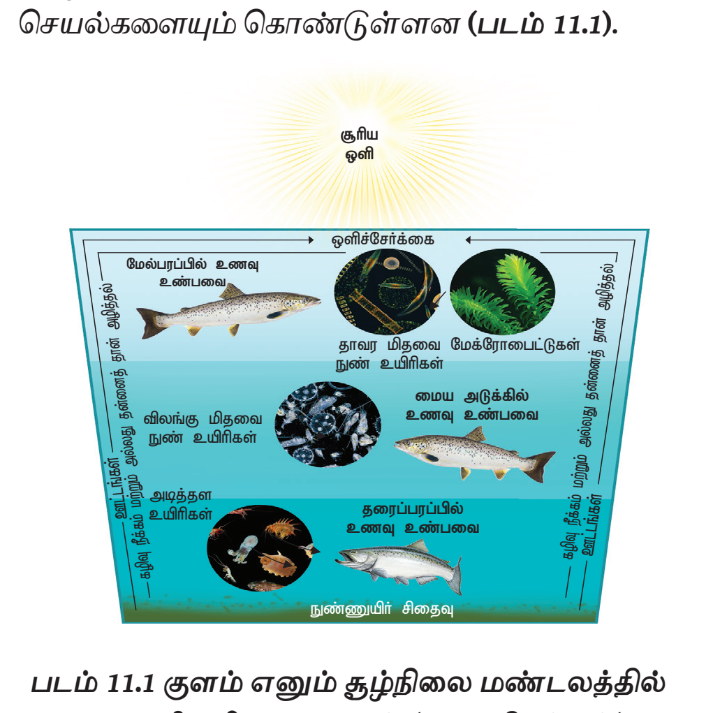

## 11.3  முக்கிய உயிரற்ற ஆக்கக்கூறுகள்

அல்லது காரணிகள்
உயிரற்ற
காரணிகள்
என்பவை
உயிரினங்களிலும் அவற்றின் செயல்பபாடுகளிலும்
தாக்கத்தையும்,
பாதிப்பையும்
ஏற்படுத்தும்
இயற்பியல் மற்றும் வேதியியல் காரணிகளை
உள்ளடக்கியது ஆகும். முக்கியமான உயிரற்ற
காரணிகளாவன.

வெப்பநிலை (Temperature)

வெப்பநிலை அல்லது வெப்பம் மற்றும்
குளிர்ச்சியின் அளவு, ஒரு சுற்றுச் சூழலில் மிகவும்
அவசியமான மற்றும் மாறுபடும் காரணி ஆகும்.
இது உயிர்கக்கோளத்தில் வாழும் அனைத்து
உயிரினங்களின்
முக்கிய
செயல்களான
வளர்சிதை மாற்றம், நடத்தை, இனப்பபெருக்கம்,
கருவளர்ச்சி மற்றும் மரணம் ஆகிய அனைத்திலும்
தாக்கத்தை ஏற்படுத்துகிறது.
சுற்றுச்சூழலில்
உள்ள
குறைந்தபட்ச
மற்றும்
அதிகபட்ச
வெப்பநிலை
செல்கள்
உயிர்
வாழ்வதை
நெறிப்படுத்துகிறது.
உயிரினத்தின்
வளர்சிதை
மாற்றங்களை
நொொதிகள் நெறிப்படுத்துகின்றன. நொொதிகள்

ƒ¼½ ªˆb$t
¬¹Û ¬gàƒÀ

 ¼
­f¸c´v w‘j ªt¿Š ºyƒÄh 

º{À¾ ,ºƒÀ ‚¼b‚¾{ƒàfˆ´v
Œg ¬-.´v

´1Û Fb´j

1hºt

±2d‚¶sbƒ´
‚¼tà¾Î+t ¬¹Û
¬gàƒÀ

w‘j 

பல விலங்கினங்கள் ஒரு பொொதுவான
வாழிடத்தைப் பகிர்ந்து வாழ்கின்றன. ஆனால்
அவற்றின் சிறுவாழிடங்கள் / ஒதுக்கிடங்கள்
நன்றறாக
வரையறுக்கப்பட்டுள்ளன.
ஒரு
வாழிடத்தில், ஒரு தனிப்பட்ட இனக்கூட்டத்தின்
வாழ்க்கை முறை அதன் ஒதுக்கிடம் எனப்படும்.
எடுத்துக்காட்டாக சுவர்க் கோழிகள் (Crickets)
மற்றும் வெட்டுக்கிளிகள் ஆகிய நெருங்கிய
தொொடர்புடைய பூச்சிகள் ஒரே வாழிடத்தில்
இருந்ததாலும் அவற்றின் சுற்றுச்சூழல் சார்ந்த
சிறுவாழிடங்கள்
வெவ்வேறாக
உள்ளன.
வெட்டுக்கிளி பகல் நேரத்தில் செயல்படுபவை.
இவை தாவரங்கள் மீது வாழ்ந்து தாவரப்
பகுதிகளை உண்டு வாழும்.
சுவர்கக்கோழி,
வெட்டுக்கிளியின்
வாழிடத்தைப்
பகிர்ந்து
கொொண்டடாலும்
அதன்
செயல்பபாடுகள்
வேறானவை.
பகல் நேரங்களில் இவை
செயலற்றும், இலைகளுக்கிடையில் பதுங்கியும்
இருக்கும். இவை இரவு நேரத்தில் செயல்படுபவை
(Nocturnal). சுவர்கக்கோழியும், வெட்டுக்கிளியும்
ஒரே
வாழிடத்திலிருந்ததாலும்
ஒன்றின்
செயல்களில்
மற்றொன்று
தலையிடாமல்
வாழ்கின்றன.
எனவே ஒரு உயிரினத்தின்
ஒதுக்கிடம் என்பது அது வாழும் சூழலில்
அதற்குரிய சிறப்பு இடத்தையும் செயல்களையும்
குறிப்பதாகும்.

•.½
±2

ƒÄh º{y ª
­f¸c´v
ªt¿Š ºy

ஒரு சமுதாயத்தில் வாழும் உயிரினங்களின்
செயல்பபாட்டு நிலையை உணர்த்தும் வகையில்
‘சிறுவாழிடம்’ என்ற சொொல்லை சார்லஸ் எல்டன்
(1927) என்பவர் முதன் முதலில் பயன்படுத்தினார்.
சுற்றுச்சூழலில்
ஒப்பிடத்தக்க
செயல்களைச்
செய்யும்
சிற்றினக்குழு
மற்றும்
ஒரு
சமுதாயத்திற்குள் அக்குழுவிற்ககான சிறுவாழிட
பரப்பு ஆகியவை ‘உயிரினச் சங்கமம்’ (Guilds)
என்று அழைக்கப்படுகிறது. வெவ்வேறு புவியியல்
மண்டலங்களில்
உள்ள,
ஒரே
வகையான
சிறுவாழிடங்களில்
வாழும்
சிற்றினங்கள்
‘சுற்றுச்சூழல்
ஒத்த
உயிரினங்கள்’
(Ecological equivalents) என்று அழைக்கப்படும்.

தரைப்பரப்பையும் சிறுவாழிடமாகக் கொொண்டு
அவ்வப்பகுதியில் தங்களின் உணவுத் தேவையை
நிறைவேற்றிக் கொொள்கின்றன. அவற்றின் வாய்
அவை
வாழும்
சிறுவாழிடத்திற்ககேற்ப
அமைக்கப்பட்டிருப்பதால்,
அவை
ஒரே
வாழிடத்தில்
வேறுபட்ட
நிலைகளையும்,
செயல்களையும் கொொண்டுள்ளன (படம் 11.1).

´1Û Fb´j ¼

என்பது அவ்வுயிரினம் வாழும் சிறு இடத்தைச்
சார்ந்தது மட்டுமல்லாமல் அதன் சுற்றுச்சூழல்
தேவைகள் அனைத்தையும் உள்ளடக்கியதுமாகும்.

உயிரினங்கள் மற்றும் இனக்கூட்டம்

வான்ட் ஹாஃப் விதி (Vant Hoff’s rule)
உயிரினங்களில் ஒவ்வொரு 10 0C
வெப்பநிலை உயர்வுக்கும் வளர்சிதை
மாற்ற வீதம் இரட்டிப்படைகிறது அல்லது
ஒவ்வொரு 10 0C வெப்பநிலை குறையும்
போதும்
வளர்சிதை
மாற்றவீதம்
பாதியாகிறது
என
வான்ட்
ஹாஃப்
தெரிவித்தார்.
இவ்விதி வான்ட் ஹாஃப்
விதி
என
அழைக்கப்படுகிறது.
வெப்பநிலை, வினைகளின் வேகத்தின் மீது
ஏற்படுத்தும் விளைவு வெப்பநிலைக் கெழு
(Temperature coefficient) அல்லது Q10 மதிப்பு
எனப்படும்.
இம்மதிப்பானது
X 0C
வெப்பநிலையில்
ஒரு
வினையின்

வேகத்திற்கும் X-10 C வெப்பநிலையில்
அவ்வினையின் வேகத்திற்கும் இடையே
உள்ள விகிதத்தால் கணக்கிடப்படுகிறது.
உயிரினங்களில் Q 10 மதிப்பு சுமார் 2.0
ஆகும். Q 10 மதிப்பு 2.0 ஆக இருந்ததால்
ஒவ்வொரு 10 0C வெப்பநிலை உயர்வுக்கும்
வளர்சிதை மாற்ற வீதம் இரட்டிப்படையும்
என்பது பொொருள்.

வெப்பநிலை உணர்வுத்திறன் கொொண்டவை.
வெப்பநிலையானது
பெரும்பபாலான
உயிரினங்களில் பால் நிர்ணயம், பாலின
விகிதம், இன உறுப்புகள் முதிர்ச்சி அடைதல்,
இனச்சசெல்லாக்கம் மற்றும் இனப்பபெருக்கம்
ஆகியவற்றின் மீது தாக்கத்தை ஏற்படுத்துகிறது.
சில சுற்றுச்சூழல்களில் உயிரினங்களின் அளவு
மற்றும்
நிற
அமைப்பு
ஆகியவற்றிலும்
வெப்பநிலை
தாக்கத்தை
எற்படுத்துகிறது.
குளிரான பகுதிகளில் வசிக்கும் பறவைகள்
மற்றும் பாலூட்டிகள் வெப்பமான பகுதியில்
வசிக்கும் உயிரினங்களை விட அதிகமான உடல்
எடையை எட்டுகின்றன (பெர்க்மமானின் விதி)
(Bergmann's rule). குளிரான பகுதிகளில் வாழும்
மாறா உடல் வெப்பம் கொொண்ட விலங்குகளின்
கால்கள், காதுகள் மற்றும் பிற இணை
உறுப்புகள், வெப்பமான பருவ நிலையில்
வாழும்
அதே
சிற்றினத்தைச்
சேர்ந்த
உயிரினங்களை விடச் சிறியதாக உள்ளன
(ஆலென் விதி) (Allen’s rule). சில நீர்வவாழ் சூழலில்,
நீரின் வெப்பநிலைக்கும் மீன்களின் உடல்
அமைப்பு
மற்றும்
எண்ணிக்கை்கும்
எதிர்மறைத்
தொொடர்பு
இருப்பதாகக்
உயிரினங்கள் மற்றும் இனக்கூட்டம்

கண்டறியப்பட்டுள்ளது.
குறைவான
வெப்பநிலையில்
அதிக
எண்ணிக்கையில்
முதுகெலும்புகள்
உருவாக்கப்படுகின்றன
(ஜோர்டடானின் விதி) (Jordon's rule).
ªð˜‚ñ£Q¡ MF
ªð˜‚ñ£Q¡ MF â‹ Åö™ ¹MJò™ õˆF¡ð®,
ð™«õÁ õ¬èŠð£†´ G¬ôJ™ àœ÷ Môƒ°èO½‹,
ð™«õÁ Þù‚Æìƒèœ ñŸÁ‹ CŸPùƒèO½‹,
°Oó£ù ð°FèO™ ªðKò Ü÷Mô£ù
Môƒ°èÀ‹, ªõŠðñ£ù ð°FèO™ CPò
Ü÷Mô£ù Môƒ°èÀ‹
è£íŠð´‹.

ށ¿y 0)
À¸b† ™i)¾b †1½//ÙiŠ  /ØY Þs„´Y  ºw†Î à†)-t 
À{j  à{ƒ¿ÀÄ Ç{b ½t Àƒ¾  /  ªt¿4   ½t´2y ¬¸/t 
®tƒ¿Îà†) ¬‘ÎØ´v  ´{t´v ¼w‘j ´{Š´v  F¼{´ ¼{‘j  ¬¸t 
¼/Àƒ¸Žj 

ª  /ØY
Þ  /  ª¼.b´{ÄY  ß  / ´/³‚à{s4´Y  «  /  ªt¿4
   Þs„´Y

உயிரினங்களின் பரவலிலும் வெப்பநிலை
தாக்கத்தை எற்படுத்துகிறது. வெப்ப மண்டலப்
பகுதிகளில்
உயிரினக்
கூட்டத்தின்
பல்வகைதனமை, உயிரி மற்றும் செறிவு ஆகியவை
மித வெப்பமண்டலம் மற்றும் துருவப் பகுதிகளை
விட அதிகமாகும்.

வெப்பநிலைக்கேற்ற தகவமைப்புகள்

சிற்றினங்கள் உயிர்வவாழ வெப்பநிலைக்கேற்ற
தகவமைப்புகளைப்
பெறுதல்
மிகவும்
அவசியமாகும்.
அதிக
வெப்பநிலை
மாறுபாடுகளைத் தாங்கி வாழும் விலங்கினங்கள்
மிகை வெப்ப வேறுபாட்டு உயிரிகள் (Eurytherms)
எனப்படும் (பூனை, நாய், புலி மற்றும் மனிதன்).
மிகை வெப்ப வேறுபாடு பரிணாமத்திற்கு
சாதகமானது ஆகும். பனியுகத்தில் உயிரினங்கள்
வாழ
குறைந்த
வெப்பநிலைக்கான
தகவமைப்புகள் (மிகைகுளிர் வெப்ப வேறுபாடு)
(Cold-Euryhermy) வாழத் தேவையாக இருந்தன.
மேலும் வெப்பநிலை வேறுபாடுகளைத் தாங்கும்
திறனால் உயிரிகள் பிற பகுதிகளில் குடியேறி,
வாழும் திறனை அதிகரித்துக் கொொள்கின்றன.

¶½t´v

†ƒÃÀÎà ‚À‘à{ˆ
Þ/‚´{ ºs¼t

,ƒ´ ÀÎà
‚À‘à{ˆ

†ƒÃÀÎà ‚À‘à{ˆ
à{/ºs¼t

¬d¶*ƒ¿
¬d¶*ƒ¿

¬d¶*ƒ¿

†ƒÃiº ª)´àf¶
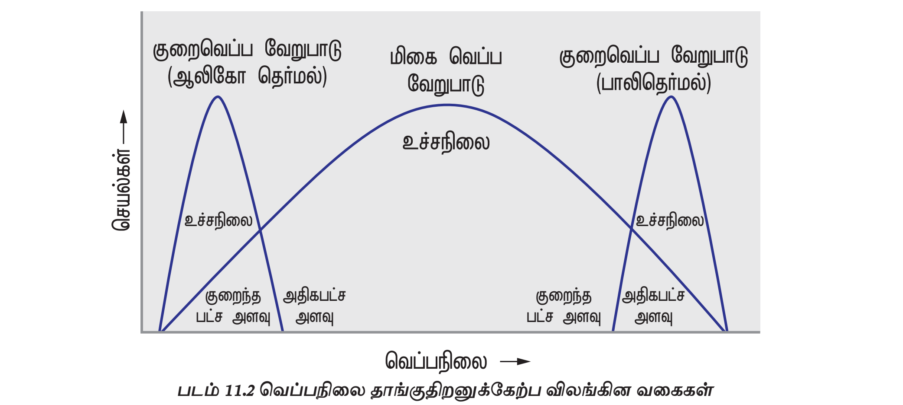
இது இயற்ககை தேர்வுக்குச் சாதகமானதாகும்.
உயிரினங்களில் மிகை வெப்ப வேறுபாடு
(Eurthermy)
ஒரு
வகையான
வெப்பநிலை
ஒழுங்குபாட்டு முறை ஆகும்.
உயிரினங்களில்
குறைவான
அளவு
வெப்பநிலை வேறுபாடுகளை மட்டுமே தாங்கிக்
கொொள்ளும் திறன் பெற்றவை குறை வெப்ப
வேறுபாடுடைய
(Stenotherms)
உயிரினங்கள்
எனப்படும் (எ.கா மீன்கள், தவளைகள், பல்லிகள்
மற்றும் பாம்புகள்)
காலப்போக்கில் பரிணாம மாற்றங்களால்,
வெவ்வேறு சூழலியல் வாழிடங்களில் வாழும்
விலங்குகள் வெப்பநிலை மாறுபாடுகளுக்கேற்ப
வெவ்வேறு
வேறுபாடுகளையும்,
தகவமைப்புகளையும்
உருவாக்கிக்
கொொண்டுள்ளன.
இதனால் அவ்விலங்குகள்
வெவ்வேறு
வாழிடங்களில்
வாழவும்,
சிறுவாழிடங்களை உருவாக்கிக் கொொள்ளவும்
முடிகிறது.
அதீதமான வெப்பநிலை உள்ள
சூழலில், உயிரினங்கள் வெப்பம் தாங்கும்
ஸ்போர்கள் மற்றும் கூடுகள் (எண்டமீபா), உறை
எதிர் புரதங்கள் (ஆர்ட்டிக் மீன்கள்) ஆகியவற்றை
உருவாக்குதல், குளிர் உறக்கம் மற்றும் கோடை
உறக்கம் போன்ற தகவமைப்புகளை மேற்கொண்டு
கடுமையான குளிர் மற்றும் கோடைகாலங்களைக்
கடக்கின்றன.
சில சூழல்களில் அதீதமான
வெப்பநிலையையும் அதனால் ஏற்படும் நீர்
மற்றும் உணவுப் பற்றாக் குறையையும் தவிர்க்க
விலங்குகள் வலசைபோதல் எனும் பொொருத்தமான
தகவமைப்புப் பண்பபைப் பெற்று அவ்விடரை
எளிதில் கடக்கின்றன (படம் 11.2).

ஒளி (Light)

இது ஒரு முக்கியமான உயிரற்ற காரணி
ஆகும். சூழலியல் நோக்கில், ஒளியின் தரம்
(அலைநீளம் அல்லது நிறம்), ஒளியின் செறிவு
(கிராம் கலோரி அளவிலான ஆற்றல்) மற்றும்
கால அளவு (பகல் பொொழுதின் நீளம்) ஆகியவை
உயிரினங்களுக்கு மிகவும் அவசியமானவை
ஆகும்.
விலங்கினங்களின் வளர்ச்சி, நிறமியாக்கம்,
இடப்பபெயர்ச்சி
மற்றும்
இனப்பபெருக்க
நிகழ்வுகளில் ஒளி தாக்கத்தை ஏற்படுத்துகிறது.
ஒளியின் செறிவு மற்றும் அலைவெண் ஆகியவை
வளர்சிதை மாற்றத்தில் தாக்கத்தை ஏற்படுத்துவது
மட்டுமின்றி, மரபணுக்களில் திடீர் மாற்றத்தை்
தூண்டுகின்றன (புற ஊதாக்கதிர்கள் மற்றும்
X-கதிர்கள்). கண்பபார்வவைக்கு ஒளி மிகவும்
அவசியம். குகையில் வாழும் உயிரினங்களில்
சரியாக வளர்ச்சிடையாத அல்லது முழுமையாகக்
கண்கள் இல்லாத நிலை ஆகியவற்றால் இது
நிரூபிக்கப்படுகிறது. விலங்குகளின் ஊடுவளர்ச்சித்
தடை (Diapause) நிகழ்வில் ஒளி தாக்கத்தை
ஏற்படுத்துகிறது.
கோடைக்காலங்களில் அதிக
ஒளிச் செறிவின்போது பறவைகளின் இன
உறுப்புகளின் செயல்பபாடு அதிகரிக்கிறது. எளிய
விலங்குகளில்
இடப்பபெயர்ச்சி
மற்றும்
இயக்கத்தில் ஒளி தாக்கத்தை ஏற்படுத்துகிறது.

நீர் (Water)

பூமியில் உள்ள உயிரினங்கள் முதன்முதலில்
கடலில்ததான் தோன்றின.
பூமியில் உள்ள
அனைத்து உயிரினங்களும் உயிர்வவாழ நீர் மிகவும்
அவசியமானதாகும்.
பூமியின் மேற்பரப்பில்,

உயிரினங்கள் மற்றும் இனக்கூட்டம்

ஒளிச்சார்பியக்கம்: ஒளிக்கான எதிர்வினை
காரணமாக முழு உயிரினமும் நகர்வது
ஒளிச்சார்பியக்கம் (Phototaxis) எனப்படும்.
உயிரினங்கள், அந்திப் பூச்சியைப் போல்
ஒளியை நோக்கியோ (நேர்மறை ஒளிச்
சார்பியக்கம்)
அல்லது
யூக்ளினா,
வால்வவாக்ஸ் மற்றும் மண்புழுக்களைப்
போல் ஒளிக்கு எதிர் திசையிலோ (எதிர்மறை
ஒளிச்சார்பியக்கம்) நகருகின்றன.
ஒளிநாட்டம் (Phototropism): ஒளித் தூண்டலின்
விளைவாக, உயிரினங்கள் வளர்ச்சி அல்லது
திசையமைவில்
ஏற்படும்
மாற்றம்,
ஒளிநாட்டம் எனப்படும்.
சூரிய காந்தித்
தாவரத்தின் மலர் ஒளியை நோக்கி நகர்வது
‘நேர்மறை
ஒளிநாட்டம்’
எனவும்,
தாவரங்களின் வேர்கள் ஒளிக்ககெதிரான
திசையில் வளர்ச்சியடைவது “எதிர்மறை
ஒளிநாட்டம்” எனவும் அழைக்கப்படும்.
ஒளித்தூண்டல் இயக்கம் (Photokinesis):
நகரும் உயிரிகளின் அல்லது செல்களின்
இடப்பபெயர்ச்சியின்
வேகம்
(அல்லது
திரும்புதல்
அலைவெண்)
ஒளியின்
செறிவால்
மாற்றியமைக்கப்படுவது
ஒளித்தூண்டல்
இயக்கம்
எனப்படும்.
இலக்கற்ற
இவ்வியக்கம்
ஒளிக்கான
எதிர்விளைவாகும்.
சுமார்
நான்கில்
மூன்று
பகுதி
நீரால்
சூழப்பட்டுள்ளது.
(நீர்கக்கோளம்) திட, திரவ
மற்றும் வாயு ஆகிய மூன்று நிலைகளிலும் நீர்
காணப்படுகிறது.
புவியில் உள்ள நீர், நன்னீர் (ஆறு, ஏரி, குளம்)
மற்றும் உவர்நீர் (கடல் மற்றும் பெருங்கடல்) என
இரண்டு
வகைகளாக
உள்ளது.
நீரில்
கரைந்துள்ள உப்புக்களின் அடிப்படையில்,
கடினநீர் (கால்சியம் மற்றும் மக்னீசியத்தின்
சல்பபேட்டுகள்
அல்லது
நைட்ரரேட்டுகள்
கரைந்துள்ளது)
மற்றும்
மென்னீர்
(உப்புக்களற்றது) என இரு வகைகள் உள்ளன.
கொொதிக்க வைத்தல் முறையில் நீரின் கடினத்
தனமையை நீக்க முடிந்ததால் அது தற்ககாலிக
கடினத்
தனமை
ஆகும்.
அவ்வாறு
இல்லையெனில் அது நிரந்தரக் கடினத் தனமை
ஆகும்.

நீரின் முக்கியப் பண்புகள்

- மண் உருவாக்கத்தில் (Pedogenesis) நீர் ஒரு
முக்கியக் காரணி ஆகும்.

உயிரினங்கள் மற்றும் இனக்கூட்டம்

- பல்வவேறு சூழ்நிலை மண்டலங்களுக்கான
ஊடகமாகத் நீர் திகழ்கிறது.
- நீர், வளிமண்டலத்திலும், பாறைக்கோளத்தின்
வெளிஉறையிலும் ஈரநிலையில் உள்ளது.
பூமியில் நீர் சமமற்ற நிலையில் பரவியுள்ளது.
- நீர் காற்றை விடக் கனமானது, மேலும்
நீர்ச்சூழலில் அது மிதவைத் தனமையை
அளிக்கிறது. இப்பண்பு, நீர்வவாழ் உயிரிகள்
நீர்நிலையின் வெவ்வேறு மட்டங்களில் மிதக்க
உதவி செய்கிறது.
- நீரின் அதிக வெப்பத் திறன் மற்றும் உள்ளுறை
வெப்பம்
காரணமாக,
அதிக
அளவு
வெப்பத்தை் தக்க வைத்துக் கொொள்ளும்
திறனுடையது. அதனால் பெருங்கடல் மற்றும்
ஏரிகளில்
சீரான
வெப்பநிலை
பாரமரிக்கப்படுகிறது.
மற்றும்
உயிர்கக்கோளத்தில் நிலைத்த வெப்பநிலை
காணப்படுகிறது.
- இதன் இயற்பியல் தனமை தனித்துவமானது.
திடநிலையில்
(பனிக்கட்டி)
உள்ள
நீர்
திரவநிலையில் உள்ளதை விட அடர்த்தி
குறைவானது ஆகும்.
- உறைநிலையில் (0 0C) நீர் சுருங்குகிறது. 4 0C
வெப்பநிலையில் திரவ நீரின் அடர்த்தி மிக
அதிகமாக உள்ளது. இதற்கு கீழ்நிலையில்
நீரானது
குறிப்பிடத்தக்க
அளவில்
விரிவடையத் துவங்குகிறது.
இப்பண்பு
பனிக்கட்டியை, நீர்நிலைகளில் உள்ள நீரின்
மேல் மிதக்கச் செய்கிறது. இதனால் நீர்
நிலைகளில் மேல்புறம் உள்ள நீர் மட்டும்
உறைகிறது; அதன் கீழ்ப்பகுதியில் உள்ள நீர்
திரவ நிலையிலியே இருந்து, உயிரினங்கள்
வாழ்வதை நிலைப்படுத்துகிறது (படம் 11.3).
  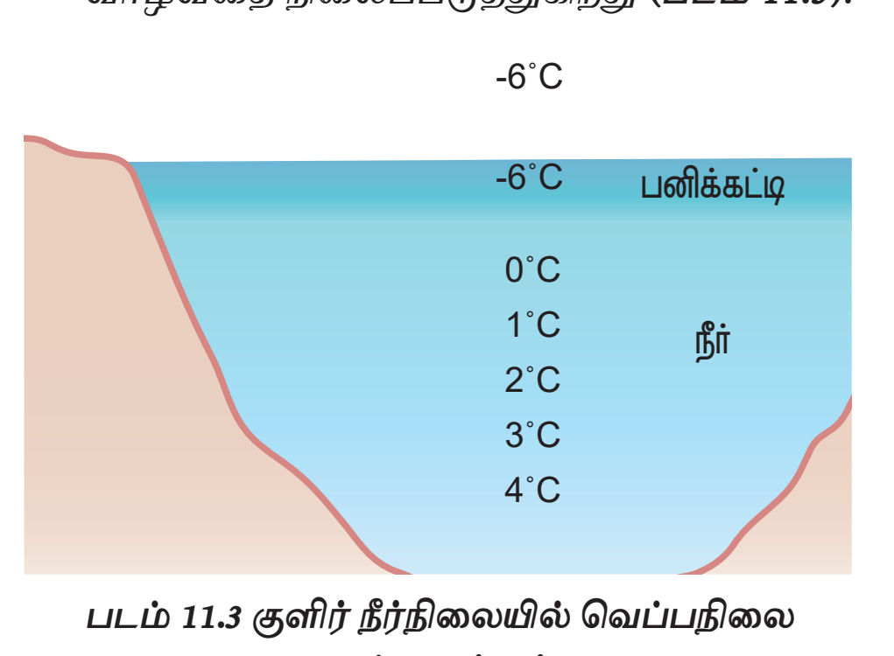

- நீர் பொொதுக் கரைப்பானாகக் கருதப்படுகிறது.
வேதிப்பொருட்கள்
உயிரற்ற
ஆக்கக்கூறுகளிலிருந்து,
சூழ்நிலை
மண்டலத்தின்
உயிர்ச்
சூழலுக்குக்
கடத்தப்பட நீர் முக்கியமான ஊடகமாகச்
செயல்படுகிறது.

(Pore space) எனப்படும்.
அதாவது புரை
வெளிகளால் நிரம்பியுள்ள மண்ணினுடைய
கன அளவின் ஒட்டுமொொத்த பருமனின்
சதவீதமே மண் புரைமை ஆகும்.
3.

மண்ணின் ஊடுருவ விடும் தனமை (அ)
உட்புகவிடும்
தனமை
(Permeability)

புரைவெளி ஊடாக நீர் மூலக்கூறுகள்
நகர்வதை தீர்மமானிக்கும் மண்ணின் தனமை,
மண்ணின்
ஊடுருவ
விடும்
தனமை
எனப்படும். மண்ணின் ஊடுருவ விடும்
தனமை
புரைவெளியின்
அளவினை
நேரடியாகச் சார்ந்துள்ளது. மண்ணின் நீரைப்
பிடித்து வைக்கும் திறன் மண்ணின் ஊடுருவ
விடும் தனமைக்கு எதிர் விகிதத்தில் உள்ளது.

4.

மண் வெப்பநிலை – மண் சூரியனிடமிருந்தும்,
சிதையும்
கரிமப்பொருட்களிலிருந்தும்
மற்றும் புவியின் உட்புறத்திலிருந்தும் வெப்ப
ஆற்றலைப்
பெறுகிறது.
மண்ணின்
வெப்பநிலை, விதைகள் முளைப்பதையும்,
வேர்கள் வளர்வதையும் மற்றும் மண்ணில்
வாழும்
நுண்ணிய
மற்றும்
பெரிய
உயிரினங்களின் உயிரியல் செயல்களையும்
பாதிக்கிறது.

5.

மண் நீர் – மண்ணில் காணப்படும் நீர்
முக்கியமான கரைப்பானாகவும், கடத்தும்
காரணியாகவும் செயல்படுவது மட்டுமல்லாது
மண்ணின்
நயம்,
மண்
துகள்களின்
கட்டமைப்பு ஆகியவற்றையும் பராமரித்து,
பல்வவேறு
தாவரங்களும்
விலங்குகளும்
வாழத்தகுதியான
வாழிடங்களாக
மாற்றுகின்றன.

- நீர் அதிகப் பரப்பு இழுவிசை கொொண்டதாகும்.
நீரின் இப்பண்பினால், மகரந்தத் தூள், தூசி
மற்றும் நீர் மேல் நடக்கும் பூச்சிகள் ஆகியவை
நீரை விட அதிக அடர்த்தி கொொண்டிருந்ததாலும்,
நீரின் புறப்பரப்பில் மிதக்கின்றன.

மண் (Soil)

மண் என்பது, கரிமப்பொருட்கள், தாது
உப்புகள்,
வாயுக்கள்,
திரவங்கள்
மற்றும்
உயிரினங்களின் கலவை ஆகும். இவையனைத்தும்
உயிரிகளின்
வாழ்க்கை்குத்
துணை
நிற்பனவாகும். புவிப்பரப்பிலுள்ள மண் நிறைந்த
பகுதி மண் கோளம் (Pedosphere) எனப்படும்.
மண்ணின் தாய்பப்பபொருளான பாறைகளிலிருந்து
மண் உருவாகின்றது. பாறைகள், காலநிலைக்
காரணிகளால் சிதைவுற்று மண்ணாக மாறுகிறது
(மண் உருவாக்கம் - paedogenesis). இவை மூலமண்
(Embryonic soil) எனப்படும்.
மண்ணின் நான்கு பெரிய பணிகள்:
- தாவரங்கள் வளர்வதற்ககான ஊடகம்
- நீரைச் சேமிக்கவும், சுத்தப்படுத்துவதற்குமான
வழிமுறையாகும்.
- புவியின்
மாற்றியமைப்பவை

வளிமண்டலத்தை

- மண்ணின் தனமையை மாற்றியமைக்கக்கூடிய
பல உயிரினங்களின் வாழிடம்
- மண்
பலகிடைமட்ட
அடுக்குகளாகக்
கட்டமைந்து காணப்படும். இது மண் விபரம்
(Soil profile) என அழைக்கப்படும்.

மண்ணின் பண்புகள்
1.

மண்ணின் நயம் (Soil texture) – மண்ணில்
உள்ள துகள்களின் அளவைப் பொொறுத்தது
மண்ணின் நயம் அமைகிறது.
மண்
துகள்களின் அளவின் அடிப்படையில் மணல்,
வண்டல் மற்றும் களிமண் என பல மண்
வகைகள் காணப்படுகிறது.

2.

மண் புரைமை (Porosity) – ஒரு குறிப்பிட்ட
கனஅளவு உள்ள மண்ணின், துகள்களுக்கு
இடையே உள்ள இடைவெளி புரைவெளி

காற்று (Wind)

குறிப்பிட்ட
திசையிலிருந்து
குறிப்பிட்ட
வேகத்தில், இயற்ககையான நகரும் வளி, காற்று
என அழைக்கப்படுகிறது. நிலநடுக்கோடு மற்றும்
துருவப்பகுதிகளுக்கிடையே
காணப்படும்
வெப்பநிலை வேறுபாடு மற்றும் பூமியின் சுழற்சி
(கோரியோலிஸ்
விளைவு)
ஆகிய
இரு
காரணங்களால் காற்று உருவாகிறது. மகரந்தத்
துகள்கள் மற்றும் விதைகள் கடத்தப்படவும்,
பறவைகள் பறக்கவும் காற்று உதவுகிறது. காற்றின்
மூலம்
உற்பத்தியாகும்
ஆற்றலுக்கு
மூலகாரணமாக விளங்குவதுடன் காற்று மண்
அரிப்பையும் ஏற்படுத்துகிறது. அனிமோமீட்டர்
என்ற கருவியின் உதவியால் காற்றின் வேகம்
அளவிடப்படுகிறது.

உயிரினங்கள் மற்றும் இனக்கூட்டம்

ஈரப்பதம் (Humidity)

வளிமண்டலத்தில் உள்ள கண்ணுக்குப்
புலப்படாத நீராவியினால் ஏற்படும் ஈரம்,
ஈரப்பதம் எனப்படும். ஈரப்பதம் பொொதுவாக
முழுமையான ஈரப்பதம் மற்றும் ஒப்புமை
ஈரப்பதம்
(அல்லது)
குறித்த
ஈரப்பதம்
(Specific humidity) ஆகிய இரு வகைகளில்
குறிப்பிடப்படுகிறது. குறிப்பிட்ட கொொள்ளளவு
(அல்லது) பொொருணமை, அளவுள்ள காற்றில்
உள்ள ஒட்டு மொொத்த நீராவியின் பொொருணமை
முழுமையான ஈரப்பதம் எனப்படும். இதில்
வெப்பநிலை கருத்தில் கொொள்ளப்படுவதில்லை.
காற்றில் உள்ள நீராவியின் அளவு ஒப்புமை
ஈரப்பதம்
எனப்படும்.
ஒரு
குறிப்பிட்ட
வெப்பநிலையில் காற்றில் உள்ள ஈரப்பதம்
தெவிட்டு நிலையை அடைய தேவைப்படும்
நீராவியின் அளவை விழுக்காட்டில் குறிப்பதே
ஒப்புமை ஈரப்பதம் எனப்படும்.
ஒப்புமை
ஈரப்பதம்
அதன்
விழுக்காட்டில்
குறிக்கப்படுகிறது.
ஒரு
குறிப்பிட்ட
வெப்பநிலையில்
ஒப்புமை
ஈரப்பதத்தின்
விழுக்காடு அதிகமாக இருந்ததால் காற்று-நீர்
கலவை அதிக ஈரத்தனமையுடன் உள்ளது எனக்
கொொள்ளலாம். ஈரப்பதத்தை ஹைக்ரோமீட்டர்
எனும் கருவியால் அளக்கலாம்.
ஏற்றம்
அல்லது
சரிவைக்
கொொண்ட
இக்காரணி ஒரு சூழ்நிலை மண்டலம் அல்லது
உயிர்த் தொொகையில் வெப்பநிலை மற்றும்
மழையளவைக் கட்டுப்படுத்துகிறது.
உயரம்
அதிகரிக்கும் போது வெப்பநிலை மற்றும்
ஆக்சிஜனின் அடர்த்தி குறைகிறது.
அதிக
உயரத்தில் வெப்பநிலை குறைவு காரணமாக
மழைக்குப் பதிலாக பனிப்பொழிவு ஏற்படுகிறது.
விலங்குகள்
சுற்றுச்சூழலில்
ஏற்படும்
மாறுபாடுகளுக்கேற்ப, தங்கள் எதிர்வினையை
குறுகிய
காலத்திற்குள்
மாற்றிமைத்துக்
கொொள்கின்றன.
இதற்கு
இணக்கமாதல்
(Acclimatization) என்று பெயர். எடுத்துக்காட்டாக
தரைப்பகுதியில்
வாழ்பவர்கள்
உயரமான
பகுதிக்குச் செல்லும்போது, புதிய சூழலுக்கு
உட்பட்ட சில நாட்களுக்குள் சிவப்பணுக்களின்
எண்ணிக்கை அதிகரிக்கிறது. இது அவர்களுக்கு,
வளிமண்டல ஆக்சிஜன் குறைபாடு காரணமாக
ஏற்படும் அதிக அளவு ஆக்சிஜன் தேவையைச்
சமாளிக்க உதவும்.

உயிர்த் தொொகை என்பது, ஒரே மாதிரியான
அல்லது பொொதுவான தாவரங்கள் மற்றும்
காலநிலையைக் கொொண்ட புவியின் பெரும்
பரப்பு ஆகும். பூமியில் உயிரினங்கள் நிலைத்து
வாழ்வதில் இவை முக்கியப் பங்ககேற்கின்றன.
அப்பகுதியில்
உள்ள
மண்,
காலநிலை,
தாவரங்கள்
மற்றும்
விலங்குகளால்
உயிர்தத்ததொகை
வரையறுக்கப்படுகின்றது.
உயிர்தத்ததொகைகள் ஓரிடத்தின் இயற்பியல்வேதியியல்
காலநிலைக்கேற்ப
உருவான
தனித்துவமான
உயிரிய
சமுதாயங்களைக்
கொொண்டுள்ளன.
உயிர்தத்ததொகை
கண்டங்களுக்கிடையே கூடப் பரவியிருக்கின்றன.
எனவே உயிர்தத்ததொகை என்பது வாழிடம்
என்ற சொொல்லை விட அகன்ற பொொருள்
கொொண்டதாகும்.
ஒரு
உயிர்தத்ததொகை
பல்வவேறு
வகையான
வாழிடங்களைக்
கொொண்டிருக்கும்.
ஒரு உயிர்தத்ததொகையில்
வாழும் உயிரினங்களின் வகைகள் மற்றும்
அதன்
தகவமைப்புக்ளளைத்
தீர்மமானிப்பது
வெப்பநிலை, ஒளி மற்றும் நீர் வளம் ஆகிய
காரணிகள் ஆகும் (படம் 11.4).

உயிர்தத்ததொகையின் பண்புகள்

உயரம் (Altitude)

உயிரினங்கள் மற்றும் இனக்கூட்டம்

## 11.4  உயிர்த் தொொகை மற்றும் அவற்றின்

பரவல் குறித்த கோட்பபாடுகள்

- இருப்பிடம் /புவியியல் நிலை (அட்சக்கோடு
மற்றும் தீர்க்கக்கோடு)
- காலநிலை மற்றும் இயற்பியல்-வேதியியல்
சூழல்
- முதனமையாகக் காணப்படும் தாவரங்கள்
மற்றும் விலங்குகள்
- உயிர்
தொொகைகளுக்கிடையே
உள்ள
எல்லையைத்
துல்லியமாக
வரையறை
செய்யமுடியாது.
புல்வவெளி மற்றும் வன
உயிர்தத்ததொகைகளில்,
சந்திக்கும்
/
இடைநிலைப் பகுதிகள் உள்ளன (படம் 11.5).

நீர் உயிர்தத்ததொகை
உயிர்கக்கோளத்தில் 71% நீர் உயிர்தத்ததொகையே
காணப்படுகிறது.
நீர் உயிர்தத்ததொகையில்
மில்லியன் கணக்கான மீன்கள் போன்ற நீர்வவாழ்
உயிரிகள்
வாழ்கின்றன.
கடலோர
மண்டலங்களின் காலநிலைகளில் நீர்நிலைகள்
தாக்கத்தை ஏற்படுத்துக்கின்றன.

ªõŠðñ‡ìô ñ¬ö‚ 裴èœ
Iî ªõŠðñ‡ìô‚ 裴èœ
ð£¬ôõù‹
ðQ„êñªõ÷¤
¬ìè£ (ð²¬ññ£ø£ áCJ¬ô‚ 裴èœ)
¹™ªõOèœ
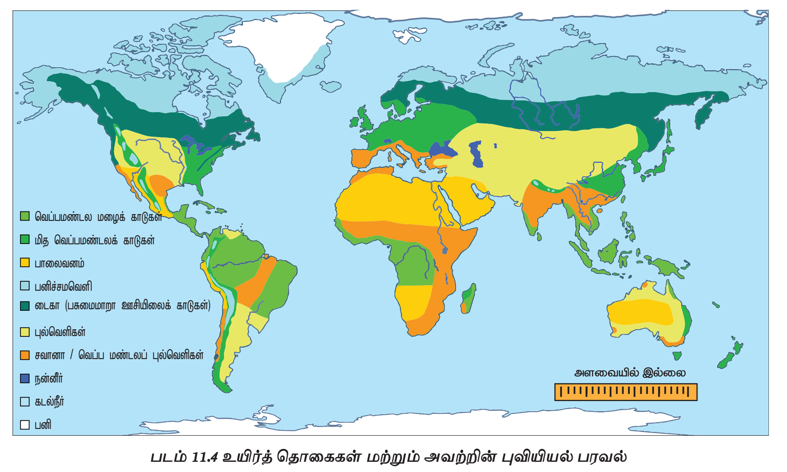

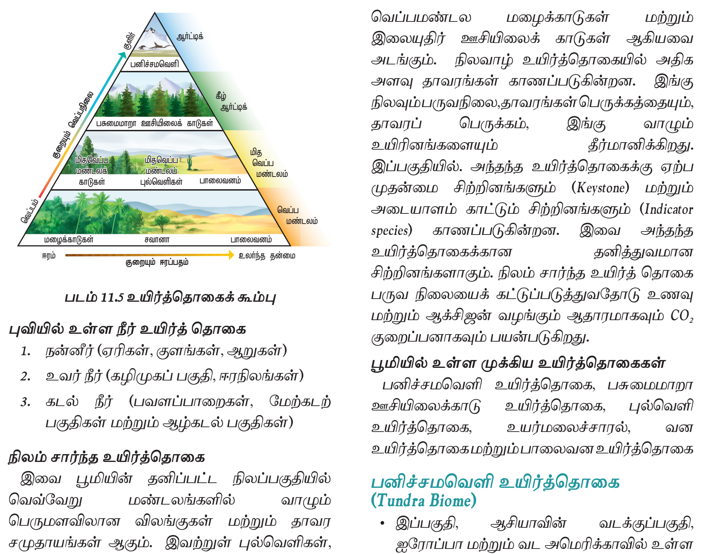

புவியில் உள்ள நீர் உயிர்த் தொொகை
1. நன்னீர் (ஏரிகள், குளங்கள், ஆறுகள்)
2.

உவர் நீர் (கழிமுகப் பகுதி, ஈரநிலங்கள்)

3.

கடல் நீர் (பவளப்பாறைகள், மேற்கடற்
பகுதிகள் மற்றும் ஆழ்கடல் பகுதிகள்)

நிலம் சார்ந்த உயிர்தத்ததொகை
இவை பூமியின் தனிப்பட்ட நிலப்பகுதியில்
வெவ்வேறு
மண்டலங்களில்
வாழும்
பெருமளவிலான விலங்குகள் மற்றும் தாவர
சமுதாயங்கள் ஆகும். இவற்றுள் புல்வவெளிகள்,
பனிச்சமவெளிப்
பகுதிகள்,
பாலைவனம்,

வெப்பமண்டல
மழைக்காடுகள்
மற்றும்
இலையுதிர் ஊசியிலைக் காடுகள் ஆகியவை
அடங்கும். நிலவாழ் உயிர்தத்ததொகையில் அதிக
அளவு தாவரங்கள் காணப்படுகின்றன. இங்கு
நிலவும் பருவநிலை, தாவரங்கள் பெருக்கத்தையும்,
தாவரப்
பெருக்கம்,
இங்கு
வாழும்
உயிரினங்களையும்
தீர்மமானிக்கிறது.
இப்பகுதியில். அந்தந்த உயிர்தத்ததொகைக்கு ஏற்ப
முதனமை சிற்றினங்களும் (Keystone) மற்றும்
அடையாளம் காட்டும் சிற்றினங்களும் (Indicator
species) காணப்படுகின்றன. இவை அந்தந்த
உயிர்தத்ததொகைக்கான
தனித்துவமான
சிற்றினங்களாகும். நிலம் சார்ந்த உயிர்த் தொொகை
பருவ நிலையைக் கட்டுப்படுத்துவதோடு உணவு
மற்றும் ஆக்சிஜன் வழங்கும் ஆதாரமாகவும் CO2
குறைப்பனாகவும் பயன்படுகிறது.

பூமியில் உள்ள முக்கிய உயிர்தத்ததொகைகள்
பனிச்சமவெளி உயிர்தத்ததொகை, பசுமைமாறா
ஊசியிலைக்காடு
உயிர்தத்ததொகை,
புல்வவெளி
உயிர்தத்ததொகை,
உயர்மலைச்சாரல்,
வன
உயிர்தத்ததொகை மற்றும் பாலைவன உயிர்தத்ததொகை

பனிச்சமவெளி உயிர்தத்ததொகை
(Tundra Biome)

- இப்பகுதி,
ஆசியாவின்
வடக்குப்பகுதி,
ஐரோப்பா மற்றும் வட அமெரிக்காவில் உள்ள
மரங்களற்ற சமவெளி ஆகும்.

உயிரினங்கள் மற்றும் இனக்கூட்டம்

- குறுகிய
பகல்
பொொழுதைக்
கொொண்ட
குளிர்ககாலம் நீண்டதாகவும், நீண்ட பகல்
பொொழுதைக்
கொொண்ட
கோடைக்காலம்
குறுகியதாகவும் உள்ளது.
- மழையளவு
ஆண்டுக்கு

மிமீக்கும்
குறைவாக உள்ளது. இப்பகுதி நிலைத்த
உறைபனி மண்டலமாகும்.
- குட்டையான வில்லோ மரங்கள், பூச்ச மரங்கள்,
பாசிகள், புற்கள், கோரைகள் ஆகிய தாவர
இனங்கள் இங்கு காணப்படுகின்றன.
- கலைமான்கள், ஆர்ட்டிக் முயல்கள், கஸ்தூரி
எருது மற்றும் லெம்மிங்குகள் ஆகியவை
பனிச்சமவெளியில்
வாழும்
தாவர
உண்ணிகள் ஆகும். ஆர்ட்டிக் நரி, ஆர்ட்டிக்
ஓநாய், சிவிங்கி பூனை (Bobcat) மற்றும் பனி
ஆந்ததை ஆகியவை இங்கு வாழும் முக்கிய
விலங்குண்ணிகள் ஆகும்.
கடலோரப்
பகுதிகளில் துருவக் கரடிகள் வாழ்கின்றன.

கோடைகாலங்களில்
பனிச்சமவெளி
நோக்கியும், குளிர் காலங்களில் ஊசியிலைக்
காடுகளை நோக்கியும் வலசை போகின்றன
சிறிய
தாவர
உண்ணி
பாலூட்டிகள்,
அணில்கள், வெண்பனி முயல்களான மற்றும்
முக்கிய
விலங்குண்ணிகளான
பைன்
மார்டடென்கள், மரஓநாய்கள், பழுப்பு நிறக்
கரடிகள், கருப்புக் கரடிகள், சிவிங்கிப் பூனை
மற்றும் ஓநாய்கள் ஆகியன இப்பகுதியில்
வாழ்கின்றன. (படம் 11.6).

- இங்கு குளிர்ககாலம் கடுமையாக இருப்பதால்
பல விலங்குகள் வலசைபோகும் பண்பபைக்
கொொண்டுள்ளன.
கடலோரப் பறவைகள்
மற்றும் வாத்துகள் போன்ற நீர்ப்பறவைகள்
கோடைக்காலங்களில் பனிச்சமவெளிகளில்
வசிக்கும்; குளிர்ககாலங்களில் தெற்கு நோக்கி
வலசை போகும்.

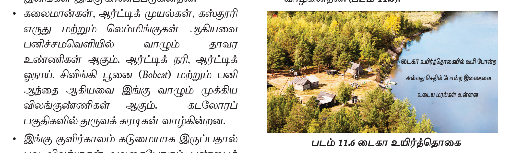

பசுமை மாறா ஊசியிலைக் காடுகள்
(டைகா உயிர்தத்ததொகை) (Taiga Biome)

- டைகா என்பது, பனிச்சமவெளியின் தென்
பகுதியில், 1300-1450 கி.மீ அளவில் பரந்து
காணப்படும் பகுதி ஆகும்.
- இப்பகுதி
அதிகக்
குளிர்மிக்க,
குளிர்ககாலம் கொொண்டது.

நீடித்த

- கோடைகால வெப்பநிலை
21ºC வரை இருக்கும்.

முதல்

10ºC

- இங்கு ஆண்டு மழையளவு 380-1000 மி.மீ
ஆகும்.
- இப்பகுதியில் ஸ்புரூஸ், ஃபிர் மற்றும் பைன்
போன்ற ஊசியிலை மரங்கள் காணப்படுகிறது.
இப்பகுதி மரத் தொொழிற்சசாலைகளுக்கான
மூல வளங்களாகும்.
- மூக்கு மான், கடம்பபை மான் மற்றும்
கலைமான்கள் போன்ற வலசைபோகும் தாவர
உண்ணிகள்
இப்பகுதியின்
முக்கிய
விலங்குகள் ஆகும்.
குளிர் காலங்களில்
இப்பகுதியில் வாழும் கடமான் மற்றும்
கலைமான்கள்
போன்றவை
உயிரினங்கள் மற்றும் இனக்கூட்டம்

ைடகா உy  ெதாைகy  ஊc ேபா ற
அ லt ெசt  ேபா ற இைலகைள
உைடய மர க  உ ளன

வரலாற்றின் பக்கங்களில்,
கால மாற்றங்கள் காரணமாக
உயிர்த்
தொொகையில்
மாற்றங்கள் ஏற்பட்டுள்ளன.
எடுத்துக்காட்டு:
சஹாரா
பாலைவனம்.
ஒரு காலத்தில் இப்பகுதி
ஆறுகள் பாய்ந்த பசுமையான நிலப்பரப்பாக
இருந்தது.
அதனால்,
ஏராளமான
மரவகைகளும், விலங்குகளான நீர்யயானை,
ஒட்டகச்சிவிங்கி, முதலை போன்றவையும்
இங்கு வாழ்ந்தன. காலப்போக்கில் காலநிலை
வறண்டதால்,
இப்பகுதி
புவிக்கோளின்
மிகப்பபெரிய பாலைவனமாக மாறிவிட்டது.
இங்கு வாழ்ந்த விலங்குகள் சாதகமான சூழல்
நிலவும் அருகிலுள்ள பகுதிகளுக்கு இடம்
பெயர்ந்திருக்கலாம்.
(மூலம்: நேஷனல்
ஜியாக்ரபி)

புல்வவெளி உயிர்தத்ததொகை
(Grassland Biome)
- மித
வெப்பமண்டலம்
வெப்பமண்டலப்
பகுதிகளில்
உயிர்தத்ததொகை காணப்படுகிறது.

மற்றும்
புல்வவெளி

- இப்பகுதி, வெப்பமான கோடைக்காலத்தையும்
குளிர்ச்சியான குளிர்ககாலத்தையும், சீரற்ற
மழையையும் கொொண்டது.

- அதிகமான காற்று வீசுவது இப்பகுதியின்
தனிப்பட்ட பண்பு ஆகும்.
- குறைவான சீரற்ற மழையே மித வெப்ப
மண்டல
இலையுதிர்
காடுகளுக்கும்
மிதவெப்ப
மண்டல
புல்வவெளிக்கும்
இடையேயான வேறுபாடுகளை உருவாக்கும்
காரணியாகும்.
- மறிமான், காட்டடெருமை, ஜாக் முயல், தரை
வாழ் அணில் மற்றும் பிரைரி நாய்கள்
போன்ற தாவர உண்ணிகள் அதிகமாகக்
காணப்படுகின்றன.
- கோயோட், ஓநாய்கள், பருந்துகள் மற்றும்
பாம்புகள் ஆகியன முக்கிய வேட்டையாடும்
உயிரிகள் ஆகும்.
- இந்தியாவில்
காட்டடெருமை,
மறிமான்கள்
வாழ்கின்றன.

யானைகள்,
இந்தியக்
காண்டடாமிருகம்
மற்றும்
ஆகியவை
புல்வவெளியில்

- இப்பகுதியில் உள்ள தாவர இனங்கள்,
ஊதாநிற ஊசிப்புல், காட்டு ஓட்ஸ், தினை, ரை
புல் மற்றும் எருமை புற்கள் ஆகும் (படம் 11.7).

சுற்றுச்சூழல் காரணிகள் இங்கு
உயிரினங்களைப் பாதிக்கின்றன.

வாழும்

- இமயமலையில் உள்ள உயர் மலைச்சாரல்
பகுதியில் விலங்கினங்கள் மிகக் குறைவாகக்
காணப்படுகின்றன. இங்கு வாழும் முதுகு
நாணற்ற
விலங்குகள்
பெரும்பபாலும்
கொொன்றுண்ணிகளாகவும், ஏரிகள், ஓடைகள்
மற்றும் குளங்களில் வாழ்வதாகவும் உள்ளன.
முதுகு நாணுள்ளவைகளில் மீன்கள் மற்றும்
இருவாழ்விகள்
ஆகியவை
இங்கு
காணப்படவில்லை, ஊர்வன இன உயிரிகள்
அரிதாகக் காணப்படுகின்றன.
- உயர் மலைச்சாரல் பகுதியில் உள்ள தாவர
வகைகள்,
உயர்மலைச்சாரல்
பாசிலியா,
கரடிப்புற்கள், முள்கூம்பு பைன், பாசி
காம்பியன், பாலிலெபிஸ் காடு, குள்ள கசப்பு
வேர் மற்றும் காட்டு உருளை ஆகியவை ஆகும்.

வன உயிர்தத்ததொகை (Forest Biome)

அடர்த்தியான மரங்கள் கொொண்ட பகுதி
வனப்பகுதி எனப் பொொதுவாக அழைக்கப்படுகிறது
(படம் 11.8). வனப்பகுதி உயிர்தத்ததொகையில்
வெவ்வேறு வகையான உயிரினக் கூட்டங்கள்
காணப்படுகின்றன. வெப்ப மண்டலக்காடுகள்
மற்றும் மிதவெப்ப மண்டலக் காடுகள் ஆகியவை
முக்கியமான வன உயிர்தத்ததொகைகள் ஆகும்.

வெப்பமண்டலக் காடுகள் (Tropical Forest)
- இவை
நிலநடுக்கோட்டிற்கு
அருகே

(23.5
வடக்கு
மற்றும்
23.5
தெற்கு
அட்சக்கோடுகளுக்கு இடையில்) உள்ளன.
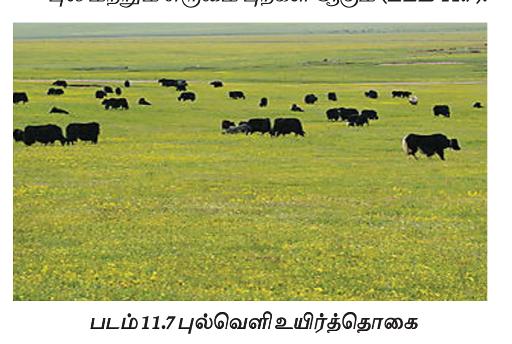

உயர்மலைச் சாரல் உயிர்தத்ததொகை
(Alpine Biome)

- மரம் வளர் பகுதிக்கும் பனி சூழ் பகுதிக்கும்
இடைப்பட்ட பகுதியான உயர் மலைச்சாரல்
பகுதியில் முறையே இறங்கு வரிசையில் பனி
சூழ் பகுதிக்குக் கீழே உள்ள பகுதி, புல்வவெளிப்
பகுதி மற்றும் புதர்ப்பகுதி (மரம் வளர்
பகுதியுடன் இணையும் பகுதி) ஆகிய பகுதிகள்
உள்ளன.
- இமயமலைப் பகுதியில் உள்ள பனி சூழ் பகுதி
கடல் மட்டத்திலிருந்து 5100 மீ உயரத்திலும்
உயர்மலைச் சாரல் பகுதி கடல் மட்டத்திலிருந்து
3600 மீ உயரத்திலும் உள்ளது. சூழலியல்
நோக்கில், மரம் வளர் பகுதிக்கும் மேலே
உள்ள
பகுதியில்
காணப்படும்
அதீத

- இங்கு நிலவும் தெளிவான காலநிலைகள்
வெப்பமண்டலக் காடுகளின் தனித்தனமை
ஆகும். மழைக்காலம் மற்றும் வறண்ட காலம்
ஆகிய இரண்டு காலநிலைகள் மட்டும் உள்ளன.
குளிர்ககாலம் காணப்படுவதில்லை. பகல்நநேர
சூரிய வெளிச்சம் ஏறத்தாழ 12 மணி நேரம்
உள்ளது. இது சற்றே மாறுபடக் கூடியது.
- ஒரு ஆண்டிற்ககான சராசரி வெப்பநிலை அளவு
200C முதல் 250C ஆகும்.
- ஆண்டு
முழுவதும்
மழைப்பொழிவு
காணப்படும்.
ஆண்டு
மழைப்பொழிவு
2000 மி.மீக்கும் அதிகமாக உள்ளது.
- மண்ணில் ஊட்டச்சத்து குறைவாகவும், அமிலத்
தனமை அதிகமாகவும் காணப்படும். சிதைதல்
விரைவாக நடைபெறுகிறது. மேலும் மண் அதிக
அளவில் கரைந்து பிரியும் தனமையுடையதாக
காணப்படுகிறது.

உயிரினங்கள் மற்றும் இனக்கூட்டம்

- மரங்களின் கவிகை (Canopy) பல அடுக்குகள்
உடையதாகவும், தொொடர்ச்சியாகவும் உள்ளதால்
மிகக் குறைந்த அளவு சூரிய வெளிச்சமே
ஊடுருவுகிறது.
- இப்பகுதியின் தாவர பல்வகைமை மிக அதிகமாக
உள்ளது. ஒரு சதுர கிலோ மீட்டர் பகுதியில்
100க்கும் மேற்பட்ட மரசிற்றினங்கள் உள்ளன.
மரங்கள் 25-35மீ உயரம், தாங்கும் அமைப்புடைய
தண்டுகள், ஆழம் குறைவாகச் செல்லும் வேர்கள்
மற்றும் அடர் பச்சை நிறம் கொொண்ட பசுமைமாறா
இலைகளையும் கொொண்டுள்ளன. இப்பகுதியில்
ஆர்க்கிடுகள், நீள் நாரிழைச் செடி வகைகள்,
திராட்சசை, பெரணிகள், பாசிகள் மற்றும் பனை
வகைத் தாவரங்கள் ஆகிய காணப்படுகின்றன.
- இப்பகுதியில் பறவைகள், வௌவால்கள், சிறிய
பாலூட்டிகள் மற்றும் பூச்சிகள் உள்ளிட்ட அதிக
விலங்கினப் பல்வகைமை காணப்படுகிறது.
பூமியில் பாதிக்கும் மேற்பட்ட வெப்ப
மண்டலக்
காடுகள்
ஏற்ககெனவே
அழிக்கப்பட்டுவிட்டன.

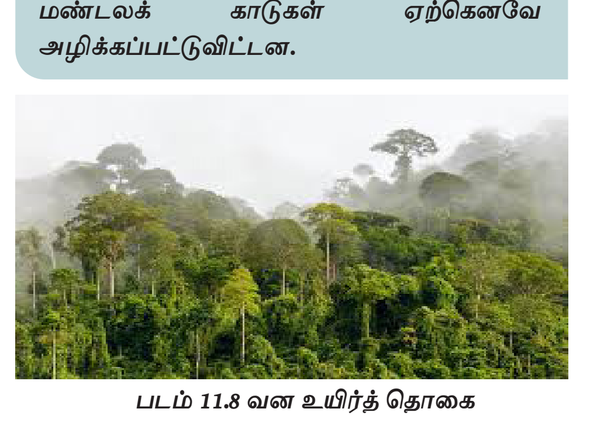

மித வெப்ப மண்டலக் காடுகள்
(Temperate Forest)
- இக்காடுகள், வடகிழக்கு அமெரிக்கா, வட
மேற்கு ஆசியா, மேற்கு மற்றும் மத்திய
ஐரோப்பா பகுதிகளில் காணப்படுகின்றன.
- இங்கு நன்கு வரையறுக்கப்பட்ட பருவ
காலங்களும் தனித்துவமான பனிக்காலமும்
காணப்படுகின்றன. மிதமான காலநிலையும்
மேலும் 4 முதல் 6 மாதங்கள் வரையிலான
உறைபனியற்ற காலத்தில் 140 – 200 நாட்கள்
வளர்ச்சிக்
காலமாகவும்
இருப்பதால்
மிதவெப்பக்காடுகள்
தனித்துவமிக்கதாக
உள்ளன.
- ஆண்டு வெப்பநிலை -300C முதல் 300C வரை
வேறுபடுகிறது.
உயிரினங்கள் மற்றும் இனக்கூட்டம்

- ஆண்டு முழுவதும் சீராக (750-1500மி.மீ),
மழை பொொழிகிறது.
- மண்
வளமுடையதாகவும்,
மட்கும்
குப்பையினால் வளமேற்றப் பட்டதாகவும்
இருக்கும்
- மரங்களின் கவிகை அடர்த்தி மிதமாகவும்,
ஒளி
ஊடுறுவலை
அனுமதிப்பதாகவும்
உள்ளது. இதனால் இங்கு நல்ல பரவலைக்
கொொண்ட பல்வவேறு வகையான கீழ் அடுக்குத்
தாவரங்களும், விலங்கின அடுக்கமைவும்
காணப்படுகின்றன.
- ஒரு சதுர கி.மீ பரப்பளவில் 3 முதல் 4
வெவ்வேறு சிற்றினங்களை சேர்ந்த மரங்கள்
காணப்படுகின்றன. மரங்களின் இலைகள்
அகலமாகவும்,
ஆண்டுதோறும்
உதிரக்
கூடியதாகவும் உள்ளன. இங்குள்ள தாவர
வகைகள், ஓக், ஹிக்கரி, பீச், ஹெம்லலாக்,
மேப்பிள், பால் மரக்கட்டை, பருத்தி, எல்ம்,
வில்லோ மற்றும் வசந்த காலத்தில் மலரும்
சிறுசெடிகள் ஆகியனவாகும்.
- விலங்கினங்களில் அணில்கள், முயல்கள்,
முடைவளி மான் (ஸ்கங்க்), பறவைகள்,
கரடிகள், மலைச்சிங்கம், சிவிங்கி பூனை,
மரஓநாய்கள், நரி மற்றும் கருப்பு மான்கள்
ஆகியவை அடங்கும்.
பூமியில், ஆங்ககாங்ககே காணப்படும் எஞ்சிய
மித வெப்ப மண்டலக் காடுகளே தற்போது
உள்ளன.

பாலைவன உயிர்தத்ததொகை (Desert Biome)

- பூமியில் ஐந்தில் ஒரு பகுதி பாலைவனமாக
உள்ளது. ஆண்டு மழையளவு 250 மிமீக்கும்
குறைவாக
உள்ள
பகுதிகளில்
இவை
காணப்படுகின்றன.
- மழைப்பொழிவு மிகக் குறைவாக இருக்கும்
அல்லது நீண்ட மழையற்ற காலங்களுக்குப்
பின் குறுகிய கால அளவிலும் இருக்கும்.
மழைப்பொழிவு வீதத்தை விட ஆவியாதல்
வீதம் அதிகமாக காணப்படும்.
- மண்,
துகள்தனமையுடையதாகவும்,
ஆழமற்றதாகவும், பாறைத் தனமை அல்லது
சரளைக் கற்கள் உடையதாகவும் காணப்படும்.
மண்ணின் நீர் கடத்து திறன் அதிகமாகவும்,
மேற்பரப்பின்
அடிப்புறம்
நீரின்றியும்

- ஆண்டின் சராசரி வெப்பநிலை 200C முதல்
250C ஆகும். உச்ச அளவு வெப்பநிலை 43.50C
முதல் 490C வரையும்,
குறைந்த அளவு
வெப்பநிலை சில நேரங்களில் -180C வரையும்
இருக்கும். வெப்பநிலையின் அடிப்படையில்,
வெப்பப்பாலைவனம்
மற்றும்
குளிர்
பாலைவனம் என இருவகைகள் உள்ளன.
வெப்பப்பாலைவனம்
- வட
ஆப்பிரிக்காவில்
உள்ள
சஹாரா
பாலைவனம்,
தென்மமேற்கு
அமெரிக்கா
மெக்சிகோ, ஆஸ்திரேலியா மற்றும் இந்தியாவில்
உள்ள பாலைவனங்கள் (தார் பாலைவனம்)
ஆகியவை அட்சக்கோட்டின் கீழ்ப்பகுதியில்
உள்ள வெப்பப் பாலைவனங்கள் ஆகும்.
- வெப்பப் பாலைவனங்களில் சிறப்பு வகைத்
தாவரங்களான (வறண்ட நில தாவரங்கள்)
கற்றாழை, பாசிகள், சப்பாத்திக்கள்ளி சிற்றினம்
மற்றும்
யுஃபோர்பியா
ராய்ளியானா
ஆகியவை காணப்படும்.
சிறப்பு வகை
முதுகுநாணுடைய மற்றும் முதுகுநாணற்ற
விலங்குகளும் காணப்படுகின்றன.
- வெப்பமான பாலைவனங்களில் ஊர்வன
மற்றும் சிறிய விலங்குகள் காணப்படும்.
இந்திய முள்வவால் பல்லிகள், கருப்பு மான்,
வெள்ளைக் கால் நரி, ஆகியவை தார்
பாலைவனத்தில் காணப்படும் பொொதுவான
விலங்குகள் ஆகும். இவை தவிர பூச்சிகள்,
அரக்னிடுகள்
மற்றும்
பறவைகளும்
காணப்படுகின்றன.
குளிர் பாலைவனம்
- இவை அண்டடார்டிக், கிரீன்லலாந்து மற்றும்
நியார்க்டிக் பகுதி, அமெரிக்கா மற்றும் மேற்கு
ஆசியாவின் சில பகுதிகளிலும் மற்றும்
இந்தியாவின்
லடாக்
பகுதிகளிலும்
காணப்படுகின்றன.
- இப்பகுதியில்
அதிகமாகப்
பரவுயுள்ள
விலங்குகள் ஜாக் முயல், கங்ககாரு எலி,
கங்ககாரு
சுண்டடெலி,
பை
சுண்டடெலி,
வெட்டுக்கிளி எலி, மறிமான்கள் மற்றும் தரை
அணில்கள் ஆகியவையாகும்.

சிலியில் உள்ள அடகாமா
பாலைவனத்தில்
மிகக்
குறைந்த
மழைப்பொழிவு
காணப்படுகிறது.
இங்கு
ஆண்டின் சராசரி மழைப்பொழிவு 15 மிமீக்கும்
குறைவாகும். சில ஆண்டுகளில் மழையே
பொொழிவதில்லை. சஹாரா பாலைவனத்தின்
உட்பகுதியிலும் மழைப்பொழிவு ஆண்டிற்கு
15 மிமீக்கும் குறைவாக உள்ளது. அமெரிக்கப்
பாலைவனங்களில் மழைப்பொழிவு சற்று
அதிகமாகக்
(ஆண்டுக்கு
280மி.மீ)
காணப்படுகிறது.

## 11.5  உயிரற்ற காரணிகளுக்கான

துலங்கல்கள்
ஒவ்வொரு உயிரினமும் அதன் சுற்றுச்சூழலுக்கு
ஏற்ப வினைபுரிகின்றன. உயிரினங்கள் பல்வவேறு
வகைகளில்
உயிரற்ற
காரணிகளுக்கேற்ப
துலங்கல்களை வெளிப்படுத்துகின்றன.
சில
உயிரினங்கள் மாறாத உடல்சசெயலியல் மற்றும்
புறத்தோற்ற நிலைகளைப் பராமரிக்கின்றன. சில
உயிரினங்கள்
சுற்றுச்சூழல்
மாற்றங்களைத்
தாங்கிக்
கொொள்வதற்ககான
செயல்களைச்
செய்கின்றன. இதுவும் ஒரு துலங்கல் வினையாகக்
கருதப்படும் (படம் 11.9).

ª´b´{¾(´v ªÂÛ

உள்ளது. நுண்ணிய தூசி மற்றும் மணல்
துகள்கள்
காற்றினால்
அடித்து
செல்லப்படுவதால் பெரிய துகள்கள் மட்டும்
தங்குகின்றன. பொொதுவாக மணல் மேடுகள்
உள்ளன.

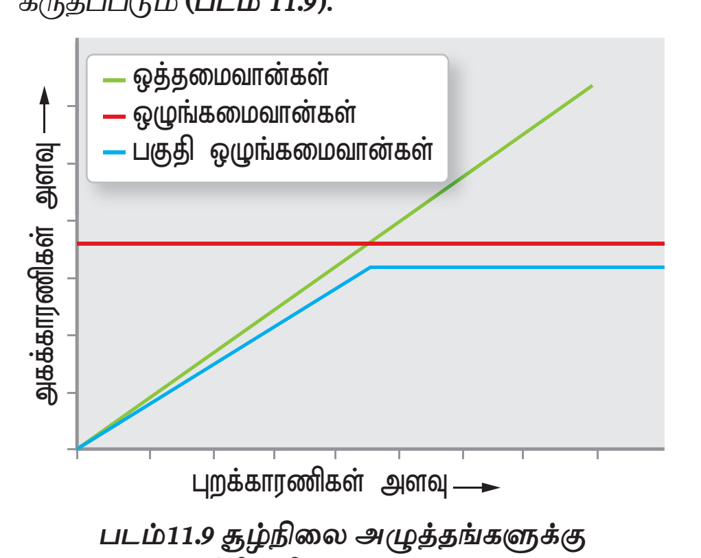

விலங்குகளில் உள்ள துலங்கல்களின்
வகைகள்

- ஒழுங்கமைவு (Regulate) சில விலங்கினங்கள்
உடற்சசெயலியல் செயல்கள் மூலம் சீரான
தன்நிலை காத்தலைப் பராமரிக்கின்றன.
அச்சசெயல்பபாடுகள்
வழியாக,
உடலின்
வெப்பநிலை, அயனிகள் / ஊடுகலப்பு சமன்
ஆகியவை
உறுதி
செய்யப்படுகிறது.

உயிரினங்கள் மற்றும் இனக்கூட்டம்

பறவைகள், பாலூட்டிகள் மற்றும் சில எளிய
முதுகுநாணிகள் மற்றும் முதுகுநாணற்ற
சிற்றினங்கள் இவ்வகை நெறிப்படுத்துதலை
மேற்கொள்ளும் திறன் பெற்றிருக்கின்றன.
- ஒத்தமைவு (Conform) : பெரும்பபாலான
விலங்குகளால்
உள்சூழ்நிலைகளை
நிலையாகப்
பராமரிக்க
முடிவதில்லை.
அவற்றின் உடல் வெப்பநிலை சுற்றுச் சூழல்
வெப்பநிலைக் கேற்ப மாறுகிறது. மீன்கள்
போன்ற
நீர்வவாழ்
உயிரிகளில்,
உடல்
திரவத்தின்
ஊடுகலப்புச்
செறிவு
சுற்றுச்சூழலில் உள்ள நீரின் ஊடுகலப்புச்
செறிவிற்ககேற்ப மாற்றமடைகிறது. இத்தகைய
விலங்குகள் ஒத்தமைவான்கள் எனப்படும்.
அதீத சூழல்களில் விலங்கினங்கள் வலசை
போவதன் மூலம் தங்களின் வாழிடங்களை
இடம் மாற்றிக் கொொள்கின்றன.
- வலசைபோதல் (Migration) : ஒரு வாழிடத்தில்
வாழும் விலங்குகள் அங்கு நிலவும் அதிக சூழல்
அழுத்தத்திலிருந்து தப்பிக்க, இடம்பபெயர்ந்து
புதிய வாழத்தகுந்த பகுதிக்குச் செல்கின்றன.
அதன்
வாழிடத்தில்
சூழல்
அழுத்தம்
நீங்கும்போது அவை மீண்டும் தனது பழைய
இடத்திற்கு வருகின்றன. சைபீரியாவில் வாழும்
பறவைகள்
கடுங்குளிர்பருவத்திலிருந்து
தற்ககாத்துக் கொொள்ள வலசைபோதல் முறையில்
இடம்பபெயர்ந்து தமிழ்நநாட்டின் வேடந்ததாங்கல்
பகுதிக்கு வருகின்றன.
செயலற்ற நிலை (Suspend) : சிலசமயம்,
விலங்கினங்கள் இடம்பபெயர்ந்து செல்ல இயலாத
சூழலில், சூழல் அழுத்தத்திலிருந்து விடுபட
செயலற்ற நிலைத் தனமையை மேற்கொள்கின்றன.
சில
கரடிகள்
குளிர்ககாலங்களில்
குளிர்
உறக்கத்தையும், சில நத்தைகள் மற்றும் மீன்கள்
போன்றவை வெப்பம் மற்றும் வறட்சி போன்ற
வெப்பம் தொொடர்பபான பிரச்சினைகளிலிருந்து
விடுபட
கோடைகால
உறக்கத்தையும்
மேற்கொள்கின்றன.
சில எளிய வகை
உயிரினங்கள் அதன் வாழ்க்கை சுழற்சியின் சில
நிலைகளை இடைநிறுத்தம் செய்து கொொள்கின்றன.
இது ‘வளர்ச்சித் தடை நிலை’ (diapause) எனப்படும்.

## 11.6 தகவமைப்புகள்

உயிரியலில்,
தகவமைப்பு
என்பது
உயிரினங்களை
அதன்
சுற்றுச்சூழலுக்குப்
உயிரினங்கள் மற்றும் இனக்கூட்டம்

பொொருத்தமானதாக மாற்றும் பரிணாம நிகழ்ச்சி
ஆகும். இது உயிரினங்களின் பரிணாமத் தகுதியை
அதிகரித்து, அதனைச் சூழலுக்கேற்ப மாற்றும்.
ஒவ்வொரு உயிரினத்திலும், பணியோடு தொொடர்பு
கொொண்ட,
புறத்தோற்றப்
பண்பு
அல்லது
தகவமைப்புப்
பண்பு
பராமரிக்கப்படுகிறது.
இப்பண்பு இயற்ககை தேர்வு உருவாக்கியதாகும்.
உடல் அமைப்பு சார்ந்தவை, நடத்தை சார்ந்தவை
மற்றும்
உடற்சசெயலியல்
சார்ந்தவை
என
தகவமைப்புப் பண்புகள் மூன்று வகையாகப்
பிரிக்கப்பட்டுள்ளது.

அ) உடல் அமைப்பு சார்ந்த
தகவமைப்புகள்

உயிரினங்களுக்கு உள்ளே மற்றும் வெளியே
உள்ள அமைப்புகள் (உறுப்புகள்) அவற்றின்
சூழலுக்கேற்ப தங்களைத் தகவமைத்துக் கொொள்ள
பெரிதும் உதவுகின்றன. உறை வெப்பநிலையில்
வாழ்வதற்ககேற்ப
பாலூட்டிகள்
கனத்த
உரோமத்தைக் கொொண்டுள்ளன என்பது இதற்கு
மிகச் சிறந்த எடுத்துக்காட்டு ஆகும். நிறமாற்றம்
(Camouflage) மற்றும் ஒப்புமைப்போலி (Mimicry)
போன்றவை
இயற்ககையின்
மிகச்
சிறந்த
தகவமைப்பு முறைகள் ஆகும். நிறம் மாறும்
விலங்குகள் சுற்றுச் சூழலின் நிறத்திற்ககேற்ப
தன்னை மாற்றிக் கொொள்வதால் அவற்றை
எளிதாகக் கண்டறிய முடியாது.
ஊர்வன
விலங்ககான பச்சோந்தி மற்றும் பூச்சியினத்தைச்
சேர்ந்த குச்சிப்பூச்சி ஆகியன இவ்வகைத்
தகவமைப்பை பெற்றவையாகும்.
இதனால்,
அவை எதிரிகளிடமிருந்து தப்பித்துக் கொொள்ளவும்,
இரையைப் பிடிக்கவும் முடிகிறது. குதிரையின்
கால்கள் புல்வவெளிகளிலும் தரைச்சூழல்களிலும்
வேகமாக ஓடுவதற்ககேற்ப அமைந்துள்ளது.

ஆ) நடத்தை சார்ந்த தகவமைப்புகள்

விலங்குகளின் செயல்கள் மற்றும் நடத்தைகள்
ஆகியவை உள்ளார்ந்த அல்லது கற்றுக்கொண்ட
பண்புகள் ஆகும். தங்களின் உயிர் வாழ்க்கை்காக,
விலங்கினங்கள் நடத்தை சார்ந்த பண்புகள்
அல்லது
தகவமைப்புகளை
உருவாக்கிக்
கொொள்கின்றன.
கொொன்றுண்ணிகளிடமிருந்து
தப்பித்தல், மறைவான இடங்களில் உறங்குதல்,
காலநிலை மாறும் போது அடைக்கலம் தேடுதல்
மற்றும் உணவு வளங்களைத் தேடித் திரிதல்
ஆகியவை நடத்தை சார்ந்த சில பண்புகளாகும்.
வலசைபோதல் மற்றும் கலவி ஆகிய இரண்டும்
முக்கியமான நடத்தை சார்ந்த தகவமைப்பு

வகைகள் ஆகும்.
வலசைபோதல் நிகழ்ச்சி,
விலங்கினங்கள்,
புதிய
வளங்களைக்
கண்டறியவும், அச்சுறுத்தலிலிருந்து தப்பிக்கவும்
உதவும். கலவி என்பது இனப்பபெருக்கத்திற்ககான
துணையை கண்டறிவதற்ககான பல நடத்தை
செயல்களின் தொொகுப்பு ஆகும்.
இரவு வாழ்
விலங்குகள் பகல் நேரங்களில் பூமிக்கு அடியில்
வாழ்கின்றன அல்லது செயலற்றுக் இருக்கின்றன.
இது
அவ்விலங்கின்
உணவூட்டம்
மற்றும்
செயல்முறை அல்லது வாழ்க்கை முறை அல்லது
நடத்தையின் மாறுபாடு ஆகும்.

2.

மீன்களின்
உடலில்
தொொகுப்புகளாக
இருப்பதால் அவை
பயன்படுகின்றன.

3.

படகு போன்ற உடல் அமைப்பு நீரில் வேகமாக
நீந்த உதவுகிறது.

4.

நீரில் கரைந்துள்ள ஆக்சிஜனைச் சுவாசிக்க
மீன்களின் செவுள்கள் உதவுகின்றன.

5.

காற்று நிரம்பிய காற்றுப் பைகள் மிதவைத்
தனமைக்கு உதவுகின்றன.

6.

பக்கக்கோட்டு
உணர்வுறுப்பு,
அழுத்த
உணர்வவேற்பியாகச்
செயல்படுகிறது.
இவ்வமைப்பு நீரில் உள்ள பொொருட்களை,
எதிரொொலியைப் பயன்படுத்திக் கண்டறியப்
பயன்படும்.

7.

கோழைச் சுரப்பிகளை அதிகமாகக் கொொண்ட
தோல், செதில்களால் மூடப்பட்டுள்ளது.

8.

கழிவுநீக்க உறுப்புகள்மூலம் இவை நீர்
மற்றும்
அயனிகள்
சமநிலையைப்
பேணுகின்றன.

நடத்தையியல் என்பது, இயற்ககையான
சூழலில்
விலங்கினங்களின்
நடத்தை
குறித்துப் படிக்கும் அறிவியல் பிரிவு ஆகும்.

இ) உடற்சசெயலியல் சார்ந்த
தகவமைப்புகள்

இவை
விலங்கினங்கள்
தமக்குரிய
தனித்துவமிக்க, சிறுவாழிடத்தை உள்ளடக்கிய
சூழலில்
சிறப்பாக
வாழ்வதற்கு
உதவும்
தகவமைப்புகள்
ஆகும்.
எடுத்துக்காட்டாக,
வேட்டையாடவும், இறைச்சியைக் கிழிக்கவும்
வசதியாக சிங்கங்களுக்கு கோரைப் பற்களும்
பச்சை மாமிசத்தை செரிப்பதற்ககான செரிமான
மண்டலமும் அமைந்துள்ளன.
குளிர்ககால
உறக்கம் மற்றும் கோடைகால உறக்கம் ஆகியவை
விலங்குகளின்
இரண்டு
மிகச்
சிறந்த
உடற்சசெயலியல் சார்ந்த தகவமைப்புகள் ஆகும்.
இவ்விரண்டும் வெவ்வேறு வகை செயலற்ற
தனமை
ஆனாலும்,
இச்சசெயல்களின்போது
விலங்குகளின் வளர்சிதை மாற்ற வீதம் மிகக்
குறைவாக இருப்பதால் அவற்றால் நீண்ட காலம்
உணவு உண்ணாமலும், நீர் அருந்ததாமலும் வாழ
முடிகிறது.
நீர் மற்றும் நில வாழிடங்கள்
ஒவ்வொன்றும் அவற்றுக்ககென வெவ்வேறு வகை
சுற்றுச்சூழல்
நிலைகளைக் கொொண்டுள்ளன.
எனவே
அங்கு
வாழும்
விலங்கினங்கள்
தங்களுக்கான
வாழிடங்களையும்,
சிறு
வாழிடங்களையும் தேர்ந்ததெடுப்பதற்கு ஏதுவாக,
பொொருத்தமான
தகவமைப்புப்
பண்புகளை
உருவாக்கி கொொள்கின்றன.
நீரில் வாழும் விலங்குகளின் தகவமைப்புகள்
1.

மீன்களின் இடுப்புத் துடுப்பு மற்றும் முதுகுத்
துடுப்புகள் சமநிலைப் படுத்தவும், வால்
துடுப்பு சுக்கானாகவும் (திசை மாற்றி)
செயல்படுகின்றன.

நிலவாழ் விலங்குகளின் தகவமைப்புகள்
1.

மண்புழு மற்றும் நிலவாழ் பிளனேரியாக்கள்
போன்றவை வளைதோண்டுதல், சுருளுதல்,
சுவாசம்போன்ற பிற செயல்பபாடுகளுக்காக
ஈரப்பதம் மிக்க சூழலைத் தருவதற்ககாக
உடலின்
மேற்பரப்பில்
கோழையைச்
சுரக்கின்றன.

2.

கணுக்காலிகளில் சுவாசப் பரப்புகளுக்கு
மேல் வெளிப்புறப் போர்வவையும், நன்கு
வளர்ச்சி பெற்ற மூச்சுக்குழல் மண்டலமும்
காணப்படுகின்றன.

3.

முதுகெலும்பிகளின்
தோலில்
நன்கு
பாதுகாக்கப்பட்ட சுவாசப் பரப்புகளுடன் பல
செல் அடுக்குகளும் உள்ளன.
இவை
நீரிழிப்பைத் தடுக்க உதவுகின்றன.

4.

சில விலங்குகள், கழிவு நீக்கத்தின் போது
ஏற்படும்
நீரிழிப்பை
ஈடு
செய்ய
உணவிலிருந்து நீரைப் பெறுகின்றன.

5.

பறவைகள்
அதிக
உணவு
கிடைக்கும்
மழைகாலம் துவங்கும் முன்பபே கூடுகட்டுதல்
மற்றும் இனப்பபெருக்கம் ஆகிய செயல்களில்
ஈடுபடுகின்றன.
வறண்ட
காலத்தில்
பறவைகள் அரிதாகவே இனப்பபெருக்கம்
செய்கின்றன.

உள்ள
தசைகள்
(மையோடோம்கள்)
இடப்பபெயர்ச்சிக்குப்

உயிரினங்கள் மற்றும் இனக்கூட்டம்

6.

தோல் மற்றும் சுவாசமண்டலம் உதவியினால்
ஆவியாக்கிக் குளிர வைப்பதன் மூலமும்
அதிக
அடர்த்தியுள்ள
சிறுநீரை
உருவாக்குவதன் மூலமும் அதன் உடல்
எடையில் 25% நீரிழப்பைத் தாங்கும் திறன்
பெற்றிருப்பதன் மூலமும் ஒட்டகங்கள் நீர்ச்
சமநிலையைப் பராமரிக்கின்றன.

## 11.7 இனக்கூட்டம் (Population)

தங்களுக்குள் அகக்கலப்பு
செய்து கொொள்ளக்கூடிய, ஒரே
சிற்றினத்தைச் சேர்ந்த, ஒரு
குறிப்பிட்ட
இடத்தில்
வாழ்கின்ற
மற்றும்
ஒரு
உயிரின
சமுதாயத்தின்
பகுதியாகச்
செயல்படும்
உயிரினங்களின்
தொொகுப்பே
இனக்கூட்டம்
எனப்படும். இனக்கூட்டத்தின் அடர்த்தி, பிறப்பு
வீதம், இறப்பு வீதம், வயது பகிர்வு, உயிரியல்
திறன், பரவல் மற்றும் r மற்றும் K ஆல் தேர்வு
செய்யப்பட்ட வளர்ச்சி வடிவங்கள் ஆகியவை
இனக்கூட்டத்தின் பல்வவேறு பண்புகளாகும். ஒரு
இனக்கூட்டத்தின் மரபுப் பண்புகள், அவற்றின்
தகவமைப்பு,
இனப்பபெருக்க
வெற்றி,
ஒரு
குறிப்பிட்ட
வாழிடத்தில்
நீண்ட
காலம்
நிலைத்திருக்கும் திறன் ஆகிய காரணிகளுடன்
நேரடியாகத் தொொடர்பு கொொண்டுள்ளது. ஒரு
உயிரினத்தின்
வாழ்க்கை
வரலாறு
அதன்
தனிப்பட்ட பண்புகளைப் பொொறுத்தது ஆகும்.
காலத்தோடு கொொண்ட தொொடர்பபை விளக்கும்
வகையில்
தெளிவான
அமைப்பையும்,
செயலையும் இனக்கூட்டம் பெற்றுள்ளது.

## 11.8 இனக்கூட்டத்தின் இயல்புகள்

இனக்கூட்டத்தின் அடர்த்தி
(Population density)

ஒரு அலகுப் பரப்பில், குறிப்பிட்ட காலத்தில்
வாழும் இனக்கூட்டத்தின் அளவு இனக்கூட்ட
அடர்த்தி எனப்படும். இயற்ககையான வாழிடத்தில்
வாழும் ஒரு சிற்றினத்தின் மொொத்த எண்ணிக்கை
அதன் இனக்கூட்ட அடர்த்தி எனப்படும். ஒரு
இனக்கூட்டத்தின்
அளவினைப்
பல்வவேறு
முறைகளில் அளவிடலாம்.
அவை மொொத்த
எண்ணிக்கை (உயிரினங்களின் உணமையான
எண்ணிக்கை),
எண்ணிக்கை
அடர்த்தி
(ஒரு அலகுப் பரப்பு அல்லது கொொள்ளளவில்
உள்ள உயிரினங்களின் எண்ணிக்கை) மற்றும்
உயிரினங்கள் மற்றும் இனக்கூட்டம்

உயிர்த்திரள் அடர்த்தி (ஒரு குறிப்பிட்ட பரப்பு
அல்லது கொொள்ளளவில் உள்ள உயிர்த்திரள்
அடர்த்தி) ஆகும். ஒரு சிற்றினத்தைச் சேர்ந்த
இனக்கூட்டத்தின்
அடர்த்தியை
ஒரு
சிற்றினத்திற்குக் கிடைக்கக்கூடிய வாழிடத்தின்
உணமையான
பரப்பினைக்
கொொண்டும்
குறிக்கலாம். ஒரு இனக்கூட்டத்தில் உள்ள
உயிரினங்களின் அளவு ஒப்பீட்டளவில் சீராக
இருந்ததால் அதன் அடர்த்தியை உயிரினங்களின்
எண்ணிக்கை அடிப்படையில் வெளிப்படுத்தலாம்
(எண்ணிக்கை அடர்த்தி).

பிறப்பு வீதம் (Natality)

பிறப்பு வீத அதிகரிப்பால் இனக்கூட்ட அளவு
அதிகரிக்கிறது. பிறத்தல், பொொரித்தல், முளைத்தல்
அல்லது பிளவுறுதல் ஆகிய செயல்களின்
காரணமாக புதிய உயிரினங்கள் உருவாவதை
வெளிப்படுத்துவதே பிறப்பு வீதம் ஆகும். இனப்
பெருக்கத்தின் இரண்டு முக்கிய காரணிகள்
கருவுறும் திறன் (Fertility) மற்றும் இனப்பபெருக்கத்
திறன் (Fecundity) ஆகியவை ஆகும்.
பிறப்பு
வீதத்தை சீரமைக்கப்படாத பிறப்பு வீதம் மூலம்
வெளிப்படுத்தலாம். சீரமைக்கப்படாத பிறப்பு
வீதம் என்பது ஒரு குறிப்பிட்ட காலத்தில் ஒரு
பெண்
உயிரிக்குப்
பிறக்கும்
உயிரிகளின்
எண்ணிக்கை ஆகும்.
பிறப்பு
குறிப்பிட்ட காலத்திய பிறப்பு எண்ணிக்கை
வீதம் (b) =
சராசரி இனக்கூட்டம்

இறப்பு வீதம் (Mortality)

இறப்பு வீதம் என்பது பிறப்பு வீதத்துக்கு
எதிரான இனக்கூட்டத்தொகை குறைப்புக் காரணி
ஆகும். இறப்பு வீதம் என்பது ஒரு குறிப்பிட்ட
காலத்தில்
இழக்கப்படும்
உயிரினங்களின்
எண்ணிக்கையைக் குறிக்கும். பொொதுவாக இறப்பு
வீதம்
என்பது
குறித்த
இறப்பு
வீதமாக
வெளிப்படுத்தப்படும். அதாவது குறிப்பிட்ட கால
கட்டம் கடந்த பின்பு ஒரு மூல இனக்கூட்டத்தில்
இறந்துவிட்ட உயிரினங்களின் எண்ணிக்கையைக்
குறிக்கும். சீரமைக்கப்படாத இறப்பு வீதத்தை
கீழ்க்கண்ட சூத்திரத்தால் கணக்கிடலாம்.
இறப்பு
குறிப்பிட்ட காலத்திய இறப்பு எண்ணிக்கை
வீதம் (d) =
சராசரி இனக்கூட்டம்

ஒரு உயிரினத் தொொகையின் இறப்பு வீதம் அதன்
அடர்த்தியால் நிர்ணயிக்கப்படுகிறது. உயிரினத்
தொொகையின் அடர்த்தி அதிகமாகும்போது இட

நெருக்கடி, கொொன்று தின்னும் பண்பு அதிகரித்தல்
மற்றும் நோய் பரவல் காரணமாக இறப்பு வீதமும்
அதிகரிக்கிறது.
இறப்பு வீதம் சிற்றினத்திற்ககேற்ப மாறுபடும்.
கூடுகள், முட்டைகள் அல்லது இளம் உயிரினங்கள்
ஆகியன அழிவதற்குக் காரணமான புயல், காற்று,
வெள்ளம் கொொன்று தின்னிகள், விபத்துக்கள்
மற்றும் பெற்றோரால் தனித்து விடப்படுதல் ஆகிய
பலகாரணிகள் இறப்பு வீதத்தை் தூண்டுகின்றன.

இனக்கூட்டப் பரவல்
(Population dispersion)

தடை ஏற்படும் வரை தொொடர்ந்து அனைத்துத்
திசைகளிலும் இனக்கூட்டம் பரவும் இயல்புடையது.
இதனை
உள்ளே
வருதல்
(உள்ளேற்றம்)
இனக்கூட்டதிலிருந்து
வெளியேறுதல்
(வெளியேற்றம்) ஆகிய நிகழ்வுகளால் உணரலாம்.

வலசை போதல்

வலசைபோதல்
என்பது
ஓரிடத்திலிருந்து
மற்றொரு
இடத்திற்கும்,
மீண்டும்
பழைய
இடத்திற்குமான
பெருமளவிலான
உயிரினங்களின் தனித்துவமான இயக்கத்தை /
நகர்வவைக் குறிக்கும்.
சைபீரியாவில் வாழும்
சைபீரியக் கொொக்குகள், கடுமையான பனிக்காலக்
குளிரைத்
தவிர்க்கும்
பொொருட்டு
சைபீரியாவிலிருந்து
தமிழ்நநாட்டின்
வேடந்ததாங்கலுக்கு வருகை தந்து பின்பு வசந்த
காலத்தின்போது
திரும்பச்
செல்கின்றன.
சால்மன் போன்ற மீன்கள் கடல் நீரிலிருந்து
நன்னீருக்கும் (நன்னீர் நோக்கி வலசைபோதல் –
அனாட்ரராமஸ்) விலாங்கு போன்ற மீன்கள்,
நன்னீரிலிருந்து கடல் நீருக்குமாய் (கடல் நீர்
நோக்கி வலசைபோதல் - கட்டாட்ரராமஸ்) வலசை
போகின்றன.

À½Š ªƒ¼ÎØ

குடிப்பபெயர்ச்சி / வெளியேற்றம்

இயற்ககையான
சூழலில்
இடநெருக்கடி
காரணமாக வெளியேற்றம் நிகழ்கிறது. இது ஒரு
குறிப்பிட்ட இடத்தில் உயிரினத் தொொகையைக்
கட்டுபடுத்தி,
அவ்வாழிட
வளங்களின்
வரையறையற்ற
பயன்பபாட்டைத்
தடுக்கும்
தகவமைப்புப் பண்பு ஆகும். மேலும் இது புதிய
வாழிடங்களைக் கண்டறியவும் பயன்படும்.

குடியேற்றம் / உள்ளேற்றம்

குடியேற்றம் காரணமாக இனக்கூட்டத்தின்
அளவு அதிகரிக்கும். இனக்கூட்டத்தின் அளவு
தாங்கு திறனை விட அதிகரித்தால் உள்ளேறிய
உயிரினங்களின் இறப்பு வீதம் அதிகரிக்கும்
அல்லது உயிரினங்களின் இனப்பபெருக்கத்திறன்
குறையும்.
உள்ளேற்றம் மற்றும் வெளியேற்றம் ஆகிய
இரண்டு நிகழ்வுகளும் தட்ப, வெப்பநிலை மற்றும்
பிற உயிரற்ற மற்றும் உயிர்க் காரணிகளால்
தூண்டப்படுகின்றன.

## 11.9  இனக்கூட்டம் – வயது பரவல்

(Population age distribution)
இனக்கூட்டத்தில்
உள்ள
உயிரினங்களின்
வெவ்வேறு குழுவின் வயது விகிதம் (இனப்
பெருக்கத்திற்கு முந்ததைய வயது, இனப்பபெருக்க
வயது மற்றும் இனப்பபெருக்கத்திற்கு பிந்ததைய
வயது) அதன் வயதுப் பரவலைக் குறிக்கிறது. இது
ஒரு குறிப்பிட்ட காலத்தில், ஒரு இனக்கூட்டத்தின்
இனப்பபெருக்க நிலையைக் நிர்ணயிக்கிறது. இது
எதிர்ககால இனக்கூட்ட அளவைத் தீர்மமானிக்கும்
காரணியும் ஆகும்.
பொொதுவாக வேகமாக வளரும் இனக்கூட்டத்தில்
இளம் உயிரினங்களின் எண்ணிக்கை அதிகமாகக்

À½Š à¾Àt

+y ßÄ΁àÙb´ À½Š

ßÄ΁àÙb´ À½Š
y ßÄ΁àÙb´ À½Š
ª)´.b†j ßÄb“f¸j

*ƒ¿hº ßÄb“f¸j

†ƒÃŽj ßÄb“f¸j

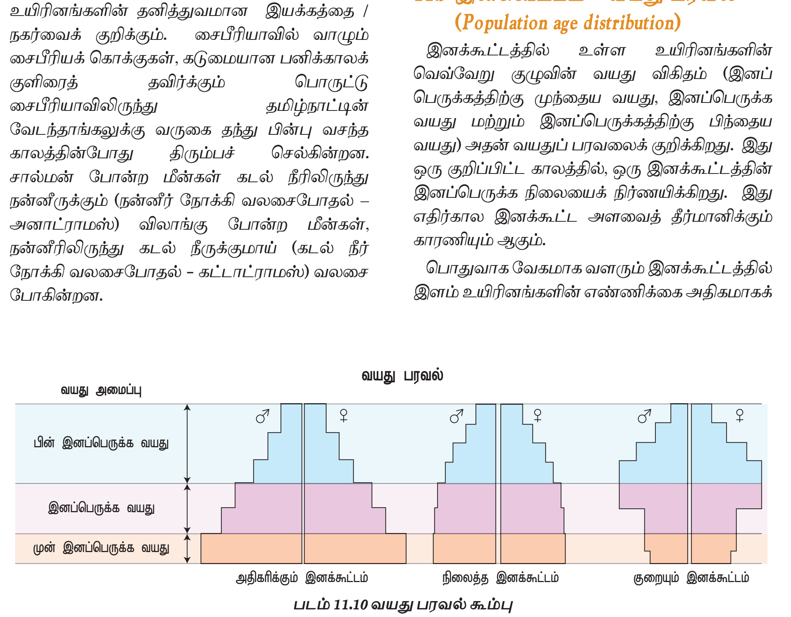

உயிரினங்கள் மற்றும் இனக்கூட்டம்

அட்டவணை 11.2 r-தேர்வு செய்த மற்றும் K-தேர்வு செய்த சிற்றினங்களுக்கிடையேஉள்ள வேறுபாடுகள்
உயிரினத் திறன் அல்லது இனப்பபெருக்கத் திறன் (r)
r-தேர்வு செய்த சிற்றினங்கள்

காணப்படும். ஒரு நிலைத்த இனக்கூட்டத்தில்
வெவ்வேறு வயதுடைய உயிரினக் குழுக்களின்
பரவல் சீராக இருக்கும். இனக்கூட்டத்தின் அளவு
குறையும் நிலையில் முதிர்ந்த உயிரினங்கள்
அதிகமாகக் காணப்படும் (படம் 11.10).

## 11.10  வளர்ச்சி மாதிரிகள் /

வளைவுகள்
இனக்கூட்டத்தின்
வளர்ச்சி
ஒரு
தனித்துவமான
குறிப்பிட்ட
வடிவங்களில்
அமைகிறது. வரைபடத்தில் இதனை வரையும்
போது J வடிவ வளர்ச்சி மற்றும் S வடிவ வளர்ச்சி
(சிக்மமாய்டு) என இரு வடிவங்கள் கிடைக்கின்றன.

Þù‚ Æì‹

àJKùˆ
Fø¡

²ŸÁ„Åö™
î¬ìèœ

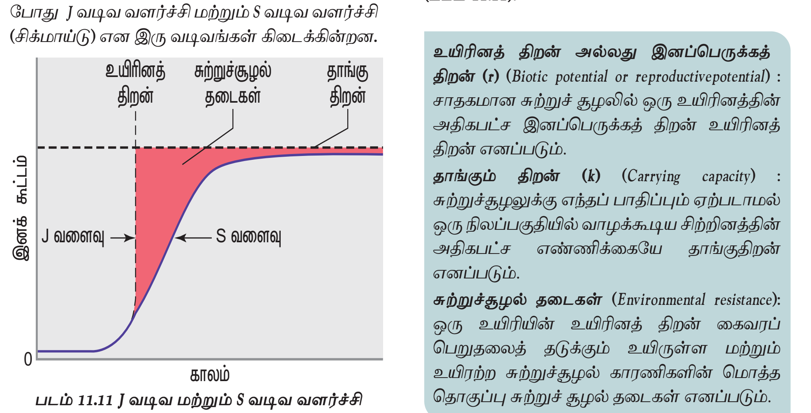

உயிரினங்கள் மற்றும் இனக்கூட்டம்

தாங்கும் திறன் (k)
k-தேர்வு செய்த சிற்றினங்கள்

‘J’ வடிவிலான வளர்ச்சி வடிவம்

ஒரு இனக்கூட்டத்தின் அளவு விரைந்து
பெருகிக் கொொண்டிருக்கும்போது, சுற்றுச்சூழல்
தடை அல்லது திடீரெனத் தோன்றும் கட்டுப்படுத்தும்
காரணிகள் ஆகியவற்றால் வளர்ச்சி விகிதம்
உடனடியாகத் தடை செய்யப்படுகிறது. இவை
J வடிவிலான வளர்ச்சியைக் கொொடுக்கின்றன.
மழைக்காலங்களில், நிறைய பூச்சி வகைகளின்
எண்ணிக்கை
உடனடியாக
அதிகரிக்கும்,
மழைக்காலங்களின் முடிவில் அவை மறையும்
(படம் 11.11).
உயிரினத் திறன் அல்லது இனப்பபெருக்கத்
திறன் (r) (Biotic potential or reproductivepotential) :
சாதகமான சுற்றுச் சூழலில் ஒரு உயிரினத்தின்
அதிகபட்ச இனப்பபெருக்கத் திறன் உயிரினத்
திறன் எனப்படும்.
தாங்கும் திறன் (k) (Carrying capacity) :
சுற்றுச்சூழலுக்கு எந்தப் பாதிப்பும் ஏற்படாமல்
ஒரு நிலப்பகுதியில் வாழக்கூடிய சிற்றினத்தின்
அதிகபட்ச
எண்ணிக்கையே
தாங்குதிறன்
எனப்படும்.
சுற்றுச்சூழல் தடைகள் (Environmental resistance):
ஒரு உயிரியின் உயிரினத் திறன் கைவரப்
பெறுதலைத் தடுக்கும் உயிருள்ள மற்றும்
உயிரற்ற சுற்றுச்சூழல் காரணிகளின் மொொத்த
தொொகுப்பு சுற்றுச் சூழல் தடைகள் எனப்படும்.

S வடிவிலான வளர்ச்சி வடிவம்
(சிக்மமாய்டு வடிவம்)

சில
இனக்கூட்டங்களில்
தொொடக்கத்தில்
உயிரினங்கள் எண்ணிக்கை மிக மெதுவாகவும்,
பின் வேகமாகவும் உயர்ந்து, பின்பு சுற்றுச்சூழல்
தடைகளின் அதிகரிப்பால் மெதுவாகக் குறைந்து
வளர்ச்சி வேகம் சமநிலையை எட்டி தொொடர்ந்து
பராமரிக்கப்படுகிறது.
இவ்வகை வளர்ச்சி
S வடிவத்தைக் கொொடுக்கின்றது.

## 11.11  இனக்கூட்டம்

நெறிப்படுத்தப்படுதல்
(Population Regulation)
அனைத்து
விலங்கினக்கூட்டத்தின்
உள்ளார்ந்த நோக்கம் எண்ணிக்கை அதிகரிப்பதே
ஆகும். ஆனால் எண்ணிக்கை எல்லையில்லாமல்
அதிகரிப்பதில்லை. சுற்றுச்சூழல் தாங்குதிறன்
எல்லையை எட்டியவுடன், இனக்கூட்டத்தின்
எண்ணிக்கை
நிலையாகவோ,
சுற்றுச்சூழல்
நிலைகளுக்கேற்ப
ஏற்ற
இறக்கமாகவோ
காணப்படும்.
இனக்கூட்டத் தொொகையை பல
காரணிகள் நெறிப்படுத்துகின்றன. அவை
1.

அடர்த்தி சாராதது – புறக் காரணிகள்

2.

அடர்த்தி சார்ந்தது – அகக் காரணிகள்

உயிரினத்திற்கு
கிடைக்கும்
இடப்பரப்பு,
வசிப்பிடம், தட்பவெப்பம், உணவு ஆகியன புறக்
காரணிகள் ஆகும். போட்டி, கொொன்றுண்ணுதல்,
வெளியேற்றம், உள்ளேற்றம் மற்றும் நோய்கள்
ஆகியவை அகக் காரணிகள் ஆகும்.

## 11.12  இனக்கூட்டச் சார்பு

(Population interaction)
வெவ்வேறு இனக்கூட்டத்தைச் சேர்ந்த
உயிரினங்கள் உணவு, வாழிடம், இணை மற்றும்
பிற தேவைகளுக்காக ஒன்றறையொொன்று சார்ந்து
வாழ்கின்றன.
இத்தகைய சார்பு வாழ்க்கை
சிற்றினங்களுக்குள்ளேயோ (ஒரே சிற்றினத்தைச்
சேர்ந்த
உயிரினங்களுக்கிடையே)
அல்லது
வெவ்வேறு
சிற்றினங்களுக்கிடையேயோ
(வெவ்வேறு
சிற்றினத்தைச்
சேர்ந்த
உயிரினங்களுக்கிடையே) ஏற்படுகின்றன.
சிற்றினங்களுக்குள்ளே உள்ள சார்பு
உயிர்வவாழ்வதற்குத் தேவையான உணவு, எல்லை
உணர்வு, இனப்பபெருக்கம் மற்றும் பாதுகாப்பு
போன்ற காரணங்களுக்காக ஏற்படுகின்றன.
சிற்றினங்களுக்கிடையே உள்ள சார்பு வாழ்க்கை
அட்டவணை 11.3ல் குறிக்கப்பட்டுள்ளது.

வெவ்வேறு சிற்றினங்களுக்கிடையே உள்ள
சார்பு கீழ்க்கண்ட வகைகளில் இருக்கலாம்.
நடுநிலை சார்பு: வெவ்வேறு சிற்றினங்கள்
ஒன்றறாக வாழ்ந்ததாலும் அவை ஒன்றறையொொன்று
பாதிப்பதில்லை.
நேர்மறை சார்பு: இத்தகைய இணை வாழ்வில்
தொொடர்பு
கொொண்டிருக்கும்
எந்த
உயிரும்
பாதிக்கப்படுவதில்லை,
மற்றும்
அவ்வாழ்க்கையால்,ஒன்றோஅல்லதுஇரண்டுமோ
நனமையடைகின்றன. பகிர்ந்து வாழும் வாழ்க்கை
மற்றும் உதவி பெறும் வாழ்க்கை என இச்சார்பு
வாழ்க்கை இரு வகைப்படும்.
எதிர்மறைச் சார்பு: தொொடர்புடைய ஒரு உயிரினம்
அல்லது இரு உயிரினங்களும் பாதிப்படையும்.
எடுத்துக்காட்டு போட்டி, கொொன்றுண்ணுதல்
மற்றும் ஒட்டுண்ணி வாழ்க்கை.
கேடு செய்யும் வாழ்க்கை (-, 0) (Amensalism)
இத்தகைய சூழலியல் சார்பில், பெரிய மற்றும்
சக்தி வாய்ந்த ஒரு சிற்றினத்தைச் சேர்ந்த
உயிரினம்,
எந்தவித
பலனும்
பெறாமல்
மற்றொரு சிற்றின உயிரினத்திற்குக் கேடு
விளைவிக்கிறது. எடுத்துக்காட்டு: யானையின்
கால்களில் அழிக்கப்படும் சிறிய உயிரினங்கள்.
பகிர்ந்து வாழும் வாழ்க்கை (+, +) (Mutualism)
இவ்வகை சார்பில் தொொடர்புள்ள இரண்டு
வெவ்வேறு
சிற்றினத்தைச்
சேர்ந்த
விலங்கினங்களும்
ஒன்று
மற்றொன்றறால்
பலனடைகின்றன.
இவ்வாழ்க்கை
முறையில்
ஈடுபட்டுள்ள சிற்றினங்கள் தனித்தனியாகவும்
மற்றொன்றறை சாராமல் சுதந்திரமாகவும் வாழ
இயலும். (தன் விருப்ப பகிர்ந்து வாழும் வாழ்க்கை)
அல்லது இரு சிற்றினங்களில் ஒன்றில்லாமல்
மற்றொன்று வாழ இயலாமல் இருக்கலாம்
(கட்டாய பகிர்ந்து வாழும் வாழ்க்கை முறை)
எடுத்துக்காட்டுகள்:
- தாவர உண்ணிகளின் பெருங்குடல் பிதுக்கம்
மற்றம்
சிறுகுடலில்
வாழும்
சில
பாக்டீரியாக்கள் செல்லுலோஸ் செரித்தலுக்கு
உதவுகின்றன.
விருந்தோம்பி
உயிரி,
பாக்டீரியாக்கள்
பெருகத்
தேவையான
பாதுகாப்பான சூழலை வழங்குகின்றன.
- தாவரங்களில் அயல் மகரந்தச் சேர்க்கையில்
ஈடுபடும்
பூச்சிகளும்,
பறவைகளும்,
பூக்களிலிருந்து பூந்ததேன் மற்றும் மகரந்தத்தைப்
பெறுகின்றன.
இது
வேளாணமையில்
முக்கியமான நிகழ்வு ஆகும்.

உயிரினங்கள் மற்றும் இனக்கூட்டம்

அட்டவணை 11.3 இரு சிற்றின கூட்டங்களுக்கிடையேயான சார்பபை பகுப்பாய்தல்
வ.
எண்

சார்பின்
வகை

கேடு செய்யும்
வாழ்க்கை

பகிர்ந்து
வாழுதல்

சிற்றினம்

+

சிற்றினம்

சார்பின் தனமை

எடுத்துக்காட்டு

சக்தி வாய்ந்த பெரிய
உயிரினங்கள்,
சிறிய உயிரினங்கள்
வளர்ச்சியைத் தடுத்தல்

யானையின் கால்களில்
அழிக்கப்படும் சிறிய
விலங்குகள்

+

இரண்டு
சிற்றினங்களுக்கும்
பயனுள்ள தொொடர்பு

முதலைக்கும்
பறவைகளுக்கும் உள்ள
தொொடர்பு

உறிஞ்சு மீன் மற்றும்
சுறாமீன்

உதவிபெறும்
வாழ்க்கை

+

உதவி பெறும் உயிரி
(உயிரினக் கூட்டம்1) பலனடைகிறது.
விருந்தோம்பி
பாதிக்கப்படுவது
இல்லை

போட்டி

ஒன்றறை மற்றொன்று
தடை செய்தல்

பறவைகள் உணவுக்காக
அணில்களுடன்
போட்டியிடுதல்

சிறியஉயிரினக் கூட்டம்-1
சிறிய விருந்தோம்பியைப்
பாதித்து பலனடைகிறது.
ஒட்டுண்ணி
விருந்தோம்பியை விடச்
சிறியது.

மனிதனின் உணவு
மண்டலத்தில் உள்ள
அஸ்ககாரிஸ் மற்றும்
நாடாப்புழு

பெரிய கொொன்று
தின்னும் உயிரி
இரையைக் கொொல்கிறது.
கொொன்று தின்னும்
உயிரி இரையை விடப்
பெரியது.

சிங்கம் மானை
வேட்டையாடுதல்

ஒட்டுண்ணி
வாழ்க்கை

கொொன்று
தின்னுதல்

+

+

- சிறிய பறவைகள் முதலையின் பற்களைச்
சுத்தப்படுத்துகின்றன. இதில் பறவைகள்
உணவைப்
பெறுகின்றன,
மற்றும்
முதலைகளின் பற்கள் சுத்தமாகின்றது.
- துறவி நண்டு தனது ஓட்டின் மீது கடல்
சாமந்தியைத் (நகராத குழியுடலி) தூக்கிச்
செல்கிறது.
கடல் சாமந்தியின் கொொட்டும்
செல்களால், நண்டு பாதுகாக்கப்படுகிறது.

உயிரினங்கள் மற்றும் இனக்கூட்டம்

அதே சமயம் கடல் சாமந்தி தன் உணவைப்
பெறுகிறது (படம் 11.12).

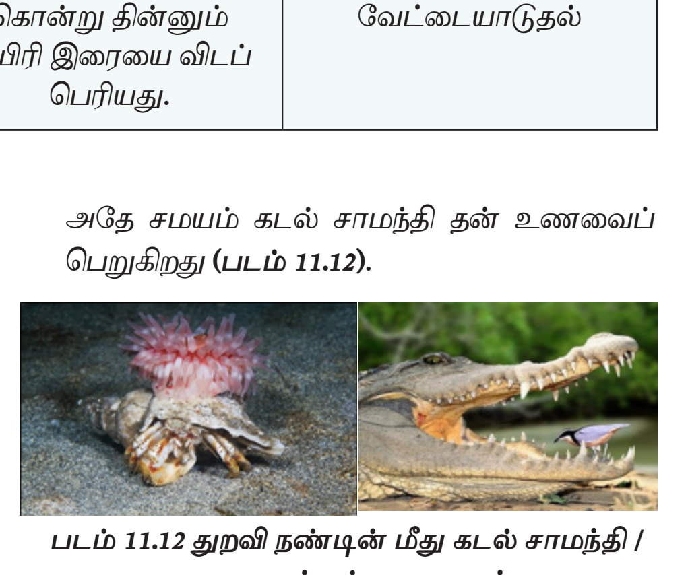

உதவிபெறும் வாழ்க்கை (+, 0) (Commensatism)
இவ்வகையான
விலங்கினத்
தொொடர்பில்
இரண்டு அல்லது இரண்டுக்கும் மேற்பட்ட
சிற்றினங்கள்
உணவிற்ககாக
இணைந்து
வாழ்கின்றன.
இவற்றில் ஒரு சிற்றின உயிரி
நனமை அடைகிறது. மற்றொரு சிற்றின உயிரி
நனமையோ, தீமையோ அடைவதில்லை. சமீப
காலங்களில், இவ்வகை உயிரினத் தொொடர்பு
உணவுக்காக மட்டுமின்றி ஆதரவு, பாதுகாப்பு,
உற்பத்தி மற்றும் இடப்பபெயர்ச்சி போன்ற
தேவைகளுக்காகவும்
நிகழலாம்
எனக்
கண்டறியப்பட்டுள்ளது. எடுத்துக்காட்டுகள்
- திமிங்கலத்தின்
உடலில்
ஒட்டியுள்ள
பர்னக்கிள்கள், விருந்தோம்பியுடன் ஆயிரக்
கணக்கான மைல்கள் இடம் பெயர்வதுடன்,
தனக்குத்
தேவையான
உணவையும்
நீரிலிருந்து வடிகட்டி எடுத்துக் கொொள்கிறது.
- எக்ரட் (கொொக்குகள்) கால்நடைகள் மேயும்
பகுதியிலேயே
காணப்படும்.
இவை
கால்நடைகளால்
சலனப்படுத்தப்பட்ட
பூச்சிகளைப் பிடித்து உண்கின்றன. இதில்
பறவைகள்
பலனடைகின்றன.
ஆனால்
கால்நடைகள்
பாதிக்கப்படுவதில்லை
(படம் 11.13).

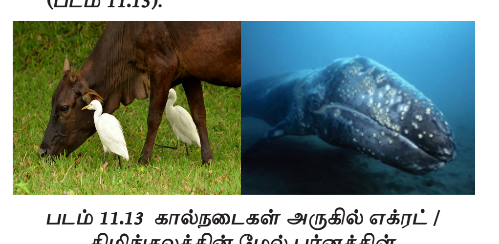
போட்டி (-, -) (Competition)
இவ்வகை உயிரினத் தொொடர்பில் ஒரே சிற்றின
உயிரினங்களோ,
வெவ்வேறு
சிற்றின
உயிரினங்களோ, குறைவாக உள்ள உணவு, நீர்,
கூடுகட்டும்
பரப்பு,
இருப்பிடம்,
இனப்பபெருக்கத்துணை மற்றும் வளங்களைப்
பயன்படுத்திக்
கொொள்வதற்ககாகப்
போட்டியிடுகின்றன. ஒரு வாழிடத்தில் இயற்ககை
வளங்கள் அதிகமாக இருந்ததால் அங்கு வாழும்
சிற்றினங்களுக்கிடையே போட்டி நிகழுவதில்லை.
இயற்ககை வளம் குறையும்போது அவ்வாழிடத்தில்
வாழும் பலவீனமான, குறைவான தகவமைப்புகள்
உடைய அல்லது குறைவான வன்நடத்தை உள்ள
உயிரினங்கள் சவாலைச் சந்திக்கும் சூழலுக்குத்
தள்ளப்படுகின்றன.
இந்நிகழ்ச்சி ஹார்டினின்

‘போட்டித் தவிர்ப்பு (Competitive exclusion) தத்துவம்’
எனப்படும் (படம் 11.14).

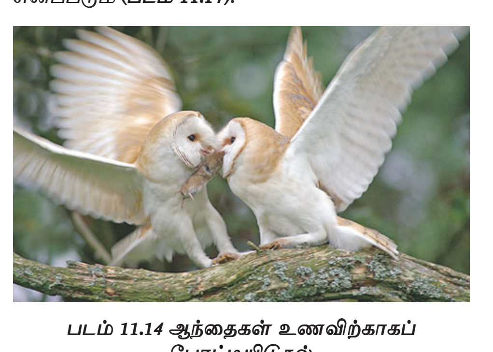
போட்டியின் வீச்சு
ஒரே
சிற்றினத்தைச்
சேர்ந்த
உயிரினங்களக்கிடையே
போட்டி
மிகக்
கடுமையாக இருக்கும். ஏனெனில், அவை ஒரே
வகையான உணவு மற்றும் இணை போன்ற
காரணிகளுக்காகப் போராட வேண்டியுள்ளது.
எ.கா. –ஆந்ததைகள் உணவுக்காகப் போட்டியிடுதல்.
இரு வேறு சிற்றினங்களுக்கிடையே உள்ள
போட்டி, அவ்வுயிரிகள் ஒரே வளம் அல்லது
பொொதுவான
பிற
காரணிகளுக்காகச்
சார்ந்திருக்கும் போது மட்டுமே நிகழ்கிறது.
போட்டியின் கடுமைத் தனமை, வெவ்வேறு
சிற்றினங்களின்
தேவைகளில்
உள்ள
ஒற்றுமையின் அளவு, வாழிடத்தில் உள்ள
வளங்களின் பற்றாக்குறை போன்ற காரணிகளால்
தீர்மமானிக்கப்படுகிறது.
எடுத்துக்காட்டாக,
பறவைகள் மற்றும் அணில்கள் போன்றவை
கொொட்டைகள்
மற்றும்
விதைகளுக்காகப்
போட்டியிடுதல், மற்றும் பூச்சிகள் மற்றும்
குளம்புயிரிகள்
ஆகியவை
புல்வவெளிகளில்
உணவுக்காகப் போட்டியிடுதல்.
ஒட்டுண்ணி வாழ்க்கை (+, -) (Parasitism)
இருவேறு சிற்றினங்களுக்கு இடையே உள்ள
இவ்வகைத்
தொொடர்பில்
ஒரு
சிற்றினம்
‘ஒட்டுண்ணி’ எனவும் மற்றொன்று ‘விருந்தோம்பி’
எனவும்
அழைக்கப்படும்.
ஒட்டுண்ணி,
விருந்தோம்பியைப்
பாதிப்பதன்
மூலம்
பலனடைகிறது.
ஒட்டுண்ணி
தனக்குத்
தேவையான இருப்பிடம், உணவு மற்றும்
பாதுகாப்பை
விருந்தோம்பியிடமிருந்து
பெறுகின்றது.
ஒட்டுண்ணிகள்,
விருந்தோம்பியைச் சுரண்டிப் பலன் பெற உரிய
தகவமைப்புகளைப்
பெற்றுள்ளன.

உயிரினங்கள் மற்றும் இனக்கூட்டம்

ஒட்டுண்ணிகள் வைரஸாகவோ (தாவர/விலங்கு
வைரஸ்கள்)
நுண்ணுயிரிகளாகவோ
(எடுத்துக்காட்டு, பாக்டீரியா ஒரு செல் உயிரி/
பூஞ்சசை), தாவர ஒட்டுண்ணியாகவோ மற்றும்
விலங்கு ஒட்டுண்ணியாகவோ (தட்டைப்புழுக்கள்,
உருளைப்புழுக்கள்,
கணுக்காலிகள்)
இருக்கலாம். ஒட்டுண்ணிகள், விருந்தோம்பிகளின்
மேல்பரப்பில் ஒட்டிக் கொொண்டோ அல்லது
வசிக்கவோ செய்யலாம். (புற ஒட்டுண்ணிகள்பேன், அட்டை) அல்லது விருந்தோம்பியின்
உடலுக்குள்
வாழலாம்
(அக
ஒட்டுண்ணிகள்

அஸ்ககாரிஸ்,
தட்டைப்புழுக்கள்).
பொொதுவாக
அக
ஒட்டுண்ணிகள்
உணவுப்பாதை,
உடற்குழி,
பல்வவேறு உறுப்புகள், இரத்தம் அல்லது பிற
திசுக்களில் வாழும்.
ஒட்டுண்ணிகள் தற்ககாலிக அல்லது நிரந்தர
ஒட்டுண்ணிகளாக இருக்கலாம்.
தற்ககாலிக
ஒட்டுண்ணிகள் தன் வாழ்க்கைச் சுழற்சியின் ஒரு
பகுதியை மட்டும் ஒட்டுண்ணியாகக் கழிக்கின்றன.
எ.கா. அனடோனியாவின் (நன்னீர் மட்டியின்)
கிளாக்கிடியம் லார்வவா, மீன்களின் உடலின் மீது
ஒட்டிக் கொொண்டு வாழும். நிரந்தர ஒட்டுண்ணிகள்
தன் வாழ்நநாள் முழுவதும் விருந்தோம்பியைச்
சார்ந்து வாழ்கின்றன. எ.கா. பிளாஸ்மோடியம்,
எண்டமீபா, உருளைப் புழுக்கள், ஊசிப்புழு,
தட்டைப் புழுக்கள் போன்றவை.
கொொன்றுண்ணி வாழ்க்கை (+, -) (Predation)
இவ்வகை உயிரினச் சார்பில் ஒரு விலங்கு
மற்றொரு
விலங்ககை
உணவுக்காகக்
வேட்டையாடுகிறது.
ஒட்டுண்ணி வாழ்க்கை
போன்று கொொன்றுண்ணி வாழ்க்கையும், சமுதாய
செயல்பபாடுகளுக்கு
முக்கியமானது
ஆகும்.
ஆனால் இத்தொடர்பில் வேட்டையாடும் விலங்கு,
தனது
இரையை
விடப்
பெரியதாகவும்
வெளியிலிருந்து இரையைப் பிடிப்பதாகவும்
இருக்கிறது. ஆனால் ஒட்டுண்ணி வாழ்க்கை
முறையில் ஒட்டுண்ணி தன் விருந்தோம்பியை
விடச்
சிறியதாகவும்,
அதன்
உடலுக்குள்/
வெளியில் இருந்து உணவை பெறவும் செய்கிறது.
கொொன்றுண்ணும் தனமை அடிப்படையில்
கொொன்றுண்ணி விலங்குகள் சிறப்பான வகை
மற்றும் பொொதுவான வகை என பிரிக்கப்படுகிறது.
சிறப்பு வகை சார்ந்த கொொன்றுண்ணிகள் சில
குறிப்பிட்ட சிற்றின விலங்குகளை மட்டுமே
வேட்டையாடுகின்றன. சிங்கம் மற்றும் மான்
ஆகியவற்றுக்கிடையேயான
தொொடர்பு
கொொன்றுண்ணி - இரை தொொடர்பு எனப்படும்.
உயிரினங்கள் மற்றும் இனக்கூட்டம்

இதில் சிங்கம் வேட்டையாடும் விலங்கு, மான்
அதன் இரையாகும். இவ்வகையான தொொடர்பு
ஊட்டநிலைகளுக்கிடையே
உணவாற்றலைக்
கடத்தவும், இனக்கூட்டத்தை நெறிப்படுத்தவும்
உதவும் (படம் 11.15).

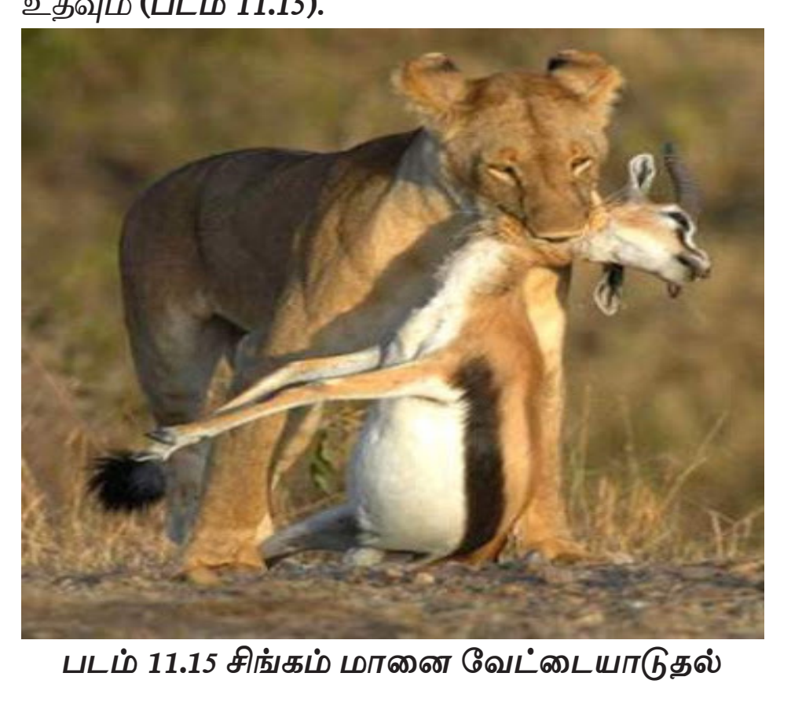

பாடச்சுருக்கம்

சுற்றுச்சூழலியல் என்பது உயிரினங்களுக்கும்,
அவை வாழும் சுற்றுச்சூழலின் உயிரின மற்றும்
உயிரற்ற
காரணிகளுக்குமிடையே
உள்ள
தொொடர்பபைப் படிக்கும் அறிவியல் பிரிவு ஆகும்.
சுற்றுச்சூழலின்
இயற்பியல்
காரணிகளான
வெப்பநிலை, ஒளி, நீர், மண், ஈரப்பதம், காற்று
மற்றும்
நிலஅமைப்பு
ஆகியவற்றுக்கேற்ப
உயிரிகள்
வெவ்வேறு
தகவமைப்புகளைப்
பெற்றுள்ன.
உச்சநிலை செயல்பபாட்டுக்காக
உயிரினங்கள் சீரான அகச்சூழலை பராமரிக்க
முற்படுகின்றன. ஆயினும், ஒரு சில உயிரினங்களே
மாறுபடும் சூழலுக்கேற்ப தன்நிலை காத்துக்
கொொள்கின்றன.
(ஒத்தமைவான்) மற்றவை
ஒழுங்கமைகின்றன. குறிப்பிட்ட சூழல் மற்றும்
காலத்தில் ஏற்படக்கூடிய சாதகமற்ற சூழலை
எதிர்கொள்ள பெரும்பபாலான விலங்கினங்கள்
தகவமைப்புகளை உருவாக்கிக் கொொள்கின்றன.
இனக்கூட்ட சுற்றுச் சூழலியல் என்பது,
சூழலியலின்
முக்கியமான
உறுப்பாகும்.
வரையறுக்கப்பட்ட
புவியியல்
பகுதியில்
வளங்களைப் பகிர்ந்து அல்லது வளங்களுக்காகப்
போட்டியிட்டு
வாழும்
ஒரு
குறிப்பிட்ட
சிற்றினத்தைச்
சேர்ந்த
உயிரினங்களே
இனக்கூட்டம் ஆகும். தனிப்பட்ட உயிரினங்களில்
காணப்படாத பண்புகளான, பிறப்பு வீதம், இறப்பு
வீதம், பாலின விகிதம் மற்றும் வயது பரவல்
ஆகியவை
இனக்கூட்டத்தில்
காணப்படும்.
இனக்கூட்டத்தில் உள்ள ஆண் மற்றும் பெண்

உயிரிகளின் வயது விகிதம், வயதுக்கூம்பு என்ற
வரைபடத்தில்
குறிக்கப்படுகிறது.
அவ்வரைபடத்தில்
கூம்பின்
வடிவத்தைக்
கொொண்டு இனக்கூட்டம் நிலையாக உள்ளதா,
வளர்ச்சி பெறுகிறதா அல்லது வீழ்ச்சி அடைகிறதா
என்பதை அறியலாம்.
சுற்றுச்சூழல் காரணிகளால் ஏற்படுத்தப்படும்
அனைத்து சுற்றுச்சூழல் பாதிப்புகளும், அங்கு
வாழும்
இனக்கூட்டத்தின்
அடர்த்தியில்
தாக்கத்தை ஏற்படுத்தும். பிறப்பு வீதம் மற்றும்
உள்ளேற்றம் போன்ற காரணிகளால் இனக்கூட்ட
அளவு அதிகரிக்கிறது.
இறப்பு மற்றும்
வெளியேற்றம் போன்ற காரணிகளால் குறைகிறது.
இயற்ககை வளங்கள் அளவற்றிருக்கும்போது,
இனக்கூட்டத்தின் வளர்ச்சி இரட்டிப்பு விகிதத்தில்
பெருகும், வளங்கள் குறையும் போது வளர்ச்சி
வீதமும் குறைகிறது.
இரண்டு நிலைகளிலும்,
இனக்கூட்டத்தின்
வளர்ச்சி
சுற்றுச்சூழலின்
தாங்குதிறனால் கட்டுப்படுத்தப்படுகிறது.
ஒரு
இனக்கூட்டம்
இயற்ககையாக
அதிகரிப்பதன்
உள்ளார்ந்த
விகிதம்,
அவ்வினக்கூட்டத்தின்
வளர்ச்சிக்கான திறனை அளவிட உதவுகிறது.
ஒரு வாழிடத்தில் வாழும் ஒரே சிற்றினத்தைச்
சேர்ந்த அல்லது வெவ்வேறு சிற்றினங்களைச்
சேர்ந்த உயிரினங்கள், தனித்தனியாக வாழாமல்
ஒன்றறையொொன்று
சார்ந்து
வாழ்கின்றன.
இவ்வுயிரினச் சார்பு சிற்றினங்களுக்குள்ளேயோ
அல்லது
சிற்றினங்களுக்கிடையேயோ
காணப்படும். இத்தொடர்பு நேர்மறை, எதிர்மறை
அல்லது நடுநிலைத் தனமை கொொண்டதாகும்.

## மதிப்பீடு

1.

ஒரு குறிப்பிட்ட இடத்தில்
வாழும்
அனைத்து
இனக்கூட்டமும் இவ்வாறு
வரையறுக்கப்படுகிறது
அ) உயிர்த் தொொகை
ஆ) சூழல் மண்டலம்
இ) எல்லை
ஈ) உயிர் காரணிகள்

2. வெப்பநிலையில் ஏற்படும் மாறுபாடுகளைத்
தாங்கி வாழும் விலங்குகள் _________ என
அழைக்கப்படும்
அ) எக்டோதெர்ம்கள்
ஆ) மிகைவெப்ப வேறுபாட்டு உயிரிகள்
இ) எண்டோதெர்ம்கள்
ஈ) ஸ்டீனோதெர்ம்கள்

3.

இயற்ககையில் ஒரு உயிரினம் மற்றொரு
உயிரினத்திலிருந்து நனமைபெறும் உயிரினச்
சார்பு
அ) வேட்டையாடும் வாழ்க்கை
ஆ) ஒன்றுக்கொன்று உதவும் வாழ்க்கை
இ) கேடு செய்யும் வாழ்க்கை
ஈ) உதவி பெறும் வாழ்க்கை

4. வேட்டையாடுதல்
மற்றும்
ஒட்டுண்ணி
வாழ்க்கை முறை எந்த வகை உயிரினச் சார்பு?
அ) (+,+)
இ) (-, -)

5.

ஆ) (+, 0)
ஈ) (+, -)

சிற்றினங்களுக்கிடையே போட்டி காரணமாக
ஏற்படுவது
அ) உயிரின மறைவு
ஆ) திடீர்மமாற்றம்
இ) தொொந்தரவு வாழ்க்கை
ஈ) கூட்டுயிரி வாழ்க்கை

6.  கீழ்க்கண்டவற்றுள் r–சிற்றினத்துக்கு
உதாரணம்
அ) மனிதன்
இ) காண்டடாமிருகம்

7.

கீழ்கண்டவற்றைப் பொொருத்தி சரியான
விடையைத் தேர்வு செய்க
பத்தி I

பத்தி II

அ)  பகிர்ந்து வாழும் 1. சிங்கம் மற்றும் மான்
வாழ்க்கை
ஆ)  உதவி பெறும் 2.  உருளைப்புழு
வாழ்க்கை
மனிதன்

மற்றும்

இ)  ஒ ட் டு ண் ணி 3. பறவைகளும் அணில்களும்
வாழ்க்கை
உணவிற்குப் போட்டியிடுதல்
ஈ)  போ ட்
வாழ்க்கை

டி 4.  கடல் அனிமோன் மற்றும்
துறவி நண்டு

உ)  கொொன்றுண்ணி 5.  ப றவைக ளு ம்
வாழ்க்கை
பாலூட்டிகளும்
விதை
பரவுதலுக்கு உதவுதல்

8.

அ) அ-4

ஆ-5

இ-2

ஈ-3

உ-1

ஆ) அ-3

ஆ-1

இ-4

ஈ-2

உ-5

இ) அ-2

ஆ-3

இ-1

ஈ-5

உ-4

ஈ) அ-5

ஆ-4

இ-2

ஈ-3

உ-1

கீழ்க்காணும் வரைபடம் சுற்றுச்சூழல்
உயிரற்ற காரணிகளுக்கேற்ப உயிரினங்களின்
எதிர்வினையைக் குறிக்கிறது. இதில் அ, ஆ,
மற்றும் இ எனக் குறிக்கப்பட்டுள்ளவற்றைக்
கண்டறிக.

ஆ) பூச்சிகள்
ஈ) திமிங்கலம்

உயிரினங்கள் மற்றும் இனக்கூட்டம்

9.

உறிஞ்சுமீனுக்கும் சுறாமீனுக்கும் உள்ள
தொொடர்பு
அ) போட்டி
ஆ) உதவி பெறும் வாழ்க்கை
இ) வேட்டையாடும் வாழ்க்கை
ஈ) ஒட்டுண்ணி வாழ்க்கை

10. கீழ்க்கண்டவற்றும் r-வகை தேர்வு
செய்யப்பட்ட சிற்றினம் குறித்த சரியான
கருத்துக்கள்
அ)  அதிக எண்ணிக்கையில் சத்ததிகள் மற்றும்
சிறிய உருவம்
ஆ)  அதிக எண்ணிக்கையில் சந்ததிகள் மற்றும்
பெரிய உருவம்
இ)  குறைவான எண்ணிக்கையில் சந்ததிகள்
மற்றும் சிறிய உருவம்
ஈ)  குறைவான எண்ணிக்கையில் சந்ததிகள்
மற்றும் பெரிய உருவம்

11. நன்னீரிலிருந்து கடல் நீருக்கு நகரும்
விலங்கினங்கள் எவ்வாறு
அழைக்கப்படுகின்றன?
அ) ஸ்டீனோதெர்மல்
ஆ) யூரிதெர்மல்
இ) கட்டாட்ரராமஸ்
ஈ) அனாட்ரராமஸ்

12. சில இயற்பிய செயல்பபாடுகள் மூலம்
தன்நிலை பேணும் விலங்குகள்

13. வாழிடம் என்றறால் என்ன?

14. வரையறு – சூழலியல் ஒதுக்கிடம்/
சிறுவாழிடம்

6ã€[M

15. புதிய சூழலுக்கு இணங்கல் என்றறால் என்ன?

16. மண்ணின் தோற்றம் என்றறால் என்ன?

17. மண்ணின் ஊடுருவும் திறன் என்றறால் என்ன?

®L €[M

அ

அ

ஆ

இ

ஒத்தமைவான்

ஒழுங்கமைவான்

பகுதி
ஒழுங்கமைவான்

ஆ

ஒழுங்கமைவான்

பகுதி

ஒத்தமைவான்

ஒழுங்கமைவான்
இ

பகுதி

ஒழுங்கமைவான்

ஒத்தமைவான்

ஒழுங்கமைவான்
ஈ

ஒழுங்கமைவான்

ஒத்தமைவான்

பகுதி
ஒழுங்கமைவான்

18. வேறுபடுத்துக: மிகை வெப்பவேறுபாடு
உயிரிகள் (யூரிதெர்ம்கள்) மற்றும் குறை
வெப்ப வேறுபாட்டு உயிரிகள்
(ஸ்டீனோதெர்ம்கள்)
19 குளிர் உறக்கம் மற்றும் கோடை உறக்கம் ஆகிய
நிகழ்ச்சிகளை எடுத்துக்காட்டுகளுடன் விவரி.

20. உயிர்தத்ததொகையின் பண்புகளை எழுதுக.

21. புவியில் காணப்படும் நீர் சார்ந்த
உயிர்தத்ததொகையை வகைப்படுத்துக.

22. உயிரற்ற காரணிகளுக்கேற்ப உயிரினங்கள்
எந்ததெந்த வழிகளில் எதிர்வினை புரிகின்றன
என்பதை விளக்கு.

23. உயிரினங்களில் காணப்படும் தகவமைப்புப்
பண்புகளை வகைப்படுத்துக.

24. பிறப்பு வீதம் மற்றும் இறப்பு வீதம் என்றறால்
என்ன?

25. J வடிவ மற்றும் S வடிவ வளைவுகளை
வேறுபடுத்துக.

26. இனக்கூட்டம் நெறிப்படுத்தப்படுதல் குறித்து
எழுதுக.

27. மண்ணின் பண்புகள் குறித்து குறிப்பு வரைக.

28. பனிச் சமவெளி உயிரினத் தொொகை மற்றும்
பசுமை மாறா ஊசியிலைக் காடுகள்
உயிரினக்குழுமங்களுக்கிடையே உள்ள
வேறுபாடுகளைக்கூறுக.

29. நிலவாழ் உயிரினங்களில் காணப்படும்
தகவமைப்புகளை விளக்குக.

30. இனக்கூட்ட வயதுப் பரவலை விளக்குக.

31. வளர்ச்சி மாதிரிகள் / வளைவுகளை
விளக்குக.

32. இரு வேறு சிற்றின
விலங்குகளுக்கிடையேயான சார்புகள்
ஏதேனும் இரண்டினை
அட்டவணைப்படுத்துக.

அ) ஒத்தமைவான்கள்
ஆ) ஒழுங்கமைவான்கள்
இ) வலசைபோகின்றன
ஈ) செயலற்ற நிலையில் உள்ளன

33. ஒட்டுண்ணி வாழ்க்கை என்றறால் என்ன? ஒரு
எடுத்துக்காட்டுடன் விளக்குக.

உயிரினங்கள் மற்றும் இனக்கூட்டம்

À{1¸j ¼w‘j
&‘À{1¸j

Ø0Îà¾Àt
´{¾(

à{ƒ¿ÀÄj

ÀÂ|¼¹z¸¿
«¾Îàºj

¶½¿wà *ƒ¿ 

߸jà½sºt

ØtÀ2

¼g

ÀÄj

±hºƒ¼Û

Éփ¼ ¼{Ã{
­¶|½|ƒ¿b
´{ˆ´v

±2

Fs

±c´ƒ¼Û

ÉÄ|d¶¼ÀÂ|

ÀÎà*ƒ¿

¬-¾wÃ
´{¾(´b†
®)s0ƒÄ

¬-shº{ƒ´

¬-¾wÃ
´{¾(´v

¬-.Äc´v

34. வேறுபடுத்துக: கேடு செய்யும் வாழ்க்கை
மற்றும் உதவி பெறும் வாழ்க்கை.

உயிரினங்கள் மற்றும் இனக்கூட்டம்

## கருத்து வரைபடம்

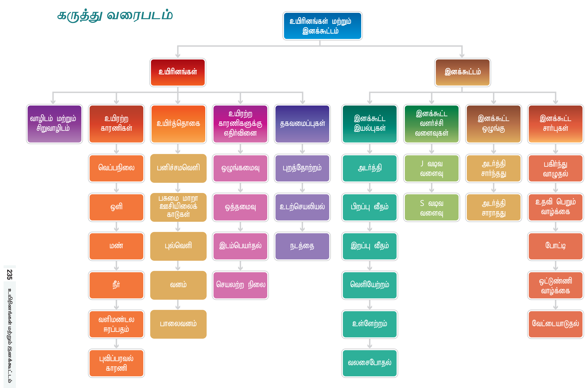

### இணையச் செயல்பபாடு
உயிரினங்கள் மற்றும்
மக்கள்தொகை

உயிரினங்கள் மற்றும் மக்கள்தொகைப்
பற்றி அறிதல்

படிநிலைகள்
படி 1 :  கீழ்க்காணும் உரலி/விரைவுக்குறியீட்டைப் பயன்படுத்திஇச்சசெயல்பட்டிற்ககான இணையப்
பக்கத்திற்குச் செல்க.
படி2 :  “Background Information” என்பதை சொொடுக்கி மக்கள்தொகை மரபியல் பற்றிய பொொது அறிமுகம்
அறிக.
படி3:  “Tutorial” ஐசொொடுக்கி சோதனையின் படிநிலைகளையும் செய்முறையையும் அறிக.
படி4:  முகப்பு பக்கத்தில் உள்ள “Run Experiments”என்பதை சொொடுக்கி , வெவ்வேறு தரவுகளை உள்ளீடு
செய்து சோதனையை செய்து அறிக.

படி 1

படி 2

படி 3

படி 4

உயிரினங்கள் மற்றும் மக்கள்தொகை
உரலி: http://virtualbiologylab.org/ModelsHTML5/PopGenFishbowl/PopGenFishbowl.html

*படங்கள் அடையாளத்திற்கு மட்டுமே .
தேவையெனில் Adobe Flash யை அனுமதிக்க.

உயிரினங்கள் மற்றும் இனக்கூட்டம்
