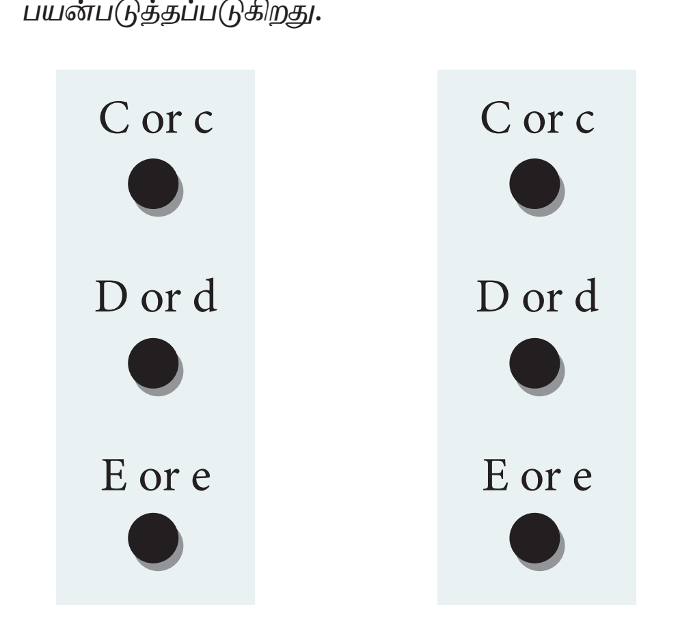
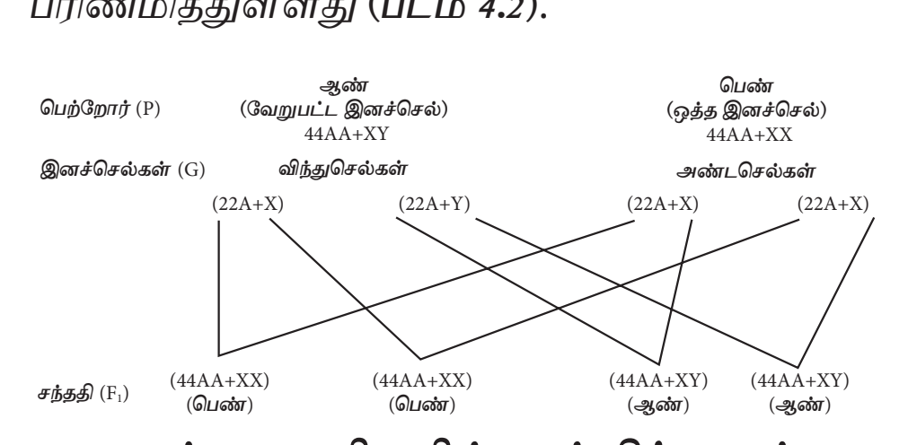
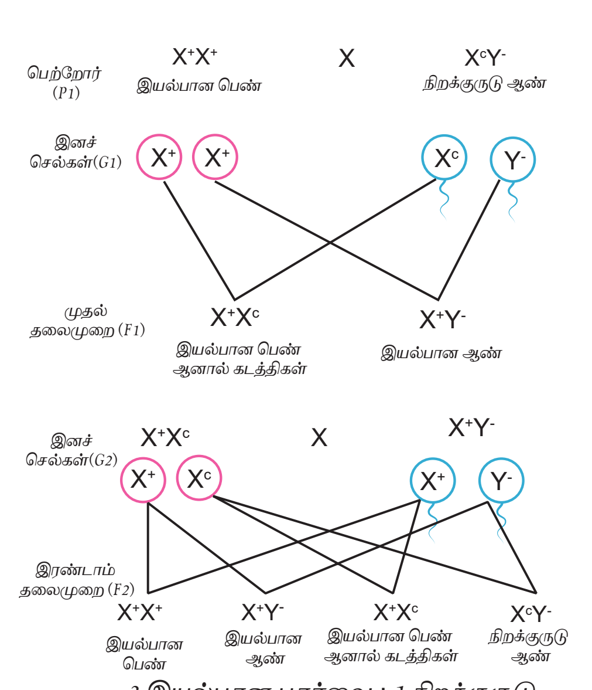
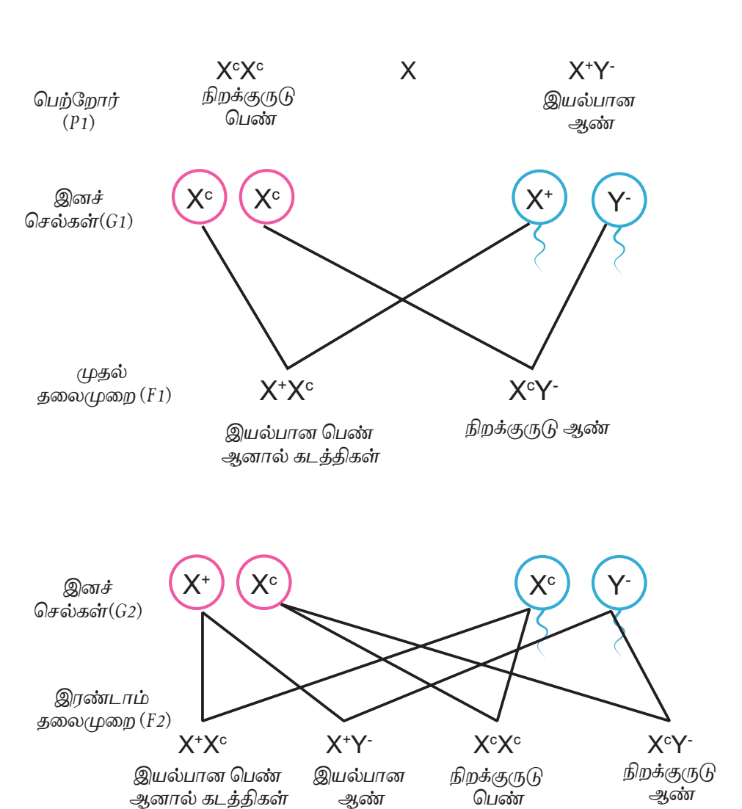
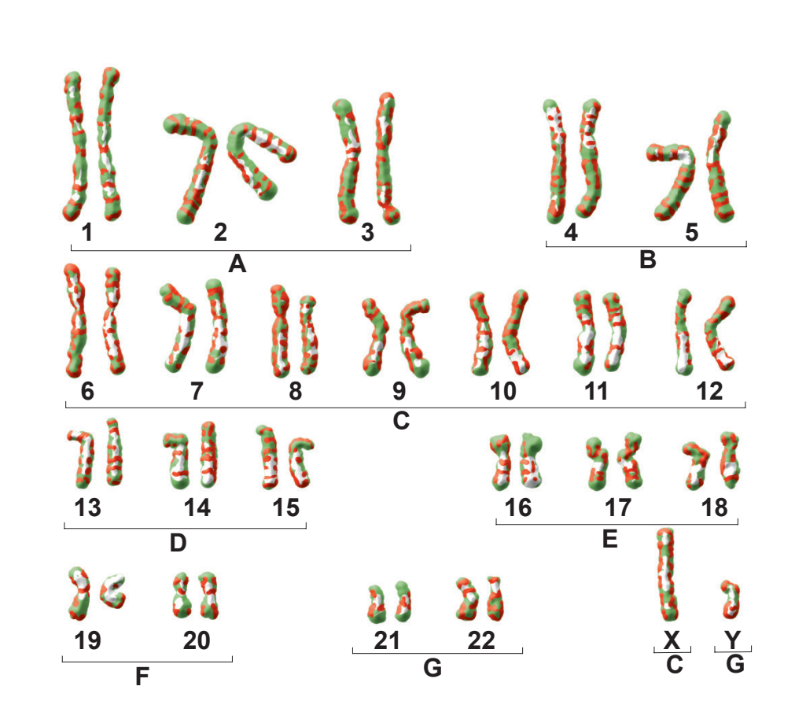
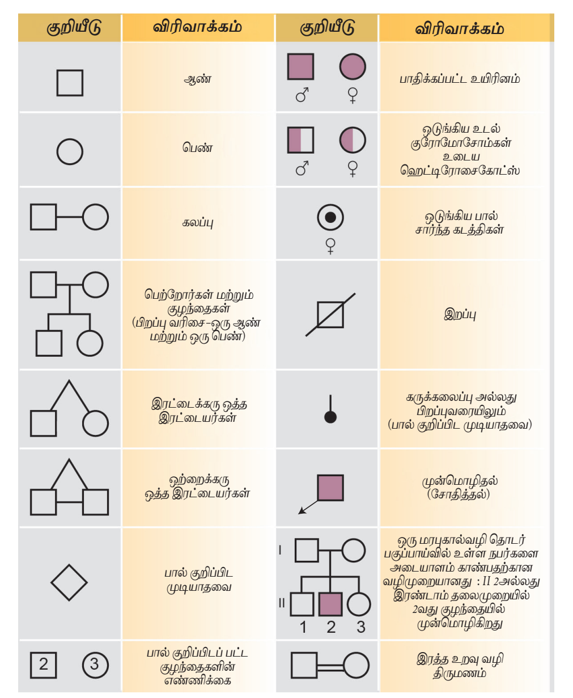
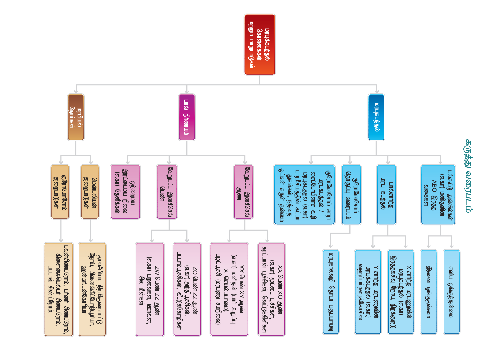

# பாடம் 4: மரபுக் கடத்தல் கொள்கைகள் மற்றும் மாறுபாடுகள்

> குறிப்பு: கீழுள்ள தேடக்கூடிய உரை துல்லியமான படங்கள், அட்டவணைகள் மற்றும் அமைப்பிற்கு அசல் பக்கங்களைப் பார்க்கவும்.

பாடம்

அலகு - II

மரபுக் கடத்தல்
கொொள்ககைகள் மற்றும்
மாறுபாடுகள்

## பாட உள்ளடக்கம்

## 4.1 பல்கூட்டு அல்லீல்கள்

## 4.2 மனித இரத்த வகைகள்

## 4.3 Rh காரணியின் மரபுவழி கட்டுப்பாடு

## 4.4 பால் நிர்ணயம்

## 4.5 பால் சார்ந்த மரபுக்கடத்தல்

## 4.6 குரோமோசோம் தொொகுப்பு வரைபடம்

## 4.7 மரபுக்கால் வழி தொொடர் பகுப்பாய்வு

## 4.8 மென்டலின் குறைபாடுகள்

## 4.9 குரோமோசோம் பிறழ்ச்சிகள்

## 4.10 குரோமோசோம் சாரா மரபுக் கடத்தல்

## 4.11 இனமேம்பபாட்டியல், புறத்தோற்ற

மேம்பபாட்டியல் மற்றும் சூழல் மேம்பபாட்டியல்

மரபியல் மற்றும் அதன் வளர்ச்சி சார்ந்த
ஆய்வுக்கு பழப்பூச்சிகள் மிகச் சிறந்ததாகும்.

- குரோமோசோம் அல்லாத மரபுக் கடத்தலை
பற்றி அறிந்துணர்தல்
- மனித மேம்பபாட்டில், மரபியல் பயன்பபாடுகளின்
முக்கியத்துவத்தை உணரச்சசெய்தல்

உ

யிரியலின்

ஒரு

என்பது

பிரிவான

மரபியல்

மரபுவழி

மற்றும்

மாறுபாடுகளை பற்றி படிப்பதாகும்.

ஒவ்வொரு

தலைமுறையிலும்

பண்புகள்

உயிரிகளின்

எவ்வாறு பெற்றோர்களிடமிருந்து சந்ததிகளுக்குக்
கடத்தப்படுகின்றன என்பதை பற்றி இவ்வியல்
விவரிக்கிறது. மரபுக்கடத்தலின் அலகு மரபணு
எனப்படும். இது, உயிரிகளின் தனித்தனமையை

கற்றலின் நோக்கங்கள்

- மனித இரத்த வகையை
மேற்கோளாகக் கொொண்டு
பல்கூட்டு அல்லீல்களின் மரபுக்
கடத்தலைக் கற்றல்
- மனிதன், பூச்சிகள் மற்றும்
பறவைகளில் பால் நிர்ணயம் நடைபெறும்
முறையை புரிந்துகொொள்ளுதல்
- மனிதனில் பால் சார்ந்த (X மற்றும் Y) மரபு
நோய்களைப் பற்றி அறிதல்
- மெண்டலியன் குறைபாடுகள் மற்றும்
குரோமோசோம் பிறழ்ச்சிகளோடு
தொொடர்புடைய நோய்களை
புரிந்துகொொள்ளுதல்

நிர்ணயிக்கும்

காரணியாகும்.

சந்ததிகளுக்கும் அவர்தம் பெற்றோர்களுக்கும்
இடையிலான வேறுபாட்டு தனமையின் அளவே
மாறுபாடு ஆகும்.
இப்பாடத்தில்

மனித

இரத்த

வகைகளை

மேற்கோளாகக் கொொண்டு பல்கூட்டு அல்லீல்கள்,
மனிதன்,

பூச்சிகள்

நடைபெறும்

மற்றும்

பால்நிர்ணய

பறவைகளில்

முறைகள்,

பால்

சார்ந்த மரபுக் கடத்தல், மரபியல் நோய்கள்,
குரோமோசோம்

அல்லாத

மரபுக்

கடத்தல்

மற்றும் மனித இனத்தை மேம்பபாடு அடைய
செய்ய உதவும் முறைகளான இனமேம்பபாட்டியல்,
சூழல் மேம்பபாட்டியல், சூழ்நிலையியல் மற்றும்
புறத்தோற்ற மேம்பபாட்டியல் ஆகியவை பற்றியும்
விளக்கப்பட்டுள்ளன.

மரபியல்

மரபுக் கடத்தல் கொொள்ககைகள் மற்றும் மாறுபாடுகள்

## 4.1 பல்கூட்டு அல்லீல்கள்

(Multiple Alleles)
மெண்டலிய மரபுக் கடத்தலின் படி அனைத்து
மரபணுக்களும்
இருமாற்று
வடிவங்களை
கொொண்டுள்ளன.
அவை ஓங்கிய மற்றும்
ஒடுங்கிய அல்லீல்கள் ஆகும். (எ. கா.) நெட்டை
(T) மற்றும் குட்டை (t). இதில் ஓங்கிய அல்லீல்கள்
இயல்பபானவை மற்றும் ஒடுங்கிய அல்லீல்கள்
திடீர் மாற்றம் அடைந்தவை. ஒரு மரபணு பலமுறை
திடீர்மமாற்றமடைந்து பல மாற்று வடிவங்களை
உருவாக்குகிறது. ஒரு குறிப்பிட்ட உயிரினத்தின்
ஒத்த குரோமோசோம்களின் ஒரே மட்டத்தில்,
ஒரு குறிப்பிட்ட பண்பபை கட்டுப்படுத்துகின்ற
மூன்று அல்லது அதற்கு மேற்பட்ட அல்லீல்கள்
காணப்பட்டால் அவை பல்கூட்டு அல்லீல்கள்
என்றும்
இவை
கடத்தப்படுதல்
பல்கூட்டு
மரபுக்கடத்தல்
(Multiple
allelism)
என்றும்
அழைக்கப்படுகிறது.

## 4.2 மனித இரத்த வகைகள்

(Human Blood Groups)
மனிதனிலும்
பல்கூட்டு
அல்லீல்கள்
காணப்படுகின்றன.
குறிப்பாக
பல்வவேறு
இரத்தவகைகளின்
மரபுக்
கடத்தலைக்
கூறலாம். எதிர்பொருள் தூண்டிகள் (Antigen)
மற்றும்
எதிர்பொருள்கள்
(Antibody)
பற்றி
அறிந்துகொொள்வதன் மூலம் இரத்தவகையின்
மரபுக்கடத்தலை அறிந்து கொொள்ள முடியும்.
இரத்தத்தில் காணப்படும் பகுதி பொொருட்கள்,
அதன் வகைகள் (ABO), இரத்த எதிர்பொருள்
தூண்டிகள் மற்றும் எதிர்பொருள்கள் பற்றி நாம்
ஏற்கனவே பதினோராம் வகுப்பின் 7ஆம் பாடத்தில்
பயின்றுள்ளோம்.

### 4.2.1 ABO இரத்த வகைகள்

பல்கூட்டு அல்லீல்களான
வகைகளின் மரபுக் கடத்தல்:

ABO

இரத்த

ஒரு
மனிதனின்
இரத்தம்
இன்னொரு
மனிதனின்
இரத்தத்திலிருந்து
வேதிப்பொருட்களின்
அடிப்படையில்
வேறுபடுகிறது.
பொொருத்தமில்லாத இரண்டு
இரத்த வகைகளை ஒன்றறாக கலக்கும்போது
அதிலுள்ள இரத்த சிவப்பு செல்கள் ஒன்றுடன்
ஒன்று இணைந்து இரத்த செல் திரட்சியை
ஏற்படுத்துகின்றன.
இரத்த சிவப்பு செல்லின்
மேற்புறச்சவ்வு மற்றும் எபிதீலியல் செல்களில்
மரபுக் கடத்தல் கொொள்ககைகள் மற்றும் மாறுபாடுகள்

காணப்படும்
எதிர்பப்பபொருள்
தூண்டியின்
காரணமாக வேதிப்பொருட்களின் வேறுபட்ட
தனமை நிர்ணயிக்கப்படுகிறது. டாக்டர் கார்ல்
லேண்ட்ஸஸ்டடெய்னர் என்பவர் மனித இரத்தத்தில்
உள்ள RBC யின் புறப்பரப்பில் ‘எதிர்பப்பபொருள்
தூண்டி A’ மற்றும் ‘எதிர்பப்பபொருள் தூண்டி
B’ என்ற இரண்டு வகையான எதிர்பொருள்
தூண்டிகள்
இருப்பதைக்
கண்டறிந்ததார்.
எதிர்பப்பபொருள் தூண்டிகள் இருத்தல் அல்லது
இல்லாமலிருத்தலின் அடிப்படையில், A இரத்த
வகை, B இரத்த வகை மற்றும் O இரத்தவகை
என்ற மூன்று வகையான இரத்த வகைகளை
(ABO) அவர் கண்டறிந்ததார். இதில் ‘O’ வகை
கொொண்டோரை ‘பொொதுக்கொடையாளர்கள்’ என்பர்.
1902 ஆம் ஆண்டு லேண்ட்ஸஸ்டடெய்னருடைய
மாணவர்களாகிய வான் டி காஸ்டடெல்லோ
மற்றும் ஸ்டூர்லி என்பவர்கள் மிகவும் அரிதான
AB என்ற நான்ககாவது இரத்த வகையை
(பொொதுப் பெறுநர்) கண்டுபிடித்தனர்.
1925 இல் பெர்னஸ்டின் என்பவர் மனிதனின்
பல்வவேறு இரத்தவகைகளின் மரபுக் கடத்தல்
பல்கூட்டு அல்லீல்களால் நிர்ணயிக்கப்படுகிறது
என கண்டறிந்ததார். எந்த ஒரு நபரின் இரத்த
வகைகயையும் நிர்ணயிப்பது குரோமோசோம்
9-ல் உள்ள மூன்று அல்லீல்கள் ஆகும்.
இரத்த வகையை கட்டுப்படுத்தும் மரபணு
L அல்லது I என குறிப்பிடப்படுகிறது. (L என்பது
கண்டுபிடிப்பாளரான லேண்ட்ஸஸ்டடெய்னர்ரையும்
I-என்பது
ஐஸோஅக்ளுட்டினேசனையும்
குறிக்கும்) மரபணு I ஆனது IA, IB, IO என்ற மூன்று
அல்லீல்
வடிவங்களைக்
கொொண்டுள்ளது.
A
I அல்லீல் எதிர்பொருள் தூண்டி –A யையும்,
IB அல்லீல் எதிர்பொருள் தூண்டி B யையும்
குறிக்கிறது.
ஆனால், IO அல்லீல் எந்த ஒரு
எதிர்பப்பபொருள் தூண்டியையும் குறிக்கவில்லை.
சிலரின் கண்ணீர் மற்றும் உமிழ்நீர் போன்ற
உடல் திரவத்தில் எதிர்பப்பபொருள் தூண்டிகள்
காணப்படும். அவர்கள் சுரப்பாளர்கள் என
அழைக்கப்படுகின்றனர்.
IA
அல்லீல் N-அசிடைல் கேலக்டோஸ்
டிரான்ஸ்பபெரேஸ் நொொதியை சுரந்து N-அசிட்டைல்
கேலக்டோசமைனைச்
(NAG)
சேர்க்கிறது.
IB அல்லீல், கேலக்டோஸ் டிரான்ஸ்பபெரேஸ்
நொொதியை சுரந்து கேலக்டோஸை ‘H’ பொொருள்
எனப்படும்
மூலப்பொருளோடு
சேர்க்கிறது.

அட்டவணை 4.1 ABO இரத்த வகைகளின் மரபியல் அடிப்படை
மரபு வகை

ABO இரத்த
வகைகளின்
புறத்தோற்றம்

இரத்த சிவப்பணு மீது காணப்படும்
எதிர்பப்பபொருள் தூண்டிகள் (Antigen)

பிளாஸ்மமாவில் காணப்படும்
எதிர்பொருட்கள் (Antibody)

IAIA

A வகை

A வகை

எதிர் - B

IAIO

A வகை

A வகை

எதிர் - B

IBIB

B வகை

B வகை

எதிர் – A

IBIO

B வகை

B வகை

எதிர் – A

IAIB

AB வகை

A மற்றும் B வகைகள்

எதிர்பொருட்கள் இல்லை

IOIO

O வகை

எதிர்பப்பபொருள் தூண்டி இல்லை

எதிர் A மற்றும் எதிர் B

IO / IO அல்லீல் டிரான்ஸ்பபெரேஸ் நொொதி எதையும்
சுரப்பதில்லை
எனவே
“வெற்று
அல்லீல்”
(Null
allele)
என்று
அழைக்கப்படுகின்றன.
மேலும் இவை NAG அல்லது கேலக்டோஸை
மூலப்பொருளுடன் சேர்ப்பதில்லை.
புறத்தோற்ற விகிதத்தில் IA மற்றும் IB
அல்லீல்கள் IO விற்கு ஓங்கிய தனமையை

- 
ம னி த ர் ்க ளி டையே
காணப்படும் எதிர்பொருள்
தூண்டிகள்
மற்ற
உ யி ரி ன ங் ்க ளி ன்
இரத்தத்திலும் அடையாளம்
காணப்பட்டுள்ளன.
சிம்பபான்சி
மற்றும்
கிப்பன் குரங்குகளில் A வகை எதிர்பொருள்
தூண்டிகளும் உராங்குட்டான் குரங்குகளில்
A, B மற்றும் AB வகை எதிர்பப்பபொருள்
தூண்டிகளும் காணப்படுகின்றன.
- நவீன
உலகத்தின்
குரங்கு
(பிளாட்டிரைனா) மற்றும் லெமூர் குரங்குகள்
ஒரே மாதிரியான பொொருளை கொொண்டுள்ளன.
ஆனால்
மனிதனில்
காணப்படுகின்ற
எதிர்பப்பபொருள் தூண்டி –B யோடு ஒத்து
காணப்படுவதில்லை.
- பூனைகளில் மூன்று இரத்த வகைகள்
அறியப்பட்டுள்ளன. இவை மனிதர்களுடைய
மரபணு அமைப்புடன் ஒத்துப் போகின்றன.
விலங்குகளின் கண்ணீர், உமிழ்நீர், சிறுநீர்,
விந்து திரவம் இரப்பை நீர் மற்றும் பால்
போன்ற உடல் திரவங்களில் எதிர்பப்பபொருள்
தூண்டிகள் காணப்படுகின்றன.

கொொண்டிருக்கின்றன.
ஆனால்
இவை
இரண்டும் ஒன்றுக்கொன்று ஓங்குதனமையுடன்
(IA = IB) இருப்பதால் இது “இணை ஓங்குதனமை”
(Co­-dominance)
என
அழைக்கப்படுகிறது.
இவற்றின்
ஓங்கு
பண்புசார்ந்த
படிநிலை
A
B
O
I = I > I (Dominance hierarchy) ஆகும். குழந்ததைகள்
தங்கள் பெற்றோர்களிடமிருந்து இந்த மூன்று
அல்லீல்களில் ஏதேனும் ஒன்றறைப் பெறுகின்றன.
இதனால் ஆறுவகையான மரபணு வகைகளும்
நான்கு
வகையான
இரத்த
வகைகளும்
(புறத்தோற்ற
ஆக்கமும்)
உருவாகின்றன.
A A
A O
B B
B O
A B
O O
I I , I I , I I , I I , I I , I I என்ற ஆறுவகையான
மரபு வகைகளை சேய் உயிரிகள் கொொண்டுள்ளன.

ரீசஸ் அல்லது Rh காரணி
Rh காரணி அல்லது Rh எதிர்பப்பபொருள்
தூண்டி
இரத்த
சிவப்பணுக்களின்
மேற்பரப்பில் காணப்படுகின்றன. 1940ல் கார்ல்
லேண்ட்ஸஸ்டடெய்னர் மற்றும் அலெக்சசாண்டர்
வெய்னர்
ஆகிய
இருவரும்
முதலில்
மகாகா ரீசஸ் என்னும் ரீசஸ் குரங்குகளிலும்
பிறகு மனிதனிலும் இதனை கண்டுபிடித்தனர்.
Rh காரணி என்ற வார்த்தை தடுப்பாற்றல்
தருகின்ற D (இம்யுனோஜெனிக் D) எதிர்பொருள்
தூண்டியைக் குறிக்கிறது.
D எதிர்பொருள்
தூண்டியை பெற்றிருப்பவர் Rh D உடையோர்
(Rh+) என்றும் D எதிர்பப்பபொருள் தூண்டி அற்றவர்
Rh D அற்றோர் (Rh-) என்றும் அழைக்கப்படுவர்.
இரத்தத்தில் காணப்படும் ரீசஸ் காரணியானது
ஓங்கு பண்பபாக மரபுவழி கடத்தப்படுகிறது.
இயற்ககையாகவே அனைவரின் பிளாஸ்மமாவிலும்
Dக்கு எதிரான எதிர்பப்பபொருள்கள் இருப்பதில்லை.
Rh- (Rh அற்றோர்) இரத்தம் Rh+ (Rh - D உடையோர்)

மரபுக் கடத்தல் கொொள்ககைகள் மற்றும் மாறுபாடுகள்

இரத்தத்தோடு தொொடர்பு ஏற்படுகிறபோது அவர்கள்
இரத்தத்தில் Dக்கு எதிரான எதிர்பப்பபொருள்
உருவாகின்றது.
ஆனால் Rh உடையோர்
Rh அற்றோரின் இரத்தத்தைப் பெறும்போது
எவ்வித விளைவுகளும் உண்டடாவதில்லை.

## 4.3 Rh காரணியின் மரபுவழிக்

கட்டுப்பாடு (Genetic Control of Rh Factor)
ஃபிஷர் மற்றும் ரேஸ் கருதுகோள்
Rh காரணியின் மூன்று வெவ்வேறு அல்லீல்
இணைகள்,
குரோமோசோம்
இணைகளின்
நெருக்கமான மூன்று வெவ்வேறு இடங்களில்
அமைந்துள்ளன. இன்றறைய பயன்பபாட்டில் இரத்த
அமைப்பு பொொதுவாக Cde என்ற பெயர்களில்
பயன்படுத்தப்படுகிறது.

C or c

C or c

D or d

D or d

E or e

E or e

மேற்கண்ட படம் 4.1 ல் மூன்று Rh அல்லீல்
இணைகள்

(Cc,

Dd,

Ee)

அமைப்பொத்த

குரோமோசோம் இணையில், மூன்று வெவ்வேறு
அமைவிடங்களில்

உள்ளன.

ஒவ்வொரு

குரோமோசோமும் ஒரு C அல்லது c, ஒரு D
அல்லது d, ஒரு E அல்லது e வாய்ப்புக்கான
மரபுவகையைப் பெற்றிருக்கும். எடுத்துக்காட்டு
CDE/cde, CdE/cDe, cde/cde, CDe/CdE போன்றவை.
அனைத்து மரபு வகைகளிலும் உள்ள ஓங்கிய
D அல்லீல்கள் Rh+ (உடையோர்) புறத்தோற்ற
வகையை

உருவாக்குகின்றன.

அதேபோல்

இரண்டு ஒடுங்கிய பண்புகொொண்ட மரபுவகையில்
(dd) அல்லீல்கள் Rhஉற்பத்தி செய்கின்றன.

புறத்தோற்ற

மரபுக் கடத்தல் கொொள்ககைகள் மற்றும் மாறுபாடுகள்

வகையை

வெய்னரின் கருதுகோள்

ஒரு
Rhனுடைய
இருப்பிடத்தில்
எட்டு

Z
1 11 1
அல்லீல்கள் (R , R , R , R , r, r , r , r ) இருக்கின்றன
என்ற கருத்தை வெய்னர் முன்மொழிந்ததார்.
ஓங்கிய R அல்லீல்களைக் கொொண்ட அனைத்து
மரபுவகைகளும் (R1, R2, R0, Rz) R+ புறத்தோற்ற
வகையை உற்பத்தி செய்கின்றன. அதேபோல்
இரண்டு ஒடுங்கிய பண்பு கொொண்ட அனைத்து
மரபுவகையும் (rr, r1r1, r11r11, ry ry) Rh- புறத்தோற்றத்தை
உற்பத்தி செய்கின்றன.

### 4.3.1 Rh காரணியின் இணக்கமினமை

– வளர்கரு இரத்த சிவப்பணு சிதைவு
நோய் (எரித்ரோபிளாஸ்டோசிஸ்
ஃபீடாலிஸ் – Erythroblastosis foetalis)

Rh
இணக்கமினமையானது,
பிள்ளை
பேற்றின்
மீது
பெரும்
முக்கியத்துவத்தை
கொொண்டுள்ளது. ஒரு Rh- பெண் ஒரு Rh+ ஆணை
மணந்துக்கொள்ளும்போது
அவர்களின்
+
குழந்ததை Rh வாக இருக்கும். இதற்கு தந்ததையிடம்
இருந்து
பெற்ற
காரணியே
காரணமாகும்.
+
இந்த Rh தாய் தன் உடலில் Rh குழந்ததையை
சுமக்கும்போது
உணர்வவாக்கம்
பெறுகிறார்.
குழந்ததைபிறப்பின் போது இரத்தக்குழாய்களில்
ஏற்படும் சேதத்தால் தாயின் நோய்த் தடைகாப்பு
மண்டலம்
Rh
எதிர்பொருள்தூண்டிகளை
அடையாளம் காண்கின்றன. இதன் விளைவாக
Rh
எதிர்பப்பபொருட்கள்
உற்பத்தியாகின்றன.
இதனால் உண்டடான IgG வகை எதிர்பப்பபொருட்கள்
மிக சிறியதாக உள்ளதால் அவை தாய்சசேய்
இணைப்பு திசு (Placenta) வழியாக ஊடுருவி
கருவின் இரத்த ஓட்டத்தில் கலக்கின்றன. தாய்
உணர்வவாக்கம் பெற்று, D-எதிர்பப்பபொருட்கள்
உற்பத்தியாகும் நேரத்தில் குழந்ததை பிறந்து விடும்.
இதனால் முதல் குழந்ததை பிறக்கும் வரை Rh+
எதிர்பொருள் தூண்டிக்ககெதிராக தாய் எவ்வித
பாதிப்பையும் ஏற்படுத்துவதில்லை.
மாறாக
+
அதே தாய் அடுத்தடுத்த Rh எதிர்பொருள்
தூண்டிகளைக் கொொண்ட கருவைச் சுமக்கின்ற
போது அவைகளுக்ககெதிராக தாய் உடலானது
எதிர்பொருட்களை உற்பத்தி செய்கின்றது. இந்த
எதிர்பொருட்கள் தாய் சேய் இணைப்புதிசு
மூலம் கருவின் இரத்த ஓட்டத்தில் கலந்து
கருவின் இரத்த சிவப்பணுக்களை அழிக்கின்றன.
இதன் விளைவாக இரத்த சோகை மற்றும்
மஞ்சள் காமாலை உண்டடாகின்றது. இந்நிலை,
“வளர்கரு இரத்த சிவப்பணு சிதைவு நோய்”
அல்லது சிசு ஹீமோலைடிக் நோய் (HDN) என
அழைக்கப்படுகிறது.

வளர்கரு இரத்த சிவப்பணு சிதைவு
நோயை தடுக்கும் முறை
Rh- தாய் Rh+ குழந்ததையை சுமக்கும்போது
D–எதிர்பொருள்களை எதிர்க்க வல்ல பொொருளை
(Anti D antibodies) 28வது வாரமும் 34 வாரமும்
கருவுற்ற தாய்க்கு தடுப்பு நடவடிக்கையாக
கொொடுக்கப்படுகிறது. Rh- தாய் Rh+ குழந்ததையை
பெற்றறெடுத்தால் குழந்ததை பிறந்த உடனே
D எதிர்பொருள்களை எதிர்க்க வல்ல பொொருளை
(Anti D antibodies) தாய்க்கு கொொடுக்க வேண்டும்.
இதனால் இயல்பபான நோய் தடைக்காப்பு
உருவாவதுடன்
கருவின்
சிவப்பணுக்களை
அழிக்கின்ற D எதிர்பொருள் தாயின் உடலில்
உருவாவது தடுக்கப்படுகிறது.
மேலும் தாய்
கர்ப்பம் தரிக்கும் போதெல்லாம் இம்முறையை
மேற்கொள்ள வேண்டும்.

## 4.4 பால் நிர்ணயம் (Sex determination)

பால் நிர்ணயம் என்பது உயிரினங்களிடையே
ஆண், பெண் வேறுபாடுகளை உருவாக்குகின்ற
முறைகளாகும்.
பால் குரோமோசோம்கள்
ஒரு பாலின (Dioecious or Unisexual) உயிரிகளில்
பாலினத்தை
நிர்ணயிக்கின்றன.
பால்
குரோமோசோம்கள்
தவிர
மீதமுள்ள
அனைத்தும்
உடல்
குரோமோசோம்கள்
(Autosomes) என அழைக்கப்படுகின்றன.
பால்
குரோமோசோம்கள்
ஒரு
பாலினத்தில்
உருவம் ஒத்த குரோமோசோம் அமைப்பையும்
(Homomorphic)
மற்றொரு
பாலினத்தில்
உருவம்
வேறுபட்ட
குரோமோசோம்
அமைப்பையும் (Heteromorphic) கொொண்டுள்ளன.
ஒத்த பால் குரோமோசோம்கள் கொொண்ட
பாலினத்தில் ஒரே வகையான (Homogametic)
இனச்சசெல்கள் உற்பத்தியாகின்றன. வேறுபட்ட
குரோமோசோம்களை (Heterogametic) கொொண்ட
பாலினத்தில் இரண்டு வகையான இனச்சசெல்கள்
உற்பத்தியாகின்றன.
Y குரோமோசோம்: மனித Y
குரோமோசோமின் அளவு 60Mb
ஆகும். இதனுள் 60 மரபணுக்கள்
செயல்படும் நிலையில் உள்ளன.
அதேபோல்

Mb
அளவுள்ள
X
குரோமோசோமில் 1000 மரபணுக்கள் உள்ளன.

குரோமோசோம் அடிப்படையிலான
பால் நிர்ணயம்

வேறுபட்ட இனச்சசெல் (Heterogametic) வகை
பால் நிர்ணயம்
வேறுபட்ட
இனச்சசெல்
பால் நிர்ணயத்தில் ஒரு பாலின
உயிரியில் ஒரே மாதிரியான
இனச்சசெல்களையும் மற்றொரு
பாலின
உயிரி
வேறுபட்ட
இனச்சசெல்களையும் உற்பத்தி
செய்கின்றன. இதில் சேய் உயிரிகளின் பால்,
கருவுறுதலின் போது நிர்ணயிக்கப்படுகிறது.

1. வேறுபட்ட இனச்சசெல் ஆண் உயிரிகள்
(Heterogametic male)

இம்முறையில், ஆண் உயிரிகள் வேறுபட்ட
இனச்சசெல்களை உற்பத்தி செய்கின்றன. பெண்
உயிரிகள் ஒத்த இனச்சசெல்களை உற்பத்தி
செய்கின்றன. இதனை XX-XO (எ.கா. மூட்டை
பூச்சிகள் மற்றும் பூச்சிகளான கரப்பான் பூச்சிகள்,
மற்றும் வெட்டுக்கிளிகள்) மற்றும் XX-XY
(எ.கா. மனிதன் மற்றும் பழப்பூச்சி (Drosophila)
வகை என இரண்டு வகையாக பிரிக்கலாம்.

2. வேறுபட்ட இனச்சசெல் பெண் உயிரிகள்
(Heterogametic female)

இம்முறையில், பெண் உயிரிகள் வேறுபட்ட
இனச்சசெல்களை
உற்பத்தி
செய்கின்றன.
ஆண்
உயிரிகள்
ஒத்த
இனச்சசெல்களை
உற்பத்தி செய்கின்றன. ஏற்கனவே வேறுபட்ட
இனச்சசெல்
ஆண்
உயிரிகளில்
XX-XO
மற்றும் XX-XY வகையில் X மற்றும் Y
எழுத்துக்கள் பயன்படுத்தப்பட்டதால் இப்போது
குழப்பத்தை தவிர்க்க வேறுபட்ட இனச்சசெல்
பெண்களில் Z மற்றும் W எழுத்து முறையே
X,Y க்கு ஈடாகப் பயன்படுத்தப்படுகின்றன.
வேறுபட்ட இனச்சசெல் பெண்களில் ZO-ZZ
(எ.கா. அந்திப் பூச்சிகள், வண்ணத்துப் பூச்சிகள்
மற்றும் வீட்டுக்கோழிகள்) மற்றும் ZW-ZZ
(எ.கா. ஜிப்சி அந்திப்பூச்சி, மீன்கள், ஊர்வன
மற்றும் பறவைகள்) ஆகிய இரண்டு வகையான
முட்டைகள் காணப்படுகின்றன.

மனிதனில் பால் நிர்ணயம்

மனிதனில்
பால்
நிர்ணயம்
செய்யும்
மரபணுக்கள் இரண்டு பால் குரோமோசோம்களில்
உள்ளன. இக்குரோமோசோம்களுக்கு ‘பால்
குரோமோசோம்கள்’ அல்லது ‘அல்லோசோம்கள்’
என்று
பெயர்.
பாலூட்டிகளில்,
பால்

மரபுக் கடத்தல் கொொள்ககைகள் மற்றும் மாறுபாடுகள்

நிர்ணயமானது
இரண்டு
பாலினத்திலும்
உள்ள
பால்
குரோமோசோம்களின்
வேறுபாட்டை
அடிப்படையாகக்
கொொண்டு
அமைகின்றது. எடுத்துக்காட்டாக, பெண்கள்
XX
குரோமோசோம்களையும்
ஆண்கள்
XY குரோமோசோம்களையும் கொொண்டுள்ளனர்.
மனிதனில்
மொொத்தம்

இணை
குரோமோசோம்கள் உள்ளன. அதில் 22 இணை
உடல் குரோமோசோம்களும் (44AA) ஓர் இணை
பால் குரோமோசோம்களும் (XX அல்லது XY)
அடங்கும். பெண்கள் ஒத்த இனச்சசெல் பண்பு
கொொண்ட ஒரே வகையான அண்டசெல்லை
(இனச்சசெல்) உருவாக்குகின்றனர். ஒவ்வொரு
அண்டசெல்லிலும் ஒரு X குரோமோசோம்
மட்டுமே காணப்படும்.
மாறாக வேறுபட்ட
இனச் செல்களை உருவாக்கும் ஆண்கள் இரு
வேறு வகை விந்துச்சசெல்களை அதாவது X
மற்றும் Y குரோமோசோம்களைக் கொொண்ட
விந்து செல்களை உருவாக்குகின்றன. இதைப்
போன்றறே,
பழப்பூச்சியின்
பால்
குரோமோசோம்களின் அமைப்பும் மனிதனை
போன்றறே
XX:XY
என்று
தன்னியல்பபாய்
பரிணமித்துள்ளது (படம் 4.2).
ஆ

(ேவ பட இனெச)
44AA+XY

ெப
ேறா (P)

vtெசக

இனெசக (G)

(22A+X)

சதt (F1)

ெப

(ஒத இனெச)
44AA+XX

(44AA+XX)
(ெப
)

அ
டெசக

(22A+Y)

(22A+X)

(22A+X)

(44AA+XX)
(ெப
)

(44AA+XY)
(ஆ
)

(44AA+XY)
(ஆ
)

Y குரோமோசோம் மற்றும் ஆண்களின்
வளர்ச்சி
Y குரோமோசோமில் பல மரபணுக்கள்
இருப்பதையும்

அப்பகுதிகள்

ஆற்றல்

மிக்க

மரபியல் பணிகளை வெளிப்படுத்தும் திறன்
கொொண்டவை

என்றும்

Y

குரோமோசோம்

பற்றிய

தற்போதைய

ஆய்வுகள்

தெரியப்படுத்துகின்றன X குரோமோசோமில்
இம்மரபணுக்களுக்கான

ஒத்த

எதிர்

இணைகள் இருக்கலாம் அல்லது இல்லாமலும்
இருக்கலாம்.

Y

குரோமோசோமின்

இரு

முனைகளிலும் போலி உடல் குரோமோசோம்
உள்ளன

பகுதிகள்
regions).

இதற்கு

(%5)

இணையான

மரபுக் கடத்தல் கொொள்ககைகள் மற்றும் மாறுபாடுகள்

(Pesudoautosomal
பகுதிகள்

X குரோமோசோமிலும் உள்ளன. இப்பகுதியில்
குன்றல் பகுப்பின் குறுக்ககெதிர்மமாற்றமும் மறு
இணைவும் நடைபெறுகின்றன. மீதம் உள்ள %95
Y குரோசோமினுடைய பகுதிகள், இணையா
Y பகுதியாகும் (NRY).

இந்த இணையா Y

பகுதிகள் செயல்படும் மரபணுக்கள் (Euchromatic)
பகுதி

மற்றும்

செயல்படா

மரபணுக்கள்

(Heterochromatic) பகுதி என இரண்டு சமமான
பகுதிகளாக பிரிக்கப்பட்டுள்ளன.
மரபணு

பகுதியில்

பால்

செயல்படும்

நிர்ணயப்பகுதி

Y

என்னும் (Sex determining region - SRY) மரபணு
உள்ளது.

மனிதனில்

இல்லாநிலையில்,
பெண்

குரோமோசோம்

தவிர்க்க

உயிரியாக

வழிவகுக்கிறது.

Y

வளர்ச்சி

முடியாமல்
அடைய

பால் நிர்ணய மரபணுப்பகுதி

X குரோமோசோமில் கிடையாது.

இந்த பால்

நிர்ணயப்பகுதி Y யின் மரபணு விளைபொொருள்,
முதிர்ந்த ஆணின் விந்தகத்தில் காணப்படும்
விந்தக நிர்ணயக் காரணியாகும்.

### 4.4.1 பழப்பூச்சிகளில் மரபணு சமநிலை

C.B. பிரிட்ஜஸ் என்பவர் முதன் முதலில்
பழப்பூச்சிகளில் மரபணு சமநிலை மூலம் பால்
நிர்ணயிக்கப்படுவதைக்
கண்டறிந்ததார்.
ஆண்பபாலினத்தின்
கருவுறுதல்
திறனுக்கு
Y
குரோமோசோம்கள்
தேவையானதாகும்.
ஆனால்
அது
ஆண்
பாலினத்தை
நிர்ணயிப்பதில்லை. பெண் பழப்பூச்சியில் பெண்
தனமைக்கான
மரபணுக்கள்
X
குரோமோசோமில் உள்ளன.
அதேபோல்,
ஆண்களில் ஆண் தனமைக்கான மரபணுக்கள்
உடல் குரோமோசோம்களில் உள்ளன.
மரபியலாளரான
பிரிட்ஜஸ்
தன்
ஆராய்ச்சியில் மும்மய (3n) தனமை கொொண்ட
பெண் பழப்பூச்சியுடன் இயல்பபான ஆண் பூச்சியை
கலப்பு செய்தபோது, உருவான சேய் உயிரிகளில்
பால் மற்றும் உடல் குரோமோசோம்களில்
பலவகை புதிய இணைவுகளைக் கண்டறிந்ததார்.
1921ல் நடத்தப்பட்ட இச்சோதனைகளில் கிடைத்த
முடிவுகளின் அடிப்படையில், பழப்பூச்சியின்
X
குரோமோசோமில்
உள்ள
பெண்
தனமைக்கான
மரபணுக்களுக்கும்
உடல்
குரோமோசோம்களில்
உள்ள
ஆண்
தனமைக்கான மரபணுகளுக்கும் இடையேயான
மரபுச்
சமநிலையே
இப்பூச்சிகளில்

பாலினத்தை நிர்ணயிக்கிறது என பிரிட்ஜஸ்
கண்டறிந்ததார்.
எனவே
பழப்பூச்சியில்
உடல்குரோமோசோம்களின்
தொொகுதிக்கும்
X குரோமோசோமுக்கும் இடையே காணும்
விகிதமே
பாலினத்தை
நிர்ணயிக்கின்றன.
இவ்விகிதமே
“பால்
குறியீட்டு
எண்”
எனப்படுகிறது.
இதனை கீழ்க்கண்டவாறு
வெளிப்படுத்தலாம்.
பால் குறியீட்டு எண் =

X குரோமோ சோம்களின்
எண்ணிக்கை

X

உடல் குரோமோசோம்
தொொகுதிகளின் எண்ணிக்கை

A

குறியீட்டு எண்ணில் ஏற்படுகின்ற மாற்றம்,
உயிரிகளின்
புறத்தோற்ற
பால்
பண்பில்
வெளிப்படுகிறது. மும்மய பெண் பழப்பூச்சியை
(3A:3X),
இரட்டைமய
ஆணுடன்
(2A+XY)
கலப்புச்சசெய்த ஆய்வின் முடிவுகள் அட்டவணை 4.2 மற்றும் 4.3ல் கொடுக்கப்பட்டுள்ளன.

X:A வின் குறியீட்டு எண் 1.00 எனில்
அவ்வுயிரிகள் இயல்பபான பெண்களாக உள்ளன.
குறியீட்டு எண் 1.00 க்கு மேல் எவ்வளவு
கூடினாலும் அவை பெண்களாகவே உள்ளன.
குறியீட்டு எண் 0.50 என இருந்ததால் அவை
இயல்பபான ஆண்களாக உள்ளன. மேலும்
இம்மதிப்பு 0.50 க்கு எவ்வளவு குறைவாக
இருந்ததாலும் அவை ஆண்களாகவே உள்ளன.
குறியீட்டு எண் 0.67 ஆக இருந்ததால் இடைபால்
உயிரியாக உள்ளன. மிகை ஆண்களுக்கான
குறியீட்டு எண் 0.33 ஆகவும் மிகை பெண்களின்
குறியீட்டு எண் 1.50 ஆகவும் உள்ளன.
இவ்விருவகை
உயிரிகளும்
வலிமையற்ற
மலடுகளாக உள்ளன.
- பழப்பூச்சிகளில்,
பெண்
தனமை
வளர்ச்சியை ‘பால் மாற்றி மரபணு’ (Sex switch
gene) வழிநடத்துகின்றன. இந்த பால் கொொல்லி
மரபணு
(SXL)
X
குரோமோசோமில்
காணப்படுகின்றது.
- பால்
கொொல்லி
மரபணு
இரண்டு
வகையான
நிலைகளைக்
கொொண்டுள்ளன.
இவ்வகையான மரபணு செயல்படும் நிலையில்
(திறக்கும் போது) பெண் தனமை வளர்ச்சியையும்
செயல்படாதநிலையில் (மூடுகின்ற போது) ஆண்
தனமை வளர்ச்சியையும் வழிநடத்துகின்றது.
மேலும்
X
குரோமோசோமிலும்
உடல்
குரோமோசோமிலும்
உள்ள
வேறு
சில
மரபணுக்கள் பால் மாற்றி மரபணுக்களை
கட்டுப்படுத்துகின்றன.

அட்டவணை 4.2 மும்மய (3A:XXX)
பெண் பூச்சிக்கும் இரட்டைமய (2A+XY)
ஆண் பூச்சிக்கும் இடையே செய்யப்பட்ட
பிரிட்ஜஸின் கலப்பு ஆய்வு முடிவு.

பெற்றோர்
(P1)

இரட்டைமய
ஆண்

3A+XXX

2A+XY

இனச்சசெல்கள் ( 2 A + X X ) (A+x)(A+Y)
(G)
(A+X)
(2A+X)
(A+XX)
ஆண்
பெண்

A+X

A+Y

2A+XX

3A+XXX
மும்மய - பெண்

3A+XXY
மும்மய –
இடைபால்
உயிரி

2A+X

3A+XX மும்மய
இடைபால்
உயிரி

A+XX

2A+XXX
மிகை பெண்

2A+XXY
இரட்டைமய
- பெண்

A+X

2A+XX
இரட்டைமய பெண்

2A+XY
இரட்டைமய
- ஆண்

3A+XY
மிகை ஆண்

- பழப்பூச்சிகளில்
ஆண்
தனமை
உருவாவதற்கு Y குரோமோசோமின் இருப்பு
கட்டாயமாகும்.
- X-குரோமோசோமை ஹென்கிங் என்பவர்
1981 ஆம் ஆண்டு கண்டுபிடித்தார்.
- Y-குரோமோசேமை ஸ்டிவன்ஸ் என்பவர்
1902 ல் கண்டுபிடித்தார்.

இருபால் உருவம் (Gynandromorph)
இவ்வகையான உயிரினங்களின் சில உடல்
பகுதிகள் ஆண் பண்புகளையும் மற்ற சில உடல்
பகுதிகள்
பெண்
பண்புகளையும்
வெளிப்படுத்துகின்றன. ஆண் மற்றும் பெண்
மரபுவகைகளைக் கொொண்ட திசுக்களால் இவ்வகை
உயிரிகள் உடலாக்கம் பெற்றுள்ளன (மொொசைக்
தனமை).

மும்மய
பெண்

மரபுக் கடத்தல் கொொள்ககைகள் மற்றும் மாறுபாடுகள்

அட்டவணை 4.3 X குரோமோசோம்கள் மற்றும் உடல் குரோமோசோம் தொொகுதிகளின் வெவ்வேறு அளவுகளால்
பழப்பூச்சியின் பால்நிர்ணயத்தலில் ஏற்படும் தாக்கங்கள்.
வ.
எண்

உடல்
குரோமோசோம்
தொொகுதிகளின்
எண்ணிக்கை (A)

3/2 = 1.5

நாற்மயம்

4/4=1.0

மும்மயம்

3/3=1.0

இரட்டைமயம்

2/2=1.0

ஒற்றைமயம்

1/1=1.0

புறத்தோற்ற ஆக்கம்

மிகை பெண்

இயல்பபான
பெண்

X குரோமோ சோம்களின்
பால்
எண்ணிக்கை
குறியீட்டுஎண் =

X குரோமோ
சோம்களின்
எண்ணிக்கை
(X)

உடல் குரோமோசோம்
தொொகுதிகளின் எண்ணிக்கை

இடை பால் உயிரி

2/3=0.67

இயல்பபான ஆண்

1/2=0.50

மிகை ஆண்

1/3=0.33

### 4.4.2 அளவு ஈடுசெய்தல் – பார்

உறுப்புகள் (Dosage Compensation - Barr
Body)
1949 ஆம் ஆண்டு பார் மற்றும் பெர்ட்ரம் ஆகிய
இருவரும் பெண் பூனையின் நரம்பு செல்லில் ஒரு
அடர்த்தியான உறுப்பை கண்டறிந்தனர். அவை
ஆண் பூனையில் காணப்படுவதில்லை. இந்த
அடர்த்தியான உறுப்பை பால் குரோமேட்டின் (Sex
chromatin) என்று அழைத்தார்கள். பின்னர் “பார்
உறுப்புக்கள்”
என
அழைக்கப்பட்டன.
XY குரோமோசோம் வகை பால் நிர்ணயித்தலில்
ஆண் உயிரிகள் ஒரு X குரோமோசோமையும்
பெண்
உயிரிகள்
இரண்டு
X குரோமோசோம்களையும் கொொண்டுள்ளன.
பாலினத்திற்கு இடையேயோன இந்த அளவீட்டு
வேறுபாட்டை உயிரினம் எப்படி ஈடு செய்கிறது
என்கிற வினா எழுகிறது. பாலூட்டிகளின் பெண்
உயிரிகளில் ஒரு X குரோமோசோம் மட்டுமே
செயல்படுகின்றன. இன்னொரு X குரோமோசோம்
செயல்படாமல்
இருப்பதால்
அளவீடுகளின்
வேறுபாட்டை
ஈடுசெய்து
கொொள்கின்றன.
இதனால், ஆண் மற்றும் பெண் ஆகிய இரு பாலின
உயிரிகளிலும்
ஒரு
செல்லுக்கு
ஒரு
‘X’
குரோமோசோம்
மட்டுமே
செயல்திறன்
பெற்றுள்ளது.
செயலற்ற குரோமோசோமே பார் உடல்களாக
உள்ளன என மேரி லியோன் முன்மொழிந்ததார்.
இவை பெண் உயிரிகளில், மிக நெருக்கமாக

மரபுக் கடத்தல் கொொள்ககைகள் மற்றும் மாறுபாடுகள்

X
A

சுருண்டு,
குரோமேட்டினின்
காணத்தக்க
வடிவமான ஹெட்டிரோ குரோமேட்டின் ஆக
மாறுகிறது
(லையான்
கருதுகோள்Lyon’s Hypothesis). ஒரு செல்லில் உள்ள பார்
உறுப்பின் எண்ணிக்கை, அச்சசெல்லில் உள்ள
X குரோமோசோம்களின் எண்ணிக்கையை விட
ஒன்று குறைவாகும். XO வகை பெண் உயிரிகளில்
பார் உறுப்புகள் கிடையாது. மாறாக XXY வகை
ஆண் உயிரிகள் ஒரு பார் உறுப்பை பெற்றுள்ளன.
பார்
உறுப்புகளின்
எண்ணிக்கை
N-விதியைப் பின்பற்றுகிறது N-1 விதியில்
(Nலிருந்து ஒன்றறை கழித்தல் விதி)N என்பது
செல்லில் உள்ள X குரோமோசோம்களின்
மொொத்த எண்ணிக்கை ஆகும்.

தேனீக்களின் ஒற்றைமய-இரட்டைமய
நிலை:
ஹைமனோப்டிரா
வரிசையைச்
சேர்ந்த
பூச்சிகளான தேனீக்கள், எறும்புகள் மற்றும்
குளவிகளில் பொொதுவாக ஒற்றைமய-இரட்டைமய
முறையில் பால் நிர்ணயம் நடைபெறுகின்றது.
இம்முறையில் சேய் உயிரிகளின் பாலினம்,
அவை
பெறுகிற
குரோமோசோம்
தொொகுதியின்
எண்ணிக்கையை
பொொறுத்து
நிர்ணயிக்கப்படுகிறது.
கருவுற்ற
முட்டைகள்
பெண்
உயிரிகளாகவும்
(இராணி
மற்றும்
வேலைக்கார தேனீக்கள்) கருவுறாத முட்டைகள்

ஆண்

தேனீக்களாக

கன்னி

இனப்பபெருக்க

முறையிலும்

(Parthenogenesis)

யடைகின்றன.

ஆண்

வளர்ச்சி
தேனீக்களில்

ஜீன்கள்’ (Holandric genes) என அழைக்கப்படுகின்றன.
Y

சார்ந்த

மரபணுக்களுக்கு

இணையான

அல்லீல்கள் X குரோமோசோமில் இல்லை. Y

குரோமோசோம்களின் எண்ணிக்கை பாதியளவே

சார்ந்த

உள்ளன(ஒற்றைமயம்).

Y குரோமோசோமுடன் சேர்ந்ததே கடத்தப்படுவதால்

பெண்

தேனீக்களில்

மரபணுக்கள்

குரோமோசோம்கள் இரு மடங்ககாக உள்ளன

ஆண்

(இரட்டைமயம்).

பண்புகளை

இதனால்

இம்முறை

பாலினத்தில்

மட்டுமே

அவை

தன்

புறத்தோற்றத்தில்

ஒற்றைமய – இரட்டைமய பால் நிர்ணயம் என

வெளிப்படுத்துகின்றன. பால்சசார்ந்த பண்புகளின்

அழைக்கப்படுகின்றது.

மரபுக்கடத்தல்

பெண்களைவிட

பொொதுவாக

அதிகம்

இவ்வகையான பால் நிர்ணயம், தேனீக்களின்
சமூக

வாழக்கை

வழிவகுக்கின்றன.
கொொண்ட

ஒரு இரட்டைமய தனமை

தேனீ,

கூட்டத்திற்ககான

பரிணாமத்திற்கு

இராணித்

தேனீயாகி

முட்டைகளை

இடுகின்றன.

கருவுற்ற முடையில் இருந்து உருவாகும் பிற பெண்
தேனீக்கள், இராணித் தேனீ இடும் முட்டைகளை
பராமரிப்பதற்கும்
வெற்றிக்கும்

அதன்

இனப்பபெருக்க

மறைமுகமாக

தங்களுக்காவும்

பங்களிக்கின்றன.
“உறவினர்

எனவே, இத்தகைய நிகழ்வு
(Kin

தேர்வு”

அழைக்கப்படுகிறது.

selection)

ஒரு

என

வகையான

ஹார்மோனைச் சுரப்பதன் மூலம் இராணித் தேனீ
வேலைக்கார தேனீக்களின் இனப்பபெருக்க திறனை
ஒடுக்கி

தன்

சமூக

வாழ்க்கை

சூழலை

கட்டமைத்துக் கொள்கிறது.

## 4.5 பால் சார்ந்த மரபுக்கடத்தல் (Sex Linked Inheritance)

ஏதாவது ஒரு பால் குரோமோசோமில் அமைந்துள்ள மரபணு சில பண்புகளின் மரபுக் கடத்தலை நிர்ணயிக்கின்றது. இதுவே பால்சார்ந்த மரபுக்கடத்தல் ஆகும்.

X அல்லது Y குரோமோசோமின் வெவ்வேறு பகுதிகளில் காணப்படும் மரபணுக்கள் பால்சார்ந்த மரபணுக்கள் என்று அழைக்கப்படுகின்றன. X குரோமோசோமின் வெவ்வேறு பகுதிகளில் காணப்படும் மரபணுக்கள் X சார்ந்த மரபணுக்கள் ஆகும். Y குரோமோசோமின் வெவ்வேறு பகுதிகளில் காணப்படும் மரபணுக்கள் ‘Y சார்ந்த மரபணுக்கள்’ அல்லது ‘ஹோலான்ட்ரிக் ஜீன்கள்’ (Holandric genes) என அழைக்கப்படுகின்றன. Y சார்ந்த மரபணுக்களுக்கு இணையான அல்லீல்கள் X குரோமோசோமில் இல்லை. Y சார்ந்த மரபணுக்கள் Y குரோமோசோமுடன் சேர்ந்தே கடத்தப்படுவதால் ஆண் பாலினத்தில் மட்டுமே அவை தன் பண்புகளை புறத்தோற்றத்தில் வெளிப்படுத்துகின்றன. பால்சார்ந்த பண்புகளின் மரபுக்கடத்தல் பெண்களைவிட ஆண்களில் பொதுவாக அதிகம் காணப்படுகின்றன. ஏனெனில், ஆண்கள் ஹெமிசைகஸ் (Hemizygous) தன்மை கொண்டவர்களாக இருப்பதால் ஒரு திடீர் மாற்ற அல்லீல் அடுத்த தலைமுறைக்கு கடத்தப்படும்போது அதற்கான பண்பை வெளிப்படுத்துகின்றது. வெவ்வேறு பகுதிகளில் உள்ள X சார்ந்த அல்லது Y சார்ந்த மரபணுக்கள் (ஒவ்வாத்தன்மை பகுதிகள்) குன்றல் பகுப்பின் போது இணை சேர்வதோ அல்லது குறுக்கெதிர் மாற்றத்தில் பங்குகொள்வதோ இல்லை. எனவே X அல்லது Y சார்ந்த மரபணுக்கள் மரபுவழி கடத்தப்படுதலே பால் சார்ந்த மரபுக்கடத்தல் என்று அழைக்கப்படுகின்றது.

### 4.5.1 X சார்ந்த மரபணுவின் மரபுக்கடத்தல்

சிவப்பு – பச்சை நிறக்குருடு அல்லது டால்டோனிசம், இரத்தக்கசிவு நோய் (Haemophilia) மற்றும் டச்சென்ஸின் தசை நலிவு நோய் போன்றவை மனிதனில் காணப்படும் X சார்ந்த மரபணுவின் மரபுக்கடத்தலுக்கு எடுத்துக்காட்டுகள் ஆகும்.

#### 1. இரத்தக் கசிவு நோய் (ஹீமோஃபிலியா)

ஹீமோபிலியா பொதுவாக இரத்தக்கசிவு நோய் (Bleeder's disease) என அழைக்கப்படுகின்றது. இது பொதுவாக பெண்களை விட ஆண்களில் அதிகம் காணப்படுகின்றது. 1803ல் ஜான் கோட்டோ என்பவர் முதன் முதலில் மரபுக்கடத்தல் அடிப்படையிலான இந்நோயினை பற்றிய தகவல்களை அளித்தார். இரத்தக்கசிவு நோய் ஒடுங்கிய X சார்ந்த மரபணுவால் ஏற்படுகின்றது. இரத்தக்கசிவு நோய்க்கான ஒடுங்கு மரபணுவை கொண்ட நபரின் இரத்தத்தில் இயல்பான இரத்த உறைவு பொருள் (திராம்போபிளாஸ்டின்) காணப்படுவதில்லை. எனவே சிறுகாயங்கள் ஏற்பட்டாலும் இரத்தம் தொடர்ச்சியாக வெளியேறி இறப்புக்கு வழிவகுக்கின்றது. பெண்கள் இந்நோய் கடத்திகளாகவும், ஆண் இயல்பாகவும் இருக்கும்போது, பிறக்கின்ற மகன்களில் 50 பேருக்கு இந்நோய் கடத்தப்படுகின்றது. குறுக்குமறுக்கு (criss cross) மரபுக்கடத்தலை இது பின்பற்றுகின்றது.

#### 2. நிறக்குருடு

மனிதனில் ஓங்கு தன்மை கொண்ட X சார்ந்த மரபணுக்களே நிறங்களை பார்ப்பதற்கு உதவும் கூம்பு செல்களின் உற்பத்திக்கு காரணமாக இருக்கின்றன. இம்மரபணுக்கள் ஒடுங்கு நிலையில் இருந்தால் இவற்றால் கூம்பு செல்களை உருவாக்கமுடிவதில்லை. ஒத்த தன்மை கொண்ட ஒடுங்கு அல்லீல்களைப் (X^c X^c) பெற்றுள்ள பெண்கள் மற்றும் பாதியளவு ஒடுங்கு அல்லீல்களை (X^c Y) பெற்றுள்ள ஆண்கள் ஆகியோர் சிவப்பு மற்றும் பச்சை நிறங்களை வேறுபடுத்தியறிய முடிவதில்லை. கீழ்க்கண்ட இரண்டு வகையான திருமணங்களின் வழியாக நிறக்குருடுவின் மரபுக்கடத்தலை அறியலாம்.

**(i) ஒரு இயல்பான பார்வையுடைய பெண்ணுக்கும் ஒரு நிறக்குருடு உடைய ஆணுக்கும் இடையிலான திருமணம்:** ஒரு இயல்பான பார்வையுடைய பெண் ஒரு நிறக்குருடு ஆணை மணக்கும்பொழுது F1 தலைமுறையைச் சேர்ந்த ஆண், பெண் அனைவரும் இயல்பான பார்வைத்தினனுடனேயே பிறக்கின்றனர். இருப்பினும் F1 தலைமுறை பெண்கள் கடத்திகளாக உள்ளனர். இந்த F1 தலைமுறையில் கடத்திகளாக உள்ள ஆனால் இயல்பான பார்வையுடைய பெண்ணை ஒரு இயல்பான பார்வையுடைய ஆண் மணக்கும்பொழுது F2 தலைமுறையில் ஒரு இயல்பான பார்வையுடைய பெண், ஒரு இயல்பான பார்வையுடைய ஆண் ஒரு இயல்பான பார்வையுடைய கடத்தியாக உள்ள பெண் மற்றும் நிறக்குருடு ஆண் ஆகியோர் பிறக்கின்றனர் (3:1). நிறக்குருடு பண்பானது தந்தையிடம் இருந்து கடத்திகளாக உள்ள மகள் வழி பேரனுக்கு கடத்தப்படுவது குறுக்கு மறுக்கு மரபுக்கடத்தல் என அழைக்கப்படுகின்றது (படம் 4.3).

**(ii) ஒரு இயல்பான பார்வையுடைய ஆணுக்கும் நிறக்குருடு உடைய பெண்ணுக்கும் இடையிலான திருமணம்:** ஒரு இயல்பான பார்வையுடைய ஆண் (X^+ Y) ஒரு நிறக்குருடு பெண்ணை (X^c X^c) மணக்கும்பொழுது F1 தலைமுறை மகன்கள் அனைவரும் நிறக்குருடு உடையவர்களாகவும் மகள்கள் அனைவரும் இயல்பான பார்வையுடைய கடத்திகளாகவும் உள்ளனர்.

இந்த F1 தலைமுறையைச் சேர்ந்த கடத்திகளாக உள்ள இயல்பான பார்வையுடைய பெண் ஒரு நிறக்குருடு ஆணை மணக்கும்பொழுது F2 தலைமுறையில் ஒரு இயல்பான பார்வையுடைய ஆனால் கடத்தியாக உள்ள பெண், ஒரு இயல்பான பார்வையுடைய ஆண், ஒரு நிறக்குருடு பெண் மற்றும் ஒரு நிறக்குருடு ஆண் ஆகியோர் பிறக்கின்றனர் (படம் 4.4).

### 4.5.2 Y- சார்ந்த மரபணுக்களின்

மரபுக்கடத்தல்
Y-குரோமோசோமில்
ஒவ்வாதனமை
(Non-homologous) கொொண்ட பகுதிகளில் உள்ள
மரபணுக்கள் ஒரு ஆணிடமிருந்து மற்றொரு
ஆணுக்கு
நேரடியாகக்
கடத்தப்படுகின்றன.
மனிதனில் Y-சார்ந்த மரபணுக்கள் அல்லது
ஹோலாண்ட்ரிக் ஜீன்கள், காது மடலில் மிக
அதிகமாக முடிவளர்தலுக்குக் காரணமாகும்.
(ஹைப்பர்டிரைக்கோசிஸ்) இப்பண்பு தந்ததையிடம்
இருந்து மகனுக்கு நேரடியாக கடத்தப்படுகின்றது.
ஏனெனில்,
ஆண்கள்
Y-குரோமோசோமை
தந்ததையிடம் இருந்து நேரடியாகப் பெறுகின்றனர்.
X குரோமோசோமை மட்டுமே தந்ததையிடம்
இருந்து
பெறுவதால்
பெண்கள்
பாதிக்கப்படுவதில்லை.

## 4.6 குரோமோசோம் தொொகுப்பு

வரைபடம் (Karyotyping)

ஒரு செல்லில் உள்ள குரோமோசோம்
தொொகுதியை
முழுமையாகப்
பிரித்ததெடுத்து
அவற்றை
இணைகளாக
வரிசைபடுத்தும்
தொொழில்நுட்பமே குரோமோசோம் தொொகுப்பு
வரைபடம் ஆகும். குரோமோசோம் வரைபடம்
(Idiogram) என்ற சொொல் குரோமோசோம்களை
படமாக காட்சிபடுத்துதலை குறிக்கும்.

வரைபடம் (ஆண்)

குரோமோசோம் தொொகுப்பு வரைபடம்
தயாரிக்கும் முறை
ஜியோ மற்றும் லிவான் (Tjio and Levan) (1960)
ஆகிய இருவரும் மனித இரத்தத்தில் உள்ள
லிம்போசைட்டுகளை எளிய முறையில் வளர்ப்பது
குறித்து விளக்கினர். இச்சசெல்களின் மறைமுகப்
பிரிவு தூண்டப்பட்டு மெட்டாபேஸ் நிலையை
அடையும்பொழுது அதில் கோல்சிஸின் (Colchicine)
சேர்த்த உடன், அச்சசெல்கள் செல் பிரிதல் நிகழ்வவை
அதே நிலையில் நிறுத்திவிட்டன.
பின்னர்,
மெட்டாபேஸ் நிலையில் உள்ள செல்லின்
அனைத்து
குரோமோசோம்களும்
படமெடுக்கப்பட்டது. படத்திலிருந்த ஒவ்வொரு
குரோமோசோமும்
தனித்தனியாயாக
வெட்டியெடுத்து அவற்றின் ஒத்த இணைகளோடு
(Homologus
pair)
வரிசையாக
அமைத்தனர்.
இத்தகைய வரிசையமைப்பேயே குரோமோசோம்
தொொகுப்பு
வரைபடம்
(Karyotype)
என்று
அழைக்கப்படுகிறது.
குரோமோசோம்களில்
உள்ள
பட்டை
அமைப்பின்
மூலம்
குரோமோசோம்களின்
அமைப்பு
மற்றும்
வேறுபாட்டை அறியமுடிகிறது.
குரோமோசோம்
பயன்கள்

வரைபடத்தின்

- பாலினங்களை (ஆண் மற்றும் பெண்)
அடையாளம் காண உதவுகின்றது.
- நீக்கம்,
இரட்டித்தல்,
இடம்பபெயர்தல்
மற்றும் குரோமோசோம்கள் பிரியாநிலை போன்ற
குரோமோசோம்
பிறழ்ச்சிகளை
கண்டறிய
பயன்படுகின்றது.

தொொகுப்பு

மரபுக் கடத்தல் கொொள்ககைகள் மற்றும் மாறுபாடுகள்

- குரோமோசோம்
குறைபாடுகளான
ஒழுங்கற்ற பன்மயம் (Aneuplidy) போன்றவற்றை
கண்டறிய பயன்படுகின்றது.
- சிற்றினங்களுக்கிடையேயான
உறவுகளை கணிக்க உதவுகின்றது.

பரிணாம

- இத்தொழில்நுட்பத்தின் மூலம் மனிதனில்
காணப்படும் மரபியல் நோய்களை கண்டறியலாம்
மனிதனின் குரோமோசோம் தொொகுப்பு வரைபடம்
சென்டட்ரரோமியரின் இடம் மற்றும் இரு
கரங்களின்
ஒப்பீட்டு
நீளம்
இவற்றின்
அடிப்படையில் மனித குரோமோசோம்களை
மூன்று வகையாக பிரிக்கலாம். அவையாவன:
மெட்டா சென்ட்ரிக், துணைமெட்டாசென்ட்ரிக்
மற்றும்
அக்ரோசென்ட்ரிக்
ஆகும்.
குரோமோசோம்களின் புகைப்படத்தை அவற்றின்
நீளத்தை
அடிப்படையாக
கொொண்டு
இறங்குவரிசையில் A முதல் G வரை குழுக்களாக
வகைப்படுத்தப்படுகின்றன (படம் 4.5).

## 4.7 மரபுக்கால் வழித்தொடர்

பகுப்பாய்வு (Pedigree Analysis)

மரபுக்கால்
வழித்தொடர்
என்பது
பொொருத்தமான மரபுக் குறியீடுகளைக் கொொண்டு
வரையப்பட்ட ஒரு குடும்ப மரமாகும். இதன்
மூலம் குறிப்பிட்ட புறப் பண்புகளின் மரபுக்கடத்தல்
வழிகளை கண்டறியலாம். ஒரு குடும்பத்தொடரில்
பண்புகள் எவ்வாறு கடந்த பல தலைமுறைகளாக
தோன்றுகின்றன என்பதைப் பற்றிய படிப்பே
மரபுக் கால்வழித்தொடர் பகுப்பாய்வு எனப்படும்
(படம் 4.6).

மரபியல் குறைபாடுகள்
மரபியல்
குறைபாடுகள்
என்பவை ஒரு நோய் அல்லது
சின்டட்ரரோம் ஆகும். இவை ஒரு
உயிரியின் தனிப்பட்ட டி.என்.எ
வின் இயல்பற்ற பிறழ்நிலை
தனமையால்
அல்லது
கோளாறுகளால்
உருவாகின்றன.
ஒரு
மரபணுவில் ஏற்படும் சிறு திடீர்மமாற்றம் முதல்
ஒரு குரோமோசோம் தொொகுதி அல்லது ஒரு
முழுமையான குரோமோசோமுடன் சேர்த்தல்
அல்லது இழத்தல் வரையிலான பரந்த வீச்சை
மரபியல் குறைபாடுகள் என்கிறோம். மரபியல்
குறைபாடுகளை இரண்டு வகையாக பிரிக்கலாம்
அவையாவன
மென்டலியன்
குறைபாடுகள்
மற்றும் குரோமோசோம் குறைபாடுகள்.
மரபுக் கடத்தல் கொொள்ககைகள் மற்றும் மாறுபாடுகள்

## 4.8 மென்டலின் குறைபாடுகள்

(Mendalian disorders)

ஒரு
மரபணுவில்
ஏற்படுகின்ற
மறுசீரமைப்பு அல்லது திடீர்மமாற்றம், மெண்டலின்
குறைபாட்டை ஏற்படுத்துகின்றன. மெண்டலின்
மரபுக்கடத்தல் விதிகளின் படியே இவை சேய்
உயிரிகளுக்குக் கடத்தப்படுகின்றன. தலாசீமியா,
அல்பினிசம், பினைல்கீட்டோநீயூரியா, அரிவாள்
செல் இரத்தசோகை நோய் மற்றும் ஹன்டிங்டன்
கோரியா
போன்றவை
மென்டலியன்
குறைபாடுகளுக்கு எடுத்துகாட்டுகளாகும் இந்த
வகையான குறைபாடுகள், ஓங்கு தனமை அல்லது
ஒடுங்குதனமை கொொண்டோ மற்றும் உடல்
குரோமோசோம் அல்லது பால் குரோமோசோம்
சார்ந்த பண்பபாகவோ இருக்கலாம்.
k
y

vrவாக

k
y

vrவாக

ஆ

பாtக பட உyrன

ெப

ஒˆ‰kய உட
kேராேமாேசாக
உைடய
ெஹ ேராைசேகாŒ

கல p

ஒˆ‰kய பா
சாத கடtக

ெப
ேறாக ம

kழைதக
(pற p வrைச-ஒr ஆ
ம
 ஒr ெப)

இற p

இரைடகr ஒத
இரைடயக

கrகைல p அலt
pற pவைரyl
(பா k pட m யாதைவ)

ஒ
ைறகr
ஒத இரைடயக

m€ெமா”த
(ேசாtத)

பா k pட
m யாதைவ

ஒr மரpகாவ” ெதாட
பk பா•v உள நபகைள
அைடயாள காபத
கான
வ”mைறயானt : II 2அலt
இரடா தைலmைறy
2வt kழைதy
m€ெமா”kறt

பா k pட பட
kழைதக€
எƒைக

இரத உறv வ”
trமண

பயன்படுத்தப்படும் மரபுக் குறியீடுகள்

தலாசீமியா (Thalassemia)
இது உடல் குரோமோசோமில் உள்ள ஒரு
ஒடுங்கு பண்பு மரபணுவின் திடீர் மாற்றத்தினால்
ஏற்படும் நோயாகும். இந்நோயினால், இரத்த
சிவப்பணுக்கள் அதிகமாக சிதைக்கப்படுகின்றன.
இயல்புக்கு
மாறான
ஹீமோகுளோபின்
மூலக்கூறுகள்
உருவாவதே
இதற்குக்
காரணமாகும்.
இயல்பபான ஹீமோகுளோபின்
நான்கு பாலிப்பபெப்டடைடு சங்கிலியால் ஆனது

அதில் 2 ஆல்பபா மற்றும் 2 பீட்டா குளோபின்
சங்கிலிகளாகும்.
தலசீமியா
நோயால்
பாதிக்கப்பட்டவர்களின்
ஆல்பபா
அல்லது
பீட்டா
சங்கிலிகளில்
ஏதாவதென்று
பாதிக்கப்பட்டுள்ளதால் இயல்புக்கு மாறான
ஹீமோகுளோபின் மூலக்கூறுகள் உருவாகி,
இரத்த சோகையை ஏற்படுத்துகிறது.
பாதிக்கப்பட்டுள்ள

ஹீமோகுளோபின்

சங்கிலி வகையின் அடிப்படையில் ஆல்பபா மற்றும்
பீட்டா

தலசீமியா

பிரிக்கலாம்.

என

இரு

16ஆம்

வகைகளாகப்

குரோமோசோமில்

நெருக்கமாக அமைந்த HBA1 மற்றும் HBA2 ஆகிய
இரண்டு

ஜீன்கள்

கட்டுப்படுத்துகின்றன.
நீக்கம்

அடைந்த

தலாசீமியாவை
திடீர்மமாற்றம் அல்லது
ஒன்று

அல்லது

ஒன்றுக்குமேற்பட்ட ஆல்பபா மரபணுக்கள் ஆல்ஃபா
தலாசீமீயாவை

உண்டடாக்குகின்றன.

பீட்டா

தலசீமியா என்பது பீட்டா குளோபின் சங்கிலி
உற்பத்தி பாதிப்படைவதால் ஏற்படுகிறது. இதனை
குரோமோசோம் 11ல் உள்ள ஒற்றை ஜீன் (HBB)
கட்டுப்படுத்துகிறது. பொொதுவாக காணப்படும்
இவ்வகை தலாசீமியா கூலியின் இரத்தசோகை
(Cooley’s anaemia) எனவும் அழைக்கப்படுகிறது.
இந்நோயினால்
ஆல்பபா
சங்கிலி
உற்பத்தி
அதிகரித்து இரத்த சிவப்பணுக்களின் சவ்வுகள்
சேதமுறுகின்றன.

பினைல்கீடோநியூரியா
இது பினைல் அலனைன் வளர்சிதை
மாற்ற பிறவிக் குறைபாட்டு நோயாகும் (Inborn
error of metabolism). உடல் குரோமோ சோம்களில்
உள்ள ஒரு இணை ஒடுங்கு மரபணுக்களால்
இந்நோய் ஏற்படுகிறது.

குரோமோசோம் 12ல்

அமைந்துள்ள பினைல் அலனைன் ஹைட்ரராக்
ஸிலேஸ் என்ற கல்லீரல் நொொதியை சுரப்பதற்குக்
காரணமான PAH மரபணுவின் திடீர்மமாற்றத்தால்
இந்நோய் உண்டடாகிறது.

பினைல் அலனைனை

டைரோசினாக மாற்ற இந்நொதி அவசியமாகும்.
இந்நோயால் பாதிக்கப்பட்டவர்களுக்கு இந்நொதி
சுரக்காது.

இதனால்

தேங்கிய

பினைல்

அலனைன்கள் பினைல் பைருவிக் அமிலமாகவும்
மற்றும் அதன் வழிப்பொருளாகவும் மாறுகின்றன.
இதன் விளைவால் அதிதீவிர மூளை குறைபாட்டு
நோய், தோல் மற்றும் முடிகளில் குறைவான
நிறமிகள் ஆகியவை உண்டடாகின்றன. பினைல்

பைருவிக்

அமிலம்

வழியாக

வெளியேற்றப்படுகிறது.
பினைல்அலனைன்

பினைல்அலனைன்
ஹைட்ரராக்ஸிேலஸ்

டைரோசின்

நிறமி குறைபாட்டு நோய் (Albinism)
நிறமிகுறைபாட்டு நோய் ஒரு வளர்சிதை
மாற்ற பிறவி குறைபாட்டு நோயாகும் (Inborn error
of metabolism). இவை உடற்குரோமோசோமில்
உள்ள ஒடுங்கிய ஜீனால் ஏற்படுகிறது. தோலின்
நிறத்திற்கு மெலானின் நிறமிகள் காரணமாக
உள்ளன. மெலானின் நிறமி இல்லாத நிலை
‘நிறமி
குறைபாட்டு
நோய்’
என
அழைக்கப்படுகின்றது.
ஒரு நபர், ஒடுங்கிய
அல்லீல்களை
பெற்றிருக்கும்போது,
டைரோசினேஸ்
நொொதியை
உற்பத்தி
செய்யமுடியாது. மெலானோசைட் செல்களில்
உள்ள டைஹைட்ரராக்ஸி பினைல்அலனைனை
(DOPA) மெலானின் நிறமியாக மாற்ற இந்நொதி
தேவைப்படுகின்றது. இந்நோயால் பாதிக்கப்பட்ட
நபர்களின் தோல், உரோமம், ஐரிஸ் மற்றும் பல
பகுதிகளில்
இயல்பபான
எண்ணிக்கையில்
மெலானோசைட் செல்கள் காணப்படும். ஆனால்
அவற்றில் மெலானின் நிறமி இருப்பதில்லை.
3-4டைஹைட்ரராக்சி
பினைல்அலனைன்(DOPA)

டைரோசினேஸ்

மெலானின்

ஹன்டிங்டன் கோரியா
இது மனிதனில் உடற்குரோமோசோமின்
ஓங்கு தனமை கொொண்ட கொொல்லி மரபணுவால்
ஏற்படுகிறது.
தன்னியல்பபான உடல் நடுக்கம்
மற்றும் படிப்படியான நரம்பு மண்டல சிதைவு,
அதனுடன் மனநிலை பாதிப்பு மற்றும் உடல்பலம்
குன்றல் ஆகியன இந்நோயின் பண்புகளாகும்.
இந்நோய் கொொண்ட நபர்கள் 35 முதல் 40
வயதுக்கிடையே இறப்பை சந்திக்கிறார்கள்.

## 4.9 குரோமோசோம் பிறழ்ச்சிகள்

(Chromosomal Abnormalities)

மனிதனுடைய ஒவ்வொரு இரட்டைமய
(2n) உடல்சசெல்களும் 46 குரோமோசோம்களை
(23 இணைகள்) பெற்றுள்ளன. குரோமோசோமின்
அமைப்பு அல்லது எண்ணிக்கையில் ஏற்படுகின்ற
மாற்றங்கள்
குரோமோசோம்
குறைபாட்டு
நோய்களை உண்டடாக்குகின்றன.
பொொதுவாக,
செல்
பிளவில்
ஏற்படும்
பிழைகளால்

சிறுநீர்

மரபுக் கடத்தல் கொொள்ககைகள் மற்றும் மாறுபாடுகள்

குரோமோசோமில்
முரண்பபாடுகள்
உண்டடாகின்றன.
செல்பிரிவின்
போது
குரோமோசோம்களின் குரோமட்டிடுகள் சரிவர
பிரியாததால் ஒன்றோ அல்லது அதற்கு மேற்பட்ட
குரோசோம்களின் எண்ணிக்கை அதிகரித்தோ
அல்லது குறைந்தோ காணப்படுவது ஒழுங்கற்ற
பன்மயம்
(அன்யூபிளாய்டி)
எனப்படும்.
குரோமோசோம்கள் சரிவர பிரிந்து ஒதுங்ககாததால்
இந்நிலை உண்டடாகின்றது. ஒரு குறிப்பிட்ட
குறைபாட்டு நோயின் பண்புகளாக வெளிப்படுகிற
பல்வவேறு அடையாளங்களும் அறிகுறிகளும்
சிண்டட்ரரோம் எனப்படும்.
மனிதனில், டவுன்
சிண்டட்ரரோம்,
டர்னர்
சிண்டட்ரரோம்,
கிளைன்ஃபெல்டர் சிண்டட்ரரோம் மற்றும் பட்டாவ்
சிண்டட்ரரோம்
போன்ற
குரோமோசோம்
குறைபாட்டு நோய்கள் காணப்படுகின்றன.

(அ) மனிதனில் காணப்படும் உடல்
குரோமோசோம் சார்ந்த ஒழுங்கற்ற
பன்மயம்
மனிதனில்
பல
உடல்குரோமோசோம்
சார்ந்த
ஒழுங்கற்ற
பன்மயங்கள்
கண்டுபிடிக்கப்பட்டுள்ளன.
(எ.கா) டவுண்
சிண்டட்ரரோம் (21 டிரைசோமி) பாட்டவ் சிண்டட்ரரோம்
(13 டிரைசோமி)

1. டவுண் சிண்டட்ரரோம் (21-டிரைசோமி)
21 -ஆவது குரோமோசோம் டிரைசோமி
நிலையில் இருப்பதை டவுண் சிண்டட்ரரோம் என
அழைக்கிறோம். தீவிர மூளை வளர்ச்சி குறைபாடு,
மைய நரம்பு மண்டல வளர்ச்சி பாதிக்கப்படுதல்,
இரு
கண்களுக்கிடையே
அதிக
தூரம்
காணப்படுதல்,
தட்டையான
மூக்கு,
செவி
குறைபாடு, வாய் எப்போதும் திறந்திருத்தல்
மற்றும் நாக்கு வெளியே நீட்டியவாறு இருத்தல்
ஆகியவை இந்நோயின் பண்புகளாகும்.

2. பட்டாவ் சிண்டட்ரரோம்
(13–டிரைசோமி)
13 ஆவது
குரோமோசோம்
டிரைசோமி
நிலையில் இருப்பதனால் பட்டாவ் சிண்டட்ரரோம்
உருவாகிறது.
குன்றல்பிரிவின்
போது
குரோமோசோம்களின் குரோமட்டிட்கள் சரிவர
பிரியாததால் இவ்வகையான குரோமோேசாம்
மாற்றங்கள் உண்டடாகின்றன. இதன் விளைவாக
மரபுக் கடத்தல் கொொள்ககைகள் மற்றும் மாறுபாடுகள்

அதிகரித்த மற்றும் தீவிரமான உடல் குறைபாடுகள்,
மனநலக் குறைபாடு, சிறிய கண்களுடன் கூடிய
சிறிய தலைகள், பிளவுற்ற அண்ணம், மூளை
மற்றும்
உள்உறுப்புகளின்
குறைவளர்ச்சி
ஆகியவை இதன் சில அறிகுறிகளாகும்.

(ஆ) மனிதனில் காணப்படும்
பால்குரோமோசோமின் இயல்பற்ற
மாற்றம்
மறைமுகப்பிரிவு அல்லது குன்றல் பிரிவின்
போது குரோமோசோம்கள் சரிவர பிரிந்து
ஒதுங்ககாததால் பால் குரோமோசோம் குறைபாட்டு
நோய்கள்
உண்டடாகின்றன.
மனிதனில்,
கிளைன்ஃபெல்டர் சின்டட்ரரோம் மற்றும் டர்னர்
சிண்டட்ரரோம் என பல பால் குரோமோசோம்
குறைபாட்டு நோய்கள் கண்டுபிடிக்கப்பட்டுள்ளன.

1. கிளைன்ஃபெல்டர் சிண்டட்ரரோம்
(XXY-ஆண்கள்)

இவ்வகை
மரபியல்
குறைபாட்டிற்கு
ஆண்களில் ஒரு X குரோமோசோம் கூடுதலாக
இருப்பதே காரணமாகும். இதன் விளைவாக
இச்சிண்டட்ரரோம் கொொண்ட நபர்களுக்கு 44AA+XXY
என மொொத்தம் 47 குரோமோசோம்கள் உள்ளன.
இக்குறைபாட்டுடன்
பிறப்பவர்கள்
மலட்டு
ஆண்களாகவும் நீண்ட கை கால்களுடனும் உரத்த
ஒலி கொொண்டவர்களாகவும், நெட்டையாகவும்,
குண்டடாகவும், குறைவளர்ச்சியுடைய ஆண் பாலின
உறுப்புகள்
மற்றும் மார்பக வளர்ச்சியை
(Gynaecomastia) கொொண்டும் காணப்படுகின்றனர்.

2. டர்னர் சிண்டட்ரரோம் (XO-பெண்கள்)
இவ்வகை
மரபியல்
குறைபாட்டிற்கு
பெண்களில் ஒரு X-குரோமோசோம் குறைந்து
காணப்படுவது காரணமாகும். இந்த சிண்டட்ரரோம்
கொொண்ட நபர்கள், 45 குரோமோசோம்களை
(44 உடல்குரோமோசோம் மற்றும் ஒரு X
குரோமோசோம்)
மட்டுமே
பெற்றுள்ளனர்.
இக்குறைபாட்டு
நோயின்
காரணமாக
பெண்களுக்கு மலட்டுத்தனமை, குள்ளத்தனமை,
அகன்ற சவ்வுகளையுடைய கழுத்து, குறை
மார்பக
வளர்ச்சி,
அண்டச்
சுரப்பி
வளர்ச்சியினமை மற்றும் பருவமடையும்போது
மாதவிடாய்ச்சுழற்சியினமை
போன்றவை
அறிகுறிகளாக காணப்படுகின்றன.

## 4.10 குரோமோசோம் சாரா மரபுக்

கடத்தல் (சைட்டோபிளாச வழி
மரபு கடத்தல்) (Extra chromosomal
inheritance)

சில
பண்புகள்,
கு ளோ ரோ பி ள ா ஸ் ட் ,
மைட்டோகான்ட்ரியா, தொொற்று
உயிரி மற்றும் பிளாஸ்மிட்
போன்ற உட்கரு சாரா மரபுத்
தொொ கு தி க ள ா ல்
கட்டுப்படுத்தப்படுகின்றன. இவை மெண்டலின்
மரபுக்கடத்தல்
விதிகளுக்கு
உட்படாதவை.
குரோமோசோம்
சாராத
மரபணுக்களின்
மரபுக்கடத்தல் தாயின் தாக்கத்தைச் சார்ந்ததே
உள்ளது. கரு வளர்ச்சிக்கு சமச்சீரற்ற பங்களிப்பை
அளிப்பதன் மூலம் தாயின் தாக்கம் வெளிப்படுகிறது.
ஆண் மற்றும் பெண் ஆகிய இரண்டு பெற்றோர்களும்
குரோமோசோம்
மரபணுக்கள்
மூலம்
கருமுட்டைக்கான
பங்களிப்பை
சமமாக
அளித்தாலும்
ஆண்களின்
விந்துசெல்களில்
மிகக்குறைந்த சைட்டோபிளாசம் இருப்பதால் பெண்
உயிரிகள் தங்கள் பங்களிப்பாக கருமுட்டையின்
ஆரம்பநிலை சைட்டோபிளாசம் மற்றும் செல் உள்
உறுப்புகள்
போன்றவற்றை
அளிக்கின்றன.
சைட்டோபிளாசத்தில் மரபுக் கடத்தல் அலகுகள்
இருந்ததால் அவை சேய் உயிரிகளுக்கு முட்டைகள்
மூலம் கடத்தப்படுகின்றன. எனவே சேய்கள்
தாய்சசார்ந்த விளைவைக் கொொண்டுள்ளன.
சைட்டோபிளாசத்தில் காணப்படும் மரபு சாரா
மரபணுக்களின்
மரபுக்கடத்தல்
உட்கருவில்
காணப்படும் குரோமோசோம் மரபணுக்களின்
மரபுக்கடத்தலுடன் ஒத்துபோவதில்லை. எனவே,
இவை குரோமோசோம் சாராத (அ) உட்கரு சாராத
அல்லது சைட்டோபிளாச வழி மரபுக்கடத்தல் என
அழைக்கப்படுகின்றன. மேலும் இவை தாய்சசார்ந்த
தாக்கத்தைக் கொொண்டுள்ளன. உட்கரு சாரா
மரபுக்கடத்தலில் ஆண் மற்றும் பெண் பெற்றோர்கள்
தங்கள் உட்கரு மரபணுக்களுக்கு இணையாக
தங்களது
பங்களிப்பை
சேய்களுக்கு
அளிக்கின்றனர். ஆனால் குரோமோசோம் சாராத
மரபணுக்களை சமமாக அளிப்பதில்லை. எனவே
மெண்டலின் மரபுக்கடத்தல் விதியில் இருந்து
மாறுபட்ட முடிவுகள் கிடைக்கின்றன. லிம்னனேயே
நத்தை
ஓட்டின்
சுருள்
தனமை
மற்றும்
பாரமீசியத்தின் கப்பா துகள்கள் ஆகியவற்றை
எடுத்துக்காட்டாகக்
கொொண்டு
விலங்குகளில்
குரோமோசோம் சாரா மரபுக்கடத்தலை அறியலாம்.

## 4.11 இனமேம்பபாட்டியல், புறத்தோற்ற

மேம்பபாட்டியல்
மற்றும்
சூழ்நிலை
மேம்பபாட்டியல்
(Eugenics, Euphenics and Euthenics)
அ) இனமேம்பபாட்டியல் (Eugenics)
மனித
இனத்தை
மேம்படுத்துவதற்ககாக
மரபியல் விதிகளை பயன்படுத்துவது இன
மேம்பபாட்டியல் (Eugenics) எனப்படும். பிரான்சிஸ்
கால்டன் என்பவர் 1885 ஆம் ஆண்டு யூஜெனிக்ஸ்
என்ற சொொல்லை உருவாக்கினார். இதற்கு “நல்ல
பிறப்பு” என்று பொொருள்.
சிறந்த எதிர்ககால
தலைமுறைக்காக,
இன
மேம்பபாட்டியல்
விதிகளைப் பயன்படுத்தி தலைசிறந்த மக்களைக்
கொொண்ட இனத்தொகையை அதிகப்படுத்துதல்
மற்றும் இயல்பற்ற, குறைபாடுடைய மக்களின்
இனத்தொகையைக் குறைத்தல் அவசியமாகின்றது.
இன மேம்பபாட்டியலில் இரண்டு முறைகள்
உள்ளன வளராக்க முறை அல்லது நேர்மறை
இனமேம்பபாட்டியல், கட்டுப்படுத்தப்பட்ட முறை
அல்லது எதிர்மறை இனமேம்பபாட்டியல்.

(i) நேர்மறை இன மேம்பபாட்டியல்
நேர்மறை இன மேம்பபாட்டியல், சிறந்த
அல்லது விரும்பத்தக்க வளர்கரு பிளாசத்தினை
தொொடர்ந்து நிலையாக அதிகரிக்கவும் சமூகத்தின்
சிறந்த வளர்கரு பிளாசத்தினை பாதுகாக்கவும்
முயல்கின்றது.
கீழ்ககாணும் நடவடிக்கைளை
ஏற்றுக் கொொள்வதன் மூலம் விரும்பத்தகுந்த
பண்புகளை அதிகரிக்க முடியும்.
i.

விரும்பத்தகுந்த
பண்புகளைப்
பெற்றவர்களுக்கு மிக குறைந்த வயதிலேயே
திருமணம் செய்து வைத்தல்

ii. சிறந்த வளர்கரு பிளாசத்தை பெறும் பொொருட்டு
விந்து மற்றும் அண்ட வங்கிகளை நிறுவ
மானியம் அளித்தல்
iii. மரபியல் மற்றும் இன மேம்பபாட்டியல் பற்றிய
அடிப்படை கொொள்ககைகளை போதித்தல்
iv. சுற்றுச்சூழல் நிலைகளை மேம்படுத்துதல்
v.

மரபிய ஆய்வுகளை முன்னனெடுத்துச் செல்லல்

(ii) எதிர்மறை இன மேம்பபாட்டியல்
குறைபாடுடைய வளர்கரு பிளாசத்தினை
சமூகத்திலிருந்து
வெளியேற்றும்
நிகழ்வவே
எதிர்மறை இன மேம்பபாட்டியல் எனப்படும்.

மரபுக் கடத்தல் கொொள்ககைகள் மற்றும் மாறுபாடுகள்

இதற்கு
கீழ்ககாணும்
அவசியமாகிறது.

நடவடிக்கைள்

i.

குறைபாடுடையவர்களை
தனிமைப்படுத்துதல்

ii.

குறைபாடுடையவர்களை மலடாக்குதல்

iii. உள் வருகையை
வைத்தல்

பாலின

(Immigration)

ரீதியில்

கட்டுக்குள்

iv. திருமணங்களை முறைப்படுத்துதல்

ஆ) புறத்தோற்ற மேம்பபாட்டியல்
(Euphenics)
மனித மரபிய நோய்களை, நோய் அறிகுறி
சார்ந்து
குணப்படுத்துவது
புறத்தோற்ற
மேம்பபாட்டியல் அல்லது மருத்துவ பொொறியியல்
எனப்படும். யூபெனிக்ஸ் என்ற சொொல், 1960 ஆம்
ஆண்டு ஜோஸ்வவா லெடர்பபெர்க் (Joshua Lederberg)
என்பவரால் உருவாக்கப்பட்டது. இதன் பொொருள்
“இயல்பபான தோற்றம்” என்பதாகும். இது பல்வவேறு
மனித பாரம்பரிய நோய்கள் குறிப்பாக பிறப்பு வழி
வளர்சிதைமாற்றக்
குறைபாடு நோயினை
கட்டுப்படுத்துவதில்
பங்குபெறுகிறது.
(எ.கா.) பினைல்கீட்டோனூரியா (PKU).

இ) சூழ்நிலை மேம்பபாட்டியல் (Euthenics)
சுற்றுச்சூழல் நிலைகளை மேம்படுத்துவதன்
மூலம்,
தற்போதான
மனித
இனத்தை
மேம்படுத்தும்
அறிவியல்
சூழ்நிலை
மேம்பபாட்டியல் எனப்படும். அவர்களுக்கு நல்ல
உணவூட்டம், மாசற்ற சுற்றுச்சூழல் நிலைகள்,
சிறந்த கல்வி மற்றும் போதுமான மருத்துவ
வசதிகளை அளிப்பதன் மூலம் சூழ்நிலை
மேம்பபாட்டினை அடைய முடியும்.

பாடச்சுருக்கம்

மரபியல் என்பது பாரம்பரியம் மற்றும்
வேறுபாடுகளைப் பற்றி படிக்கும் உயிரியலின் ஒரு
பிரிவாகும். இது பண்புகள் மற்றும் தோற்றங்கள்
பெற்றோர்களிடம் இருந்து அடுத்த அடுத்த
சந்ததிகளுக்கு
எவ்வாறு
கடத்தப்படுகிறது
என்பதை விளக்குகிறது. மாறுபாடுகள் என்பது
பெற்றோர்களிடம்
இருந்து
குழந்ததைகள்
வேறுபடும் அளவை குறிப்பதாகும்.
மூன்று
அல்லது
அதற்கு
மேற்பட்ட
இணையான
அல்லீல்கள் இணை ஒத்த குரோமோசோமின்
ஒரே இடத்தில் அமைந்து ஒரு குறிப்பிட்ட பண்பபை
கட்டுப்படுத்துவது பல்கூட்டு அல்லீல் ஆகும்.
மரபுக் கடத்தல் கொொள்ககைகள் மற்றும் மாறுபாடுகள்

இதற்கு மனிதனின் ABO இரத்த வகை மிக சிறந்த
உதாரணமாகும்.
மனித
இரத்தத்தில்
சிவப்பணுவின் A மற்றும் B எதிர்பப்பபொருள்
தூண்டிகள் மட்டுமின்றி Rh எதிர்பொருள் தூண்டி
/
Rh
காரணிகளும்
காணப்படுகின்றன.
எரித்ரோபிளாஸ்டட்டோஸிஸ் ஃபீடாலிஸ் என்பது
வளர்கரு இரத்த சிவப்பணு சிதைவு நோய் என
அழைக்கப்படுகிறது. இந்நிலையில் கருக்களில்
உள்ள
இரத்த
சிவப்பணுக்கள்
தாயினுடைய நோய்தடைகாப்பு வினைகளால்
அழிக்கப்படுகின்றன.
தாய்க்கும்
மற்றும்
சேய்க்கும் இரத்த தொொகுதி பொொருத்தமினமையால்
இவை உண்டடாகின்றன.
ஒரு பால் குரோமோசோமில் அமைந்துள்ள
மரபணு
சில
பண்புகளின்
மரபுகடத்தலை
நிர்ணயிக்கின்றது.
இதுவே,
பால்சசார்ந்த
மரபுக்கடத்தல் எனப்படும்.
ஹீமோபிலியா,
நிறக்குருடு, தசை நலிவு நோய் ஆகியவை
மனிதர்களில்
காணப்படும்
சில
X
சார்ந்த
மரபுக்கடத்தலுக்கான
எடுத்துக்காட்டுகள் ஆகும்.
மரபுக்கால் வழித்தொடர் என்பது ஒரு
குடும்பத்தொடரின் பண்புகள் எவ்வாறு பல
தலைமுறைகளாக தோன்றுகிறது என்பதைப் பற்றி
அறிவதாகும்.
மரபியல் குறைபாடுகள் இரு
வகைப்படும். அவை மெண்டலின் குறைபாடுகள்
மற்றும் குரோமோசோம் குறைபாடுகள் ஆகும்.
ஒரு மரபணுவில் ஏற்படும் திடீர்மமாற்றங்கள்
தலசீமியா, நிறமிக் குறைபாட்டு நோய், பினைல்
கீட்டோனூரியா மற்றும் ஹன்டிங்டன்ேகாரியா
போன்ற
நோய்களை
ஏற்படுத்துகின்றன.
குரோமோசோம் குறைபாடுகள் குரோமாட்டிடுகள்
பிரியாமை,
இடம்
மாறுதல்,
இழத்தல்,
இரட்டிப்பாதல் போன்றவற்றால் ஏற்படுகின்றன.
டவுன்
சிண்டட்ரரோம்,
டர்னர்
சிண்டட்ரரோம்,
கிளைன்ஃபெல்டர் சிண்டட்ரரோம் மற்றும் பட்டாவ்
சிண்டட்ரரோம்
போன்றவை
குரோமோசோம்
பிறழ்சிக்கான எடுத்துக்காட்டுகள் ஆகும்.
குரோமோசோம் 21ன் டிரைசோமி நிலை
டவுன் சின்டட்ரரோம் எனப்படும். குரோமோசோம்
13 ன் டிரைசோமி நிலை பட்டாவ் சின்டட்ரரோம்
எனப்படும்.
டர்னர் சின்டட்ரரோமில் பால்
குரோமோசோம்
XO
என்ற
நிலையிலும்
கிளைன்ஃபில்டர்
சின்டட்ரரோமில்
பால்
குரோமோசோம்கள் XXY என்ற நிலையிலும்
உள்ளன.
குரோமோசோம்களை
படமாகக்

காட்சிப்படுத்துதல் குரோமோசோம் வரைபடம்
எனப்படும். சைட்டோபிளாசத்தில் காணப்படும்
மரபு சாரா மரபணுக்களின் மரபுக்கடத்தல்
உட்கருவில்
காணப்படும்
குரோமோசோம்
மரபணுக்களின்
மரபுக்கடத்தலுடன்
ஒத்துபோவதில்லை.
எனவே
இவற்றை
குரோமோசோம் சாராத அல்லது உட்கரு சாராத
அல்லது சைட்டோபிளாச மரபுக்கடத்தல் என
அழைக்கப்படுகிறது. இதனை லிம்னனேயா நத்தை
ஓட்டின் சுருள் தனமை மற்றும் பாரமிசீயத்தின்
கப்பா துகள்கள் வழியாக நாம் அறிந்துணரலாம்.
இனமேம்பபாட்டியல்,
புறத்தோற்ற
மேம்பபாட்டியல் மற்றும் சூழல் மேம்பபாட்டியல்
மூலமாக மனித இனத்தை மேம்பபாடு அடையச்
செய்யலாம்.

## மதிப்பீடு

2.  மனிதனின்
ABO
கட்டுப்படுத்துவது

இ) IB IB மற்றும் IA IA
ஈ) IA IA மற்றும் I0 I0

இ) பல்கூட்டு அல்லீல்கள் குரோமோசோமின்
வெவ்வேறு இடத்தில் அமைந்துள்ளன.
ஈ) பல்வவேறு
உயிரினத்தொகையில்
இரட்டைமய
உயிரிகள்
இரண்டு
அல்லீல்கள் மட்டுமே கொொண்டுள்ளன.
5.  கீழ்க்கண்ட எந்த புறத்தோற்ற சந்ததிகள்
பெற்றோர்கள் AxB களுக்கிடையே பிறக்க
சாத்தியம் உண்டு?

இ) AB மட்டும்
ஈ) A, B, AB மற்றும் O
ஒடுங்கு

பண்பு

ஓங்கு

பண்பு

ஓங்கு

பண்பு

ஒடுங்கு

பண்பு

இரத்த

வகைகளை

3. ஒரு குடும்பத்தில் மூன்று குழந்ததைகள் A, AB
மற்றும்
B
என்ற
இரத்தவகைகளை
கொொண்டுள்ளனர். இவர்களின் பெற்றோர்கள்
எவ்வகையான
மரபுவகை
விகிதத்தை
கொொண்டிருப்பார்கள்?
ஆ) IA I0 மற்றும் IB I0

ஆ) இயல்பபான மரபணுக்கள் திடீர்மமாற்றம்
அடைந்து
பல
அல்லீல்களை
உருவாக்குகின்றன.

ஆ) A,B மற்றும் AB மட்டும்

அ) பல்கூட்டு அல்லீல்கள்
ஆ) கொொல்லி மரபணுக்கள்
இ) பால் சார்ந்த மரபணுக்கள்
ஈ) Y – சார்ந்த மரபணுக்கள்

அ) IA IB மற்றும்I0 I0

அ) இரண்டு அல்லது அதற்கு மேற்பட்ட
அல்லீல்கள் ஓர் உயிரின தொொகையில்
காணப்பட்டால்
அவை
பல்கூட்டு
அல்லீல்கள் என அழைக்கப்படுகின்றன.

அ) A மற்றும் B மட்டும்

1.  இரத்தக்கசிவு
நோய்
ஆண்களில் பொொதுவாக
காணப்படும்
காரணம்
என்ன?
அ) Y-குரோமோசோமில்
கொொண்டுள்ளதால்
ஆ) Y-குரோமோசோமில்
கொொண்டுள்ளதால்
இ) X-குரோமோசோமில்
கொொண்டுள்ளதால்
ஈ) X-குரோமோசோமில்
கொொண்டுள்ளதால்

4. கீழ்க்கண்டவைகளில் தவறானவை எது?

6. கீழ்க்கண்ட
எந்த
புறத்தோற்ற
சந்ததி
A 0
பெற்றோர்களின் மரபுவகையான I I X IA IB
களுக்கிடையே பிறக்க சாத்திமில்லை?
அ) AB

ஆ) O

இ) A

ஈ) B

7.  பெற்றோர்களான Dd x Dd களுக்கிடையே
பிறக்கும் சந்ததிகளில், Rh காரணியை பற்றி
பின்வருவனவற்றில் எது சரியானவை?
அ) அனைவரும் Rh+ வாக இருப்பார்கள்
ஆ) இரண்டில் ஒரு பங்கு Rh+ வாக இருப்பார்கள்
இ) நான்கில் மூன்று
இருப்பார்கள்

Rh-

வாக

ஈ) நான்கில் ஒரு பங்கு Rh- வாக இருப்பார்கள்
8.  இரண்டு பெற்றோர்களின் இரத்தவகையும் AB
யாக இருக்கும் பொொழுது சந்ததிகளின்
இரத்தவகை என்னவாக இருக்க முடியும்?
அ) AB மட்டும்
ஆ) A, B மற்றும் AB
இ) A, B, AB மற்றும் O
ஈ) A மற்றும் B மட்டும்

பங்கு

மரபுக் கடத்தல் கொொள்ககைகள் மற்றும் மாறுபாடுகள்

9. குழந்ததையின்
இரத்தவகை
O
என்றறால்,
A இரத்தவகை கொொண்ட தந்ததையும் மற்றும்
B இரத்த வகை கொொண்ட தாயும் எவ்வகையான
மரபுவகையைக் கொொண்டிருப்பார்
அ) IA IA மற்றும் IB I0
ஆ) IA I0 மற்றும் IB I0
இ) IA I0 மற்றும் I0 I0
ஈ I0 I0 மற்றும் IB IB

அ) வேறுபட்ட இனச்சசெல் ஆண்
ஆ) வேறுபட்ட இனச்சசெல் பெண்
இ) ஒத்த இனச்சசெல் ஆண்
ஈ) ஆ மற்றும் இ
11. ஒரு விபத்தில் மிகப்பபெரிய அளவில் இரத்த
இழப்பு ஏற்பட்டு மற்றும் இரத்தவகையை
ஆய்வு செய்ய நேரம் இல்லாதபோது எந்த
இரத்தவகை பாதுகாப்பாக ஒரு நபருக்கு
உடனடியாக ஏற்ற முடியும்?
அ) O மற்றும் Rhஆ) O மற்றும் Rh+
இ) B மற்றும் Rhஈ) AB மற்றும் Rh+
12. ஒரு குழந்ததையின் தந்ததை நிறக்குருடாகவும்
மற்றும் தாய் நிறக்குருடு கடத்தியாகவும்
இருக்கும்
பொொழுது
குழந்ததையின்
நிறக்குருடுக்கான வாய்ப்பு எவ்வளவு?
ஆ) 50%

இ) 100%

ஈ) 75%

அ) மகள்கள் அனைவரும் கடத்திகளாகவும்
மற்றும்
மகன்கள்
இயல்பபாகவும்
இருப்பார்கள்
ஆ) 50% மகள்கள் கடத்திகளாகவும் மற்றும்
50% இயல்பபான பெண்களாக இருப்பார்கள்
இ) 50% நிறக்குருடு ஆண்களாகவும் மற்றும்
50% இயல்பபான ஆண்களாக இருப்பார்கள்
ஈ) அனைத்து சந்ததிகளும் கடத்திகளாக
இருப்பார்கள்
14. டவுன்சின்டட்ரரோம் என்பது ஒரு மரபியல்
குறைபாடு
ஆகும்.
இது
எந்த
குரோமோசோமின் எண்ணிக்கை கூடுதல்
காரணமாக ஏற்படுகிறது?
அ) 20
ஆ) 21
இ) 4
ஈ) 23

ஈ) XXY

அ) சிறிய கருப்பை
ஆ) வளர்ச்சியடையாத அண்டகங்கள்
இ) வளர்ச்சியடையாத மார்பகம்
ஈ) மேற்கண்ட அனைத்தும்
17. பட்டாவ் சிண்டட்ரரோம் எவ்வாறு
அழைக்கப்படுகிறது?
அ) 13 டிரைசோமி
ஆ) 18 டிரைசோமி
இ) 21 டிரைசோமி
ஈ) மேற்கண்ட எதுவும் இல்லை
18. பொொதுக் கொொடையாளர் மற்றும் பொொதுப்
பெறுநர்
ஆகியோரின்
இரத்தவகை
முறையே__________
மற்றும்
___________ஆகும்.
அ) AB, O

ஆ) O, AB

இ) A, B

ஈ) B, A

19. ZW-ZZ
வகை
காணப்படுகிறது.

பால்நிர்ணயம்

எதில்

அ) மீன்கள்

ஆ) ஊர்வன

இ) பறவைகள்

ஈ) மேற்கண்ட அனைத்தும்

20. இணை ஓங்குத்தனமை இரத்தவகை எது

13. ஒரு நிறக்குருடு ஆண் இயல்பபான பெண்ணை
திருமணம் செய்கின்ற போது பிறக்கும்
குழந்ததைகள் எவ்வாறு இருக்கும்.

மரபுக் கடத்தல் கொொள்ககைகள் மற்றும் மாறுபாடுகள்

அ) XYY ஆ) XO இ) XXX

16. டர்னர் சிண்டட்ரரோம் கொொண்ட பெண்களிடம்
காணப்படுவது

10. XO வகை பால் நிர்ணயம் மற்றும் XY வகை
பால்
நிர்ணயம்
எதற்கு
உதாரணமாக
கூறலாம்.

அ) 25%

15. கிளைன்ஃபெல்டர் சிண்டட்ரரோம் குரோமோசோம்
தொொகுப்பு
வரைபடம்
எவ்வாறு
வகைப்படுத்தப்பட்டுள்ளது?

அ) A

ஆ) AB

இ) B

ஈ) O

21. ZW-ZZ
வகை
பால்நிர்ணயத்தில்
கீழ்கண்டவைகளில் தவறானது எது.
அ) பறவை மற்றும்
காணப்படுகிறது.

சில

ஊர்வனவற்றில்

ஆ) பெண்கள் ஒத்தயினச்சசெல்லையும் மற்றும்
ஆண்கள் வேறுபட்ட இனச்சசெல்லையும்
கொொண்டுள்ளனர்.
இ) ஆண்கள் ஒத்தயினச்சசெல்லை உற்பத்தி
செய்கின்றனர்.
ஈ) இவை
ஜிப்சி
காணப்படுகின்றன.

அந்தி

பூச்சியில்

22. நவீன மேம்பபாட்டியல் இயக்கத்தின் நிறுவனர்
யார்?
அ) மெண்டல்
ஆ) டார்வின்

32. டவுன்
சிண்டட்ரரோமின்
குறிப்பிடுக?

இ) பிரான்சிஸ் கால்டன்
ஈ) காரல் பியர்சன
23. மனித
இனத்தை
மேம்படுத்துவதற்ககாக
விருப்பத்தகுந்த பண்புகளை பெற்றவர்களுக்கு
மிக குறைந்த வயதில் திருமணம் செய்து அதிக
எண்ணிக்கையிலான
குழந்ததையை
பெற்றறெடுப்பதை எவ்வாறு அழைக்கலம்.
அ) நேர்மறை இனமேம்பபாட்டியல்
ஆ) எதிர்மறை இனமேம்பபாட்டியல்
இ) நேர்மறை சூழ்நிலை மேம்பபாட்டியல்
ஈ) நேர்மறை புறதோற்ற மேம்பபாட்டியல்
24. ________
என்பவை
பல்வவேறு
மனித
மரபுக்கடத்தல் நோய்கள் குறிப்பாக பிறவி வழி
வளர்சிதை மாற்றக் குறைபாட்டு நோயினை
கட்டுப்படுத்துவதில பங்குபெறுகிறது.
அ) புறதோற்ற மேம்பபாட்டியல்
ஆ) இனமேம்பபாட்டியல்
இ) சூழ்நிலை மேம்பபாட்டியல்
ஈ) மேற்கண்ட அனைத்தும்

அறிகுறிகளை

33. மரபு அடிப்படையில் மனிதனின் ABO இரத்த
வகையை விவரி.
34.மனிதனில்
பால்
நிர்ணயிக்கப்படுகிறது?

எவ்வாறு

35.வேறுபட்ட இனச்சசெல் ஆண் உயிரிகளை விவரி
36. வேறுபட்ட இனச்சசெல் பெண் உயிரிகளைப்
பற்றி எழுதுக.
37. Rh காரணியின் மரபுக் கட்டுப்பாட்டை பற்றி
விளக்கு.
38. தேனீக்களில் பால் நிர்ணயம் நடைபெறும்
முறையை விவரி.
39. குரோமோசோம் தொொகுப்பு
பயன்களை எழுதுக.

வரைபடத்தின்

25. ஒற்றைமய – இரட்டைமய நிலை என்றறால்
என்ன?

40. மனிதனில் பால் சார்ந்த மரபுக்கடத்தலில்
காணப்பபடும் பண்புகளை எழுதுக.

26 வேறுபட்ட இனச்சசெல் மற்றும் ஒத்தயினசெல்
பால் நிர்ணயத்திற்கும் இடையே உள்ள
வேறுபாடுகளை எழுதுக.

41. குரோமோசோம் சாரா மரபு கடத்தல் என்றறால்
என்ன?

27. லையோனைசேஷன் என்றறால் என்ன?
28. குறுக்கு மறுக்கு மரபுகடத்தல் என்றறால் என்ன?

42. இடை பால் உயிரியை மிகை பெண்ணில்
இருந்து வேறுபடுத்துக?

30. ஹோலாண்டிரிக் மரபணுக்கள் யாவை?

43. பழப்பூச்சியை
(டிரோசோஃஃபைலா)
உதாரணமாக கொொண்டு மரபு சமநிலை
அடிப்படையில் பால் நிர்ணயம் நடைபெறுவதை
விவாதி?

31. பீனைல்கிடோநியூரியாவின்
குறிப்பிடுக?

44. இனமேம்பபாட்டியலின்
எழுதுக.

29. பால்சசார்ந்த ஒடுங்கு பண்பு மரபு கடத்தல்
ஆண்களில் ஏன் அதிகமாகக் காணப்படுகிறது?

அறிகுறிகளை

முறைகளை

பற்றி

மரபுக் கடத்தல் கொொள்ககைகள் மற்றும் மாறுபாடுகள்

## கருத்து வரைபடம்

