# பாடம் 1: உயிரிகளின் இனப்பெருக்கம்

> மூலம்: தமிழ் வழிப் பாடநூல், PDF பக்கங்கள் 9–19.

> குறிப்பு: கீழுள்ள தேடக்கூடிய உரை துல்லியமான படங்கள், அட்டவணைகள் மற்றும் அமைப்பிற்கு அசல் பக்கங்களைப் பார்க்கவும்.

பாடம்

அலகு - I

உயிரிகளின்
இனப்பபெருக்கம்

## பாட உள்ளடக்கம்

1. 1
1. 2
1. 3

இனப்பபெருக்க முறைகள்
பாலிலி இனப்பபெருக்கம்
பாலினப்பபெருக்கம்

## கற்றலின் நோக்கங்கள் :

-  உயிரிகளில் பாலிலி இனப்பபெருக்க
முறைகளைக் கற்றல்.
-  பாலிலி இனப்பபெருக்கத்தின்
முக்கியத்துவத்தை
புரிந்துணர்தல்.
-  பல்வவேறு பாலினப்பபெருக்க
முறைகளை அறிந்து
கொொள்ளுதல்.
-  பாலினப்பபெருக்கத்தின்
முக்கியத்துவம் மற்றும் பயன்களையும்
பரிணாமத்தில் அதன் பங்கினையும்
உணர்தல்.

உ

யிரினங்களின் வாழ்க்கை சுழற்சியில்
பிறப்பு,
வளர்ச்சி,
முதிர்ச்சி,
இனப்பபெருக்கம் மற்றும் இறப்பு ஆகிய நிகழ்வுகள்
காணப்படுகின்றன.
இனப்பபெருக்கம்
என்பது
அனைத்து
உயிரினங்களின்
அடிப்படை
பண்பபாகும். இந்த உயிரியல் நிகழ்வின் மூலம்
உயிரிகள் தங்கள் சேய்களை உருவாக்குகின்றன.
இச்சேய் உயிரிகள் வளர்ந்து முதிர்ச்சியடைந்த
பின் இனப்பபெருக்க நிகழ்வவை தொொடர்கின்றன.
இவ்வாறாக, இனப்பபெருக்கத்தினால் சிற்றினத்

பாரமீசியம் பால் மற்றும் பாலிலி எனும்
இருவகை இனப்பபெருக்கத் திறனையும்
பெற்றுள்ளது.

தொொடர்ச்சி ஏற்படுவதுடன் உயிரினங்களினூடே
மாறுபாடுகளும்
தோன்றுகின்றன.
இந்த
மாறுபாடுகள்
உயிரினங்களின்
தகவமைப்பு
மற்றும் பரிணாமத்திற்கு அத்தியாவசியமானவை
ஆகும்.

## 1.1 இனப்பபெருக்க முறைகள்

அனைத்து இனப்பபெருக்க முறைகளிலும்,
டி.என்.ஏ இரட்டிப்பாதல் ஆர்.என்.ஏ உற்பத்தி,
புரத
உற்பத்தி,
செல்
பிரிதல்,
வளர்ச்சி,
இனப்பபெருக்க அலகுகள் உருவாக்கம், அவை
இணைந்து, கருவுறுதல் நடைபெற்று புதிய சேய்
உயிரிகள் உருவாதல் போன்ற அடிப்படைப்
பண்புகள் காணப்படுகின்றன. உயிரினங்கள்,
பாலிலி மற்றும் பாலினப்பபெருக்கம் எனும் இரு
பெரும்
இனப்பபெருக்க
முறைகளை
மேற்கொள்கின்றன. தனியொொரு பெற்றோரால்
இனச்சசெல் உருவாக்கம் இன்றி நடைபெறும்
இனப்பபெருக்கம் பாலிலி இனப்பபெருக்கம் (Asexual
reproduction)
எனப்படும்.
இதன்
வழி
உற்பத்தியாகும்
சேய்
உயிரினங்கள்
மரபொொத்தனவாக இருக்கும். உடல் செல்களில்
நேரடி செல் பகுப்பு (Amitosis) அல்லது மறைமுகச்
செல்
பகுப்பு
(Mitosis)
முறைகளில்
நடைபெறுவதால் இது
உடலால் தோன்றும்
இனப்பபெருக்கம்
(Somatogenic)
அல்லது
கருக்கோளத்தால் தோன்றும் இனப்பபெருக்கம்
(Blastogenic)
என்று
அழைக்கப்படுகின்றது.
இனப்பபெருக்க செயலில் இரு பெற்றோர் (ஆண்,
பெண்) ஈடுபட்டு இரண்டு வகை இனச்சசெல்கள்
இணைந்து
நடைபெறும்
இனப்பபெருக்கம்
பாலினப்பபெருக்கம் (Sexual reproduction) எனப்படும்.

## 1.2 பாலிலி இனப்பபெருக்கம்

பரவலாக பல்வவேறு உயிரினங்களில் பாலிலி
இனப்பபெருக்கம் நடைபெறுகின்றது. பொொதுவாக
புரோட்டிஸ்டடா, பாக்டீரியா, ஆர்க்கியா மற்றும்
எளிய கட்டமைப்பு கொொண்ட பலசெல் உயிரிகளில்
பாலிலி இனப்பபெருக்கம் காணப்படுகின்றது.
இதன் மூலம் தோன்றும் சேய் உயிரிகள், மரபு
மாறுபாடுகள் இன்றி “ஒற்றை பெற்றோர்
மரபுப்
பண்புகளைக்”
கொொண்டிருக்கின்றன.
பிளவுறுதல் (Fission), முகிழ்தல் (Budding),
துண்டடாதல் (Fragmentation) மற்றும் இழப்பு
மீட்டல் (Regeneration) ஆகிய பல்வவேறு பாலிலி
இனப்பபெருக்க
முறைகள்
விலங்குகளில்
காணப்படுகின்றன.
பிளவுறுதல் முறையில் பெற்றோர் உடலானது
இரண்டு
அல்லது
அதற்கும்
அதிகமான
அமைப்பொத்த சேய் உயிரிகளாகப் பிரிகின்றன.
இருசமப்பிளவு (Binary fission) முறை, பல பிளவு
முறை (Multiple fission), ஸ்போர்கள் உருவாக்கம்
(Sporulation) ஸ்டட்ரரோபிலா ஆக்கம் (Strobilation)
மற்றும் பிளாஸ்மோடோமி (Plasmotomy) ஆகிய
ஐந்து
வகை
பிளவுறுதல்
விலங்குகளில்
காணப்படுகின்றன.
இருசமப்பிளவு முறையில் பெற்றோர் உயிரி
இரு சம பகுதிகளாகப் பிரிந்து ஒவ்வொரு
பகுதியும் ஒரு சேய் உயிரியாக மாற்றமடைகிறது.
முதலில் உட்கருவானது நேர்முக அல்லது
மறைமுகப்பிரிவின்
மூலம்
பிரிவடைகிறது
(Karyokinesis) (கேரியோகைெனசிஸ்).
இதன்
தொொடர்ச்சியாக சைட்டோபிளாசம் பிரிவடைகிறது
(Cytokinesis) (சைட்டோகைெனசிஸ்).
இவ்விதம்
உருவாகும் சேய் உயிரிகள் மரபியல் ரீதியாக
பெற்றோரை ஒத்திருக்கின்றன. பிளவு மட்டத்தைப்
பொொறுத்து இரு சம பிளவு முறையானது,
அ)  எளிய ஒழுங்கற்ற இருசமபிளவு முறை
(Simple irregular binary fission)
ஆ)  கிடைமட்ட
இருசமபிளவு
முறை
(Transverse binary fission)
இ)  நீள்மட்ட
இருசமபிளவு
முறை
(Longitudinal binary fission)

ஈ)  சாய்வுமட்ட இருசமபிளவு முறை (Oblique binary
fission) என வகைப்படுத்தப்படுகின்றன.
எளிய ஒழுங்கற்ற இருசமபிளவு முறையில்
(Simple irregular binary fission) இவ்வகை பிளவுறுதல்
அமீபா போன்ற ஒழுங்கற்ற வடிவமுடைய
உயிரிகளில் நடைபெறுகின்றது (படம் 1.1).

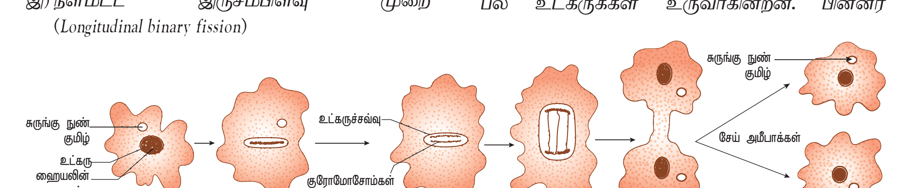 இதில்
பிளவு மட்டத்தை கண்டறிதல் கடினமானதாகும்.
இம்முறையில் சுருங்கு நுண் குமிழ் செயலிழந்து
மறைந்து
விடும்.
உட்கருமணி
மறைந்து
உட்கருவானது
மறைமுகப்பிரிவு
முறையில்
பிளவுபடும். பின்னர், செல்லின் நடுவில் சுருக்கம்
ஏற்பட்டு சைட்டோபிளாசம் பிரிந்து இரு சேய்
செல்கள் தோன்றுகின்றன.
கிடைமட்ட இருசமபிளவு முறையில் பிளவு
மட்டம்
உயிரியின்
கிடைமட்ட
அச்சில்
ஏற்படுகின்றது. எ.கா: பாரமீசியம் மற்றும்
பிளனேரியா. பாரமீசியத்தில் (படம் 1.2)

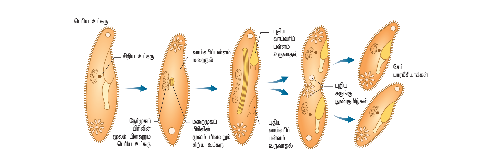 பெரிய
உட்கரு நேர்முகப் பிரிவு முறையிலும் சிறிய
உட்கரு
மறைமுகப்பிரிவு
முறையிலும்
பிரிவடைகின்றன.
நீள்மட்ட இருசமபிளவு முறையில் உட்கரு
மற்றும் சைட்டோபிளாசம் உயிரியின் நீள் அச்சில்
பிரிவடைகின்றது (படம் 1.3).

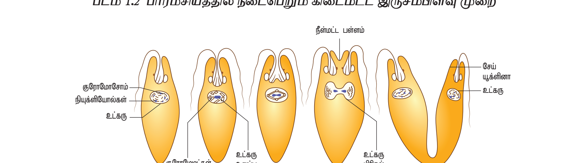 நீளிழை உயிரிகளில்
பிளவின்போது
நீளிழையானது
ஒரு
சேய்
செல்லில் தக்க வைக்கப்படுகின்றது. அடிப்படைத்
துகள்
இரண்டடாகப்
பிரிகிறது.
புதிய
அடிப்படைத்துகள் மற்றொரு சேய் செல்லின்
நீளிழையைத்
தோற்றுவிக்கின்றது.
எ.கா:
வோர்டிசெல்லா மற்றும் யூக்ளினா.
சாய்வுமட்ட
இருசமபிளவு
முறையில்
பிளவுமட்டம்
சாய்வவாக
அமைகின்றது.
டைனோஃஃபிளாஜெல்லேட்டுகளில்
இவ்வகைப்
பிளவுறுதல் காணப்படுகிறது. எ.கா: செராஷியம்
பல பிளவு முறையில் பெற்றோரின் உடல்,
ஒத்த அமைப்புடைய பல சேய் உயிரிகளாக
பிரிவடைகின்றது. உட்கரு தொொடர்ந்து பிரிவடைந்து,
பல உட்கருக்கள் உருவாகின்றன. பின்னர்
²¼ƒ° ¸‡
°I›

à†è¼„êš¾

²¼ƒ° ¸‡
°I›

«êŒ Üeð£‚èœ

உட்கரு எண்ணிக்கை்கு ஏற்ப சைட்டோபிளாசம்
பல பகுதிகளாகப் பிரிவடைந்து, ஒவ்வொரு
சைட்டோபிளாச பகுதியும் ஒரு சேய் உட்கருவைச்
சூழ்ந்து கொொண்டு ஓர் உயிரியாக மாறுகின்றது.
இதன்மூலம் ஒற்றை பெற்றோர் உயிரியிலிருந்து
பல சிறிய சேய் உயிரிகள் தோன்றுகின்றன.
பலபிளவுமுறையில் சமமான செல் பிரிதலினால்
ஒரு உயிரியிலிருந்து நான்கு அல்லது பல சேய்
உயிரிகள் தோன்றுகின்றன. மேலும், பிளவுறுதல்
நிகழ்வு முழுமையடையும் வரை சேய் உயிரிகள்
பிரிவதில்லை. இத்தகு பிரிவிற்கு பன்மடி பகுப்பு
(Repeated
fission)
என்று
பெயர்,
எ.கா: வோர்டிசெல்லா.
சாதகமற்ற
சூழலில்
(வெப்பநிலை,
அதிகரித்தல் அல்லது குறைதல் மற்றும் உணவுத்

தட்டுப்பாடு)
அமீபா
போலிக்கால்களை
உள்ளிழுத்துக் கொொண்டு தன்னைச் சுற்றி
கைட்டின் என்னும் பொொருளால் ஆன மூன்று
அடுக்கு சிஸ்ட் எனும் பாதுகாப்பு உறையைச்
சுரந்து
அதனுள்
செயலற்று
உறைகிறது
(படம் 1.4). இந்நிகழ்வுக்கு ‘உறையாக்கம்’ (encystment) என்று பெயர்.

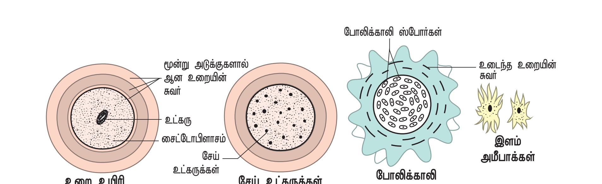 சாதகமான சூழல்
ஏற்படும்போது உறையிலுள்ள அமீபா பலபிளவு
முறையில் பகுப்படைந்து எண்ணற்ற சிறிய
‘போலிக்காலிஸ்போர்கள்’ அல்லது ‘அமீபுலே’வை
உற்பத்தி செய்கின்றன. சிஸ்ட் உறை நீரை உறிஞ்சி
சிதைவடைதல், நுண்ணிய போலிக்கால்களைக்
கொொண்ட
சேய்
போலிக்காலிஸ்போர்கள்
வெளிவருகின்றன. இவை உணவுண்டு, துரிதமாக
வளர்ந்து தனித்து செயற்படக்கூடிய வாழ்க்கை
முறையை மேற்கொள்கின்றன.
«ð£L‚è£L v«ð£˜èœ

Í¡Á Ü´‚°è÷£™
Ýù à¬øJ¡
²õ˜

à¬ì‰î à¬øJ¡
²õ˜

à†è¼
¬ê†«ì£H÷£ê‹

à¬ø àJK

«êŒ
à†è¼‚èœ

Þ÷ñ¢
Üeð£‚èœ
«êŒ à†è¼‚èœ
à¼õ£î™

«ð£L‚è£L
v«ð£˜èœ à¼õ£î™

பலசெல் உயிரிகள் சிலவற்றில் ஸ்டட்ரரோபிலா
ஆக்கம் (Strobilation) எனும் சிறப்பு வகை
கிடைமட்டப்பிளவு நடைபெறுகின்றது (படம் 1.5).

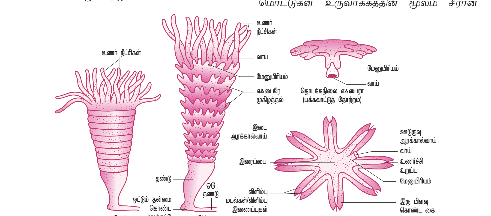
ஸ்டட்ரரோபிலா ஆக்க நிகழ்வில் பல கிடைமட்டப்
பிளவுகள் ஒரே நேரத்தில் நடைபெற்று தனித்துப்
பிரியாத
எண்ணற்ற
உயிரிகளை
உருவாக்குகின்றன.
எ.கா:
ஆரிலியா.
பல
உட்கருக்களைக் கொொண்ட பெற்றோர் உயிரியின்
உட்கருக்கள் பிரிந்து பல
உட்கருக்களைக்
கொொண்ட சேய் உயிரிகளை உருவாக்குதல்
பிளாஸ்மோடோமி
(Plasmotomy)
எனப்படும்.
பின்னர் உட்கருக்கள் பிளந்து இயல்பபான
எண்ணிக்கையை
நிலைப்படுத்துகின்றன.
ஒபாலினா
மற்றும்
பிலோமிக்ஸஸா
(இராட்சத
அமீபாக்கள்)
ஆகியனவற்றில்
பிளாஸ்மோடோமி முறை காணப்படுகின்றது.
அமீபாக்கள், சாதகமற்ற சூழ்நிலைகளில்
“ஸ்போர் உருவாக்கம்” முறையில் மேலுறையை
உருவாக்காமல்
எண்ணிக்கையில்
பெருக்கமடைகின்றன.
உட்கரு
பல
சிறு
துண்டுகளாகவோ
அல்லது
குரோமட்டின்
தொொகுப்புகளாகவோ உடைகிறது. பின் ஒவ்வொரு
துண்டடைச் சுற்றிலும் உட்கருச் சவ்வு உருவாகிறது.
அவை
பின்னர்
சைட்டோபிளாசத்தினால்
சூழப்பட்ட பின் தம்மைச்சுற்றிலும் ஓர் ஸ்போர்
உறையை உருவாக்குகிறது (படம் 1.6).

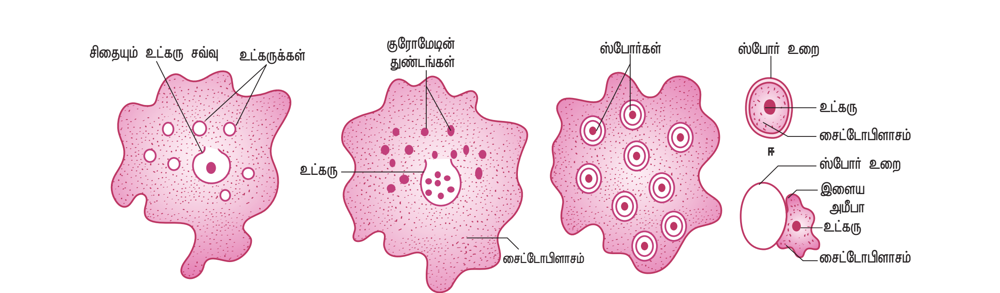 சூழ்நிலை
சாதகமாகும்போது பெற்றோர் உடல் சிதைந்து
ஸ்போர்கள்
வெளியேற்றப்படுகின்றன.
ஸ்போர்கள் ஒவ்வொன்றிலிருந்தும் ஒரு இளம்
அமீபா வெளிவருகின்றது.

முகிழ்தல் (Budding) முறையில் பெற்றோர்
உயிரிகளின் உடலில் ஒன்று அல்லது பல
மொொட்டுகள் தோன்றி ஒவ்வொன்றும் ஒரு சேய்
உயிரி ஆகின்றது. பின்னர் ஒவ்வொரு மொொட்டும்
பெற்றோரை
விட்டுப்பிரிந்து
இயல்பபான
வாழ்க்கையைத்
தொொடர்கின்றது.
எடுத்துக்காட்டாக, கடற் பஞ்சுகளில் உருவாகும்
மொொட்டுகளின் அடிப்பகுதி குறுகி பெற்றோரை
விட்டுப் பிரிந்து புதிய உயிரியாகின்றது (படம் 1.7).

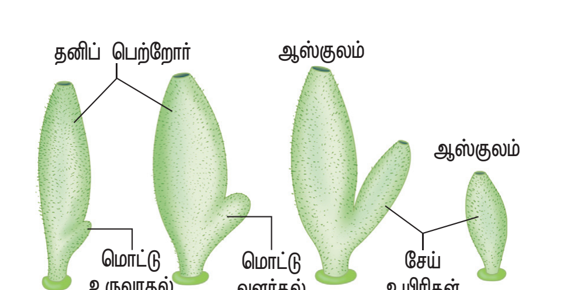
பெற்றோர்
உடலின்
வெளிப்பகுதியில்
மொொட்டுகள் உருவானால் அதற்கு புற முகிழ்தல்
(Exogenous budding) என்று பெயர். எ.கா: ஹைட்ரரா.
ஹைட்ரராவில் உணவு அதிகம் கிடைக்கும்போது
புறப்படை செல்கள் பெருகி உடலின் மேற்பகுதியில்
ஒரு புடைப்பை உருவாக்குகின்றது (படம் 1.8).

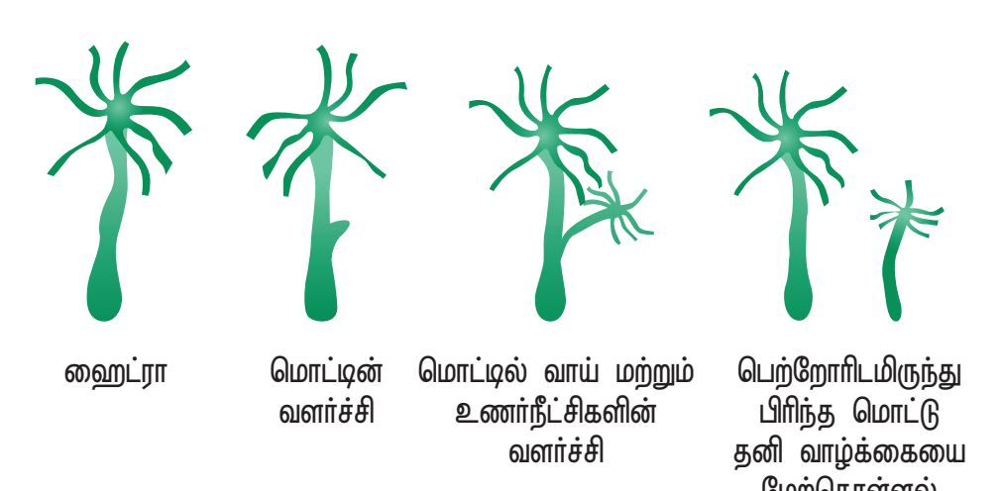
புறப்படை மற்றும் அகப்படை வெளிநோக்கி
தள்ளப்பட்டு மொொட்டு உருவாகின்றது. இந்த
மொொட்டில் பெற்றோர் உயிரியின் குடற்குழி
நீண்டுள்ளது. மொொட்டின் நுனியில் வாயும் மற்றும்
அதனைச் சுற்றி உணர்நீட்சிகளும் வளர்கின்றன.
முழுவதும் வளர்ந்த பிறகு மொொட்டின் அடிப்பகுதி
சுருங்கி பெற்றோர் உடலிலிருந்து பிரிந்து தனித்த
வாழ்க்கையை மேற்கொள்கின்றது.
நாக்டிலூகா-வில்
நூற்றுக்கணக்கான
மொொட்டுகள் சைட்டோபிளாசத்தினுள் உருவாகி
பெற்றோர் உடலினுள்ளேயே இருக்கும் நிலை
அக முகிழ்தல் (endogenous budding) எனப்படும்.
நன்னீர் பஞ்சுகள் மற்றும் சில கடற் பஞ்சுகளில்
ஜெம்யூல்கள் (Gemmules) என்னும் உள்ளமை
மொொட்டுகள் உருவாக்கத்தின் மூலம் சீரான
àí˜
c†Cèœ

àí˜ c†Cèœ

õ£Œ
«ñÂHKò‹
«ñÂHKò‹
âç¬ð«ó
ºA›ˆî™

ªî£ì‚èG¬ô âç¬ðó£
(ð‚èõ£†´ˆ «î£Ÿø‹)

Þ¬ì
Ýó‚裙õ£Œ

á´¼¾
Ýó‚裙õ£Œ
õ£Œ
à현C
àÁŠ¹
«ñÂHKò‹

Þ¬óŠ¬ð

冴‹ ñ
ªè£‡ì
Ü®ˆî†´
Þ÷ñ¢
v†«ó£Hô£

æ´

ºF˜‰î
v†«ó£Hô£

õ£Œ

MO‹¹
ñì™èœ/MO‹¹
ެ특èœ

Þ¼ H÷¾
ªè£‡ì ¬è
ªî£ì‚èG¬ô âç¬ðó£
(õ£ŒŠ¹øˆ «î£Ÿø‹)

C¬î»‹ à†è¼ êš¾

°«ó£«ñ®¡
¶‡ìƒèœ

à†è¼è¢è÷¢

v«ð£˜èœ

v«ð£˜ à¬ø

à†è¼
¬ê†«ì£H÷£ê‹

ß

v«ð£˜ à¬ø

à†è¼

Þ¬÷ò
Üeð£
à†è¼
¬ê†«ì£H÷£ê‹

¬ê†«ì£H÷£ê‹

îQŠ ªðŸ«ø£˜

Ýv°ô‹

Ýv°ô‹
¬ý†ó£

ªñ£†´
à¼õ£î™

ªñ£†´
õ÷˜î™

«êŒ
àJKèœ

முகிழ்த்தல்

மற்றும் தனித்துவமான பாலிலி இனப்பபெருக்கம்
நடைபெறுகின்றது (படம். 1.9).

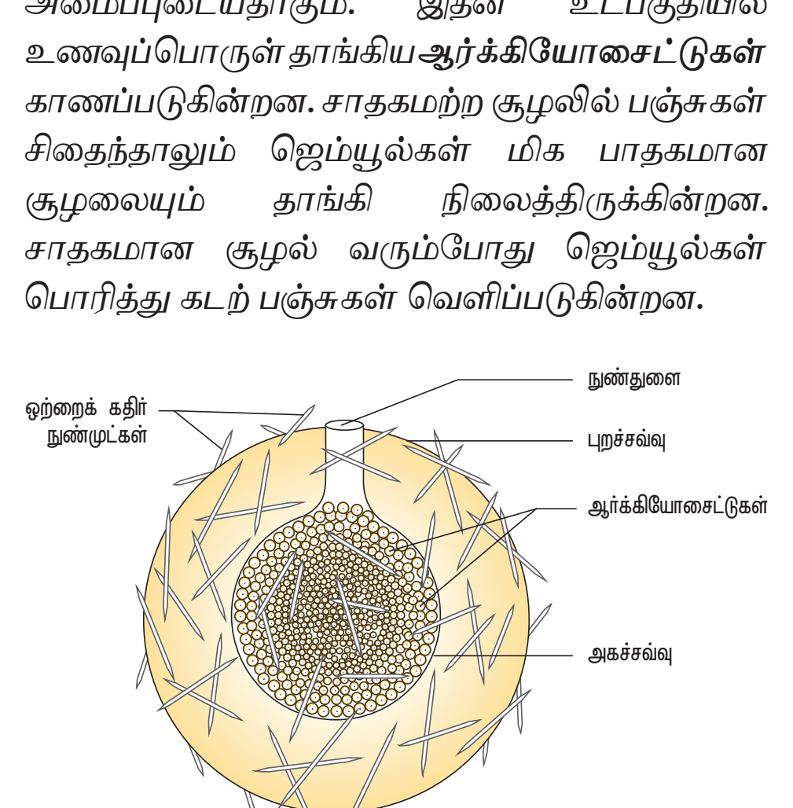 முழுவளர்ச்சி
பெற்ற ஜெம்யூல் உறுதியான பந்துபோன்ற
அமைப்புடையதாகும்.
இதன்
உட்பகுதியில்
உணவுப் பொொருள் தாங்கிய ஆர்க்கியோசைட்டுகள்
காணப்படுகின்றன. சாதகமற்ற சூழலில் பஞ்சுகள்
சிதைந்ததாலும் ஜெம்யூல்கள் மிக பாதகமான
சூழலையும்
தாங்கி
நிலைத்திருக்கின்றன.
சாதகமான சூழல் வரும்போது ஜெம்யூல்கள்
பொொரித்து கடற் பஞ்சுகள் வெளிப்படுகின்றன.
¸‡¶¬÷
埬ø‚ èF˜
¸‡º†èœ

ªñ£†®¡
õ÷˜„C

¹ø„êš¾
ݘ‚A«ò£¬ê†´èœ

ªñ£†®™ õ£Œ ñŸÁ‹
àí˜c†CèO¡
õ÷˜„C

ªðŸ«ø£KìI¼‰¶
HK‰î ªñ£†´
îQ õ£›‚¬è¬ò
«ñŸªè£œ÷™

துண்டடாதல்

முறை

இனப்பபெருக்கம்

கடல்

சாமந்தியின் பல பேரினங்களில் நடைபெறுகின்றது.
பாதத்தட்டுகளின்

அடிப்பகுதியில்

ஏற்படும்

சுருக்கங்களால்

பிரிந்த

கதுப்புகள்

ஒவ்வொன்றிலும் குடல் தாங்கிகளும் (Mesenteries)
உணர்கொம்புகளும் (Tentacles) வளர்ந்து புதிய
கடற்சசாமந்திகள் உருவாகின்றன.
நாடாப்புழுக்களில் (டீனியா சோலியம்) (Taenia solium) வயதான பழுத்த கண்டங்கள் உடற்பகுதியான ஸ்ட்ரோபிலாவின் பின்முனையில் உள்ளன. இத்தகு பழுத்த கண்டங்கள் தனியாகவோ அல்லது தொகுப்பாகவோ உடலில் இருந்து பிரியும் செயலுக்கு 'அபோலைசிஸ்' (தற்சிதைவு) (Apolysis) (படம் 1.10) என்று பெயர். இதன் மூலம் வளர்ந்த கருவானது முதல் நிலை விருந்தோம்பி (மனிதன்) யிடமிருந்து இரண்டாம் நிலை விருந்தோம்பி (பன்றி)யை அடைவதால் இந்நிகழ்வு மிகவும் முக்கியத்துவம் வாய்ந்ததாகும்.

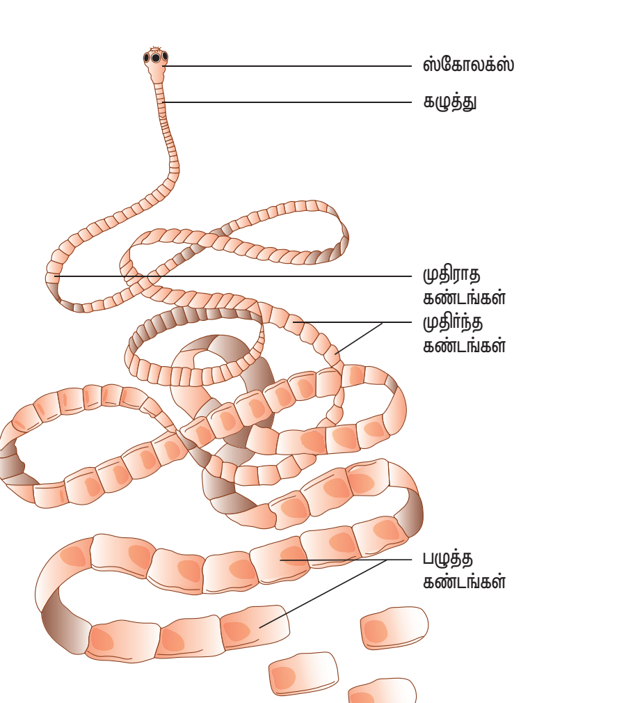

காயமடைந்த உடல் பகுதியிலிருந்து உடல் பாகங்கள் (அல்லது) திசுக்கள் மறுவளர்ச்சி அடைவது 'இழப்பு மீட்டல்' (Regeneration) எனப்படும். 1740ல் ஆபிரகாம் டிராம்ப்ளி என்னும் அறிவியலாளர் ஹைட்ராவில் 'இழப்பு மீட்டல்' குறித்து முதன் முதலில் ஆய்வு மேற்கொண்டார்.

இழப்பு மீட்டல் இருவகைப்படும். அவை, ‘முழு உருவ மீட்பு’ (Morphallaxis) மற்றும் ‘உறுப்பு மீட்பு’ (Epimorphosis) ஆகும். முழுஉருவ மீட்பில் உடலின் ஒரு சிறிய துண்டுப்பகுதியிலிருந்து முழு உடலும் மீண்டும் வளர்கிறது. எ.கா. ஹைட்ரா மற்றும் பிளனேரியா. ஹைட்ராவை பல துண்டுகளாக வெட்டினால் ஒவ்வொரு துண்டும் தனது இழந்த பகுதிகளை வளரச் செய்து ஒரு முழுமையான புதிய ஹைட்ராவை உருவாக்குகிறது (படம் 1.11).

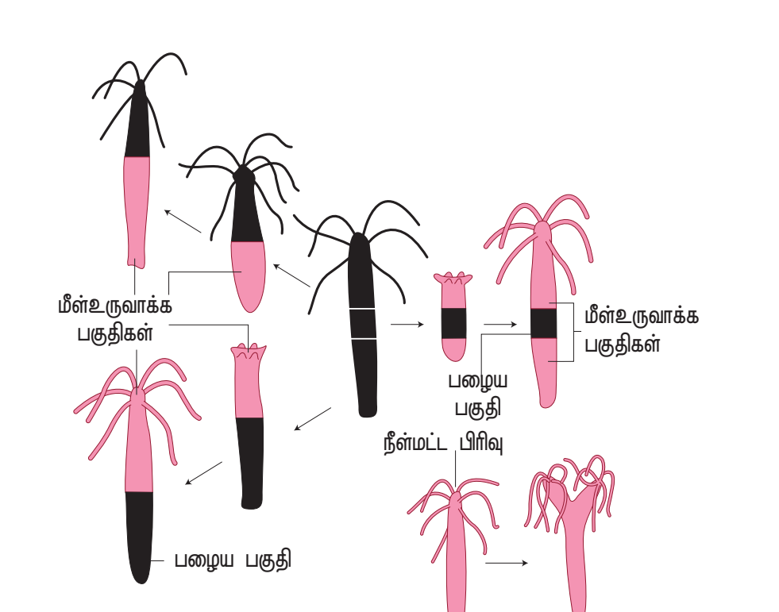

இந்த இழப்பு மீட்டலில் உறுப்புகள் தங்களது துருவத்தன்மையை தக்க வைத்துக் கொள்கின்றன. வாய்முனை (Oral ends) உணர் நீட்சிகளையும் (Tentacles), வாய் எதிர்முனை (Aboral ends) அடித்தட்டுகளையும் உருவாக்கிக் கொள்கின்றன.

உறுப்புமீட்பு என்பது இழந்த உடல் உறுப்புகளை மட்டும் மீண்டும் உருவாக்கிக் கொள்ளும் திறன் ஆகும். இது இரு வகைப்படும். அவை ‘சீராக்கல்’ (Reparative) மற்றும் ‘மீண்டும் உருவாக்குதல்’ (Restorative) வகையான இழப்பு மீட்டல்களாகும். சீராக்கல் இழப்பு மீட்டலில் உடலில் சேதமுற்ற சில வகையான திசுக்கள் மட்டும் சரி செய்யப்படுகின்றன எ.கா. மனிதன். மீண்டும் உருவாக்குதல் என்பது உடல் இழந்த அல்லது வெட்டுண்ட பகுதியை முழுமையாக உருவாக்கும் திறனாகும் எ.கா. நட்சத்திர மீன் மற்றும் சுவர்ப்பல்லி இழந்த வால் (படம் 1.12).

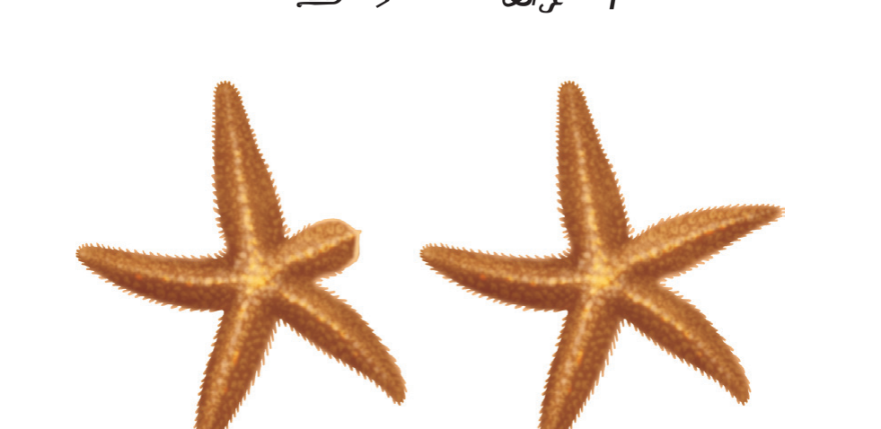

> **இழப்பு மீட்டல் திறன்**
> சிதைக்கப்பட்ட கடற்பஞ்சினை ஒரு மெல்லிய பட்டுத்துணியின் வழியாக பிழிந்ததால் கிடைக்கும் செல் தொகுப்பு மீண்டும் புதிய முழுமையான கடற்பஞ்சுகளாக உருவாக இயலும். இத்தொழில் நுட்பம் செயற்கை முறை கடற்பஞ்சு வளர்ப்பில் பயன்படுகிறது.

## 1.3 பாலினப்பபெருக்கம்

ஆண்
மற்றும்
பெண்
இனச்சசெல்கள் இணைவுற்று
இரட்டை மய கருமுட்டையை
(Diploid
zygote)
உருவாக்கி
அதிலிருந்து
ஒரு
புதிய
உயிரியைத்
தோற்றுவிக்கும்
முறையே பாலினப்பபெருக்கம் ஆகும். இதன்மூலம்
மரபியல்
வேறுபாடுகள்
உருவாகின்றன.
‘ஒருங்கிணைவு’ (Syngamy) மற்றும் ‘இணைவு முறை
இனப்பபெருக்கம்’
(Conjugation)
என்னும்
இருமுறைகளில்
பாலினப்
பெருக்கம்
நடைபெறுகிறது. ஒருங்கிணைவு முறையில், இரு
ஒற்றை மய இனச்சசெல்கள் (Haploid gametes)

ஒன்றிணைந்து
இரட்டைமய
கருமுட்டை
(Diploid zygote) உருவாக்கப்படுகிறது. கருவுறுதலின்
நிகழ்விடத்தைப் பொொறுத்து ஒருங்கிணைவு முறை
இரண்டு வகையாகப் பிரிக்கப்பட்டுள்ளது. பெண்
உயிரியின் உடலுக்கு வெளியில், ஆண், பெண்
இனச்சசெல்கள் இணைந்ததால் குறிப்பாக அவை
வாழும் நீர் வாழிடத்தில் நிகழ்ந்ததால் அவ்வகைக்
கருவுறுதல்
‘வெளிக்கருவுறுதல்’
(External
fertilization) எனப்படும். எ.கா: கடற்பஞ்சுகள்,
மீன்கள் மற்றும் இருவாழ்விகள். ஆண், பெண்
இனச்சசெல்களின்
இணைதலானது
பெண்
உயிரியின்
உடலுக்குள்ளேயே
நிகழ்ந்ததால்
அவ்வகைக் கருவுறுதல் ‘உட்கருவுறுதல்’ (Internal
fertilization) என அழைக்கப்படும். எ.கா: ஊர்வன,
பறவைகள் மற்றும் பாலூட்டிகள்.
உயிரிகளில்

பல்வவேறு

வகையான

ஒருங்கிணைவு (கருவுறுதல்) நடைபெறுகிறது.
அ)

‘சுய

கருவுறுதல்’

(Autogamy)

ஒரு

செல்லிலிருந்தோ அல்லது ஒரே உயிரியிலிருந்தோ
உருவாகின்ற ஆண் மற்றும் பெண் இன செல்கள்
இணைந்து கருமுட்டையை உருவாக்குகின்றன.
எ.கா: ஆக்டினோஸ்பபேரியம் மற்றும் பாரமீசியம்.
ஆ) ‘அயல் கருவுறுதல்’ (exogamy) - ஆண்
மற்றும்

பெண்

என்னும்

இரு

தனித்தனி

பெற்றோர்களிலிருந்து உருவாகின்ற ஆண் மற்றும்
பெண் இனச்சசெல்கள் ஒன்றிணைந்து கருமுட்டை
உருவாகிறது.

எனவே,

இது

இரு

பெற்றோர்

வகையானது.

எ.கா: மனிதனில் ஆண் பெண்

என்னும் இரு தனித்தனி உயிரிகள் காணப்படுதல்.
(டயோஷியஸ் அல்லது ஒரு பால்-உயிரி (Dioecious
or Unisexual).
இ) ‘முழுசேர்க்கை’ (Hologamy) - கீழ்நிலை
உயிரிகளில், சில சமயங்களில் முதிர்ந்த உயிரிகள்
இனச்சசெல்களை உருவாக்காமல், அவ்வயிரிகளே
இனச்
செல்கள்
போன்று
செயல்பட்டு
ஒன்றிணைந்து
புதிய
உயிரிகளைத்
தோற்றுவிக்கின்றன.
இது
‘முழுச்சேர்க்கை’
எனப்படும்.
எ. கா.
டிரைக்கோநிம்ஃபா
(Trichonympha).
ஈ) இளம் செல் சேர்க்கை (Paedogamy) முதிர்ந்த
பெற்றோர்
செல்லிலிருந்து
மறைமுகப்பிரிவு மூலம் உருவாகும் இரு இளம்
சேய்
செல்கள்
இனச்சசெல்கள்
போன்று

செயல்பட்டு ஒன்றிணைந்து புதிய உயிரியைத்
தோற்றுவிக்கும் செயல் ‘இளம் செல் சேர்க்கை’
எனப்படும். எ.கா. ஆக்டினோபிரிஸ்.
உ) மாறுபட்ட செல்சசேர்க்கை (Merogamy) அமைப்பில் மாறுபட்ட இரு சிறிய இனச்சசெல்கள்
ஒன்றிணையும் முறை ‘மாறுபட்ட செல்சசேர்க்கை’
எனப்படும். எ.கா. புரோட்டோசோவா.
ஊ) ஒத்த செல் சேர்க்கை (Isogamy) அமைப்பிலும் செயலிலும் ஒரே மாதிரியான இரு
இனச்சசெல்கள் ஒன்றிணைதல் ‘ஒத்த செல்
சேர்க்கை’ எனப்படும். எ.கா. மோனோசிஸ்டிஸ்.
எ) வேறுபட்ட செல் சேர்க்கை’ (anisogamy)
(Gr. An without; iso-equal; gam-marriage) - முற்றிலும்
வேறுபட்ட இரு இனச் செல்கள் ஒன்றிணையும்
முறை ‘வேறுபட்ட செல் சேர்க்கை’ (anisogamy)
எனப்படும். இவ்வகைக் கருவுறுதல் உயர்வகை
விலங்குகளில்
நடைபெறுகிறது.
ஆனால்,
அவ்விலங்குகளில்
‘வேறுபட்ட
செல்
சேர்க்கை’(Anisogamy) ‘ஒருங்கிணைவு’ (Syngamy)
போன்ற
வார்த்தைகளை
விட
கருவுறுதல்
(Fertilization) என்னும் வார்த்தைப் பயன்பபாடே
நடைமுறையில் உள்ளது. எ.கா. உயர்நிலை
முதுகெலும்பற்றவை
மற்றும்
அனைத்து
முதுகெலும்பிகள்.
‘இணைவு முறை இனப்பபெருக்கம்’ (Conjugation)
என்னும் முறையில் ஒரே சிற்றினத்தைச் சார்ந்த
இரு உயிரிகள் தற்ககாலிகமாக இணைதல்
நடைபெறுகிறது.
இவ்விணைதலில் ஈடுபடும்
உயிரிகள் இணைவிகள் (Conjugants) என்று
அழைக்கப்படுகின்றன. அவை தங்களுக்கிடையே
குறிப்பிட்ட அளவு உட்கரு பொொருட்களை (DNA)
பரிமாறிக் கொொண்ட பின் தனித்தனியாகப்
பிரிகின்றன. பொொதுவாக குறு இழைஉயிரிகளில்
இணைவு முறை இனப்பபெருக்கம் காணப்படுகிறது.
எ.கா: பாரமீசியம், வோர்ட்டிசெல்லா மற்றும்
பாக்டீரியா (புரோகேரியோட்டுகள்).

வாழ்க்கைச் சுழற்சியின் நிலைகள்
உயிரிகள் தங்கள் வாழ்க்கை சுழற்சியில்
மூன்று நிலைகளைக் (Phases) கொொண்டுள்ளன.
அவை, ‘இளம் உயிரிநிலை’ / ‘வளராக்க நிலை’
(Juvenile Phase/Vegetative Phase), ‘இனப்பபெருக்க
நிலை’ / ‘முதிர்ச்சி நிலை’ (Reproductive Phase /
Maturity Phase) மற்றும் முதுமை நிலை
(Senescent Phase). ஒரு உயிரியின் பிறப்பிற்கும்

இனப்பபெருக்க
முதிர்ச்சிக்கும்
இடைப்பட்ட
வளர்ச்சிக்காலம் ‘இளம் உயிரி நிலை’ எனப்படும்.
ஒரு உயிரியானது இனப்பபெருக்கம் செய்து வழித்
தோன்றல்களை உருவாக்கும் செயல்களைச்
செய்யும் காலம் இனப்பபெருக்க நிலை ஆகும்.
இனச்சேர்க்கையுறும் காலத்தைப் பொொறுத்து
விலங்குகள் இரு வகையாகப் பிரிக்கப்படும்.
அவை, ‘பருவகால இனச்சேர்க்கையாளர்கள்’
(Seasonal
breeders)
மற்றும்
‘காலமுறையற்ற
இனச்சேர்க்கையாளர்கள்’ (Continuous breeders).
ஒரு ஆண்டின் குறிப்பிட்ட காலத்தில் மட்டும்
இனச்சேர்க்கையில் ஈடுபடும் உயிரிகள் ‘பருவ
கால இனச்சேர்க்கையாளர்கள்’ எனப்படும். எ.கா:
தவளைகள், பல்லிகள், பெரும்பபாலான பறவைகள்,
மான்கள் போன்றவை. பால் முதிர்ச்சிக் காலம்
முழுவதும்
இனச்சேர்க்கையில்
ஈடுபடும்
உயிரிகள்
‘காலமுறையற்ற
இனச்
சேர்க்கையாளர்கள்’ ஆகும். எ. கா: தேனீக்கள்,
வளர்ப்புப் பறவைகள், முயல்கள் போன்றவை.
இனப்பபெருக்க நிலை முடியும் காலத்தில் ஒரு
உயிரியின்
உடல்
அமைப்பிலும்
செயல்பபாடுகளிலும் சிதைவு ஏற்படத் தொொடங்கும்
நிலை முதுமை நிலை (Senescent phase) எனப்படும்.

கன்னி இனப்பபெருக்கம் (Parthenogenesis)
(Gr. Parthenos – virgin, Genesis – produce)
அண்ட செல்லானது, கருவுறாமலேயே முழு
உயிரியாக வளர்ச்சி அடையும் செயலுக்கு ‘கன்னி
இனப்பபெருக்கம்’ என்று பெயர்.
இது, 1745ல்
சார்லஸ் பானட் என்பவரால் முதன் முதலில்
கண்டறிப்பட்டது.
கன்னி
இனப்பபெருக்கம்
இருவகைப்படும். அவை, இயற்ககையான கன்னி
இனப்பபெருக்கம் (Natural parthenogenesis) மற்றும்
செயற்ககையானக் கன்னி இனப்பபெருக்கம் (Artificial
Parthenogenesis).
சில விலங்குகளின் வாழ்க்கை
சுழற்சியில் கன்னி இனப்பபெருக்கம் தொொடர்ச்சியாக,
நிலையாக மற்றும் இயற்ககையாக நடைபெறுகிறது.
இது இயற்ககையான கன்னி இனப்பபெருக்கம்
எனப்படும்.
இயற்ககையான கன்னி இனப்பபெருக்கத்தை
இரு
வகைகளாகப்
பிரிக்கலாம்.
அவை,
‘முழுமையான’ (Complete) மற்றும் ‘முழுமையற்ற’
(Incomplete) கன்னி இனப்பபெருக்கம் ஆகும். சில
விலங்குகளில், இரு பெற்றோர்களால் நிகழும்
பாலினப் பெருக்கம் நடைபெறுவதில்லை. மாறாக,
அவை முழுமையான கன்னி இனப்பபெருக்கம்
மூலம் மட்டுமே இனப்பபெருக்கம் செய்கின்றன.
இவ்விலங்குகளில்
ஆண்
உயிரிகளே
காணப்படுவதில்லை. பெண் உயிரிகள் மட்டுமே
உள்ளன. முழுமையற்ற கன்னி இனப்பபெருக்கம்
நடைபெறும்
சில விலங்குகளில், பாலினப்
பெருக்கம் மற்றும் கன்னி இனப்பபெருக்கம்
இரண்டுமே
நடைபெறுகின்றன.
எ.கா:
தேனீக்களில், கருவுற்ற முட்டை இராணித்
தேனீயாகவும் வேலைக்காரத் தேனீக்களாகவும்
வளர்ச்சியுறுகின்றன. அதே வேளையில், கருவுறாத
முட்டைகள்
ஆண்
தேனீக்களாக
வளர்ச்சியடைகின்றன. ‘இளம் உயிரி கன்னி
இனப்பபெருக்கத்தில்’ (Paedogenetic parthenogenesis/
Paedogenesis)
இளவுயிரியே
(larvae)
கன்னி
இனப்பபெருக்கத்தின் மூலம் புதிய தலைமுறை
இளவுயிரிகளை
உருவாக்குகிறது.
கல்லீரல்
புழுவின்
ஸ்போரோசிஸ்ட்டுகள்
மற்றும்
ரீடியா
லார்வவாக்கள்
இவ்வகையில்
இனப்பபெருக்கம்
செய்கின்றன.
சிலவகைப்
பூச்சிகளின்
லார்வவாக்களிலும்
இது
நடைபெறுகிறது. எ.கா. மொொழுக்கு ஈ (Gall fly).
செயற்ககை கன்னி இனப்பபெருக்கத்தில் கருவுறாத
அண்டம் இயற்பிய அல்லது வேதிய தூண்டல்கள்
மூலம்
தூண்டப்பட்டு
முழு
உயிரியாக
வளர்ச்சியடைகின்றன. எ.கா: வளை தசை
புழுக்கள் மற்றும் கடல் அர்ச்சின்.

இயற்ககையான
கன்னி
இனப்பபெருக்கம்
பல
வகைப்படும்
அ) அர்ரீனோடோகி (Arrhenotoky) :
இவ்வகைக்
கன்னி
இனப்பபெருக்கத்தில் ஆண் உயிரிகள் மட்டுமே
உருவாக்கப்படுகின்றன. எ. கா. ஏபிஸ் (தேனீக்கள்)
ஆ) தெலிடோகி (Thelytoky): இவ்வகைக் கன்னி
இனப்பபெருக்கத்தில் பெண் உயிரிகள் மட்டுமே
உருவாக்கப்படுகின்றன. எ. கா. சொொலனோபியா
இ) ஆம்ஃபிடோகி (Amphitoky): இவ்வகைக்
கன்னி இனப்பபெருக்கத்தில் அண்ட செல்
வளர்ச்சியுற்று ஆண் அல்லது பெண் உயிரியாக
உருவாகின்றது. எ. கா. ஏஃபிஸ் காஸிபீ

பாடச்சுருக்கம்
உயிரிகள் தங்களைப்போன்றறே மற்றொரு
உயிரியை உருவாக்கும் இனவிருத்தி நிகழ்ச்சி
இனப்பபெருக்கம் ஆகும். பாலிலி இனப்பபெருக்கம்
மற்றும்
பாலினப்
பெருக்கம்
என

இனப்பபெருக்கத்தை இரு பெரும் வகைகளாகப்
பிரிக்கலாம். இனச்சசெல்கள் உருவாக்கம் மற்றும்
அவை
இணைதல்
போன்ற
நிகழ்ச்சிகள்
பாலினப்பபெருக்கத்தில் மட்டுமே நடைபெறுகிறது.
பாலிலா
இனப்பபெருக்கத்தில்
இவ்விதம்
நிகழ்வதில்லை.
பிளவுறுதல், முகிழ்த்தல்,
துண்டடாதல், இழப்பு மீட்டல் போன்ற முறைகளில்
பாலிலா இனப்பபெருக்கம் நிகழ்கிறது. பிளவுறுதல்
நிகழ்ச்சியானது இரு சமப்பிளவுமுறை, பல
பிளவுமுறை, ஸ்போர் உருவாக்கம், ஸ்டட்ரரோபிலா
உருவாக்கம்
போன்ற
பிரிவுகளாகப்
பிரிக்கப்பட்டுள்ளது. பிளவுறுதல் நடைபெறும்
தளத்தைப் பொொறுத்து பல வகையான இரு
பிளவுறுதல் காணப்படுகிறது.
அவையாவன,
எளிய
ஒழுங்கற்ற
இருசமப்
பிளவுமுறை
கிடைமட்ட இரு சமபிளவு முறை, நீளவாட்டு இரு
சமபிளவு முறை மற்றும் சாய்வு மட்ட இரு
சமப்பிளவு முறை. பல பிளவு முறை என்பது தாய்
செல்லானது ஒரே நேரத்தில் பல சிறிய சேய்
செல்களாகப் பிரியும் நிகழ்ச்சியாகும். பாலிலி
இனப்பபெருக்கத்தின் மற்றொரு முறை முகிழ்த்தல்
ஆகும். பெற்றோரின் உடலத்தில் ஒன்று அல்லது
அதற்கு மேற்பட்ட மொொட்டுகள் தோன்றி ஒவ்வொரு
மொொட்டும் ஒரு இளம் உயிரியாக வளர்ச்சியடைந்து
பின்பு உடலத்தில் இருந்து தனித்துப் பிரிந்து
இயல்பபான வாழ்க்கையை மேற்கொள்கின்றன.
பெற்றோர்
உடலத்தின்
மேற்பரப்பில்
பல
மொொட்டுகள் தோன்றினால் அது ‘புற முகிழ்த்தல்’
என்றும்
பெற்றோர்
உடல்
செல்களின்
சைட்டோபிளாசத்தில்
பல
மொொட்டுகள்
தோன்றினால் அது ‘அக முகிழ்த்தல்’ என்றும்
அழைக்கப்படும். ‘துண்டடாதல்’ என்பது மற்றொரு
வகையான பாலிலி இனப்பபெருக்கம் ஆகும். இதில்
பெற்றோர்
உடலானது
பல
துண்டுகளாக
உடைகிறது.
இவ்வாறு உருவான ஒவ்வொரு
துண்டும் ஒரு புதிய உயிரியை உருவாக்கும்
திறனைப் பெற்றுள்ளது. இழப்பு மீட்டல் என்பது
ஒரு சிறு துண்டிலிருந்து முழுமையான உயிரியை
உருவாக்கும் நிகழ்வவாகும். இது, சீராக்கல் வகை
இழப்பு மீட்டல் மற்றும் மீண்டும் உருவாக்குதல்
வகை இழப்பு மீட்டல் என இரு வகைப்படும்.

நடைபெறுகின்றன. அவை தன் கருவுறுதல், அயல்
கருவுறுதல்,
முழுச்சேர்க்கை,
இளம்
செல்சசேர்க்கை, மாறுபட்ட செல் சேர்க்கை, ஒத்த
செல்சசேர்க்கை, வேறுபட்ட செல் சேர்க்கை மற்றும்
இணைவு முறை இனப்பபெருக்கம் ஆகியவை
ஆகும்.
கன்னி இனப்பபெருக்கம் என்பது
விலங்குகளில் காணப்படும் சிறப்பு வகையான
இனப்பபெருக்க முறை ஆகும். இது இயற்ககையான
கன்னி இனப்பபெருக்கம் மற்றும் செயற்ககையான
கன்னி இனப்பபெருக்கம் என இருவகைப்படும்.

விலங்குகளில் பல வகையான பாலினப்பபெருக்க
முறைகள் காணப்படுகின்றன.
ஒருங்கிணைவு
முறையில் இரண்டு ஒற்றைமய இனச்சசெல்கள்
ஒன்றிணைந்து
ஒரு
கருமுட்டை
உருவாக்கப்படுகிறது. விலங்குகளில் கீழ்க்காணும்
பல
வகையான
ஒருங்கிணைவு
முறைகள்

அ) ‘ கூ’ மற்றும் ‘கா’ இரண்டும் சரியானால் ‘கா’
என்பது ‘கூ’ வின் சரியான விளக்கம் ஆகும்.

## மதிப்பீடு

1.  எவ்வகைக்
கன்னி
இனப்பபெருக்கத்தில் ஆண்
உயிரிகள்
மட்டுமே
உருவாகின்றன?
அ) அர்ரீனோடோக்கி
ஆ) தெலிடோக்கி
இ) ஆம்ஃபிடோக்கி
ஈ) ‘அ’ மற்றும் ‘இ’ இரண்டும்
2.  பாக்டீரியாவில் பால் இனப்பபெருக்கம் கீழ்க்கண்ட
எந்த முறையில் நடைபெறுகிறது
அ) கேமிட் உருவாக்கம்
ஆ) என்டோஸ்ேபார் உருவாக்கம்
இ) இணைதல்
ஈ) சூஸ்போர் உருவாக்கம்
3.  எவ்வகை இனப்பபெருக்கத்தில் வேறுபாடுகள்
தோன்றும்
அ) பாலிலி இனப்பபெருக்கம்
ஆ) கன்னி இனப்பபெருக்கம்
இ) பாலினப் பெருக்கம்
ஈ) ‘அ’ மற்றும் ‘ஆ’ இரண்டும்
4.  கூற்று மற்றும் காரண வினாக்கள்:
கீழ்க்கண்ட வினாக்களில் இரண்டு கூற்றுகள்
கொொடுக்கப்பட்டுள்ளன.
ஒன்று கூற்று (கூ)
ஆகும். மற்றொன்று காரணம் (கா). சரியான
விடையை கீழ்க்காணும் வகையில் குறிப்பிடுக.

ஆ) ‘ கூ’ மற்றும் ‘கா’ இரண்டும் சரியானவை
ஆனால் ‘கா’ என்பது ‘கூ’ வின் சரியான
விளக்கம் இல்லை.

இ) ‘கூ’ சரியானது ஆனால் ‘கா’ தவறானது.
ஈ) ‘கூ’ மற்றும் ‘கா’ இரண்டும் தவறானவை.
i.  கூற்று: தேனீக்களின் சமூகத்தில் ஆண்
தேனீக்களைத் தவிர மற்ற அனைத்தும்
இருமயம் கொொண்டவை
காரணம்:
ஆண்
இனப்பபெருக்கம்
செய்யப்படுகின்றன.
அ)

ஆ)

இ)

தேனீக்கள்
மூலம்

கன்னி
உற்பத்தி

ஈ)

ii.  கூற்று: பாலிலா இனப்பபெருக்கம் மூலம்
உருவாகும் சேய்கள் பெற்றோரை ஒத்த
மரபியல் பண்புகளைக் கொொண்டிருக்கும்.
காரணம்:
பாலிலா
இனப்பபெருக்கத்தில்
மறைமுகப்பிரிவு மட்டுமே நடைபெறுகிறது.
அ)

ஆ)

இ)

ஈ)

5.  எவ்வுயிரினத்தில் செல் பிரிதலே இனப்பபெருக்க
முறையாகச் செயல்புரிகிறது?
6.  பெண் இனச்சசெல் நேரடியாக வளர்ச்சியடைந்து
சேயாக மாறும் நிகழ்வின் பெயரையும் அது
நிகழும் ஒரு பறவையின் பெயரையும் குறிப்பிடுக.
7.  கன்னி இனப்பபெருக்கம் என்றறால் என்ன?
விலங்குகளிலிருந்து இரு எடுத்துக்காட்டுகள்
தருக.

8.  பாலிலி இனப்பபெருக்கம் (அல்லது) பாலினப்
பெருக்கம் இவற்றுள் எது மேம்பட்டது? ஏன்?
9.  இரு பிளவுறுதல் முறைப்படி இனப்பபெருக்கம்
செய்யும் ஒரு ெசல் உயிரிகள் அழிவற்றவை.
நியாயப்படுத்து.
10.  பாலிலி
இனப்பபெருக்க
முறையில்
உருவாக்கப்படும் சேய்கள் ஏன் ‘பிரதி’ (clone)
என்று அழைக்கப்படுகிறது?
11.  காரணங்கள் கூறுக.
அ)  தேனீக்கள் போன்ற உயிரிகள்
இனப்பபெருக்க
விலங்குகள்
அழைக்கப்படுகின்றன.

கன்னி
என்று

ஆ)  ஆண்தேனீக்களில்16குரோமோசோம்களும்
பெண்
தேனீக்களில்

குரோமோசோம்களும் காணப்படுகின்றன.
12.  கீழ்க்கண்டவற்றை வேறுபடுத்துக.
அ)  வெளி கருவுறுதல் மற்றும் உட்கருவுறுதல்.
ஆ)  பல்லி மற்றும் பிளனேரியாவில் காணப்படும்
இழப்பு மீட்டல்.
13.  இளவுயிரி நிலை எவ்வாறு இனப்பபெருக்க
நிலையிலிருந்து வேறுபட்டுள்ளது?
14.  உயிரிகளில் காணப்படும் பல்வவேறு வகையான
ஒருங்கிணைவு முறைகளை விவரி.

## கருத்து வரைபடம்

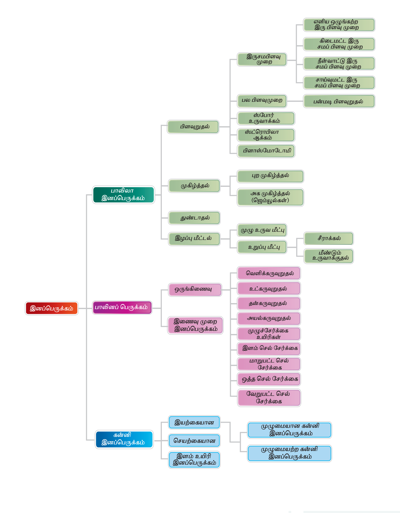
