# அசல் பாடநூல் பக்கங்கள்: உயிரிகளின் இனப்பெருக்கம்

இந்தப் படங்கள் பாடநூலின் அசல் அமைப்பு, விளக்கப்படங்கள், குறிச்சொற்கள், அட்டவணைகள், செயல்பாடுகள் மற்றும் வினாக்களைப் பாதுகாக்கின்றன.

## PDF பக்கம் 9 - பாடநூல் பக்கம் 1

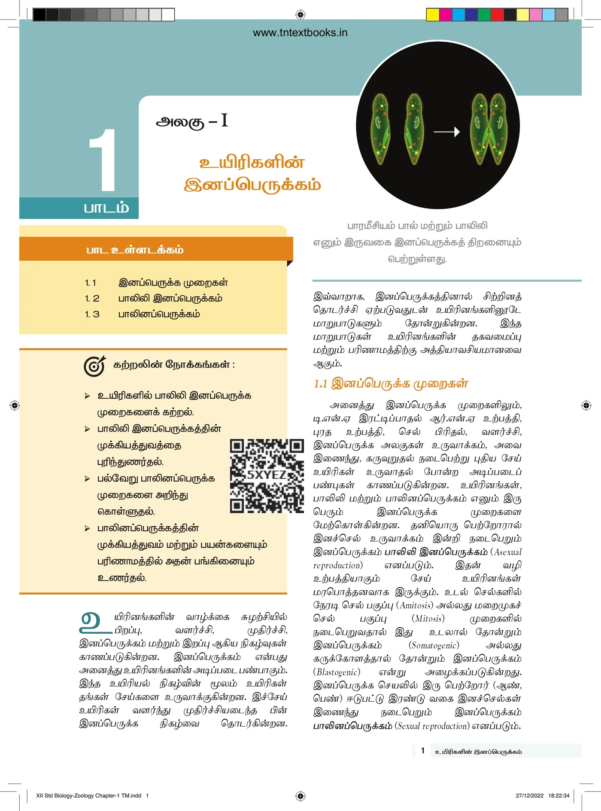

## PDF பக்கம் 10 - பாடநூல் பக்கம் 2

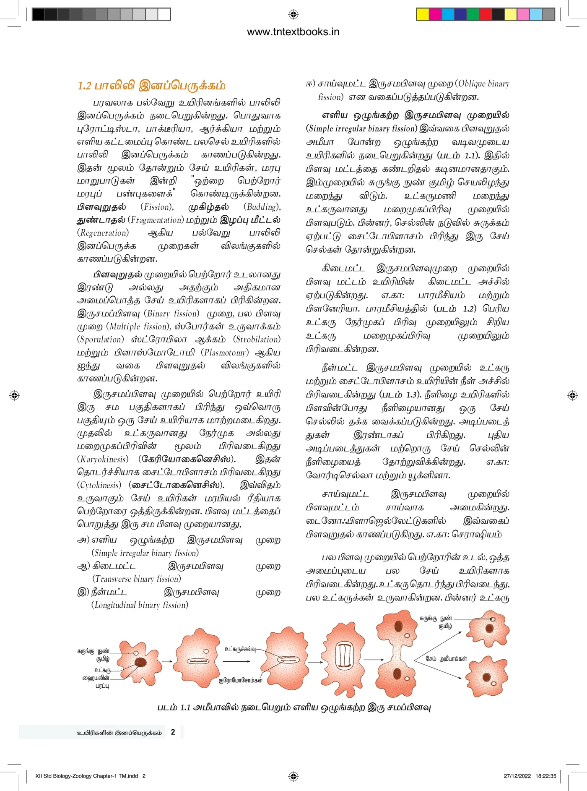

## PDF பக்கம் 11 - பாடநூல் பக்கம் 3

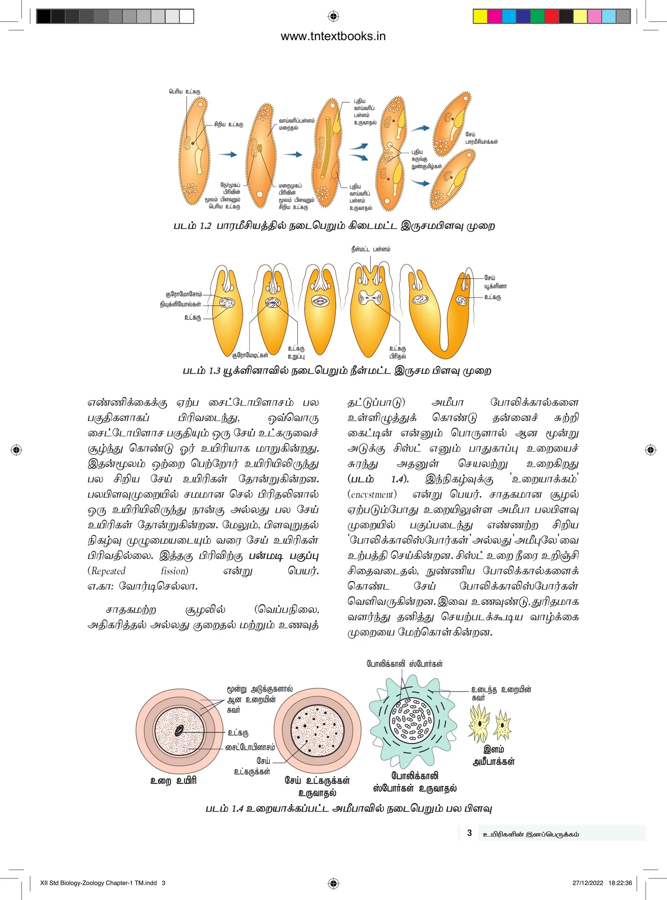

## PDF பக்கம் 12 - பாடநூல் பக்கம் 4

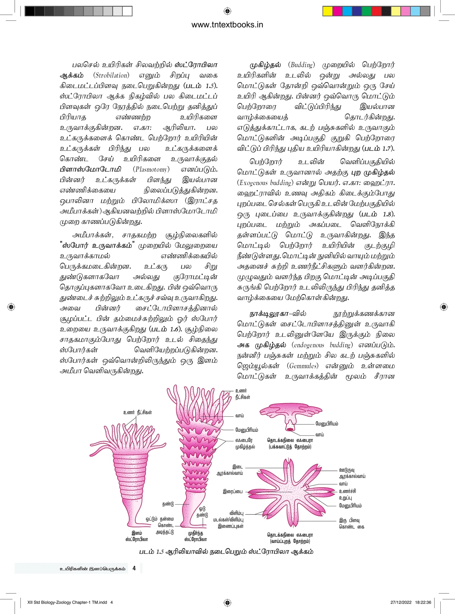

## PDF பக்கம் 13 - பாடநூல் பக்கம் 5

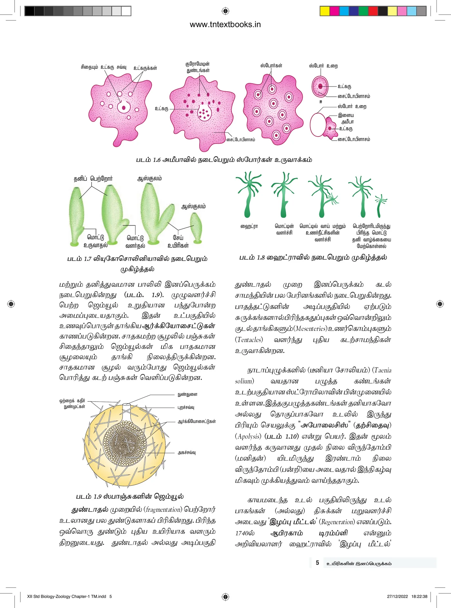

## PDF பக்கம் 14 - பாடநூல் பக்கம் 6

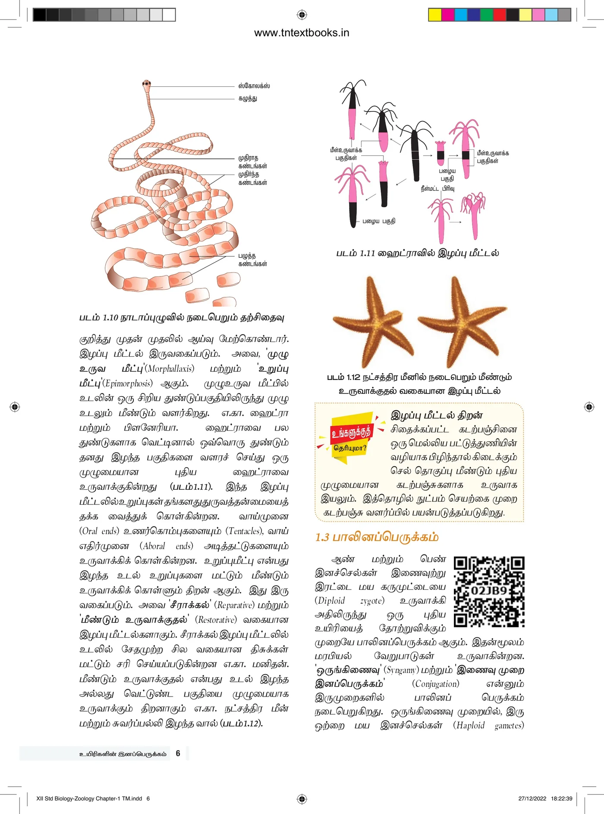

## PDF பக்கம் 15 - பாடநூல் பக்கம் 7

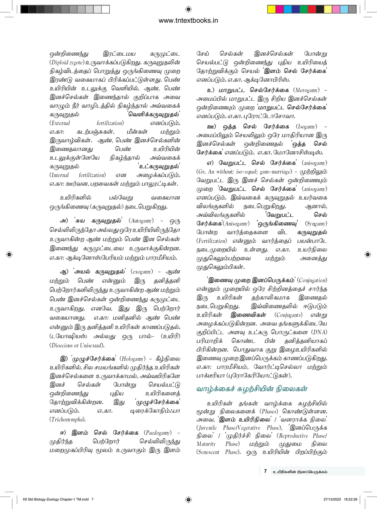

## PDF பக்கம் 16 - பாடநூல் பக்கம் 8

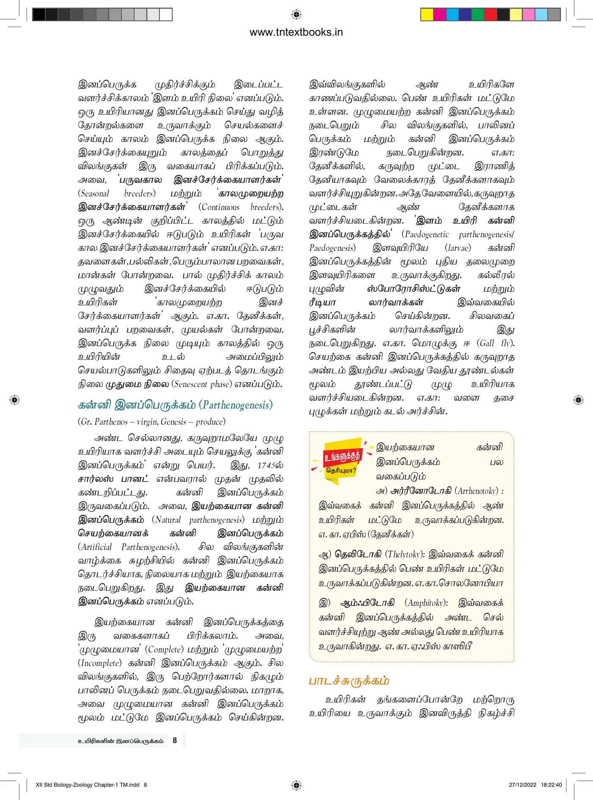

## PDF பக்கம் 17 - பாடநூல் பக்கம் 9

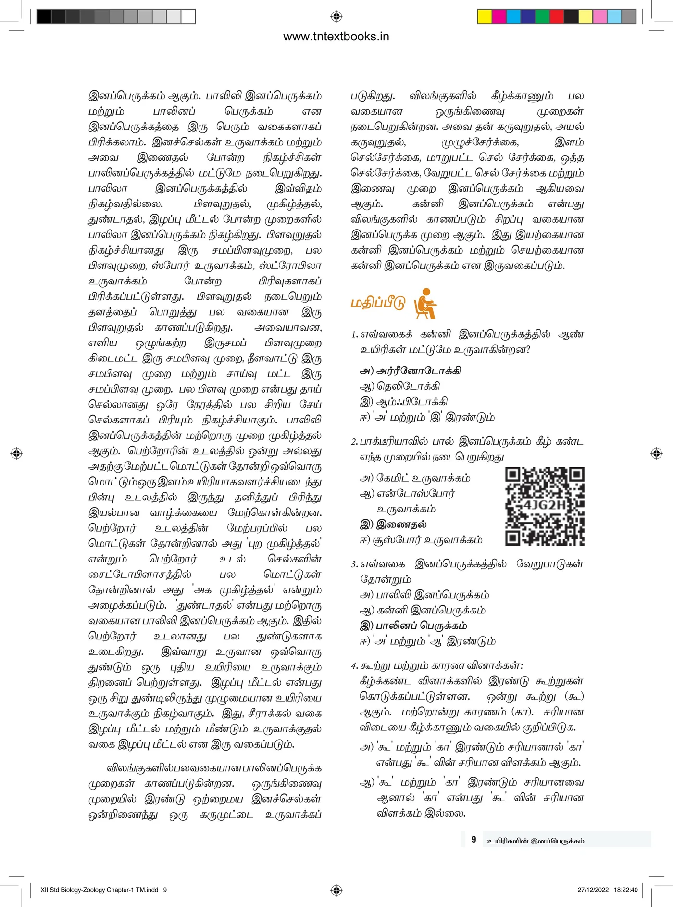

## PDF பக்கம் 18 - பாடநூல் பக்கம் 10

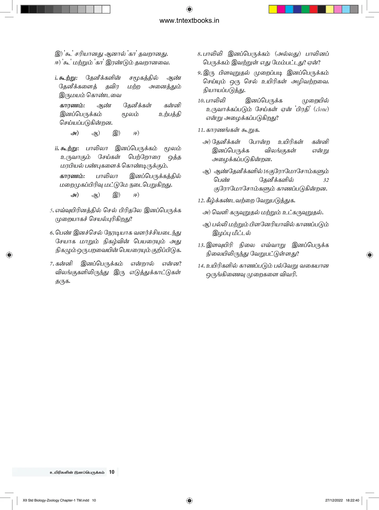

## PDF பக்கம் 19 - பாடநூல் பக்கம் 11

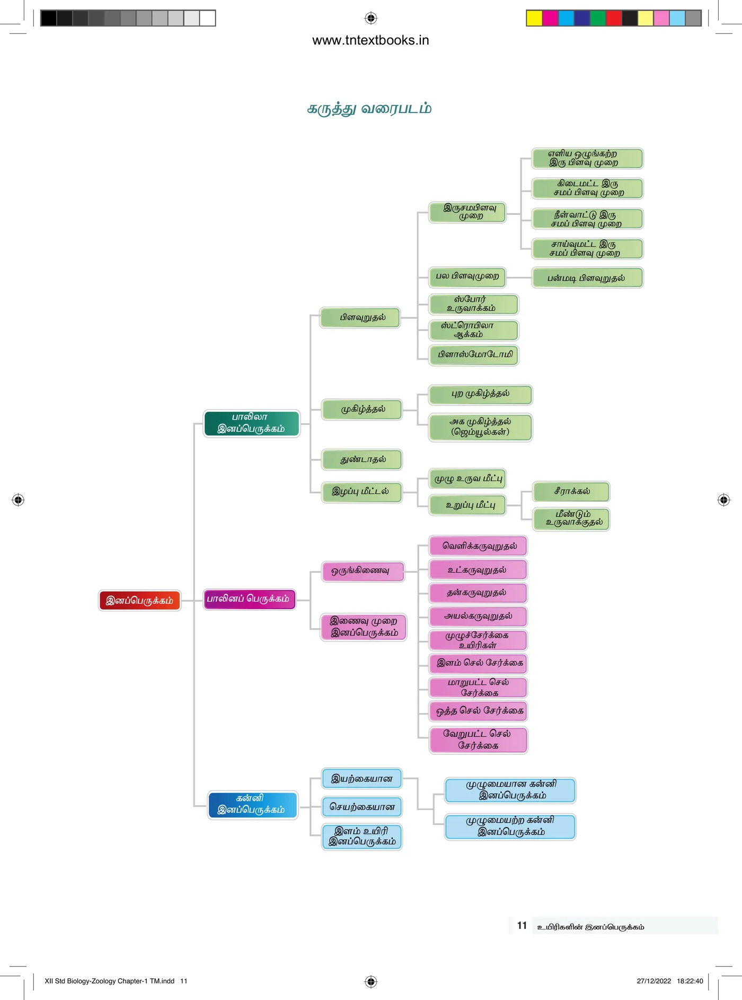
