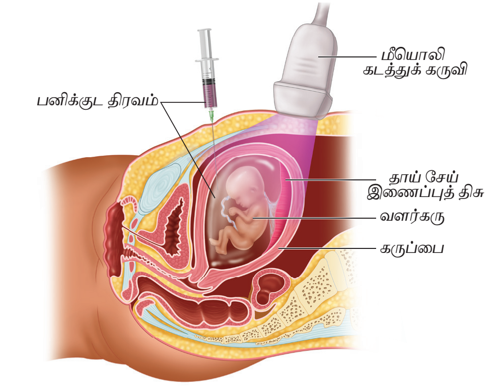
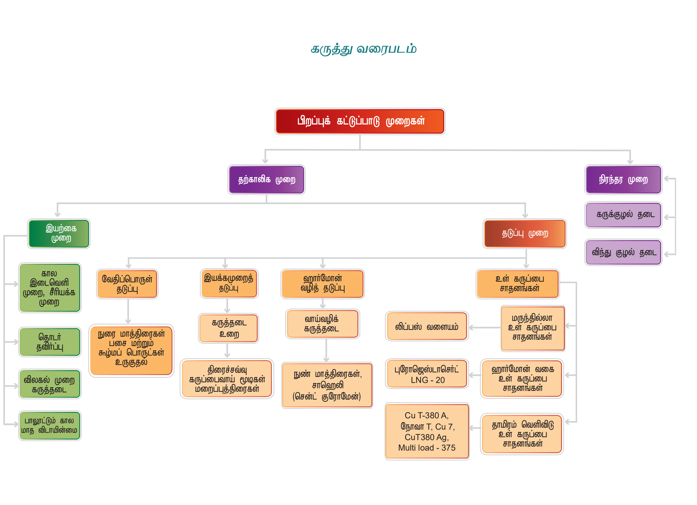

# பாடம் 3: இனப்பெருக்க நலன்

> குறிப்பு: கீழுள்ள தேடக்கூடிய உரை துல்லியமான படங்கள், அட்டவணைகள் மற்றும் அமைப்பிற்கு அசல் பக்கங்களைப் பார்க்கவும்.

அலகு - I

இனப்பபெருக்க நலன்

பாடம்

## பாட உள்ளடக்கம்

3.1  இனப்பபெருக்க நலனின் தேவை,
பிரச்சனைகள் மற்றும் உத்திகள்
3.2  பனிக்குடத் துளைப்பு மற்றும் அதன்
சட்டபூர்வமான தடை
3.3  பாலின விகிதம், பெண் கருக்கொலை
மற்றும் சிசுக்கொலை ஆகியவை
சமூகத்தின் மீது ஏற்படுத்தும் தாக்கம்
3.4 மக்கள் தொொகைப் பெருக்கம் மற்றும்
பிறப்புக் கட்டுப்பாடு
3.5 மருத்துவ ரீதியான கருக்கலைப்பு (MTP)
3.6  பால்வினை நோய்கள் (STD)

## 3.7 மலட்டுத் தனமை

3.8 இனப்பபெருக்கத் துணைத் தொொழில்
நுட்பங்கள்
3.9  கருவின் குறைபாடுகளை கர்ப்பகாலத்
தொொடக்கத்திலேயே கண்டறிதல்.

கற்றலின் நோக்கங்கள்
- பாலியல் கல்வி மற்றும்
இனப்பபெருக்க நலன்

ஆகியவற்றின்
முக்கியத்துவத்தை
புரிந்துகொொள்ளுதல்.
- மகப்பேறுக்கு முந்ததைய
பரிசோதனையான பனிக்குட துளைப்பு
சோதனையின் முக்கியத்துவத்தை கற்றல்.
- தாய் மற்றும் சேய் இறப்பின் விளைவுகளை
மதிப்பீடு செய்தல்.
- பல்வவேறு வகை கருத்தடை சாதனங்களை
இனப்பபெருக்க நலன்

கருவுறுதலுக்கு முன்பபாகவே ஆரோக்கியமான
வாழ்க்கை முறை மற்றும் முறையான
உணவூட்டம் ஆகியவற்றுடன் பாதுகாப்பான
தாயமை தொொடங்கி விடுகிறது.

கண்டறிந்து ஒப்புநோக்குதல் மற்றும்
விவரித்தல்.
- மருத்துவ ரீதியான கருக்கலைப்பின்
தேவை மற்றும் சமூக விளைவுகளை
விவாதித்தல்.
- பால்வினைத் தொொற்று பரவக் காரணங்கள்
மற்றும் தடுப்பு முறைகளை விளக்குதல்.
- மலட்டுத்தனமைக்கான காரணிகளை
முன்னிலைப்படுத்துதல்.
- இனப்பபெருக்கம் பற்றிய நேர்மறையான
ஆரோக்கியமான மனப்பானமையை
வளர்த்தல்.

அ

மைப்பு

மற்றும்

செயல்ரீதியாக

இயல்பபாக செயல்படும் இனப்பபெருக்க

உறுப்புகளைப் பெற்றுள்ள மக்களைக் கொொண்ட
சமூகத்தைக்

குறிப்பதே

இனப்பபெருக்க

நலன்

எனப்படும். ஆரோக்கியமான மக்கள் உடல் நலம்
மிகுந்த குழந்ததைகளைப் பெற்று குடும்பத்தை
நன்முறையில்

பாதுகாத்து

சமுதாயத்திற்கும்

சமூகத்திற்கும் தம் பங்களிப்பினை அதிகமாகத்
தருகின்றனர்.

எனவே உடல்நலம் என்பது ஒரு

சமூகம் சார்ந்த பிரச்சினையாகும். இனப்பபெருக்க
மண்டலம்,

நரம்பு

வேதி

ஒருங்கிணைப்பு

மண்டலங்களால்

கட்டுப்படுத்தப்படும்

ஒரு

கூட்டமைப்பாகும்.

எனவே, தொொற்றுநோய்கள்

மற்றும் காயங்கள் ஏதுமின்றி இனப்பபெருக்க
உறுப்புகளை பாதுகாப்பது அவசியமானதாகும்.

உலகளவில் தினமும் சுமார்

பெண்கள்
கர்ப்பம்
மற்றும் குழந்ததை பிறப்பு
தொொடர்பபான தடுக்கக் கூடிய
காரணங்களால் பாதிப்புற்று
இறக்கின்றனர். இதில் 20
சதவீதம் பெண்கள் இந்தியர்கள் ஆவர்.
அதேபோல, இந்தியாவில் பச்சிளங்குழந்ததை
இறப்பு வீதம் 1000 பேரில் 44 ஆகும். இந்தியா
கடந்த இருபது ஆண்டுகளில் அபரிதமான
வளர்ச்சியை அடைந்திருந்ததாலும் தாய் இறப்பு
வீதம் பிற வளரும் நாடுகளை ஒப்பிடும்போது
இன்னும் அதிகமாகவே உள்ளது.
மூலம்: http://unicef.in

## 3.1  இனப்பபெருக்க நலனின் தேவை,

பிரச்சனைகள் மற்றும் உத்திகள்
குடும்ப நலத் திட்டத்தை முதலில் நடைமுறைப்
படுத்திய சில நாடுகளில் நம் இந்திய நாடு
முதனமையானதாகும். 1951 - ஆம் ஆண்டு
தொொடங்கப்பட்ட இத்திட்டம், பத்தாண்டுகளுக்கு ஒரு முறை மதிப்பீடு செய்யப்படுகின்றது.
இத்திட்டம் “இனப்பபெருக்க மற்றும் குழந்ததை நலம்
பாதுகாப்பு” (RCH) என அழைக்கப்படுகிறது.
இத்திட்டத்தின் கீழ் மேற்கொள்ளப்படும் பெரும்
பணிகளாவன…
¾ உடல்
நலம்
மிக்க
சமுதாயத்தைக்
கட்டமைக்கத் தேவையான விழிப்புணர்வவை
ஏற்படுத்துதல் மற்றும் மருத்துவ உதவி
அளித்தல்.
¾ விடலைப்பருவம் மற்றும் விடலைப் பருவம்
சார்பபான மாற்றங்கள் பற்றிய தகவல்களைத்
தரும் பாலியல் கல்வியை பள்ளிகளில்
கொொண்டு வருதல்.
¾ தம்பதியர் மற்றும் திருமண வயதினர்க்கு
குடும்ப கட்டுப்பாடு விதிகள் மற்றும் பிறப்புக்
கட்டுபாட்டு முறைகள் பற்றி அறிவுறுத்தல்.
¾ கர்ப்பமடைந்த
பெண்கள்
பாதுகாப்பு,
மகப்பேற்றுக்குப்
பிந்ததைய
தாய்-சேய்
பாதுகாப்பு மற்றும் தாய்ப்பால் ஊட்டுவதன்
முக்கியத்துவம்
போன்றவை
பற்றிய
விழிப்புணர்வவை ஏற்படுத்துதல்.
¾ அரசு மற்றும் அரசு சாரா முகவாணமைகளுக்கு
ஆதரவு அளித்து இனப்பபெருக்கம் சார்ந்த புதிய
முறைகளைக் கண்டறிந்து நடைமுறையிலுள்ள
குடும்பக் கட்டுப்பாட்டு முறைகளை மேம்படுத்த
ஊக்கமளித்தல்.

மாபெரும் குழந்ததைகள் தடுப்பூசித் திட்டம்,
கருவுற்ற பெண்களுக்கு ஊட்டச்சத்து மிக்க
உணவு வழங்குதல், ஜனனி சுரக்ஷா யோஜனா
(Janani suraksha yojana), ஜனனி சிசு சுரக்க்ஷா
கார்யகரம் (Janani Shishu Suraksha Karyakaram),
ஒருங்கிணைந்த
இனப்பபெருக்க,
தாய்,
சேய்,
வளர்குழந்ததை
மற்றும்
பதின்
பருவத்தினருக்கான
ஒருங்கிணைந்த
ஆரோக்கிய
அணுகுமுறை
(RMNCH+A),
பிரதமரின் சுரக்ஷிட் மட்ரிட்வவா அபியான்
(Pradhanmantri
Surakshit
Matritva
Abhiyan),
போன்றவை இந்திய அரசால் தேசிய அளவில்
நடத்தப்பட்டு வரும் திட்டங்களாகும்.

## 3.2  பனிக்குடத்

துளைப்பு
(ஆம்னியோசென்டடெசிஸ்) மற்றும்
அதன் சட்டபூர்வமான தடை
சிறு குடும்ப விதிகள் மற்றும் குடும்பத்தில்
ஆண் குழந்ததையைப் பெற்றுக்கொள்ளும் விருப்பம்
போன்ற காரணங்களால் மக்கள் தொொகையில்
பெண்களின்
எண்ணிக்கை
அபாயகரமான
விகிதத்தில்
குறைந்து
வருகின்றது.
ஆம்னியோசென்டடெசிஸ் எனப்படும் பனிக்குடத்
துளைப்பு என்பது குழந்ததை பிறப்புக்கு முன்
செய்யப்படும்
ஒரு
தொொழில்
நுட்பமாகும்.
இத்தொழில் நுட்பம் மூலம் வளர்கருவின்
குரோமோசோம்குறைபாடுகளைக்கண்டறியலாம்.
ஆனால், இத் தொொழில்நுட்ப முறையை தவறாகப்
பயன்படுத்தி
வளர்கருவின்
பால்
தனமை
கண்டறியப்படுகிறது.
குழந்ததையின்
பால்
தெரிந்துவிட்ட பிறகு பெண்கரு கொொலை செய்யப்பட
வாய்ப்பு ஏற்படுகிறது. எனவே, இத்தொழில் நுட்ப
முறைக்கு
சட்டபூர்வமானத்
தடை
அவசியமாகின்றது.

## 3.3  பாலின

விகிதம்,
பெண்
கருக்கொலை
மற்றும்
சிசுக்
கொொலை ஆகியவை சமுதாயத்தின்
மீது ஏற்படுத்தும் தாக்கம்.
மக்கள்
தொொகையில்
ஆண்களுக்கும்
பெண்களுக்கும் இடையேயான விகிதம் பாலின
விகிதம் எனப்படும்.
நம் இந்திய நாட்டில்
குழந்ததைகளின்
பாலின
விகிதம்
கடந்த
பத்தாண்டுகளில் 1000 ஆண்களுக்கு 927 பெண்கள்
என்பதிலிருந்து

பெண்கள்
எனக்

இனப்பபெருக்க நலன்

குறைந்துள்ளது. இந்த விகித்தை சரிசெய்ய மக்கள்
மனநிலையிலும் மனப்பானமையிலும் மாற்றத்தை,
குறிப்பாக இளைஞர்களிடம் இம்மாற்றத்தைக்
கொொண்டு வர நடவடிக்கை அவசியமாகும். நம்
சமுதாயத்தில் பாலினப் பாகுபாடு நிலவுவதை
பெண் கருக்கொலை மற்றும் பெண் சிசுக்கொலை
ஆகியவை வெளிப்படையாகத் தெரிவிக்கின்றன.
தாயின் கருப்பையிலேயே பெண் சிசுவைக்
கருக்கலைப்பு
செய்வது
பெண்கருக்கொலை
எனப்படும்.
பிறந்த பின் பச்சிளம் பெண்
குழந்ததைகளை கொொல்வது பெண்சிசுக்கொலை
எனப்படும். இவ்வாறு தேர்ந்ததெடுத்து பெண்
கருவை கருக்கலைப்பு செய்வதன் விளைவாக,
பாலின
விகிதச்
சமநிலையில்
பாதிப்பு
ஏற்பட்டுள்ளது.
ஆண்களுடன் ஒப்பிடுகையில்
பெண்களுக்குக்
கிடைக்கும்
பொொருளாதார
வாய்ப்புகள் மிகக் குறைவாக இருப்பதால், UNDP’S
G II எனப்படும் ஐக்கிய நாடுகளின் வளர்ச்சித்திட்ட
பாலின சமமினமைக் குறியீடு (2018) பட்டியலில்
உள்ள 187 நாடுகளில் நம்நநாடு 135 ஆம் இடத்தைப்
பெற்றுள்ளது.
பெண்கருக்கொலை மற்றும் பெண் சிசுக்
கொொலையை தடுக்கும் வகையில், குழந்ததை
பிறப்புக்கு முன் பாலினத்தை முன்கூட்டியே
கண்டறியும் தொொழில்நுட்பத்தடைச் சட்டம்-1994
(PCPNDT- Pre-Conception and Pre Natal Diagnostic
Technique
Act,
1994)
போன்ற
பல்வவேறு
நடவடிக்கைளை இந்திய அரசு எடுத்துள்ளது.
இதன்படி பிறப்புக்கு முன் கருவில் வளரும்
குழந்ததையின்
பாலினத்தைக்
கண்டறிந்து
தேர்ந்ததெடுத்து கருக்கலைப்பு செய்யும் தொொழில்
நுட்பம்
தடை
செய்யப்பட்டுள்ளது.
சிறந்த
உணவூட்டம், கல்வி, பாதுகாப்பு மற்றும் அதிகாரம்
போன்றவற்றை பெண்களுக்கு அளிப்பதன் மூலம்
பாலின விகித வேறுபாடு மற்றும் பெண் சிசு இறப்பு
விகிதம் ஆகியவற்றைக் களைய அரசு பல
நடவடிக்கைளை மேற்கொண்டுள்ளது. POCSO
சட்டம்
(பாலியல்
குற்றங்களில்
இருந்து
குழந்ததைகளைத் தடுத்தல்) பணிபுரியும் இடங்களில்
பாலியல் தாக்குதல் விதி (தவிர்த்தல், தடுத்தல்
மற்றும் நிவர்த்தி) மற்றும் நீதியரசர் வெர்மமா
குழுவின் (2013) பரிந்துரைகளின்படி குற்றவியல்
சட்டத்தில் கொொண்டு வரப்பட்ட மாற்றங்கள்
ஆகியவை
ஆண்,
பெண்
இருபாலருக்கும்
பாதுகாப்பான சூழ்நிலையை உருவாக்குவதை
நோக்கமாகக் கொொண்டவையாகும்.

இனப்பபெருக்க நலன்

## 3.4  மக்கள்

தொொகைப்
பெருக்கம்
மற்றும் பிறப்புக் கட்டுப்பாடு
மருத்துவ வசதிகளின் மேம்பபாடு மற்றும்
வளம் நிறைந்த வாழ்க்கைமுறை ஆகியவற்றால்
மனித வாழ்நநாள் உயர்ந்துள்ளது. ஐக்கிய நாடுகள்
சபையின் சமீபத்திய அறிக்கை இந்திய மக்கள்
தொொகை 1.26 பில்லியனைக் கடந்துவிட்ட நிலையில்
2023 ஆம்
ஆண்டில் மிகப்பபெரிய மக்கள்
தொொகையைக் கொொண்ட நாடாக இந்தியா சீனாவை
விஞ்சிவிடும் எனக் குறிப்பிட்டுள்ளது. மக்கள்
தொொகைப் பெருக்கத்தை சமாளிக்க பிறப்புக்
கட்டுப்பாடு மட்டுமே தீர்வவாகும். பல்வவேறு
கருத்தடை
முறைகளைப்
பயன்படுத்தி
குடும்பத்தைச் சிறியதாக அமைத்துக்கொள்ள
மக்களை ஊக்கப்படுத்த வேண்டும். அரசு
ஊடகங்களில்
தரும்
விளம்பரங்களும்,
சுவரொொட்டிகள், “நாம் இருவர், நமக்கு இருவர்”
“நாம் இருவர் நமக்கு ஒருவர்” போன்ற
முழக்கங்களைக் கொொண்ட துண்டு பிரசுரங்கள்
போன்றவை மூலம் மக்கள் தொொகைப் பெருக்கம்
தமிழகத்தில் கட்டுப்படுத்தப்பட்டுள்ளது. மேலும்,
நமது நாட்டில் சட்டப்படியான திருமண வயது
பெண்களுக்கு பதினெட்டு மற்றும் ஆண்களுக்கு
இருபத்து ஒன்று என உயர்த்தியது மற்றும்
சிறுகுடும்பம் கொொண்ட தம்பதிகளுக்கு ஊக்கப்
பரிசுகள்
அளிப்பது
ஆகியவை
மக்கள்
தொொகையைக் கட்டுப்படுத்த எடுக்கப்பட்ட பிற
நடவடிக்கைள் ஆகும்.

கருத்தடை முறைகள்
(Birth control methods)
கருத்தடை முறைகளை தன்னிச்சையுடன்
பயன்படுத்தி
கருவுறுதலையோ
அல்லது
கருப்பையில் கரு பதித்தலையோ தடுத்தல்
பொொதுவாக “குடும்பக் கட்டுப்பாடு” எனப்படும்.
பயனர் நட்பு, எளிதில் கிடைத்தல், குறைந்தபட்ச
பக்க விளைவு மற்றும் பாலுணர்வு உந்தலை தடை
செய்யாமை ஆகியவை ஒரு சிறந்த கருத்தடை
அமைப்பின் பண்புகளாகும். தற்ககாலிக முறை,
நிரந்தர முறை என கருத்தடை முறைகள் இரு
வகைப்படும்.
இயற்ககை கருத்தடை முறை,
வேதிப்பொருள் பயன்பபாட்டு முறை, கருவிகள்
பயன்பபாட்டு முறை மற்றும் ஹார்மோன் தடுப்பு
முறை போன்றன தற்ககாலிக முறையில் அடங்கும்.
1. இயற்ககை கருத்தடை முறை: இம்முறையில்
விந்து செல்களும் அண்ட செல்லும் சந்திப்பது

தடுக்கப்படுகின்றது. சீரியக்க முறை (பாதுகாப்பு
காலம்), விலகல் முறை, தொொடர் தவிர்ப்பு மற்றும்
பாலூட்டும் கால மாத விடாயினமை ஆகியன
இயற்ககை கருத்தடை முறைகளாகும்.
அ) சீரியக்க முறை / கால இடைவெளி முறை
(Periodic abstinence rhythm method): மாதவிடாய்
சுழற்சியின் 14 ஆம் நாள் வாக்கில் அண்ட செல்
வெளியேற்றம் நடைபெறும். வெளியேறிய அண்ட
செல் ஏறத்தாழ 2 நாட்கள் உயிருடன் இருக்கும்.
விந்தணுக்கள், பெண்ணின் இனப்பாதையில்
சுமார் 72 மணிநேரம் உயிருடன் இருக்கும். இந்த
காலத்தில்
கலவியை
தவிர்ப்பதன்
மூலம்
கருத்தரித்தலைத் தவிர்க்கலாம்.
ஆ) பாலுணர்வு தொொடர் தவிர்ப்பு முறை
(Continuous abstinence): இது மிகவும் எளிய
நம்பகமான முறையாகும். கலவியை குறிப்பிட்ட
காலத்திற்கு தவிர்ப்பதன் மூலம் கருதரித்தல்
தடுக்கப்படுகிறது.
இ) விலகல் முறை கருத்தடை (Coitus interruptus):
பழைமையான இம்முறையில் விந்தணுக்கள்
கலவிக் கால்வவாயை அடையாதபடி ஆண்கள்
விந்து திரவ வெளியேற்றத்துக்கு முன் விலகிக்
கொொள்வர்.
ஈ) பாலூட்டும் கால மாத விடாயினமை
(Lactational Amenorrhoea): பொொதுவாக, பெண்களில்
பிரசவத்திற்குப் பின் 6 முதல் 8 வாரங்களில்
மாதவிடாய் சுழற்சி மீண்டும் தொொடங்குகின்றது.
எனினும், தாய் பாலூட்டுவதால் இயல்பபான
அண்டசெல்லாக்க சுழற்சி மீண்டும் தொொடங்க
ஆறு மாதங்கள் வரை தாமதமாகலாம். இந்த
தாமத நிலைக்கு “பாலூட்டும் கால மாத
விடாயினமை”
என்று
பெயர்.
இது
ஒரு
இயற்ககையான ஆனால் நம்பகத்தனமையற்ற
கருத்தடை முறையாகும். குழந்ததைகள் பால்
உறிஞ்சுவதால் பிட்யூட்டரி சுரப்பி தூண்டப்பட்டு
புரோலாக்டின் ஹார்மோன் உற்பத்தி அதிகரித்து
பால் உற்பத்தி உயர்கின்றது. தாயின் இரத்தத்தில்
புரோலாக்டின்
அளவு
அதிகரிப்பதால்
ஹைபோதலாமஸ் சுரக்கின்ற GnRH எனும்
கொொனடோட்ரோபின் விடுவிக்கும் ஹார்மோன்
உற்பத்தியும்
பிட்யூட்டரி
சுரக்கின்ற
கொொனடோட்ரோபின் ஹார்மோன் உற்பத்தியும்
தடுக்கப்படுகிறது. இதன் விளைவாக மாதவிடாய்
சுழற்சி தடுக்கப்படுகின்றது.
2. தடுப்பு முறை (Barrier method) இம்முறையில்
அண்டசெல் மற்றும் விந்து செல் சந்திப்பு
தடுக்கப்படுவதால் கருவுறுதல் நடைபெறுவதில்லை.

அ) வேதிப்பொருள் தடுப்பு (Chemical barrier)
நுரைக்கும்
மாத்திரைகள்,
உட்கரையும்
மாத்திரைகள், ஜெல்லிகள் மற்றும் களிம்புகள்,
ஆகியவை கலவிக் கால்வவாயில் விந்தணுக்களை
செயலிழக்கச் செய்யும் சில வேதிப்பொருட்கள்
ஆகும்.
ஆ) இயக்கமுறைத் தடுப்பு (Mechanical barrier)
கலவிக்கு முன் ஆண்களில் ஆண்குறி மற்றும்
பெண்களில் கலவிக்கால்வவாய் மற்றும் கருப்பை
வாய் ஆகியவற்றை மூட பயன்படுத்தப்படும்
மெல்லிய படல அமைப்பு கருத்தடை உறை (Condom)
ஆகும். இவற்றின் பயன்பபாட்டால் கலவியின்போது
வெளியேறும்
விந்துதிரவம்
பெண்
இனப்பபெருக்கப்பாதையில்
நுழைவது
தடுக்கப்படுகின்றது.
கருத்தடை
உறைகள்
ஒருமுறை பயன்பபாட்டிற்கு மட்டுமே. கருத்தடை
உறைகளின் பயன்பபாடு AIDS போன்ற பால்வினை
நோய்களில் இருந்தும் பாதுகாப்பளிக்கின்றது.
பாலியூரிதேன், இரப்பர், மற்றும் ஆட்டுத் தோல்
பொொருட்களைக் கொொண்டு கருத்தடை உறைகள்
தயாரிக்கப்படுகின்றன.
திரைச்சவ்வுகள்,
கருப்பைவாய்
மூடிகள்,
மறைப்புத்திரைகள்
மெனமையான
ரப்பர்
பொொருளால் ஆன மேற்கூறிய பொொருட்கள்
பெண்களின்
கலவிக்
கால்வவாயில்
பொொருத்தப்படுவதால் கலவியின்போது விந்து
செல்கள் உள் நுழைவது தடுக்கப்படுகின்றது.
இ) ஹார்மோன் வழி தடுப்பு (Hormonal barrier):
இப்பொருட்கள்
அண்டகத்திலிருந்து
அண்ட
செல்கள் விடுபடுதலைத் தடுப்பதுடன் கருப்பை
வாய் திரவத்தைக் கெட்டியாக்கி விந்து செல்கள்
அண்ட செல்லுடன் இணைவதைத் தடுக்கின்றது.
வாய்வழி
கருத்தடை
மாத்திரைகள்
(Oral contraceptives): இவ்வகை மாத்திரைகளைப்
பயன்படுத்துவதால்
FSH
மற்றும்
LH
ஹார்மோன்களின் உற்பத்தி தடுக்கப்பட்டு அண்ட
செல் விடுபடுதல் தவிர்க்கப்படுகின்றது. பொொதுவாக,
கூட்டு மாத்திரைகள் பலராலும் கருத்தடை
மாத்திரைகளாகப் பயன்படுத்தப்படுகின்றன. இதில்,
செயற்ககை
புரோஜெஸ்டிரோன்
மற்றும்
ஈஸ்டட்ரரோஜன்
ஹார்மோன்கள்
உள்ளன.
லக்னோவிலுள்ள மத்திய மருந்து ஆராய்ச்சி
நிறுவனத்தின் (CDRI) தயாரிப்பான சாஹெலி (Saheli)
எனும் கருத்தடை மாத்திரையில் சென்ட்குரோமேன்
(Centchroman) எனும் ஸ்டீராய்டு அல்லாத பொொருள்
உள்ளது.

இனப்பபெருக்க நலன்

ஈ. உள்கருப்பை சாதனங்கள் (Intrauterine DevicesIUDs): இவை மருத்துவ நிபுணர்களால் பெண்களின்
கலவிக் கால்வவாய் வழியாக கருப்பையினுள்
பொொருத்தப்படும் கருவியாகும். இவை தாமிரம்
வெளிவிடும் வகை, ஹார்மோன் வெளிவிடும்
வகை
மற்றும்
மருந்தில்லா
வகை
என
பலவகைகளில்
கிடைக்கின்றன. இக்கருவிகள்
கருப்பையினுள் விந்து செல்கள் விழுங்கப்படுதலை
அதிகரிக்கின்றன.
கர்ப்பத்தை
தள்ளிப்போட
விரும்பும் பெண்களுக்கு உள்கருப்பை சாதனங்கள்
சரியான தேர்வவாகும். இந்தியாவின் பிரபலமான
கருத்தடை முறையான இதன் வெற்றி வீதம் 95%
முதல் 99% ஆகும்.
தாமிரம் வெளிவிடும் உள்கருப்பை சாதனங்கள்
(copper releasing IUDs): தாமிரத்தின் அளவைப்
பொொறுத்து
இவை
ஒன்றுக்கொன்று
வேறுபடுகின்றன. Cu T-380A, Nova T Cu7, Cu T
380Ag.,
Multiload

போன்ற
கருவிகள்
கருப்பைக்குள் வெளியிடும் தனித்த தாமிரம்
மற்றும் தாமிர உப்புகள் விந்து இயக்கத்தை
தடைசெய்கின்றன. இது கருப்பையினுள் 5 முதல்
10 ஆண்டுகள் வரை இருக்கலாம்.
ஹார்மோன்
வெளிவிடும்
உள்
கருப்பை
சாதனங்கள்
(Hormone
releasing
IUDs):
புரோஜெஸ்டடாசெர்ட் (Progestasert) மற்றும் LNG-20
என்பன சில ஹார்மோன் வெளிவிடும் உள்
கருப்பை சாதனங்கள் ஆகும். இதிலிருந்து
வெளிப்படும் ஹார்மோன் கருப்பை வாய் சுரக்கும்
கோழைப்பொருளின்
வழவழப்புத்தனமையை
(அல்லது பிசுபிசுப்புத் தனமையை) உயர்த்தி விந்து
செல்கள் கருப்பை வாயினுள் நுழைவதைத் தடை
செய்கின்றன.
மருந்தில்லா
உள்
கருப்பை
சாதனங்கள்
(Non-medicated IUD) இவை நெகிழி அல்லது
துருப்பிடிக்காத இரும்பபால் செய்யப்பட்டுள்ளன.
லிப்பஸ் வளையம் (Lippes loop) என்பது இரட்டை
S வடிவ நெகிழிக் கருவியாகும்.
3. நிரந்தர பிறப்புக் கட்டுப்பாட்டு (Permanent Birth
control methods) முறைகள் எனப்படுபவை மேலும்
குழந்ததைகள் வேண்டடாமென கருதும் மக்கள்
பயன்படுத்தும் முறைகளாகும்.
அறுவை சிகிச்சை மூலம் இனப்பபெருக்க ஆற்றலை
நீக்குதல்: (Sterilisation) இம்முறையானது, மேலும்
கருத்தரிப்பதை விரும்பபாத, ஆண்கள் மற்றும்
பெண்களுக்கு
அறிவுறுத்தப்படும்
நிரந்தர
கருத்தடை
முறையாகும்.
இதன்
மூலம்
இனப்பபெருக்க நலன்

இனச்சசெல்களின் இயக்கம் மற்றும் கருத்தரித்தல்
ஆகியவை தடுக்கப்படுகின்றது.
கருக்குழல்தடை (Tubectomy) இது அறுவை சிகிச்சை
மூலம் கருத்தரித்தலைத் தடுக்கும் முறையாகும்.
இம்முறையில், பெண்களின் வயிற்றுப் பகுதியில்
ஏற்படுத்தப்படும் சிறு வெட்டு மூலமாகவோ
அல்லது கலவிக் கால்வவாய் வழியாகவோ இரு
அண்ட
நாளங்களும்
வெட்டப்படுகின்றன.
பின்னர், இரு வெட்டு முனைகளும் இணைத்து
முடிச்சிட்டுக்
கட்டப்படுகின்றன.
இதனால்,
கருவுறுதல் நிகழ்வதும், கருவுற்ற முட்டை
கருப்பையை அடைவதும் தடுக்கப்படுகின்றது.
விந்து குழல் தடை (Vasectomy) இம்முறை அறுவை
சிகிச்சை
மூலம்
ஆண்களின்
இனப்பபெருக்கத்திறனைத் தடுக்கும் முறையாகும்.
இம்முறையில்,
ஆண்களின்
விதைப்பையில்
ஏற்படுத்தப்படும் ஒரு சிறு துளை வழியே இரு
விந்து
நாளங்களும்
வெட்டப்படுகின்றன.
வெட்டப்பட்ட பகுதிகளை மீண்டும் இணைத்து
முடிச்சிடப்படுகின்றன.
இதனால்,
சிறுநீர்
வடிகுழாயினுள்
விந்தணுக்கள்
நுழைய
முடிவதில்லை. எனவே, வெளிப்படும் விந்து
திரவத்தில் விந்து செல்கள் காணப்படுவதில்லை.

## 3.5  மருத்துவ ரீதியான கருக்கலைப்பு

(Medical Termination of Pregnancy-MTP)
அறுவை சிகிச்சையோ கருவிகள் உள்
நுழைத்தலோ இன்றி, விருப்பத்துடனோ அல்லது
வேண்டுமென்றோ, கருவளர்ச்சியை முடிவுக்குக்
கொொண்டு வரும் மருத்துவ முறை மருத்துவரீதியான
கருக்கலைப்பு
ஆகும்.
கருவளர்ச்சியின்
ஆரம்பகட்டமான

வார
(முதல் மும்மாதம்) காலத்திற்குள் கருக்கலைப்பு
செய்வது மிகவும் பாதுகாப்பானதாகும். இதனால்
பெண்ணின்
இனப்பபெருக்கத்திறன்
பாதிக்கப்படுவதில்லை. இரண்டடாம் மும்மாத
கருவளர்ச்சியின்போது
வளர்கரு
தாயின்
உடற்திசுவில்
நன்கு
இணைந்துள்ளதால்
கருக்கலைப்பு
செய்வது
அதிக
ஆபத்தை
விளைவிக்கும். எனவே, மருத்துவ ரீதியான
அவசியம் மற்றும் சில சமூகப் பயன்களையும்
கருதி மத்திய அரசு 1971 ஆம் ஆண்டு
கருக்கலைப்பை
சட்டபூர்வமாக்கியது.
இச்சட்டத்தை் தவறாகப் பயன்படுத்தப்படுவதைத்
தடுக்கும் நோக்கில் பாலினப் பாகுபாடு மற்றும்
சட்டவிரோதமான
பெண்சிசுக்கொலை

திட்டமிடப்படாமல் ஏற்படும் கர்ப்பங்களில் ஏறக்குறைய பாதியளவு கருத்தடை
முறைகளின் குறைபாடுகள் காரணமாக ஏற்படுகின்றன. ஒவ்வாத அல்லது
தவறான கருத்தடை முறை பயன்பபாடுகளே இதற்குக் காரணமாகும்.
நெடுங்ககாலம் செயல்படும் மீள்தனமை கருத்தடை முறைகள் (உள்கருப்பை சாதனங்கள் மற்றும்
உள்பதிப்புக் கருவிகள்), மாத்திரைகள், ஒட்டுக்கருவி, வளையம் போன்றவற்றை விட
மேலானவையாகும். உள்கருப்பை சாதனங்கள் மற்றும் உள்பதிப்புக் கருவிகள் போன்றவற்றின்
பயன்கள் பற்றி குடும்ப நலத்திட்டம் விழையும் இளம் பெண்களுக்கு அறிவுறுத்துவதன் மூலம்
திட்டமிடாமல் ஏற்படும் கர்ப்பங்களின் எண்ணிக்கை வியக்கத்தக்க வகையில் குறையும்.

த
நப  ஆ v

போன்றவற்றைத்
தடைசெய்து
சில
கட்டுப்பாடுகளுடன் இச்சட்டம் இயற்றப்பட்டது.
தகுதியற்ற போலி மருத்துவர்களால் செய்யப்படும்
சட்டவிரோதமான கருக்கலைப்பு பாதுகாப்பற்றது.
உயிருக்கு
ஆபத்தை
விளைவிக்கக்கூடியது.
குறிப்பாக, முதல் கர்ப்பத்தை கருக்கலைப்பு
செய்வது கடுமையான உளவியல் விளைவுகளை
ஏற்படுத்தும்.

## 3.6  பால்வினை நோய்கள்

(Sexually Transmitted Diseases STD)
பால்வினைத் தொொற்றுகள்
(STI)
என்பது
பால்வினை
நோய்கள்
(STD),
இனப்பபெருக்கப்
பாதைத்
தொொற்று
(RTI),
அல்லது
வெனிரியல் நோய்கள் (Venerial
diseases)
என்றும்
முன்பு
அழைக்கப்பட்டது. பால்வினை நோய்த் தொொற்று
உள்ளவருடன் மிக நெருக்கமான பாதுகாப்பற்ற
உடலுறவு கொொள்வதன் மூலம் இத்தொற்று
பரவுகிறது. கல்லீரல் அழற்சி-B (Hepatitis-B)
மற்றும் HIV தொொற்றுக்கள் பாலுறவினால்
மட்டுமின்றி,
நோயாளி
பயன்படுத்திய
உட்சசெலுத்து ஊசிகள், அறுவை சிகிச்சைக்
கருவிகள் போன்றவற்றைப் பகிர்வதன் மூலமும்,
இரத்தம் செலுத்துதல் மற்றும் தொொற்று கொொண்ட
தாயிடம் இருந்து சேய்க்கும் பரவுகின்றன. 15 முதல்
24 வயதினருக்கு இத்தகு தொொற்றுகள் ஏற்பட
வாய்ப்புகள்
அதிகம்.
வெட்டைநோய்
(கொொனோரியா), கிரந்தி (சிஃபிலிஸ்), கான்க்ரராய்டு
(மேகப்புண்),
கிளாமிடியாஸிஸ்,
லிம்ஃபோகிரானுலோமா வெனரியம் என்னும்
அரையாப்புக் கட்டி போன்றவை பாக்டீரிய
பால்வினைத்
தொொற்று
நோய்கள்
ஆகும்.
பிறப்புறுப்பு அக்கி, பிறப்புறுப்பு மருக்கள், கல்லீரல்
அழற்சி-B மற்றும் எய்ட்ஸ் போன்றன வைரஸ்

பால்வினைத்
தொொற்று
நோய்கள்
ஆகும்.
டிரைகோமோனியாஸிஸ், ஒரு புரோட்டோசோவா
பால்வினைத் தொொற்றாகும். கேன்டிடியாசிஸ் ஒரு
பூஞ்சசைத் தொொற்றாகும். பூஞ்சசை, புரோட்டோசோவா,
பாக்டீரியா மற்றும் ஒட்டுண்ணிகளால் ஏற்படும்
பால்வினைத்
தொொற்றுகளை
உயிர்
எதிர்
பொொருட்கள்
மற்றும்
பிற
மருந்துகளால்
குணப்படுத்தலாம்.
வைரஸ்களால்
ஏற்படும்
பால்வினைத்
தொொற்றுகளைக்
குணப்படுத்த
இயலாது
எனினும்
வைரஸ்
எதிர்ப்பு
மருந்துகளைப்
பயன்படுத்தி
நோயின்
அறிகுறிகளைக் கட்டுப்படுத்தலாம். இரப்பராலான
கருத்தடை
உறைகளைச்
சரியாகப்
பயன்படுத்துவதால் பால்வினைத் தொொற்று பரவும்
ஆபத்தை பெருமளவு குறைக்கலாம். ஆனால்,
நோய் பரவும் ஆபத்தை முழுமையாகத் தவிர்க்க
இயலாது.

பால்வினை நோய்களை வருமுன்
காத்தல் (Prevention of STD’s)
அ) முன்பின் தெரியாதவருடன் அல்லது பலருடன்
பாலுறவு கொொள்வதை தவிர்த்தல்.
ஆ) கருத்தடை உறைகளைப் பயன்படுத்துதல்.
இ) சந்ததேகம் இருக்கும் பட்சத்தில் மருத்துவ
ஆலோசனையுடன்
முழுமையான
சிகிச்சை
மேற்கொள்ளுதல்.
உலக சுகாதார நிறுவனத்தின்
((WHO) 2017, அறிக்கையின்படி
உலகளவில் ஒவ்வொரு நாளும்
பால்வினைத்
தொொற்றால்
ஒரு
மில்லியன்
மக்களுக்கு
மேல்
பாதிப்படைகின்றனர். 2.1 மில்லியன் HIV
தொொற்று கொொண்ட மக்களுடன், உலகளவில் HIV
பாதித்தோர் அதிகம் கொொண்ட மூன்றறாவது
நாடாக இந்தியா உள்ளது.

இனப்பபெருக்க நலன்

அட்டவணை 3.1 பால்வினை நோய்கள் மற்றும் அறிகுறிகள்
நோயின் பெயர்

நோய்க்காரணி

அறிகுறிகள்

நோய்
வெளிப்படும்
காலம்

பாக்டீரிய பால்வினைத் தொொற்று (Bactrial STI):
கொொனோரியா அல்லது நீஸ்ஸஸெரியா
கொொனோரியே
வெட்டைநோய்
(Gonorrhoea)

(Neisseria gonorrhoeae)

- சிறு நீர் வடிகுழாய், மலக்குடல்,
தொொண்டடை, பெண்களின் கருப்பைவாய்
ஆகிய பகுதிகளில் பாதிப்பு
- பிறப்புப் பாதையில் வலி, சீழ் வடிதல்
சிறுநீர் கழிக்கும் போது எரிச்சல்
உணர்வு

2 - 5 நாட்கள்

- முதல் நிலை - பாலுறுப்புகளின் புறப்
பகுதியில் வலியற்ற புண்கள்.

கிரந்தி அல்லது
மேகப்புண்
(Syphilis)

கிளாமிடியாஸிஸ்
(Chlamydiasis)

லிம்ஃபோகிரானுலோமா
வெனரியம்
(Lymphogranuloma
venereum)

டிரிபோனிமா பாலிடம்
(Treponema pallidum)

கிளாமிடியா
ட்ரராகோமேடிஸ்
(Chlamydia trachomatis)

கிளாமிடியா
ட்ரராகோமேடிஸ்
(Chlamydia trachomatis)

- இரண்டடாம் நிலை - தோல் புண்கள்,
சொொறி, தோல் தடிப்பு, மூட்டுகளில்
வீக்கம் காய்ச்சல் மற்றும் முடி உதிர்வு.
- மூன்றறாம் நிலை -மூக்கு, கீழ்க்கால்
பகுதி மற்றும் அண்ணப் பகுதியில்
நாள்பட்ட புண்கள், இயக்க மினமை,
மனநல பாதிப்பு, பார்வவைக்கோளாறு,
இதயப் பிரச்சனை, மெனமையான
பரவும் தனமையற்ற கட்டிகள் (Gummas)
போன்றன.
- கண் இமை அரிப்பு, சிறுநீரக
இனப்பபெருக்கப் பாதை, சுவாசப் பாதை
மற்றும் கண்ணின் கன்ஜங்க்டிவா
ஆகியவற்றில் தூண் எபிதீலிய
செல்கள் பாதிப்பு
- பிறப்புறுப்பின் தோல் அல்லது
கோழைப்படல பாதிப்பு, சிறுநீர்
வடிகுழாய் அழற்சி, உள்கருப்பை வாய்
அழற்சி, ஆங்ககாங்ககே கேடு தரும்
புண்கள். இனப்பபெருக்க உறுப்பு
யானைக்கால் நோய்

10 - 90 நாட்கள்

2 - 3 வாரங்கள்
அல்லது 6
வாரங்கள் வரை

வைரஸ் பால்வினைத் தொொற்று (Viral STI)
பிறப்புறுப்பு அக்கி
(Genital herpes)

ஹெர்பஸ் சிம்ப்லலெக்ஸ்
வைரஸ்
(Herpes simplex virus)

இனப்பபெருக்க நலன்

- பெண்களின் பெண்குறி வெளியிதழ்,
கலவிக்கால்வவாய், சிறுநீர் வடிகுழாய்
ஆகியனவற்றைச் சுற்றி புண்கள்,
ஆண்களில் ஆண்குறியைச் சுற்றி
புண்கள்.

2 - 21 நாட்கள்
(சராசரி 6
நாட்கள்)

நோயின் பெயர்

நோய்க்காரணி

நோய்
வெளிப்படும்
காலம்

அறிகுறிகள்
- சிறுநீர் கழிக்கும் போது வலி.
- மாதவிடாய் சுழற்சிகளுக்கிடையே
இரத்தப்போக்கு
- தொொடை இடுக்குகளின் நிணநீர்
முடிச்சுகளில் வீக்கம்

பிறப்புறுப்பு மருக்கள்
(Genital warts)

கல்லீரல் அழற்சி
(Hepatitis-B)

எய்ட்ஸ் (AIDS)

மனித பாப்பிலோமா
வைரஸ் (HPV)
(Human papilloma virus)

ஹிபாடிடிஸ் - B வைரஸ்
(HBV)

- இன உறுப்புகளின் வெளிப்பகுதி,
கருப்பைவாய், மலவாயைச் சுற்றிய
பகுதிகளில் கடினமான புடைப்புகள்
(கட்டிகள்)
- சோர்வு, மஞ்சள் காமாலை, காய்ச்சல்,
தோல் தடிப்பு, வயிற்று வலி,

(Hepatitis –B Virus)

- கல்லீரல் இறுக்கம், இறுதி நிலையில்
கல்லீரல் செயலிழப்பு

மனித தடைகாப்பு
குறைப்பு வைரஸ் (HIV)

- நிணநீர் முடிச்சுகள் பெரிதாதல்,
நீண்டநாள் காய்ச்சல், நீண்டநாள்
வயிற்றுப்போக்கு, உடல் எடை
குறைதல், இரவில் வியர்த்தல்,

1 - 8 மாதங்கள்

30 - 80 நாட்கள்

2 - 6 வாரங்கள்
முதல் 10
ஆண்டுகளுக்கு
மேலும்.

பூஞ்சசை பால்வினைத் தொொற்று (Fungal STI)
- வாய், தொொண்டடை, குடற்பபாதை மற்றும்
கலவிக்கால்வவாய் ஆகிய பகுதிகளில்
தாக்கம்.
கேன்டிடியாஸிஸ்

கேன்டிடா அல்பிகன்ஸ்

(Candidiasis)

(Candida albicans)

- கலவிக்கால்வவாயில் அரிப்பு (அ)
புண்கள்

_

- கலவிக்கால்வவாய் திரவம் மிகைப்
போக்கு
- வலியுடன் சிறுநீர் கழித்தல்

புரோட்டோசோவா பால்வினைத் தொொற்று (Protozoan STI)

டிரைகோமோனி
யாசிஸ்

டிரைகோமோனாஸ்
வாஜினாலிஸ்

(Trichomoniasis)

(Trichomonas vaginalis)

- கலவிக்கால்வவாய் அழற்சி, பச்சை
மஞ்சள் கலந்த கலவிக் கால்வவாய் திரவ
வெளிப்பாடு, அரிப்பு மற்றும் எரிச்சல்
4-28 நாட்கள்
உணர்வு, சிறுநீர் வடிகுழல் அழற்சி,
விந்தக மேல் சுருள் நாள அழற்சி,
புரோஸ்டடேட் சுரப்பி அழற்சி

இனப்பபெருக்க நலன்

கருப்பைவாய் புற்றுநோய்
(Cervical cancer)

TNHSP- (Tamil Nadu Health
Systems Project) தமிழக அரசின்
மக்கள்
நல்வவாழ்வுத்துறையின்
அங்கமான தமிழ்நநாடு சுகாதார
அமைப்புத்திட்டம், கருப்பைவாய் புற்றுநோய்
மற்றும் மார்பகப் புற்றுநோயைக் கண்டறியும்
பரிசோதனைகளை இலவசமாகச் செய்கின்றன.

பால்வழிப் பரவும் வைரஸான மனித
பாப்பில்லோமா வைரஸ் (HPV) கருப்பைவாய்
புற்றுநோயை தோற்றுவிக்கின்றது. இதனால்
கருப்பைவாய்
செல்கள்
கருப்பைவாய்
பிறழ்வவாக்கம் என்னும் இயல்புக்கு மாறான
வளர்ச்சியை அடைகின்றன.
இடுப்புவலி,
கலவிக்கால்வவாய்
திரவ
மிகைப்போக்கு,
இயல்புக்கு
மாறான
இரத்தப்போக்கு
போன்றன
கருப்பைவாய்
புற்றுநோயின் பொொதுவான அறிகுறிகள் ஆகும்.
கருப்பைவாய்ப் புற்றுநோயை உருவாக்கும்
காரணிகள்: 1) பலருடன் பாலியல் தொொடர்பு,
2) கருத்தடை மாத்திரைகளை நீண்ட நாட்களாகப்
பயன்படுத்துதல்.
கருப்பைவாய் புற்றுநோயை HPV ஆய்வு
மற்றும்
பாப்
பூச்சு
சோதனை
போன்ற
கூட்டுச்சோதனைகள் மூலம் கண்டறியலாம்.
எக்ஸ்ரரே, CT ஸ்ககேன், MRI மற்றும் PET
ஸ்ககேன்
போன்ற
ஆய்வுகள்
மூலம்
இப்புற்றுநோயின்
நிலைகளை
அறியலாம்.
இதனை குணப்படுத்த கதிர்வீச்சு சிகிச்சை,
அறுவை சிகிச்சை மற்றும் வேதிமருந்து சிகிச்சை
பயன்படுகின்றது.
நவீன
தொொழில்நுட்பங்கள்
மூலம்
கருப்பைவாய்
புற்றுநோய்
தாக்குவதற்கு
முன் ஏற்படும் முந்ததைய மாற்றங்களைக்
கண்டறியலாம்.
எனவே,

வயதுக்கு
மேற்பட்ட
பெண்களுக்கு
ஆண்டுக்கு
ஒரு
முறை
பரிசோதனை
செய்து
கொொள்ள
பரிந்துரைக்கப்படுகின்றது.
தடுப்பூசிகள் மூலம் கருப்பைவாய் புற்றுநோய்,
வராமல்
தடுக்கலாம்.
பால்பண்புகள்
செயல்பபாட்டுக்கு வருவதற்கு முன்பபே, அதாவது,
9 முதல் 13 வயது உடைய பெண்களுக்கு
HPV தடுப்பூசி போடுவதன் மூலம் முதனிலை
தடுப்பு
தொொடங்குகிறது.
வாழ்க்கை
முறையில் மாற்றம் செய்வதும் கருப்பைவாய்
புற்றுநோய் வராமல் தடுக்க உதவுகின்றது.
சத்தான
உணவு,
புகையிலை
பயன்பபாடு
தவிர்த்தல்,
இளவயது
திருமணத்தை
தவிர்த்தல், ஓரிணை இனப்பபெருக்க முறை
மற்றும் சீரான உடற்பயிற்சி போன்றன மூலம்
கருப்பைவாய் புற்றுநோய் தோன்றும் வாய்ப்பை
குறைக்கலாம்.
இனப்பபெருக்க நலன்

## 3.7 மலட்டுத்தனமை (Infertility)

தடையற்ற பாலிய இணை வாழ்விற்குப்
பிறகும் கருவுற இயலாமை அல்லது குழந்ததையை
உருவாக்க
இயலாமை
மலட்டுத்தனமை
எனப்படும். அதாவது, ஒரு ஆண் ஒரு பெண்ணின்
அண்டத்தை கருவுறச் செய்யும் அளவிற்கு
தரமான அல்லது போதுமான எண்ணிக்கையில்
விந்து செல்களை உருவாக்க இயலாமை
அல்லது ஒரு பெண்ணால் கருத்தரிக்க இயலாதத்
தனமை மலட்டுத்தனமை எனப்படும்.
பிட்யூட்டரி சுரப்பி அல்லது இனப்பபெருக்க
உறுப்புகளில்
கட்டிகள்
உருவாதல்,
இனப்பபெருக்க ஹார்மோன்கள் உற்பத்திக்குக்
காரணமான மரபணுக்களில் ஏற்படும் திடீர்
மாற்றங்கள்,
கருப்பைவாய்
மற்றும்
அண்டநாளங்களின் குறை வளர்ச்சி, இளவயதில்
ஊட்டச்சத்துக்
குறைபாடு
போன்ற
காரணங்களால் மலட்டுத்தனமை ஏற்படுகின்றது.
நீண்ட கால மன அழுத்தத்தால் உடல்
நலத்தின் பல்வவேறு கூறுகளில் குறிப்பாக
மாதவிடாய்
சுழற்சியில்
பாதிப்புகள்
ஏற்படுகின்றன.
காட்மியம்
போன்ற
கன
உலோகங்கள் கொொண்ட நச்சுப்பொருட்களை
உட்கொள்ளல், தீவிர குடிப்பழக்கம், புகையிலை
மற்றும் போதைப்பொருள் பயன்பபாடு, இன செல்
சுரப்பிகளின் பாதிப்பு மற்றும் அதிக வயது
ஆகியவையும்
மலட்டுத்
தனமைக்குக்
காரணமாகின்றன.

மலட்டுத் தனமைக்கான பிற
காரணங்கள்
- 

இடுப்புக்குழி வீக்க நோய் (PID), கருப்பை
தசைநார்க் கட்டிகள், கருப்பை உட்படல
அழற்சி
போன்றவை
பெண்களின்
மலட்டுத்தனமைக்கான
பொொதுவான
காரணங்கள் ஆகும்.

- 

பெண்களின் உடலில் கொொழுப்பு அளவு
குறைதல் அல்லது பசியினமை. அதாவது
உடல் எடை கூடிவிடுமோ என்ற அச்சத்தால்
உணவு
உண்பதில்
ஏற்படும்
மனநலக்கோளாறு.

- 

ஆண்கள்
இறுக்கமான
உடைகள்
அணிவதால்
விந்தகத்தின்
வெப்பநிலை
உயர்ந்து
விந்து
செல்
உற்பத்தி
பாதிக்கப்படுதல்.

- 

நன்கு
கீழிறங்ககாத
விந்தகம்
மற்றும்
வேரிகோசீல்
எனப்படும்
விதைப்பை
சிரைகளின் வீக்கம்.

- 

விந்தகம் மற்றும் அண்டகங்களின் குறை
வளர்ச்சி.

- 

பெண்களில் தன் வாழ்க்கைத் துணைவரின்
விந்துசெல்களுக்கு
எதிராக
எதிர்ப்புப்
பொொருள் உருவாதல்.

- 

ஆண்களில்
தங்கள்
சொொந்த
விந்துசெல்களுக்கு எதிராக சுயதடைகாப்பு
விளைவு உருவாதல்.
அனைத்து பெண்களும் அண்டங்களுடன்
பிறக்கின்றனர். ஆனால் சிலருக்கு கருப்பை
இருக்காது.

இந்நிலைக்கு

“மேயர்

ரோகிடான்ஸ்கி நோய்க் குறைபாடு” (Mayer –
Rokitansky Syndrome) என்று பெயர்.

## 3.8  இனப்பபெருக்க துணை

தொொழில் நுட்பங்கள்
 (Assisted Reproductive Technology
- ART)
இனச்சசெல்கள்
அல்லது/
மற்றும்
கருமுட்டைகளை
உடலுக்கு
வெளியில்
கையாண்டு
கர்ப்பம்
அடையச்
செய்யும்
செயல்முறைத் தொொகுப்பு இனப்பபெருக்கத் துணை
தொொழில் நுட்பம் எனப்படும். இது மலட்டுத்
தனமையுடைய
தம்பதிகள்
கருத்தரிக்கும்
வாய்ப்புக்களை அதிகரிக்கின்றது. இத்தொழில்
நுட்பத்தில் கருப்பையினுள் விந்தணுக்களை
செலுத்துதல்
(IUI)
அல்லது
செயற்ககை

விந்தூட்டல் (AI), உடல் வெளிக் கருவுறுதல்
(IVF) கருமுட்டையை அண்ட நாளத்தினுள்
செலுத்துதல் (ZIFT) இனச் செல்களை அண்ட
நாளத்தினுள்
செலுத்துதல்
(GIFT),
கரு
இடமாற்றம் (ET), அண்ட செல் சைட்டோ
பிளாசத்தினுள் விந்து செல்களை செலுத்துதல்
(ICSI), கரு பதிவுக்கு முன்பபே
மரபியல்
குறைகளைக்
கண்டறிதல்,
அண்டசெல்
மற்றும்
விந்து
செல்கள்
தானம் மற்றும் வாடகைத்
தாயமை ஆகியன அடங்கும்.

கருப்பையினுள் விந்து செல்களை உட்
செலுத்துதல் (IUI) / செயற்ககை
விந்தூட்டல் (AI)
இச்சசெயல் முறை குறைந்த எண்ணிக்கையில்
விந்து
செல்களை
உற்பத்தி
செய்யும்
ஆண்களுக்குச்
செய்யக்கூடிய
சிகிச்சை
முறையாகும்.
இம்முறையில்
கணவர்
அல்லது
உடல்
நலமிக்க
விந்துக்
கொொடையாளரிடமிருந்து
விந்து
திரவம்
சேகரிக்கப்படுகிறது. அண்டகத்தை் தூண்டி
அதிக
அண்டசெல்கள்
உற்பத்தி
செய்யப்படுகின்றன.
பின்னர் சேகரிக்கப்பட்ட
விந்து செல்கள் நுண்குழல் மூலம் கலவிக்
கால்வவாய்
வழியாக
கருப்பையினுள்
செலுத்தப்படுகின்றன. பின்னர், விந்து செல்கள்
அண்ட நாளத்தை நோக்கி நீந்திச் சென்று
கருவுறுதல் நிகழ்ந்து இயல்பபான கர்ப்பம்
ஏற்படுகின்றது.

உடல்வவெளிக் கருவுறுதல் (IVF) அல்லது
சோதனைக்குழாய் குழந்ததை
இத்தொழில் நுட்பத்தில் அண்ட செல்கள்
மற்றும்
விந்து
செல்கள்
உடலுக்கு
வெளியில்
ஆய்வகத்தில்
இணைய
வைக்கப்படுகின்றன. இவ்வாறு கருவுற்ற ஒன்று
அல்லது
அதற்குமேற்பட்ட
கருவுற்ற
முட்டைகள்
பெண்ணின்
கருப்பையினுள்
செலுத்தப்படுகின்றன. அங்கு அவை கருப்பை
சுவரில் பதிந்து வளரத் தொொடங்குகின்றன.
மீதமுள்ள உபரி வளர்கருக்கள் உறைநிலை
பதப்படுத்துதல்
(Cryopreservation)
முறையில்
எதிர்ககாலத் தேவைக்கு பாதுகாக்கப் படுகின்றன.

இனப்பபெருக்க நலன்

தொொடக்கத்தில்,
இத்தொழில்
நுட்பமானது
வளராத, அடைபட்ட மற்றும் பாதிப்படைந்த
அண்டநாளம் கொொண்ட பெண்களுக்குப் பயன்
அளித்தது.
தற்போது இத்தொழில் நுட்பம்
பல்வவேறு காரணிகளால் ஏற்படும் மலட்டுத்
தனமையை
நிவர்த்தி
செய்யப்
பயன்படுகின்றது. அண்டகத்தை் தூண்டுதல்,
அண்ட
செல்களை
வெளிக்கொணர்தல்,
கருவுறச் செய்தல், கருவளர்ப்பு மற்றும் கரு
இடமாற்றம் ஆகியன இத் தொொழில் நுட்ப
சுழற்சியின் அடிப்படைப் படிநிலைகள் ஆகும்
(படம் 3.1).
கரு

உறைநிலை

குளிரூட்டும்

முறை: (Cryopreservation or freezing)
ஒரு

உடல்வவெளிக்

கருவுறுதல்

நிகழ்வில் தேவைக்கு அதிகமான
கருக்கள்

உருவானால்

உபரிகருக்கள்

உறைநிலை

குளிரூட்டும்

முறை

பாதுகாக்கப்படுகின்றன

மூலம்

தேவையான

நேரத்தில், உறைந்த கருவை மாற்றிப்பொருத்தி
(FET)

கருத்தரிப்பதற்ககான

கூடுதல்

வாய்ப்புகளைப் பெறலாம். இதனால், மீண்டும்
அண்டகத்தை் தூண்டி அண்ட செல்களை
எடுக்க வேண்டிய தேவையில்லை.
hCG ஊசியை உடலில் செலுத்திய 34 முதல்
37 மணி நேரம் கழித்து பொொது மயக்கமூட்டல்
செய்து சிறிய அறுவை சிகிச்சை மூலம் மீயொொலி
வழிகாட்டியைப்
பயன்படுத்தி
பெண்ணின்
அண்டகத்திலிருந்து
அண்டம்
வெளியே
கொொண்டுவரப் படுகின்றது.
இம்முட்டை /
அண்டம்
பிற
புறச்சசெல்களிலிருந்து
பிரிக்கப்படுகிறது
அதே
வேளையில்
விந்து
செல்களும்
சிறப்பு
ஊடகத்தைப்
பயன்படுத்தி
தயார் செய்யப்படுகின்றன.
பின்னர்,
இனச்சசெல்கள்
ஒன்றறாக
சேர்க்கப்படுகின்றன.
ஒரு
முட்டையை
கருவுறச்
செய்ய
10,000
முதல்
100,000
நகரும்
திறனுடைய
விந்தணுக்கள்
தேவைப்படுகின்றன.
பின்னர்,
கருமுட்டை
யானது செல் பிரிதலுக்கு உட்படுத்தப்பட்டு
எட்டு
செல்
கருக்கோள
நிலையில்
கருப்பையினுள் செலுத்தப்படுகின்றது. 8 செல்
நிலைக்கு மேற்பட்ட கருவை கருப்பையினுள்
இனப்பபெருக்க நலன்

செலுத்தும் முறை “கருமாற்று தொொழில் நுட்பம்”
எனப்படும்.

கருமுட்டையை அண்டநாளத்தினுள்
செலுத்துதல் (Zygote Intra Fallopian
Transfer–ZIFT)
இது உடல் வெளிக் கருவுறுதல் தொொழில்
நுட்பம்
போன்றது.
இம்முறையில்
8 பிளாஸ்டோமியர்களைக் கொொண்ட கருமுட்டை
லேப்ரராஸ்கோப்பி
முறையில்
அண்டநாளத்தினுள்
செலுத்தப்படுகிறது.
கருமுட்டையில்
இயல்பபான
செல்பிரிதல்
நிகழ்ந்து கருக்கோளம் தோன்றி கருப்பையை
நோக்கி நகர்ந்து, பதிகின்றது.

கருப்பை உள்இடமாற்றம்
(Intra Uterine Transfer -IUT)
8 பிளாஸ்டோமியர்களை விட அதிகமான
செல்களைக்
கொொண்ட
கருவானது
கருப்பையினுள் செலுத்தப்பட்டு முழுவளர்ச்சி
அடைகிறது.

அண்டநாளத்தினுள் இனச்சசெல்
இடமாற்றம் (Gamete Intra Fallopian
Transfer - GIFT)
இம்முறையில்,
அண்டகத்திலிருந்து
முட்டைகள்
சேகரிக்கப்பட்டு
விந்து
செல்களுடன்
சேர்த்து
ஒரு
அண்ட
நாளத்தினுள் வைக்கப்படுகின்றது. கருவுறுதல்
நிகழ்ந்த
பின்
உருவாகும்
கருமுட்டை
கருப்பையை நோக்கி நகர்ந்து கருப்பையின்
உட்படலத்தில் பதிகின்றது.

அண்ட சைட்டோபிளாசத்தினுள்
விந்து செல்களை செலுத்துதல் (Intra
Cytoplasmic Sperm Injection - ICSI)
இம்முறையில் ஒரே ஒரு விந்து செல்லை
முட்டையின்
குவியப்புள்ளியில்
செலுத்தி
கருவுறச்
செய்யப்படுகின்றது.
அதாவது,
முட்டையின் சைட்டோபிளாசத்திற்குள் விந்து
செல்லானது
மிக
கவனமாகச்
செலுத்தப்படுகின்றது. இதில் கருவுறுதல் வீதம்
75 முதல் 85% ஆகும். கருமுட்டை 8 செல்
கருக்கோள
நிலையை
அடைந்த
உடன்
பெண்ணின்
கருப்பைக்குள்
மாற்றப்பட்டு
கர்ப்பமடையச் செய்யப்படுகின்றது.

வாடகைத் தாயமை (Surrogacy)
தாயமை அடைய முடியாத பெண்ணிற்கு
அல்லது பெண்களுக்கு வேறொொரு பெண் ஒப்பந்த
முறையில் கருவைச் சுமந்து குழந்ததையைப்
பெற்றுத்தரும் முறை வாடகைத் தாயமை எனப்படும்.
இச்சசெய்முறையில் உடல் வெளிக்கருவுறுதல் (IVF)
முறையில் கரு உருவாக்கப்பட்டு வாடகைத்
தாயின்
கருப்பைக்குள்
வைக்கப்பட்டு
கரு
வளர்க்கப்படுகிறது.
இதன்மூலம் பிறக்கும்
குழந்ததைக்கு, தாயமை அடைய முடியாத பெண்
தாயாகும் பேறு பெறுகின்றறார்.

ஆண்களின் மலட்டுத்தனமை
(Male Infertility)
விந்து செல்கள் இல்லாத விந்து திரவம்
குறைந்தபட்சம் இரு முறை வெளிப்பட்டால்
இந்நிலைக்கு ஏஜூஸ்பபெர்மியா (Azoospermia)
என்று பெயர். இந்நிலை மொொத்த மக்கள்
தொொகையில்
சுமார்
1%
மக்களிடம்
காணப்படுகின்றது.

மற்றும் கர்ப்பகாலத் தொொடக்கத்தில் தோன்றும்
பிரச்சனைகளைக் கண்டறியலாம்.

பனிக்குடத் துளைப்பு (Ammiocentesis)
இம்முறையில் வளர்கருவைச் சூழ்ந்துள்ள
பனிக்குட
திரவ
மாதிரியைக்
கொொண்டு
குரோமோசோம்களின்
பிறழ்ச்சிகளைக்
கண்டறியலாம் (படம் 3.1).

 இச் செயல் முறை
பொொதுவாக 15 முதல் 20 வார கருவளர்ச்சி
கொொண்ட
கருவுற்ற
பெண்களில்
செய்யப்படுகின்றது. இச்சசெயல் முறையில் மிக
மெல்லிய, நீண்ட ஊசியை வயிற்றை வழியாக
பனிக்குடப் பைக்குள் செலுத்தி சிறிதளவு
பனிக்குட திரவ மாதிரி சேகரிக்கப்படுகின்றது.
இத்திரவத்தில், வளர் கருவின் உடலிலிருந்து
உதிர்ந்த செல்கள் காணப்படுகின்றன.
mெயாl
கட t
கrv
ப

kட tரவ 

விந்தகத்திலிருந்து விந்து சேகரித்தல்
(TESE)

இம்முறையில், நுண்ணிய அறுவை மூலம்
விதைப்பையைத் துளையிட்டு விந்தகத்திலிருந்து
விந்து சேகரிக்கப்படுகிறது. இக்கீறல் வழியாக
நுண்ணோக்கி உதவியுடன் ஒன்று அல்லது இரு
விந்தகங்களிலும் உள்ள விந்தக நுண்குழல்களை
விரிவடையச் செய்து விந்து செல் உற்பத்தியாகும்
பகுதியிலிருந்து சிறிதளவுத் திசுவை வெளியே
எடுத்து
விந்து
செல்களின்
உற்பத்தி
மேம்படுத்தப்படுகிறது. இம்முறை தொொனமையான
உயிர்த்திசு (Biopsy) தொொழில் நுட்பத்தை விட
மேம்பட்ட முறையாகும்.

## 3.9  கருவின்

குறைபாடுகளை
கர்ப்பகாலத் தொொடக்கத்திலேயே
கண்டறிதல்
மீயொொலி வரியோட்டம் (Ultrasound scanning):

மீயொொலி பயன்பபாடு ஒரு ஆபத்தில்லா
முறையாகும். இம் முறையில் பயன்படுத்தப்படும்
கடத்தி வயிற்றுப் பகுதி அல்லது கலவிக் கால்வவாய்ப்
பகுதியில் கொொடுக்கும் அழுத்தம் மிதமான
அசௌகரியத்தை
மட்டுமே
தருகின்றது.
இம்முறையில்
கதிர்வீச்சுப்
பயன்படுத்தப்
படுவதில்லை.
மீயொொலி
வரைவியை
பயன்படுத்தி முதல் மும்மாத கருவளர்ச்சியின்
போதே பிறப்புத் தேதி, கருவின் எண்ணிக்கை

மீயொொலி நிழலுரு தொொழில் நுட்பம் பல
வகைப்படும். மிகப் பொொதுவான வகையாகிய
இருபரிமாண (2D) மீயொொலி நிழலுரு, வளர்
குழந்ததையின் ஒரு பண்பபை மட்டும் விளக்கும்
தட்டையான
படத்தை
மட்டுமே
தரும்.
முப்பரிமாண (3D) நிழலுரு முறையில் திரையில்
தெரியும் நிழலுருவின் நீளம், அகலம், ஆழம்
போன்றவற்றை மருத்துவர் பார்க்க இயலும்.
இதனால், கருவின் ஆரோக்கிய நிலையையும்
அறிய இயலும். நவீன தொொழில் நுட்பமான
நாற்பரிமாண (4D) மீயொொலி நிழலுருவைக்
கொொண்டு மருத்துவர்கள் வளர் குழந்ததையின்
உணமையான அசைவு போன்ற நேரடிச் செயல்
காட்சிகளை
முப்பரிமாணக்
காட்சியுடன்
அறியலாம்.

இனப்பபெருக்க நலன்

கோரியான் நுண் நீட்சி மாதிரி ஆய்வு
(Chorionic Villus Sampling –CVS)

ஏதேனும் கட்டிகள் தென்பட்டாலோ அல்லது
ஏதேனும் ஒரு புறம் காம்பு ஒதுங்கியிருந்ததாலோ

குழந்ததை பிறப்புக்கு முன் தாய் சேய்
இணைப்புத்திசுவின் சிறு பகுதியை ஆய்வு செய்து
குரோமோசோம் பிறழ்ச்சி ஏதும் இருந்ததால்
அறியலாம்.

அல்லது

கரு கண்ககாணிப்புக் கருவி (Foetoscope)

பெண்களில்

காம்பில்

காணப்பட்டாலோ
என்பதை

இரத்தக்

புற்றுநோய்

ஆரம்ப

கண்டறியலாம்.

கசிவு
உள்ளது

நிலையிலேயே

40 வயதுக்கு மேற்பட்ட

‘மம்மோகிராம்’

எனப்படும்

இக்கருவியைக் கொொண்டு வளர்கருவின் இதயத்
துடிப்பு வீதம் மற்றும் கர்ப்பகால இறுதியில்
நடைபெறும் செயல்கள் மற்றும் பிரசவ வலி
போன்றனவற்றைக் கண்டறியலாம். வளர்கருவின்
சராசரி இதயத்துடிப்பு வீதம், நிமிடத்திற்கு 120

மார்பகப் பரிசோதனையையும் 40 வயதுக்குக்

மார்பக சுய பரிசோதனை மூலம் மார்பக
புற்றுநோயைத் தொொடக்க நிலையிலேயே
கண்டறிதல்

முதல் 160 துடிப்புகள் ஆகும். கருவின் இயல்புக்கு
மாறான இதயத் துடிப்பு வீதம் ஆக்ஸிஜன்
பற்றாக்குறை அல்லது பிற பிரச்சனைகளையும்
இக்கருவி காட்டுகிறது.

1.  மார்பகம்

நான்கு

கால்வட்டப்

பகுதிகளாகப் பிரிக்கப்பட்டு காம்புடன்
கூடிய

மையப்பகுதி

ஐந்ததாவது

கால்வட்டப்பகுதியாக

(படத்தில்

காட்டியுள்ளவாறு) பிரிக்கப்படுகிறது.

பரிசோதனையையும்
மூலம்

செய்து

தொொடக்க

பார்ப்பதன்

நிலையிலேயே

புற்றுநோயைக் கண்டறியலாம்.

டாப்ளர் கருவி என்னும் கையடக்கமான
கண்ககாணிப்புக் கருவி வளர்கருவின் இதயத்
துடிப்பு வீதத்தைக் கண்டறியப் பயன்படுகின்றது.
பெரும்பபாலும், மகப்பேறின் போது தொொடர்
மின்னணு கரு கண்ககாணிப்பு செய்யப்படுகின்றது.

- இனப்பபெருக்க உறுப்புகளின் இயல்பபான

குறைவான இளம் பெண்களில், மீயொொலிப்

செயல்பபாட்டுக்கு

உதவுவதால்

வைட்டமின் E மலட்டுத் தனமைக்ககெதிர்

2.  வலது

வைட்டமின் என அழைக்கப்படுகிறது.

மார்பபை

- இனப்பபெருக்க
இடக்கையின்

உள்ளங்ககை கொொண்டும் இடது மார்பபை
வலக்கையின் உள்ளங்ககை கொொண்டும்
ஒவ்வொரு

கால்வட்டப்பகுதியையும்

அழுத்திப் பார்த்து ஏதேனும் கட்டிகள்
தென்படுகிறதா என்பதைப் பரிசோதிக்க
வேண்டும்.
3.  மாதம் ஒருமுறை, மாதவிடாய் சுழற்சி
முடிந்த

முதல்

நிலையிலும்

வாரத்தில்
நின்ற

மேற்குறிப்பிட்ட

படுத்த

நிலையிலும்

பரிசோதனையைச்

செய்ய வேண்டும்.

ஹார்மோன்கள்

அடோல்ஃப் பியூடெனன்ட் (Adolf Butenandt)
என்பவரால் கண்டறியப்பட்டது.
- ஒவ்வொரு ஆண்டும் ஜூலை 11, உலக
மக்கள்

தொொகை

தினமாக

கடைபிடிக்கப்படுகின்றது.
- ஒவ்வொரு ஆண்டும் டிசம்பர் 1, உலக
எய்ட்ஸ் தினமாக அனுசரிக்கப்படுகின்றது.
- தேசிய எய்ட்ஸ் கட்டுபாட்டு அமைப்பு
NACO,

1992

ஆம்

ஆண்டு

உருவாக்கப்பட்டது.
- கிரந்தி மற்றும் வெட்டைநோய் பொொதுவாக
சர்வதேச

நோய்கள்

என்றழைக்கப்

படுகின்றன..
இனப்பபெருக்க நலன்

பாடச்சுருக்கம்

மிக நல்ல சிகிச்சைக்கு வழிவகை செய்கின்றது.

இனப்பபெருக்க

ஆரோக்கியம்

இனப்பபெருக்கம்

என்பது

தொொடர்பபான

அனைத்து

கூறுகளிலும்

ஆரோக்கியமாக

இருப்பதாகும்.

மாதவிடாய்

பிறழ்ச்சி,

பல்வவேறு

நிலைகள்,

கர்ப்பம்

தொொடர்பபான

மருத்துவ

ரீதியான

கருக்கலைப்பு, பால்வினை நோய்கள், பிறப்புக்
கட்டுப்பாடு,

மலட்டுத்தனமை,

பிறப்புக்குப்

பிந்ததைய தாய் சேய் நல மேலாணமை போன்ற
பிரச்சனைகளுக்கான மருத்துவ வசதிகளையும்,
பாதுகாப்பையும்
மற்றும்

அளிப்பதே

குழந்ததைநலப்

இனப்பபெருக்க

பாதுகாப்புத்திட்டம்

என்பதாகும்.
குறைந்த தாய், சேய் இறப்பு வீதம், குழந்ததை
பெற இயலாத தம்பதிகளுக்கு உதவி புரிதல்
போன்றவற்றில்

இருந்து

நம்

நாட்டின்

இனப்பபெருக்க ஆரோக்கியத்தில் ஏற்பட்டுள்ள
ஒட்டுமொொத்த

மேம்பபாடு

தெளிவாகின்றது.

மருத்துவ வசதிகளின் மேம்பபாடு, வாழ்க்கை தர
மேம்பபாடு

ஆகியவற்றின்

அபரிமிதமான

மக்கள்

ஏற்பட்டுள்ளது.

தொொகைப்

விளைவால்
பெருக்கம்

இவ்வாறு மக்கள் தொொகை

பெருகியதால், கருத்தடை முறைகளின் பயன்கள்
பற்றிய தீவிர பரப்புரை தேவைப்பட்டது. இயற்ககை
முறை, பாரம்பரிய முறை, தடுப்பு முறை, கருப்பை
அகக் கருவிகள், மாத்திரைகள், ஊசி மருந்துகள்,
பதிக்கும்

சாதனங்கள்,

போன்ற

பல்வவேறு

தற்போது

அறுவை

கருத்தடை

முறைகள்
வாய்ப்புகள்

பயன்பபாட்டில்

உள்ளன.

ஆரோக்கியமான

இனப்பபெருக்கத்திற்கு

வழக்கமான

முறைகள்

இல்லை.

கருத்தடை

தேவை

எனினும், கருத்தரிப்பை தவிர்க்க

அல்லது தள்ளிப்போட அல்லது அடுத்தடுத்த
குழந்ததைகளுக்கிடையே போதிய இடைவெளி தர
கருத்தடை

முறைகளைப்

பயன்படுத்தும்

படி

அறிவுறுத்தப்படுகின்றது.
கலவியின்

வழியாகப்

பரவும்

நோய்கள்

அல்லது தொொற்றுக்கள் பால்வினை நோய்கள்
(STI’s) எனப்படும்.
(PID’S),

இறந்து

மலட்டுத்தனமை

இடுப்புக் குழி வீக்க நோய்
பிறக்கும்

குழந்ததை,

போன்றவை

பால்வினை

நோய்களால் ஏற்படும் சிக்கல்களாகும். தொொடக்க
நிலையிலேயே இத்தகு நோய்களை கண்டறிதல்

முன் பின் அறியாதவருடன் அல்லது பலருடன்
பாலுறவு

கொொள்வதைத்

கருத்தடை

உறைகளைப்

மற்றும்

பயன்படுத்துதல்

போன்றன பால்வினைத் தொொற்றை தவிர்க்கும்
எளிய வழிகளாகும்.
மலட்டுத்தனமை என்பது தடையற்ற பாலியல்
இணைவாழ்விற்குப் பின்னும் கருவுற இயலாமை
அல்லது குழந்ததைகளை உருவாக்க இயலாமை
என்பதாகும். தற்போது அத்தகு தம்பதிகளுக்கு
உதவ பல்வவேறு முறைகள் உள்ளன. உடல்
வெளிக் கருவுறுதல் செய்த பிறகு வளர்க்கருவை
பெண் கருப்பைக்குள் செலுத்துதல் அவற்றுள்
ஒன்றறாகும்.

## மதிப்பீடு

1.  கீழ்வருவனவற்றுள்
HIV,
ஹிபாடிடிஸ்
B,
வெட்டைநோய்
மற்றும்
டிரைகோமோனியாஸிஸ்
பற்றிய சரியான கூற்று எது?
அ)  வெட்டை நோய் மட்டும்
பால்வினை
நோய்,
பிற
பால்வினை நோய்கள் அல்ல.

அனைத்தும்

ஆ)  டிரைகோமோனியாஸிஸ் ஒரு வைரஸ்
நோய், பிற அனைத்தும் பாக்டீரிய நோய்கள்.
இ)  HIV என்பது நோய்க்கிருமி, பிற அனைத்தும்
நோய்கள்.
ஈ)  ஹிபாடிடிஸ்
ஒழிக்கப்பட்டு
அப்படியல்ல.

மட்டும்
விட்டது.

முழுமையாக
ஆனால், பிற

2.  கீழ் உள்ள குழுக்களுள், பாக்டீரிய பால்வினை
நோய்க்குழுவைக் குறிப்பிடுக
அ)  கிரந்தி,
வெட்டைநோய்
கேன்டிடியாஸிஸ்

மற்றும்

ஆ) கிரந்தி, கிளாமிடியாஸிஸ், வெட்டைநோய்
இ)  கிரந்தி, கொொனோரியா,
டிரைகோமோனியாஸிஸ்
ஈ)  கிரந்தி, டிரைகோமோனியாஸிஸ்,
பெடிகுலோஸிஸ்

தவிர்த்தல்

இனப்பபெருக்க நலன்

3. கீழ் வருவனவற்றுள் சரியான கூற்று எது?

ஈ

அ)  கிளாமிடியாஸிஸ் ஒரு வைரஸ் நோய்,

உள் கருப்பை
சாதனங்கள்

ஆ)  டிரிபோனிமா பாலிடம் எனும் ஸ்பபைரோகீட்
பாக்டீரியத்தால்
வெட்டைநோய்
தோன்றுகின்றது
இ)  கிரந்தி நோயின் நோய் வெளிப்படு காலம்
ஆண்களில் 2 முதல் 14 நாட்கள், பெண்களில்
7 முதல் 21 நாட்கள்.
ஈ)  எதிர் உயிரி பொொருட்களைக் கொொண்டு கிரந்தி
மற்றும்
வெட்டைநோயை
எளிதில்
குணப்படுத்த இயலும்.

4.  ஒரு கருத்தடை மாத்திரை அண்ட
வெளியீட்டை எவ்வாறு தடுக்கிறது?

செல்

அ) அண்ட நாளத்தில் அடைப்பு ஏற்படுத்துதல்
மூலம்
ஆ)  FSH மற்றும் LH ஹார்மோன்கள் சுரத்தலை
தடுப்பதன் மூலம்
இ)  FSH மற்றும் LH ஹார்மோன்கள் சுரத்தலை
தூண்டுவதன் மூலம்
ஈ)  அண்ட செல் விடுபட்டவுடன் அதனை
உடனடியாக அழித்துவிடுவதன் மூலம்

5.  கீழ்வரும் அணுகுமுறைகளில் எது கருத்தடை
சாதனங்களின்
செயல்பபாடுகளைப்
பற்றி
வரையறுத்துக் கூறவில்லை.
அ

ஹார்மோன்
வழி
கருத்தடைகள்

விந்து செல்கள் உள்
நுழைவதை
தடைசெய்யும்,
அண்டசெல்
வெளியேற்றம் மற்றும்
கருவுறுதலைத்
தடைசெய்யும்

விந்து செல்கள்
விழுங்கப்படுதலை
அதிகரிக்கும், விந்து
செல்களின்
நகர்ச்சியை ஒடுக்கி
கருவுறச் செய்யும்
திறனைக் குறைக்கும்

6.  கொொடுக்கப்பட்டுள்ள கூற்றுகளைப்
சரியானதை தேர்வு செய்க

படித்து

கூற்று அ: இரப்பரால் செய்யப்ட்ட திரைச்
சவ்வுகள் கருப்பைவாய் மூடிகள் மற்றும்
மறைப்புத்
திரைகள்
போன்றவை
பெண்
இனப்பபெருக்கம் பாதையில் கருப்பைவாயினை
கலவிக்கு முன் மூடப் பயன்படுகின்றன.
கூற்று ஆ: மேற்கூறிய அனைத்தும் மீண்டும்
பயன்படுத்தக்கூடிய வேதிப்பொருள் தடுப்புகள்
ஆகும்.
அ)  கூற்றுகள் அ மற்றும் ஆ சரியே, மேலும்,
கூற்று ஆ கூற்று அ விற்ககான சரியான
விளக்கமாகும்.
ஆ)  கூற்றுகள் அ மற்றும் ஆ சரியே, ஆனால்,
கூற்று ஆ கூற்று அ விற்ககான சரியான
விளக்கமில்லை.
இ)  கூற்று அ சரி ஆனால் கூற்று ஆ தவறு
ஈ)  கூற்றுகள் அ
தவறானவை

மற்றும்

ஆ

இரண்டுமே

7.  வரிசை I மற்றும் வரிசை II ஐ பொொருத்தி சரியான
விடைத் தொொகுப்பை தெரிவு செய்யவும்.
வரிசை I

வரிசைII

A

தாமிரம் வெளிவிடு i
IUD

LNG - 20

ஆ

விந்து குழல்
தடை

விந்து செல்லாக்கத்தை
தடைசெய்யும்

B

ஹார்மோன்
வெளிவிடு IUD

ii

லிப்பள் வளைய
IUD

இ

தடுப்பு
முறைகள்

கருவுறுதலைத்
தடைசெய்யும்

C

மருந்தில்லா IUD

iiii

சாஹெலி

D

மாத்திரைகள்

iv

Multiload - 375

இனப்பபெருக்க நலன்

அ) A (iv), B (ii), C (i), D (iii)

8.  கீழ் வருவனவற்றுள் ஹார்மோன் கருத்தடை
மாத்திரைகளின் செயல்கள் பற்றிய தவறான
கூற்று ஏது?
அ) விந்து செல்லாக்கத்தை தடைசெய்தல்
ஆ) அண்ட வெளிப்பாட்டை தடைசெய்தல்
இ)

கருப்பைவாய் கோழையின் தனமை
மாற்றத்தால் விந்துசெல் நுழையும் பாதை
மற்றும்
விந்துசெல்
நகர்வதை
பலவீனப்படுத்துகின்றது.

ஈ) கருப்பை உட்கோழைப் படலத்தில் ஏற்படும்
மாற்றம் கருப்பதிவிற்கு எதிரான சூழலை
ஏற்படுத்துகின்றது.

9.  அடைப்புக்குள் இருந்து சரியான பதங்களை
தேர்வு
செய்து
கிளைத்த
மரத்திலுள்ள
வெற்றிடங்களை நிரப்புக.
இய ைக mைறக 
A

pற
p  
க  
பா  
mைறக 

வா­வ€ கr தைட
mைறக 

கால இைடெவ
B
vலக  mைற
கr தைட
கr தைட உைறக 
மைற
p  tைரக ,m
மா tைரக 
vtkழ  தைட

அƒைவ ck†ைச
mைறக 

C

உ  கr
ைப†
சாதன‰க 

D

(தடுப்புகள், பாலூட்டும் கால மாதவிடாயினமை,
CuT. கருக்குழல் தடை)

10.  கீழ்வரும் கூற்றுகளின் பிழைகளைத் திருத்துக.
அ)  கொொடையாளியிடமிருந்து
பெறப்பட்ட
அண்டத்தை
கருப்பை
நாளத்திற்கு
இடமாற்றம் செய்யும் முறை ZIFT ஆகும்.
ஆ)  8 கருக்கோளச் செல்களுக்கு மேல் உள்ள
கருவை கருப்பைக்குள் பொொருத்தும் முறை
GIFT எனப்படும்.

11.  குழந்ததை வேண்டும் தம்பதியரில் ஆண் விந்து
நீர்மத்தை உற்பத்தி செய்ய இயலாமல்
போனாலோ
அல்லது
மிகக்
குறைந்த
விந்துசெல் கொொண்ட விந்து நீர்மத்தை
உற்பத்தி செய்ததாலோ அத்தம்பதியர் குழந்ததை
பெற எம்முறையை பரிந்துரை செய்வீர்?

ஆ ) A (iv), B (i), C (iii), D (ii)
இ ) A (i), B (iv), C (ii), D (iii)
ஈ ) A (iv), B (i), C (ii), D (iii)

12.  அ) ZIFT ஆ) ICSI விரிவாக்கம் தருக.

13.  நமது இந்திய நாட்டில் முழுமையான
இனப்பபெருக்க ஆரோக்கியத்தை அடைய
மேற்கொள்ள வேண்டிய உத்திகள் யாவை?

14.  கருக்கொலை
வேறுபடுத்துக.

மற்றும்

சிசுக்கொலை

15.  முக்கிய
பால்வினை
நோய்களையும்
அவற்றின் அறிகுறிகளையும் விளக்குக.

16.  பால்வினை நோய்கள் எவ்வாறு பரவுகின்றன?

17.  பால்வினைத் தொொற்று நோய்களைத் தடுக்கும்
முறைகளை எழுதுக.

18.  GIFT முறையில் பெண் இனச்சசெல்கள்
அண்டநாளத்தினுள்
இடமாற்றம்
செய்யப்படுகின்றது.
இனச்சசெல்களை
கருப்பைக்குள் இடமாற்றம் செய்ததால் இதே
முடிவு தோன்ற வாய்ப்புள்ளதா? விளக்குக.

19.  பனிக்குடத் துளைப்பு எனும் வளர்கரு பால்
கண்டறியும் ஆய்வு நம் நாட்டில் தடை
செய்யப்பட்டுள்ளது.
இது தேவைதானா?
கருத்தை் தெரிவிக்கவும்.

20.  மக்கள் தொொகையைக் கட்டுப்படுத்துவதில்
பல்வவேறு தடுப்புமுறைகள் (Barrier Method)
பற்றி விளக்குக.

21.  ஆரோக்கியமான இனப்பபெருக்கம் சட்டப்படி
கட்டுப்படுத்தப்பட்டுள்ள
பிறப்புக்
கட்டுப்பாட்டு
வழிமுறைகள்
மற்றும்
முறையான குடும்ப நலத்திட்டம் போன்றன
மனித
வாழ்விற்கு
முக்கியமானவை”–
கூற்றை நியாயப்படுத்து.

இ)  மல்டிலோட் 375 என்பது ஒரு ஹார்மோன்
வெளிவிடு IUD ஆகும்.

இனப்பபெருக்க நலன்

இனப்பபெருக்க நலன்

à{¥fˆj ´{¿
¼{º 0¸{-yƒ¼

0¿´t ƒÃ
´Ùhºƒ¸

)ƒ¾d¶ÑÛ
´Ù΃ÉÀ{k „´v
¼ƒÃÎØh)ƒ¾´v

Œg ¼{h)ƒ¾´v 
¶{á/
¶yf †‚¾{‚¼y  

&X 7     $ 
 ‚»{À{ 7  &X   
&X7    $J 
0XOWL ORDG      

 /1*     

؂¾{ÇY¸{¶sf

º{,¾j À20ˆ
¬v ´Ù΃à
¶{ºÄc´v

á{s‚¼{y Àƒ´
¬v ´Ù΃à
¶{ºÄc´v

¼Ùi)t¿{
¬v ´Ù΃à
¶{ºÄc´v

Œƒ¾ ¼{h)ƒ¾´v
àƒ¶ ¼w‘j
“u¼Î à{Ùf´v
¬Ù†ºt

/ÎÉY ÀƒÂ½j

º{¸s
º0sÎØ

À{kÀ1b
´Ùhºƒ¸

´Ùhºƒ¸
¬ƒÃ

¬v ´Ù΃à
¶{ºÄc´v

á{s‚¼{y
À1h ºˆÎØ

ºˆÎØ

‚À)΁à{Ùv
ºˆÎØ

´{¿
߃¸À2
ƒÃ  <.½b´
ƒÃ

ß½b´ƒÃh

ºˆÎØ ƒÃ

ß½wƒ´
ƒÃ

ºw´{/´ ƒÃ

+ÃÎØb ´fˆÎà{ˆ ƒÃ´v

## கருத்து வரைபடம்

## கருத்து வரைபடம்

